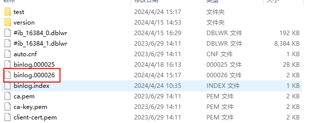
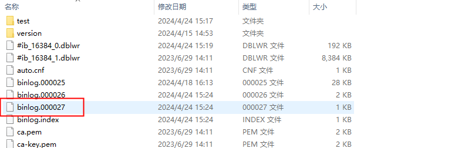
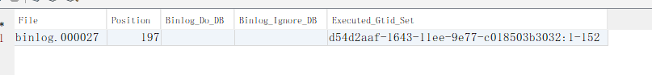

看这篇之前先看[第一](https://www.yuque.com/yuncengshangdelantian/ghbp0u/ler8a0780pgxnhzd)和[第二](https://www.yuque.com/yuncengshangdelantian/ghbp0u/idxnmtfk9gi8ta3c)篇

这篇主要讲一些特殊且有一定用处的event类型

我们恢复第一篇最开始的程序并启动

# 1、执行DDL类型语句

在mysql执行建表语句

```sql
CREATE TABLE
    IF NOT EXISTS test.test_2
    (
        id BIGINT,
        name VARCHAR(10),
        PRIMARY KEY (id)
    )
    ENGINE=InnoDB DEFAULT CHARSET=utf8mb3
```

我们得到一些事件

```plain
GtidEventData{flags=1, gtid='d54d2aaf-1643-11ee-9e77-c018503b3032:151'}
QueryEventData{threadId=10, executionTime=0, errorCode=0, database='', sql='CREATE TABLE
    IF NOT EXISTS test.test_2
    (
        id BIGINT,
        name VARCHAR(10),
        PRIMARY KEY (id)
    )
    ENGINE=InnoDB DEFAULT CHARSET=utf8mb3'}
```

我们注意到QueryEventData事件，其中有个sql字段，其内容就是我们刚才执行的sql内容

执行表删除后

```plain
GtidEventData{flags=1, gtid='d54d2aaf-1643-11ee-9e77-c018503b3032:152'}
QueryEventData{threadId=11, executionTime=0, errorCode=0, database='test', sql='DROP TABLE `test_2` /* generated by server */'}
```

可以看到，不管binlog配置为什么格式,对ddl语句的处理，都是采用statement模式，直接处理sql

flink cdc 3版本中动态添加库表，字段，就是通过解析这个sql实现的

# 2.binlog文件的切分

我们重启程序得到

```plain
RotateEventData{binlogFilename='binlog.000026', binlogPosition=1717}
FormatDescriptionEventData{binlogVersion=4, serverVersion='8.0.33', headerLength=19, dataLength=98, checksumType=CRC32}
```

查看mysql的文件发现binlog文件，与RotateEventData中的binlogFilename一样



这时候，我们执行sql：flush logs,发现文件系统多了个binlog文件

同时程序中拦截到了以下的event

```plain
RotateEventData{binlogFilename='binlog.000027', binlogPosition=4}
FormatDescriptionEventData{binlogVersion=4, serverVersion='8.0.33', headerLength=19, dataLength=98, checksumType=CRC32}
PreviousGtidSetEventData {gtidSet='d54d2aaf-1643-11ee-9e77-c018503b3032:1-152'}
```

执行sql:show master status



我们发现，flush logs作用是作废掉当前binlog文件，开启一个新的binlog文件

### RotateEvent作用

1.客户端启动时RotateEvent通知客户端消费起始位置

2.当服务器切换一个新的binlog文件时，会向客户端发送RotateEvent，binlogFilename为新的文件名，binlogPosition为固定值4

3.在重放情况下，客户端消费完一个binlog文件时，会收到一个RotateEvent，客户端根据其内容可知道切换到哪个binlog文件

# 总结

这3篇文章主要讲解了binlog中数据内容，flink-cdc/canal/maxwall这些中间件，除gtid的相关知识，涉及binlog的基础知识，均在以上3篇文章中介绍到了。