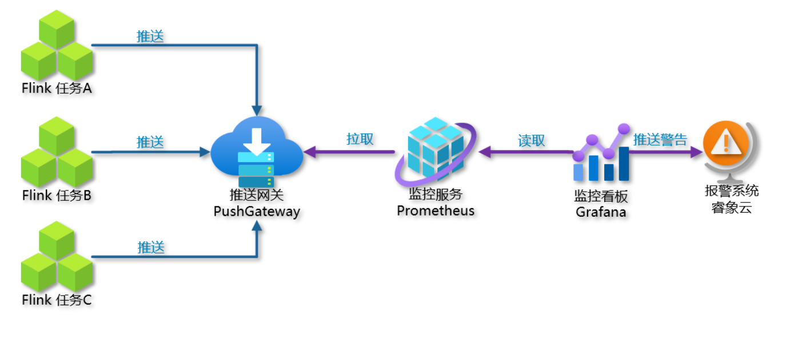
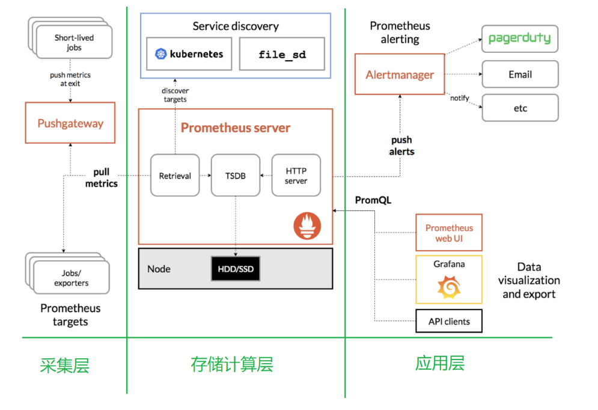
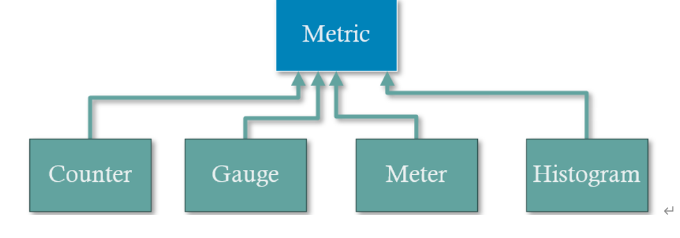
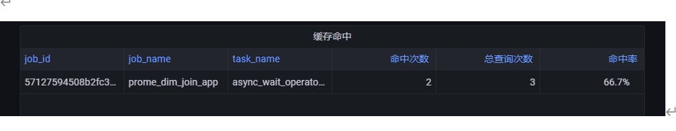

# Flink+Prometheus+grafana

## 一、对比

### 开源与云上对比：

### 阿里云：

### 网易：

## 二、开源怎么做

### 1.为什么做？

目前yarn+flinkUI界面仅能对单一任务分析解读；flinkUI界面模板固定无法按需定制。

### 2.有什么用？

通过监控内存使用情况、CPU使用情况、任务计算数据量、任务缓存命中率、任务链路处理时延等。

1 Flink 内部自带的指标，比如：内存使用情况，数据量。

2 根据监控需要自定义的指标，比如：缓存命中率，空值数量，维度查询时间。

### 3.架构



### 4.实现步骤

监控指标数据从实时任务到监控看板，分以下几个步骤：

1 flink 各个任务通过 reporter 把指标推送到 PushGateway (Prometheus

的组件)

2 Prometheus 从网关中主动拉取指标数据，并存储在自己的时序数据库中。

3 Grafana 监控看板从 Prometheus 中查询数据并进行展示。

## 三、Prometheus

### 1.优点

1）易于管理，不依赖第三方，需要本地磁盘，推拉模型作为辅助手段。

2）基于Prometheus丰富的Client库，用户可以获取服务和应用内部真正的运行状态。

3）强大的数据模型，内置时间序列数据库

每一条时间序列由指标名称(Metrics Name)以及一组标签(Labels)唯一标识。每条时间序列按照时间的先后顺序存储一系列的样本值。

 http\_request\_status：指标名称(Metrics Name)

 {code='200',content\_path='/api/path',environment='produment'}：表示维度的标签，基于这些Labels我们可以方便地对监控数据进行聚合，过滤，裁剪。

 [value1@timestamp1,value2@timestamp2...]：按照时间的先后顺序 存储的样本值。

4）强大的查询语言PromQL，通过PromQL可以轻松回答类似于以下问题：

 在过去一段时间中95%应用延迟时间的分布范围？

 CPU占用率前5位的服务有哪些？

5）高效处理数据

Ø 数以百万的监控指标

Ø 每秒处理数十万的数据点

6）可扩展：联邦集群的支持

7）可视化

Ø Prometheus Server中自带的Prometheus UI，可以方便地直接对数据进行查询，并且支持直接以图形化的形式展示数据。

Ø 最新的Grafana可视化工具也已经提供了完整的Prometheus支持，基于Grafana可以创建更加精美的监控图标。

Ø 基于Prometheus提供的API还可以实现自己的监控可视化UI。

### 2.架构

Prometheus 既然设计为一个维度存储模型，可以把它理解为一个 OLAP 系统。

1、存储计算层

 Prometheus Server，里面包含了存储引擎和计算引擎。

 Retrieval 组件为取数组件，它会主动从 Pushgateway 或者 Exporter 拉取指标数据。

 Service discovery，可以动态发现要监控的目标。

 TSDB，数据核心存储与查询。

 HTTP server，对外提供 HTTP 服务。

2、采集层

采集层分为两类，一类是生命周期较短的作业，还有一类是生命周期较长的作业。

 短作业：直接通过 API，在退出时间指标推送给 Pushgateway。

 长作业：Retrieval 组件直接从 Exporter 拉取数据。

3、应用层

应用层主要分为两种，一种是 AlertManager，另一种是数据可视化。

 AlertManager

对接 Pagerduty，是一套付费的监控报警系统。可实现短信报警、5 分钟无人 ack 打

电话通知、仍然无人 ack，通知值班人员 Manager...

Emial，发送邮件

 数据可视化

Prometheus build-in WebUI

Grafana

其他基于API开发的客户端

### 3.安装

安装Prometheus server、pushgateway、node\_exportor

### 4.PromeSQL语法

## flink集成Prometheus

移动prometheus的jar包到lib下、修改conf

## grafana安装

添加数据源、从官网下载别人模板导入flink dashboard、添加node exporter模板。

## 做过的监控

### 1.任务失败监控

这一个指标监控主要是基于flink\_jobmanager\_job\_uptime 这个指标进行了监控。原理是在job任务存活时，会按照配置metrics.reporter.promgateway.interval上报频率递增。基于这个特点，当任务失败后这个数值就不会改变，就能监控到任务失败。

30秒为数据上报到 promgateway 频率，除以100为了数据好看，当job任务失败后数 flink上报的promgateway 的 flink\_jobmanager\_job\_uptime指标值不会变化。((flink\_jobmanager\_job\_uptime)-(flink\_jobmanager\_job\_uptime offset 30s))/100 值就会是0，可以配置告警。

在告警通知中可以邮件和webhook,webhook可以调用相关接口，执行一些动作。webhook需要提前配置，在这里配置告警时就可以直接引入。

### 2.网络延时或任务重启监控

((flink\_jobmanager\_job\_uptime offset 30s)-(flink\_jobmanager\_job\_uptime))/1000

1）延时会导致值突然小于\-30（正常情况为\-30）

2）重启会导致flink\_jobmanager\_job\_uptime指标清零从新从0值上报，导致查询公式值突然大于0（正常情况为-30）

### 3.重启次数

基于flink\_jobmanager\_job\_numRestarts 指标，表示flink job的重启次数。一般设置重启策略后，在任务异常重启后这个数值会递增+1。可以单纯的监控重启次数，也可以每次重启都进行告警（差值）。

利用当前值减去30秒前的值，如果等于1证明重启了一次。

## 集成睿象云

注册睿象云账号-》集成grafana-》配置分派策略-》配置通知策略-》

# 分析flink程序的缓存命中率

### 1.分析

1） 缓存命中率=缓存命中次数 / 总关联查询次数 ， 所以咱们实际要监控的是两个指标：缓存命中次数 和 总关联查询次数。

2） 这两个指标都不是flink的标准指标，因此需要入侵到任务的代码层，对指标进行埋点采集。从Flink程序中抓取缓存命中次数和总数。

### 2.开发

```java
public   class DimAsyncFunction extends RichAsyncFunction<String, String>   {
    private ExecutorService executorService;

    //增加两个counter
    Counter hitCounter=null;
    Counter totalCounter=null;

 
    @Override
    public void open(Configuration parameters) throws Exception {
        //初始化线程池对象
        System.out.println("open ");
        executorService = ThreadPoolUtil.getInstance();

        //增加两个counter
         hitCounter=getRuntimeContext().getMetricGroup().addGroup("CacheHit").counter("hitCounter");
         totalCounter=getRuntimeContext().getMetricGroup().addGroup("CacheHit").counter("totalCounter");
 
    }

    @Override
    public void asyncInvoke(String key, ResultFuture<String> resultFuture) throws Exception {
        // 开启多个线程，发送异步请求
        executorService.submit(
            new Runnable() {
                @Override
                public void run() {
                    //返回值为 tuple(查询值,是否命中缓存)
                    //System.out.println("线程名称 = " + Thread.currentThread().getName());
                    Tuple2<String, Boolean> valueTuple = DimUtil.getDimInfo(key);
                    String dimValue = valueTuple.f0;
                    String result= key+"_"+dimValue;
                    resultFuture.complete(Collections.singleton(result));

                    Boolean hit = valueTuple.f1;

                    if(hit){
                       hitCounter.inc();
                            
                    }
                    totalCounter.inc();
                }
            }
        );
    }

}
```

### 3.flink指标

程序中增加了两个Counter对象。

Counter hitCounter=null;  
Counter totalCounter=null;

Counter是什么？

它是Flink的一种指标类型。Flink一共有四种指标类型：



1 Counter

Counter主要用来可累加的计数统计，通过inc或dec方法来对计数值进行增加或减少。比如，numRecordsIn、numRecordsOut等等。

2 Gauge

Gauge可以根据需要提供各种类型的值，对值的类型没有限制，一般是用来做状态数值，不做累加。举例：CPU Load、JVM Heap Used，该类型使用较多。

3 Meter

Meter主要用于统计速率，比如numBytesOutPerSecond。

​  

4 Histogram

直方图统计，对一批数据进行分组统计，用于观察数据的分布情况。

### 4.增加counter

在open方法中增加：

hitCounter=getRuntimeContext().getMetricGroup().addGroup("CacheHit").counter("hitCounter");  
totalCounter=getRuntimeContext().getMetricGroup().addGroup("CacheHit").counter("totalCounter");

​  

其中addGroup是设定了组名，对未来展示数据进行分组。

从open方法中创建对象，那么就是每个slot一个指标对象，如果有多个slot那么就要把指标的值进行汇总。

​  

在业务方法中的hit进行判断，如果命中就在hitCounter进行累加。同时任何情况都对totalCounter进行累加。

```java
Boolean hit = valueTuple.f1;
if(hit){
   hitCounter.inc();
}
totalCounter.inc();
```

### 5.解决并发问题

因为使用了异步线程池 ，意味着同一个slot下的counter，会有多个线程访问，  
而 inc() 是线程不安全的，因此需要增加锁。

​  

性能影响：因为同步代码块中的程序只是做简单的变量累加，所以加锁时间非常短，影响不大。

​  

```java
public   class DimAsyncFunction extends RichAsyncFunction<String, String>   {
    private ExecutorService executorService;

    //增加两个counter
    Counter hitCounter=null;
    Counter totalCounter=null;

    Lock hitLock=null;
    Lock totalLock=null;
    @Override
    public void open(Configuration parameters) throws Exception {
        //初始化线程池对象
        System.out.println("open ");
        executorService = ThreadPoolUtil.getInstance();

        //增加两个counter
         hitCounter=getRuntimeContext().getMetricGroup().addGroup("CacheHit").counter("hitCounter");
         totalCounter=getRuntimeContext().getMetricGroup().addGroup("CacheHit").counter("totalCounter");

        //因为使用了异步线程池，意味着同一个slot下的counter，会有多个线程访问，
        //而 inc() 是线程不安全的，因此需要增加锁。
        //性能影响：因为同步代码块中的程序只是做简单的变量累加，所以加锁时间非常短，影响不大。
        hitLock=new ReentrantLock();
        totalLock=new ReentrantLock();

    }

    @Override
    public void asyncInvoke(String key, ResultFuture<String> resultFuture) throws Exception {
        // 开启多个线程，发送异步请求
        executorService.submit(
            new Runnable() {
                @Override
                public void run() {
                    //返回值为 tuple(查询值,是否命中缓存)
                    //System.out.println("线程名称 = " + Thread.currentThread().getName());
                    Tuple2<String, Boolean> valueTuple = DimUtil.getDimInfo(key);
                    String dimValue = valueTuple.f0;
                    String result= key+"_"+dimValue;
                    resultFuture.complete(Collections.singleton(result));

                    Boolean hit = valueTuple.f1;
                    if(hit){
                        try {
                            hitLock.lock();
                            hitCounter.inc();
                        }finally {
                            hitLock.unlock();
                        }
                    }
                    try {
                        totalLock.lock();
                        totalCounter.inc();
                    }finally {
                        totalLock.unlock();
                    }
                }
            }
        );
    }

}
```

### 6\. 在prometheus中调试查询

查询近10分钟内的缓存命中次数

sum(max\_over\_time( flink\_taskmanager\_job\_task\_operator\_CacheHit\_hitCounter[10m])- max\_over\_time( flink\_taskmanager\_job\_task\_operator\_CacheHit\_hitCounter[10m] offset 10m) ) by (job\_name,job\_id,task\_name)

说明: max\_over\_time(指标[时间范围]) 当前时间窗口内的最大值。

​ 加上offset ，就是取之前某个时点的时间窗口。

​两者相减获得就是本时间窗口内的增量。

​由于同一个任务可能会有多个slot所以要根据job\_name,job\_id,task\_name的分组sum。

​  

同理查询近10分钟内的总关联次数

sum(max\_over\_time( flink\_taskmanager\_job\_task\_operator\_CacheHit\_totalCounter[10m])- max\_over\_time( flink\_taskmanager\_job\_task\_operator\_CacheHit\_totalCounter[10m] offset 10m) ) by (job\_name,job\_id,task\_name)

​  

​  

同理查询近10分钟内的命中率

sum(max\_over\_time( flink\_taskmanager\_job\_task\_operator\_CacheHit\_ hitCounter [10m])- max\_over\_time( flink\_taskmanager\_job\_task\_operator\_CacheHit\_ hitCounter[10m] offset 10m) ) by (job\_name,job\_id,task\_name)

/

sum(max\_over\_time( flink\_taskmanager\_job\_task\_operator\_CacheHit\_totalCounter[10m])- max\_over\_time( flink\_taskmanager\_job\_task\_operator\_CacheHit\_totalCounter[10m] offset 10m) ) by (job\_name,job\_id,task\_name) \*100

### 7.grafana中配置对应的标签

最终效果



## pushgateway清理问题处理

### 1.为什么要清理

Pushgateway作为Flink到Prometheus中间的中转站，随着日积月累会沉淀相当多的数据，而Pushgateway目前并没有清理机制。

比如某个Job已经死掉，但是它在Pushgateway沉积的指标信息，会一直被Promethues拉取。而这些已经死掉的job指标会干扰我们对任务的观察，也会让Promethues的数据库越来越臃肿。

因此我们要把已经死掉的Job的指标从Pushgateway清除掉。

### 2.我们如何删除

官方虽然没有提供定期的清理服务，但是提供了删除的REST API命令

DELETE http://hostname:port/metrics/job/{job}

其中DELETE 是restful的一种请求方式类似GET,POST。

地址路径除了hostname，port以外唯一动态的就是要提供待删除的job

这个job是每个指标都带的

所以只要把job传这个命令，就可以把所有该job的指标从pushgateway清理掉。

### 3.如何识别出已经“死掉的Job”

办法就是找到每个Job最后推送时间，与当前时间做比对，如果超过某个阈值，比如5分钟。这意味这该Job已经5分钟不再对Pushgateway传送任何指标了。

那么我们可以认为该job已经死掉了，可以从pushgateway中删除该job的指标数据。

注意，我们只是删除掉了该job在pushgateway的数据，但这并不影响该job在Prometheus的数据。

push\_time\_seconds指标保存了每个job的最后推送时间戳。

### 4.Java版的prometheus-pushgateway清理思路开发思路

1 通过Restful api 的Get请求获得全部pushgateway的metrics，放到一个集合里。

2 遍历集合，找到push\_time\_seconds指标，对指标的时间戳逐个检查，如果发现推送时间小于【当前时间\-失效阈值】，则视为过期job，获取job属性值。

3 把job属性值组合到restful api的DELETE请求路径中，并发送。

4 以上步骤周期性循环执行

**http类：**

```java
package com.atguigu.common;

import okhttp3.*;

import java.io.IOException;

public class HttpUtil {

    private static OkHttpClient client;

    private HttpUtil(){

    }
    public static OkHttpClient getInstance() {
        if (client == null) {
            synchronized (HttpUtil.class) {
                if (client == null) {
                    client = new OkHttpClient();
                }
            }
        }
        return client;
    }

    public static String get( String url){

        Request request = new Request.Builder()
                .url(url).get().build();
        Call call = HttpUtil.getInstance().newCall(request);
        Response response = null;

        try {
            response = call.execute();
             return response.body().string();
        } catch (IOException e) {
            e.printStackTrace();
            throw new RuntimeException("发送失败...检查网络地址...");

        }

    }

    public static void delete( String url)  {
           Request request = new Request.Builder()
                    .url(url)
                   .delete()
                .build();
            Call call = HttpUtil.getInstance().newCall(request);
          try {
               call.execute();
          } catch (IOException e) {
              e.printStackTrace();
              throw new RuntimeException("发送失败...检查网络地址...");
          }
         }
}
```

主程序

```java
package com.atguigu.app;

import com.atguigu.common.HttpUtil;

import java.math.BigDecimal;
import java.util.Date;
public class PushGatewayClear {

    static String pushGatewayURL="http://hadoop102:9091";
    static String metricsURL=pushGatewayURL+"/metrics";
    static String deleteURL=pushGatewayURL+"/metrics/job/";

    public static void main(String[] args) throws Exception{
        String hostAndPort= args[0];
        String expireSecStr= args[1];
        String runType= args[2];
        Integer intervalSec=Integer.valueOf(args[4]);

        pushGatewayURL="http://"+hostAndPort;

        Integer  expireSec= Integer.valueOf(expireSecStr);
        metricsURL=pushGatewayURL+"/metrics";
        deleteURL=pushGatewayURL+"/metrics/job/";
        while (true){
            String metricsStr = HttpUtil.get(metricsURL);

            String[] stringLines = metricsStr.split("\\n");
            for (String line : stringLines) {  //遍历所有指标行
                if(line.startsWith("push_time_seconds")){
                    checkAndDelete(  line,expireSec);
                }
            }

            if(!runType.equals("continue")){
                break;
            }
            Thread.sleep(intervalSec*1000L);
        }
    }

    /**
       检查push_time_seconds指标是否失效，如果失效则进行删除
     */
    static void  checkAndDelete(String line,Integer expireSec){
        int jobInfoStartIdx = line.indexOf("{");
        int jobInfoEndIdx = line.indexOf("}");

        String json = line.substring(jobInfoStartIdx, jobInfoEndIdx+1);
        String tsString= line.substring(jobInfoEndIdx+1  ).trim().replace("+", "");

        Long expireTs = (new BigDecimal(tsString).intValue()+ expireSec  )  *1000L;
        Date expireDate = new Date(expireTs );
        Date nowDate = new Date();

        if(nowDate.compareTo(expireDate)>0){
            //对失效job进行删除
            int jobIdStartIdx = json.indexOf("job=")+5;
            int jobIdEndIdx= json.indexOf("\"", jobIdStartIdx+1);
            String jobId = json.substring(jobIdStartIdx, jobIdEndIdx);

            String deleteJobURL=deleteURL+jobId;
            System.out.println("删除_job:"+jobId);
            HttpUtil.delete(deleteJobURL);

        }
    }
}
```

  

## \-----------------------------------------------------------------------