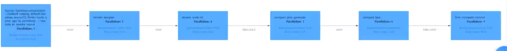

# 一、简介

## 1.功能：

Hudi提供了表、事务、高效的upserts/delete、高级索引、流摄取服务、数据集群/压缩优化和并发，同时保持数据的开源文件格式。

## 2.特性

Ø 可插拔**索引机制**支持快速Upsert/Delete。（更快查找到file group，本质就是裁剪优化）

Ø 支持**增量**拉取表变更以进行处理。（通过版本、到达时间、事件时间来筛选增量数据）

Ø 支持事务提交及回滚，并发控制。

Ø 支持Spark、Presto、Trino、Hive、Flink等引擎的SQL读写。

Ø 自动管理小文件，数据聚簇，压缩，清理。（mor靠parquet+log合并、cow靠合并parquet）

Ø 流式摄入，内置CDC源和工具。

Ø 内置可扩展存储访问的元数据跟踪。（catalog、常用hivecatalog来做元数据集中）

Ø 向后兼容的方式实现表结构变更的支持。

## 3.使用场景：

① 湖仓代替数仓，hudi能代替kafka，解决kafka作为分层中间件对大体量数据不友好、不可查询的痛点。

② 近实时处理（不管是写时合并还是读时合并，都有一定延迟，能做到分钟级）

③ 增量导入导出（借助两个时间实现增量导入）

# 二、核心概念

## 1.基本概念

### ① 时间轴

instance：一个动作实例

动作分类：commit、cleans、delta\_commit、compaction、rollback、savepoint

动作的开始时间：ariveTime

动作的状态：requested（已申请调度，但是未运行）、inflight（处理中）、completed（完成）

### ② 文件布局

table（.hoodie ，Partition（filegroup（filesplit（parquet、.log）））

表 = 元数据 + 原数据

元数据 = .hoodie = 时间轴信息

原数据=n个分区

分区=n个文件组 file group

文件组=.parquet文件+.log文件（mor有，cow只有parquet） （索引会用来筛选文件组）

每个文件由唯一id标识。

base文件即parquet文件，在元数据区记录了数据的主键（recordkey）的布隆索引，能判断一定在，但是不能判断一定不在。

### ③ 索引

#### （1）索引：

将给定的hoodie key(record key + partition path)与文件id（文件组）建立唯一映射，读取时方便过滤不必要的文件组，从而提高读插性能，且标记insert和update供后续数据update做参照（insert直接写parquet、upsert写log，因为log中没有索引）

#### （2）全局索引和非全索引：

全局索引在全表的所有分区范围下强制要求键的唯一性。

非全局索引只能保证数据在分区的唯一性。

#### （3）索引分类及使用场景：

| **I****ndex****类型** | **原理** | **优点** | **缺点** | **场景** |
| --- | --- | --- | --- | --- |
| Bloom Index | 默认配置，使用布隆过滤器来判断记录存在与否，也可选使用record key的范围裁剪需要的文件 | 效率高，不依赖外部系统，数据和索引保持一致性 | 因假阳性问题，还需回溯原文件再查找一遍 | 更新发生在最近的文件（分区）中 |
| Simple Index | 把update/delete操作的新数据和老数据进行join | 实现最简单，无需额外的资源 | 性能比较差 | 随机更新历史 |
| HBase Index | 把index存放在HBase里面。在插入 File Group定位阶段所有task向HBase发送 Batch Get 请求，获取 Record Key 的 Mapping 信息 | 对于小批次的keys，查询效率高 | 需要外部的系统，增加了运维压力 | 随机更新历史 |
| Flink State-based Index | HUDI 在 0.8.0 版本中实现的 Flink witer，采用了 Flink 的 state 作为底层的 index 存储，每个 records 在写入之前都会先计算目标 bucket ID。 | 不同于BloomFilter Index，避免了每次重复的文件 index 查找 | 数据量大状态大，但是可以rocksdb存储且增量检查点优化 | Flink时使用 |

**除了hbase是全局索引，其他的都有全局和非全参数。**

### ④ 表类型

#### （1）copy on write

##### 概述：

只有parquet文件，有数据写入时会合并得到新的parquet。写入时延迟较高，适合读多写少场景。

##### 读：

**Snapshot Queries：**查询最新parquet，快速

**Incremental Queries：**增量管道，过滤\_hoodie\_commit\_time\_

（1）Stream 增量消费，通过参数 read.start-commit 指定起始消费位置；

（2）Batch 增量消费，通过参数 read.start-commit 指定起始消费位置，通过参数 read.end-commit 指定结束消费位置，区间为闭区间，即包含起始、结束的 commit

（3）TimeTravel：Batch 消费某个时间点的数据：通过参数 read.end-commit 指定结束消费位置即可（由于起始位置默认从最新，所以无需重复声明）

WITH 参数

| **名称** | **Required** | **默认值** | **说明** |
| --- | --- | --- | --- |
| read.start-commit | false | 默认从最新 commit | 支持 earliest 从最早消费 |
| read.end-commit | false | 默认到最新 commit |  |

**Streaming读：**会一直监控上游、持续往下游输出，不像快照和增量查询是批量查完就finished，需要开启参数。

##### 写（insert、update、bulck\_insert）：

**upsert：**

（1）先对 records 按照 record key 去重

（2）首先对这批数据创建索引 (HoodieKey => HoodieRecordLocation)；通过索引是否存在区分哪些records 是 update，哪些 records 是 insert（key 第一次写入）

（3）对于 update 消息，会直接找到对应 key 所在的最新 FileSlice 的 base 文件，并做 merge 后写新的 base file (新的 FileSlice)

（4）对于 insert 消息，会扫描当前 partition 的所有 SmallFile（小于一定大小的 base file），然后 merge 写新的 FileSlice；如果没有 SmallFile，直接写新的 FileGroup + FileSlice

**insert：**

（1）先对 records 按照 record key 去重（可选）

（2）不会创建 Index

（3）如果有小的 base file 文件，merge base file，生成新的 FileSlice + base file，否则直接写新的 FileSlice + base file

**INSERT OVERWRITE：原来的parquet标记为无效，新增parquet**

#### （2）merge on read

##### 概述：

parquet + log文件，每次commit会生成log文件，一定条件下触发合并为parquet。读时合并，延迟高，适合读少写多场景。

##### 读：

**Snapshot Queries：**查询parquet + log的合并，需要合并，性能慢

**Incremental Queries：**查询给定commit/delta commit即时操作以来新写入的数据，增量管道使用

（1）Stream 增量消费，通过参数 read.start-commit 指定起始消费位置；

（2）Batch 增量消费，通过参数 read.start-commit 指定起始消费位置，通过参数 read.end-commit 指定结束消费位置，区间为闭区间，即包含起始、结束的 commit

（3）TimeTravel：Batch 消费某个时间点的数据：通过参数 read.end-commit 指定结束消费位置即可（由于起始位置默认从最新，所以无需重复声明）

WITH 参数

| **名称** | **Required** | **默认值** | **说明** |
| --- | --- | --- | --- |
| read.start-commit | false | 默认从最新 commit | 支持 earliest 从最早消费 |
| read.end-commit | false | 默认到最新 commit |  |

**Read Optimized Queries：**跟快照相比，查询更快，只查询最新的parquet

**Streaming读：**会一直监控上游、持续往下游输出，不像快照和增量查询是批量查完就finished，需要开启参数如下：

| **名称** | **Required** | **默认值** | **说明** |
| --- | --- | --- | --- |
| read.streaming.enabled | false | false | 设置 true 开启流读模式 |
| read.start-commit | false | 最新 commit | 指定 'yyyyMMddHHmmss' 格式的起始 commit（闭区间） |
| read.streaming.skip_compaction | false | false | 流读时是否跳过 compaction 的 commits，跳过 compaction 有两个用途：<br>1）避免 upsert 语义下重复消费 (compaction 的 instant 为重复数据，如果不跳过，有小概率会重复消费)<br>2) changelog 模式下保证语义正确性<br>**0.11 ****开始，以上两个问题已经通过保留**** compaction ****的 ****instant time ****修复** |
| clean.retain_commits | false | 10 | cleaner 最多保留的历史 commits 数，大于此数量的历史 commits 会被清理掉，changelog 模式下，这个参数可以控制 changelog 的保留时间，例如 checkpoint 周期为 5 分钟一次，默认最少保留 50 分钟的时间。 |

**注意：**当参数read.streaming.skip\_compaction 打开并且 streaming reader 消费落后于clean.retain\_commits 数时，流读可能会丢失数据。从 0.11 开始，compaction 不会再变更 record 的 instant time，因此理论上数据不会再重复消费，但是还是会重复读取并丢弃，因此额外的开销还是无法避免，对性能有要求的话还是可以开启此参数。

#### 写（insert、update、bulck\_insert）：

**upsert：**

（1）先对 records 按照 record key 去重（可选）

（2）首先对这批数据创建索引 (HoodieKey => HoodieRecordLocation)；通过索引区分哪些 records 是 update，哪些 records 是 insert（key 第一次写入）

（3）如果是 insert 消息，如果 log file 不可建索引（默认），会尝试 merge 分区内最小的 base file （不包含 log file 的 FileSlice），生成新的 FileSlice；如果没有 base file 就新写一个 FileGroup + FileSlice + base file；如果 log file 可建索引，尝试 append 小的 log file，如果没有就新写一个 FileGroup + FileSlice + base file

（4）如果是 update 消息，写对应的 file group + file slice，直接 append 最新的 log file（如果碰巧是当前最小的小文件，会 merge base file，生成新的 file slice）

（5）log file 大小达到阈值会 roll over 一个新的

**insert：**

（1）先对 records 按照 record key 去重（可选）

（2）不会创建 Index

（3）如果 log file 不可索引，写一个新的 FileSlice + base file；如果log file 可索引，并且有小的 FileSlice，尝试追加或写最新的 log file；

**INSERT OVERWRITE：原来的parquet+log标记为无效，新增parquet**

**​**  

### ⑤ key生成策略

用来生成HoodieKey（record key + partition path），目前支持以下策略：

Ø 支持多个字段组合record keys，多个列作为主键

Ø 支持多个字段组合的parition path （可定制时间格式，Hive style path name）

Ø 非分区表

### ⑥ 删除策略

1）逻辑删：将value 字段全部标记为 null

2）物理删：

（1）通过 OPERATION\_OPT\_KEY 删除所有的输入记录

（2）配置 PAYLOAD\_CLASS\_OPT\_KEY = org.apache.hudi.EmptyHoodieRecordPayload 删除所有的输入记录

（3）在输入记录添加字段：\_hoodie\_is\_deleted

### ⑦ 数据读取的方式

Snapshot读：同上

Incremantal读：同上

Streaming读：基于cdc的流式实时读取。默认是快照读取，需要开启流读参数。

### ⑧ Compaction

（1）没有 base file：走 mor insert 流程，直接 merge 所有的 log file 并写 base file

（2）有 base file：走 mor upsert 流程，先读 log file 建 index，再读 base file，最后读 log file 写新的 base file

Flink 和 Spark streaming 的 writer 都可以 apply 异步的compaction 策略，按照间隔commits 数或者时间来触发 compaction 任务，在独立的 pipeline 中执行。

### ⑨ 总结

（1）天然对小文件的合并优势。cow一直写满bucket的阈值才会split，mor写入同一个bucket也是超出后会roll over

（2）由于索引机制，update和delete比较高效。通过索引查询桶的索引，查找filegroup，过滤不必要的查询。相当于裁剪

# 三、集成spark

## 1.环境安装：

安装spark-》spark环境变量-》hudi集成到spark（jars目录）

## 2.spark\_shell使用：

#### 启动时指定配置文件：

```java
spark-shell \
--conf 'spark.serializer=org.apache.spark.serializer.KryoSerializer' \
--conf 'spark.sql.catalog.spark_catalog=org.apache.spark.sql.hudi.catalog.HoodieCatalog' \
--conf 'spark.sql.extensions=org.apache.spark.sql.hudi.HoodieSparkSessionExtension'
```

### 增

先read-》write（可指定mode是否覆盖）

### 删

根据HoodieKeys删除

### 改

普通修改：通过HoodieKeys + PRECOMBINE\_FIELD\_OPT\_KEY，key取最新值的记录来作为最新版本

覆盖数据

### 查

DF：read

SQL：select

时间旅行：查指定版本，通过指定实例查询：as.of.instant

增量查询：通过过滤hoodie\_commt\_time

## 3.spark\_sql使用

### 建表：分区、在原有hudi上建表、Create Table As Select建表

### 增：分区、PRECOMBINE\_FIELD\_OPT\_KEY、bulk\_insert

hudi支持使用bulk\_insert作为写操作的类型，只需要设置两个配置：

hoodie.sql.bulk.insert.enable和hoodie.sql.insert.mode。

### 删：DELETE + where 主键/非主键

### 改：更新操作需要指定preCombineField、update、mergeinto

### 查：普通查询、时间旅行查询

## 4.idea使用：同spark-shell

## 5.DeltaStreamer导入工具

HoodieDeltaStreamer工具 (hudi-utilities-bundle中的一部分) 提供了从DFS或Kafka等不同来源进行摄取的方式，并具有以下功能：

Ø 精准一次从Kafka采集新数据，从Sqoop、HiveIncrementalPuller的输出或DFS文件夹下的文件增量导入。

Ø 导入的数据支持json、avro或自定义数据类型。

Ø 管理检查点，回滚和恢复。

Ø 利用DFS 或 Confluent schema registry的Avro Schema。

Ø 支持自定义转换操作。

**操作：需要写脚本、source、provider。还需要配置文件**

spark-submit \\

\--class org.apache.hudi.utilities.deltastreamer.HoodieDeltaStreamer \\

/opt/module/spark-3.2.2/jars/hudi-utilities-bundle\_2.12-0.12.0.jar \\

\--props hdfs://hadoop1:8020/hudi-props/kafka-source.properties \\

\--schemaprovider-class org.apache.hudi.utilities.schema.FilebasedSchemaProvider \\

\--source-class org.apache.hudi.utilities.sources.JsonKafkaSource \\

\--source-ordering-field userid \\

\--target-base-path hdfs://hadoop1:8020/tmp/hudi/hudi\_test \\

\--target-table hudi\_test \\

\--op BULK\_INSERT \\

\--table-type MERGE\_ON\_READ

## 6.并发控制

### （1）并发控制：

**mvcc**

Hudi的表操作，如压缩、清理、提交，hudi会利用多版本并发控制来提供多个表操作写入和查询之间的快照隔离。使用MVCC这种模型，Hudi支持并发任意数量的操作作业，并保证不会发生任何冲突。Hudi默认这种模型。MVCC方式所有的table service都使用**同一个writer**来保证没有冲突，避免竟态条件。

**OPTIMISTIC CONCURRENCYYY**

针对写入操作（upsert、insert等）利用乐观并发控制来启用**多个writer**将数据写到同一个表中，Hudi支持文件级的乐观一致性，即对于发生在同一个表中的任何2个提交（写入），如果它们没有写入正在更改的重叠文件，则允许两个写入都成功。此功能处于实验阶段，需要用到Zookeeper HiveMetastore来获取锁。

optimistic concurrency 的关键概念是“乐观”，即它假定在并发操作过程中不会发生冲突，因此不需要立即锁定资源。这种方法可以提高系统的性能，但可能需要处理回滚事务和处理错误的情况。

### （2）使用并发写方式

开启乐观并发写入，Hudi获取锁的服务提供两种模式使用zookeeper、HiveMetaStore或Amazon DynamoDB

### （3）使用Spark DataFrame并发写入

```scala
.
option("hoodie.write.concurrency.mode", "optimistic_concurrency_control").
option("hoodie.cleaner.policy.failed.writes", "LAZY").
option("hoodie.write.lock.provider", "org.apache.hudi.client.transaction.lock.ZookeeperBasedLockProvider").
option("hoodie.write.lock.zookeeper.url", "hadoop1,hadoop2,hadoop3").
option("hoodie.write.lock.zookeeper.port", "2181").
option("hoodie.write.lock.zookeeper.lock_key", "test_table").
option("hoodie.write.lock.zookeeper.base_path", "/multiwriter_test").
```

### （4）使用Delta Streamer并发写入

##### 1）进入配置文件目录，修改配置文件添加对应参数，提交到Hdfs上

##### 2）运行Delta Streamer

##### 3）查看zk是否产生新的目录

## 7.hudi集成spark常规调优

### （1）并行度

配置项为hoodie.[insert|upsert|bulkinsert].shuffle.parallelism，以使其至少达到inputdatasize/500MB。

### （2）Off-heap（堆外）内存

Hudi写入parquet文件，需要使用一定的堆外内存，如果遇到此类故障，请考虑设置类似 spark.yarn.executor.memoryOverhead或 spark.yarn.driver.memoryOverhead的值。

### （3）spark内存

Hudi会缓存输入数据以便能够智能地放置数据，因此预留一些 spark.memory.storageFraction通常有助于提高性能。

### （4）调整文件大小

设置limitFileSize以平衡接收/写入延迟与文件数量，并平衡与文件数据相关的元数据开销。

### **（5）时间序列/日志数据**

单条记录较大的数据库/ nosql变更日志/时间序列/事件/日志数据，可通过.bloomFilterFPP()设置误报率/bloomFilterNumEntries()设置实体数量来调整Bloom过滤器的精度,以加速目标索引查找时间，另外可考虑一个以事件时间为前缀的键，这将使用范围修剪并显着加快索引查找的速度。

### (6) GC调优

请确保遵循Spark调优指南中的垃圾收集调优技巧，以避免OutOfMemory错误。[必须]使用G1 / CMS收集器，其中添加到spark.executor.extraJavaOptions的示例如下：

```java
-XX:NewSize=1g -XX:SurvivorRatio=2 -XX:+UseCompressedOops -XX:+UseConcMarkSweepGC -XX:+UseParNewGC -XX:CMSInitiatingOccupancyFraction=70 -XX:+PrintGCDetails -XX:+PrintGCTimeStamps -XX:+PrintGCDateStamps -XX:+PrintGCApplicationStoppedTime -XX:+PrintGCApplicationConcurrentTime -XX:+PrintTenuringDistribution -XX:+HeapDumpOnOutOfMemoryError -XX:HeapDumpPath=/tmp/hoodie-heapdump.hprof
```

（7）OutOfMemory错误

spark.memory.fraction=0.2（spark使用内存的最大比例），spark.memory.storageFraction=0.2（spark存储磁盘比例）允许其溢出而不是OOM（速度变慢与间歇性崩溃相比）

（8）完整的生产配置

```java
spark.driver.extraClassPath /etc/hive/conf
spark.driver.extraJavaOptions -XX:+PrintTenuringDistribution -XX:+PrintGCDetails -XX:+PrintGCDateStamps -XX:+PrintGCApplicationStoppedTime -XX:+PrintGCApplicationConcurrentTime -XX:+PrintGCTimeStamps -XX:+HeapDumpOnOutOfMemoryError -XX:HeapDumpPath=/tmp/hoodie-heapdump.hprof
spark.driver.maxResultSize 2g
spark.driver.memory 4g
spark.executor.cores 1
spark.executor.extraJavaOptions -XX:+PrintFlagsFinal -XX:+PrintReferenceGC -verbose:gc -XX:+PrintGCDetails -XX:+PrintGCTimeStamps -XX:+PrintAdaptiveSizePolicy -XX:+UnlockDiagnosticVMOptions -XX:+HeapDumpOnOutOfMemoryError -XX:HeapDumpPath=/tmp/hoodie-heapdump.hprof
spark.executor.id driver
spark.executor.instances 300
spark.executor.memory 6g
spark.rdd.compress true

spark.kryoserializer.buffer.max 512m
spark.serializer org.apache.spark.serializer.KryoSerializer
spark.shuffle.service.enabled true
spark.sql.hive.convertMetastoreParquet false
spark.submit.deployMode cluster
spark.task.cpus 1
spark.task.maxFailures 4

spark.yarn.driver.memoryOverhead 1024
spark.yarn.executor.memoryOverhead 3072
spark.yarn.max.executor.failures 100
```

  

```java
 spark.driver.extraClassPath：为驱动程序添加额外的类路径。在这个例子中，它指定了 Hive 的配置文件路径 `/etc/hive/conf`。
 spark.driver.extraJavaOptions：为驱动程序添加额外的 Java 选项。在这个例子中，它指定了 JVM 参数，用于打印内存管理和垃圾回收的信息。
 spark.driver.maxResultSize：设置驱动程序的最大结果大小。在这个例子中，它设置为 2GB。
 spark.driver.memory：设置驱动程序的内存大小。在这个例子中，它设置为 4GB。
 spark.executor.cores：设置每个执行器的核心数。在这个例子中，它设置为 1。
 spark.executor.extraJavaOptions：为执行器添加额外的 Java 选项。在这个例子中，它指定了 JVM 参数，用于打印内存管理和垃圾回收的信息。
 spark.executor.id：设置执行器的 ID。在这个例子中，它设置为 "driver"。
 spark.executor.instances：设置执行器的数量。在这个例子中，它设置为 300。
 spark.executor.memory：设置执行器的内存大小。在这个例子中，它设置为 6GB。
 spark.rdd.compress：设置 RDD 压缩。在这个例子中，它设置为 true。
 spark.kryoserializer.buffer.max：设置 Kryo 序列化器的缓冲区大小。在这个例子中，它设置为 512MB。
 spark.serializer：设置 Spark 使用的序列化器。在这个例子中，它设置为 Kryo 序列化器。
 spark.shuffle.service.enabled：设置 Spark 是否启用 Shuffle 服务。在这个例子中，它设置为 true。
 spark.sql.hive.convertMetastoreParquet：设置是否将 Hive 的元数据转换为 Parquet 格式。在这个例子中，它设置为 false。
 spark.submit.deployMode：设置 Spark 提交的模式。在这个例子中，它设置为 "cluster"。
 spark.task.cpus：设置每个任务使用的核心数。在这个例子中，它设置为 1。
 spark.task.maxFailures：设置每个任务的最大失败次数。在这个例子中，它设置为 4。
 spark.yarn.driver.memoryOverhead：设置 YARN 驱动程序的内存 overhead。在这个例子中，它设置为 1024。
 spark.yarn.executor.memoryOverhead：设置 YARN 执行器的内存 overhead。在这个例子中，它设置为 3072。
 spark.yarn.max.executor.failures：设置 YARN 最大执行器失败次数。在这个例子中，它设置为 100。
```

# 四、集成flink

## 环境准备：

jar包放入flink lib目录-》解决guava冲突-》配置hadoop环境变量

## 使用方式

### （1）sql\_client写sql：local模式、yarn模式启动一个session，再启动sql客户端

#### insert

source -》 join 、开窗、聚合或其他计算 -》sink

#### delete

changelog有 -I。

#### update

除非是第一次创建表，否则请始终使用追加模式。

查找前一次提交中相同的\_hoodie\_record\_keys。

#### select：基本查询，默认快照读取最新数据，也可设置流读，读取数据的changlog。

### （2）idea方式流式api或者sql api

和sql的基本一致，只是多了流式编程。需要installhudi\_flink到本地Maven。

## flink与hudi的类型映射关系

| **Flink SQL Type** | **Hudi Type** | **Avro logical type** |
| --- | --- | --- |
| CHAR / VARCHAR / STRING | string | ​ |
| BOOLEAN | boolean | ​ |
| BINARY / VARBINARY | bytes | ​ |
| DECIMAL | fixed | decimal |
| TINYINT | int | ​ |
| SMALLINT | int | ​ |
| INT | int | ​ |
| BIGINT | long | ​ |
| FLOAT | float | ​ |
| DOUBLE | double | ​ |
| DATE | int | date |
| TIME | int | time-millis |
| TIMESTAMP | long | timestamp-millis |
| ARRAY | array | ​ |
| MAP<br>(key must be string/char/varchar type) | map | ​ |
| MULTISET<br>(element must be string/char/varchar type) | map | ​ |
| ROW | record |  |

## Flink可配参数：

[https://hudi.apache.org/docs/configurations#FLINK\_SQL](https://hudi.apache.org/docs/configurations%23FLINK_SQL)

## 核心参数

### 去重参数 ：with中添加参数

| **名称** | **说明** | **默认值** | **备注** |
| --- | --- | --- | --- |
| hoodie.datasource.write.recordkey.field | 主键字段 | -- | 支持主键语法 PRIMARY KEY 设置，支持逗号分隔的多个字段 |
| precombine.field<br>(0.13.0 之前版本为<br>write.precombine.field) | 去重时间字段 | -- | record 合并的时候会按照该字段排序，选值较大的 record 为合并结果；不指定则为处理序：选择后到的 record |

### 并发参数

**流程算子：source(flink 并行度)-》assigner（flink并行度）-》writer task（writer的并发，默认4）-》compact plan（flink并行度）-》compact task （writer的并发，默认4）-》compact commit（flink并发）**



| **名称** | **说明** | **默认值** | **备注** |
| --- | --- | --- | --- |
| write.tasks | writer 的并发，每个 writer 顺序写 1~N 个 buckets | 4 | 增加并发对小文件个数没影响 |
| write.bucket_assign.tasks | bucket assigner 的并发 | Flink的并行度 | 增加并发同时增加了并发写的 bucekt 数，也就变相增加了小文件(小 bucket) 数 |
| write.index_bootstrap.tasks | Index bootstrap 算子的并发，增加并发可以加快 bootstrap 阶段的效率，bootstrap 阶段会阻塞 checkpoint，因此需要设置多一些的 checkpoint 失败容忍次数 | Flink的并行度 | 只在 index.bootstrap.enabled 为 true 时生效 |
| read.tasks | 读算子的并发（batch 和 stream） | 4 | ​ |
| compaction.tasks | online compaction 算子的并发 | writer 的并发 | online compaction 比较耗费资源，建议走 offline compaction |

可以flink建表时在**with**中指定，或**Hints**临时指定参数的方式：在需要调整的表名后面加上 /\*+ OPTIONS() \*/

```sql
insert into t2 /*+ OPTIONS('write.tasks'='2','write.bucket_assign.tasks'='3','compaction.tasks'='4') */
select * from sourceT;
```

### 压缩参数 compaction

| **名称** | **说明** | **默认值** | **备注** |
| --- | --- | --- | --- |
| compaction.schedule.enabled | 是否阶段性生成压缩 plan | true | 建议开启，即使compaction.async.enabled 关闭的情况下 |
| compaction.async.enabled | 是否开启异步压缩 | true | 通过关闭此参数关闭在线压缩 |
| compaction.tasks | 压缩 task 并发 | 4 | ​ |
| compaction.trigger.strategy | 压缩策略 | num_commits | 支持四种策略：num_commits、time_elapsed、num_and_time、<br>num_or_time |
| compaction.delta_commits | 默认策略，5 个 commits 压缩一次 | 5 | ​ |
| compaction.delta_seconds | ​ | 3600s | ​ |
| compaction.max_memory | 压缩去重的 hash map 可用内存 | 100（MB） | 资源够用的话建议调整到 1GB |
| compaction.target_io | 每个压缩 plan 的 IO 上限，默认 5GB | 500（GB） |  |

### 小文件处理

在进行insert/upsert操作时，Hudi可以将文件大小维护在一个指定文件大小。

目前只有log 文件的写入大小可以做到精确控制，parquet 文件大小按照估算值。

| **名称** | **说明** | **默认值** | **备注** |
| --- | --- | --- | --- |
| hoodie.parquet.max.file.size | 最大可写入的 parquet 文件大小 | 120 * 1024 * 1024<br>默认 120MB<br>(单位 byte) | 超过该大小切新的 file group |
| hoodie.logfile.to.parquet.compression.ratio | log文件大小转 parquet 的比率 | 0.35 | hoodie 统一依据 parquet 大小来评估小文件策略 |
| hoodie.parquet.small.file.limit | 在写入时，hudi 会尝试先追加写已存小文件，该参数设置了小文件的大小阈值，小于该参数的文件被认为是小文件 | 104857600<br>默认 100MB<br>(单位 byte) | 大于 100MB，小于 120MB 的文件会被忽略，避免写过度放大 |
| hoodie.copyonwrite.record.size.estimate | 预估的 record 大小，hoodie 会依据历史的 commits 动态估算 record 的大小，但是前提是之前有单次写入超过<br>hoodie.parquet.small.file.limit 大小，在未达到这个大小时会使用这个参数 | 1024<br>默认 1KB<br>(单位 byte) | 如果作业流量比较小，可以设置下这个参数 |
| hoodie.logfile.max.size | LogFile最大大小。这是在将Log滚转到下一个版本之前允许的最大大小。 | 1073741824<br>默认1GB<br>(单位 byte) |  |

​  

### Hadoop参数

如果有跨集群提交执行的需求，可以通过 sql 的 ddl 指定 per-job 级别的 hadoop 配置

| **名称** | **说明** | **默认值** | **备注** |
| --- | --- | --- | --- |
| hadoop.${you option key} | 通过 hadoop.前缀指定 hadoop 配置项 | -- | 支持同时指定多个 hadoop 配置项 |

## 内存优化

### 内存参数

| **名称** | **说明** | **默认值** | **备注** |
| --- | --- | --- | --- |
| write.task.max.size | 一个 write task 的最大可用内存 | 1024 | 当前预留给 write buffer 的内存为<br>write.task.max.size -compaction.max_memory<br>当 write task 的内存 buffer达到阈值后会将内存里最大的 buffer flush 出去compact |
| write.batch.size | Flink 的写 task 为了提高写数据效率，会按照写 bucket 提前 buffer 数据，每个 bucket 的数据在内存达到阈值之前会一直 cache 在内存中，当阈值达到会把数据 buffer 传递给 hoodie 的 writer 执行写操作 | 256 | 一般不用设置，保持默认值就好 |
| write.log_block.size | hoodie 的 log writer 在收到 write task 的数据后不会马上 flush 数据，writer 是以 LogBlock 为单位往磁盘刷数据的，在 LogBlock 攒够之前 records 会以序列化字节的形式 buffer 在 writer 内部 | 128 | 一般不用设置，保持默认值就好 |
| write.merge.max_memory | hoodie 在 COW 写操作的时候，会有增量数据和 base file 数据 merge 的过程，增量的数据会缓存在内存的 map 结构里，这个 map 是可 spill 的，这个参数控制了 map 可以使用的堆内存大小 | 100 | 一般不用设置，保持默认值就好 |
| compaction.max_memory | 同 write.merge.max_memory: 100MB 类似，只是发生在压缩时。 | 100 | 如果是 online compaction，资源充足时可以开大些，比如 1GB |

### mor表

（1）state backend 换成 rocksdb (默认的 in-memory state-backend 非常吃内存)

（2）内存够的话，compaction.max\_memory 调大些 (默认是 100MB 可以调到 1GB)

（3）关注 TM 分配给每个 write task 的内存，保证每个 write task 能够分配到 write.task.max.size 所配置的大小，比如 TM 的内存是 4GB 跑了 2 个 StreamWriteFunction 那每个 write function 能分到 2GB，尽量预留一些 buffer，因为网络 buffer，TM 上其他类型 task (比如 BucketAssignFunction 也会吃些内存)

（4）需要关注 compaction 的内存变化，compaction.max\_memory 控制了每个 compaction task 读 log 时可以利用的内存大小，compaction.tasks 控制了 compaction task 的并发

注意: write.task.max.size - compaction.max\_memory 是预留给每个 write task 的内存 buffer

### cow表

（1）state backend 换成 rocksdb（默认的 in-memory state-backend 非常吃内存）。

（2）write.task.max.size 和 write.merge.max\_memory 同时调大（默认是 1GB 和 100MB 可以调到 2GB 和 1GB）。

（3）关注 TM 分配给每个 write task 的内存，保证每个 write task 能够分配到 write.task.max.size 所配置的大小，比如 TM 的内存是 4GB 跑了 2 个 StreamWriteFunction 那每个 write function 能分到 2GB，尽量预留一些 buffer，因为网络 buffer，TM 上其他类型 task（比如 BucketAssignFunction 也会吃些内存）。

注意：write.task.max.size - write.merge.max\_memory 是预留给每个 write task 的内存 buffer。

## 限流

如果将全量数据(百亿数量级) 和增量先同步到 kafka，再通过 flink 流式消费的方式将库表数据直接导成 hoodie 表，因为直接消费全量部分数据：量大（吞吐高）、乱序严重（写入的 partition 随机），会导致写入性能退化，出现吞吐毛刺，这时候可以开启限速参数，保证流量平稳写入。

WITH 参数

| **名称** | **Required** | **默认值** | **说明** |
| --- | --- | --- | --- |
| write.rate.limit | false | 0 | 默认关闭限速 |

## 写入hudi的方式

### cdc的方式

cdc直接读取mysql、pg、Oracle入hudi。sql的方式，只支持source和sink一对一，需要写很多source sink；api的方式可以实现一个source、sink搞定。

cdc先读取mysql、pg、Oracle入kafka，kafak再入hudi。减少全量同步时的压力，kafka作为缓存。

### 离线批量

**1****）原理**

（1）批量导入省去了 avro 的序列化以及数据的 merge 过程，后续不会再有去重操作，数据的唯一性需要上游来保证。

（2）bulk\_insert 需要在 **Batch Execuiton Mode** 下执行更高效，Batch 模式默认会按照 partition path 排序输入消息再写入 Hoodie，避免 file handle 频繁切换导致性能下降。

SET execution.runtime-mode = batch;

SET execution.checkpointing.interval = 0;

（3）bulk\_insert write task 的并发通过参数 write.tasks 指定，并发的数量会影响到小文件的数量，理论上，bulk\_insert write task 的并发数就是划分的 bucket 数，当然每个 bucket 在写到文件大小上限（parquet 120 MB）的时候会 roll over 到新的文件句柄，所以最后：写文件数量 \>= bulk\_insert write task 数。

**2****）****WITH** **参数**

| **名称** | **Required** | **默认值** | **说明** |
| --- | --- | --- | --- |
| write.operation | true | upsert | 配置 bulk_insert **开启**该功能 |
| write.tasks | false | 4 | bulk_insert 写 task 的并发，最后的文件数 >=write.tasks |
| ~~write.bulk_insert.shuffle_by_partition~~<br>write.bulk_insert.shuffle_input<br>（从 0.11 开始） | false | true | 是否将数据按照 partition 字段 shuffle 再通过 write task 写入，开启该参数将**减少小文件的数量**但是可能有数据倾斜风险 |
| ~~write.bulk_insert.sort_by_partition~~<br>write.bulk_insert.sort_input<br>（从 0.11 开始） | false | true | 是否将数据线按照 partition 字段排序再写入，当一个 write task 写多个 partition，开启可以**减少小文件数量** |
| write.sort.memory | ​ | 128 | sort 算子的可用 managed memory（单位 MB） |

  

### 全量接增量

如果已经有全量的离线Hoodie 表，需要接上实时写入，并且保证数据不重复，可以开启 index bootstrap 功能。

如果觉得流程冗长，可以在写入全量数据的时候资源调大直接走流模式写，全量走完接新数据再将资源调小（或者开启限流功能）。

WITH 参数

| **名称** | **Required** | **默认值** | **说明** |
| --- | --- | --- | --- |
| index.bootstrap.enabled | true | false | 开启索引加载，会将已存表的最新数据一次性加载到 state 中 |
| index.partition.regex | false | * | 设置正则表达式进行分区筛选，默认为加载全部分区 |

使用流程

（1） CREATE TABLE 创建和 Hoodie 表对应的语句，注意 table type 要正确

（2）设置 index.bootstrap.enabled = true开启索引加载功能

（3）全量阶段结束重启任务，将index.bootstrap.enabled 关闭，参数配置到合适的大小，

如果RowDataToHoodieFunction 和 BootstrapFunction 并发不同，可以重启避免 shuffle

​说明：

（1）索引加载为并发加载，根据数据量大小加载时间不同，可以在log中搜索

finish loading the index under partition 和 Load records from file 日志来观察索引加载的进度

## 写入模式

### changelog模式

借助mor流读可以消费到所有的变更记录。默认mor是upsert语义，开启参数才行。

| **名称** | **Required** | **默认值** | **说明** |
| --- | --- | --- | --- |
| changelog.enabled | false | false | 默认是关闭状态，即 UPSERT 语义，所有的消息仅保证最后一条合并消息，中间的变更可能会被 merge 掉；改成 true 支持消费所有变更。 |

快照读仍然会合并查询最新版本

流读开启changelog.enabled 参数后，任然会被compaction异步线程合并，此时需要设置尽可能保证数据消费到后再compaction。调整压缩的buffer 时间可以预留一定的时间 buffer 给 reader

Ø compaction.delta\_commits:5

Ø compaction.delta\_seconds: 3600。

Changelog 模式开启流读的话，要在 sql-client 里面设置参数：

set sql-client.execution.result-mode=tableau;

或者

set sql-client.execution.result-mode=changelog;

否则中间结果在读的时候会被直接合并。（参考：https://nightlies.apache.org/flink/flink-docs-release-1.13/docs/dev/table/sqlclient/#running-sql-queries）

数仓使用时：通过流读ODS 层 changelog 接上 ETL 逻辑写入到 DWD 层，流读的时候我们要注意changelog 有可能会被 compaction 合并掉，中间记录会消除，可能会影响计算结果，需要关注sql-client的属性（result-mode）同上。

### append模式

从0.10 开始支持

对于INSERT 模式：

Ø MOR 默认会 apply 小文件策略： 会追加写 avro log 文件

Ø COW 每次直接写新的 parquet 文件，没有小文件策略

Hudi 支持丰富的 Clustering 策略，优化 INSERT 模式下的小文件问题：

**1****）****Inline Clustering**

只有Copy On Write 表支持该模式

| **名称** | **Required** | **默认值** | **说明** |
| --- | --- | --- | --- |
| write.insert.cluster | false | false | 是否在写入时合并小文件，COW 表默认 insert 写不合并小文件，开启该参数后，每次写入会优先合并之前的小文件（不会去重），吞吐会受影响 |

**2****）** **Async Clustering**

**从****0.12** **开始支持**

（1）WITH参数

| **名称** | **Required** | **默认值** | **说明** |
| --- | --- | --- | --- |
| clustering.schedule.enabled | false | false | 是否在写入时定时异步调度 clustering plan，默认关闭 |
| clustering.delta_commits | false | 4 | 调度 clsutering plan 的间隔 commits，<br>clustering.schedule.enabled 为 true 时生效 |
| clustering.async.enabled | false | false | 是否异步执行 clustering plan，默认关闭 |
| clustering.tasks | false | 4 | Clustering task 执行并发 |
| clustering.plan.strategy.target.file.max.bytes | false | 1024 * 1024 * 1024 | Clustering 单文件目标大小，默认 1GB |
| clustering.plan.strategy.small.file.limit | false | 600 | 小于该大小的文件才会参与 clustering，默认600MB |
| clustering.plan.strategy.sort.columns | false | N/A | 支持指定特殊的排序字段 |
| clustering.plan.partition.filter.mode | false | NONE | 支持<br>NONE：不做限制<br>RECENT_DAYS：按时间（天）回溯<br>SELECTED_PARTITIONS：指定固定的 partition |
| clustering.plan.strategy.daybased.lookback.partitions | false | 2 | RECENT_DAYS 生效，默认 2 天 |

（2）Clustering Plan Strategy

支持定制化的clustering 策略。

| **名称** | **Required** | **默认值** | **说明** |
| --- | --- | --- | --- |
| clustering.plan.partition.filter.mode | false | NONE | 支持<br>· NONE：不做限制<br>· RECENT_DAYS：按时间（天）回溯<br>· SELECTED_PARTITIONS：指定固定的 partition |
| clustering.plan.strategy.daybased.lookback.partitions | false | 2 | RECENT_DAYS 生效，默认 2 天 |
| clustering.plan.strategy.cluster.begin.partition | false | N/A | SELECTED_PARTITIONS 生效，<br>指定开始 partition(inclusive) |
| clustering.plan.strategy.cluster.end.partition | false | N/A | SELECTED_PARTITIONS 生效，<br>指定结束 partition(incluseve) |
| clustering.plan.strategy.partition.regex.pattern | false | N/A | 正则表达式过滤 partitions |
| clustering.plan.strategy.partition.selected | false | N/A | 显示指定目标 partitions，支持逗号 , 分割多个 partition |

## Bucket 索引

默认的flink 流式写入使用 state 存储索引信息：primary key 到 fileId 的映射关系。当数据量比较大的时候，state的存储开销可能成为瓶颈，bucket 索引通过固定的 hash 策略，将相同 key 的数据分配到同一个 fileGroup 中，避免了索引的存储和查询开销。

**1****）****WITH****参数**

| **名称** | **Required** | **默认值** | **说明** |
| --- | --- | --- | --- |
| index.type | false | FLINK_STATE | 设置 BUCKET 开启 Bucket 索引功能 |
| hoodie.bucket.index.hash.field | false | 主键 | 可以设置成主键的子集 |
| hoodie.bucket.index.num.buckets | false | 4 | 默认每个 partition 的 bucket 数，当前设置后则不可再变更。 |

**2）和 state 索引的对比：state的索引类似于全局索引、bucket index类似于非全局索引**

（1）bucket index 没有 state 的存储计算开销，性能较好

（2）bucket index 无法扩 buckets，state index 则可以依据文件的大小动态扩容

（3）bucket index 不支持跨 partition 的变更(如果输入是 cdc 流则没有这个限制)，state index 没有限制

## Hudi Catalog（持久化元数据，一表多用）

通过 catalog 可以管理 flink 创建的表，避免重复建表操作，另外 hms 模式的 catalog 支持自动补全 hive 同步参数。

**1****）****WITH** **参数**

| **名称** | **Required** | **默认值** | **说明** |
| --- | --- | --- | --- |
| catalog.path | true | -- | 默认的 catalog 根路径，用作表路径的自动推导，默认的表路径：${catalog.path}/${db_name}/${table_name} |
| default-database | false | default | 默认的 database 名 |
| hive.conf.dir | false | -- | hive-site.xml 所在的目录，只在 hms 模式下生效 |
| mode | false | dfs | 支持 hms模式通过 hive 管理元数据 |
| table.external | false | false | 是否创建外部表，只在 hms 模式下生效 |

**2）使用dfs方式**

（1）创建sql-client初始化sql文件

```sql
vim /opt/module/flink-1.13.6/conf/sql-client-init.sql
CREATE CATALOG hoodie_catalog
WITH (
'type'='hudi',
'catalog.path' = '/tmp/hudi_catalog',
'mode'='dfs' 
);
USE CATALOG hoodie_catalog;
// 通过catalog可以识别到dfs上管理的元数据信息，不单单是现在创建的
```

（2）指定sql\-client启动时加载sql文件

hadoop fs -mkdir /tmp/hudi\_catalog

bin/sql-client.sh embedded \-i conf/sql-client-init.sql -s yarn-session

（3）其他正常crud操作

## 离线Compaction

### 为什么用

MOR 表的 compaction 默认是自动打开的，策略是 5 个 commits 执行一次压缩。 因为压缩操作比较耗费内存，和写流程放在同一个 pipeline，在数据量比较大的时候（10w+/s qps），容易干扰写流程，此时采用离线定时任务的方式执行compaction 任务更稳定。

### 设置参数：

Ø compaction.async.enabled 为 false，关闭在线 compaction。

Ø compaction.schedule.enabled 仍然保持开启，由写任务阶段性触发压缩 plan。

Compaction过程

### 原理

一个compaction 的任务的执行包括两部分：

Ø schedule 压缩 plan

该过程推荐由写任务定时触发，写参数compaction.schedule.enabled 默认开启

Ø 执行对应的压缩plan

### 使用方式

**1****）执行命令**

离线compaction 需要手动执行 Java 程序，程序入口：

Ø hudi-flink1.13-bundle-0.12.0.jar

Ø org.apache.hudi.sink.compact.HoodieFlinkCompactor

// 命令行的方式，定期执行

```shell
./bin/flink run -c org.apache.hudi.sink.compact.HoodieFlinkCompactor lib/hudi-flink1.13-bundle-0.12.0.jar --path hdfs://xxx:8020/table
```

**2****）参数配置**

| **参数名** | **required** | **默认值** | **备注** |
| --- | --- | --- | --- |
| --path | true | -- | 目标表的路径 |
| --compaction-tasks | false | -1 | 压缩 task 的并发，默认是待压缩 file group 的数量 |
| --compaction-max-memory | false | 100 （单位 MB） | 压缩时 log 数据的索引 map，默认 100MB，内存足够可以开大些 |
| --schedule | false | false | 是否要执行 schedule compaction 的操作，当写流程还在持续写入表数据的时候，开启这个参数有丢失查询数据的风险，所以开启该参数一定要保证当前没有任务往表里写数据, 写任务的 compaction plan 默认是一直 schedule 的，除非手动关闭（默认 5 个 commits 一次压缩） |
| --seq | false | LIFO | 执行压缩任务的顺序，默认是从最新的压缩 plan 开始执行，可选值：<br>LIFO: 从最新的 plan 开始执行；<br>FIFO: 从最老的 plan 开始执行 |
| --service | false | false | 是否开启 service 模式，service 模式会打开常驻进程，一直监听压缩任务并提交到集群执行（从 0.11 开始执行） |
| --min-compaction-interval-seconds | false | 600 （单位 秒） | service 模式下的执行间隔，默认 10 分钟 |

## **离线Clustering**

### 为啥用：

异步的clustering 相对于 online 的 async clustering 资源隔离，从而更加稳定。

### 参数设置：

Ø clustering.async.enabled 为 false，关闭在线 clustering。

Ø clustering.schedule.enabled 仍然保持开启，由写任务阶段性触发 clustering plan。

### 原理：

一个clustering 的任务的执行包括两部分：

Ø schedule plan

推荐由写任务定时触发，写参数clustering.schedule.enabled 默认开启。

Ø 执行对应的plan

### 使用方式：

**执行命令**

离线clustering 需要手动执行 Java 程序，程序入口：

Ø hudi-flink1.13-bundle-0.12.0.jar

Ø org.apache.hudi.sink.clustering.HoodieFlinkClusteringJob

注意：必须是分区表，否则报错空指针异常。

// 命令行的方式

./bin/flink run -c org.apache.hudi.sink.clustering.HoodieFlinkClusteringJob lib/hudi-flink1.13-bundle-0.12.0.jar --path hdfs://xxx:8020/table

**2****）参数配置**

| **参数名** | **required** | **默认值** | **备注** |
| --- | --- | --- | --- |
| --path | true | -- | 目标表的路径。 |
| --clustering-tasks | false | -1 | Clustering task 的并发，默认是待压缩 file group 的数量。 |
| --schedule | false | false | 是否要执行 schedule clustering plan 的操作，当写流程还在持续写入表数据的时候，开启这个参数有丢失查询数据的风险，所以开启该参数一定要保证当前没有任务往表里写数据, 写任务的 clustering plan 默认是一直 schedule 的，除非手动关闭（默认 4 个 commits 一次 clustering）。 |
| --seq | false | FIFO | 执行压缩任务的顺序，默认是从最老的 clustering plan 开始执行，可选值：<br>LIFO: 从最新的 plan 开始执行；<br>FIFO: 从最老的 plan 开始执行 |
| --target-file-max-bytes | false | 1024 * 1024 * 1024 | 最大目标文件，默认 1GB。 |
| --small-file-limit | false | 600 | 小于该大小的文件会参与 clustering，默认 600MB。 |
| --sort-columns | false | N/A | Clustering 可选排序列。 |
| --service | false | false | 是否开启 service 模式，service 模式会打开常驻进程，一直监听压缩任务并提交到集群执行（从 0.11 开始执行）。 |
| --min-compaction-interval-seconds | false | 600 （单位 秒） | service 模式下的执行间隔，默认 10 分钟。 |

## 常见问题

### 存储一直看不到数据

如果是streaming 写，请确保开启 checkpoint，Flink 的 writer 有 3 种刷数据到磁盘的策略：

Ø 当某个bucket 在内存积攒到一定大小 (可配，默认 64MB)

Ø 当总的buffer 大小积攒到一定大小（可配，默认 1GB）

Ø 当checkpoint 触发，将内存里的数据全部 flush 出去

### 数据有重复

COW 写每个 bucket 的第一个文件默认是不去重的，只有增量的数据会去重，全局去重需要开启参数 write.insert.drop.duplicates；

MOR 写不需要开启任何参数，定义好 primary key 后默认全局去重。（注意：从 0.10 版本开始，该属性改名 write.precombine 并且默认为 true。）

如果需要多partition 去重，需要开启参数: index.global.enabled 为 true。

索引index 是判断数据重复的核心数据结构，index.state.ttl 设置了索引保存的时间，默认为 1.5 天，对于长时间周期的更新，比如更新一个月前的数据，需要将 index.state.ttl 调大（单位天），设置小于 0 代表永久保存。（注意：从 0.10 版本开始，该属性默认为 0。），所以需要根据业务逻辑判断ttl的时间。

### Merge On Read 写只有 log 文件

Merge On Read 默认开启了异步的 compaction，策略是 5 个 commits 压缩一次，当条件满足参会触发压缩任务，另外，压缩本身因为耗费资源，所以不一定能跟上写入效率，可能会有滞后。

可以先观察log，搜索 compaction 关键词，看是否有 compact 任务调度：

After filtering, Nothing to compact for 关键词说明本次 compaction strategy 是不做压缩。

# 五、集成hive

## 背景

Hudi 源表对应一份 HDFS 数据，通过 Spark，Flink 组件或者 Hudi CLI，可以将 Hudi 表的数据映射为 **Hive 外部表**，基于该外部表，Hive可以方便的进行实时视图，读优化视图以及增量视图的查询。

## 集成步骤

拷贝jar包放到hive/lib下边

修改hive的配置文件

重启hive

启动hive元数据服务

## hive同步（将hudi的表映射为hive的一张外部表）

### flink同步hive

Flink hive sync 现在支持两种 hive sync mode, 分别是 hms 和 jdbc 模式。 其中 hms 只需要配置 metastore uris；而 jdbc 模式需要同时配置 jdbc 属性 和 metastore uris。

### spark同步hive

以Spark shell为例：

```scala
option("hoodie.datasource.hive_sync.enable","true").                         //设置数据集注册并同步到hive
option("hoodie.datasource.hive_sync.mode","hms").                         //使用hms
option("hoodie.datasource.hive_sync.metastore.uris", "thrift://ip:9083"). //hivemetastore地址
option("hoodie.datasource.hive_sync.username","").                          //登入hiveserver2的用户
option("hoodie.datasource.hive_sync.password","").                      //登入hiveserver2的密码
option("hoodie.datasource.hive_sync.database", "").                   //设置hudi与hive同步的数据库
option("hoodie.datasource.hive_sync.table", "").                        //设置hudi与hive同步的表名
option("hoodie.datasource.hive_sync.partition_fields", "").               //hive表同步的分区列
option("hoodie.datasource.hive_sync.partition_extractor_class", "org.apache.hudi.hive.MultiPartKeysValueExtractor"). // 分区提取器 按/ 提取分区
```

## flink使用hive外表

**1）上传hive connector到flink的lib中**

hive3.1.3的connector存在guava版本冲突，需要解决：官网下载connector后，用压缩软件打开jar包，删除/com/google文件夹。处理完后上传flink的lib中。

**2****）解决与****hadoop****的冲突**

避免与hadoop的冲突，拷贝hadoop-mapreduce-client-core-3.1.3.jar到flink的lib中（5.2.1已经做过）

**3****）创建****catalog**

```sql
CREATE CATALOG hive_catalog
WITH (
  'type' = 'hive',
  'default-database' = 'default',
  'hive-conf-dir' = '/opt/module/hive/conf',
  'hadoop-conf-dir'='/opt/module/hadoop-3.1.3/etc/hadoop'
);

use catalog hive_catalog;

-- hive-connector内置了hive module，提供了hive自带的系统函数
load module hive with ('hive-version'='3.1.2');
show modules;
show functions;

-- 可以调用hive的split函数
select split('a,b', ',');
```

## 创建Hive 外表

### 概述

一般来说Hudi 表在用 Spark 或者 Flink 写入数据时会自动同步到 Hive 外部表（3），此时可以直接通过beeline 查询同步的外部表，若写入引擎没有开启自动同步，则需要手动利用 hudi 客户端工具 run\_hive\_sync\_tool.sh 进行同步。

### hive sync tool：

若写入引擎没有开启自动同步，则需要手动利用Hudi 客户端工具进行同步，Hudi提供Hive sync tool用于同步Hudi最新的元数据（包含自动建表、增加字段、同步分区信息）到hive metastore。

Hive sync tool提供三种同步模式，JDBC，HMS，HIVEQL。这些模式只是针对Hive执行DDL的三种不同方式。在这些模式中，JDBC或HMS优于HIVEQL, HIVEQL主要用于运行DML而不是DDL。

### 使用语法及参数

脚本位置在hudi源码路径下的hudi-sync/hudi-hive-sync/run\_sync\_tool.sh

**1****）语法**

```shell
#查看语法帮助
./run_sync_tool.sh --help
#语法：
./run_sync_tool.sh  \
--jdbc-url jdbc:hive2:\/\/hiveserver:10000 \
--user hive \
--pass hive \
--partitioned-by partition \
--base-path <basePath> \
--database default \
--table <tableName>
```

从Hudi 0.5.1版本开始，读时合并优化版本的表默认带有'\_ro'后缀。为了向后兼容旧的Hudi版本，提供了一个可选的配置 --skip-ro-suffix，如果需要，可以关闭'\_ro'后缀。

**2****）参数说明**

| **HiveSyncConfig** | **DataSourceWriteOption** | **描述** |
| --- | --- | --- |
| --database | hoodie.datasource.hive_sync.database | 同步到hive的目标库名 |
| --table | hoodie.datasource.hive_sync.table | 同步到hive的目标表名 |
| --user | hoodie.datasource.hive_sync.username | hive metastore 用户名 |
| --pass | hoodie.datasource.hive_sync.password | hive metastore 密码 |
| --use-jdbc | hoodie.datasource.hive_sync.use_jdbc | 使用JDBC连接到hive metastore |
| --jdbc-url | hoodie.datasource.hive_sync.jdbcurl | Hive metastore url |
| --sync-mode | hoodie.datasource.hive_sync.mode | 同步hive元数据的方式. 有效值为 hms, jdbc 和hiveql. |
| --partitioned-by | hoodie.datasource.hive_sync.partition_fields | hive分区字段名，多个字段使用逗号连接. |
| --partition-value-extractor | hoodie.datasource.hive_sync.partition_extractor_class | 解析分区值的类名，默认SlashEncodedDayPartitionValueExtractor |

### 解决依赖问题

run\_sync\_tool.sh这个脚本就是查找hadoop、hive和bundle包的依赖，实际上使用的时候会报错各种ClassNotFoundException、NoSuchMethod，所以要动手修改依赖的加载逻辑：

vim /opt/software/hudi-0.12.0/hudi-sync/hudi-hive-sync/run\_sync\_tool.sh

**1）修改hadoop、hive、hudi-hive-sync-bundle-0.12.0.jar的依赖加载**

**2）解决parquet-column的版本冲突**

### **JDBC****模式同步**

通过hive2 jdbc协议同步，提供的是hive server2的地址，如jdbc:hive2://hive-server:10000。默认为jdbc。

cd /opt/software/hudi-0.12.0/hudi-sync/hudi-hive-sync

```shell
./run_sync_tool.sh \
--base-path hdfs://hadoop102:8020/tmp/hudi_flink/t12/ \
--database default \
--table t12_flink \
--jdbc-url jdbc:hive2://hadoop102:10000 \
--user atguigu \
--pass 123456 \
--partitioned-by num
```

### **HMS****模式同步**

提供hive metastore的地址，如thrift://hms:9083，通过hive metastore的接口完成同步。使用时需要设置 \--sync-mode=hms。

如果使用的是远程metastore，那么确保hive-site.xml配置文件中设置hive.metastore.uris。

```shell
./run_sync_tool.sh  \
--base-path hdfs://hadoop102:8020/tmp/hudi_flink/t3 \
--database default \
--table t3_flink  \
--user atguigu \
--pass atguigu \
--partitioned-by age \
--sync-mode hms \
--jdbc-url thrift://hadoop102:9083 
```

**​**  

## 查询hive外表

### 参数设置

使用Hive 查询 Hudi 表前，需要通过set命令设置 hive.input.format，否则会出现数据重复，查询异常等错误，如下面这个报错就是典型的没有设置 hive.input.format 导致的：

java.lang.IllegalArgumentException: HoodieRealtimeReader can oly work on RealTimeSplit and not with xxxxxxxxxx

除此之外对于增量查询，还需要set 命令额外设置3个参数。

set hoodie.mytableName.consume.mode=INCREMENTAL;

set hoodie.mytableName.consume.max.commits=3;

set hoodie.mytableName.consume.start.timestamp=commitTime;

注意这3个参数是表级别参数。

| **参数名** | **描述** |
| --- | --- |
| hoodie.mytableName.consume.mode | Hudi表的查询模式。<br>增量查询：INCREMENTAL。<br>非增量查询：不设置或者设为SNAPSHOT |
| hoodie.mytableName.consume.start.timestamp | Hudi表增量查询起始时间。 |
| hoodie. mytableName.consume.max.commits | Hudi表基于 hoodie.mytableName.consume.start.timestamp之后要查询的增量commit次数。<br>例如：设置为3时，增量查询从指定的起始时间之后commit 3次的数据；设为-1时，增量查询从指定的起始时间之后提交的所有数据 |

### cow表查询

**1****）实时视图**

设置hive.input.format 为以下两个之一：

Ø org.apache.hadoop.hive.ql.io.HiveInputFormat

Ø org.apache.hudi.hadoop.hive.HoodieCombineHiveInputFormat

像普通的hive表一样查询即可：

set hive.input.format= org.apache.hadoop.hive.ql.io.HiveInputFormat;

select count(\*) from hudi\_cow;

**2****）增量视图**

除了要设置hive.input.format，还需要设置上述的3个增量查询参数，且增量查询语句中的必须添加 where 关键字并将 \`\_hoodie\_commit\_time > 'startCommitTime' 作为过滤条件（这地方主要是hudi的小文件合并会把新旧commit的数据合并成新数据，hive是没法直接从parquet文件知道哪些是新数据哪些是老数据）

set hive.input.format= org.apache.hadoop.hive.ql.io.HiveInputFormat;

set hoodie.hudicow.consume.mode= INCREMENTAL;

set hoodie.hudicow.consume.max.commits=3;

set hoodie.hudicow.consume.start.timestamp= xxxx;

select count(\*) from hudicow where \`\_hoodie\_commit\_time\`\>'xxxx'

\-- （这里注意\`\_hoodie\_commit\_time\` 的引号是反引号（tab键上面那个）不是单引号， 'xxxx'是单引号）

### **MOR 表查询**

这里假设MOR 类型 Hudi 源表的表名为hudi\_mor，映射为两张 Hive 外部表hudi\_mor\_ro（ro表）和 hudi\_mor\_rt（rt表）。

**1****）实时视图**

设置了hive.input.format 之后，即可查询到Hudi源表的最新数据

set hive.input.format= org.apache.hadoop.hive.ql.io.HiveInputFormat;

select \* from hudicow\_rt;

**2****）读优化视图**

ro 表全称 read oprimized table，对于 MOR 表同步的 xxx\_ro 表，只暴露压缩后的 parquet。其查询方式和COW表类似。设置完 hiveInputFormat 之后 和普通的 Hive 表一样查询即可。

**3****）增量视图**

这个增量查询针对的rt表，不是ro表。同 COW 表的增量查询类似：

set hive.input.format=org.apache.hudi.hadoop.hive.HoodieCombineHiveInputFormat; // 这地方指定为HoodieCombineHiveInputFormat

set hoodie.hudimor.consume.mode=INCREMENTAL;

set hoodie.hudimor.consume.max.commits=-1;

set hoodie.hudimor.consume.start.timestamp=xxxx;

select \* from hudimor\_rt where \`\_hoodie\_commit\_time\`\>'xxxx';// 这个表名要是rt表

索引

说明：

Ø set hive.input.format=org.apache.hudi.hadoop.hive.HoodieCombineHiveInputFormat;最好只用于 rt 表的增量查询 当然其他种类的查询也可以设置为这个，这个参数会影响到普通的hive表查询，因此在rt表增量查询完成后，应该设置 set hive.input.format=org.apache.hadoop.hive.ql.io.HiveInputFormat; 或者改为默认值set hive.input.format=org.apache.hadoop.hive.ql.io.CombineHiveInputFormat; 用于其他表的查询。

Ø set hoodie.mytableName.consume.mode=INCREMENTAL; 仅用于该表的增量查询模式，若要对该表切换为其他查询模式，应设置set hoodie.hudisourcetablename.consume.mode=SNAPSHOT;

​