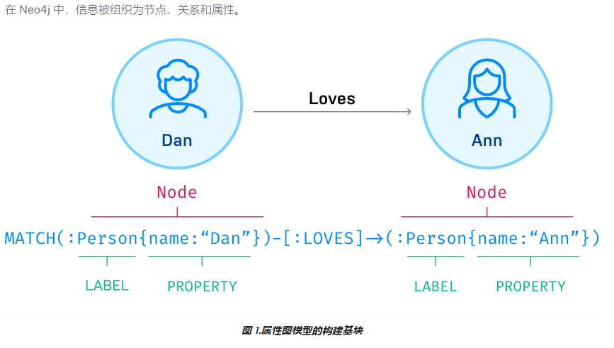

# Neo4j

# 一、图模型

## 结构

节点：

-   节点可以用*标签*进行标记，以表示它们在域中的不同角色（例如，）。Person
-   节点可以保存任意数量的键值对或*属性*（例如，）。name
-   节点标签还可以将元数据（例如索引或约束信息）附加到某些节点。

关系：

-   关系始终具有方向、类型、起始节点和结束节点，它们可以具有属性，就像节点一样。
-   节点可以具有任意数量或类型的关系，而不会牺牲性能。
-   尽管关系始终是*定向*的，但它们可以在任何方向上有效地导航。

属性：

描述节点或者关系

## neo4j特性

-   Cypher®：一种类似于 SQL 的声明性查询语言，但针对图形进行了优化。 现在由其他数据库（如 SAP HANA Graph 和 Redis Graph）通过[openCypher 项目](http://www.opencypher.org/).
-   **Constant time traversals：**由于节点和关系的有效表示，大图中的深度和广度**都具有恒定的时间遍历**。 支持在中等硬件上纵向扩展到数十亿个节点。
-   **Flexible** ：**灵活的**属性图架构，可以随时间推移进行调整，从而可以在以后具体化和添加新的关系，以便在业务需求发生变化时缩短和加快域数据。
-   **Driver：**适用于流行的编程语言，包括 Java、JavaScript、.NET、Python 等等。

  

  

  

  

**领导关心的东西：**

**汇报：oneID要做好、根据业务建合适的模型、语法不算难懂（类sql）、搭配es快速查询使用、免费只能单机、贵**

### 1.存储大小预估：

**需要看数据量 + 索引（索引字段多不多？存储、cpu、缓存）**

**10亿点数据（正常几个字段属性）-》10亿边关系 ≈ 300G （属性少、超级节点多不多、关系是否稀疏）**

**找个场景自己预估一下：**170亿边，25亿节点、将近1.3T数据量。数据导入

[**https://www.jianshu.com/p/b8d7ac4b2d91**](https://www.jianshu.com/p/b8d7ac4b2d91)

### 2.内存资源消耗（shell脚本测试推荐内存大小）

​  

### 3.磁盘IO或者说SATA/SAS/SSD对性能影响

**​**  

### 4.节点、关系数据量预估

  

### 5.数据库迁移工作量评估

**转csv导**

**csv支持远程端和本地、可where语句过滤、可分割、可特殊值处理等类sql语句**

1.  LOAD CSVCypher® 命令：此命令是一个很好的起点，可处理中小型数据集（最多 1000 万条记录）。*适用于任何设置，包括 AuraDB。*
2.  Kettle 导入工具：映射和执行数据处理流程的步骤，适用于非常大的数据集，尤其是在您已经熟悉使用此工具的情况下。*适用于任何设置，包括 AuraDB。*

**JSON：**

**RDBMS：**

**1）** [LOAD CSV](https://neo4j.com/docs/getting-started/data-import/csv-import/)：可能是从关系数据库导入数据的最简单方法。 需要转储格式为 CSV 文件的单个实体表和联接表。转为节点表和关系表。

**2)** [**APOC公司**](https://neo4j.com/labs/apoc/4.4/)：Cypher®上的超棒程序。 创建为扩展库，为开发人员提供通用过程和函数。 此库对于复杂的转换和数据操作特别有用。 有用的过程包括 apoc.load.jdbc、apoc.load.json 等。

**3)** [**ETL 工具**](https://neo4j.com/labs/etl-tool/)：Neo4j Labs UI工具，可将JDBC连接的关系转换为图形。 允许批量导入大型数据集的数据，具有快速的性能和简单的用户体验。

**4)** Kettle：用于企业级数据导出和导入的开源工具。 轻松处理各种数据源和大型数据集，并组织数据流过程。

**5）**其他ETL工具：还有一些供应商和社区工具可用于类似的ETL过程和GUI交互，用于将各种格式的数据传入和传出Neo4j。 其中一些工具还可以绘制出通过系统的数据流和转换。spark、

**6**） 通过驱动程序编程：能够从关系数据库（或其他表格结构）中检索数据，并使用 bolt 协议通过您选择的编程语言之一通过[**驱动程序**](https://neo4j.com/docs/getting-started/languages-guides/)将其写入 Neo4j。

​  

**6.监控相关：可支持prometheus**

（1）数据库连接数：监控负载情况

（2）查询响应时间：延迟、性能、效率

（3）缓存命中率：

（4）磁盘使用率

（5）堆内存使用率

（6）监控日志文件大小：

（7）锁等待时间：时间过长可能是资源不足或者性能瓶颈，需增加资源

（8）主从复制延迟

（9）事务提交量

## \-----------------------------------------------------------------------