# dataworks vs easydata

## dataworks:

参考官方文档：[https://help.aliyun.com/zh/dataworks/?spm=a2c4g.11186623.0.0.2b8c5420BcmOWV](https://help.aliyun.com/zh/dataworks/?spm=a2c4g.11186623.0.0.2b8c5420BcmOWV)

### 阿里云数据地图：

包括各模块各项目，不同引擎下的数据资产。如maxcompute、hologres、cdhhive、cdhkudu、cdhHbase、传统数据库、doris等。

主要由首页、数据总览、全部数据、我的数据、配置管理、数据发现、更多几个页面及其子页面。

**首页：**

1.几个topN，近期浏览表、近期读取表、热门浏览表、热门读取表、数据量最大表...

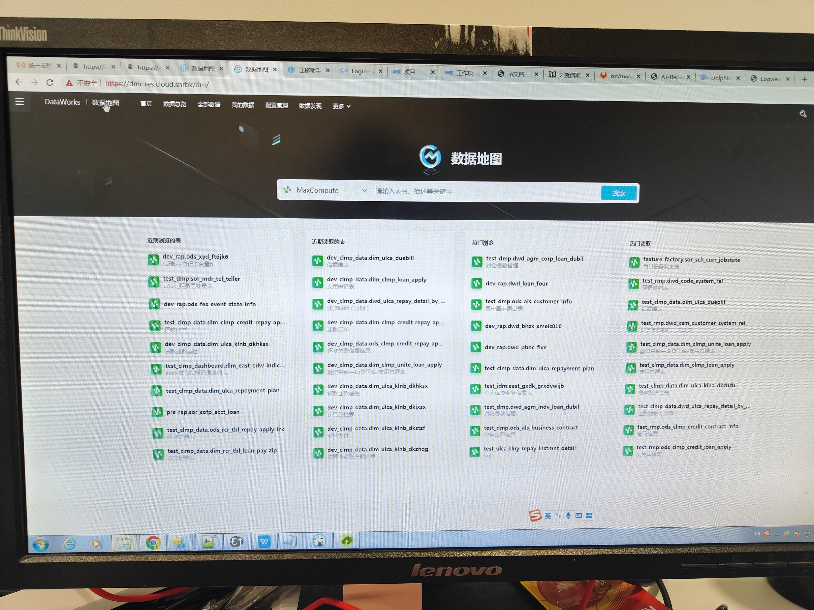

**数据总览：**

1.项目数、表数、存储量；存储趋势图、topN存储量项目（项目大小）、TopN存储表（表大小）、TopN热门表（热度指标）。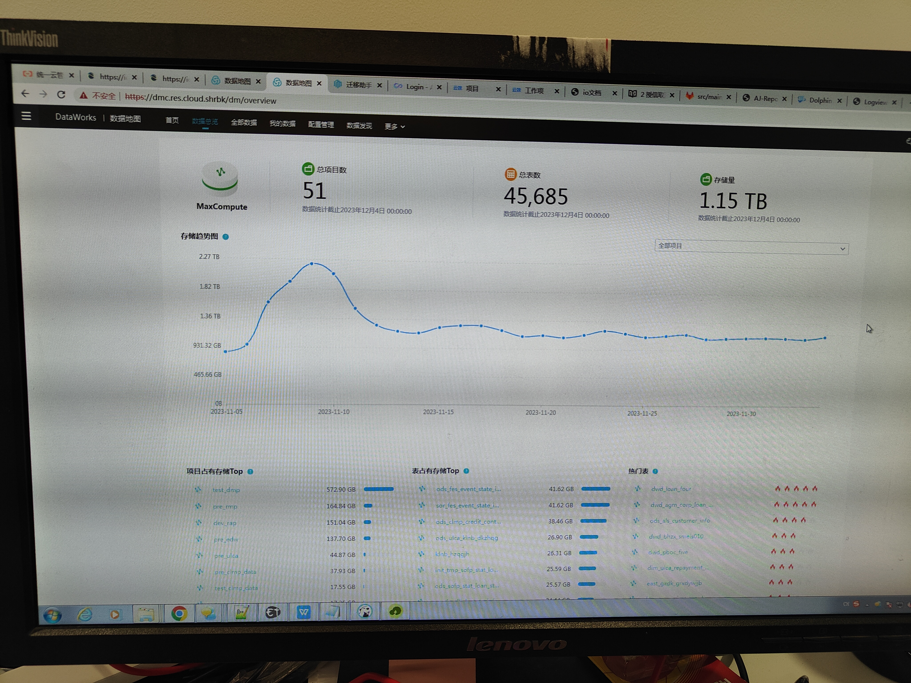

2.点击库名可以进入通过库名、表名、负责人来筛选表格资产的功能，并且会显示项目元数据信息（名称、引擎所在区域、技术负责人、业务负责人、创建时间、描述等）。

3.点击表名进入页面，同样坐标显示表基础信息（读取次数、产出任务、所属项目、使用引擎、负责人、创建时间、生命周期、是否分区表、存储量、表描述、表类型、业务信息业务负责人、当前账户访问权限、最后表格更改日期等）。

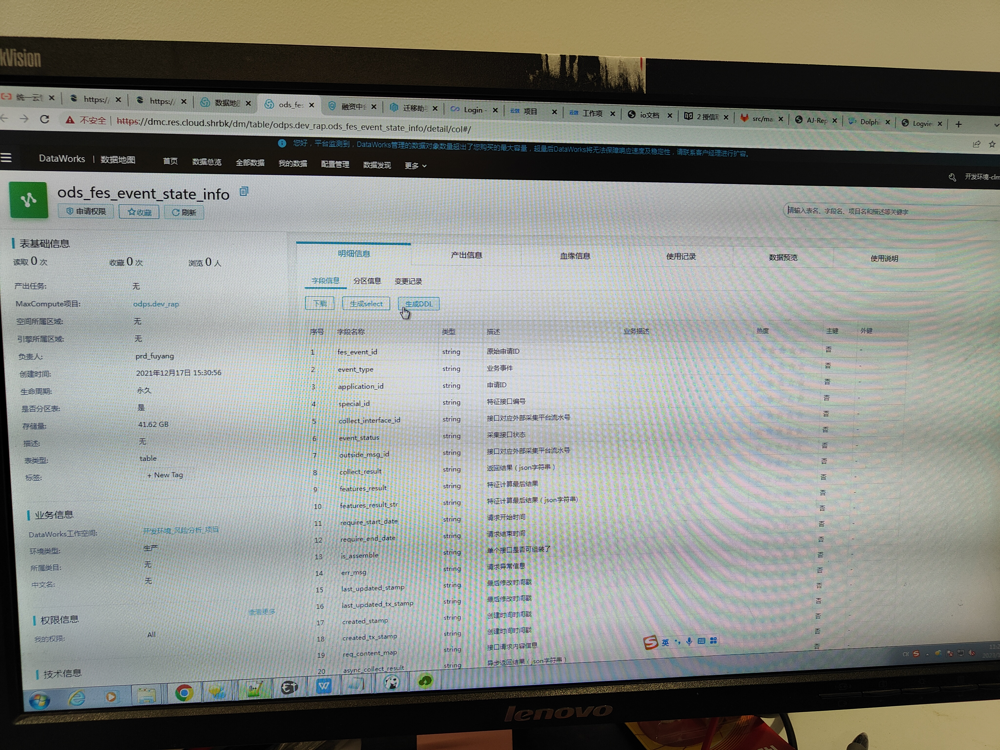

4.进入表页面的右侧有表的明细信息、产出信息、血缘信息、使用记录、数据预览、使用说明等。明细信息有表格结构（字段、类型、业务描述、热度、主键、外键、分区字段、变更信息等信息展示），可根据表结构生成select或者ddl语句。产出信息抓药包括任务的基本信息、执行情况，开始结束时间、等待时间等。血缘信息包括表级血缘图展示（可以选择上下展示多少层）、字段血缘图展示、影响分析等。使用记录包括：频繁关联字段、被使用统计。数据预览信息就是部分表数据limit。使用说明包括该表的具体业务使用场景、粒度说明等。

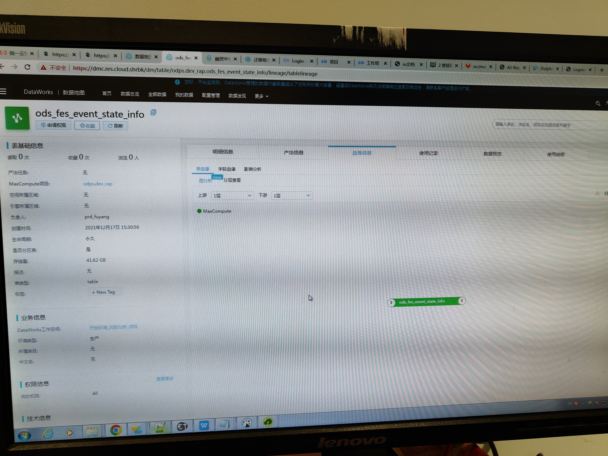

  

**全部数据：**

1.通过环境、项目、负责人筛选表格。或者通过表名、关键字等来直接搜索表。点击搜索出来的表名即可看到对应的表明细信息（如数据总览第4点）。

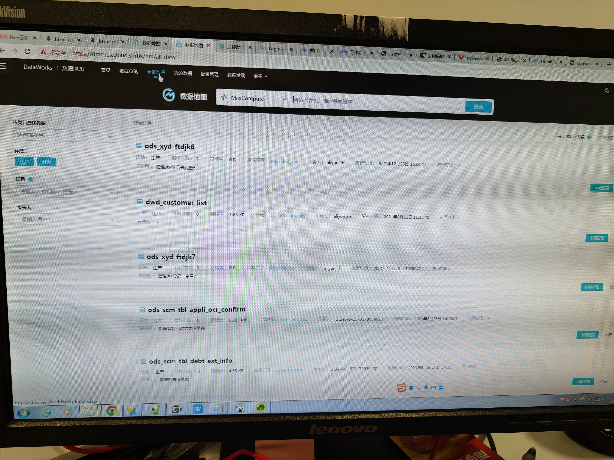

**我的数据：**

1.我拥有的数据表格总览

2.我管理的表格数据总览

3.生产账号的数据，测试环境看不到

4.我的收藏，我收藏的表格，如数据建模过程中可以先收藏事实表加以熟悉，方面查看

5.权限管理，可以审批组员对资源的访问权限、或者提起申请访问其他项目的函数、表等资源的权限，以及审批记录和申请记录等信息。

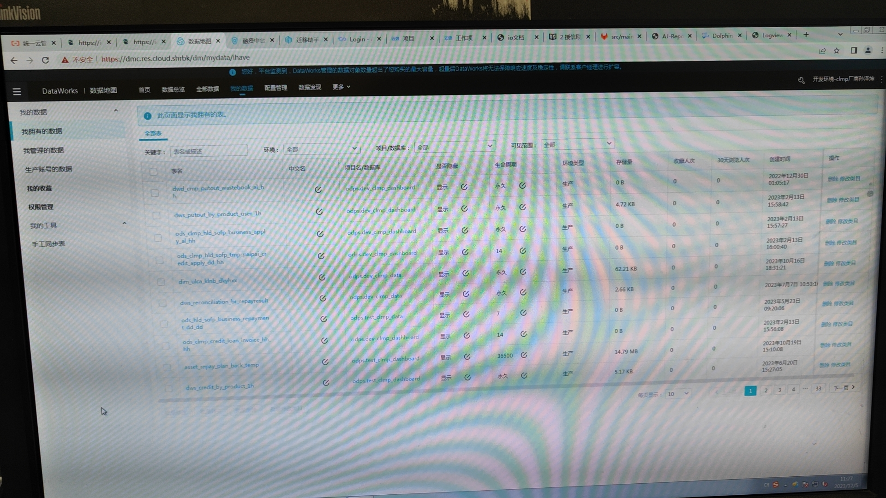

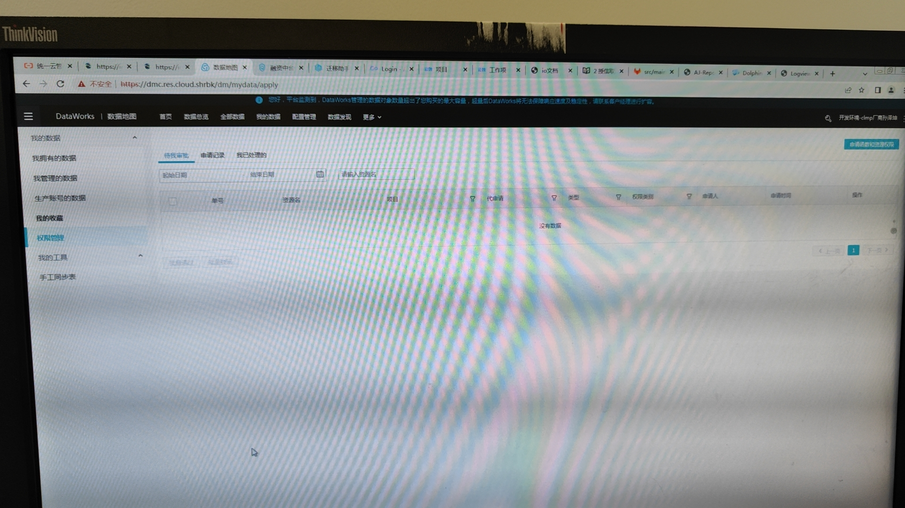

​  

**配置管理：**

对项目的一些配置，需要管理员和负责人权限。

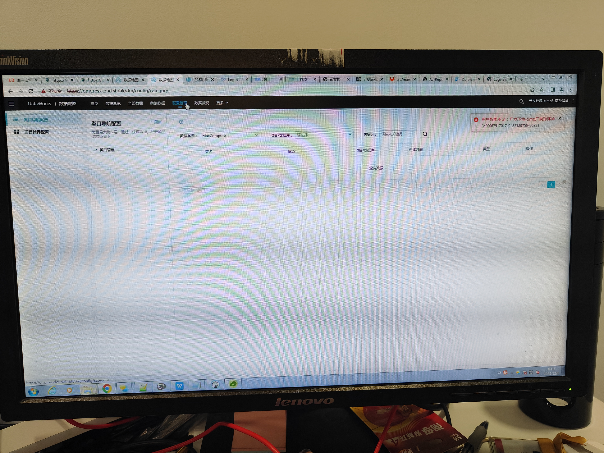

**数据发现：**

主要是对采集数据源的管理，新建采集器，批量创建等。

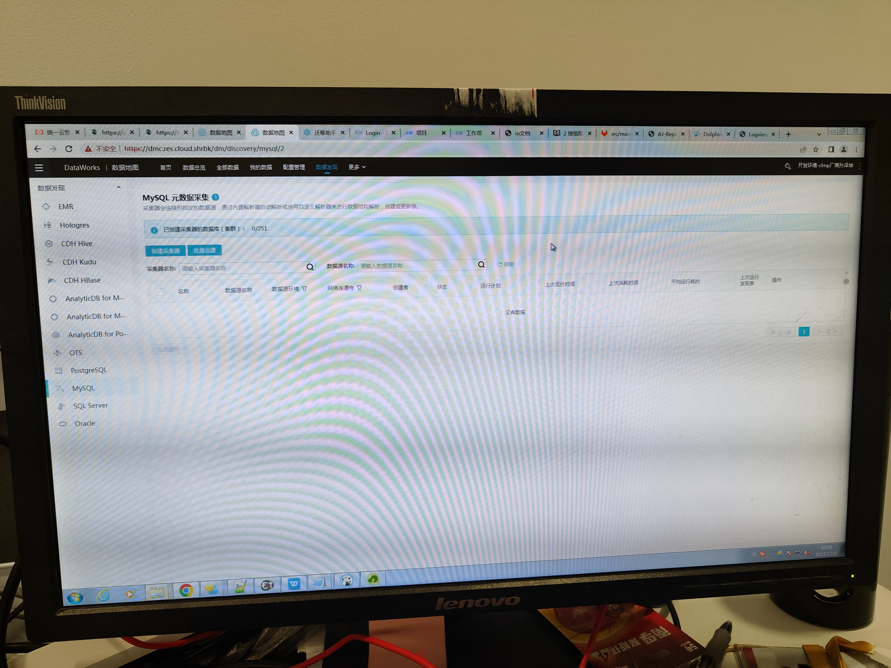

**更多：**

​  

## easydata功能:

[http://easydemo-prod.163yun.com/media/doc/release\_notes.html](http://easydemo-prod.163yun.com/media/doc/release_notes.html)

**指标系统**

指标系统依托离线开发中心，是指标的统一入口，通过定义原子、派生和复合指标，明确指标业务口径和技术口径，解决指标定义不一致、口径不一致和数据来源不一致的问题，实现规范定义，助力数据模型规范设计。

​  

**数据传输**

数据传输主要用于多种异构数据源之间的数据交换，可实现各部门业务数据在应用层面的互联互通和信息共享。数据传输采用分布式的架构，可以从容应对大数据量的数据传输需求。

**数据测试中心**

数据测试中心提供hive表的形态探查和数据比对功能。形态探查可帮助用户发现数据潜在问题，比如主键唯一性、字段空值等。数据比对可帮助用户进行两个表之间字段级别的比较。

**模型设计中心**

主要提供组织数据、刻画数据、规范约束、效果衡量等能力，用于实现数仓的规范化建模，同时指引数仓建设的方向。该产品支持主题域、表分层、字典集、设计规则、维度、度量等模块的管理，支持数仓建设数据大屏展示。

**自助分析**

是数据开发人员进行数据自助探查数据的场所，可方便快捷的执行自定义的SQL语句，操作如Hive、Doris、MySQL、Oracle、ClickHouse等数据源的表。也能够实现语句分享、代码共享等。

**离线开发**

离线开发中心是有数大数据平台的基础产品，提供大规模数据存储与计算能力。可选择搭载其它易数产品，完成数据集成、数据研发、数据治理、数据服务等功能，灵活满足客户的各类场景。

**数据质量中心**

数据质量中心通过事前定义监控规则、事中监控数据的生成过程以及事后评估和问题追溯，围绕完整性、一致性、准确性、有效性和及时性五个方面衡量数据质量，依托离线开发中心的数据质量配置，提升企业数据价值。

**数据服务**

提供快速将数据表生成API以及对已有的API进行注册管理的能力。数据服务通过应用授权，供外部应用系统调用API获取数据，支持API的策略配置，对API进行统一管理和发布。

**任务运维中心**

提供周期实例运行情况统计大屏、实例运维（重跑、暂停、致成功、查看血缘、实例诊断等）、补数据实例运维、任务列表、报警模块（值班组、基线运维、报警历史、报警规则等）

​  

## 一、简介

DataWorks基于MaxCompute、Hologres、EMR、AnalyticDB、CDP等大数据引擎，为数据仓库、数据湖、湖仓一体等解决方案提供统一的全链路大数据开发治理平台

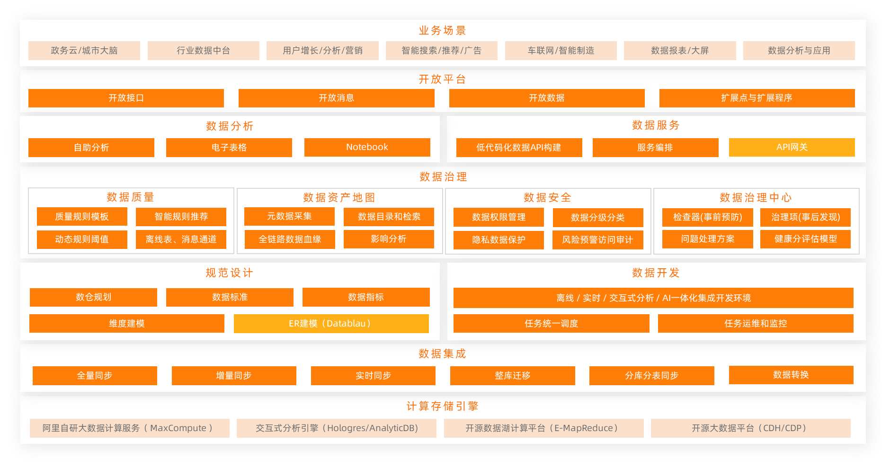

## 二、数据源 source

### 1.架构

数据集成采用星型架构

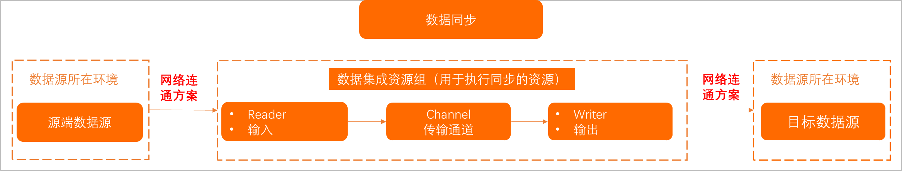

**使用限制**

-   数据同步：支持且仅支持结构化（例如RDS、DRDS等）、半结构化、无结构化（OSS、TXT等，要求具体同步数据必须抽象为结构化数据）的数据的同步。即数据集成仅支持传输能够抽象为逻辑二维表的数据同步，不支持同步OSS中存放完全非结构化的数据（例如一段MP3）至MaxCompute。
-   网络连通：支持单地域内及部分跨地域的数据存储相互同步、交换的数据同步需求。 部分地域之间可以通过经典网络传输，但不能保证其连通性。如果测试经典网络不通，建议您使用公网方式进行连接。
-   数据传输：数据集成仅完成数据同步（传输），本身不提供数据流的消费方式。
-   数据一致性：数据集成同步仅支持at least once，不支持exact once，即不能保证数据不重复，只能依赖主键+目的端能力来保证。

**说明**

同步任务源端和目标端字段类型需要注意精度，如果目标端字段类型最大值小于源端最大值（或最小值大于源端最小值，或精度低于源端精度），可能会导致写入失败或精度被截断的风险。（不区分源端和目标端类型，也不区分离线还是实时同步）

### 2.离线同步

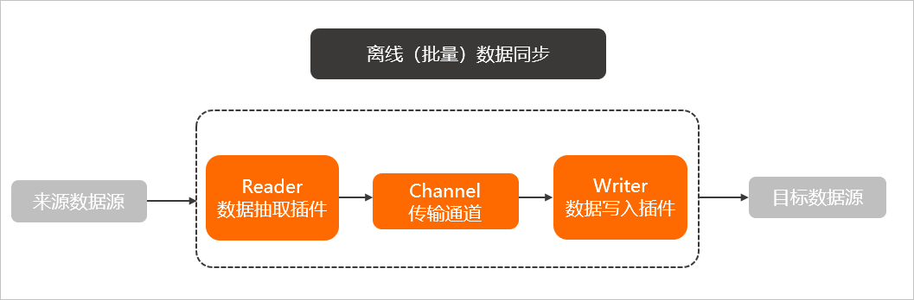

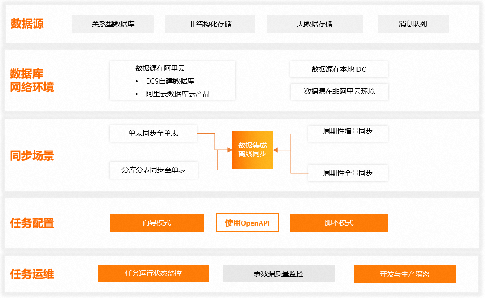

**如何同步**

新建业务流程、新建离线同步结点，填入对应的输入输出端信息，以及资源组设置。

**同步速度影响因素**

| **因素** | **说明** |
| --- | --- |
| 来源端数据源 | 数据库的性能：CPU、内存、SSD硬盘、网络和硬盘等。并发数：数据源并发数越高，数据库负载越高。通常，数据库的性能越好，它可以承载的并发数越高，您可以为数据同步作业配置越多的并发数据抽取。网络：网络的带宽（吞吐量）、网速。 |
| 离线同步任务使用的调度资源组 | 离线同步任务将有调度资源下发至数据集成任务执行资源上执行，调度资源使用情况同样会影响整体数据集成同步效率。关于离线任务下发机制，详情请参见：[任务下发机制](https://help.aliyun.com/zh/dataworks/user-guide/overview-17#section-97v-3bt-115) 。 |
| 离线同步任务配置 | 传输速度：是否设置任务同步速度上限值。并发：从源并行读取或并行写入数据存储端的最大线程数。WAIT资源。Bytes的设置：单个线程的**Bytes=1048576**，在网速比较敏感时，会出现超时现象，此时建议将Bytes设置的较小。查询语句是否建索引。 |
| 目的端数据源 | 性能：CPU、内存、SSD 硬盘、网络和硬盘。负载：目的数据库负载过高会影响同步任务数据写入效率。网络：网络的带宽（吞吐量）、网速。 |

### 3.实时同步

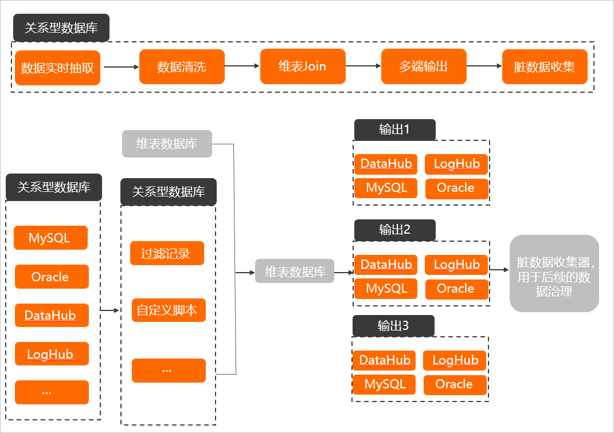

  

## 二、计算处理 transform

## 三、数据结果 sink

  

## \-----------------------------------------------------------------------