## 一、什么是flink

### 1、flink

为分布式、高性能、随时可用、能对有界和无界数据流进行有状态计算、事件驱动型以及准确的流处理应用程序打造的开源流处理框架。

### 2、flink与spark

底层世界观不同，spark是微批次模型，flink是事件驱动的连续流批一体式处理模型；flink拥有更加灵活的窗口、精确一次语义保证以及事件时间语义对处理乱序数据和延迟数据更方便。

## 二、flink快速上手

### 1、所需依赖

```plain
<properties>
    <flink.version>1.13.1</flink.version>
    <scala.binary.version>2.12</scala.binary.version>
    <slf4j.version>1.7.30</slf4j.version>
<maven.compiler.source>1.8</maven.compiler.source>
<maven.compiler.target>1.8</maven.compiler.target>
</properties>

<dependencies>

<!-- java版flink的版本 -->
    <dependency>
        <groupId>org.apache.flink</groupId>
        <artifactId>flink-java</artifactId>
        <version>${flink.version}</version>
   <scope>provided</scope>
    </dependency>
<!-- 流式处理环境提供 -->
    <dependency>
        <groupId>org.apache.flink</groupId>
        <artifactId>flink-streaming-java_${scala.binary.version}</artifactId>
        <version>${flink.version}</version>
   <scope>provided</scope>
    </dependency>
<!-- flink客户端，一般使用Scala版本 -->
    <dependency>
        <groupId>org.apache.flink</groupId>
        <artifactId>flink-clients_${scala.binary.version}</artifactId>
        <version>${flink.version}</version>
   <scope>provided</scope>
    </dependency>
<!-- flink运行时web界面提供 -->
    <dependency>
        <groupId>org.apache.flink</groupId>
        <artifactId>flink-runtime-web_${scala.binary.version}</artifactId>
        <version>${flink.version}</version>
<scope>provided</scope>
    </dependency>
<!-- 日志信息 -->
    <dependency>
        <groupId>org.slf4j</groupId>
        <artifactId>slf4j-api</artifactId>
        <version>${slf4j.version}</version>
<scope>provided</scope>
    </dependency>
    <dependency>
        <groupId>org.slf4j</groupId>
        <artifactId>slf4j-log4j12</artifactId>
        <version>${slf4j.version}</version>
<scope>provided</scope>
    </dependency>
    <dependency>
        <groupId>org.apache.logging.log4j</groupId>
        <artifactId>log4j-to-slf4j</artifactId>
        <version>2.14.0</version>
   <scope>provided</scope>
    </dependency>
</dependencies>

<!-- maven打包插件 -->

<build>
    <plugins>
        <plugin>
            <groupId>org.apache.maven.plugins</groupId>
            <artifactId>maven-shade-plugin</artifactId>
            <version>3.2.4</version>
            <executions>
                <execution>
                    <phase>package</phase>
                    <goals>
                        <goal>shade</goal>
                    </goals>
                    <configuration>
                        <artifactSet>
                            <excludes>
                                <exclude>com.google.code.findbugs:jsr305</exclude>
                                <exclude>org.slf4j:*</exclude>
                                <exclude>log4j:*</exclude>
                            </excludes>
                        </artifactSet>
                        <filters>
                            <filter>
                                <!-- Do not copy the signatures in the META-INF folder.
                                Otherwise, this might cause SecurityExceptions when using the JAR. -->
                                <artifact>*:*</artifact>
                                <excludes>
                                    <exclude>META-INF/*.SF</exclude>
                                    <exclude>META-INF/*.DSA</exclude>
                                    <exclude>META-INF/*.RSA</exclude>
                                </excludes>
                            </filter>
                        </filters>
                        <transformers combine.children="append">
                            <transformer implementation="org.apache.maven.plugins.shade.resource.ServicesResourceTransformer">
                            </transformer>
                        </transformers>
                    </configuration>
                </execution>
            </executions>
        </plugin>
    </plugins>
</build>
```

### 2、日志设置：

src/main/resources添加文件:log4j.properties

```plain
log4j.rootLogger=error, stdout
log4j.appender.stdout=org.apache.log4j.ConsoleAppender
log4j.appender.stdout.layout=org.apache.log4j.PatternLayout
log4j.appender.stdout.layout.ConversionPattern=%-4r [%t] %-5p %c %x - %m%n
```

### 3、批处理特点：

（1）一般处理有界流，环境ExecutionEnvironment.*getExecutionEnvironment****()；***

（2）读取数据直接处理，处理完就结束了，不需要env.execute***()***;

```java
// 1. 创建执行环境
ExecutionEnvironment env = ExecutionEnvironment.getExecutionEnvironment();
// 2. 从文件读取数据  按行读取(存储的元素就是每行的文本)
DataSource<String> lineDS = env.readTextFile("input/words.txt");
// 3. 转换数据格式
FlatMapOperator<String, Tuple2<String, Long>> wordAndOne = lineDS
        .flatMap((String line, Collector<Tuple2<String, Long>> out) -> {
            String[] split = line.split(" ");
            for (String word : split) {
                out.collect(Tuple2.of(word, 1L));
            }
        })
        .returns(Types.TUPLE(Types.STRING, Types.LONG));  // 当Lambda表达式使用 java 泛型的时候, 由于泛型擦除的存在, 需要显示的声明类型信息

// 4. 按照 word 进行分组
UnsortedGrouping<Tuple2<String, Long>> wordAndOneUG = wordAndOne.groupBy(0);
// 5. 分组内聚合统计
AggregateOperator<Tuple2<String, Long>> sum = wordAndOneUG.sum(1);

// 6. 打印结果
sum.print();
```

### 4、流处理：

（1）环境StreamExecutionEnvironment.*getExecutionEnvironment****()***;

（2）处理有界流处理完即关闭流，处理无界流不会关闭，需要env.execute();

```java
// 1. 创建流式执行环境
StreamExecutionEnvironment env = StreamExecutionEnvironment.getExecutionEnvironment();
// 2. 读取文件
DataStreamSource<String> lineDSS = env.readTextFile("input/words.txt");
// 3. 转换数据格式
SingleOutputStreamOperator<Tuple2<String, Long>> wordAndOne = lineDSS
        .flatMap((String line, Collector<String> words) -> {
            Arrays.stream(line.split(" ")).forEach(words::collect);
        })
        .returns(Types.STRING)
        .map(word -> Tuple2.of(word, 1L))
        .returns(Types.TUPLE(Types.STRING, Types.LONG));
// 4. 分组
KeyedStream<Tuple2<String, Long>, String> wordAndOneKS = wordAndOne
        .keyBy(t -> t.f0);
// 5. 求和
SingleOutputStreamOperator<Tuple2<String, Long>> result = wordAndOneKS
        .sum(1);
// 6. 打印
result.print();
// 7. 执行
env.execute();
```

  

```java
// 1. 创建流式执行环境
StreamExecutionEnvironment env = StreamExecutionEnvironment.getExecutionEnvironment();
// 2. 读取文件
DataStreamSource<String> lineDSS = env.socketTextStream("hadoop162", 9999);
// 3. 转换数据格式
SingleOutputStreamOperator<Tuple2<String, Long>> wordAndOne = lineDSS
        .flatMap((String line, Collector<String> words) -> {
            Arrays.stream(line.split(" ")).forEach(words::collect);
        })
        .returns(Types.STRING)
        .map(word -> Tuple2.of(word, 1L))
        .returns(Types.TUPLE(Types.STRING, Types.LONG));
// 4. 分组
KeyedStream<Tuple2<String, Long>, String> wordAndOneKS = wordAndOne
        .keyBy(t -> t.f0);
// 5. 求和
SingleOutputStreamOperator<Tuple2<String, Long>> result = wordAndOneKS
        .sum(1);
// 6. 打印
result.print();
// 7. 执行
env.execute();
```

## 三、flink部署

### 1.部署模式：

（1）local-cluster模式：尝新flink使用

（2）standalone模式：利用flink自己的资源调度器来调度资源来计算数据，可以利用Hadoop zookeeper来搭建高可用集群

（3）flink on yarn模式：使用居多、利用yarn来调度资源处理数据，同样可以 通过Hadoop、zookeeper来配置高可用。有session模式和application模式，区别在于一个是先启动常驻的flink集群来接受多个作业的提交，另一个是一个应用的多个或者单个job提交时才会启动集群，若作业完成或者结束集群也会随之消失，生产多用application模式。另外还有per-job模式，一个作业一个集群，1.15已被弃用。使用时提交参数可设置不同模式，\-t yarn-application -t yarn-session -t yarn-per-job

（4）flink on k8s：使用flink operator安装flink 或者 在k8s上使用fink镜像，具体参照官网。

### 2.具体安装参照官网

## 四、运行框架

### 1、jobmanager：

每个应用程序都会被一个jobmanager控制执行，会接受客户端提交的所有类、库和其他资源的jar包；客户端将streamgraph（算子处理顺序）优化为jobgraph（算子链处理连接、算子链划分类比spark的stage划分），jobmanager根据jobgraph生成executiongraph（结合并行度生成的可执行图），最终jobmanager根据executiongraph对job进行调度后在各个taskmanager上部署task后形成physicalgraph图（根据并行度和slots数量分配taskmanager的个数）。

（1）resourcemanager：负责管理taskmanager的插槽，若有空闲插槽的taskmanager则直接给jobmanager提供、否则会想资源提供平台申请启动新的taskmanager（如yarn、k8s）

（2）dispatcher：接受客户端提交的作业信息、并启动一个新的jobmaster组件、也会启动一个webUI

（3）jobmaster：负责单个jobgrph的执行、多个job可以同时运行在一个flink集群中，每个job都有一个对应的jobmaster

### 2、taskmanager：

提供插槽来供task运行，多个taskmanager之间可以交换数据

### 3、client：

严格说他不是运行的一部分，只是为了提交作业，查看作业运行情况，取消运行的交互操作。

### 4、重要概念：

taskmanager与slots、parallelism的关系，task与subtask的关系，operator chains任务链（相同并行度的1对1操作），共享slots

1）一个taskManager可以设置多个slots，slots数量最好和CPU核心数相等或者和任务并行度相等；

2）task是个定义，subtask是真正运行起来后task的不同并行实例，算子链是在并行度或分区一对一算子之间，将多个相连一对一算子当做一个task来管理的情况（flink webUI会以一个task显示一个算子链）；

3）共享slots，指的是整个数据流图中算子在slot中应保证一个完整的流处理过程，根据并行度在另外slot中也有一一份完整的流程（source和sink一般只有一个并行度）。能保证部分slot挂了，仍能有完整链路运行。

### 5、提交流程

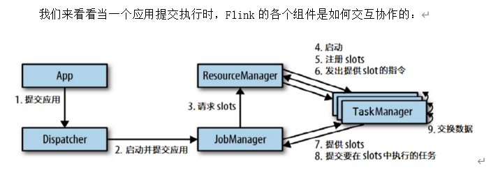

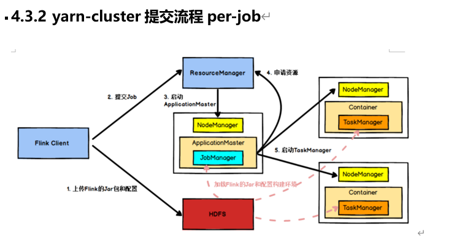

1. Flink任务提交后，Client向HDFS上传Flink的Jar包和配置

2. 向Yarn ResourceManager提交任务，ResourceManager分配Container资源

3. 通知对应的NodeManager启动ApplicationMaster，ApplicationMaster启动后加载Flink的Jar包和配置构建环境，然后启动JobManager

4. ApplicationMaster向ResourceManager申请资源启动TaskManager

5. ResourceManager分配Container资源后，由ApplicationMaster通知资源所在节点的NodeManager启动TaskManager

6. NodeManager加载Flink的Jar包和配置构建环境并启动TaskManager

7\. TaskManager启动后向JobManager发送心跳包，并等待JobManager向其分配任务。

## 五、核心编程

### 1、source：

（1）从Java集合中读取数据

env.fromCollection***(***waterSensors***)***

（2）从文件件中读取数据

env.readTextFile***(*****"input"*****)***

***说明：***

1. 参数可以是目录也可以是文件

2. 路径可以是相对路径也可以是绝对路径

3. 相对路径是从系统属性user.dir获取路径:

idea下是project的根目录,

standalone模式下指的当前的用户的home目录

yarn: ?

4. 也可以从hdfs目录下读取, 使用路径:hdfs://...., 由于Flink没有提供hadoop相关依赖, 需要pom中添加相关依赖:

```plain
<dependency>
    <groupId>org.apache.hadoop</groupId>
    <artifactId>hadoop-client</artifactId>
    <version>3.1.3</version>
<scope>provided</scope>
</dependency>
```

（3）从socket读取数据

env.socketTextStream***(*****"hadoop162"**, 9999***)***

（4）从kafka中读取

```plain
<dependency>
    <groupId>org.apache.flink</groupId>
    <artifactId>flink-connector-kafka_2.12</artifactId>
    <version>1.13.1</version>
</dependency>
```
```java
import org.apache.flink.api.common.serialization.SimpleStringSchema;
import org.apache.flink.streaming.api.environment.StreamExecutionEnvironment;
import org.apache.flink.streaming.connectors.kafka.FlinkKafkaConsumer;

import java.util.Properties;

/**
* @Author lizhenchao@atguigu.cn
* @Date 2020/12/8 22:44
*/
public class Flink03_Source_Kafka {
    public static void main(String[] args) throws Exception {

        // 0.Kafka相关配置
        Properties properties = new Properties();
        properties.setProperty("bootstrap.servers", "hadoop102:9092,hadoop103:9092,hadoop104:9092");
        properties.setProperty("group.id", "Flink01_Source_Kafka");
        properties.setProperty("auto.offset.reset", "latest");

        // 1. 创建执行环境
        StreamExecutionEnvironment env = StreamExecutionEnvironment.getExecutionEnvironment();
        env
            .addSource(new FlinkKafkaConsumer<>("sensor", new SimpleStringSchema(), properties))
            .print("kafka source");

        env.execute();
    }
}

```

（5）自定义source

```java
import org.apache.flink.streaming.api.environment.StreamExecutionEnvironment;
import org.apache.flink.streaming.api.functions.source.SourceFunction;

import java.io.BufferedReader;
import java.io.IOException;
import java.io.InputStreamReader;
import java.net.Socket;
import java.nio.charset.StandardCharsets;

/**
 * @Author lizhenchao@atguigu.cn
 * @Date 2020/12/8 22:44
 */
public class Flink04_Source_Custom {
    public static void main(String[] args) throws Exception {

        // 1. 创建执行环境
        StreamExecutionEnvironment env = StreamExecutionEnvironment.getExecutionEnvironment();
        env
          .addSource(new MySource("hadoop102", 9999))
          .print();

        env.execute();
    }

    public static class MySource implements SourceFunction<WaterSensor> {
        private String host;
        private int port;
        private volatile boolean isRunning = true;
        private Socket socket;

        public MySource(String host, int port) {
            this.host = host;
            this.port = port;
        }

        @Override
        public void run(SourceContext<WaterSensor> ctx) throws Exception {
            // 实现一个从socket读取数据的source
            socket = new Socket(host, port);
            BufferedReader reader = new BufferedReader(new InputStreamReader(socket.getInputStream(), StandardCharsets.UTF_8));
            String line = null;
            while (isRunning && (line = reader.readLine()) != null) {
                String[] split = line.split(",");
                ctx.collect(new WaterSensor(split[0], Long.valueOf(split[1]), Integer.valueOf(split[2])));
            }
        }

        /**
         * 大多数的source在run方法内部都会有一个while循环,
         * 当调用这个方法的时候, 应该可以让run方法中的while循环结束
         */

        @Override
        public void cancel() {
            isRunning = false;
            try {
                socket.close();
            } catch (IOException e) {
                e.printStackTrace();
            }
        }
    }
}

```

### 2.transform算子

（1）map:一对一转换

```java
package com.atguigu.flink.java.chapter_5.transform;

import org.apache.flink.api.common.functions.MapFunction;
import org.apache.flink.streaming.api.environment.StreamExecutionEnvironment;

/**
 * @Author lizhenchao@atguigu.cn
 * @Date 2020/12/10 7:17
 */
public class Flink01_TransForm_Map_Anonymous {
    public static void main(String[] args) throws Exception {
        StreamExecutionEnvironment env = StreamExecutionEnvironment.getExecutionEnvironment();

        env
          .fromElements(1, 2, 3, 4, 5)
          .map(new MapFunction<Integer, Integer>() {
              @Override
              public Integer map(Integer value) throws Exception {
                  return value * value;
              }
          })
          .print();

        env.execute();
    }
}
```
```java
env
  .fromElements(1, 2, 3, 4, 5)
  .map(ele -> ele * ele)
  .print();
```

  

```java
package com.atguigu.flink.java.chapter_5.transform;

import org.apache.flink.api.common.functions.MapFunction;
import org.apache.flink.streaming.api.environment.StreamExecutionEnvironment;

/**
 * @Author lizhenchao@atguigu.cn
 * @Date 2020/12/10 7:17
 */
public class Flink01_TransForm_Map_StaticClass {
    public static void main(String[] args) throws Exception {
        StreamExecutionEnvironment env = StreamExecutionEnvironment.getExecutionEnvironment();

        env
          .fromElements(1, 2, 3, 4, 5)
          .map(new MyMapFunction())
          .print();

        env.execute();
    }

    public static class MyMapFunctionimplements MapFunction<Integer, Integer> {

        @Override
        public Integer map(Integer value) throws Exception {
            return value * value;
        }
    }
    
}
```

  

RichMapFunction

```java
import org.apache.flink.api.common.functions.RichMapFunction;
import org.apache.flink.configuration.Configuration;
import org.apache.flink.streaming.api.environment.StreamExecutionEnvironment;

/**
 * @Author lizhenchao@atguigu.cn
 * @Date 2020/12/10 7:17
 */
public class Flink01_TransForm_Map_RichMapFunction {
    public static void main(String[] args) throws Exception {
        StreamExecutionEnvironment env = StreamExecutionEnvironment.getExecutionEnvironment().setParallelism(5);

        env
          .fromElements(1, 2, 3, 4, 5)
          .map(new MyRichMapFunction()).setParallelism(2)
          .print();

        env.execute();
    }

    public static class MyRichMapFunction extends RichMapFunction<Integer, Integer> {
        // 默认生命周期方法, 初始化方法, 在每个并行度上只会被调用一次
        @Override
        public void open(Configuration parameters) throws Exception {
            System.out.println("open ... 执行一次");
        }

        // 默认生命周期方法, 最后一个方法, 做一些清理工作, 在每个并行度上只调用一次
        @Override
        public void close() throws Exception {
            System.out.println("close ... 执行一次");
        }

        @Override
        public Integer map(Integer value) throws Exception {
            System.out.println("map ... 一个元素执行一次");
            return value * value;
        }
    }
}
```

1. 默认生命周期方法, 初始化方法, 在每个并行度上只会被调用一次, 而且先被调用

2. 默认生命周期方法, 最后一个方法, 做一些清理工作, 在每个并行度上只调用一次, 而且是最后被调用

3\. getRuntimeContext()方法提供了函数的RuntimeContext的一些信息，例如函数执行的并行度，任务的名字，以及state状态. 开发人员在需要的时候自行调用获取运行时上下文对象.

（2）flatmap:一元素转换为多个或者零个

```java
// 新的流存储每个元素的平方和3次方
env
  .fromElements(1, 2, 3, 4, 5)
  .flatMap(new FlatMapFunction<Integer, Integer>() {
      @Override
      public void flatMap(Integer value, Collector<Integer> out) throws Exception {
          out.collect(value * value);
          out.collect(value * value * value);
      }
  })
  .print();
```

​  

```java
env
  .fromElements(1, 2, 3, 4, 5)
  .flatMap((Integer value, Collector<Integer> out) -> {
      out.collect(value * value);
      out.collect(value * value * value);
  }).returns(Types.INT)
  .print();
```

说明: 在使用Lambda表达式表达式的时候, 由于泛型擦除的存在, 在运行的时候无法获取泛型的具体类型, 全部当做Object来处理, 及其低效, 所以Flink要求当参数中有泛型的时候, 必须明确指定泛型的类型.

（3）filter： 根据指定的规则将满足条件（true）的数据保留，不满足条件(false)的数据丢弃

匿名内部类写法

```java
// 保留偶数, 舍弃奇数
env
  .fromElements(10, 3, 5, 9, 20, 8)
  .filter(new FilterFunction<Integer>() {
      @Override
      public boolean filter(Integer value) throws Exception {
          return value % 2 == 0;
      }
  })
  .print();
```

Lambda表达式写法

```java
env
  .fromElements(10, 3, 5, 9, 20, 8)
  .filter(value -> value % 2 == 0)
  .print();
```

（4）keyby：把流中的数据分到不同的分区（并行度）中，具有相同key的元素会分到同一个分区中，一个分区中可以有多重不同的key（key的hash分区多于并行度时）

Key选择器函数: interface KeySelector<IN, KEY>

**注意****:** 什么值**不可以**作为KeySelector的Key:

l 没有覆写hashCode方法的POJO, 而是依赖Object的hashCode. 因为这样分组没有任何的意义: 每个元素都会得到一个独立无二的组. 实际情况是:可以运行, 但是分的组没有意义.

l 任何类型的数组

```java
// 奇数分一组, 偶数分一组
env
  .fromElements(10, 3, 5, 9, 20, 8)
  .keyBy(new KeySelector<Integer, String>() {
      @Override
      public String getKey(Integer value) throws Exception {
          return value % 2 == 0 ? "偶数" : "奇数";
      }
  })
  .print();
env.execute();
```

  

```java
env
  .fromElements(10, 3, 5, 9, 20, 8)
  .keyBy(value -> value % 2 == 0 ? "偶数" : "奇数")
  .print();
```

（5）shuffle：把流中的元素**随机**打乱. 对同一个组数据, 每次执行得到的结果都不同.

Rebalance：全局重分区，对流中的元素平均分配到每个分区，对数据倾斜处理有效果，但是网络传输效率低。

rescale：在各自taskmanager内将流中的元素平均分配到每个slots，不需要走网络，更高效。

```java
env
  .fromElements(10, 3, 5, 9, 20, 8)
  .shuffle()
  .print();
env.execute();
```

（6）connect

```java
DataStreamSource<Integer> intStream = env.fromElements(1, 2, 3, 4, 5);
DataStreamSource<String> stringStream = env.fromElements("a", "b", "c");
// 把两个流连接在一起: 貌合神离
ConnectedStreams<Integer, String> cs = intStream.connect(stringStream);
cs.getFirstInput().print("first");
cs.getSecondInput().print("second");
env.execute();
```

注意:

**1.** 两个流中存储的数据类型**可以不同**

2. 只是机械的合并在一起, 内部仍然是分离的2个流

3\. 只能2个流进行connect, 不能有第3个参与,也可以两个流合并后再与第三个流合并（类似于表join）

​  

（7）union

```java
DataStreamSource<Integer> stream1 = env.fromElements(1, 2, 3, 4, 5);
DataStreamSource<Integer> stream2 = env.fromElements(10, 20, 30, 40, 50);
DataStreamSource<Integer> stream3 = env.fromElements(100, 200, 300, 400, 500);

// 把多个流union在一起成为一个流, 这些流中存储的数据类型必须一样: 水乳交融
stream1
  .union(stream2)
  .union(stream3)
  .print();
```

connect与 union 区别：

1. union之前两个或多个流的类型必须是一样，connect可以不一样

2\. connect只能操作两个流，union可以操作多个。

（8）sum min max minby maxby

```java
DataStreamSource<Integer> stream = env.fromElements(1, 2, 3, 4, 5);
KeyedStream<Integer, String> kbStream = stream.keyBy(ele -> ele % 2 == 0 ? "奇数" : "偶数");
kbStream.sum(0).print("sum");
kbStream.max(0).print("max");
kbStream.min(0).print("min");
```
```java
ArrayList<WaterSensor> waterSensors = new ArrayList<>();
waterSensors.add(new WaterSensor("sensor_1", 1607527992000L, 20));
waterSensors.add(new WaterSensor("sensor_1", 1607527994000L, 50));
waterSensors.add(new WaterSensor("sensor_1", 1607527996000L, 30));
waterSensors.add(new WaterSensor("sensor_2", 1607527993000L, 10));
waterSensors.add(new WaterSensor("sensor_2", 1607527995000L, 30));

KeyedStream<WaterSensor, String> kbStream = env
  .fromCollection(waterSensors)
  .keyBy(WaterSensor::getId);

kbStream
  .sum("vc")
  .print("maxBy...");
```

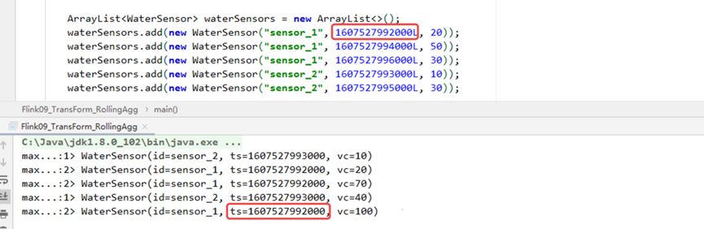

**注意****:**

分组聚合后, 理论上只**能取分组字段和聚合结果**, 但是Flink**允许其他的字段**也可以取出来, 其他字段默认情况是取的是这个**组内第一个元素**的字段值

```java
ArrayList<WaterSensor> waterSensors = new ArrayList<>();
waterSensors.add(new WaterSensor("sensor_1", 1607527992000L, 20));
waterSensors.add(new WaterSensor("sensor_1", 1607527994000L, 50));
waterSensors.add(new WaterSensor("sensor_1", 1607527996000L, 50));
waterSensors.add(new WaterSensor("sensor_2", 1607527993000L, 10));
waterSensors.add(new WaterSensor("sensor_2", 1607527995000L, 30));

KeyedStream<WaterSensor, String> kbStream = env
  .fromCollection(waterSensors)
  .keyBy(WaterSensor::getId);

kbStream
  .maxBy("vc", false)
  .print("max...");

env.execute();
```

​**注意****:**

maxBy和minBy可以指定当**出现相同值**的时候,其他字段**是否取第一个**. true表示取第一个, false表示取与最大值(最小值)同一行的.

（9）reduce： 输入上次合并的值和下一个要合并的值，累计

```java
ArrayList<WaterSensor> waterSensors = new ArrayList<>();
waterSensors.add(new WaterSensor("sensor_1", 1607527992000L, 20));
waterSensors.add(new WaterSensor("sensor_1", 1607527994000L, 50));
waterSensors.add(new WaterSensor("sensor_1", 1607527996000L, 50));
waterSensors.add(new WaterSensor("sensor_2", 1607527993000L, 10));
waterSensors.add(new WaterSensor("sensor_2", 1607527995000L, 30));

KeyedStream<WaterSensor, String> kbStream = env
  .fromCollection(waterSensors)
  .keyBy(WaterSensor::getId);

kbStream
  .reduce(new ReduceFunction<WaterSensor>() {
      @Override
      public WaterSensor reduce(WaterSensor value1, WaterSensor value2) throws Exception {
          System.out.println("reducer function ...");
          return new WaterSensor(value1.getId(), value1.getTs(), value1.getVc() + value2.getVc());
      }
  })
  .print("reduce...");

env.execute();
```
```java
kbStream
  .reduce((value1, value2) -> {
      System.out.println("reducer function ...");
      return new WaterSensor(value1.getId(), value1.getTs(), value1.getVc() + value2.getVc());
  })
  .print("reduce...");
```

（9）process

1.在keyby之前的流上使用

```java
env
  .fromCollection(waterSensors)
  .process(new ProcessFunction<WaterSensor, Tuple2<String, Integer>>() {
      @Override
      public void processElement(WaterSensor value,
                                 Context ctx,
                                 Collector<Tuple2<String, Integer>> out) throws Exception {
          out.collect(new Tuple2<>(value.getId(), value.getVc()));
      }
  })
  .print();
```

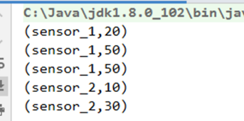

2.在keyby之后的流上使用

```java
env
  .fromCollection(waterSensors)
  .keyBy(WaterSensor::getId)
  .process(new KeyedProcessFunction<String, WaterSensor, Tuple2<String, Integer>>() {
      @Override
      public void processElement(WaterSensor value, Context ctx, Collector<Tuple2<String, Integer>> out) throws Exception {
          out.collect(new Tuple2<>("key是:" + ctx.getCurrentKey(), value.getVc()));
      }
  })
  .print();
```

​  

### 3.sink

（1）print

```java
public DataStreamSink<T> print(String sinkIdentifier) {
   PrintSinkFunction<T> printFunction = new PrintSinkFunction<>(sinkIdentifier, false);
   return addSink(printFunction).name("Print to Std. Out");
}
```

（2）kafkasink

```java
<dependency>
    <groupId>org.apache.flink</groupId>
    <artifactId>flink-connector-kafka_2.12</artifactId>
    <version>1.13.1</version>
</dependency>
<dependency>
    <groupId>com.alibaba</groupId>
    <artifactId>fastjson</artifactId>
    <version>1.2.75</version>
</dependency>
```
```java
import com.alibaba.fastjson.JSON;
import com.atguigu.flink.java.chapter_5.WaterSensor;
import org.apache.flink.api.common.serialization.SimpleStringSchema;
import org.apache.flink.streaming.api.environment.StreamExecutionEnvironment;
import org.apache.flink.streaming.connectors.kafka.FlinkKafkaProducer;

import java.util.ArrayList;

/**
 * @Author lizhenchao@atguigu.cn
 * @Date 2020/12/10 14:46
 */
public class Flink01_Sink_Kafka {
    public static void main(String[] args) throws Exception {
        ArrayList<WaterSensor> waterSensors = new ArrayList<>();
        waterSensors.add(new WaterSensor("sensor_1", 1607527992000L, 20));
        waterSensors.add(new WaterSensor("sensor_1", 1607527994000L, 50));
        waterSensors.add(new WaterSensor("sensor_1", 1607527996000L, 50));
        waterSensors.add(new WaterSensor("sensor_2", 1607527993000L, 10));
        waterSensors.add(new WaterSensor("sensor_2", 1607527995000L, 30));

        StreamExecutionEnvironment env = StreamExecutionEnvironment.getExecutionEnvironment().setParallelism(1);
        env
          .fromCollection(waterSensors)
          .map(JSON::toJSONString)
          .addSink(new FlinkKafkaProducer<String>("hadoop102:9092", "topic_sensor", new SimpleStringSchema()));

        env.execute();
    }
}
```

启动消费者来查看sink的数据

```java
bin/kafka-console-consumer.sh --bootstrap-server hadoop102:9092 --topic topic_sensor
```

（3）redissink

```java
<!-- https://mvnrepository.com/artifact/org.apache.flink/flink-connector-redis -->
<dependency>
<groupId>org.apache.flink</groupId>
<artifactId>flink-connector-redis_2.11</artifactId>
<version>1.1.5</version>
</dependency>
```
```java
import com.alibaba.fastjson.JSON;
import com.atguigu.flink.java.chapter_5.WaterSensor;
import org.apache.flink.streaming.api.environment.StreamExecutionEnvironment;
import org.apache.flink.streaming.connectors.redis.RedisSink;
import org.apache.flink.streaming.connectors.redis.common.config.FlinkJedisPoolConfig;
import org.apache.flink.streaming.connectors.redis.common.mapper.RedisCommand;
import org.apache.flink.streaming.connectors.redis.common.mapper.RedisCommandDescription;
import org.apache.flink.streaming.connectors.redis.common.mapper.RedisMapper;

import java.util.ArrayList;

/**
 * @Author lizhenchao@atguigu.cn
 * @Date 2020/12/10 14:46
 */
public class Flink02_Sink_Redis {
    public static void main(String[] args) throws Exception {
        ArrayList<WaterSensor> waterSensors = new ArrayList<>();
        waterSensors.add(new WaterSensor("sensor_1", 1607527992000L, 20));
        waterSensors.add(new WaterSensor("sensor_1", 1607527994000L, 50));
        waterSensors.add(new WaterSensor("sensor_1", 1607527996000L, 50));
        waterSensors.add(new WaterSensor("sensor_2", 1607527993000L, 10));
        waterSensors.add(new WaterSensor("sensor_2", 1607527995000L, 30));

        // 连接到Redis的配置
        FlinkJedisPoolConfig redisConfig = new FlinkJedisPoolConfig.Builder()
          .setHost("hadoop102")
          .setPort(6379)
          .setMaxTotal(100)
          .setTimeout(1000 * 10)
          .build();
        StreamExecutionEnvironment env = StreamExecutionEnvironment.getExecutionEnvironment().setParallelism(1);
        env
          .fromCollection(waterSensors)
          .addSink(new RedisSink<>(redisConfig, new RedisMapper<WaterSensor>() {
              /*
                key                 value(hash)
                "sensor"            field           value
                                    sensor_1        {"id":"sensor_1","ts":1607527992000,"vc":20}
                                    ...             ...
               */

              @Override
              public RedisCommandDescription getCommandDescription() {
                  // 返回存在Redis中的数据类型  存储的是Hash, 第二个参数是外面的key
                  return new RedisCommandDescription(RedisCommand.HSET, "sensor");
              }

              @Override
              public String getKeyFromData(WaterSensor data) {
                  // 从数据中获取Key: Hash的Key
                  return data.getId();
              }

              @Override
              public String getValueFromData(WaterSensor data) {
                  // 从数据中获取Value: Hash的value
                  return JSON.toJSONString(data);
              }
          }));

        env.execute();
    }
}
```

（4）elasticsearchSink

```java
<!-- https://mvnrepository.com/artifact/org.apache.flink/flink-connector-elasticsearch6 -->
<dependency>
<groupId>org.apache.flink</groupId>
<artifactId>flink-connector-elasticsearch6_2.12</artifactId>
<version>1.13.1</version>
</dependency>
```
```java
import com.alibaba.fastjson.JSON;
import com.atguigu.flink.java.chapter_5.WaterSensor;
import org.apache.flink.api.common.functions.RuntimeContext;
import org.apache.flink.streaming.api.environment.StreamExecutionEnvironment;
import org.apache.flink.streaming.connectors.elasticsearch.ElasticsearchSinkFunction;
import org.apache.flink.streaming.connectors.elasticsearch.RequestIndexer;
import org.apache.flink.streaming.connectors.elasticsearch6.ElasticsearchSink;
import org.apache.http.HttpHost;
import org.elasticsearch.action.index.IndexRequest;
import org.elasticsearch.client.Requests;
import org.elasticsearch.common.xcontent.XContentType;

import java.util.ArrayList;
import java.util.Arrays;
import java.util.List;

/**
 * @Author lizhenchao@atguigu.cn
 * @Date 2020/12/10 14:46
 */
public class Flink03_Sink_ES {
    public static void main(String[] args) throws Exception {
        ArrayList<WaterSensor> waterSensors = new ArrayList<>();
        waterSensors.add(new WaterSensor("sensor_1", 1607527992000L, 20));
        waterSensors.add(new WaterSensor("sensor_1", 1607527994000L, 50));
        waterSensors.add(new WaterSensor("sensor_1", 1607527996000L, 50));
        waterSensors.add(new WaterSensor("sensor_2", 1607527993000L, 10));
        waterSensors.add(new WaterSensor("sensor_2", 1607527995000L, 30));

        List<HttpHost> esHosts = Arrays.asList(
          new HttpHost("hadoop102", 9200),
          new HttpHost("hadoop103", 9200),
          new HttpHost("hadoop104", 9200));
        StreamExecutionEnvironment env = StreamExecutionEnvironment.getExecutionEnvironment().setParallelism(1);
        env
          .fromCollection(waterSensors)
          .addSink(new ElasticsearchSink.Builder<WaterSensor>(esHosts, new ElasticsearchSinkFunction<WaterSensor>() {

              @Override
              public void process(WaterSensor element, RuntimeContext ctx, RequestIndexer indexer) {
                  // 1. 创建es写入请求
                  IndexRequest request = Requests
                    .indexRequest("sensor")
                    .type("_doc")
                    .id(element.getId())
                    .source(JSON.toJSONString(element), XContentType.JSON);
                  // 2. 写入到es
                  indexer.add(request);
              }
          }).build());

        env.execute();
    }
}
```

Ø 如果出现如下错误: 添加log4j2的依赖:

```java
<dependency>
    <groupId>org.apache.logging.log4j</groupId>
    <artifactId>log4j-to-slf4j</artifactId>
    <version>2.14.0</version>
</dependency>
```

Ø 如果是无界流, 需要配置bulk的缓存

```java
esSinkBuilder.setBulkFlushMaxActions(1);
```

（5）自定义sink

Ø 在mysql中创建数据库和表

```sql
create database test;
use test;
CREATE TABLE `sensor` (
  `id` varchar(20) NOT NULL,
  `ts` bigint(20) NOT NULL,
  `vc` int(11) NOT NULL,
  PRIMARY KEY (`id`,`ts`)
) ENGINE=InnoDB DEFAULT CHARSET=utf8;
```
```sql
<dependency>
    <groupId>mysql</groupId>
    <artifactId>mysql-connector-java</artifactId>
    <version>5.1.49</version>
</dependency>
```
```java
import com.atguigu.flink.java.chapter_5.WaterSensor;
import org.apache.flink.configuration.Configuration;
import org.apache.flink.streaming.api.environment.StreamExecutionEnvironment;
import org.apache.flink.streaming.api.functions.sink.RichSinkFunction;

import java.sql.Connection;
import java.sql.DriverManager;
import java.sql.PreparedStatement;
import java.util.ArrayList;

/**
* @Author lizhenchao@atguigu.cn
* @Date 2020/12/10 14:46
*/
public class Flink04_Sink_Custom {
    public static void main(String[] args) throws Exception {
        ArrayList<WaterSensor> waterSensors = new ArrayList<>();
        waterSensors.add(new WaterSensor("sensor_1", 1607527992000L, 20));
        waterSensors.add(new WaterSensor("sensor_1", 1607527994000L, 50));
        waterSensors.add(new WaterSensor("sensor_1", 1607527996000L, 50));
        waterSensors.add(new WaterSensor("sensor_2", 1607527993000L, 10));
        waterSensors.add(new WaterSensor("sensor_2", 1607527995000L, 30));

        StreamExecutionEnvironment env = StreamExecutionEnvironment.getExecutionEnvironment().setParallelism(1);
        env.fromCollection(waterSensors)
            .addSink(new RichSinkFunction<WaterSensor>() {

                private PreparedStatement ps;
                private Connection conn;

                @Override
                public void open(Configuration parameters) throws Exception {
                    conn = DriverManager.getConnection("jdbc:mysql://hadoop102:3306/test?useSSL=false", "root", "aaaaaa");
                    ps = conn.prepareStatement("insert into sensor values(?, ?, ?)");
                }

                @Override
                public void close() throws Exception {
                    ps.close();
                    conn.close();
                }

                @Override
                public void invoke(WaterSensor value, Context context) throws Exception {
                    ps.setString(1, value.getId());
                    ps.setLong(2, value.getTs());
                    ps.setInt(3, value.getVc());
                    ps.execute();
                }
            });

        env.execute();
    }
}
```

  

一个小总结：流和批的输出结果对比，流是一个元素输出一次，批是一批数据输出一次。job是否会自动结束取决于你是无界还是有界，而不是批处理就一定会结束、流处理就一定会卡住

## 六、flink流处理进阶

### 1.时间语义与watermark

事件语义：处理时间、事件时间

watermark：用于测量事件时间进度的方式，作为数据流的一部分在流动，并且携带一个时间戳

Flink内置了两个WaterMark生成器:

（1）. Monotonously Increasing Timestamps(时间戳单调增长:其实就是允许的延迟为0) 和无序的继成同一个类

```java
WatermarkStrategy.forMonotonousTimestamps();
```

（2）. Fixed Amount of Lateness(允许固定时间的延迟)

```java
WatermarkStrategy.forBoundedOutOfOrderness(Duration.ofSeconds(10));

import com.atguigu.flink.java.chapter_5.WaterSensor;
import org.apache.flink.api.common.eventtime.SerializableTimestampAssigner;
import org.apache.flink.api.common.eventtime.WatermarkStrategy;
import org.apache.flink.api.common.functions.MapFunction;
import org.apache.flink.streaming.api.datastream.SingleOutputStreamOperator;
import org.apache.flink.streaming.api.environment.StreamExecutionEnvironment;
import org.apache.flink.streaming.api.functions.windowing.ProcessWindowFunction;
import org.apache.flink.streaming.api.windowing.assigners.TumblingEventTimeWindows;
import org.apache.flink.streaming.api.windowing.time.Time;
import org.apache.flink.streaming.api.windowing.windows.TimeWindow;
import org.apache.flink.util.Collector;

import java.time.Duration;

/**
 * @Author lizhenchao@atguigu.cn
 * @Date 2020/12/12 20:29
 */
public class Flink10_Chapter07_OrderedWaterMark {
    public static void main(String[] args) throws Exception {
        StreamExecutionEnvironment env = StreamExecutionEnvironment.getExecutionEnvironment().setParallelism(1);

        SingleOutputStreamOperator<WaterSensor> stream = env
          .socketTextStream("hadoop102", 9999)  // 在socket终端只输入毫秒级别的时间戳
          .map(new MapFunction<String, WaterSensor>() {
              @Override
              public WaterSensor map(String value) throws Exception {
                  String[] datas = value.split(",");
                  return new WaterSensor(datas[0], Long.valueOf(datas[1]), Integer.valueOf(datas[2]));

              }
          });

        // 创建水印生产策略
        WatermarkStrategy<WaterSensor> wms = WatermarkStrategy
          .<WaterSensor>forBoundedOutOfOrderness(Duration.ofSeconds(3)) // // 最大容忍的延迟时间
          .withTimestampAssigner(new SerializableTimestampAssigner<WaterSensor>() { // 指定时间戳
              @Override 
              public long extractTimestamp(WaterSensor element, long recordTimestamp) {
                  return element.getTs() * 1000;
              }
          });

        stream
          .assignTimestampsAndWatermarks(wms) // 指定水印和时间戳
          .keyBy(WaterSensor: :getId)
          .window(TumblingEventTimeWindows.of(Time.seconds(5)))
          .process(new ProcessWindowFunction<WaterSensor, String, String, TimeWindow>() {
              @Override
              public void process(String key, Context context, Iterable<WaterSensor> elements, Collector<String> out) throws Exception {
                  String msg = "当前key: " + key
                    + "窗口: [" + context.window().getStart() / 1000 + "," + context.window().getEnd()/1000 + ") 一共有 "
                    + elements.spliterator().estimateSize() + "条数据 ";
                  out.collect(msg);
              }
          })
          .print();
        env.execute();
    }
}
```

（3）自定义水印生成：有2种风格的WaterMark生产方式: periodic(周期性) and punctuated(间歇性).都需要继承接口: WatermarkGenerator

（4）多并行度或者多流join后，水印以最小的为准。

### 2.窗口

窗口分配器：确定要开什么类型的窗口，开窗必须要指定watermark，keyby之前开窗则是全局开窗，keyby之后则是每个task上都有自己独立的窗口。

（1）. 基于时间的窗口(**时间驱动**)：滚动、滑动、会话

```java
env
  .socketTextStream("hadoop102", 9999)
  .flatMap(new FlatMapFunction<String, Tuple2<String, Long>>() {
      @Override
      public void flatMap(String value, Collector<Tuple2<String, Long>> out) throws Exception {
          Arrays.stream(value.split("\\W+")).forEach(word -> out.collect(Tuple2.of(word, 1L)));
      }
  })
  .keyBy(t -> t.f0)
  .window(TumblingProcessingTimeWindows.of(Time.seconds(8))) // 添加滚动窗口
  .sum(1)
```

说明:

1. 时间间隔可以通过: Time.milliseconds(x), Time.seconds(x), Time.minutes(x),等等来指定.

2\. 我们传递给window函数的对象叫**窗口分配器**.

```java
env
  .socketTextStream("hadoop102", 9999)
  .flatMap(new FlatMapFunction<String, Tuple2<String, Long>>() {
      @Override
      public void flatMap(String value, Collector<Tuple2<String, Long>> out) throws Exception {
          Arrays.stream(value.split("\\W+")).forEach(word -> out.collect(Tuple2.of(word, 1L)));
      }
  })
  .keyBy(t -> t.f0)
  .window(SlidingProcessingTimeWindows.of(Time.seconds(10), Time.seconds(5))) // 添加滚动窗口
  .sum(1)
  .print();

env.execute();
```

就比滚动窗口多了个滑动步长，如上是10s窗口5s的滑动

会话窗口：静态gap

.window***(***ProcessingTimeSessionWindows.*withGap****(***Time.*seconds****(***10***)))***

会话窗口：动态gap

```java
.window(ProcessingTimeSessionWindows.withDynamicGap(new SessionWindowTimeGapExtractor<Tuple2<String, Long>>() {
    @Override
    public long extract(Tuple2<String, Long> element) { // 返回 gap值, 单位毫秒
        return element.f0.length() * 1000;
    }
}))
```

**创建原理****:**

因为会话窗口没有固定的开启和关闭时间, 所以会话窗口的创建和关闭与滚动,滑动窗口不同. 在Flink内部, 每到达一个新的元素都会创建一个新的会话窗口, 如果这些窗口彼此相距比较定义的gap小, 则会对他们进行合并. 为了能够合并, 会话窗口算子需要合并触发器和合并窗口函数: ReduceFunction, AggregateFunction, or ProcessWindowFunction

​  

（2）. 基于元素个数的(数据驱动)：滚动、滑动

.countWindow(3)

.countWindow(3,2)

（3）全局窗口（所有相同的key在一个窗口，只有自己制定的触发器才有用）

.window(GlobalWindows.create());

窗口函数：确定窗口内的数据计算逻辑，且一个窗口输出一次结果，分为增量聚合处理（来一个计算一个，如reduceFunction、aggregateFunction）和全量聚合处理（全来了一起计算，如processWindowFunction）

##### ​  

```java
.window(TumblingProcessingTimeWindows.of(Time.seconds(5)))
.reduce(new ReduceFunction<Tuple2<String, Long>>() {
    @Override
    public Tuple2<String, Long> reduce(Tuple2<String, Long> value1, Tuple2<String, Long> value2) throws Exception {
        System.out.println(value1 + " ----- " + value2);
  // value1是上次聚合的结果. 所以遇到每个窗口的第一个元素时, 这个函数不会进来
        return Tuple2.of(value1.f0, value1.f1 + value2.f1);
    }
})
```

##### ​  

```java
.window(TumblingProcessingTimeWindows.of(Time.seconds(5)))
.aggregate(new AggregateFunction<Tuple2<String, Long>, Long, Long>() {

    // 创建累加器: 初始化中间值
    @Override
    public Long createAccumulator() {
        System.out.println("createAccumulator");
        return 0L;
    }

    // 累加器操作
    @Override
    public Long add(Tuple2<String, Long> value, Long accumulator) {
        System.out.println("add");
        return accumulator + value.f1;
    }

    // 获取结果
    @Override
    public Long getResult(Long accumulator) {
        System.out.println("getResult");
        return accumulator;
    }

    // 累加器的合并: 只有会话窗口才会调用
    @Override
    public Long merge(Long a, Long b) {
        System.out.println("merge");
        return a + b;
    }
}) 
```

​  

### 3.侧输出流

用法一、接受窗口关闭之后的迟到数据（使用allowedLateness方法能延迟窗口的关闭时间，但是任然有数据迟到时，即可用侧输出流）

​  

```java
import com.atguigu.flink.java.chapter_5.WaterSensor;
import org.apache.flink.api.common.eventtime.SerializableTimestampAssigner;
import org.apache.flink.api.common.eventtime.WatermarkStrategy;
import org.apache.flink.api.common.functions.MapFunction;
import org.apache.flink.streaming.api.datastream.SingleOutputStreamOperator;
import org.apache.flink.streaming.api.environment.StreamExecutionEnvironment;
import org.apache.flink.streaming.api.functions.windowing.ProcessWindowFunction;
import org.apache.flink.streaming.api.windowing.assigners.TumblingEventTimeWindows;
import org.apache.flink.streaming.api.windowing.time.Time;
import org.apache.flink.streaming.api.windowing.windows.TimeWindow;
import org.apache.flink.util.Collector;
import org.apache.flink.util.OutputTag;

import java.time.Duration;

/**
 * @Author lizhenchao@atguigu.cn
 * @Date 2020/12/12 20:29
 */
public class Flink13_Chapter07_SideOutput {
    public static void main(String[] args) throws Exception {
        StreamExecutionEnvironment env = StreamExecutionEnvironment.getExecutionEnvironment().setParallelism(1);
        System.out.println(env.getConfig());

        SingleOutputStreamOperator<WaterSensor> stream = env
          .socketTextStream("hadoop102", 9999)  // 在socket终端只输入毫秒级别的时间戳
          .map(new MapFunction<String, WaterSensor>() {
              @Override
              public WaterSensor map(String value) throws Exception {
                  String[] datas = value.split(",");
                  return new WaterSensor(datas[0], Long.valueOf(datas[1]), Integer.valueOf(datas[2]));

              }
          });

        // 创建水印生产策略
        WatermarkStrategy<WaterSensor> wms = WatermarkStrategy
          .<WaterSensor>forBoundedOutOfOrderness(Duration.ofSeconds(3)) // 最大容忍的延迟时间
          .withTimestampAssigner(new SerializableTimestampAssigner<WaterSensor>() { // 指定时间戳
              @Override
              public long extractTimestamp(WaterSensor element, long recordTimestamp) {
                  return element.getTs() * 1000;
              }
          });

        SingleOutputStreamOperator<String> result = stream
          .assignTimestampsAndWatermarks(wms)
          .keyBy(WaterSensor::getId)
          .window(TumblingEventTimeWindows.of(Time.seconds(5)))
          .allowedLateness(Time.seconds(3))
          .sideOutputLateData(new OutputTag<WaterSensor>("side_1") {}) // 设置侧输出流
          .process(new ProcessWindowFunction<WaterSensor, String, String, TimeWindow>() {
              @Override
              public void process(String key, Context context, Iterable<WaterSensor> elements, Collector<String> out) throws Exception {
                  String msg = "当前key: " + key
                    + " 窗口: [" + context.window().getStart() / 1000 + "," + context.window().getEnd() / 1000 + ") 一共有 "
                    + elements.spliterator().estimateSize() + "条数据" +
                    "watermark: " + context.currentWatermark();
                  out.collect(context.window().toString());
                  out.collect(msg);
              }
          });
        result.print();
        result.getSideOutput(new OutputTag<WaterSensor>("side_1"){}).print();
        env.execute();
    }
}
```

​  

用法二、把一个流拆分成多个流

​  

```java
SingleOutputStreamOperator<WaterSensor> result =
  env
    .socketTextStream("hadoop102", 9999)  // 在socket终端只输入毫秒级别的时间戳
    .map(new MapFunction<String, WaterSensor>() {
        @Override
        public WaterSensor map(String value) throws Exception {
            String[] datas = value.split(",");
            return new WaterSensor(datas[0], Long.valueOf(datas[1]), Integer.valueOf(datas[2]));

        }
    })
    .keyBy(ws -> ws.getTs())
    .process(new KeyedProcessFunction<Long, WaterSensor, WaterSensor>() {
        @Override
        public void processElement(WaterSensor value, Context ctx, Collector<WaterSensor> out) throws Exception {
            out.collect(value);
            if (value.getVc() > 5) { //水位大于5的写入到侧输出流
                ctx.output(new OutputTag<WaterSensor>("警告") {}, value);
            }
        }
    });

result.print("主流");
result.getSideOutput(new OutputTag<WaterSensor>("警告"){}).print("警告");
```

  

### 4.processFunction 底层API （灵活多变）

（1）ProcessFunction (富函数、context可获取timestamp timeserver)

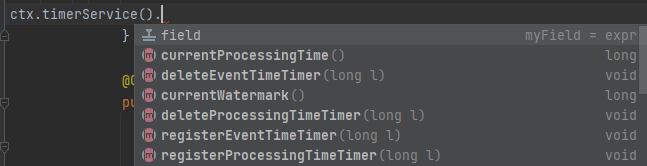

```java
env
  .socketTextStream("hadoop102", 9999)
  .map(line -> {
      String[] datas = line.split(",");
      return new WaterSensor(datas[0], Long.valueOf(datas[1]), Integer.valueOf(datas[2]));
  })
  .process(new ProcessFunction<WaterSensor, String>() {
      @Override
      public void processElement(WaterSensor value, Context ctx, Collector<String> out) throws Exception {
          out.collect(value.toString());
      }
  })
  .print();
```

（2）KeyedProcessFunction（除了上述（1）有的，比较重要的是可以获取侧输出流）

```java
env
  .socketTextStream("hadoop102", 9999)
  .map(line -> {
      String[] datas = line.split(",");
      return new WaterSensor(datas[0], Long.valueOf(datas[1]), Integer.valueOf(datas[2]));
  })
  .keyBy(ws -> ws.getId())
  .process(new KeyedProcessFunction<String, WaterSensor, String>() { // 泛型1:key的类型 泛型2:输入类型 泛型3:输出类型
      @Override
      public void processElement(WaterSensor value, Context ctx, Collector<String> out) throws Exception {
          System.out.println(ctx.getCurrentKey());
          out.collect(value.toString());
      }
  })
  .print();
```

（3）CoProcessFunction （用于将两个流connect后对两个流的不同处理逻辑实现，体现了connect合并流的本质->还是两个流，类似于SQL里边的join操作）

```java
DataStreamSource<Integer> intStream = env.fromElements(1, 2, 3, 4, 5);
DataStreamSource<String> stringStream = env.fromElements("a", "b", "c");

ConnectedStreams<Integer, String> cs = intStream.connect(stringStream);
cs
  .process(new CoProcessFunction<Integer, String, String>() {
      @Override
      public void processElement1(Integer value, Context ctx, Collector<String> out) throws Exception {
          out.collect(value.toString());
      }

      @Override
      public void processElement2(String value, Context ctx, Collector<String> out) throws Exception {
          out.collect(value);
      }
  })
  .print();
```

（4）ProcessJoinFunction

```java
SingleOutputStreamOperator<WaterSensor> s1 = env
  .socketTextStream("hadoop102", 8888)  // 在socket终端只输入毫秒级别的时间戳
  .map(value -> {
      String[] datas = value.split(",");
      return new WaterSensor(datas[0], Long.valueOf(datas[1]), Integer.valueOf(datas[2]));

  });
SingleOutputStreamOperator<WaterSensor> s2 = env
  .socketTextStream("hadoop102", 9999)  // 在socket终端只输入毫秒级别的时间戳
  .map(value -> {
      String[] datas = value.split(",");
      return new WaterSensor(datas[0], Long.valueOf(datas[1]), Integer.valueOf(datas[2]));

  });

s1.join(s2)
  .where(WaterSensor::getId)
  .equalTo(WaterSensor::getId)
  .window(TumblingProcessingTimeWindows.of(Time.seconds(5))) // 必须使用窗口
  .apply(new JoinFunction<WaterSensor, WaterSensor, String>() {
      @Override
      public String join(WaterSensor first, WaterSensor second) throws Exception {
          return "first: " + first + ", second: " + second;
      }
  })
  .print();
```

（5）BroadcastProcessFunction（用于将维表广播到事实表数据流中）

（6）KeyedBroadcastProcessFunction（keyby之后使用）

（7）ProcessWindowFunction（添加窗口之后使用）

（8）ProcessAllWindowFunction （全窗口函数之后使用）

​  

### 5.定时器

基于处理时间或者事件时间处理过一个元素之后, 注册一个定时器, 然后**指定的时间执行****.**

​Context和OnTimerContext所持有的TimerService对象拥有以下方法:

l currentProcessingTime(): Long 返回当前处理时间

l currentWatermark(): Long 返回当前watermark的时间戳

l registerProcessingTimeTimer(timestamp: Long): Unit 会注册当前key的processing time的定时器。当processing time到达定时时间时，触发timer。

l registerEventTimeTimer(timestamp: Long): Unit 会注册当前key的event time 定时器。当水位线大于等于定时器注册的时间时，触发定时器执行回调函数。

l deleteProcessingTimeTimer(timestamp: Long): Unit 删除之前注册处理时间定时器。如果没有这个时间戳的定时器，则不执行。

l deleteEventTimeTimer(timestamp: Long): Unit 删除之前注册的事件时间定时器，如果没有此时间戳的定时器，则不执行。

```java
SingleOutputStreamOperator<WaterSensor> stream = env
  .socketTextStream("hadoop102", 9999)  // 在socket终端只输入毫秒级别的时间戳
  .map(value -> {
      String[] datas = value.split(",");
      return new WaterSensor(datas[0], Long.valueOf(datas[1]), Integer.valueOf(datas[2]));

  });

stream
  .keyBy(WaterSensor::getId)
  .process(new KeyedProcessFunction<String, WaterSensor, String>() {
      @Override
      public void processElement(WaterSensor value, Context ctx, Collector<String> out) throws Exception {
          // 处理时间过后5s后触发定时器
          ctx.timerService().registerProcessingTimeTimer(ctx.timerService().currentProcessingTime() + 5000);
          out.collect(value.toString());
      }

      // 定时器被触发之后, 回调这个方法
      // 参数1: 触发器被触发的时间
      @Override
      public void onTimer(long timestamp, OnTimerContext ctx, Collector<String> out) throws Exception {
          System.out.println(timestamp);
          out.collect("我被触发了....");
      }
  })
  .print();
```
```java
SingleOutputStreamOperator<WaterSensor> stream = env
  .socketTextStream("hadoop102", 9999)  // 在socket终端只输入毫秒级别的时间戳
  .map(value -> {
      String[] datas = value.split(",");
      return new WaterSensor(datas[0], Long.valueOf(datas[1]), Integer.valueOf(datas[2]));

  });

WatermarkStrategy<WaterSensor> wms = WatermarkStrategy
  .<WaterSensor>forBoundedOutOfOrderness(Duration.ofSeconds(3))
  .withTimestampAssigner((element, recordTimestamp) -> element.getTs() * 1000);
stream
  .assignTimestampsAndWatermarks(wms)
  .keyBy(WaterSensor::getId)
  .process(new KeyedProcessFunction<String, WaterSensor, String>() {
      @Override
      public void processElement(WaterSensor value, Context ctx, Collector<String> out) throws Exception {
          System.out.println(ctx.timestamp());
          ctx.timerService().registerEventTimeTimer(ctx.timestamp() + 5000);
          out.collect(value.toString());
      }

      @Override
      public void onTimer(long timestamp, OnTimerContext ctx, Collector<String> out) throws Exception {
          System.out.println("定时器被触发.....");
      }
  })
  .print();
```

定时器练习：监控水位传感器的水位值，如果水位值在5s之内(event time)连续上升，则报警。

```java
SingleOutputStreamOperator<WaterSensor> stream = env
  .socketTextStream("hadoop102", 9999)  // 在socket终端只输入毫秒级别的时间戳
  .map(value -> {
      String[] datas = value.split(",");
      return new WaterSensor(datas[0], Long.valueOf(datas[1]), Integer.valueOf(datas[2]));

  });

WatermarkStrategy<WaterSensor> wms = WatermarkStrategy
  .<WaterSensor>forBoundedOutOfOrderness(Duration.ofSeconds(3))
  .withTimestampAssigner((element, recordTimestamp) -> element.getTs() * 1000);
stream
  .assignTimestampsAndWatermarks(wms)
  .keyBy(WaterSensor::getId)
  .process(new KeyedProcessFunction<String, WaterSensor, String>() {
      int lastVc = 0;
      long timerTS = Long.MIN_VALUE;

      @Override
      public void processElement(WaterSensor value, Context ctx, Collector<String> out) throws Exception {
          if (value.getVc() > lastVc) {
              if (timerTS == Long.MIN_VALUE) {
                  System.out.println("注册....");
                  timerTS = ctx.timestamp() + 5000L;
                  ctx.timerService().registerEventTimeTimer(timerTS);
              }
          } else {
              ctx.timerService().deleteEventTimeTimer(timerTS);
              timerTS = Long.MIN_VALUE;
          }

          lastVc = value.getVc();
          System.out.println(lastVc);

      }

      @Override
      public void onTimer(long timestamp, OnTimerContext ctx, Collector<String> out) throws Exception {
          out.collect(ctx.getCurrentKey() + " 报警!!!!");
        timerTS = Long.MIN_VALUE;
      }
  })
  .print();
```

  

### 6.flink状态编程

**（1）状态：**当需要考虑多个数据之间的关系时，则需要将数据或者数据处理结果先存储（内存、rocksdb、filesystem）起来，供后续数据与之做进一步处理。如：数据去重、聚合、更新机器学习模型等场景

**（2）状态分类：**

Flink包括两种基本类型的状态**Managed State**和**Raw State**

| ​ | **Managed State** | **Raw State** |
| --- | --- | --- |
| **状态管理方式** | Flink Runtime托管, 自动存储, 自动恢复, 自动伸缩 | 用户自己管理 |
| **状态数据结构** | Flink提供多种常用数据结构, 例如:ListState, MapState等 | 字节数组: byte[] |
| **使用场景** | 绝大数Flink算子 | 所有算子 |

​  

**注意****:**

从具体使用场景来说，绝大多数的算子都可以通过继承Rich函数类或其他提供好的接口类，在里面使用Managed State。Raw State一般是在已有算子和Managed State不够用时，用户自定义算子时使用。

在我们平时的使用中Managed State已经足够我们使用, 下面重点学习Managed State

Managed State的分类：按照keyby前后位置分为 Operator State（算子状态）和Keyed State（键控状态）

| ​ | **Operator State** | **Keyed State** |
| --- | --- | --- |
| **适用用算子类型** | 可用于所有算子: 常用于source, sink, 例如 FlinkKafkaConsumer | 只能用于用于KeyedStream上的算子 |
| **状态分配** | 一个算子的**子任务**对应一个状态 | 一个Key对应一个State: 一个算子会处理多个Key, 则访问相应的多个State |
| **创建和访问方式** | 实现CheckpointedFunction或ListCheckpointed(**已经过时**)接口 | 重写RichFunction, 通过里面的RuntimeContext访问 |
| **横向扩展** | 并发改变时有多重重写分配方式可选: 均匀分配和合并后每个得到全量 | 并发改变, State随着Key在实例间迁移 |
| **支持的数据结构** | ListState,UnionListStste和BroadCastState | ValueState, ListState,MapState ReduceState, AggregatingState |

**（3）算子状态的使用：**

注意: 算子**子任务**之间的状态**不能互相访问**

Operator State的实际应用场景不如Keyed State多，它经常**被用在Source或Sink等算子上**，用来保存流入数据的偏移量或对输出数据做缓存，以保证Flink应用的Exactly-Once语义。

Flink为算子状态提供**三种**基本数据结构：

Ø 列表状态（List state）

将状态表示为一组数据的列表

Ø 联合列表状态（Union list state）

也是将状态表示为数据的列表。它与常规列表状态的区别在于，在发生故障时，或者从保存点（savepoint）启动应用程序时如何恢复。

一种是均匀分配(List state)，另外一种是将所有 State 合并为全量 State 再分发给每个实例(Union list state)。

```java
import org.apache.flink.api.common.functions.MapFunction;
import org.apache.flink.api.common.state.ListState;
import org.apache.flink.api.common.state.ListStateDescriptor;
import org.apache.flink.runtime.state.FunctionInitializationContext;
import org.apache.flink.runtime.state.FunctionSnapshotContext;
import org.apache.flink.streaming.api.checkpoint.CheckpointedFunction;
import org.apache.flink.streaming.api.environment.StreamExecutionEnvironment;

/**
 * @Author lizhenchao@atguigu.cn
 * @Date 2021/1/2 11:51
 */
public class Flink01_State_Operator {
    public static void main(String[] args) throws Exception {
        StreamExecutionEnvironment env = StreamExecutionEnvironment
          .getExecutionEnvironment()
          .setParallelism(3);
        env
          .socketTextStream("hadoop102", 9999)
          .map(new MyCountMapper())
          .print();

        env.execute();
    }

    private static class MyCountMapper implements MapFunction<String, Long>, CheckpointedFunction {
        private Long count = 0L;
        private ListState<Long> state;

        @Override
        public Long map(String value) throws Exception {
            count++;
            return count;
        }

        // 初始化时会调用这个方法，向本地状态中填充数据. 每个子任务调用一次
        @Override
        public void initializeState(FunctionInitializationContext context) throws Exception {
            System.out.println("initializeState...");
            state = context
              .getOperatorStateStore()
              .getListState(new ListStateDescriptor<Long>("state", Long.class));
            for (Long c : state.get()) {
                count += c;
            }
        }

        // Checkpoint时会调用这个方法，我们要实现具体的snapshot逻辑，比如将哪些本地状态持久化
        @Override
        public void snapshotState(FunctionSnapshotContext context) throws Exception {
            System.out.println("snapshotState...");
            state.clear();
            state.add(count);
        }

    }
}
```

Ø 广播状态（Broadcast state）

是一种特殊的算子状态. 如果一个算子有多项任务，而它的每项任务状态又都相同，那么这种特殊情况最适合应用广播状态。把一个流当做共享数据广播到其他流

1\. 它是一个map格式

2\. 它只对输入有广播流和无广播流的特定算子可用

3\. 这样的算子可以具有不同名称的多个广播状态。

```java
import org.apache.flink.api.common.state.BroadcastState;
import org.apache.flink.api.common.state.MapStateDescriptor;
import org.apache.flink.api.common.state.ReadOnlyBroadcastState;
import org.apache.flink.streaming.api.datastream.BroadcastStream;
import org.apache.flink.streaming.api.datastream.DataStreamSource;
import org.apache.flink.streaming.api.environment.StreamExecutionEnvironment;
import org.apache.flink.streaming.api.functions.co.BroadcastProcessFunction;
import org.apache.flink.util.Collector;

/**
 * @Author lizhenchao@atguigu.cn
 * @Date 2021/1/2 11:51
 */
public class Flink01_State_Operator_3 {
    public static void main(String[] args) throws Exception {
        StreamExecutionEnvironment env = StreamExecutionEnvironment
          .getExecutionEnvironment()
          .setParallelism(3);
        DataStreamSource<String> dataStream = env.socketTextStream("hadoop102", 9999);
        DataStreamSource<String> controlStream = env.socketTextStream("hadoop102", 8888);

        MapStateDescriptor<String, String> stateDescriptor = new MapStateDescriptor<>("state", String.class, String.class);
        // 广播流
        BroadcastStream<String> broadcastStream = controlStream.broadcast(stateDescriptor);
        dataStream
          .connect(broadcastStream)
          .process(new BroadcastProcessFunction<String, String, String>() {
              @Override
              public void processElement(String value, ReadOnlyContext ctx, Collector<String> out) throws Exception {
                  // 从广播状态中取值, 不同的值做不同的业务
                  ReadOnlyBroadcastState<String, String> state = ctx.getBroadcastState(stateDescriptor);
                  if ("1".equals(state.get("switch"))) {
                      out.collect("切换到1号配置....");
                  } else if ("0".equals(state.get("switch"))) {
                      out.collect("切换到0号配置....");
                  } else {
                      out.collect("切换到其他配置....");
                  }
              }

              @Override
              public void processBroadcastElement(String value, Context ctx, Collector<String> out) throws Exception {
                  BroadcastState<String, String> state = ctx.getBroadcastState(stateDescriptor);
                  // 把值放入广播状态
                  state.put("switch", value);
              }
          })
          .print();

        env.execute();
    }

}
```

**（4）键控状态的使用**

每一个键值维护一个状态实例，相同key的数据共享一个状态，Keyed State很类似于一个分布式的key-value map数据结构，只能**用于KeyedStream**（keyBy算子处理之后）。

Ø ValueState<T>

保存单个值. 每个key有一个状态值. 设置使用 update(T), 获取使用T value()

```java
import com.atguigu.flink.java.chapter_5.WaterSensor;
import org.apache.flink.api.common.state.ValueState;
import org.apache.flink.api.common.state.ValueStateDescriptor;
import org.apache.flink.configuration.Configuration;
import org.apache.flink.streaming.api.environment.StreamExecutionEnvironment;
import org.apache.flink.streaming.api.functions.KeyedProcessFunction;
import org.apache.flink.util.Collector;

/**
 * @Author lizhenchao@atguigu.cn
 * @Date 2021/1/2 11:51
 */
public class Flink02_State_Keyed_Value {
    public static void main(String[] args) throws Exception {
        StreamExecutionEnvironment env = StreamExecutionEnvironment
          .getExecutionEnvironment()
          .setParallelism(3);
        env
          .socketTextStream("hadoop102", 9999)
          .map(value -> {
              String[] datas = value.split(",");
              return new WaterSensor(datas[0], Long.valueOf(datas[1]), Integer.valueOf(datas[2]));

          })
          .keyBy(WaterSensor::getId)
          .process(new KeyedProcessFunction<String, WaterSensor, String>() {
              private ValueState<Integer> state;
              @Override
              public void open(Configuration parameters) throws Exception {
                  state = getRuntimeContext().getState(new ValueStateDescriptor<Integer>("state", Integer.class));
              }

              @Override
              public void processElement(WaterSensor value, Context ctx, Collector<String> out) throws Exception {
                  Integer lastVc = state.value() == null ? 0 : state.value();
                  if (Math.abs(value.getVc() - lastVc) >= 10) {
                      out.collect(value.getId() + " 红色警报!!!");
                  }
                  state.update(value.getVc());
              }
          })
          .print();
        env.execute();
    }
}
```

Ø ListState<T>:

保存元素列表.

添加元素: add(T) addAll(List<T>)

获取元素: Iterable<T> get()

**覆盖**所有元素: update(List<T>)

```java
import com.atguigu.flink.java.chapter_5.WaterSensor;
import org.apache.flink.api.common.state.ListState;
import org.apache.flink.api.common.state.ListStateDescriptor;
import org.apache.flink.configuration.Configuration;
import org.apache.flink.streaming.api.environment.StreamExecutionEnvironment;
import org.apache.flink.streaming.api.functions.KeyedProcessFunction;
import org.apache.flink.util.Collector;

import java.util.ArrayList;
import java.util.List;

/**
 * @Author lizhenchao@atguigu.cn
 * @Date 2021/1/2 11:51
 */
public class Flink02_State_Keyed_ListState {
    public static void main(String[] args) throws Exception {
        StreamExecutionEnvironment env = StreamExecutionEnvironment
          .getExecutionEnvironment()
          .setParallelism(3);
        env
          .socketTextStream("hadoop102", 9999)
          .map(value -> {
              String[] datas = value.split(",");
              return new WaterSensor(datas[0], Long.valueOf(datas[1]), Integer.valueOf(datas[2]));

          })
          .keyBy(WaterSensor::getId)
          .process(new KeyedProcessFunction<String, WaterSensor, List<Integer>>() {
              private ListState<Integer> vcState;

              @Override
              public void open(Configuration parameters) throws Exception {
                  vcState = getRuntimeContext().getListState(new ListStateDescriptor<Integer>("vcState", Integer.class));
              }

              @Override
              public void processElement(WaterSensor value, Context ctx, Collector<List<Integer>> out) throws Exception {
                  vcState.add(value.getVc());
                  //1. 获取状态中所有水位高度, 并排序
                  List<Integer> vcs = new ArrayList<>();
                  for (Integer vc : vcState.get()) {
                      vcs.add(vc);
                  }
                  // 2. 降序排列
                  vcs.sort((o1, o2) -> o2 - o1);
                  // 3. 当长度超过3的时候移除最后一个
                  if (vcs.size() > 3) {
                      vcs.remove(3);
                  }
                  vcState.update(vcs);
                  out.collect(vcs);
              }
          })
          .print();
        env.execute();
    }
}
```

Ø ReducingState<T>:

存储单个值, 表示把所有元素的聚合结果添加到状态中. 与ListState类似, 但是当使用add(T)的时候ReducingState会使用指定的ReduceFunction进行聚合.

```java
.process(new KeyedProcessFunction<String, WaterSensor, Integer>() {
    private ReducingState<Integer> sumVcState;
    @Override
    public void open(Configuration parameters) throws Exception {
        sumVcState = this
          .getRuntimeContext()
          .getReducingState(new ReducingStateDescriptor<Integer>("sumVcState", Integer::sum, Integer.class));
    }

    @Override
    public void processElement(WaterSensor value, Context ctx, Collector<Integer> out) throws Exception {
        sumVcState.add(value.getVc());
        out.collect(sumVcState.get());
    }
})
```

Ø AggregatingState<IN,  
OUT>:

存储单个值. 与ReducingState类似, 都是进行聚合. 不同的是,AggregatingState的聚合的结果和元素类型可以不一样.

```java
.process(new KeyedProcessFunction<String, WaterSensor, Double>() {

    private AggregatingState<Integer, Double> avgState;

    @Override
    public void open(Configuration parameters) throws Exception {
        AggregatingStateDescriptor<Integer, Tuple2<Integer, Integer>, Double> aggregatingStateDescriptor = new AggregatingStateDescriptor<>("avgState", new AggregateFunction<Integer, Tuple2<Integer, Integer>, Double>() {
            @Override
            public Tuple2<Integer, Integer> createAccumulator() {
                return Tuple2.of(0, 0);
            }

            @Override
            public Tuple2<Integer, Integer> add(Integer value, Tuple2<Integer, Integer> accumulator) {
                return Tuple2.of(accumulator.f0 + value, accumulator.f1 + 1);
            }

            @Override
            public Double getResult(Tuple2<Integer, Integer> accumulator) {
                return accumulator.f0 * 1D / accumulator.f1;
            }

            @Override
            public Tuple2<Integer, Integer> merge(Tuple2<Integer, Integer> a, Tuple2<Integer, Integer> b) {
                return Tuple2.of(a.f0 + b.f0, a.f1 + b.f1);
            }
        }, Types.TUPLE(Types.INT, Types.INT));
        avgState = getRuntimeContext().getAggregatingState(aggregatingStateDescriptor);
    }

    @Override
    public void processElement(WaterSensor value, Context ctx, Collector<Double> out) throws Exception {
        avgState.add(value.getVc());
        out.collect(avgState.get());
    }
})
```

Ø MapState<UK, UV>:

存储键值对列表.

添加键值对: put(UK, UV) or putAll(Map<UK, UV>)

根据key获取值: get(UK)

获取所有: entries(), keys() and values()

检测是否为空: isEmpty()

```java
.process(new KeyedProcessFunction<String, WaterSensor, WaterSensor>() {
    private MapState<Integer, String> mapState;
    @Override
    public void open(Configuration parameters) throws Exception {
        mapState = this
          .getRuntimeContext()
          .getMapState(new MapStateDescriptor<Integer, String>("mapState", Integer.class, String.class));
    }
    @Override
    public void processElement(WaterSensor value, Context ctx, Collector<WaterSensor> out) throws Exception {
        if (!mapState.contains(value.getVc())) {
            out.collect(value);
            mapState.put(value.getVc(), "随意");
        }
    }
})
```

**注意****:**

a) 所有的类型都有clear(), 清空当前key的状态

b) 这些状态对象仅用于用户与状态进行交互.

c) 状态不是必须存储到内存, 也可以存储在磁盘或者任意其他地方

d) 从状态获取的值与输入元素的key相关

  

**（5）状态后端：可在flink\_conf.yaml文件中设置，或者代码中设置类型及地址**

每传入一条数据，有状态的算子任务都会**读取和更新状态**。由于有效的状态访问对于处理数据的低延迟至关重要，因此每个并行任务(子任务)都会在本地维护其状态，以确保快速的状态访问。

状态的存储、访问以及维护，由一个**可插入**的组件决定，这个组件就叫做**状态后端**（state backend）

**状态后端主要负责两件事：**

Ø 本地(taskmanager)的状态管理

Ø 将检查点（checkpoint）状态写入远程存储

分类：

MemoryStateBackend （新的是 HashMapStateBackend）

内存级别的状态后端(**默认**),

**存储方式****:**本地状态存储在TaskManager的内存中, checkpoint 存储在JobManager的内存中.

**特点****:**快速, 低延迟, 但不稳定

**使用场景****:** 1\. 本地测试 2\. 几乎无状态的作业(ETL) 3. JobManager不容易挂, 或者挂了影响不大. 4. 不推荐在生产环境下使用

FsStateBackend

**存储方式**: 本地状态在TaskManager内存, **Checkpoint****时****,** **存储在文件系统****(hdfs)****中**

**特点****:** 拥有内存级别的本地访问速度, 和更好的容错保证

**使用场景****:** 1. 常规使用状态的作业. 例如分钟级别窗口聚合, join等 2\. 需要开启HA的作业 3\. 可以应用在生产环境中

RocksDBStateBackend

将所有的状态序列化之后, 存入**本地**的**RocksDB**数据库中.(一种NoSql数据库, KV形式存储)

**存储方式****:** 1\. 本地状态存储在TaskManager的RocksDB数据库中(实际是内存+磁盘) 2. Checkpoint在外部文件系统(hdfs)中.

**使用场景:** 1\. 超大状态的作业, 例如天级的窗口聚合 2. 需要开启HA的作业 3. 对读写状态性能要求不高的作业 4. 可以使用在生产环境

### 7.flink的容错机制

flink做到了exactly-once的同时又保证了低延迟和高吞吐

（1）状态的一致性：at-most-once、at-least-once、exactly-once

（2）端到端的状态一致性：

source端：需要外部数据源可重设数据的读取位置，例如kafka可以指定offset来读取数据

flink内部：基于昌迪兰伯特算法 checkpoint机制

sink端：需要保证数据写入外部数据系统时，数据不会重复，因此支持幂等性 、支持事务性写入（预写日志

或者两阶段提交），取其一即可保证。

（3）checkpoint原理：每隔一段时间保存一个快照

flink的检查点算法：a.暂停job后做检查点最后恢复job；b.基于chandy-lamport algorithm的分布式快照算法的一种变体，即异步barrier快照，需要jobmanager为应用创建checkpointcoordinator来制作快照

barrier：作为流数据的一部分随着流流动，同时将流划分成多个段、是非常轻量级的，不需要暂停应用。

checkpoint的检查点制作过程：

a.checkpoint coordinator先向所有的source节点触发检查点，从源头产生barrier

b.随着流的流动、source节点向下游传输barrier，下游的算子收到barrier才会执行相应的检查点操作

c.当每个task在完成其state checkpoint后，会将备份数据的地址（state handle）通知给checkpoint coordinator。

d.当sink节点收集齐上游算子同一批的barrier后，会先执行自己的本地快照

e.sink节点完成checkpoint之后，会将state handle返回通知给coordinator。

f.最后coordinator收集齐所有的task的state handle之后，就认为这一次的checkpoint全局完成了，向持久化存储中再备份一个checkpoint meta文件

注意：barrier对齐（task会等着上游所有算子的同一批barrier到齐后才开始做快照）的情况下能实现精确一次性，若不对齐则是实现至少一次语义（新版本好像也可以实现精确一次）

（4）savepoint 原理：人工触发的checkpoint

（5）两阶段提交步骤总结如下：kafka-flink-kafka

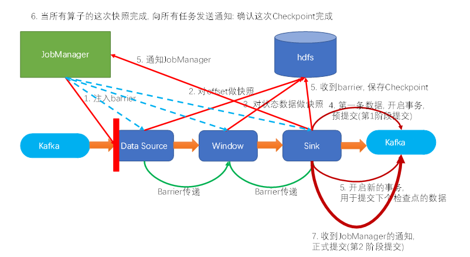

1) 某个checkpoint的第一条数据来了之后，开启一个 kafka 的事务（transaction），正常写入 kafka 分区日志但标记为未提交，这就是“预提交”(第一阶段提交)

2) jobmanager 触发 checkpoint 操作，barrier 从 source 开始向下传递，遇到 barrier 的算子状态后端会进行相应进行checkpoint，并通知 jobmanagerr

3) sink 连接器收到 barrier，保存当前状态，存入 checkpoint，通知 jobmanager，并开启下一阶段的事务，用于提交**下个检查点**的数据

4) jobmanager 收到所有任务的通知，发出确认信息，表示 checkpoint 完成

5) sink 任务收到 jobmanager 的确认信息，正式提交这段时间的数据(第二阶段提交)

6) 外部kafka关闭事务，提交的数据可以正常消费了

（6）checkpoint代码测试

```plain
import com.atguigu.flink.java.chapter_5.WaterSensor;
import org.apache.flink.api.common.serialization.SimpleStringSchema;
import org.apache.flink.api.common.state.ValueState;
import org.apache.flink.api.common.state.ValueStateDescriptor;
import org.apache.flink.configuration.Configuration;
import org.apache.flink.contrib.streaming.state.RocksDBStateBackend;
import org.apache.flink.streaming.api.CheckpointingMode;
import org.apache.flink.streaming.api.environment.CheckpointConfig;
import org.apache.flink.streaming.api.environment.StreamExecutionEnvironment;
import org.apache.flink.streaming.api.functions.KeyedProcessFunction;
import org.apache.flink.streaming.connectors.kafka.FlinkKafkaConsumer;
import org.apache.flink.streaming.connectors.kafka.FlinkKafkaProducer;
import org.apache.flink.util.Collector;

import java.util.Properties;

/**
 * @Author lizhenchao@atguigu.cn
 * @Date 2021/1/2 11:51
 */
public class Flink04_State_Checkpoint {
    public static void main(String[] args) throws Exception {
        System.setProperty("HADOOP_USER_NAME", "atguigu");

        Properties properties = new Properties();
        properties.setProperty("bootstrap.servers", "hadoop162:9092,hadoop163:9092,hadoop164:9092");
        properties.setProperty("group.id", "Flink01_Source_Kafka");
        properties.setProperty("auto.offset.reset", "latest");

        StreamExecutionEnvironment env = StreamExecutionEnvironment
          .createLocalEnvironmentWithWebUI(new Configuration())
          .setParallelism(3);
        env.setStateBackend(new RocksDBStateBackend("hdfs://hadoop162:8020/flink/checkpoints/rocksdb"));
        // 每 1000ms 开始一次 checkpoint
        env.enableCheckpointing(1000);
        // 高级选项：
        // 设置模式为精确一次 (这是默认值)
        env.getCheckpointConfig().setCheckpointingMode(CheckpointingMode.EXACTLY_ONCE);

        // 确认 checkpoints 之间的时间会进行 500 ms
        env.getCheckpointConfig().setMinPauseBetweenCheckpoints(500);

        // Checkpoint 必须在一分钟内完成，否则就会被抛弃
        env.getCheckpointConfig().setCheckpointTimeout(60000);

        // 同一时间只允许一个 checkpoint 进行
        env.getCheckpointConfig().setMaxConcurrentCheckpoints(1);

        // 开启在 job 中止后仍然保留的 externalized checkpoints
        env.getCheckpointConfig().enableExternalizedCheckpoints(CheckpointConfig.ExternalizedCheckpointCleanup.RETAIN_ON_CANCELLATION);
        
        env
          .addSource(new FlinkKafkaConsumer<>("sensor", new SimpleStringSchema(), properties))
          .map(value -> {
              String[] datas = value.split(",");
              return new WaterSensor(datas[0], Long.valueOf(datas[1]), Integer.valueOf(datas[2]));

          })
          .keyBy(WaterSensor::getId)
          .process(new KeyedProcessFunction<String, WaterSensor, String>() {
              private ValueState<Integer> state;

              @Override
              public void open(Configuration parameters) throws Exception {
                  state = getRuntimeContext().getState(new ValueStateDescriptor<Integer>("state", Integer.class));

              }

              @Override
              public void processElement(WaterSensor value, Context ctx, Collector<String> out) throws Exception {
                  Integer lastVc = state.value() == null ? 0 : state.value();
                  if (Math.abs(value.getVc() - lastVc) >= 10) {
                      out.collect(value.getId() + " 红色警报!!!");
                  }
                  state.update(value.getVc());
              }
          })
          .addSink(new FlinkKafkaProducer<String>("hadoop162:9092", "alert", new SimpleStringSchema()));

        env.execute();
    }
}
```

从快照恢复数据

bin/flink run -c com.atguigu.chapter07.state.Flink07\_Kafka\_Flink\_Kafka \-s hdfs://hadoop162:8020/flink/fs/aa62c578adb3c37056280e0c74f3d689/chk-9 flink1026-1.0-SNAPSHOT-jar-with-dependencies.jar

（7）savepoint代码测试

做savepoint

bin/flink savepoint jobid hdfs://hadoop162:8020/savepoint

从savepoint恢复数据：和checkpoint一样

​  

## 七、fink cep

### 1.介绍

是在flink实现的复杂事件处理库，能在无界流中按照过滤、关联、联合等规则检测出特定的数据，有机会掌握数据中重要的那部分复杂事件

### 2.开发步骤

（1）依赖

```java
<dependency>
    <groupId>org.apache.flink</groupId>
    <artifactId>flink-cep_${scala.binary.version}</artifactId>
    <version>${flink.version}</version>
</dependency>
```

（2）基本使用:定义模式、在流上应用模式、获取匹配到的结果

```java
import com.atguigu.flink.java.chapter_5.WaterSensor;
import org.apache.flink.api.common.eventtime.WatermarkStrategy;
import org.apache.flink.api.common.functions.MapFunction;
import org.apache.flink.cep.CEP;
import org.apache.flink.cep.PatternSelectFunction;
import org.apache.flink.cep.PatternStream;
import org.apache.flink.cep.pattern.Pattern;
import org.apache.flink.cep.pattern.conditions.SimpleCondition;
import org.apache.flink.streaming.api.datastream.SingleOutputStreamOperator;
import org.apache.flink.streaming.api.environment.StreamExecutionEnvironment;

import java.time.Duration;
import java.util.List;
import java.util.Map;

/**
 * @Author lizhenchao@atguigu.cn
 * @Date 2021/1/8 21:41
 */
public class Flink01_CEP_BasicUse {
    public static void main(String[] args) {
        StreamExecutionEnvironment env = StreamExecutionEnvironment.getExecutionEnvironment();
        env.setParallelism(2);

        SingleOutputStreamOperator<WaterSensor> waterSensorStream = env
            .readTextFile("input/sensor.txt")
            .map(new MapFunction<String, WaterSensor>() {
                @Override
                public WaterSensor map(String value) throws Exception {
                    String[] split = value.split(",");
                    return new WaterSensor(split[0],
                                           Long.parseLong(split[1]) * 1000,
                                           Integer.parseInt(split[2]));
                }
            })
            .assignTimestampsAndWatermarks(WatermarkStrategy
                                               .<WaterSensor>forBoundedOutOfOrderness(Duration.ofSeconds(5))
                                               .withTimestampAssigner((element, recordTimestamp) -> element.getTs()));
        // 1. 定义模式
        Pattern<WaterSensor, WaterSensor> pattern = Pattern
            .<WaterSensor>begin("start")	//模式名字必须有，且不能包含‘：’
            .where(new SimpleCondition<WaterSensor>() {
                @Override
                public boolean filter(WaterSensor value) throws Exception {
                    return "sensor_1".equals(value.getId());
                }
            });
        // 2. 在流上应用模式
        PatternStream<WaterSensor> waterSensorPS = CEP.pattern(waterSensorStream, pattern);
        // 3. 获取匹配到的结果
        waterSensorPS
            .select(new PatternSelectFunction<WaterSensor, String>() {
                @Override
                public String select(Map<String, List<WaterSensor>> pattern) throws Exception {
                    return pattern.toString();
                }
            })
            .print();

        try {
            env.execute();
        } catch (Exception e) {
            e.printStackTrace();
        }
    }
}
```

### 3.模式api

（1）单例模式：

单例模式只接受**一个事件.** 默认情况模式都是单例模式.

（2）循环模式：

循环模式可以接受**多个事件.**

单例模式配合上**量词**就是循环模式.(非常类似我们熟悉的正则表达式)

如：

```java
// 1. 定义模式
Pattern<WaterSensor, WaterSensor> pattern = Pattern
    .<WaterSensor>begin("start")
    .where(new SimpleCondition<WaterSensor>() {
        @Override
        public boolean filter(WaterSensor value) throws Exception {
            return "sensor_1".equals(value.getId());
        }
    });

// 1.1 使用量词出现两次
Pattern<WaterSensor, WaterSensor> patternWithQuantifier = pattern.times(2);
```
```java
// 1.1 使用量词 [2,4]   2次,3次或4次
Pattern<WaterSensor, WaterSensor> patternWithQuantifier = pattern.times(2, 4);
```
```java
Pattern<WaterSensor, WaterSensor> patternWithQuantifier = pattern.oneOrMore();
```
```java
// 2次或2次一样
Pattern<WaterSensor, WaterSensor> patternWithQuantifier = pattern.timesOrMore(2);
```

（3）条件

迭代条件：这是**最普遍的条件类型**。使用它可以指定一个基于前面已经被接受的事件的属性或者它们的一个子集的统计数据来决定是否接受时间序列的条件。

```java
Pattern<WaterSensor, WaterSensor> pattern = Pattern
    .<WaterSensor>begin("start")
    .where(new IterativeCondition<WaterSensor>() {
        @Override
        public boolean filter(WaterSensor value, Context<WaterSensor> ctx) throws Exception {
            return "sensor_1".equals(value.getId());
        }
    });
```

简单条件：这种类型的条件扩展了前面提到的IterativeCondition类，它决定是否接受一个事件只取决于事件自身的属性。

```java
Pattern<WaterSensor, WaterSensor> pattern = Pattern
    .<WaterSensor>begin("start")
    .where(new SimpleCondition<WaterSensor>() {
        @Override
        public boolean filter(WaterSensor value) throws Exception {
            System.out.println(value);
            return "sensor_1".equals(value.getId());
        }
    });
```

组合条件：.where ()、.or()

```java
Pattern<WaterSensor, WaterSensor> pattern = Pattern
    .<WaterSensor>begin("start")
    .where(new IterativeCondition<WaterSensor>() {
        @Override
        public boolean filter(WaterSensor value, Context<WaterSensor> ctx) throws Exception {
            return "sensor_1".equals(value.getId());
        }
    })
    .where(new SimpleCondition<WaterSensor>() {
        @Override
        public boolean filter(WaterSensor value) throws Exception {
            return value.getVc() > 30;
        }
    })
    .or(new SimpleCondition<WaterSensor>() {
        @Override
        public boolean filter(WaterSensor value) throws Exception {
            return value.getTs() > 3000;
        }
    });
```

停止条件：如果使用循环模式(oneOrMore, timesOrMore), 可以指定一个停止条件, 否则有可能会内存吃不消.

意思是满足了给定的条件的事件出现后，就不会再有事件被接受进入模式了。

```java
Pattern<WaterSensor, WaterSensor> pattern = Pattern
    .<WaterSensor>begin("start")
    .where(new IterativeCondition<WaterSensor>() {
        @Override
        public boolean filter(WaterSensor value, Context<WaterSensor> ctx) throws Exception {
            return "sensor_1".equals(value.getId());
        }
    })
    .timesOrMore(2)     //oneMore、timesOrMore都要用until
    .until(new SimpleCondition<WaterSensor>() {
        @Override
        public boolean filter(WaterSensor value) throws Exception {
            return value.getVc() >= 40;
        }
    });
```

（4）组合模式

严格连续（严格紧密相邻的事件）next

```java
Pattern<WaterSensor, WaterSensor> pattern = Pattern
    .<WaterSensor>begin("start")
    .where(new SimpleCondition<WaterSensor>() {
        @Override
        public boolean filter(WaterSensor value) throws Exception {
            return "sensor_1".equals(value.getId());
        }
    })
    .next("end")
    .where(new SimpleCondition<WaterSensor>() {
        @Override
        public boolean filter(WaterSensor value) throws Exception {
            return "sensor_2".equals(value.getId());
        }
    });
```

**注意****:**

notNext 如果不想后面直接连着一个特定事件

松散连续（忽略不匹配的事件） fllowedBy

```java
Pattern<WaterSensor, WaterSensor> pattern = Pattern
    .<WaterSensor>begin("start")
    .where(new SimpleCondition<WaterSensor>() {
        @Override
        public boolean filter(WaterSensor value) throws Exception {
            return "sensor_1".equals(value.getId());
        }
    })
    .followedBy("end")
    .where(new SimpleCondition<WaterSensor>() {
        @Override
        public boolean filter(WaterSensor value) throws Exception {
            return "sensor_2".equals(value.getId());
        }
    });
```

注意:

notFollowBy 如果不想一个特定事件发生在两个事件之间的任何地方。(notFollowBy不能位于模式的最后)

```java
Pattern<WaterSensor, WaterSensor> pattern = Pattern
    .<WaterSensor>begin("start")
    .where(new SimpleCondition<WaterSensor>() {
        @Override
        public boolean filter(WaterSensor value) throws Exception {
            return "sensor_1".equals(value.getId());
        }
    })
    .times(2);

```

非确定的松散连续：当且仅当数据为a,c,b,b时，对于followedBy模式而言命中的为{a,b}，对于followedByAny而言会有两次命中{a,b},{a,b}

```java
Pattern<WaterSensor, WaterSensor> pattern = Pattern
    .<WaterSensor>begin("start")
    .where(new SimpleCondition<WaterSensor>() {
        @Override
        public boolean filter(WaterSensor value) throws Exception {
            return "sensor_1".equals(value.getId());
        }
    })
    .followedByAny("end")
    .where(new SimpleCondition<WaterSensor>() {
        @Override
        public boolean filter(WaterSensor value) throws Exception {
            return "sensor_2".equals(value.getId());
        }
    });   
```
```java
Pattern<WaterSensor, WaterSensor> pattern = Pattern
    .<WaterSensor>begin("start")
    .where(new SimpleCondition<WaterSensor>() {
        @Override
        public boolean filter(WaterSensor value) throws Exception {
            return "sensor_1".equals(value.getId());
        }
    })
    .times(2)
    .allowCombinations();
```

循环模式的贪婪性：在组合模式情况下, 对次数的处理尽可能获取最多个的那个次数, 就是**贪婪**!当一个事件***同时满足两个模式***的时候起作用.

```java
Pattern<WaterSensor, WaterSensor> pattern = Pattern
    .<WaterSensor>begin("start")
    .where(new SimpleCondition<WaterSensor>() {
        @Override
        public boolean filter(WaterSensor value) throws Exception {
            return "sensor_1".equals(value.getId());
        }
    }).times(2, 3).greedy()
    .next("end")
    .where(new SimpleCondition<WaterSensor>() {
        @Override
        public boolean filter(WaterSensor value) throws Exception {
            return value.getVc() == 30;
        }
    });
```

数据:

sensor\_1,1,10  
sensor\_1,2,20  
**sensor\_1,3,30**  
sensor\_2,4,30  
sensor\_1,4,400  
sensor\_2,5,50  
sensor\_2,6,60

结果:

{start=[WaterSensor(id=sensor\_1, ts=1000, vc=10), WaterSensor(id=sensor\_1, ts=2000, vc=20), WaterSensor(id=sensor\_1, ts=3000, vc=30)], end=[WaterSensor(id=sensor\_2, ts=4000, vc=30)]}

​  

{start=[WaterSensor(id=sensor\_1, ts=2000, vc=20), WaterSensor(id=sensor\_1, ts=3000, vc=30)], end=[WaterSensor(id=sensor\_2, ts=4000, vc=30)]}

分析:

**sensor\_1,3,30** 在匹配的的时候, 既能匹配第一个模式也可以匹配的第二个模式, 由于第一个模式使用量词则使用greedy的时候会优先匹配第一个模式, 因为要**尽可能多的次数**

**注意****:**

1. 一般**贪婪比非贪婪**的**结果要少**!

2\. 模式组不能设置为greedy

模式可选性：可以使用pattern.optional()方法让所有的模式变成可选的，不管是否是循环模式

```java
Pattern<WaterSensor, WaterSensor> pattern = Pattern
    .<WaterSensor>begin("start")
    .where(new SimpleCondition<WaterSensor>() {
        @Override
        public boolean filter(WaterSensor value) throws Exception {
            return "sensor_1".equals(value.getId());
        }
    }).times(2).optional()  // 0次或2次
    .next("end")
    .where(new SimpleCondition<WaterSensor>() {
        @Override
        public boolean filter(WaterSensor value) throws Exception {
            return "sensor_2".equals(value.getId());
        }
    });
```

说明:start模式可能会没有!

模式组：在前面的代码中**次数只能用在某个模式上**, 比如: .begin(...).where(...).next(...).where(...).times(2) 这里的次数只会用在next这个模式上, 而不会用在begin模式上.

```java
Pattern<WaterSensor, WaterSensor> pattern = Pattern
    .begin(Pattern
               .<WaterSensor>begin("start")
               .where(new SimpleCondition<WaterSensor>() {
                   @Override
                   public boolean filter(WaterSensor value) throws Exception {
                       return "sensor_1".equals(value.getId());
                   }
               })
               .next("next")
               .where(new SimpleCondition<WaterSensor>() {
                   @Override
                   public boolean filter(WaterSensor value) throws Exception {
                       return "sensor_2".equals(value.getId());
                   }
               }))
    .times(2);
```

超时数据丢弃：当一个模式上通过within加上窗口长度后，部分匹配的事件序列就可能因为超过窗口长度而被丢弃。

```java
Pattern<WaterSensor, WaterSensor> pattern = Pattern
    .<WaterSensor>begin("start")
    .where(new SimpleCondition<WaterSensor>() {
        @Override
        public boolean filter(WaterSensor value) throws Exception {
            return "sensor_1".equals(value.getId());
        }
    })
    .next("end")
    .where(new SimpleCondition<WaterSensor>() {
        @Override
        public boolean filter(WaterSensor value) throws Exception {
            return "sensor_2".equals(value.getId());
        }
    })
    .within(Time.seconds(2));
```

匹配后跳过策略：对于一个给定的模式，同一个事件可能会分配到多个成功的匹配上。为了控制一个事件会分配到多少个匹配上，你需要指定跳过策略AfterMatchSkipStrategy。 有五种跳过策略，如下：

· ***NO\_SKIP***: 每个成功的匹配都会被输出。

· ***SKIP\_TO\_NEXT***: 丢弃以相同事件开始的所有部分匹配。

· ***SKIP\_PAST\_LAST\_EVENT***: 丢弃起始在这个匹配的开始和结束之间的所有部分匹配。

· ***SKIP\_TO\_FIRST***: 丢弃起始在这个匹配的开始和第一个出现的名称为*PatternName*事件之间的所有部分匹配。

· ***SKIP\_TO\_LAST***: 丢弃起始在这个匹配的开始和最后一个出现的名称为*PatternName*事件之间的所有部分匹配。

AfterMatchSkipStrategy skipStrategy = ...

Pattern.begin("patternName", skipStrategy);

​  

## 八、flink table SQL

### 1.介绍：

table api 和SQL都是流批统一的

动态表：随时间变化的，可以像查询静态表一样查询，查询会连续不断不断更新其结果表。

### 2.Table api

```plain
<dependency>
    <groupId>org.apache.flink</groupId>
    <artifactId>flink-table-planner-blink_${scala.binary.version}</artifactId>
    <version>${flink.version}</version>
    <scope>provided</scope>
</dependency>
<dependency>
    <groupId>org.apache.flink</groupId>
    <artifactId>flink-streaming-scala_${scala.binary.version}</artifactId>
    <version>${flink.version}</version>
    <scope>provided</scope>
</dependency>
<dependency>
    <groupId>org.apache.flink</groupId>
    <artifactId>flink-csv</artifactId>
    <version>${flink.version}</version>
</dependency>
<dependency>
    <groupId>org.apache.flink</groupId>
    <artifactId>flink-json</artifactId>
    <version>${flink.version}</version>
</dependency>

<!-- https://mvnrepository.com/artifact/org.apache.commons/commons-compress -->
<dependency>
<groupId>org.apache.commons</groupId>
<artifactId>commons-compress</artifactId>
<version>1.21</version>
</dependency>
```

​  

```plain
import com.atguigu.flink.java.chapter_5.WaterSensor;
import org.apache.flink.streaming.api.datastream.DataStream;
import org.apache.flink.streaming.api.datastream.DataStreamSource;
import org.apache.flink.streaming.api.environment.StreamExecutionEnvironment;
import org.apache.flink.table.api.Table;
import org.apache.flink.table.api.bridge.java.StreamTableEnvironment;
import org.apache.flink.types.Row;

import static org.apache.flink.table.api.Expressions.$;

/**
 * @Author lizhenchao@atguigu.cn
 * @Date 2021/1/11 21:43
 */
public class Flink01_TableApi_BasicUse {
    public static void main(String[] args) {
        StreamExecutionEnvironment env = StreamExecutionEnvironment.getExecutionEnvironment();
        env.setParallelism(1);
        DataStreamSource<WaterSensor> waterSensorStream =
            env.fromElements(new WaterSensor("sensor_1", 1000L, 10),
                             new WaterSensor("sensor_1", 2000L, 20),
                             new WaterSensor("sensor_2", 3000L, 30),
                             new WaterSensor("sensor_1", 4000L, 40),
                             new WaterSensor("sensor_1", 5000L, 50),
                             new WaterSensor("sensor_2", 6000L, 60));

        // 1. 创建表的执行环境
        StreamTableEnvironment tableEnv = StreamTableEnvironment.create(env);
        // 2. 创建表: 将流转换成动态表. 表的字段名从pojo的属性名自动抽取
        Table table = tableEnv.fromDataStream(waterSensorStream);
        // 3. 对动态表进行查询
        Table resultTable = table
            .where($("id").isEqual("sensor_1"))
            .select($("id"), $("ts"), $("vc"));
        // 4. 把动态表转换成流
        DataStream<Row> resultStream = tableEnv.toAppendStream(resultTable, Row.class);
        resultStream.print();
        try {
            env.execute();
        } catch (Exception e) {
            e.printStackTrace();
        }
    }
}
```
```plain
// 3. 对动态表进行查询
Table resultTable = table
    .where($("vc").isGreaterOrEqual(20))
    .groupBy($("id"))
    .aggregate($("vc").sum().as("vc_sum"))
    .select($("id"), $("vc_sum"));
// 4. 把动态表转换成流如果涉及到数据的更新, 要用到撤回流. 多个了一个boolean标记
DataStream<Tuple2<Boolean, Row>> resultStream = tableEnv.toRetractStream(resultTable, Row.class);
```

表流之间的转换：

append-only流：仅提供insert操作

retract流：可insert数据，可更新，更新时是先delete原有数据再add新数据（会有两条记录）

upsert流：新数据直接覆盖就数据（只会显示覆盖后结果）

通过connector读写数据

```plain
// 2. 创建表
// 2.1 表的元数据信息
Schema schema = new Schema()
    .field("id", DataTypes.STRING())
    .field("ts", DataTypes.BIGINT())
    .field("vc", DataTypes.INT());
// 2.2 连接文件, 并创建一个临时表, 其实就是一个动态表
tableEnv.connect(new FileSystem().path("input/sensor.txt"))
    .withFormat(new Csv().fieldDelimiter(',').lineDelimiter("\n"))
    .withSchema(schema)
    .createTemporaryTable("sensor");
// 3. 做成表对象, 然后对动态表进行查询
Table sensorTable = tableEnv.from("sensor");
Table resultTable = sensorTable
    .groupBy($("id"))
    .select($("id"), $("id").count().as("cnt"));
// 4. 把动态表转换成流. 如果涉及到数据的更新, 要用到撤回流. 多个了一个boolean标记
DataStream<Tuple2<Boolean, Row>> resultStream = tableEnv.toRetractStream(resultTable, Row.class);
resultStream.print();
```
```plain
// 2. 创建表
// 2.1 表的元数据信息
Schema schema = new Schema()
    .field("id", DataTypes.STRING())
    .field("ts", DataTypes.BIGINT())
    .field("vc", DataTypes.INT());
// 2.2 连接文件, 并创建一个临时表, 其实就是一个动态表
tableEnv
    .connect(new Kafka()
                 .version("universal")
                 .topic("sensor")
                 .startFromLatest()
                 .property("group.id", "bigdata")
                 .property("bootstrap.servers", "hadoop162:9092,hadoop163:9092,hadoop164:9092"))
    .withFormat(new Json())
    .withSchema(schema)
    .createTemporaryTable("sensor");
// 3. 对动态表进行查询
Table sensorTable = tableEnv.from("sensor");
Table resultTable = sensorTable
    .groupBy($("id"))
    .select($("id"), $("id").count().as("cnt"));
// 4. 把动态表转换成流. 如果涉及到数据的更新, 要用到撤回流. 多个了一个boolean标记
DataStream<Tuple2<Boolean, Row>> resultStream = tableEnv.toRetractStream(resultTable, Row.class);
resultStream.print();
```
```plain
import com.atguigu.flink.java.chapter_5.WaterSensor;
import org.apache.flink.streaming.api.datastream.DataStreamSource;
import org.apache.flink.streaming.api.environment.StreamExecutionEnvironment;
import org.apache.flink.table.api.DataTypes;
import org.apache.flink.table.api.Table;
import org.apache.flink.table.api.bridge.java.StreamTableEnvironment;
import org.apache.flink.table.descriptors.Csv;
import org.apache.flink.table.descriptors.FileSystem;
import org.apache.flink.table.descriptors.Schema;

import static org.apache.flink.table.api.Expressions.$;

/**
 * @Author lizhenchao@atguigu.cn
 * @Date 2021/1/11 21:43
 */
public class Flink02_TableApi_ToFileSystem {
    public static void main(String[] args) {
        StreamExecutionEnvironment env = StreamExecutionEnvironment.getExecutionEnvironment();
        env.setParallelism(1);
        DataStreamSource<WaterSensor> waterSensorStream =
            env.fromElements(new WaterSensor("sensor_1", 1000L, 10),
                             new WaterSensor("sensor_1", 2000L, 20),
                             new WaterSensor("sensor_2", 3000L, 30),
                             new WaterSensor("sensor_1", 4000L, 40),
                             new WaterSensor("sensor_1", 5000L, 50),
                             new WaterSensor("sensor_2", 6000L, 60));
        // 1. 创建表的执行环境
        StreamTableEnvironment tableEnv = StreamTableEnvironment.create(env);

        Table sensorTable = tableEnv.fromDataStream(waterSensorStream);
        Table resultTable = sensorTable
            .where($("id").isEqual("sensor_1") )
            .select($("id"), $("ts"), $("vc"));

        // 创建输出表
        Schema schema = new Schema()
            .field("id", DataTypes.STRING())
            .field("ts", DataTypes.BIGINT())
            .field("vc", DataTypes.INT());
        tableEnv
            .connect(new FileSystem().path("output/sensor_id.txt"))
            .withFormat(new Csv().fieldDelimiter('|'))
            .withSchema(schema)
            .createTemporaryTable("sensor");

        // 把数据写入到输出表中
        resultTable.executeInsert("sensor");
    }
}
```
```plain
import com.atguigu.flink.java.chapter_5.WaterSensor;
import org.apache.flink.streaming.api.datastream.DataStreamSource;
import org.apache.flink.streaming.api.environment.StreamExecutionEnvironment;
import org.apache.flink.table.api.DataTypes;
import org.apache.flink.table.api.Table;
import org.apache.flink.table.api.bridge.java.StreamTableEnvironment;
import org.apache.flink.table.descriptors.Json;
import org.apache.flink.table.descriptors.Kafka;
import org.apache.flink.table.descriptors.Schema;

import static org.apache.flink.table.api.Expressions.$;

/**
 * @Author lizhenchao@atguigu.cn
 * @Date 2021/1/11 21:43
 */
public class Flink03_TableApi_ToKafka {
    public static void main(String[] args) {
        StreamExecutionEnvironment env = StreamExecutionEnvironment.getExecutionEnvironment();
        env.setParallelism(1);
        DataStreamSource<WaterSensor> waterSensorStream =
            env.fromElements(new WaterSensor("sensor_1", 1000L, 10),
                             new WaterSensor("sensor_1", 2000L, 20),
                             new WaterSensor("sensor_2", 3000L, 30),
                             new WaterSensor("sensor_1", 4000L, 40),
                             new WaterSensor("sensor_1", 5000L, 50),
                             new WaterSensor("sensor_2", 6000L, 60));
        // 1. 创建表的执行环境
        StreamTableEnvironment tableEnv = StreamTableEnvironment.create(env);

        Table sensorTable = tableEnv.fromDataStream(waterSensorStream);
        Table resultTable = sensorTable
            .where($("id").isEqual("sensor_1") )
            .select($("id"), $("ts"), $("vc"));

        // 创建输出表
        Schema schema = new Schema()
            .field("id", DataTypes.STRING())
            .field("ts", DataTypes.BIGINT())
            .field("vc", DataTypes.INT());
        tableEnv
            .connect(new Kafka()
                         .version("universal")
                         .topic("sink_sensor")
                         .sinkPartitionerRoundRobin()
                         .property("bootstrap.servers", "hadoop162:9092,hadoop163:9092,hadoop164:9092"))
            .withFormat(new Json())
            .withSchema(schema)
            .createTemporaryTable("sensor");

        // 把数据写入到输出表中
        resultTable.executeInsert("sensor");
    }
}
```

其他的connector：[https://ci.apache.org/projects/flink/flink-docs-release-1.12/zh/dev/table/connect.html](https://ci.apache.org/projects/flink/flink-docs-release-1.12/zh/dev/table/connect.html)

### 3.flinksql

```plain
import com.atguigu.flink.java.chapter_5.WaterSensor;
import org.apache.flink.streaming.api.datastream.DataStreamSource;
import org.apache.flink.streaming.api.environment.StreamExecutionEnvironment;
import org.apache.flink.table.api.Table;
import org.apache.flink.table.api.bridge.java.StreamTableEnvironment;
import org.apache.flink.types.Row;

/**
 * @Author lizhenchao@atguigu.cn
 * @Date 2021/1/11 21:43
 */
public class Flink05_SQL_BaseUse_2 {
    public static void main(String[] args) throws Exception {
        StreamExecutionEnvironment env = StreamExecutionEnvironment.getExecutionEnvironment();
        env.setParallelism(1);
        DataStreamSource<WaterSensor> waterSensorStream =
            env.fromElements(new WaterSensor("sensor_1", 1000L, 10),
                             new WaterSensor("sensor_1", 2000L, 20),
                             new WaterSensor("sensor_2", 3000L, 30),
                             new WaterSensor("sensor_1", 4000L, 40),
                             new WaterSensor("sensor_1", 5000L, 50),
                             new WaterSensor("sensor_2", 6000L, 60));

        StreamTableEnvironment tableEnv = StreamTableEnvironment.create(env);
        // 使用sql查询一个已注册的表
        // 1. 从流得到一个表
        Table inputTable = tableEnv.fromDataStream(waterSensorStream);
        // 2. 把注册为一个临时视图，若不注册，在查询的时候则要用到inputTable代替后续sensor的位置，且要在sql字符串外
        tableEnv.createTemporaryView("sensor", inputTable);
        // 3. 在临时视图查询数据, 并得到一个新表
        Table resultTable = tableEnv.sqlQuery("select * from sensor where id='sensor_1'");
        // 4. 显示resultTable的数据
        tableEnv.toAppendStream(resultTable, Row.class).print();
        env.execute();
    }
}
```
```plain
import org.apache.flink.streaming.api.environment.StreamExecutionEnvironment;
import org.apache.flink.table.api.bridge.java.StreamTableEnvironment;

/**
 * @Author lizhenchao@atguigu.cn
 * @Date 2021/1/11 21:43
 */
public class Flink05_SQL_Kafka2Kafka {
    public static void main(String[] args) throws Exception {
        StreamExecutionEnvironment env = StreamExecutionEnvironment.getExecutionEnvironment();
        env.setParallelism(1);
        StreamTableEnvironment tableEnv = StreamTableEnvironment.create(env);

        // 1. 注册SourceTable: source_sensor
        tableEnv.executeSql("create table source_sensor (id string, ts bigint, vc int) with("
                                + "'connector' = 'kafka',"
                                + "'topic' = 'topic_source_sensor',"
                                + "'properties.bootstrap.servers' = 'hadoop162:9029,hadoop163:9092,hadoop164:9092',"
                                + "'properties.group.id' = 'atguigu',"
                                + "'scan.startup.mode' = 'latest-offset',"
                                + "'format' = 'json'"
                                + ")");

        // 2. 注册SinkTable: sink_sensor
        tableEnv.executeSql("create table sink_sensor(id string, ts bigint, vc int) with("
                                + "'connector' = 'kafka',"
                                + "'topic' = 'topic_sink_sensor',"
                                + "'properties.bootstrap.servers' = 'hadoop162:9029,hadoop163:9092,hadoop164:9092',"
                                + "'format' = 'json'"
                                + ")");

        // 3. 从SourceTable 查询数据, 并写入到 SinkTable
        tableEnv.executeSql("insert into sink_sensor select * from source_sensor where id='sensor_1'");
    }
}
```

### 4.处理时间

处理时间属性可以在 schema 定义的时候用 .proctime 后缀来定义。时间属性一定**不能定义在一个已有字段上**，所以它**新增一个字段****\_**

```plain
StreamExecutionEnvironment env = StreamExecutionEnvironment.getExecutionEnvironment();
env.setParallelism(1);
DataStreamSource<WaterSensor> waterSensorStream =
    env.fromElements(new WaterSensor("sensor_1", 1000L, 10),
                     new WaterSensor("sensor_1", 2000L, 20),
                     new WaterSensor("sensor_2", 3000L, 30),
                     new WaterSensor("sensor_1", 4000L, 40),
                     new WaterSensor("sensor_1", 5000L, 50),
                     new WaterSensor("sensor_2", 6000L, 60));
// 1. 创建表的执行环境
StreamTableEnvironment tableEnv = StreamTableEnvironment.create(env);

// 声明一个额外的字段来作为处理时间字段
Table sensorTable = tableEnv.fromDataStream(waterSensorStream, $("id"), $("ts"), $("vc"), $("pt").proctime());

sensorTable.print();

env.execute();
```
```plain
import org.apache.flink.streaming.api.environment.StreamExecutionEnvironment;
import org.apache.flink.table.api.TableResult;
import org.apache.flink.table.api.bridge.java.StreamTableEnvironment;

/**
 * @Author lizhenchao@atguigu.cn
 * @Date 2021/1/11 21:43
 */
public class Flink06_TableApi_ProcessTime {
    public static void main(String[] args) throws Exception {
        StreamExecutionEnvironment env = StreamExecutionEnvironment.getExecutionEnvironment();
        env.setParallelism(1);
        // 1. 创建表的执行环境
        StreamTableEnvironment tableEnv = StreamTableEnvironment.create(env);
        // 创建表, 声明一个额外的列作为处理时间
        tableEnv.executeSql("create table sensor(id string,ts bigint,vc int,pt_time as PROCTIME()) with("
                                + "'connector' = 'filesystem',"
                                + "'path' = 'input/sensor.txt',"
                                + "'format' = 'csv'"
                                + ")");

        TableResult result = tableEnv.executeSql("select * from sensor");
        result.print();
    }

}
```

### 5.事件时间

事件时间属性可以用 .rowtime 后缀在定义 DataStream schema 的时候来定义。[时间戳和 watermark](https://ci.apache.org/projects/flink/flink-docs-release-1.12/zh/dev/event_time.html) 在这之前一定是**在** **DataStream** **上已经定义好**了。可以替换一个已经存在的字段，或者在结尾追加一个新的字段，且该字段都是datastream中定义的事件的事件戳

```plain
import com.atguigu.flink.java.chapter_5.WaterSensor;
import org.apache.flink.api.common.eventtime.WatermarkStrategy;
import org.apache.flink.streaming.api.datastream.SingleOutputStreamOperator;
import org.apache.flink.streaming.api.environment.StreamExecutionEnvironment;
import org.apache.flink.table.api.Table;
import org.apache.flink.table.api.bridge.java.StreamTableEnvironment;

import java.time.Duration;

import static org.apache.flink.table.api.Expressions.$;

/**
 * @Author lizhenchao@atguigu.cn
 * @Date 2021/1/11 21:43
 */
public class Flink07_TableApi_EventTime {
    public static void main(String[] args) throws Exception {
        StreamExecutionEnvironment env = StreamExecutionEnvironment.getExecutionEnvironment();
        env.setParallelism(1);
        SingleOutputStreamOperator<WaterSensor> waterSensorStream = env
            .fromElements(new WaterSensor("sensor_1", 1000L, 10),
                          new WaterSensor("sensor_1", 2000L, 20),
                          new WaterSensor("sensor_2", 3000L, 30),
                          new WaterSensor("sensor_1", 4000L, 40),
                          new WaterSensor("sensor_1", 5000L, 50),
                          new WaterSensor("sensor_2", 6000L, 60))
            .assignTimestampsAndWatermarks(
                WatermarkStrategy
                    .<WaterSensor>forBoundedOutOfOrderness(Duration.ofSeconds(5))
                    .withTimestampAssigner((element, recordTimestamp) -> element.getTs())
            );

        StreamTableEnvironment tableEnv = StreamTableEnvironment.create(env);
        Table table = tableEnv
            // 用一个额外的字段作为事件时间属性
            .fromDataStream(waterSensorStream, $("id"), $("ts"), $("vc"), $("et").rowtime());
        table.execute().print();
        env.execute();

    }

}
```
```plain
// 使用已有的字段作为时间属性
.fromDataStream(waterSensorStream, $("id"), $("ts").rowtime(), $("vc"));
```

SQL api中：事件时间属性可以用 WATERMARK 语句在 CREATE TABLE DDL 中进行定义。WATERMARK 语句在一个已有字段上定义一个 watermark 生成表达式，同时标记这个已有字段为时间属性字段.

```plain
import org.apache.flink.streaming.api.environment.StreamExecutionEnvironment;
import org.apache.flink.table.api.bridge.java.StreamTableEnvironment;

/**
 * @Author lizhenchao@atguigu.cn
 * @Date 2021/1/11 21:43
 */
public class Flink07_TableApi_EventTime_2 {
    public static void main(String[] args) throws Exception {
        StreamExecutionEnvironment env = StreamExecutionEnvironment.getExecutionEnvironment();
        env.setParallelism(1);

        StreamTableEnvironment tEnv = StreamTableEnvironment.create(env);
        // 作为事件时间的字段必须是 timestamp 类型, 所以根据 long 类型的 ts 计算出来一个 t
        tEnv.executeSql("create table sensor(" +
                            "id string," +
                            "ts bigint," +
                            "vc int, " +
                            "t as to_timestamp(from_unixtime(ts/1000,'yyyy-MM-dd HH:mm:ss'))," +
                            "watermark for t as t - interval '5' second)" +
                            "with("
                            + "'connector' = 'filesystem',"
                            + "'path' = 'input/sensor.txt',"
                            + "'format' = 'csv'"
                            + ")");

        tEnv.sqlQuery("select * from sensor").execute().print();

    }
}
```

**说明****:**

1. 把一个现有的列定义为一个为表标记事件时间的属性。该列的类型必须为 **TIMESTAMP(3)**，且是 schema 中的顶层列，它也可以是一个计算列。

2. 严格递增时间戳： WATERMARK FOR rowtime\_column AS rowtime\_column。

3. 递增时间戳： WATERMARK FOR rowtime\_column AS rowtime\_column - INTERVAL '0.001' SECOND。

4\. 乱序时间戳： WATERMARK FOR rowtime\_column AS rowtime\_column - INTERVAL 'string' timeUnit。

### 6.窗口

（1）table api中使用窗口时

group Windows：分组窗口（Group Windows）会根据时间或行计数间隔，将行聚合到有限的组（Group）中，并对每个组的数据执行一次聚合函数。Table API中的Group Windows都是使用.window（w:GroupWindow）子句定义的，并且必须由as子句指定一个别名。为了按窗口对表进行分组，窗口的别名必须在group by子句中，像常规的分组字段一样引用。

有以下三种：

```plain
public class Flink08_TableApi_Window_1 {
    public static void main(String[] args) throws Exception {
        StreamExecutionEnvironment env = StreamExecutionEnvironment.getExecutionEnvironment();
        env.setParallelism(1);
        SingleOutputStreamOperator<WaterSensor> waterSensorStream = env
            .fromElements(new WaterSensor("sensor_1", 1000L, 10),
                          new WaterSensor("sensor_1", 2000L, 20),
                          new WaterSensor("sensor_2", 3000L, 30),
                          new WaterSensor("sensor_1", 4000L, 40),
                          new WaterSensor("sensor_1", 5000L, 50),
                          new WaterSensor("sensor_2", 6000L, 60))
            .assignTimestampsAndWatermarks(
                WatermarkStrategy
                    .<WaterSensor>forBoundedOutOfOrderness(Duration.ofSeconds(5))
                    .withTimestampAssigner((element, recordTimestamp) -> element.getTs())
            );

        StreamTableEnvironment tableEnv = StreamTableEnvironment.create(env);
        Table table = tableEnv
            .fromDataStream(waterSensorStream, $("id"), $("ts").rowtime(), $("vc"));

        table
            .window(Tumble.over(lit(10).second()).on($("ts")).as("w"))  // 定义滚动窗口并给窗口起一个别名
            .groupBy($("id"), $("w")) // 窗口必须出现的分组字段中
            .select($("id"), $("w").start(), $("w").end(), $("vc").sum())
            .execute()
            .print();

        env.execute();

    }

}
```
```plain
.window(Slide.over(lit(10).second()).every(lit(5).second()).on($("ts")).as("w"))
```
```plain
.window(Session.withGap(lit(6).second()).on($("ts")).as("w"))
```

over Windows

Over window聚合是标准SQL中已有的（Over子句），可以在查询的SELECT子句中定义。Over window 聚合，会针对每个输入行，计算相邻行范围内的聚合。

Table API提供了Over类，来配置Over窗口的属性。可以在事件时间或处理时间，以及指定为时间间隔、或行计数的范围内，定义Over windows。

无界的over window是使用常量指定的。也就是说，时间间隔要指定UNBOUNDED\_RANGE，或者行计数间隔要指定UNBOUNDED\_ROW。而有界的over window是用间隔的大小指定的。

```plain
public class Flink09_TableApi_OverWindow_1 {
    public static void main(String[] args) throws Exception {
        StreamExecutionEnvironment env = StreamExecutionEnvironment.getExecutionEnvironment();
        env.setParallelism(1);
        SingleOutputStreamOperator<WaterSensor> waterSensorStream = env
            .fromElements(new WaterSensor("sensor_1", 1000L, 10),
                          new WaterSensor("sensor_1", 4000L, 40),
                          new WaterSensor("sensor_1", 2000L, 20),
                          new WaterSensor("sensor_2", 3000L, 30),
                          new WaterSensor("sensor_1", 5000L, 50),
                          new WaterSensor("sensor_2", 6000L, 60))
            .assignTimestampsAndWatermarks(
                WatermarkStrategy
                    .<WaterSensor>forBoundedOutOfOrderness(Duration.ofSeconds(1))
                    .withTimestampAssigner((element, recordTimestamp) -> element.getTs())
            );

        StreamTableEnvironment tableEnv = StreamTableEnvironment.create(env);
        Table table = tableEnv
            .fromDataStream(waterSensorStream, $("id"), $("ts").rowtime(), $("vc"));

        table
            .window(Over.partitionBy($("id")).orderBy($("ts")).preceding(UNBOUNDED_ROW).as("w"))
            .select($("id"), $("ts"), $("vc").sum().over($("w")).as("sum_vc"))
            .execute()
            .print();

        env.execute();

    }

}
```

​  

```plain
public class Flink09_TableApi_OverWindow_1 {
    public static void main(String[] args) throws Exception {
        StreamExecutionEnvironment env = StreamExecutionEnvironment.getExecutionEnvironment();
        env.setParallelism(1);
        SingleOutputStreamOperator<WaterSensor> waterSensorStream = env
            .fromElements(new WaterSensor("sensor_1", 1000L, 10),
                          new WaterSensor("sensor_1", 4000L, 40),
                          new WaterSensor("sensor_1", 2000L, 20),
                          new WaterSensor("sensor_2", 3000L, 30),
                          new WaterSensor("sensor_1", 5000L, 50),
                          new WaterSensor("sensor_2", 6000L, 60))
            .assignTimestampsAndWatermarks(
                WatermarkStrategy
                    .<WaterSensor>forBoundedOutOfOrderness(Duration.ofSeconds(1))
                    .withTimestampAssigner((element, recordTimestamp) -> element.getTs())
            );

        StreamTableEnvironment tableEnv = StreamTableEnvironment.create(env);
        Table table = tableEnv
            .fromDataStream(waterSensorStream, $("id"), $("ts").rowtime(), $("vc"));

        table
						.window(Over.partitionBy($("id")).orderBy($("ts")).preceding(UNBOUNDED_RANGE).as("w"))            .select($("id"), $("ts"), $("vc").sum().over($("w")).as("sum_vc"))
            .execute()
            .print();

        env.execute();

    }

}
```

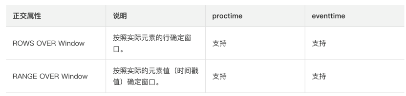

  

```plain
// 当事件时间向前算3s得到一个窗口
.window(Over.partitionBy($("id")).orderBy($("ts")).preceding(lit(3).second()).as("w"))
// 当行向前推算2行算一个窗口
.window(Over.partitionBy($("id")).orderBy($("ts")).preceding(rowInterval(2L)).as("w"))
```

  

（2）sql api中使用窗口

groupWindows：

SQL 查询的分组窗口是通过 GROUP BY 子句定义的。类似于使用常规 GROUP BY 语句的查询，窗口分组语句的 GROUP BY 子句中带有一个窗口函数为每个分组计算出一个结果。以下是批处理表和流处理表支持的分组窗口函数：

| **分组窗口函数** | **描述** |
| --- | --- |
| TUMBLE(time_attr, interval) | 定义一个滚动窗口。滚动窗口把行分配到有固定持续时间（ interval ）的不重叠的连续窗口。比如，5 分钟的滚动窗口以 5 分钟为间隔对行进行分组。滚动窗口可以定义在事件时间（批处理、流处理）或处理时间（流处理）上。 |
| HOP(time_attr, interval, interval) | 定义一个跳跃的时间窗口（在 Table API 中称为**滑动窗口**）。滑动窗口有一个固定的持续时间（ 第二个 interval 参数 ）以及一个滑动的间隔（第一个 interval 参数 ）。若滑动间隔小于窗口的持续时间，滑动窗口则会出现重叠；因此，行将会被分配到多个窗口中。比如，一个大小为 15 分组的滑动窗口，其滑动间隔为 5 分钟，将会把每一行数据分配到 3 个 15 分钟的窗口中。滑动窗口可以定义在事件时间（批处理、流处理）或处理时间（流处理）上。 |
| SESSION(time_attr, interval) | 定义一个会话时间窗口。会话时间窗口没有一个固定的持续时间，但是它们的边界会根据 interval 所定义的不活跃时间所确定；即一个会话时间窗口在定义的间隔时间内没有时间出现，该窗口会被关闭。例如时间窗口的间隔时间是 30 分钟，当其不活跃的时间达到30分钟后，若观测到新的记录，则会启动一个新的会话时间窗口（否则该行数据会被添加到当前的窗口），且若在 30 分钟内没有观测到新纪录，这个窗口将会被关闭。会话时间窗口可以使用事件时间（批处理、流处理）或处理时间（流处理）。 |

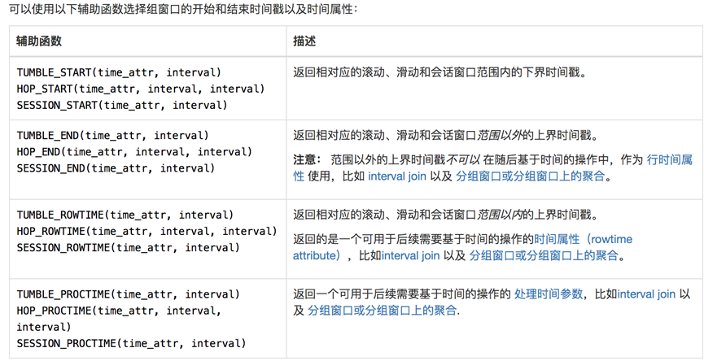

​  

```plain

StreamExecutionEnvironment env = StreamExecutionEnvironment.getExecutionEnvironment();
env.setParallelism(1);
StreamTableEnvironment tEnv = StreamTableEnvironment.create(env);
// 作为事件时间的字段必须是 timestamp 类型, 所以根据 long 类型的 ts 计算出来一个 t
tEnv.executeSql("create table sensor(" +
                    "id string," +
                    "ts bigint," +
                    "vc int, " +
                    "t as to_timestamp(from_unixtime(ts/1000,'yyyy-MM-dd HH:mm:ss'))," +
                    "watermark for t as t - interval '5' second)" +
                    "with("
                    + "'connector' = 'filesystem',"
                    + "'path' = 'input/sensor.txt',"
                    + "'format' = 'csv'"
                    + ")");

tEnv
    .sqlQuery(
        "SELECT id, " +
            "  TUMBLE_START(t, INTERVAL '1' minute) as wStart,  " +
            "  TUMBLE_END(t, INTERVAL '1' minute) as wEnd,  " +
            "  SUM(vc) sum_vc " +
            "FROM sensor " +
            "GROUP BY TUMBLE(t, INTERVAL '1' minute), id"
    )
    .execute()
    .print();
```

​  

```plain
tEnv
    .sqlQuery(
        "SELECT id, " +
            "  hop_start(t, INTERVAL '1' minute, INTERVAL '1' hour) as wStart,  " +
            "  hop_end(t, INTERVAL '1' minute, INTERVAL '1' hour) as wEnd,  " +
            "  SUM(vc) sum_vc " +
            "FROM sensor " +
            "GROUP BY hop(t, INTERVAL '1' minute, INTERVAL '1' hour), id"
    )
    .execute()
    .print();
```

over windows

```plain
tEnv
    .sqlQuery(
        "select " +
            "id," +
            "vc," +
            "sum(vc) over(partition by id order by t rows between 1 PRECEDING and current row)" +
            "from sensor"
    )
    .execute()
    .print();
```

​  

```plain
tEnv
    .sqlQuery(
        "select " +
            "id," +
            "vc," +
            "count(vc) over w, " +
            "sum(vc) over w " +
            "from sensor " +
            "window w as (partition by id order by t rows between 1 PRECEDING and current row)"
    )
    .execute()
    .print();
```

### 7.Catalog

（1）介绍

Catalog 提供了**元数据信息**，例如数据库、表、分区、视图以及数据库或其他外部系统中存储的函数和信息；提供了一个统一的API，用于管理元数据，并使其可以从 Table API 和 SQL 查询语句中来访问。

(2)GenericInMemoryCatalog ：是基于内存实现的 Catalog，所有元数据只在 session 的生命周期内可用。

(3)JdbcCatalog：使得用户可以将 Flink 通过 JDBC 协议连接到关系数据库

(4)HiveCatalog ：作为原生 Flink 元数据的持久化存储，以及作为读写现有 Hive 元数据的接口。 Flink 的 [Hive 文档](https://ci.apache.org/projects/flink/flink-docs-release-1.12/zh/dev/table/connectors/hive/) 提供了有关设置 HiveCatalog 以及访问现有 Hive 元数据的详细信息。

(5)HiveCatalog使用：

导入依赖：

```plain
<dependency>
    <groupId>org.apache.flink</groupId>
    <artifactId>flink-connector-hive_${scala.binary.version}</artifactId>
    <version>${flink.version}</version>
</dependency>
<!-- Hive Dependency -->
<dependency>
    <groupId>org.apache.hive</groupId>
    <artifactId>hive-exec</artifactId>
    <version>3.1.2</version>
</dependency>
```

启动hive元数据：

```plain
nohup hive --service metastore >/dev/null 2>&1 &
```

连接hive：

```plain
StreamExecutionEnvironment env = StreamExecutionEnvironment.getExecutionEnvironment();
env.setParallelism(1);
StreamTableEnvironment tEnv = StreamTableEnvironment.create(env);

String name            = "myhive";  // Catalog 名字
String defaultDatabase = "flink_test"; // 默认数据库
String hiveConfDir     = "c:/conf"; // hive配置文件的目录.需要把hive-site.xml添加到该目录

// 1. 创建HiveCatalog
HiveCatalog hive = new HiveCatalog(name, defaultDatabase, hiveConfDir);
// 2. 注册HiveCatalog
tEnv.registerCatalog(name, hive);
// 3. 把 HiveCatalog: myhive 作为当前session的catalog
tEnv.useCatalog(name);
tEnv.useDatabase("flink_test");
tEnv.sqlQuery("select * from stu").execute().print();
```

### 8.函数

（1）内置函数

scalar functions：输入0个或者多个，输出1个

comparison functions：

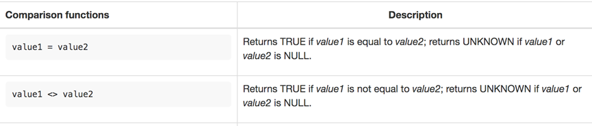

logical functions

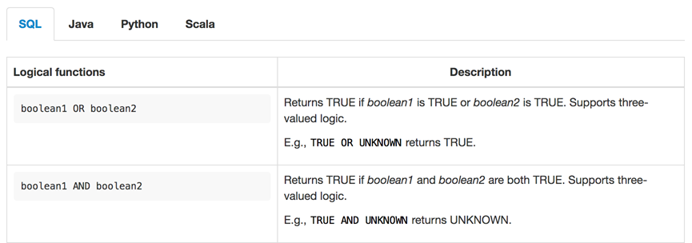

aggregate functions：

其他所有内置函数：参考官网: [https://ci.apache.org/projects/flink/flink-docs-release-1.12/dev/table/functions/systemFunctions.html](https://ci.apache.org/projects/flink/flink-docs-release-1.12/dev/table/functions/systemFunctions.html)

（2）自定义函数：自定义函数（UDF）是一种扩展开发机制，可以用来在查询语句里调用难以用其他方式表达的频繁使用或自定义的逻辑。

（3）自定义函数分类：

1) 标量函数(Scalar functions) 将标量值转换成一个新标量值；输入0个或者多个，输出一个

```plain
// 定义一个可以把字符串转成大写标量函数
public static class ToUpperCase extends ScalarFunction {
    public String eval(String s){
        return s.toUpperCase();
    }
}
```
```plain
StreamExecutionEnvironment env = StreamExecutionEnvironment.getExecutionEnvironment();
env.setParallelism(1);
StreamTableEnvironment tEnv = StreamTableEnvironment.create(env);

DataStreamSource<String> stream = env.fromElements("hello", "atguigu", "Hello");

Table table = tEnv.fromDataStream(stream, $("word"));

// 1. table api 使用方式1: 不注册直接 inline 使用
table.select(call(ToUpperCase.class, $("word")).as("word_upper")).execute().print();
// 2. table api 使用方式2: 注册后使用
// 2.1 注册函数
tEnv.createTemporaryFunction("toUpper", ToUpperCase.class);
// 2.2 使用函数
table.select(call("toUpper", $("word")).as("word_upper")).execute().print();

```
```plain
StreamExecutionEnvironment env = StreamExecutionEnvironment.getExecutionEnvironment();
env.setParallelism(1);
StreamTableEnvironment tEnv = StreamTableEnvironment.create(env);

DataStreamSource<String> stream = env.fromElements("hello", "atguigu", "Hello");

Table table = tEnv.fromDataStream(stream, $("word"));

// 1. 注册临时函数
tEnv.createTemporaryFunction("toUpper", ToUpperCase.class);
// 2. 注册临时表
tEnv.createTemporaryView("t_word", table);
// 3. 在临时表上使用自定义函数查询
tEnv.sqlQuery("select toUpper(word) word_upper from t_word").execute().print();
```

2) 表值函数(Table functions) 将标量值转换成新的行数据；输入0个或者多个，输出任意多行

```plain
@FunctionHint(output = @DataTypeHint("ROW(word string, len int)"))
public static class Split extends TableFunction<Row> {
    public void eval(String line) {
        if (line.length() == 0) {
            return;
        }
        for (String s : line.split(",")) {
            // 来一个字符串, 按照逗号分割, 得到多行, 每行为这个单词和他的长度
            collect(Row.of(s, s.length()));
        }
    }
}
```
```plain
StreamExecutionEnvironment env = StreamExecutionEnvironment.getExecutionEnvironment();
env.setParallelism(1);
StreamTableEnvironment tEnv = StreamTableEnvironment.create(env);

DataStreamSource<String> stream = env.fromElements("hello,atguigu,world", "aaa,bbbbb", "");

Table table = tEnv.fromDataStream(stream, $("line"));

// 1. 内联使用
table
    .joinLateral(call(Split.class, $("line")))
    .select($("line"), $("word"), $("len"))
    .execute()
    .print();

table
    .leftOuterJoinLateral(call(Split.class, $("line")))
    .select($("line"), $("word"), $("len"))
    .execute()
    .print();

// 2. 注册后使用
tEnv.createTemporaryFunction("split", Split.class);
table
    .joinLateral(call("split", $("line")))
    .select($("line"), $("word"), $("len"))
    .execute()
    .print();
```
```plain
StreamExecutionEnvironment env = StreamExecutionEnvironment.getExecutionEnvironment();
env.setParallelism(1);
StreamTableEnvironment tEnv = StreamTableEnvironment.create(env);

DataStreamSource<String> stream = env.fromElements("hello,atguigu,world", "aaa,bbbbb", "");

Table table = tEnv.fromDataStream(stream, $("line"));

// 1. 注册表
tEnv.createTemporaryView("t_word", table);
// 2. 注册函数
tEnv.createTemporaryFunction("split", Split.class);
// 3. 使用函数
// 3.1 join
tEnv.sqlQuery("select " +
                  " line, word, len " +
                  "from t_word " +
                  "join lateral table(split(line)) on true").execute().print();
// 或者
tEnv.sqlQuery("select " +
                  " line, word, len " +
                  "from t_word, " +
                  "lateral table(split(line))").execute().print();
// 3.2 left join
tEnv.sqlQuery("select " +
                  " line, word, len " +
                  "from t_word " +
                  "left join lateral table(split(line)) on true").execute().print();
// 3.3 join或者left join给字段重命名
tEnv.sqlQuery("select " +
                  " line, new_word, new_len " +
                  "from t_word " +
                  "left join lateral table(split(line)) as T(new_word, new_len) on true").execute().print();
```

3) 聚合函数(Aggregate functions) 将多行数据里的标量值转换成一个新标量值；

AggregateFunction的工作原理如下。

1) 首先，它需要一个累加器，用来保存聚合中间结果的数据结构（状态）。可以通过调用AggregateFunction的createAccumulator（）方法创建空累加器。

2) 随后，对每个输入行调用函数的accumulate（）方法来更新累加器。处理完所有行后，将调用函数的getValue（）方法来计算并返回最终结果。

AggregationFunction要求必须实现的方法：

1) createAccumulator()

2) accumulate()

3) getValue()

除了上述方法之外，还有一些可选择实现的方法。其中一些方法，可以让系统执行查询更有效率，而另一些方法，对于某些场景是必需的。例如，如果聚合函数应用在会话窗口（session group window）的上下文中，则merge（）方法是必需的。

1) retract() 在 bounded OVER 窗口中是必须实现的。

2) merge()

3) resetAccumulator() 在许多批式聚合中是必须实现的。

```plain
// 累加器类型
public static class VcAvgAcc {
    public Integer sum = 0;
    public Long count = 0L;
}

public static class VcAvg extends AggregateFunction<Double, VcAvgAcc> {
    
    // 返回最终的计算结果
    @Override
    public Double getValue(VcAvgAcc accumulator) {
        return accumulator.sum * 1.0 / accumulator.count;
    }
    
    // 初始化累加器
    @Override
    public VcAvgAcc createAccumulator() {
        return new VcAvgAcc();
    }
    
    // 处理输入的值, 更新累加器
    // 参数1: 累加器
    // 参数2,3,...: 用户自定义的输入值
    public void accumulate(VcAvgAcc acc, Integer vc) {
        acc.sum += vc;
        acc.count += 1L;
    }
    
}
```
```plain
StreamExecutionEnvironment env = StreamExecutionEnvironment.getExecutionEnvironment();
env.setParallelism(1);
StreamTableEnvironment tEnv = StreamTableEnvironment.create(env);

DataStreamSource<WaterSensor> waterSensorStream =
    env.fromElements(new WaterSensor("sensor_1", 1000L, 10),
                     new WaterSensor("sensor_1", 2000L, 20),
                     new WaterSensor("sensor_2", 3000L, 30),
                     new WaterSensor("sensor_1", 4000L, 40),
                     new WaterSensor("sensor_1", 5000L, 50),
                     new WaterSensor("sensor_2", 6000L, 60));

Table table = tEnv.fromDataStream(waterSensorStream);

// 1. 内联使用
table
    .groupBy($("id"))
    .select($("id"), call(VcAvg.class, $("vc")))
    .execute()
    .print();

// 2. 注册后使用
tEnv.createTemporaryFunction("my_avg", VcAvg.class);
table
    .groupBy($("id"))
    .select($("id"), call("my_avg", $("vc")))
    .execute()
    .print();
```
```plain
StreamExecutionEnvironment env = StreamExecutionEnvironment.getExecutionEnvironment();
env.setParallelism(1);
StreamTableEnvironment tEnv = StreamTableEnvironment.create(env);

DataStreamSource<WaterSensor> waterSensorStream =
    env.fromElements(new WaterSensor("sensor_1", 1000L, 10),
                     new WaterSensor("sensor_1", 2000L, 20),
                     new WaterSensor("sensor_2", 3000L, 30),
                     new WaterSensor("sensor_1", 4000L, 40),
                     new WaterSensor("sensor_1", 5000L, 50),
                     new WaterSensor("sensor_2", 6000L, 60));

Table table = tEnv.fromDataStream(waterSensorStream);

// 在sql中使用
// 1. 注册表
tEnv.createTemporaryView("t_sensor", table);
// 2. 注册函数
tEnv.createTemporaryFunction("my_avg", VcAvg.class);
// 3. sql中使用自定义聚合函数
tEnv.sqlQuery("select id, my_avg(vc) from t_sensor group by id").execute().print();
```

  

4) 表值聚合函数(Table aggregate) 将多行数据里的标量值转换成新的行数据；

TableAggregateFunction的工作原理如下。

1) 首先，它同样需要一个累加器（Accumulator），它是保存聚合中间结果的数据结构。通过调用TableAggregateFunction的createAccumulator（）方法可以创建空累加器。

2) 随后，对每个输入行调用函数的accumulate（）方法来更新累加器。

3) 处理完所有行后，将调用函数的emitValue（）方法来计算并返回最终结果。

AggregationFunction要求**必须实现**的方法：

1) createAccumulator()

2) accumulate()

除了上述方法之外，还有一些可选择实现的方法。

1) retract()

2) merge()

3) resetAccumulator()

**4)** **emitValue()**

5) emitUpdateWithRetract()

```plain
// 累加器
public static class Top2Acc {
    public Integer first = Integer.MIN_VALUE; // top 1
    public Integer second = Integer.MIN_VALUE; // top 2
}

// Tuple2<Integer, Integer> 值和排序
public static class Top2 extends TableAggregateFunction<Tuple2<Integer, Integer>, Top2Acc> {
    
    @Override
    public Top2Acc createAccumulator() {
        return new Top2Acc();
    }
    
    public void accumulate(Top2Acc acc, Integer vc) {
        if (vc > acc.first) {
            acc.second = acc.first;
            acc.first = vc;
        } else if (vc > acc.second) {
            acc.second = vc;
        }
    }
    
    public void emitValue(Top2Acc acc, Collector<Tuple2<Integer, Integer>> out) {
        if (acc.first != Integer.MIN_VALUE) {
            out.collect(Tuple2.of(acc.first, 1));
        }
        
        if (acc.second != Integer.MIN_VALUE) {
            out.collect(Tuple2.of(acc.second, 2));
        }
        
    }
}
```

  

```plain
StreamExecutionEnvironment env = StreamExecutionEnvironment.getExecutionEnvironment();
env.setParallelism(1);
StreamTableEnvironment tEnv = StreamTableEnvironment.create(env);

DataStreamSource<WaterSensor> waterSensorStream =
    env.fromElements(new WaterSensor("sensor_1", 1000L, 10),
                     new WaterSensor("sensor_1", 2000L, 20),
                     new WaterSensor("sensor_2", 3000L, 30),
                     new WaterSensor("sensor_1", 4000L, 40),
                     new WaterSensor("sensor_1", 5000L, 50),
                     new WaterSensor("sensor_2", 6000L, 60));

Table table = tEnv.fromDataStream(waterSensorStream);
// 1. 内联使用
table
    .groupBy($("id"))
    .flatAggregate(call(Top2.class, $("vc")).as("v", "rank"))
    .select($("id"), $("v"), $("rank"))
    .execute()
    .print();
// 2. 注册后使用
tEnv.createTemporaryFunction("top2", Top2.class);
table
    .groupBy($("id"))
    .flatAggregate(call("top2", $("vc")).as("v", "rank"))
    .select($("id"), $("v"), $("rank"))
    .execute()
    .print();

```

目前还不在支持SQL中使用

5) 异步表值函数(Async table functions) 是异步查询外部数据系统的特殊函数。

### 9.SQLclient：

通过启动yarn-session后再启动一个SQL客户端：bin/sql-client.sh embedded

可在客户端中创建连接到kafka、mysql等然后基于SQL查询流

### 10\. 使用SQL实现热门商品TOP N

```sql
CREATE DATABASE flink_sql;
USE flink_sql;
DROP TABLE IF EXISTS `hot_item`;
CREATE TABLE `hot_item` (
  `w_end` timestamp NOT NULL,
  `item_id` bigint(20) NOT NULL,
  `item_count` bigint(20) NOT NULL,
  `rk` bigint(20) NOT NULL,
  PRIMARY KEY (`w_end`,`rk`)
) ENGINE=InnoDB DEFAULT CHARSET=utf8;
```
```java
<dependency>
    <groupId>org.apache.flink</groupId>
    <artifactId>flink-connector-jdbc_${scala.binary.version}</artifactId>
    <version>${flink.version}</version>
    </dependency>
```
```java
import org.apache.flink.streaming.api.environment.StreamExecutionEnvironment;
import org.apache.flink.table.api.Table;
import org.apache.flink.table.api.bridge.java.StreamTableEnvironment;

/**
 * @Author lizhenchao@atguigu.cn
 * @Date 2021/1/31 9:11
 */
public class Flink01_HotItem_TopN {
    public static void main(String[] args) {
        StreamExecutionEnvironment env = StreamExecutionEnvironment.getExecutionEnvironment();
        env.setParallelism(2);
        StreamTableEnvironment tenv = StreamTableEnvironment.create(env);

        // 使用sql从文件读取数据
        tenv.executeSql(
            "create table user_behavior(" +
                "   user_id bigint, " +
                "   item_id bigint, " +
                "   category_id int, " +
                "   behavior string, " +
                "   ts bigint, " +
                "   event_time as to_timestamp(from_unixtime(ts, 'yyyy-MM-dd HH:mm:ss')), " +
                "   watermark for event_time as  event_time - interval '5' second " +
                ")with(" +
                "   'connector'='filesystem', " +
                "   'path'='input/UserBehavior.csv', " +
                "   'format'='csv')"
        );

        // 每隔 10m 统计一次最近 1h 的热门商品 top

        // 1. 计算每每个窗口内每个商品的点击量
        Table t1 = tenv
            .sqlQuery(
                "select " +
                    "   item_id, " +
                    "   hop_end(event_time, interval '10' minute, interval '1' hour) w_end," +
                    "   count(*) item_count " +
                    "from user_behavior " +
                    "where behavior='pv' " +
                    "group by hop(event_time, interval '10' minute, interval '1' hour), item_id"
            );
        tenv.createTemporaryView("t1", t1);
        // 2. 按照窗口开窗, 对商品点击量进行排名
        Table t2 = tenv.sqlQuery(
            "select " +
                "   *," +
                "   row_number() over(partition by w_end order by item_count desc) rk " +
                "from t1"
        );
        tenv.createTemporaryView("t2", t2);

        // 3. 取 top3
        Table t3 = tenv.sqlQuery(
            "select " +
                "   item_id, w_end, item_count, rk " +
                "from t2 " +
                "where rk<=3"
        );

        // 4. 数据写入到mysql
        // 4.1 创建输出表
        tenv.executeSql("create table hot_item(" +
                            "   item_id bigint, " +
                            "   w_end timestamp(3), " +
                            "   item_count bigint, " +
                            "   rk bigint, " +
                            "   PRIMARY KEY (w_end, rk) NOT ENFORCED)" +
                            "with(" +
                            "   'connector' = 'jdbc', " +
                            "   'url' = 'jdbc:mysql://hadoop162:3306/flink_sql?useSSL=false', " +
                            "   'table-name' = 'hot_item', " +
                            "   'username' = 'root', " +
                            "   'password' = 'aaaaaa' " +
                            ")");
        // 4.2 写入到输出表
        t3.executeInsert("hot_item");
    }
}
```

## 九、补充知识

### 1.window join：

join相同key且是相同窗口中的两个流的数据

1. 所有的窗口join都是 **inner join**, 意味着a流中的元素如果在b流中没有对应的, 则a流中这个元素就不会处理(就是忽略掉了)

2\. join成功后的元素的会以所在窗口的最大时间作为其时间戳. 例如窗口\[5,10), 则元素会以9作为自己的时间戳

滚动窗口join：

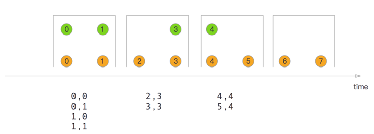

```java
import com.atguigu.flink.java.chapter_5.WaterSensor;
import org.apache.flink.api.common.eventtime.SerializableTimestampAssigner;
import org.apache.flink.api.common.eventtime.WatermarkStrategy;
import org.apache.flink.api.common.functions.JoinFunction;
import org.apache.flink.configuration.Configuration;
import org.apache.flink.streaming.api.datastream.SingleOutputStreamOperator;
import org.apache.flink.streaming.api.environment.StreamExecutionEnvironment;
import org.apache.flink.streaming.api.windowing.assigners.TumblingEventTimeWindows;
import org.apache.flink.streaming.api.windowing.time.Time;

/**
 * @Author lizhenchao@atguigu.cn
 * @Date 2021/1/24 22:09
 */
public class Flink01_Join_Window_Tumbling {
    public static void main(String[] args) {
        StreamExecutionEnvironment env = StreamExecutionEnvironment.createLocalEnvironmentWithWebUI(new Configuration());
        env.setParallelism(1);

        SingleOutputStreamOperator<WaterSensor> s1 = env
            .socketTextStream("hadoop162", 8888)  // 在socket终端只输入毫秒级别的时间戳
            .map(value -> {
                String[] datas = value.split(",");
                return new WaterSensor(datas[0], Long.valueOf(datas[1]), Integer.valueOf(datas[2]));

            })
            .assignTimestampsAndWatermarks(
                WatermarkStrategy
                    .<WaterSensor>forMonotonousTimestamps()
                    .withTimestampAssigner(new SerializableTimestampAssigner<WaterSensor>() {
                        @Override
                        public long extractTimestamp(WaterSensor element, long recordTimestamp) {
                            return element.getTs() * 1000;
                        }
                    })
            );

        SingleOutputStreamOperator<WaterSensor> s2 = env
            .socketTextStream("hadoop162", 9999)  // 在socket终端只输入毫秒级别的时间戳
            .map(value -> {
                String[] datas = value.split(",");
                return new WaterSensor(datas[0], Long.valueOf(datas[1]), Integer.valueOf(datas[2]));
            })
            .assignTimestampsAndWatermarks(
                WatermarkStrategy
                    .<WaterSensor>forMonotonousTimestamps()
                    .withTimestampAssigner(new SerializableTimestampAssigner<WaterSensor>() {
                        @Override
                        public long extractTimestamp(WaterSensor element, long recordTimestamp) {
                            return element.getTs() * 1000;
                        }
                    })
            );

        s1.join(s2)
            .where(WaterSensor::getId)
            .equalTo(WaterSensor::getId)
            .window(TumblingEventTimeWindows.of(Time.seconds(5))) // 必须使用窗口
            .apply(new JoinFunction<WaterSensor, WaterSensor, String>() {
                @Override
                public String join(WaterSensor first, WaterSensor second) throws Exception {
                    return "first: " + first + ", second: " + second;
                }
            })
            .print();

        try {
            env.execute();
        } catch (Exception e) {
            e.printStackTrace();
        }
    }
}
```

  

滑动窗口join：

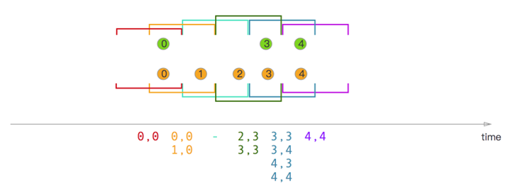

会话窗口join：

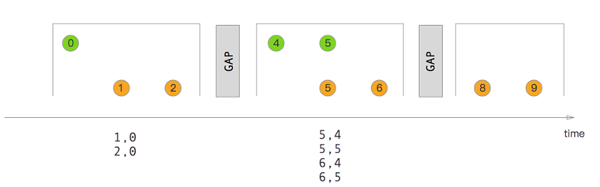

### 2.interval join

间隔流join(Interval Join), 是指使用**一个流**的数据**按照key**去join另外一条流的**指定范围**的数据.

如下图: 橙色的流去join绿色的流.范围是由橙色流的event-time + lower bound和event-time + upper bound来决定的.

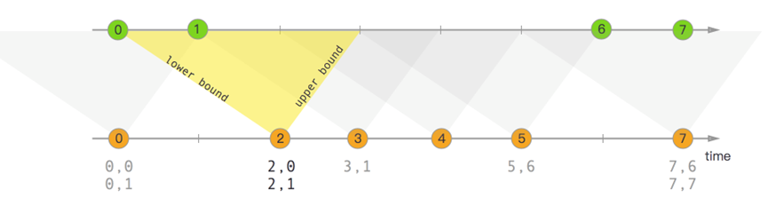

**注意****:**

1) Interval Join**只支持****event-time**

2) 必须是keyBy之后的流才可以interval join

​  

```java
import com.atguigu.flink.java.chapter_5.WaterSensor;
import org.apache.flink.api.common.eventtime.SerializableTimestampAssigner;
import org.apache.flink.api.common.eventtime.WatermarkStrategy;
import org.apache.flink.configuration.Configuration;
import org.apache.flink.streaming.api.datastream.SingleOutputStreamOperator;
import org.apache.flink.streaming.api.environment.StreamExecutionEnvironment;
import org.apache.flink.streaming.api.functions.co.ProcessJoinFunction;
import org.apache.flink.streaming.api.windowing.time.Time;
import org.apache.flink.util.Collector;

/**
 * @Author lizhenchao@atguigu.cn
 * @Date 2021/1/24 23:11
 */
public class Flink01_Join_Interval {
    public static void main(String[] args) {
        StreamExecutionEnvironment env = StreamExecutionEnvironment.createLocalEnvironmentWithWebUI(new Configuration());
        env.setParallelism(1);

        SingleOutputStreamOperator<WaterSensor> s1 = env
            .socketTextStream("hadoop162", 8888)  // 在socket终端只输入毫秒级别的时间戳
            .map(value -> {
                String[] datas = value.split(",");
                return new WaterSensor(datas[0], Long.valueOf(datas[1]), Integer.valueOf(datas[2]));

            })
            .assignTimestampsAndWatermarks(
                WatermarkStrategy
                    .<WaterSensor>forMonotonousTimestamps()
                    .withTimestampAssigner(new SerializableTimestampAssigner<WaterSensor>() {
                        @Override
                        public long extractTimestamp(WaterSensor element, long recordTimestamp) {
                            return element.getTs() * 1000;
                        }
                    })
            );

        SingleOutputStreamOperator<WaterSensor> s2 = env
            .socketTextStream("hadoop162", 9999)  // 在socket终端只输入毫秒级别的时间戳
            .map(value -> {
                String[] datas = value.split(",");
                return new WaterSensor(datas[0], Long.valueOf(datas[1]), Integer.valueOf(datas[2]));
            })
            .assignTimestampsAndWatermarks(
                WatermarkStrategy
                    .<WaterSensor>forMonotonousTimestamps()
                    .withTimestampAssigner(new SerializableTimestampAssigner<WaterSensor>() {
                        @Override
                        public long extractTimestamp(WaterSensor element, long recordTimestamp) {
                            return element.getTs() * 1000;
                        }
                    })
            );

        s1
            .keyBy(WaterSensor::getId)
            .intervalJoin(s2.keyBy(WaterSensor::getId))
            // 指定上下界
            .between(Time.seconds(-2), Time.seconds(3))
            .process(new ProcessJoinFunction<WaterSensor, WaterSensor, String>() {
                @Override
                public void processElement(WaterSensor left, WaterSensor right, Context ctx, Collector<String> out) throws Exception {
                    out.collect(left + "," + right);
                }
            })
            .print();

        try {
            env.execute();
        } catch (Exception e) {
            e.printStackTrace();
        }
    }
}
```

### 3.海量数据实时去重

（1）借助redis的set

1. 需要频繁连接Redis

2\. 如果数据量过大, 对redis的内存也是一种压力

（2）使用flink的mapState（只有key存数据）

1\. 如果数据量过大, 状态后端最好选择 RocksDBStateBackend

（3）使用布隆过滤器

布隆过滤器可以大大**减少存储的数据的数据量**

-   优点

1. 不需要存储数据本身，只用比特表示，因此空间占用相对于传统方式有巨大的优势，并且能够保密数据；

2. 时间效率也较高，插入和查询的时间复杂度均为, 所以他的时间复杂度实际是

3. 哈希函数之间相互独立，可以在硬件指令层面并行计算。

-   缺点

1. 存在**假阳性**的概率，不适用于任何要求100%准确率的情境；

2\. 只能插入和查询元素，不能删除元素，这与产生假阳性的原因是相同的。我们可以简单地想到通过计数（即将一个比特扩展为计数值）来记录元素数，但仍然无法保证删除的元素一定在集合中。