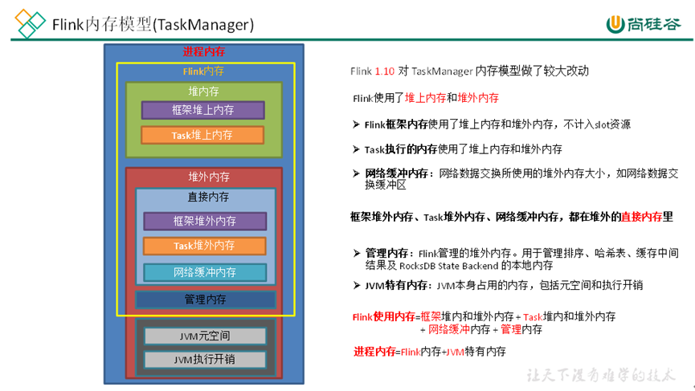
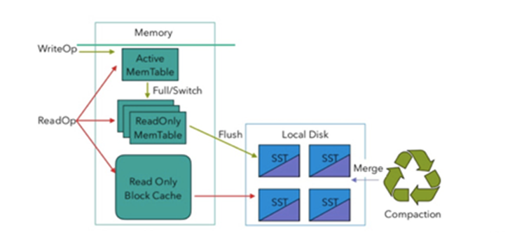
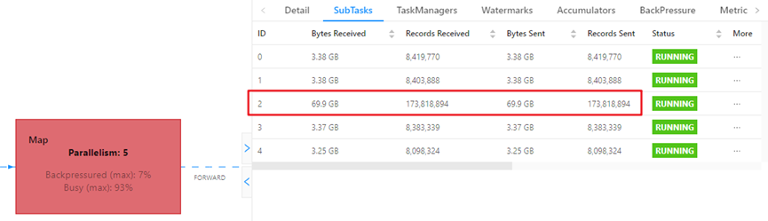
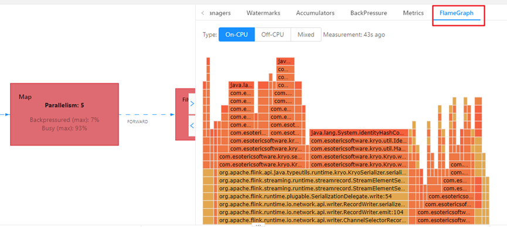
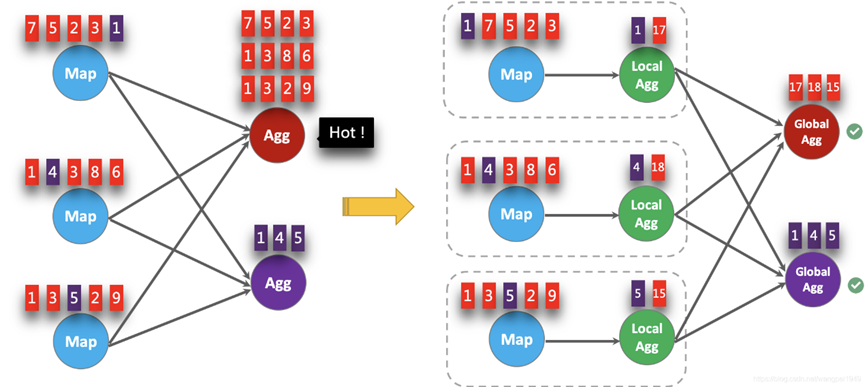
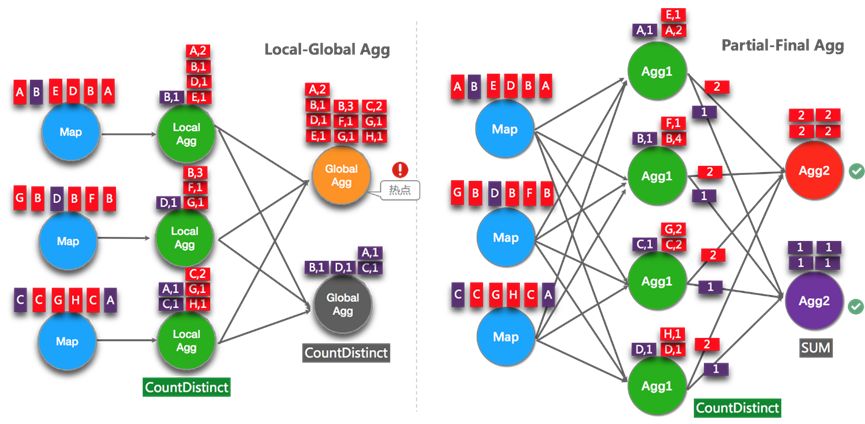

### 1.资源调优

（1）内存设置



l **JVM** **特定内存：**JVM本身使用的内存，包含JVM的metaspace和over-head

1）JVM metaspace：JVM元空间

​taskmanager.memory.jvm-metaspace.size，默认256mb

2）JVM over-head执行开销：JVM执行时自身所需要的内容，包括线程堆栈、IO、编译缓存等所使用的内存。

​taskmanager.memory.jvm-overhead.fraction，默认0.1

​taskmanager.memory.jvm-overhead.min，默认192mb

​taskmanager.memory.jvm-overhead.max，默认1gb

**总进程内存****\*fraction****，如果小于配置的****min****（或大于配置的****max****）大小，则使用****min/max****大小**

l **框架内存：**Flink框架，即TaskManager本身所占用的内存，**不计入****Slot****的资源中。**

堆内：taskmanager.memory.framework.heap.size，默认128MB

堆外：taskmanager.memory.framework.off-heap.size，默认128MB

l **Task****内存：**Task执行用户代码时所使用的内存

堆内：taskmanager.memory.task.heap.size，默认none，由Flink内存扣除掉其他部分的内存得到。

堆外：taskmanager.memory.task.off-heap.size，默认0，表示不使用堆外内存

l **网络内存：**网络数据交换所使用的堆外内存大小，如网络数据交换缓冲区

堆外：taskmanager.memory.network.fraction，默认0.1

​ taskmanager.memory.network.min，默认64mb

​ taskmanager.memory.network.max，默认1gb

**Flink****内存****\*fraction****，如果小于配置的****min****（或大于配置的****max****）大小，则使用****min/max****大小**

l **托管内存****：**用于RocksDB State Backend 的本地内存和批的排序、哈希表、缓存中间结果。

堆外：taskmanager.memory.managed.fraction，默认0.4

​taskmanager.memory.managed.size，默认none

**如果size没指定，则等于Flink内存\*fraction**

（2）CPU资源

yarn的DefaultResourceCalculator模式每个容器的vcore都是1，可以capacity-scheduler.xml 中修改属性为DominantResourceCalculator，即可在提交作业时指定\-Dtaskmanager.numberOfTaskSlots=2 ，默认单个容器的vcore数=单TM的slot数；也可指定\-Dyarn.containers.vcores=3单个容器的vcore为3，-Dtaskmanager.numberOfTaskSlots=2，此时单个taskManager就有3个vcore，两个slots。

（3）并行度设置

全局并行度：根据高峰期qps压测，并行度\*1.2，富余一些资源

开发完成后先进行压测（如现在kafka中积压数据，之后开启flink任务，出现反压就是瓶颈），任务并行度给到10以下，测试单个并行度处理能力上限，然后总qps/单并行度的处理能力 = 并行度

source端并行度设置：

读kafka，并行度与kafka的topic分区数相等最佳。若相等的情况下消费速度跟不上生产速度，则要调大topic分区，并且调大并行度与之相等。

transform端并行度设置：

keyby之前，一般都是map、flatmap、filter不会做太重的计算，保持和source一致即可。

keyby之后，如果并发较大，设置并行度为2的整数次幂，如 128,256,512等。小并发的并行度不一定要设置成2的整数次幂

sink端并行度设置：

写kafka，并行度=topic分区数

其他，需根据下游抗压能力来进行设置并行度

### 2.状态及checkpoint调优

（1）rocksDB大状态调优

rocksDB写数据类似于HBASE，是先把数据缓存到内存中，写请求效率较高，瓶颈主要是对磁盘的读请求，读写需要序列化与反序列化。



rocksDB的内存大小配置为每个task slot的托管内存，调试内存性能的问题主要是通过调整配置项taskmanager.memory.managed.size或者 taskmanager.memory.managed.fraction以增加Flink的托管内存(即堆外的托管内存)，另外一些参数调优：

开启state访问性能监控：

```java
state.backend.latency-track.keyed-state-enabled：true #启用访问状态的性能监控，正常开这一个即可
state.backend.latency-track.sample-interval: 100   #采样间隔
state.backend.latency-track.history-size: 128    #保留的采样数据个数，越大越精确
state.backend.latency-track.state-name-as-variable: true #将状态名作为变量
```

开启增量检查点

state.backend.incremental: true #默认false，改为true。

或代码中指定

new EmbeddedRocksDBStateBackend(true)

开启本地恢复

state.backend.local-recovery: true

有多块磁盘的可设置多目录提高吞吐量

state.backend.rocksdb.localdir: /data1/flink/rocksdb,/data2/flink/rocksdb,/data3/flink/rocksdb

调整预定义选项

当前支持的预定义选项有DEFAULT、SPINNING\_DISK\_OPTIMIZED、SPINNING\_DISK\_OPTIMIZED\_HIGH\_MEM或FLASH\_SSD\_OPTIMIZED。有条件上SSD的，可以指定为FLASH\_SSD\_OPTIMIZED

state.backend.rocksdb.predefined\-options： SPINNING\_DISK\_OPTIMIZED\_HIGH\_MEM

#设置为机械硬盘+内存模式

增大block缓存

整个 RocksDB 共享一个 block cache，读数据时内存的 cache 大小，该参数越大读数据时缓存命中率越高，默认大小为 8 MB，建议设置到 64 ~ 256 MB。

state.backend.rocksdb.block.cache-size: 64m #默认8m

增大write buffer 和 level 阈值大小

RocksDB 中，每个 State 使用一个 Column Family，每个 Column Family 使用独占的 write buffer，默认64MB，建议调大。

调整这个参数通常要适当增加 L1 层的大小阈值max-size-level-base，默认256m。该值太小会造成能存放的SST文件过少，层级变多造成查找困难，太大会造成文件过多，合并困难。建议设为 target\_file\_size\_base（默认64MB） 的倍数，且不能太小，例如5~10倍，即320~640MB。

state.backend.rocksdb.writebuffer.size: 128m

state.backend.rocksdb.compaction.level.max-size-level-base: 320m

增大write buffer数量

每个 Column Family 对应的 writebuffer 最大数量，这实际上是内存中“只读内存表“的最大数量，默认值是 2。对于机械磁盘来说，如果内存足够大，可以调大到 5 左右

state.backend.rocksdb.writebuffer.count: 5

增大后台线程数和write buffer合并数

1）增大线程数

用于后台 flush 和合并 sst 文件的线程数，默认为 1，建议调大，机械硬盘用户可以改为 4 等更大的值

state.backend.rocksdb.thread.num: 4

2）增大writebuffer最小合并数

将数据从 writebuffer 中 flush 到磁盘时，需要合并的 writebuffer 最小数量，默认值为 1，可以调成3。

state.backend.rocksdb.writebuffer.number-to-merge: 3

开启分区索引功能：降低数据swap竞争，内存较小时性能提升10倍左右

state.backend.rocksdb.memory.partitioned-index-filters:true #默认false

​  

参数案例：

bin/flink run \\

\-t yarn-per-job \\

\-d \\

\-p 5 \\

\-Drest.flamegraph.enabled=true \\

\-Dyarn.application.queue=test \\

\-Djobmanager.memory.process.size=1024mb \\

\-Dtaskmanager.memory.process.size=4096mb \\

\-Dtaskmanager.numberOfTaskSlots=2 \\

\-Dstate.backend.incremental=true \\

\-Dstate.backend.local-recovery=true \\

\-Dstate.backend.rocksdb.predefined-options=SPINNING\_DISK\_OPTIMIZED\_HIGH\_MEM \\

\-Dstate.backend.rocksdb.block.cache-size=64m \\

\-Dstate.backend.rocksdb.writebuffer.size=128m \\

\-Dstate.backend.rocksdb.compaction.level.max-size-level-base=320m \\

\-Dstate.backend.rocksdb.writebuffer.count=5 \\

\-Dstate.backend.rocksdb.thread.num=4 \\

\-Dstate.backend.rocksdb.writebuffer.number-to-merge=3 \\

\-Dstate.backend.rocksdb.memory.partitioned-index-filters=true \\

\-Dstate.backend.latency-track.keyed-state-enabled=true \\

\-c com.atguigu.flink.tuning.RocksdbTuning \\

/opt/module/flink-1.13.1/myjar/flink-tuning-1.0-SNAPSHOT.jar

（2）checkpoint设置

当状态比较大时，适当调大cp时间10分钟以上，以及两次cp之间的时间间隔，状态较小课设置为3-5分钟，若是追求时效性则设置秒级或者毫秒级。

```java
// 使⽤ RocksDBStateBackend 做为状态后端，并开启增量 Checkpoint
RocksDBStateBackend rocksDBStateBackend = new RocksDBStateBackend("hdfs://hadoop1:8020/flink/checkpoints", true);
env.setStateBackend(rocksDBStateBackend);

// 开启Checkpoint，间隔为 3 分钟
env.enableCheckpointing(TimeUnit.MINUTES.toMillis(3));
// 配置 Checkpoint
CheckpointConfig checkpointConf = env.getCheckpointConfig();
checkpointConf.setCheckpointingMode(CheckpointingMode.EXACTLY_ONCE)
// 最小间隔 4分钟
checkpointConf.setMinPauseBetweenCheckpoints(TimeUnit.MINUTES.toMillis(4))
// 超时时间 10分钟
checkpointConf.setCheckpointTimeout(TimeUnit.MINUTES.toMillis(10));
// 保存checkpoint
checkpointConf.enableExternalizedCheckpoints(
CheckpointConfig.ExternalizedCheckpointCleanup.RETAIN_ON_CANCELLATION);
```

### 3.反压处理

（1）理解：下游消费速度跟不上上游生产速度，导致数据积压阻塞，常出现于：垃圾回收停顿、大促销、秒杀活动等场景。

（2）危害：

影响checkpoint时长：barrier不会越过普通数据，数据阻塞导致barrier到达时间变长、导致cp总体时间变长甚至超时失败。

影响state大小：barrier对齐时，接受到较快的输入管道的barrier后，他后面的数据会被缓存起来但不处理，直到较慢的管道barrier也到达，这些被缓存的数据会被放到state里面，导致cp变大。

这两个影响对于生产环境的作业来说是十分危险的，因为 checkpoint 是保证数据一致性的关键，checkpoint 时间变长有可能导致 checkpoint **超时失败**，而 state 大小同样可能拖慢 checkpoint 甚至导致 **OOM**（使用 Heap-based StateBackend）或者物理内存使用**超出容器资源**（使用 RocksDBStateBackend）的稳定性问题。

（3）定位反压节点

先把operator chain禁用，方便定位到具体的算子。

利用flink web ui定位：1.13以前，查看算子的颜色（红、蓝、黑），指标（0.1以下为OK，0.1-0.5为low，超过0.5则为high），1.13以后就看颜色和反压比例及指标

分析瓶颈：该节点的发送速率跟不上它的产生数据的速率、或者下游的节点接受速率较慢（此时需要定位到下游第一个为OK的一般就是根源节点）。

利用metrics定位：

监控反压时会用到的 Metrics 主要和 Channel 接受端的 Buffer 使用率有关，最为有用的是以下几个 Metrics:

| **Metris** | **描述** |
| --- | --- |
| outPoolUsage | 发送端 Buffer 的使用率 |
| inPoolUsage | 接收端 Buffer 的使用率 |
| floatingBuffersUsage（1.9 以上） | 接收端 Floating Buffer 的使用率 |
| exclusiveBuffersUsage（1.9 以上） | 接收端 Exclusive Buffer 的使用率 |

其中 inPoolUsage = floatingBuffersUsage + exclusiveBuffersUsage。

反压情况可以根据以下表格进行对号入座(1.9以上):

| ​ | **outPoolUsage****低** | **outPoolUsage****高** |
| --- | --- | --- |
| **inPoolUsage****低** | 正常 | 被下游反压，处于临时情况<br>（还没传递到上游） |
|  |  | 可能是反压的根源，一条输入多条输出的场景 |
| **inPoolUsage****高** | 如果上游所有outPoolUsage都是低，有可能最终可能导致反压（还没传递到上游） | 被下游反压 |
|  | 如果上游的outPoolUsage是高，则为反压根源 |  |

在流量较大时，Channel 的 Exclusive Buffer 可能会被写满，此时 Flink 会向 Buffer Pool 申请剩余的 Floating Buffer。这些 **Floating Buffer 属于备用 Buffer。**

| ​ | **exclusiveBuffersUsage****低** | **exclusiveBuffersUsage****高** |
| --- | --- | --- |
| **floatingBuffersUsage**** ****低**<br>**所有上游****outPoolUsage ****低** | 正常 | ​ |
| **floatingBuffersUsage**** ****低**<br>**上游某个****outPoolUsage ****高** | 潜在的网络瓶颈 | ​ |
| **floatingBuffersUsage**** ****高**<br>**所有上游****outPoolUsage ****低** | 最终对部分inputChannel反压（正在传递） | 最终对大多数或所有inputChannel反压（正在传递） |
| **floatingBuffersUsage**** ****高**<br>**上游某个****outPoolUsage ****高** | 只对部分inputChannel反压 | 对大多数或所有inputChannel反压 |

总结：

1）floatingBuffersUsage 为高，则表明反压正在传导至上游

2）同时exclusiveBuffersUsage为低，则表明可能有倾斜

比如，floatingBuffersUsage 高、exclusiveBuffersUsage 低为有倾斜，因为少数 channel 占用了大部分的 Floating Buffer。

(3)反压的原因及处理：

1）数据倾斜：checkpoint detail里不同的subtask的state size是一个分析数据倾斜有用的指标



2）火焰图：如果不是数据倾斜，则可能是用户的代码处理效率低下，导致消费能力不足，可开启火焰图来帮助定位代码

配置文件中开启：

rest.flamegraph.enabled: true #默认false

提交时指定：

\-Drest.flamegraph.enabled=true \\

火焰图查看：



火焰图是通过对堆栈跟踪进行多次采样来构建的。每个方法调用都由一个条形表示，其中条形的长度与其在样本中出现的次数成正比。

Ø On-CPU: 处于 [RUNNABLE, NEW]状态的线程

Ø Off-CPU: 处于 [TIMED\_WAITING, WAITING, BLOCKED]的线程，用于查看在样本中发现的阻塞调用。

分析火焰图：

Ø 纵向是调用链，从下往上，顶部就是正在执行的函数，可由提示信息定位代码

Ø 横向是样本出现次数，可以理解为执行时长。有问题的通常是一个大平顶，执行时间很长。

3）分析GC：借助GC分析器GCViewer，设置打印GC日志，下载日志给GC分析器分析

4）外部组件交互

检查外部组件的性能是否遇到瓶颈、还有就是做维表join时的性能问题。

例如：

​Kafka 集群是否需要扩容，Kafka 连接器是否并行度较低

​HBase 的 rowkey 是否遇到热点问题，是否请求处理不过来

ClickHouse并发能力较弱，是否达到瓶颈

​  

关于第三方组件的性能问题，需要结合具体的组件来分析，最常用的思路：

1）异步io+热缓存来优化读写性能

2）先攒批再读写

维表join参考：

[https://flink-learning.org.cn/article/detail/b8df32fbc6542257a5b449114e137cc3](https://flink-learning.org.cn/article/detail/b8df32fbc6542257a5b449114e137cc3)

[https://www.jianshu.com/p/a62fa483ff54](https://www.jianshu.com/p/a62fa483ff54)

### 4.数据倾斜

（1）判断是否数据倾斜

相同task的多个subtask中，个别task接受处理的数据量明显大于其他的subtask

checkpoint detail里不同subtask的state size也是可以用于分析

（2）数据倾斜解决

1) keyby后的聚合操作存在数据倾斜

不能使用类似批处理的加随机数二次聚合的思想，因为书流数据来一条就是一个批，对一条数据加随机数无用

可采用localkeyby思想来处理：首先在上游算子的本地对数据进行聚合后再发送到下游，使下游接受到的数据量大大减少，从而减少keyby之后的聚合操作的瓶颈，类似于MapReduce中combiner的思想。但是这要求聚合操作必须是多条数据或者一批数据才能聚合，因此必须先攒批。

Ø DataStreamAPI需要自己写代码实现

以计算每个mid出现的次数为例，keyby之前，使用flatMap实现LocalKeyby功能

```java
import org.apache.flink.api.common.functions.RichFlatMapFunction;
import org.apache.flink.api.common.state.ListState;
import org.apache.flink.api.common.state.ListStateDescriptor;
import org.apache.flink.api.common.typeinfo.Types;
import org.apache.flink.api.java.tuple.Tuple2;
import org.apache.flink.runtime.state.FunctionInitializationContext;
import org.apache.flink.runtime.state.FunctionSnapshotContext;
import org.apache.flink.streaming.api.checkpoint.CheckpointedFunction;
import org.apache.flink.util.Collector;

import java.util.HashMap;
import java.util.Map;
import java.util.concurrent.atomic.AtomicInteger;

public class LocalKeyByFlatMapFunc extends RichFlatMapFunction<Tuple2<String, Long>, Tuple2<String, Long>> implements CheckpointedFunction {

//Checkpoint 时为了保证 Exactly Once，将 buffer 中的数据保存到该 ListState 中
private ListState<Tuple2<String, Long>> listState;

//本地 buffer，存放 local 端缓存的 mid 的 count 信息
private HashMap<String, Long> localBuffer;

//缓存的数据量大小，即：缓存多少数据再向下游发送
private int batchSize;

//计数器，获取当前批次接收的数据量
private AtomicInteger currentSize;

//构造器，批次大小传参
public LocalKeyByFlatMapFunc(int batchSize) {
this.batchSize = batchSize;
}

@Override
public void flatMap(Tuple2<String, Long> value, Collector<Tuple2<String, Long>> out) throws Exception {
// 1、将新来的数据添加到 buffer 中
Long count = localBuffer.getOrDefault(value, 0L);
localBuffer.put(value.f0, count + 1);

// 2、如果到达设定的批次，则将 buffer 中的数据发送到下游
if (currentSize.incrementAndGet() >= batchSize) {
// 2.1 遍历 Buffer 中数据，发送到下游
for (Map.Entry<String, Long> midAndCount : localBuffer.entrySet()) {
out.collect(Tuple2.of(midAndCount.getKey(), midAndCount.getValue()));
}

// 2.2 Buffer 清空，计数器清零
localBuffer.clear();
currentSize.set(0);
}

}

@Override
public void snapshotState(FunctionSnapshotContext context) throws Exception {
// 将 buffer 中的数据保存到状态中，来保证 Exactly Once
listState.clear();
for (Map.Entry<String, Long> midAndCount : localBuffer.entrySet()) {
listState.add(Tuple2.of(midAndCount.getKey(), midAndCount.getValue()));
}
}

@Override
public void initializeState(FunctionInitializationContext context) throws Exception {
// 从状态中恢复 buffer 中的数据
listState = context.getOperatorStateStore().getListState(
new ListStateDescriptor<Tuple2<String, Long>>(
"localBufferState",
Types.TUPLE(Types.STRING, Types.LONG)
)
);
localBuffer = new HashMap();
if (context.isRestored()) {
// 从状态中恢复数据到 buffer 中
for (Tuple2<String, Long> midAndCount : listState.get()) {
// 如果出现 pv != 0,说明改变了并行度，ListState 中的数据会被均匀分发到新的 subtask中
// 单个 subtask 恢复的状态中可能包含多个相同的 mid 的 count数据
// 所以每次先取一下buffer的值，累加再put
long count = localBuffer.getOrDefault(midAndCount.f0, 0L);
            localBuffer.put(midAndCount.f0, count + midAndCount.f1);
}
// 从状态恢复时，默认认为 buffer 中数据量达到了 batchSize，需要向下游发
currentSize = new AtomicInteger(batchSize);
} else {
currentSize = new AtomicInteger(0);
}

}
}
```

Ø SQL可以指定参数，开启miniBatch和LocalGlobal功能（推荐，后续介绍）

2）keyby之前发生数据倾斜（数据源头不均）

调用强制shuffle。如shuffle、Rebalance、rescale算子

3）keyby之后欧的窗口聚合操作存在数据倾斜

有窗口就有攒批的处理，可以使用两阶段聚合

Ø 第一阶段聚合：key拼接随机数前缀或后缀，进行keyby、开窗、聚合

*注意：**聚合完不再是**WindowedStream**，要获取**WindowEnd**作为窗口标记作为第二阶段分组依据，避免不同窗口的结果聚合到一起）*

Ø 第二阶段聚合：按照原来的key及windowEnd作keyby、聚合

### 5.job优化

（1）datagen造数据压测

```java
import com.atguigu.flink.tuning.bean.OrderInfo;
import com.atguigu.flink.tuning.bean.UserInfo;
import org.apache.commons.math3.random.RandomDataGenerator;
import org.apache.flink.api.common.typeinfo.Types;
import org.apache.flink.configuration.Configuration;
import org.apache.flink.configuration.RestOptions;
import org.apache.flink.streaming.api.datastream.SingleOutputStreamOperator;
import org.apache.flink.streaming.api.environment.StreamExecutionEnvironment;
import org.apache.flink.streaming.api.functions.source.datagen.DataGeneratorSource;
import org.apache.flink.streaming.api.functions.source.datagen.RandomGenerator;
import org.apache.flink.streaming.api.functions.source.datagen.SequenceGenerator;

public class DataStreamDataGenDemo {
    public static void main(String[] args) throws Exception {

        Configuration conf = new Configuration();
        conf.set(RestOptions.ENABLE_FLAMEGRAPH, true);
        StreamExecutionEnvironment env = StreamExecutionEnvironment.createLocalEnvironmentWithWebUI(conf);

        env.setParallelism(1);
        env.disableOperatorChaining();

        SingleOutputStreamOperator<OrderInfo> orderInfoDS = env
                .addSource(new DataGeneratorSource<>(new RandomGenerator<OrderInfo>() {
                    @Override
                    public OrderInfo next() {
                        return new OrderInfo(
                                random.nextInt(1, 100000),
                                random.nextLong(1, 1000000),
                                random.nextUniform(1, 1000),
                                System.currentTimeMillis());
                    }
                }))
                .returns(Types.POJO(OrderInfo.class));

        SingleOutputStreamOperator<UserInfo> userInfoDS = env
                .addSource(new DataGeneratorSource<UserInfo>(
                        new SequenceGenerator<UserInfo>(1, 1000000) {
                            RandomDataGenerator random = new RandomDataGenerator();
                            @Override
                            public UserInfo next() {
                                return new UserInfo(
                                        valuesToEmit.peek().intValue(),
                                        valuesToEmit.poll().longValue(),
                                        random.nextInt(1, 100),
                                        random.nextInt(0, 1));
                            }
                        }
                ))
                .returns(Types.POJO(UserInfo.class));

        orderInfoDS.print("order>>");
        userInfoDS.print("user>>");

        env.execute();
    }
}
```
```java
import org.apache.flink.configuration.Configuration;
import org.apache.flink.configuration.RestOptions;
import org.apache.flink.streaming.api.environment.StreamExecutionEnvironment;
import org.apache.flink.table.api.bridge.java.StreamTableEnvironment;

public class SQLDataGenDemo {
    public static void main(String[] args) throws Exception {

        Configuration conf = new Configuration();
        conf.set(RestOptions.ENABLE_FLAMEGRAPH, true);
        StreamExecutionEnvironment env = StreamExecutionEnvironment.createLocalEnvironmentWithWebUI(conf);

        env.setParallelism(1);
        env.disableOperatorChaining();
        
        StreamTableEnvironment tableEnv = StreamTableEnvironment.create(env);

        String orderSql="CREATE TABLE order_info (\n" +
                "    id INT,\n" +
                "    user_id BIGINT,\n" +
                "    total_amount DOUBLE,\n" +
                "    create_time AS localtimestamp,\n" +
                "    WATERMARK FOR create_time AS create_time\n" +
                ") WITH (\n" +
                "    'connector' = 'datagen',\n" +
                "    'rows-per-second'='20000',\n" +
                "    'fields.id.kind'='sequence',\n" +
                "    'fields.id.start'='1',\n" +
                "    'fields.id.end'='100000000',\n" +
                "    'fields.user_id.kind'='random',\n" +
                "    'fields.user_id.min'='1',\n" +
                "    'fields.user_id.max'='1000000',\n" +
                "    'fields.total_amount.kind'='random',\n" +
                "    'fields.total_amount.min'='1',\n" +
                "    'fields.total_amount.max'='1000'\n" +
                ")";

        String userSql="CREATE TABLE user_info (\n" +
                "    id INT,\n" +
                "    user_id BIGINT,\n" +
                "    age INT,\n" +
                "    sex INT\n" +
                ") WITH (\n" +
                "    'connector' = 'datagen',\n" +
                "    'rows-per-second'='20000',\n" +
                "    'fields.id.kind'='sequence',\n" +
                "    'fields.id.start'='1',\n" +
                "    'fields.id.end'='100000000',\n" +
                "    'fields.user_id.kind'='sequence',\n" +
                "    'fields.user_id.start'='1',\n" +
                "    'fields.user_id.end'='1000000',\n" +
                "    'fields.age.kind'='random',\n" +
                "    'fields.age.min'='1',\n" +
                "    'fields.age.max'='100',\n" +
                "    'fields.sex.kind'='random',\n" +
                "    'fields.sex.min'='0',\n" +
                "    'fields.sex.max'='1'\n" +
                ")";

        tableEnv.executeSql(orderSql);
        tableEnv.executeSql(userSql);

        tableEnv.executeSql("select * from order_info").print();
//        tableEnv.executeSql("select * from user_info").print();

    }
}
```

（2）算子指定uuid

Flink 算子的 UUID 可以通过 uid(String uid) 方法指定，通常也建议指定name。有状态的算子指定，能帮助作业更新代码后的恢复，否则作业有代码更改后没有uuid则会启动不了

```java
#算子.uid("指定uid")
.reduce((value1, value2) -> Tuple3.of("uv", value2.f1, value1.f2 + value2.f2))
.uid("uv-reduce").name("uv-reduce")
```

（3）链路延迟测量

metrics.latency.interval: 30000 #默认0，表示禁用，单位毫秒

metrics.latency.granularity: operator #默认operator

作业运行后可以通过下面的metric查看结果：

flink\_taskmanager\_job\_latency\_source\_id\_operator\_id\_operator\_subtask\_index\_latency

还可以借助Prometheus和Grafana来监控端到端的延迟

（4）开启对象重用

当调用了enableObjectReuse方法后，Flink会把中间深拷贝的步骤都省略掉，SourceFunction产生的数据直接作为MapFunction的输入，可以减少gc压力。但需要特别注意的是，这个方法不能随便调用，必须要确保下游Function只有一种，或者下游的Function均不会改变对象内部的值。否则可能会有线程安全的问题。

（5）细粒度滑动窗口优化（一个数据属于多个滑动窗口，重复计算性能急剧下降）

造成的问题：

Ø 状态

对于一个元素，会将其写入对应的(key, window)二元组所圈定的windowState状态中。如果粒度为480，那么每个元素到来，更新windowState时都要遍历480个窗口并写入，开销是非常大的。在采用RocksDB作为状态后端时，checkpoint的瓶颈也尤其明显。

Ø 定时器

每一个(key, window)二元组都需要注册两个定时器：一是触发器注册的定时器，用于决定窗口数据何时输出；二是registerCleanupTimer()方法注册的清理定时器，用于在窗口彻底过期（如allowedLateness过期）之后及时清理掉窗口的内部状态。细粒度滑动窗口会造成维护的定时器增多，内存负担加重。

解决思路：尽可能复用已计算的结果

我们一般使用**滚动窗口****+****在线存储****+****读时聚合**的思路作为解决方案：

（1）从业务的视角来看，往往窗口的长度是可以被步长所整除的，可以找到窗口长度和窗口步长的最小公约数作为时间分片（一个滚动窗口的长度）；

（2）每个滚动窗口将其周期内的数据做聚合，存到下游状态或打入外部在线存储（内存数据库如Redis，LSM-based NoSQL存储如HBase）；

（3）扫描在线存储中对应时间区间（可以灵活指定）的所有行，并将计算结果返回给前端展示。

提交作业时配置时间分片：\--sliding-split true

### 7.flinksql优化

（1）设置空闲状态保留时间

Flink SQL新手有可能犯的错误，其中之一就是忘记设置空闲状态保留时间导致状态爆炸。列举两个场景：

Ø FlinkSQL的regular join（inner、left、right），左右表的数据都会一直保存在状态里，不会清理！要么设置TTL，要么使用FlinkSQL的interval join。

Ø 使用Top-N语法进行去重，重复数据的出现一般都位于特定区间内（例如一小时或一天内），过了这段时间之后，对应的状态就不再需要了。

Flink SQL可以指定空闲状态(即未更新的状态)被保留的最小时间，当状态中某个key对应的状态未更新的时间达到阈值时，该条状态被自动清理：

#API指定  
tableEnv.getConfig().setIdleStateRetention(Duration.ofHours(1));

#参数指定

Configuration configuration = tableEnv.getConfig().getConfiguration();

configuration.setString("table.exec.state.ttl", "1 h");

（2）开启minibatch

MiniBatch是微批处理，原理是缓存一定的数据后再触发处理，以减少对State的访问，从而提升吞吐并减少数据的输出量。MiniBatch主要依靠在每个Task上注册的Timer线程来触发微批，需要消耗一定的线程调度性能。

该功能默认关闭，开启如下：

```java
// 初始化table environment
TableEnvironment tEnv = ...

// 获取 tableEnv的配置对象
Configuration configuration = tEnv.getConfig().getConfiguration();

// 设置参数：
// 开启miniBatch
configuration.setString("table.exec.mini-batch.enabled", "true");
// 批量输出的间隔时间
configuration.setString("table.exec.mini-batch.allow-latency", "5 s");
// 防止OOM设置每个批次最多缓存数据的条数，可以设为2万条
configuration.setString("table.exec.mini-batch.size", "20000");
```

适用场景：如果有低延迟的要求不建议开启，需要聚合的场景可提高性能

Ø **注意事项：**

1）目前，key-value 配置项仅被 Blink planner 支持。

2）1.12之前的版本有bug，开启miniBatch，不会清理过期状态，也就是说如果设置状态的TTL，无法清理过期状态。1.12版本才修复这个问题。

参考ISSUE：[https://issues.apache.org/jira/browse/FLINK-17096](https://issues.apache.org/jira/browse/FLINK-17096)

（3）开启localglobal

原理：LocalGlobal优化将原先的Aggregate分成Local+Global两阶段聚合，即MapReduce模型中的Combine+Reduce处理模式。第一阶段在上游节点本地攒一批数据进行聚合（localAgg），并输出这次微批的增量值（Accumulator）。第二阶段再将收到的Accumulator合并（Merge），得到最终的结果（GlobalAgg）。

LocalGlobal本质上能够靠LocalAgg的聚合筛除部分倾斜数据，从而降低GlobalAgg的热点，提升性能。结合下图理解LocalGlobal如何解决数据倾斜的问题。



由上图可知：

l 未开启LocalGlobal优化，由于流中的数据倾斜，Key为红色的聚合算子实例需要处理更多的记录，这就导致了热点问题。

l 开启LocalGlobal优化后，先进行本地聚合，再进行全局聚合。可大大减少GlobalAgg的热点，提高性能。

Ø **LocalGlobal****开启方式：**

1）LocalGlobal优化需要先开启MiniBatch，依赖于MiniBatch的参数。

2）table.optimizer.agg-phase-strategy: 聚合策略。默认AUTO，支持参数AUTO、TWO\_PHASE(使用LocalGlobal两阶段聚合)、ONE\_PHASE(仅使用Global一阶段聚合)。

```java
// 初始化table environment
TableEnvironment tEnv = ...

// 获取 tableEnv的配置对象
Configuration configuration = tEnv.getConfig().getConfiguration();

// 设置参数：
// 开启miniBatch
configuration.setString("table.exec.mini-batch.enabled", "true");
// 批量输出的间隔时间
configuration.setString("table.exec.mini-batch.allow-latency", "5 s");
// 防止OOM设置每个批次最多缓存数据的条数，可以设为2万条
configuration.setString("table.exec.mini-batch.size", "20000");
// 开启LocalGlobal
configuration.setString("table.optimizer.agg-phase-strategy", "TWO_PHASE");
```

Ø **注意事项：**

1）需要先开启MiniBatch

2）开启LocalGlobal需要UDAF实现Merge方法。

(4)开启split distinct

LocalGlobal优化针对普通聚合（例如SUM、COUNT、MAX、MIN和AVG）有较好的效果，对于DISTINCT的聚合（如COUNT DISTINCT）收效不明显，因为COUNT DISTINCT在Local聚合时，对于DISTINCT KEY的去重率不高，导致在Global节点仍然存在热点。



**Distinct****举例：**

SELECT a, COUNT(DISTINCT b)

FROM T

GROUP BY a

**手动打散举例：**

SELECT a, SUM(cnt)

FROM (

​SELECT a, COUNT(DISTINCT b) as cnt

​FROM T

​GROUP BY a, MOD(HASH\_CODE(b), 1024)

)

GROUP BY a

Ø **Split Distinct****开启方式**

默认不开启，使用参数显式开启：

l table.optimizer.distinct-agg.split.enabled: true，默认false。

l table.optimizer.distinct-agg.split.bucket-num: Split Distinct优化在第一层聚合中，被打散的bucket数目。默认1024。

// 初始化table environment

TableEnvironment tEnv = ...

​  

// 获取 tableEnv的配置对象

Configuration configuration = tEnv.getConfig().getConfiguration();

​  

// 设置参数：(要结合minibatch一起使用)

// 开启Split Distinct

configuration.setString("table.optimizer.distinct-agg.split.enabled", "true");

// 第一层打散的bucket数目

configuration.setString("table.optimizer.distinct-agg.split.bucket-num", "1024");

Ø **注意事项：**

（1）目前不能在包含UDAF的Flink SQL中使用Split Distinct优化方法。

（2）拆分出来的两个GROUP聚合还可参与LocalGlobal优化。

（3）该功能在Flink1.9.0版本及以上版本才支持。

(5)多维distinct适用filter

在某些场景下，可能需要从不同维度来统计count（distinct）的结果（比如统计uv、app端的uv、web端的uv），可能会使用如下CASE WHEN语法。

```java
SELECT
a,
COUNT(DISTINCT b) AS total_b,
COUNT(DISTINCT CASE WHEN c IN ('A', 'B') THEN b ELSE NULL END) AS AB_b,
COUNT(DISTINCT CASE WHEN c IN ('C', 'D') THEN b ELSE NULL END) AS CD_b
FROM T
GROUP BY a
```

在这种情况下，建议使用FILTER语法, 目前的Flink SQL优化器可以识别同一唯一键上的不同FILTER参数。如，在上面的示例中，三个COUNT DISTINCT都作用在b列上。此时，经过优化器识别后，Flink可以只使用一个共享状态实例，而不是三个状态实例，可减少状态的大小和对状态的访问。

**将上边的****CASE WHEN****替换成****FILTER****后**，如下所示:

```java
SELECT
a,
COUNT(DISTINCT b) AS total_b,
COUNT(DISTINCT b) FILTER (WHERE c IN ('A', 'B')) AS AB_b,
COUNT(DISTINCT b) FILTER (WHERE c IN ('C', 'D')) AS CD_b
FROM T
GROUP BY a
```

(6)设置参数总结

```java
// 初始化table environment
TableEnvironment tEnv = ...

// 获取 tableEnv的配置对象
Configuration configuration = tEnv.getConfig().getConfiguration();

// 设置参数：
// 开启miniBatch
configuration.setString("table.exec.mini-batch.enabled", "true");
// 批量输出的间隔时间
configuration.setString("table.exec.mini-batch.allow-latency", "5 s");
// 防止OOM设置每个批次最多缓存数据的条数，可以设为2万条
configuration.setString("table.exec.mini-batch.size", "20000");
// 开启LocalGlobal
configuration.setString("table.optimizer.agg-phase-strategy", "TWO_PHASE");
// 开启Split Distinct
configuration.setString("table.optimizer.distinct-agg.split.enabled", "true");
// 第一层打散的bucket数目
configuration.setString("table.optimizer.distinct-agg.split.bucket-num", "1024");
// 指定时区
configuration.setString("table.local-time-zone", "Asia/Shanghai");
```

### 8.常见故障排除

（1）非法配置异常

如果您看到从 TaskExecutorProcessUtils 或 JobManagerProcessUtils抛出的 IllegalConfigurationException，通常表明存在无效的配置值（例如负内存大小、大于 1 的分数等）或配置冲突。请重新配置内存参数。

（2）java堆空间异常

如果报 **OutOfMemoryError: Java heap space** 异常，通常表示 JVM Heap 太小。可以尝试通过增加总内存来增加 JVM 堆大小。也可以直接为 TaskManager 增加任务堆内存或为 JobManager 增加 JVM 堆内存。

还可以为 TaskManagers 增加框架堆内存，但只有在确定 Flink 框架本身需要更多内存时才应该更改此选项。

（3）直接缓冲存储器异常

如果报 **OutOfMemoryError: Direct buffer memory** 异常,通常表示 JVM直接内存限制太小或存在直接内存泄漏。检查用户代码或其他外部依赖项是否使用了 JVM 直接内存，以及它是否被正确考虑。可以尝试通过调整直接堆外内存来增加其限制。可以参考如何为 TaskManagers、 JobManagers 和 Flink 设置的JVM 参数配置堆外内存。

（4）元空间异常

如果报 **OutOfMemoryError: Metaspace** 异常，通常表示 JVM 元空间限制配置得太小。您可以尝试加大 JVM 元空间 TaskManagers 或JobManagers 选项。

（5）网络缓冲区数量不足

如果报 **IOException: Insufficient number of network buffers** 异常，这仅与 TaskManager 相关。通常表示配置的网络内存大小不够大。您可以尝试增加网络内存。

（6）超出容器内存异常

如果 Flink 容器尝试分配超出其请求大小（Yarn 或 Kubernetes）的内存，这通常**表明** **Flink** **没有预留足够的本机内存**。当容器被部署环境杀死时，可以通过使用外部监控系统或从错误消息中观察到这一点。

如果在 JobManager 进程中遇到这个问题，还可以通过设置排除可能的 JVM Direct Memory 泄漏的选项来开启 JVM Direct Memory 的限制:

jobmanager.memory.enable-jvm-direct-memory-limit: true

如果想手动多分一部分内存给 RocksDB 来防止超用，预防在云原生的环境因 OOM 被 K8S kill，可将 JVM OverHead 内存调大。

之所以不调大 Task Off-Heap，是由于目前 Task Off-Heap 是和 Direct Memeory 混在一起的，即使调大整体，也并不一定会分给 RocksDB 来做 Buffer，所以我们推荐通过调整 JVM OverHead 来解决内存超用的问题。

（7）checkpoint失败

Checkpoint 失败大致分为两种情况：Checkpoint Decline 和 Checkpoint Expire。

1) Checkpoint Decline

我们能从 jobmanager.log 中看到类似下面的日志:

Decline checkpoint 10423 by task 0b60f08bf8984085b59f8d9bc74ce2e1 of job 85d268e6fbc19411185f7e4868a44178.

我们可以在 jobmanager.log 中查找 execution id，找到被调度到哪个 taskmanager 上，类似如下所示：

2019-09-02 16:26:20,972 INFO [jobmanager-future-thread-61] org.apache.flink.runtime.executiongraph.ExecutionGraph \- XXXXXXXXXXX (100/289) (87b751b1fd90e32af55f02bb2f9a9892) switched from SCHEDULED to DEPLOYING.

2019-09-02 16:26:20,972 INFO [jobmanager-future-thread-61] org.apache.flink.runtime.executiongraph.ExecutionGraph \- Deploying XXXXXXXXXXX (100/289) (attempt #0) to slot container\_e24\_1566836790522\_8088\_04\_013155\_1 on hostnameABCDE

从上面的日志我们知道该 execution 被调度到 hostnameABCDE 的 container\_e24\_1566836790522\_8088\_04\_013155\_1 slot 上，接下来我们就可以到 container container\_e24\_1566836790522\_8088\_04\_013155 的 taskmanager.log 中查找 Checkpoint 失败的具体原因了。

另外对于 Checkpoint Decline 的情况，有一种情况在这里单独抽取出来进行介绍：Checkpoint Cancel。

当前 Flink 中如果较小的 Checkpoint 还没有对齐的情况下，收到了更大的 Checkpoint，则会把较小的 Checkpoint 给取消掉。我们可以看到类似下面的日志：

$taskNameWithSubTaskAndID: Received checkpoint barrier for checkpoint 20 before completing current checkpoint 19. Skipping current checkpoint.

这个日志表示，当前 Checkpoint 19 还在对齐阶段，我们收到了 Checkpoint 20 的 barrier。然后会逐级通知到下游的 task checkpoint 19 被取消了，同时也会通知 JM 当前 Checkpoint 被 decline 掉了。

在下游 task 收到被 cancelBarrier 的时候，会打印类似如下的日志：

DEBUG

$taskNameWithSubTaskAndID: Checkpoint 19 canceled, aborting alignment.

​  

或者

DEBUG

$taskNameWithSubTaskAndID: Checkpoint 19 canceled, skipping alignment.

​  

或者

WARN

$taskNameWithSubTaskAndID: Received cancellation barrier for checkpoint 20 before completing current checkpoint 19. Skipping current checkpoint.

上面三种日志都表示当前 task 接收到上游发送过来的 barrierCancel 消息，从而取消了对应的 Checkpoint。

2) Checkpoint Expire

如果 Checkpoint 做的非常慢，超过了 timeout 还没有完成，则整个 Checkpoint 也会失败。当一个 Checkpoint 由于超时而失败是，会在 jobmanager.log 中看到如下的日志：

Checkpoint 1 of job 85d268e6fbc19411185f7e4868a44178 expired before completing.

表示 Chekpoint 1 由于超时而失败，这个时候可以可以看这个日志后面是否有类似下面的日志：

Received late message for now expired checkpoint attempt 1 from 0b60f08bf8984085b59f8d9bc74ce2e1 of job 85d268e6fbc19411185f7e4868a44178.

可以按照7.7.1中的方法找到对应的 taskmanager.log 查看具体信息。

我们按照下面的日志把 TM 端的 snapshot 分为三个阶段:开始做 snapshot 前，同步阶段，异步阶段,需要开启DEBUG才能看到：

DEBUG

Starting checkpoint (6751) CHECKPOINT on task taskNameWithSubtasks (4/4)

上面的日志表示 TM 端 barrier 对齐后，准备开始做 Checkpoint。

DEBUG

2019-08-06 13:43:02,613 DEBUG org.apache.flink.runtime.state.AbstractSnapshotStrategy \- DefaultOperatorStateBackend snapshot (FsCheckpointStorageLocation {fileSystem=org.apache.flink.core.fs.SafetyNetWrapperFileSystem@70442baf, checkpointDirectory=xxxxxxxx, sharedStateDirectory=xxxxxxxx, taskOwnedStateDirectory=xxxxxx, metadataFilePath=xxxxxx, reference=(default), fileStateSizeThreshold=1024}, synchronous part) in thread Thread[Async calls on Source: xxxxxx\_source -> Filter (27/70),5,Flink Task Threads] took 0 ms.

上面的日志表示当前这个 backend 的同步阶段完成，共使用了 0 ms。

DEBUG

DefaultOperatorStateBackend snapshot (FsCheckpointStorageLocation {fileSystem=org.apache.flink.core.fs.SafetyNetWrapperFileSystem@7908affe, checkpointDirectory=xxxxxx, sharedStateDirectory=xxxxx, taskOwnedStateDirectory=xxxxx, metadataFilePath=xxxxxx, reference=(default), fileStateSizeThreshold=1024}, asynchronous part) in thread Thread[pool-48-thread-14,5,Flink Task Threads] took 369 ms

上面的日志表示异步阶段完成，异步阶段使用了 369 ms

在现有的日志情况下，我们通过上面三个日志，定位 snapshot 是开始晚，同步阶段做的慢，还是异步阶段做的慢。然后再按照情况继续进一步排查问题。

（8）checkpoint慢

Checkpoint 慢的情况如下：比如 Checkpoint interval 1 分钟，超时 10 分钟，Checkpoint 经常需要做 9 分钟（我们希望 1 分钟左右就能够做完），而且我们预期 state size 不是非常大。

对于 Checkpoint 慢的情况，我们可以按照下面的顺序逐一检查。

**1****）****Source Trigger Checkpoint** **慢**

这个一般发生较少，但是也有可能，因为 source 做 snapshot 并往下游发送 barrier 的时候，需要抢锁（Flink1.10开始，用 mailBox 的方式替代当前抢锁的方式，详情参考[https://issues.apache.org/jira/browse/FLINK-12477](https://issues.apache.org/jira/browse/FLINK-12477))。如果一直抢不到锁的话，则可能导致 Checkpoint 一直得不到机会进行。如果在 Source 所在的 taskmanager.log 中找不到开始做 Checkpoint 的 log，则可以考虑是否属于这种情况，可以通过 jstack 进行进一步确认锁的持有情况。

**2****）使用增量** **Checkpoint**

现在 Flink 中 Checkpoint 有两种模式，全量 Checkpoint 和 增量 Checkpoint，其中全量 Checkpoint 会把当前的 state 全部备份一次到持久化存储，而增量 Checkpoint，则只备份上一次 Checkpoint 中不存在的 state，因此增量 Checkpoint 每次上传的内容会相对更好，在速度上会有更大的优势。

现在 Flink 中仅在 RocksDBStateBackend 中支持增量 Checkpoint，如果你已经使用 RocksDBStateBackend，可以通过开启增量 Checkpoint 来加速。

**3****）作业存在反压或者数据倾斜**

task 仅在接受到所有的 barrier 之后才会进行 snapshot，如果作业存在反压，或者有数据倾斜，则会导致全部的 channel 或者某些 channel 的 barrier 发送慢，从而整体影响 Checkpoint 的时间。

**4****）****Barrier** **对齐慢**

从前面我们知道 Checkpoint 在 task 端分为 barrier 对齐（收齐所有上游发送过来的 barrier），然后开始同步阶段，再做异步阶段。如果 barrier 一直对不齐的话，就不会开始做 snapshot。

barrier 对齐之后会有如下日志打印：

DEBUG

Starting checkpoint (6751) CHECKPOINT on task taskNameWithSubtasks (4/4)

如果 taskmanager.log 中没有这个日志，则表示 barrier 一直没有对齐，接下来我们需要了解哪些上游的 barrier 没有发送下来，如果你使用 At Least Once 的话，可以观察下面的日志：

DEBUG

Received barrier for checkpoint 96508 from channel 5

表示该 task 收到了 channel 5 来的 barrier，然后看对应 Checkpoint，再查看还剩哪些上游的 barrier 没有接受到。

**5****）主线程太忙，导致没机会做** **snapshot**

在 task 端，所有的处理都是单线程的，数据处理和 barrier 处理都由主线程处理，如果主线程在处理太慢（比如使用 RocksDBBackend，state 操作慢导致整体处理慢），导致 barrier 处理的慢，也会影响整体 Checkpoint 的进度，可以通过火焰图分析。

**6****）同步阶段做的慢**

同步阶段一般不会太慢，但是如果我们通过日志发现同步阶段比较慢的话，对于非 RocksDBBackend 我们可以考虑查看是否开启了异步 snapshot，如果开启了异步 snapshot 还是慢，需要看整个 JVM 在干嘛，也可以使用火焰图分析。对于 RocksDBBackend 来说，我们可以用 iostate 查看磁盘的压力如何，另外可以查看 tm 端 RocksDB 的 log 的日志如何，查看其中 SNAPSHOT 的时间总共开销多少。

RocksDB 开始 snapshot 的日志如下：

2019/09/10-14:22:55.734684 7fef66ffd700 [utilities/checkpoint/checkpoint\_impl.cc:83] Started the snapshot process -- creating snapshot in directory /tmp/flink-io-87c360ce-0b98-48f4-9629-2cf0528d5d53/XXXXXXXXXXX/chk-92729

snapshot 结束的日志如下：

2019/09/10-14:22:56.001275 7fef66ffd700 [utilities/checkpoint/checkpoint\_impl.cc:145] Snapshot DONE. All is good

**6****）异步阶段做的慢**

对于异步阶段来说，tm 端主要将 state 备份到持久化存储上，对于非 RocksDBBackend 来说，主要瓶颈来自于网络，这个阶段可以考虑观察网络的 metric，或者对应机器上能够观察到网络流量的情况（比如 iftop)。

对于 RocksDB 来说，则需要从本地读取文件，写入到远程的持久化存储上，所以不仅需要考虑网络的瓶颈，还需要考虑本地磁盘的性能。另外对于 RocksDBBackend 来说，如果觉得网络流量不是瓶颈，但是上传比较慢的话，还可以尝试考虑开启多线程上传功能（Flink 1.13开始，state.backend.rocksdb.checkpoint.transfer.thread.num默认值是4）。

(9) kafka动态发现分区

当 FlinkKafkaConsumer 初始化时，每个 subtask 会订阅一批 partition，但是当 Flink 任务运行过程中，如果被订阅的 topic 创建了新的 partition，FlinkKafkaConsumer 如何实现动态发现新创建的 partition 并消费呢？

在使用 FlinkKafkaConsumer 时，可以开启 partition 的动态发现。通过 Properties指定参数开启（单位是毫秒）：

FlinkKafkaConsumerBase.KEY\_PARTITION\_DISCOVERY\_INTERVAL\_MILLIS

该参数表示间隔多久检测一次是否有新创建的 partition。默认值是Long的最小值，表示不开启，大于0表示开启。开启时会启动一个线程根据传入的interval定期获取Kafka最新的元数据，新 partition 对应的那一个 subtask 会自动发现并从earliest 位置开始消费，新创建的 partition 对其他 subtask 并不会产生影响。

代码如下所示：

properties.setProperty(FlinkKafkaConsumerBase.KEY\_PARTITION\_DISCOVERY\_INTERVAL\_MILLIS, 30 \* 1000 + "");

(10) watermark不更新

如果数据源中的某一个分区/分片在一段时间内未发送事件数据，则意味着 WatermarkGenerator 也不会获得任何新数据去生成 watermark。我们称这类数据源为空闲输入或空闲源。在这种情况下，当某些其他分区仍然发送事件数据的时候就会出现问题。比如Kafka的Topic中，由于某些原因，造成个别Partition一直没有新的数据。由于下游算子 watermark 的计算方式是取所有不同的上游并行数据源 watermark 的最小值，则其 watermark 将不会发生变化，导致窗口、定时器等不会被触发。

为了解决这个问题，你可以使用 WatermarkStrategy 来检测空闲输入并将其标记为空闲状态。

.withIdleness(Duration.ofMinutes(5))

```java
StreamExecutionEnvironment env = StreamExecutionEnvironment.getExecutionEnvironment();

Properties properties = new Properties();
properties.setProperty("bootstrap.servers", "hadoop1:9092,hadoop2:9092,hadoop3:9092");
properties.setProperty("group.id", "fffffffffff");

FlinkKafkaConsumer<String> kafkaSourceFunction = new FlinkKafkaConsumer<>(
"flinktest",
new SimpleStringSchema(),
properties
);

kafkaSourceFunction.assignTimestampsAndWatermarks(
WatermarkStrategy
.forBoundedOutOfOrderness(Duration.ofMinutes(2))
       .withIdleness(Duration.ofMinutes(5))
);

env.addSource(kafkaSourceFunction)
……
```

（11）依赖冲突

ClassNotFoundException/NoSuchMethodError/IncompatibleClassChangeError/...

一般都是因为用户依赖第三方包的版本与Flink框架依赖的版本有冲突导致。根据报错信息中的类名，定位到冲突的jar包，idea可以借助maven helper插件查找冲突的有哪些。打包插件建议使用maven-shade-plugin。

（12）超出文件描述符限制

java.io.IOException: Too many open files

首先检查Linux系统ulimit -n的文件描述符限制，再注意检查程序内是否有资源（如各种连接池的连接）未及时释放。值得注意的是，低版本Flink使用RocksDB状态后端也有可能会抛出这个异常，此时需修改flink-conf.yaml中的state.backend.rocksdb.files.open参数，如果不限制，可以改为-1（1.13默认就是-1）。

（13）脏数据导致数据转发失败

org.apache.flink.streaming.runtime.tasks.ExceptionInChainedOperatorException: Could not forward element to next operator

该异常几乎都是由于程序业务逻辑有误，或者数据流里存在未处理好的脏数据导致的，继续向下追溯异常栈一般就可以看到具体的出错原因，比较常见的如POJO内有空字段，或者抽取事件时间的时间戳为null等。

（14）通讯超时

akka.pattern.AskTimeoutException: Ask timed out on [Actor\[akka://...]\] after [10000 ms]

Akka超时导致，一般有两种原因：一是集群负载比较大或者网络比较拥塞，二是业务逻辑同步调用耗时的外部服务。如果负载或网络问题无法彻底缓解，需考虑调大akka.ask.timeout参数的值（默认只有10秒）；另外，调用外部服务时尽量异步操作（Async I/O）。

（15）other

[https://developer.aliyun.com/article/719703](https://developer.aliyun.com/article/719703)