# 实时数仓-20230518

# 一、数仓概述

## 1.概念

数仓是一个企业级数据管理系统、可集中整合大量数据、具有良好的数据分析能力、从数据中提取宝贵的信息进而为公司决策做贡献以及数仓的历史数据可供数据科学家和业务分析师使用、同时还可为机器学习提供高质量数据。

## 2.参考核心架构

#### 2.1 离线

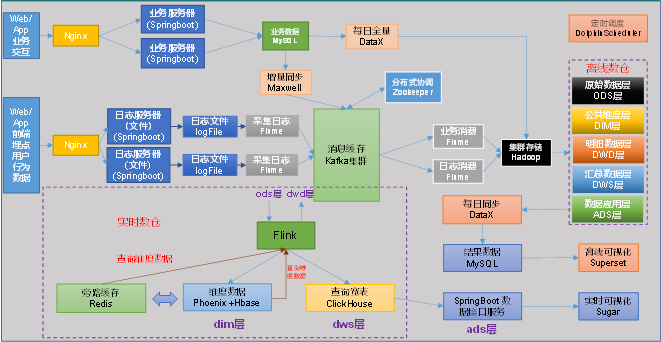

#### 2.2 实时

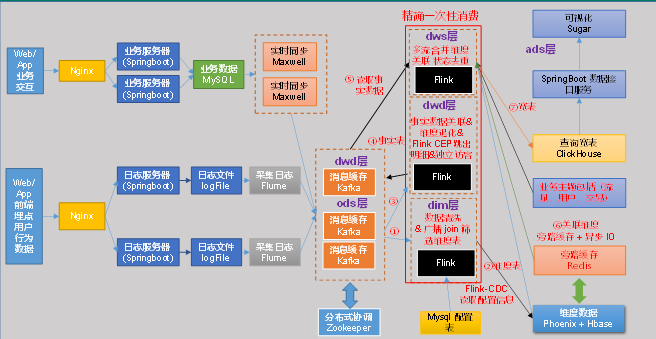

## 3.数仓建模意义

高性能：良好的数据模型能够帮助我们快速查询所需要的数据。

低成本：良好的数据模型能减少重复计算，实现计算结果的复用，降低计算成本。

高效率：良好的数据模型能极大的改善用户使用数据的体验，提高使用数据的效率。

高质量：良好的数据模型能改善数据统计口径的混乱，减少计算错误的可能性。

## 4.建模方法论

#### 4.1 ER模型-实体关系模型

遵循三范式：为了减少数据的冗余、保证数据的一致性，并不适合作为分析统计

第一范式：属性不可切割

第二范式：不能存在部分函数依赖：姓名依赖于学号和课程可以，但是里边有部分依赖就不行

第三范式：不能存在传递函数依赖：学号-》系名-》系主任，反过来系主任推不出学号、因此要拆成两段

#### 4.2 维度模型-事实维度模型

以数据分析作为出发点，关注的重点在于客户如何快速的完成需求分析以及如何实现较好的大规模复杂查询的响应性能。维度建模是围绕着业务过程来设计的。

# 二、维度建模-事实表

## 1.事实表特点

事实表比较细长、列少行多，行增加速度比较快

## 2.事实表分类

#### 2.1 事务性事实表

概述：保存各业务过程的原子（最细粒度）操作事件

设计流程：选择业务过程->声明粒度->确认维度（环境信息相关维度）->确认事实（度量值，金额、人数、次数等）

不足：处理存量指标（如余额、库存等）时，多个业务过程（放款余额+、还款-）会对余额有影响，因此需要多张事实表全量关联计算。

处理多事务关联统计：如下统计最近一个月授信申请-》授信->用信申请-》放款 之间的平均时间，则需要将四张事实表join起来计算，均为大表

#### 2.2 周期快照型事实表

针对存量型指标或者状态型指标（空气温度、速度等），不去计算，而是把业务计算好的结果定期快照保存起来。

#### 2.3 累计快照型事实表：

将每个业务过程相关的字段提取出来，每日关联增量数据，完成的关联的数据就放入历史分区、未完成的放入9999分区，再第二天时将9999和新的一天的数据union all 后再去与新一天的数据关联（等待迟到数据）

选择业务过程-》声明粒度-》确认维度-》确认事实

# 三、维度建模-维度表

## 1，实时数仓与离线数仓维表的存储区别

#### 1.1 离线数仓：

维表数据多为一些环境信息，改动较小，且数据量不大，采用datax每日全量同步。

#### 1.2 实时数仓：

采集数据是实时增量采集的，不可能每次数据有变化就全量的同步一次维表。因此采用将维表存储在Hbase中，利用Phoenix客户端提供的upsert语法，实现幂等写入，因此hbase中将是维表的全量最新数据。实时数仓是对最新数据的实时分析，不需要回去历史数据，因此不存历史数据。就算要分析历史数据那也是离线数仓干的活，或者将实时数仓的延迟提高。

## 2.维表设计步骤

#### 2.1 确认维度（表）

即确认跟业务相关的维度表（人物信息、地址信息等），如果某张表的维度信息较少，则可以将其与事实表关联维度退化到事实表中

#### 2.2 确认主维表和相关维表

如商品表与品牌分类表之间的关系，商品是主维表，分类表可以关联到主维表中。

#### 2.3 确认维度属性

即确定维度字段，维度属性可以从主维表和相关维表中获取，也可以进一步加工得到。

遵循的要求：

1）尽可能生成丰富的纬度属性，丰富的维度信息能支持指标的丰富度更高

2）尽量不要使用编码，而使用明确的文字说明，一般可以编码和文字共存，方便他人使用

3）尽量沉淀出通用的维度属性。有些字段需要复杂的逻辑处理得到，可以优先在为表中先沉淀出这些通用的复杂处理结果。

## 3.维度设计要点

#### 3.1 规范化与反规范化

规范化：遵循范式理论，减少数据冗余、增强数据的一致性。如：雪花模型

范规范化：出于易用性和提高查询性能考虑，数据相对会冗余。如：星型模型

#### 3.2 维度变化

1）全量快照

对于数据量不大、且变化频繁的数据采用全量快照，方便理解、维护与使用。

2）拉链表

数据量大、且变化不频繁的数据，每天增量拉取数据，能够更高效的保存维度信息的历史数据。

3）多值维度

一条事实表中的记录与维度表中多条维度记录相关，如一个订单可对应多件商品。

此时可采取两种方案：

降低事实表粒度，订单粒度降到商品粒度

多个字段保存多个维度id，但是这种方案只适用于多值维度个数固定的情况。

4）多值属性

维表中某个属性同时又多个值，如商品有平台属性和销售属性

此时课采取两种方案：

将多值属性放到一个字段，如平台属性的多个字段用key：value。

将多值属性放到多个字段，每个字段对应一个属性，只适用多值属性个数固定的情况，这样表结构不用变化，否则增加属性就要改变表结构。

# 四、数仓设计

## 1.分层规划

ods层：原始数据层，存放未经处理的原始数据，结构与源系统保持一致，数仓数据的准备区

dim层：共用维度层，基于维度建模理论进行构建，用于存放维度模型中的维度表，保存一致性维度信息。

dwd层：明细数据层，基于维度建模理论进行构建，存放维度模型中的事实表，保存各业务过程最小粒度的操作记录。

dws层：汇总数据层，基于上层的指标需求，以分析的主题对象作为建模驱动，构建公共统计粒度的汇总表。

ads层：数据应用层，存放各项统计指标的结果

## 2.数仓构建流程

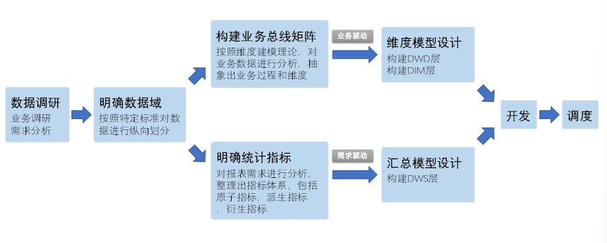

#### 2.1 数据调研

##### 2.1.1 业务调研

熟悉业务流程：明确业务的具体流程，需要将该业务所有包含的每个业务过程一一列举出来。

熟悉业务数据：将数据与业务过程对应起来，明确每个步骤对哪些表的哪些数据产生影响。

**以银行业务为例：**

**授信（额度申请）：**客户入口（银行app、第三方app）申请 》 脸活体识别 》 上传身份证等材料信息 》 判断额度表是否已经有额度 》 协议阅读 》 正式上传影像件提交额度授信申请 》 开始授信处理 》前台基础校验（黑名单、准入年龄，人脸比对等） 》 中台校验 》通过后创建客户信息 》 征信授权书等协议签署等 》 大数据风控审批 》 本地额度表创建 》签署授信合同 》 通知各系统授信结果并展示 》 授信完成

**授信过程涉及表格：**用户信息、额度表、授信申请表、合同表、活动额度表

**放款（用信）：**客户登录填写申请借款要素 》提交贷款申请 》 贷款开始受理 》 前台校验 》 中台校验 》 创建用信申请记录 》调用风控审批 》 风控审批通过占用额度 》 中台额度占用 及额度信息更新 》 借款合同签订 》 核心记账并生成借据信息 》 调用放款支付 》 展示用信结果及还款计划

**放款过程涉及表格：**放款申请表、额度占用表、借款合同表、借据表、支付表、放款计息属性表、通用还款计划表1、贷款账号主表、贷款优惠卷表、贷款利息减免活动表、贷款优惠活动规则表等。

**还款（批扣）：**还款日D-1日跑批次日需扣款文件（确认到期用户准备批扣）》协议支付扣款 》 成功扣款核心记账更新贷款信息及还款计划 》 风险中台释放已还款额度 》 批扣结果告知客户

**还款（主动）：**用户主动还款 》 单期还款 或者 提前结清 》 提交还款申请 》 创建还款申请 》 协议扣款 》 核心记账 》 更新贷款信息及还款计划 》 风险中台释放额度 》 还款成功

**还款涉及表格：**用户信息表、通用还款计划表1、还款申请表、还款流水表、扣款流水表、批量还款流水表、还款计划信息表2、还款任务明细表、代偿流水表、还款属性表（记录还款方式、提前还款利息怎么算、逾期利息怎么算）。

##### 2.1.2 需求分析

明确需求所需的业务过程与维度，即明确事实表+维度表。

**报表类需求：**

需求一：各合作方对账。通过行方计算放款、还款、代偿、还款计划明细等推送给合作方，或者合作方计算好推送到行方，进行比对，找出不一致的异常明细。放款涉及到免息券、打折等活动、较为复杂，还款涉及到还款计划的变更。

需求二：各产品分润服务费计算。行方作为出资方应得报酬计算，担保公司担保费佣金计算等。主要涉及放款、还款业务。

需求三：还款催收。预警到期、逾期1/7/30/90天提醒

需求四：大屏报表开发：

①漏斗 授信-放款-还款、授信通过率、放款通过率、还款逾期率、提前结清率等。

②授信/放款 1、7、30、年、历史（不同粒度、产品、集团、省份）金额、笔数、户数、通过率。

③产品授信、放款金额、户数、笔数、人均TopN

④产品/集团在贷余额、在贷客户数

⑤各期数贷款类型选择人数、放款金额、喜好程度（喜好率）

⑥新老客判断，及数量统计占比

⑦优惠券使用情况，总优惠金额

需求五：

用户画像标签计算

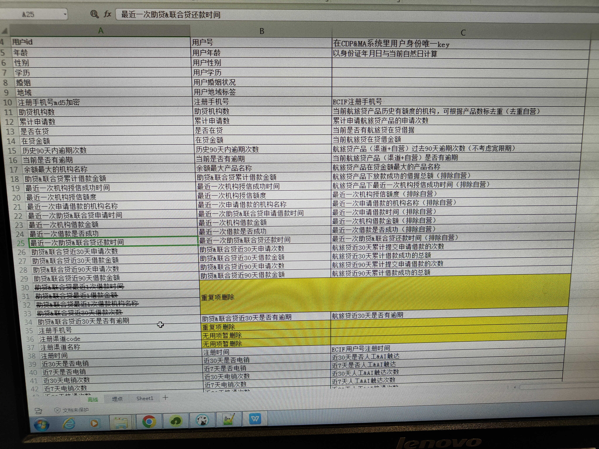

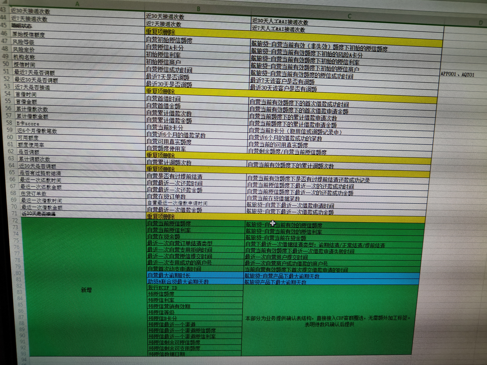

#### 2.2 明确数据域

为便于数据的管理和应用，根据业务过程或者部门进行划分数据域，如放贷域、用户域、工具域、画像域、催收域等。

| 数据域 | 业务过程 | 维度 |  |  |  |  |  |  |  |  |  |  |  |  |
| --- | --- | --- | --- | --- | --- | --- | --- | --- | --- | --- | --- | --- | --- | --- |
|  |  | 用户信息 | 额度信息 | 授信合同 | 活动额度 | 贷款账号主表 | 借款合同表 | 借据表 | 计息规则表 | 还款计划表 | 贷款优惠信息表 | 利息减免活动表 | 活动规则表 | 还款属性表 |
| 画像域 | 注册 | √ |  |  |  |  |  |  |  |  |  |  |  |  |
|  | 登录 | √ |  |  |  |  |  |  |  |  |  |  |  |  |
| 流量域 | 贷前信息 | √ | √ |  |  |  |  |  |  |  |  |  |  |  |
| 放贷域 | 授信 | √ | √ | √ |  |  |  |  |  |  |  |  |  |  |
|  | 额度占用 | √ | √ |  |  |  | ​ |  |  |  |  |  |  |  |
|  | 支付 | √ |  |  |  |  | √ | √ | √ |  |  |  |  |  |
|  | 放款 | √ | √ | √ | √ | √ | √ | √ | √ |  | √ | √ | √ |  |
|  | 还款计划生成 |  |  |  |  |  |  |  |  |  |  |  |  |  |
|  | 代扣还款 | √ |  |  |  |  |  | √ | √ | √ | √ | √ | √ | √ |
|  | 批量文件还款 | √ |  |  |  |  |  |  |  |  |  |  |  |  |
|  | 主动还款 | √ |  |  |  |  |  |  |  |  |  |  |  |  |
|  | 逾期还款 | √ |  |  |  |  |  |  |  |  |  |  |  |  |
|  | 代偿 | √ |  |  |  |  |  |  |  |  |  |  |  |  |
| 工具域 | 免息券使用 | √ |  |  |  |  |  |  |  |  |  |  |  |  |

#### 2.3 构建业务总线矩阵

一个数据域对应多个业务过程，一个业务过程对应多个维度，按照 选择业务过程->声明粒度->确认维度->确认事实 的步骤得到业务总线矩阵，根据总线矩阵 + 指标，即可找出对应指标应该如何统计聚合 涉及哪些事实表和维表。

数据域 ：（航旅、供应链、瑞商贷）放贷、用户、工具、画像、催收

业务过程 ：授信、放款、主动还款、未来期还款计划、当期还款计划、逾期还款、提前还款，批扣、

维度：用户、额度、授信合同表、贷款账户信息、贷款合同表、贷款计息属性表、借据、优惠券、优惠利息、活动规则表、优惠信息表、还款属性、银行账户信息、放款错误信息表、还款错误信息表。

#### 2.4 明确统计指标

原子指标：基于某一业务过程的度量值，业务定义中不可再拆解的指标，核心功能就是对指标的聚合逻辑进行了定义，包含三要素：业务过程、度量值、聚合逻辑，如：放款、放款金额、sum（放款金额）

派生指标：基于原子指标

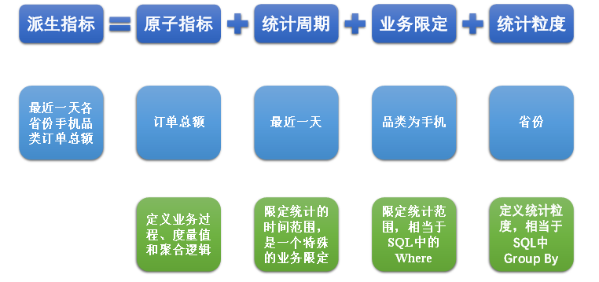

衍生指标：在一个或者多个派生指标上通过各种逻辑运算复合而成的，如 比率、比例等。

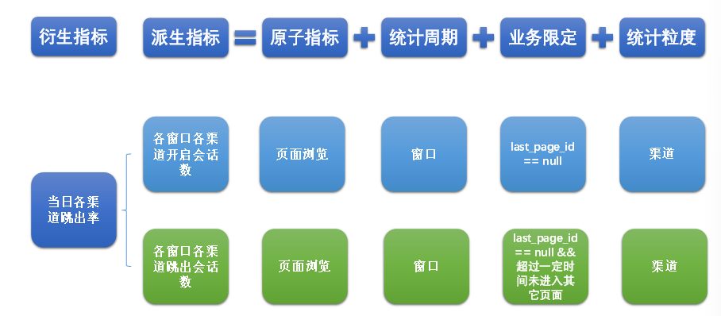

明确统计指标的目的，是为了在计算指标时，能将复用的派生指标保存为公共的指标，这样即可减少重复计算，提高数据的复用性。

## 3 数仓建模整体思路思考

#### 3.1 ods层

将数据原封不动保存过来，相当于做个备份，如果不做此步骤， 可能需要频繁到业务数据库抽取数据，会对业务数据库造成压力，数据如果是用hive+hdfs则还可以做一些压缩处理

压缩比和压缩速度是相反的。  
压缩速度从高到低：  
Snappy>LZ4>LZO>gzip>bzip2

LZO：通过索引可切分。  
bzip2：可切分。  
gzip，LZ4，Snappy其他均不可切分。  
Snappy，LZ4，LZO针对压缩速度优化

#### 3.2 dim层

对数据进行清洗，如关键字段为null、json格式不完整的数据、客户信息脱敏处理等；将维表分为主维表和相关维表，或者将维表数据关联为一个维度一个维表，字段特别少的维表可以将其退化到事实表中作为事实表的一部分；另外还要考虑多值维度（一事实多维度）、多值属性（一属性多字段）的处理

#### 3.3 dwd层

对数据进行清洗，如关键字段为null、json格式不完整的数据；主要是将整个业务流程划分为各个业务过程，根据业务过程来找出相应的该业务过程最细粒度处理操作的事实表，并对该事实表做相关处理（字段缩减，维度退化等）

#### 3.4 dws层

通过指标分析，得出一些复用性较高或者未来复用性较高的共用派生指标，将事实表+维度表得到这些公用派生指标的轻微聚合结果，该结果供后续再次聚合，或者关联其他维度信息后再次聚合使用。

#### 3.5 ads层

最终的结果数据，可能是大屏报表展示结果，也可能是表格输出，是dws聚合、dws+dim聚合、dwd+dim聚合或者相关复合计算而来。

# 五、实时数仓开发准备工作

## 1.idea开发环境准备

创建项目，删除项目名下的src，创建module

导入依赖：

```java
<properties>
<java.version>1.8</java.version>
<maven.compiler.source>${java.version}</maven.compiler.source>
<maven.compiler.target>${java.version}</maven.compiler.target>
<flink.version>1.13.0</flink.version>
<scala.version>2.12</scala.version>
<hadoop.version>3.1.3</hadoop.version>
</properties>

<dependencies>
<dependency>
<groupId>org.apache.flink</groupId>
<artifactId>flink-java</artifactId>
<version>${flink.version}</version>
</dependency>

<dependency>
<groupId>org.apache.flink</groupId>
<artifactId>flink-streaming-java_${scala.version}</artifactId>
<version>${flink.version}</version>
</dependency>

<dependency>
<groupId>org.apache.flink</groupId>
<artifactId>flink-connector-kafka_${scala.version}</artifactId>
<version>${flink.version}</version>
</dependency>

<dependency>
<groupId>org.apache.flink</groupId>
<artifactId>flink-clients_${scala.version}</artifactId>
<version>${flink.version}</version>
</dependency>

<dependency>
<groupId>org.apache.flink</groupId>
<artifactId>flink-json</artifactId>
<version>${flink.version}</version>
</dependency>

<dependency>
<groupId>com.alibaba</groupId>
<artifactId>fastjson</artifactId>
<version>1.2.68</version>
</dependency>

<!--如果保存检查点到hdfs上，需要引入此依赖-->
<dependency>
<groupId>org.apache.hadoop</groupId>
<artifactId>hadoop-client</artifactId>
<version>${hadoop.version}</version>
</dependency>

<dependency>
<groupId>org.projectlombok</groupId>
<artifactId>lombok</artifactId>
<version>1.18.20</version>
</dependency>

<!--Flink默认使用的是slf4j记录日志，相当于一个日志的接口,我们这里使用log4j作为具体的日志实现-->
<dependency>
<groupId>org.slf4j</groupId>
<artifactId>slf4j-api</artifactId>
<version>1.7.25</version>
</dependency>

<dependency>
<groupId>org.slf4j</groupId>
<artifactId>slf4j-log4j12</artifactId>
<version>1.7.25</version>
</dependency>

<dependency>
<groupId>org.apache.logging.log4j</groupId>
<artifactId>log4j-to-slf4j</artifactId>
<version>2.14.0</version>
</dependency>
</dependencies>

<build>
<plugins>
<plugin>
<groupId>org.apache.maven.plugins</groupId>
<artifactId>maven-shade-plugin</artifactId>
<version>3.1.1</version>
<executions>
<execution>
<phase>package</phase>
<goals>
<goal>shade</goal>
</goals>
<configuration>
 <artifactSet>
<excludes>
<exclude>com.google.code.findbugs:jsr305</exclude>
<exclude>org.slf4j:*</exclude>
<exclude>log4j:*</exclude>
<exclude>org.apache.hadoop:*</exclude>
</excludes>
</artifactSet>
<filters>
<filter>
<!-- Do not copy the signatures in the META-INF folder.Otherwise, this might cause SecurityExceptions when using the JAR. -->
<!-- 打包时不复制META-INF下的签名文件，避免报非法签名文件的SecurityExceptions异常-->
                          <artifact>*:*</artifact>
<excludes>
<exclude>META-INF/*.SF</exclude>
<exclude>META-INF/*.DSA</exclude>
             <exclude>META-INF/*.RSA</exclude>
</excludes>
</filter>
</filters>

<transformers combine.children="append">
  <!-- The service transformer is needed to merge META-INF/services files -->
<!-- connector和format依赖的工厂类打包时会相互覆盖，需要使用ServicesResourceTransformer解决-->
<transformer
implementation="org.apache.maven.plugins.shade.resource.ServicesResourceTransformer"/>
</transformers>
</configuration>
</execution>
</executions>
</plugin>
</plugins>
</build>
```

resources目录下创建日志配置文件 log4j.properties：

```java
log4j.appender.stdout=org.apache.log4j.ConsoleAppender
log4j.appender.stdout.target=System.out
log4j.appender.stdout.layout=org.apache.log4j.PatternLayout
log4j.appender.stdout.layout.ConversionPattern=%d{yyyy-MM-dd HH:mm:ss} %10p (%c:%M) - %m%n

log4j.rootLogger=error,stdout
```

## 2.数仓运行环境准备

Hadoop安装

Zookeeper安装

Kafka安装

Datax安装

Maxwell安装

MySQL安装

Oracle安装

Flume安装

ES安装

Flink部署安装

FlinkCDC安装

Hbase部署安装

Idea Phoenix环境准备：

配置idea依赖

```java
<dependency>
<groupId>org.apache.phoenix</groupId>
    <artifactId>phoenix-spark</artifactId>
    <version>5.0.0-HBase-2.0</version>
    <exclusions>
        <exclusion>
            <groupId>org.glassfish</groupId>
            <artifactId>javax.el</artifactId>
        </exclusion>
    </exclusions>
</dependency>
```

在resources目录下创建hbase-site.xml文件，添加如下内容

```java
<configuration>
<property>
<name>hbase.rootdir</name>
<value>hdfs://hadoop102:8020/HBase</value>
</property>

<property>
<name>hbase.cluster.distributed</name>
<value>true</value>
</property>

<property>
<name>hbase.zookeeper.quorum</name>
<value>hadoop102,hadoop103,hadoop104</value>
</property>

<property>
 <name>hbase.unsafe.stream.capability.enforce</name>
<value>false</value>
</property>

<property>
<name>hbase.wal.provider</name>
<value>filesystem</value>
</property>

<!-- 注意：为了开启hbase的namespace和phoenix的schema的映射，在程序中需要加这个配置文件，另外在linux服务上，也需要在hbase以及phoenix的hbase-site.xml配置文件中，加上以上两个配置，并使用xsync进行同步（本节1中文档已有说明）。-->
<property>
<name>phoenix.schema.isNamespaceMappingEnabled</name>
<value>true</value>
</property>

<property>
<name>phoenix.schema.mapSystemTablesToNamespace</name>
<value>true</value>
</property>
</configuration>
```

Redis 安装

Doris安装

模拟数据准备

# 六、实时数仓开发

## 1.ods层

日志文件通过flume采集到kafka的topic\_log，业务数据通过datax全量导入kafka、业务数据增量通过maxwell导入kafka的topic\_db。

## 2.dim层

#### 2.1 设计要点

（1）DIM层的设计依据是维度建模理论，该层存储维度模型的维度表。

（2）DIM层的数据存储在HBase 表中

DIM 层表是用于维度关联的，要通过主键去获取相关维度信息，这种场景下 K-V 类型数据库的效率较高。常见的 K-V 类型数据库有 Redis、HBase，而 Redis 的数据常驻内存，会给内存造成较大压力，因而选用 HBase 存储维度数据。

（3）DIM层表名的命名规范为dim\_表名

#### 2.2 配置表设计

通过配置表来区分维表和事实表，将维表存入Hbase

我们将为配置表设计五个字段.

Ø source\_table：作为数据源的业务数据表名

Ø sink\_table：作为数据目的地的 Phoenix 表名

Ø sink\_columns：Phoenix 表字段

Ø sink\_pk：Phoenix 表主键

Ø sink\_extend：Phoenix 建表扩展，即建表时一些额外的配置语句

将 source\_table 作为配置表的主键，可以通过它获取唯一的目标表名、字段、主键和建表扩展，从而得到完整的 Phoenix 建表语句。

#### 2.3 主要任务

##### 2.3.1 接受kafka数据，过滤空值数据

对maxwell抓取的数据进行ETL，有用的部分保留，没用的过滤。

##### 2.3.2 动态拆分维表功能

如果把区分维表的配置写入代码的一个配置中，那么有新的维表时，需要修改代码，重启计算程序，很不方便。

因此可采用三种方式来解决：

一种是用Zookeeper存储，通过Watch感知数据变化；

另一种是用MySQL数据库存储，周期性的同步；

再一种是用MySQL数据库存储，使用广播流。

由于flinkcdc能读取mysql的配置表，这样只用在mysql中新增一条维表的配置，flinkcdc读取到后将配置表广播与主流连接。

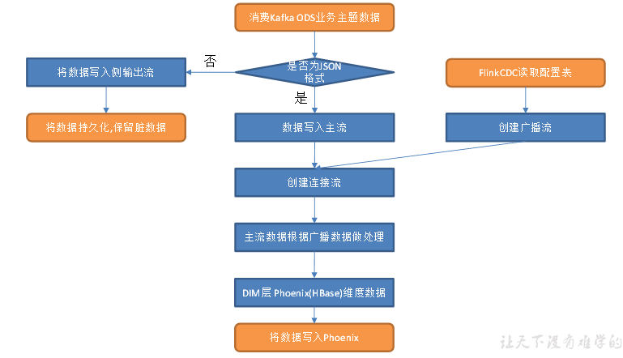

##### 2.3.3 把流中的数据保存到对应的维度表中

#### ​  

## 3.DWD层

#### 3.1DWD层设计要点：

（1）DWD层的设计依据是维度建模理论，该层存储维度模型的事实表。

（2）DWD层表名的命名规范为dwd\_数据域\_表名。

#### 3.2 流量域未经加工的事务事实表

##### 3.2.1 主要任务

**1****）数据清洗（****ETL****）**

​数据传输过程中可能会出现部分数据丢失的情况，导致 JSON 数据结构不再完整，因此需要对脏数据进行过滤。

**2****）新老访客状态标记修复**

**​**日志数据 common 字段下的 is\_new 字段是用来标记新老访客状态的，1 表示新访客，0 表示老访客。前端埋点采集到的数据可靠性无法保证，可能会出现老访客被标记为新访客的问题，因此需要对该标记进行修复。

**3****）分流**

​本节将通过分流对日志数据进行拆分，生成五张事务事实表写入 Kafka。

Ø 流量域页面浏览事务事实表

Ø 流量域启动事务事实表

Ø 流量域动作事务事实表

Ø 流量域曝光事务事实表

Ø 流量域错误事务事实表

##### 3.2.2 思路

**1****）数据清洗（****ETL****）**

对流中数据进行解析，将字符串转换为 JSONObject，如果解析报错则必然为脏数据。定义侧输出流，将脏数据发送到侧输出流，写入Kafka 脏数据主题。

**2****）新老访客状态标记修复**

（1）前端埋点新老访客状态标记设置规则

以神策提供的第三方埋点服务中新老访客状态标记设置规则为例。

Ø Web 端：用户第一次访问埋入神策 SDK 页面的当天（即第一天），JS SDK 会在网页的 cookie 中设置一个首日访问的标记，并设置第一天 24 点之前，该标记为 true，即第一天触发的网页端所有事件中，is\_new = 1。第一天之后，该标记则为 false，即第一天之后触发的网页端所有事件中，is\_new = 0；

Ø 小程序端：用户第一天访问埋入神策 SDK 的页面时，小程序 SDK 会在 storage 缓存中创建一个首日为 true 的标记，并且设置第一天 24 点之前，该标记均为 true。即第一天触发的小程序端所有事件中，is\_new = 1。第一天之后，该标记则为 false，即第一天之后触发的小程序端所有事件中，is\_new = 0；

Ø APP 端：用户安装 App 后，第一次打开埋入神策 SDK 的 App 的当天，Android/iOS SDK 会在手机本地缓存内，创建一个首日为 true 的标记，并且设置第一天 24 点之前，该标记均为 true。即第一天触发的 APP 端所有事件中，is\_new = 1。第一天之后，该标记则为false，即第一天之后触发的 APP 端所有事件中，is\_new = 0。

本项目模拟生成的是 APP 端日志数据。对于此类日志，如果首日之后用户清除了手机本地缓存中的标记，再次启动 APP 会重新设置一个首日为 true 的标记，导致本应为0 的 is\_new 字段被置为1，可能会给相关指标带来误差。因此，有必要对新老访客状态标记进行修复。

（2）新老访客状态标记修复思路

运用 Flink 状态编程，为每个 mid 维护一个键控状态，记录首次访问日期。

①如果 is\_new 的值为1

a）如果键控状态为 null，认为本次是该访客首次访问 APP，将日志中 ts 对应的日期更新到状态中，不对 is\_new 字段做修改；

b）如果键控状态不为 null，且首次访问日期不是当日，说明访问的是老访客，将 is\_new 字段置为0；

c）如果键控状态不为 null，且首次访问日期是当日，说明访问的是新访客，不做操作；

②如果 is\_new 的值为0

a）如果键控状态为 null，说明访问 APP 的是老访客但本次是该访客的页面日志首次进入程序。当前端新老访客状态标记丢失时，日志进入程序被判定为老访客，Flink 程序就可以纠正被误判的访客状态标记，只要将状态中的日期设置为今天之前即可。本程序选择将状态更新为昨日；

b）如果键控状态不为 null，说明程序已经维护了首次访问日期，不做操作。

**3）利用侧输出流实现数据拆分**

（1）埋点日志结构分析

前端埋点获取的 JSON 字符串（日志）可能存在 common、start、page、displays、actions、err、ts 七种字段。其中

Ø common 对应的是公共信息，是所有日志都有的字段。

Ø err 对应的是错误信息，所有日志都可能有的字段。

Ø start 对应的是启动信息，启动日志才有的字段。

Ø page 对应的是页面信息，页面日志才有的字段。

Ø displays 对应的是曝光信息，曝光日志才有的字段，曝光日志可以归为页面日志，因此必然有 page 字段。

Ø actions 对应的是动作信息，动作日志才有的字段，同样属于页面日志，必然有 page 字段。动作信息和曝光信息可以同时存在。

Ø ts 对应的是时间戳，单位：毫秒，所有日志都有的字段。

综上，我们可以将前端埋点获取的日志分为两大类：启动日志和页面日志。二者都有 common 字段和 ts 字段，都可能有 err 字段。页面日志一定有 page 字段，一定没有 start 字段，可能有 displays 和 actions 字段；启动日志一定有 start 字段，一定没有 page、displays 和 actions 字段。

（2）分流日志分类

本节将按照内容，将日志分为以下五类。

Ø 启动日志

Ø 页面日志

Ø 曝光日志

Ø 动作日志

Ø 错误日志

（3）分流思路

①所有日志数据都可能拥有 err 字段，所有首先获取 err 字段，如果返回值不为 null 则将整条日志数据发送到错误侧输出流。然后删掉JSONObject 中的err 字段及对应值；

②判断是否有 start 字段，如果有则说明数据为启动日志，将其发送到启动侧输出流；如果没有则说明为页面日志，进行下一步；

③页面日志必然有 page 字段、 common 字段和 ts 字段，获取它们的值，ts 封装为包装类 Long，其余两个字段的值封装为 JSONObject；

④判断是否有 displays 字段，如果有，将其值封装为 JSONArray，遍历该数组，依次获取每个元素（记为 display），封装为JSONObject。创建一个空的 JSONObject，将 display、common、page和 ts 添加到该对象中，获得处理好的曝光数据，发送到曝光侧输出流。动作日志的处理与曝光日志相同（注意：一条页面日志可能既有曝光数据又有动作数据，二者没有任何关系，因此曝光数据不为 null 时仍要对动作数据进行处理）；

⑤动作日志和曝光日志处理结束后删除 displays 和 actions 字段，此时主流的JSONObject 中只有 common 字段、 page 字段和 ts 字段，即为最终的页面日志。

处理结束后，页面日志数据位于主流，其余四种日志分别位于对应的侧输出流，将五条流的数据写入 Kafka 对应主题即可。

**4）图解**

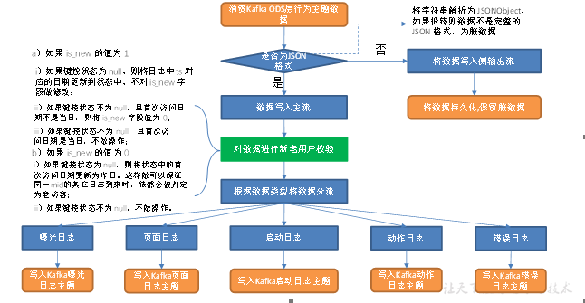

#### 3.3 流量域独立访客事务事实表

##### 3.3.1 主要任务

过滤页面数据中的独立访问记录

##### 3.3.2 思路

**1****）过滤** **last\_page\_id** **不为** **null** **的数据**

​独立访客数据对应的页面必然是会话起始页面，last\_page\_id 必为 null。过滤 last\_page\_id != null 的数据，减小数据量，提升计算效率。

**2****）筛选独立访客记录**

​运用 Flink 状态编程，为每个 mid 维护一个键控状态，记录末次登录日期。

​如果末次登录日期为 null 或者不是今日，则本次访问是该 mid 当日首次访问，保留数据，将末次登录日期更新为当日。否则不是当日首次访问，丢弃数据。

**3****）状态存活时间设置**

​如果保留状态，第二日同一 mid 再次访问时会被判定为新访客，如果清空状态，判定结果相同，所以只要时钟进入第二日状态就可以清空。

设置状态的 TTL 为1 天，更新模式为OnCreateAndWrite，表示在创建和更新状态时重置状态存活时间。如：2022-02-21 08:00:00 首次访问，若2022-02-22 没有访问记录，则2022-02-22 08:00:00 之后状态清空。

**4）图解**

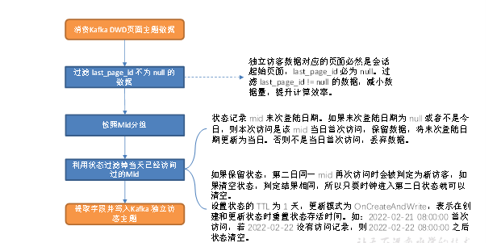

#### 3.4 流量域用户跳出事务事实表

##### 3.4.1 任务

过滤用户跳出明细数据

##### 3.4.2 思路

**1****）筛选策略**

跳出是指会话中只有一个页面的访问行为，如果能获取会话的所有页面，只要筛选页面数为1 的会话即可获取跳出明细数据。

（1）离线数仓中我们可以获取一整天的数据，结合访问时间、page\_id 和 last\_page\_id 字段对整体数据集做处理可以按照会话对页面日志进行划分，从而获得每个会话的页面数，只要筛选页面数为1 的会话即可提取跳出明细数据；

（2）实时计算中无法考虑整体数据集，很难按照会话对页面访问记录进行划分。而本项目模拟生成的日志数据中没有 session\_id（会话id）字段，也无法通过按照 session\_id 分组的方式计算每个会话的页面数。

（3）因此，我们需要换一种解决思路。如果能判定首页日志之后没有同一会话的页面访问记录同样可以筛选跳出数据。如果日志数据完全有序，会话页面不存在交叉情况，则跳出页面的判定可以分为三种情况：①两条紧邻的首页日志进入算子，可以判定第一条首页日志所属会话为跳出会话；②第一条首页日志进入算子后，接收到的第二条日志为非首页日志，则第一条日志所属会话不是跳出会话；③第一条首页日志进入算子后，没有收到第二条日志，此时无法得出结论，必须继续等待。但是无休止地等待显然是不现实的。因此，人为设定超时时间，超时时间内没有第二条数据就判定为跳出行为，这是一种近似处理，存在误差，但若能结合业务场景设置合理的超时时间，误差是可以接受的。本程序为了便于测试，设置超时时间为10s，为了更快看到效果可以设置更小的超时时间，生产环境的设置结合业务需求确定。

由上述分析可知，情况①的首页数据和情况③中的超时数据为跳出明细数据。

**2****）知识储备**

（1）Flink CEP

跳出行为需要考虑会话中的两条页面日志数据（第一条为首页日志且超时时间内没有接收到第二条，或两条紧邻的首页日志到来可以判定第一条为跳出数据），要筛选的是组合事件，用 filter 无法实现这样的功能，由此引出 Flink CEP。

Flink CEP（Complex Event Processing 复杂事件处理）是在Flink上层实现的复杂事件处理库，可以在无界流中检测出特定的事件模型。用户定义复杂规则（Pattern），将其应用到流上，即可从流中提取满足 Pattern 的一个或多个简单事件构成的复杂事件。

（2）Flink CEP 定义的规则之间的连续策略

Ø 严格连续: 期望所有匹配的事件严格的一个接一个出现，中间没有任何不匹配的事件。对应方法为 next()；

Ø 松散连续: 忽略匹配的事件之间的不匹配的事件。对应方法为followedBy()；

Ø 不确定的松散连续: 更进一步的松散连续，允许忽略掉一些匹配事件的附加匹配。对应方法为followedByAny()。

**3****）实现步骤**

（1）按照 mid 分组

​不同访客的浏览记录互不干涉，跳出行为的分析应在相同 mid 下进行，首先按照 mid 分组。

（2）定义 CEP 匹配规则

①规则一

跳出行为对应的页面日志必然为某一会话的首页，因此第一个规则判定 last\_page\_id 是否为null，是则返回 true，否则返回 false；

②规则二

规则二和规则一之间的策略采用严格连续，要求二者之间不能有其它事件。判断 last\_page\_id 是否为 null，在数据完整有序的前提下，如果不是 null 说明本条日志的页面不是首页，可以断定它与规则一匹配到的事件同属于一个会话，返回false；如果是 null 则开启了一个新的会话，此时可以判定上一条页面日志所属会话为跳出会话，是我们需要的数据，返回true；

③超时时间

超时时间内规则一被满足，未等到第二条数据则会被判定为超时数据。

（3）把匹配规则（Pattern）应用到流上

​根据 Pattern 定义的规则对流中数据进行筛选。

（4）提取超时流

​提取超时流，超时流中满足规则一的数据即为跳出明细数据，取出。

​（5）合并主流和超时流，写入 Kafka 调出明细主题

（6）结果分析

理论上 Flink 可以通过设置水位线保证数据严格有序（超时时间足够大），在此前提下，同一 mid 的会话之间不会出现交叉。若假设日志数据没有丢失，按照上述匹配规则，我们可以获得两类明细数据

①两个规则都被满足，满足规则一的数据为跳出明细数据。在会话之间不会交叉且日志数据没有丢失的前提下，此时获取的跳出明细数据没有误差；

②第一条数据满足规则二，超时时间内没有接收到第二条数据，水位线达到超时时间，第一条数据被发送到超时侧输出流。即便在会话之间不交叉且日志数据不丢失的前提下，此时获取的跳出明细数据仍有误差，因为超时时间之后会话可能并未结束，如果此时访客在同一会话内跳转到了其它页面，就会导致会话页面数大于1 的访问被判定为跳出行为，下游计算的跳出率偏大。误差大小和设置的超时时间呈负相关关系，超时时间越大，理论上误差越小。

**4）图解**

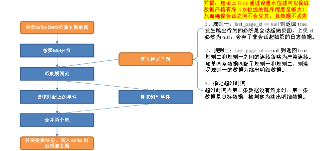

#### 3.5 交易域加购事务事实表

##### 3.5.1 任务

提取加购操作生成加购表，并将字典表中的相关维度退化到加购表中，写出到 Kafka 对应主题。

##### 3.5.2 思路

**1****）维度关联（维度退化）实现策略分析**

本章业务事实表的构建全部使用 FlinkSQL 实现，字典表数据存储在 MySQL 的业务数据库中，要做维度退化，就要将这些数据从 MySQL 中提取出来封装成 FlinkSQL 表，Flink 的JDBC SQL Connector 可以实现我们的需求。

**2****）知识储备**

（1）JDBC SQL Connector

JDBC 连接器可以让 Flink 程序从拥有 JDBC 驱动的任意关系型数据库中读取数据或将数据写入数据库。

如果在 Flink SQL 表的 DDL 语句中定义了主键，则会以 upsert 模式将流中数据写入数据库，此时流中可以存在 UPDATE/DElETE（更新/删除）类型的数据。否则，会以 append 模式将数据写出到数据库，此时流中只能有 INSERT（插入）类型的数据。

DDL 用法实例如下。

CREATE TABLE MyUserTable (

​id BIGINT,

​name STRING,

​age INT,

​status BOOLEAN,

​PRIMARY KEY (id) NOT ENFORCED

) WITH (

​'connector' = 'jdbc',

​'url' = 'jdbc:mysql://localhost:3306/mydatabase',

​'table-name' = 'users'

);

（2）Lookup Cache

​JDBC 连接器可以作为时态表关联中的查询数据源（又称维表）。目前，仅支持同步查询模式。

​默认情况下，查询缓存（Lookup Cache）未被启用，需要设置 lookup.cache.max-rows 和 lookup.cache.ttl 参数来启用此功能。

​Lookup 缓存是用来提升有 JDBC 连接器参与的时态关联性能的。默认情况下，缓存未启用，所有的请求会被发送到外部数据库。当缓存启用时，每个进程（即 TaskManager）维护一份缓存。收到请求时，Flink 会先查询缓存，如果缓存未命中才会向外部数据库发送请求，并用查询结果更新缓存。如果缓存中的记录条数达到了 lookup.cache.max-rows 规定的最大行数时将清除存活时间最久的记录。如果缓存中的记录存活时间超过了 lookup.cache.ttl 规定的最大存活时间，同样会被清除。

​缓存中的记录未必是最新的，可以将 lookup.cache.ttl 设置为一个更小的值来获得时效性更好的数据，但这样做会增加发送到数据库的请求数量。所以需要在吞吐量和正确性之间寻求平衡。

​（3）Lookup Join

​Lookup Join 通常在 Flink SQL 表和外部系统查询结果关联时使用。这种关联要求一张表（主表）有处理时间字段，而另一张表（维表）由Lookup 连接器生成。

​Lookup Join 做的是维度关联，而维度数据是有时效性的，那么我们就需要一个时间字段来对数据的版本进行标识。因此，Flink 要求我们提供处理时间用作版本字段。

​此处选择调用 PROCTIME() 函数获取系统时间，将其作为处理时间字段。该函数调用示例如下

tableEnv.sqlQuery("select PROCTIME() proc\_time")

​.execute()

​.print();

// 结果

+----+-------------------------+

| op | proc\_time |

+----+-------------------------+

| +I | 2022-04-09 15:45:50.752 |

+----+-------------------------+

1 row in set

​（4）JDBC SQL Connector 参数解读

Ø connector：连接器类型，此处为 jdbc

Ø url：数据库 url

Ø table-name：数据库中表名

Ø lookup.cache.max-rows：lookup 缓存中的最大记录条数

Ø lookup.cache.ttl：lookup 缓存中每条记录的最大存活时间

Ø username：访问数据库的用户名

Ø password：访问数据库的密码

Ø driver：数据库驱动，注意：通常注册驱动可以省略，但是自动获取的驱动是com.mysql.jdbc.Driver，Flink CDC 2.1.0 要求 mysql 驱动版本必须为8 及以上，在 mysql-connector -8.x 中该驱动已过时，新的驱动为com.mysql.cj.jdbc.Driver。省略该参数控制台打印的警告如下

Loading class \`com.mysql.jdbc.Driver'. This is deprecated. The new driver class is \`com.mysql.cj.jdbc.Driver'. The driver is automatically registered via the SPI and manual loading of the driver class is generally unnecessary.

**​**（5）Kafka Connector

本节需要从 Kafka 读取数据封装为 Flink SQL 表，并将 Flink SQL 表的数据写入 Kafka，而整个过程的数据操作类型均为 INSERT，使用 Kafka Connector 即可。

Kafka Connector 参数如下

Ø connector：指定使用的连接器，对于 Kafka，只用'kafka'。

Ø topic：主题。

Ø properties.bootstrap.servers：以逗号分隔的 Kafka broker 列表。注意：可以通过 properties.\* 的方式指定配置项，\*的位置用 Kafka 官方规定的配置项的 key 替代。并不是所有的配置都可以通过这种方式配置，因为 Flink 可能会将它们覆盖，如：'key.deserializer' 和'value.deserializer'。

Ø properties.group.id：消费者组 ID。

Ø format：指定 Kafka 消息中 value 部分的序列化的反序列化方式，'format' 和'value.format' 二者必有其一。

Ø scan.startup.mode：Kafka 消费者启动模式，有四种取值。

Ø 'earliest-offset'：从偏移量最早的位置开始读取数据。

Ø 'latest-offset'：从偏移量最新的位置开始读取数据。

Ø 'group-offsets'：从 Zookeeper/Kafka broker 中维护的消费者组偏移量开始读取数据。

Ø 'timestamp'：从用户为每个分区提供的时间戳开始读取数据。

Ø 'specific-offsets'：从用户为每个分区提供的偏移量开始读取数据。

默认值为 group-offsets。要注意：latest-offset 与 Kafka 官方提供的配置项 latest 不同， Flink 会将偏移量置为最新位置，覆盖掉 Zookeeper 或 Kafka 中维护的偏移量。与官方提供的 latest 相对应的是此处的 group-offsets。

**3****）执行步骤**

​（1）读取购物车表数据。

（2）建立 Mysql-LookUp 字典表。

（3）关联购物车表和字典表，维度退化。

**4）图解**


  

#### 3.6 交易域订单预处理表

##### 3.6.1 任务

经过分析，订单明细表和取消订单明细表的数据来源、表结构都相同，差别只在业务过程和过滤条件，为了减少重复计算，将两张表公共的关联过程提取出来，形成订单预处理表。

关联订单明细表、订单表、订单明细活动关联表、订单明细优惠券关联表四张事实业务表和字典表（维度业务表）形成订单预处理表，写入 Kafka 对应主题。

本节形成的预处理表中要保留订单表的 type 和 old 字段，用于过滤订单明细数据和取消订单明细数据。

##### 3.6.2 思路

**1****）知识储备**

（1）left join 实现过程

假设 A 表作为主表与 B 表做等值左外联。当 A 表数据进入算子，而 B 表数据未至时会先生成一条 B 表字段均为 null 的关联数据ab1，其标记为 +I。其后，B 表数据到来，会先将之前的数据撤回，即生成一条与 ab1 内容相同，但标记为 -D 的数据，再生成一条关联后的数据，标记为 +I。这样生成的动态表对应的流称之为回撤流。

（2）Kafka SQL Connector

Kafka SQL Connector 分为Kafka SQL Connector 和 Upsert Kafka SQL Connector

①功能

Upsert Kafka Connector支持以 upsert 方式从 Kafka topic 中读写数据

Kafka Connector支持从 Kafka topic 中读写数据

②区别

a）建表语句的主键

i）Kafka Connector 要求表不能有主键，如果设置了主键，报错信息如下

Caused by: org.apache.flink.table.api.ValidationException: The Kafka table 'default\_catalog.default\_database.normal\_sink\_topic' with 'json' format doesn't support defining PRIMARY KEY constraint on the table, because it can't guarantee the semantic of primary key.

ii）而 Upsert Kafka Connector 要求表必须有主键，如果没有设置主键，报错信息如下

Caused by: org.apache.flink.table.api.ValidationException: 'upsert-kafka' tables require to define a PRIMARY KEY constraint. The PRIMARY KEY specifies which columns should be read from or write to the Kafka message key. The PRIMARY KEY also defines records in the 'upsert-kafka' table should update or delete on which keys.

iii）语法： primary key(id) not enforced

注意：not enforced 表示不对来往数据做约束校验，Flink 并不是数据的主人，因此只支持 not enforced 模式

如果没有 not enforced，报错信息如下

Exception in thread "main" org.apache.flink.table.api.ValidationException: Flink doesn't support ENFORCED mode for PRIMARY KEY constaint. ENFORCED/NOT ENFORCED controls if the constraint checks are performed on the incoming/outgoing data. Flink does not own the data therefore the only supported mode is the NOT ENFORCED mode

b）对表中数据操作类型的要求

i）Kafka Connector 不能消费带有 Upsert/Delete 操作类型数据的表，如 left join 生成的动态表。如果对这类表进行消费，报错信息如下

Exception in thread "main" org.apache.flink.table.api.TableException: Table sink 'default\_catalog.default\_database.normal\_sink\_topic' doesn't support consuming update and delete changes which is produced by node TableSourceScan(table=[\[default\_catalog, default\_database, Unregistered\_DataStream\_Source\_9]\], fields=[l\_id, tag\_left, tag\_right])

ii）Upsert Kafka Connector 将 INSERT/UPDATE\_AFTER 数据作为正常的 Kafka 消息写入，并将 DELETE 数据以 value 为空的 Kafka 消息写入（表示对应 key 的消息被删除）。Flink 将根据主键列的值对数据进行分区，因此同一主键的更新/删除消息将落在同一分区，从而保证同一主键的消息有序。

③left join 结合 Upsert Kafka Connector 使用范例

说明：Kafka 并行度为4

a）表结构

left表

id tag

A left

B left

C left

​  

right 表

id tag

A right

B right

C right

b）查询语句

select

​l.id l\_id,

​l.tag l\_tag,

​r.tag r\_tag

from left l

left join right r

on l.id = r.id

c）关联结果写入到 Upsert Kafka 表，消费 Kafka 对应主题数据结果展示

{"l\_id":"A","tag\_left":"left","tag\_right":null}

null

{"l\_id":"A","tag\_left":"left","tag\_right":"right"}

{"l\_id":"C","tag\_left":"left","tag\_right":null}

null

{"l\_id":"C","tag\_left":"left","tag\_right":"right"}

{"l\_id":"B","tag\_left":"left","tag\_right":null}

null

{"l\_id":"B","tag\_left":"left","tag\_right":"right"}

④参数解读

本节需要用到 Kafka 连接器的明细表数据来源于 topic\_db 主题，于 Kafka 而言，该主题的数据的操作类型均为 INSERT，所以读取数据使用 Kafka Connector 即可。而由于 left join 的存在，流中存在修改数据，所以写出数据使用 Upsert Kafka Connector。

Upsert Kafka Connector 参数

Ø connector：指定使用的连接器，对于 Upsert Kafka，使用'upsert-kafka'

Ø topic：主题

Ø properties.bootstrap.servers：以逗号分隔的Kafka broker 列表

Ø key.format：key 的序列化和反序列化格式

Ø value.format：value 的序列化和反序列化格式

（3）Flink中的处理时间函数

​FlinkSQL 提供了几个可以获取当前时间戳的函数

Ø localtimestamp：返回本地时区的当前时间戳，返回类型为 TIMESTAMP(3)。在流处理模式下会对每条记录计算一次时间。而在批处理模式下，仅在查询开始时计算一次时间，所有数据使用相同的时间。

Ø current\_timestamp：返回本地时区的当前时间戳，返回类型为 TIMESTAMP\_LTZ(3)。在流处理模式下会对每条记录计算一次时间。而在批处理模式下，仅在查询开始时计算一次时间，所有数据使用相同的时间。

Ø now()：与 current\_timestamp 相同。

Ø current\_row\_timestamp()：返回本地时区的当前时间戳，返回类型为TIMESTAMP\_LTZ(3)。无论在流处理模式还是批处理模式下，都会对每行数据计算一次时间。

函数测试。查询语句如下。

tableEnv.sqlQuery("select localtimestamp," +

​"current\_timestamp," +

​"now()," +

​"current\_row\_timestamp()")

​.execute()

​.print();

​查询结果如下。

+----+-------------------------+-------------------------+-------------------------+-------------------------+

| op | localtimestamp | current\_timestamp | EXPR$2 | EXPR$3 |

+----+-------------------------+-------------------------+-------------------------+-------------------------+

| +I | 2022-04-13 20:42:28.529 | 2022-04-13 20:42:28.529 | 2022-04-13 20:42:28.529 | 2022-04-13 20:42:28.529 |

+----+-------------------------+-------------------------+-------------------------+-------------------------+

1 row in set

​动态表属于流处理模式，所以四种函数任选其一即可。此处选择 current\_row\_timestamp()。

**2****）执行步骤**

预处理表与订单明细事务事实表的区别只在于前者不会对订单数据进行筛选，且在表中增加了 type 和 old 字段。二者的粒度、聚合逻辑都相同，因此按照订单明细表的思路对预处理表进行分析即可。

（1）设置 ttl；

ttl（time-to-live）即存活时间。表之间做普通关联时，底层会将两张表的数据维护到状态中，默认情况下状态永远不会清空，这样会对内存造成极大的压力。表状态的 ttl 是 Idle（空闲，即状态未被更新）状态被保留的最短时间，假设 ttl 为10s，若状态中的数据在10s 内未被更新，则未来的某个时间会被清除（故而 ttl 是最短存活时间）。ttl 默认值为0，表示永远不会清空状态。

下单操作发生时，订单明细表、订单表、订单明细优惠券关联表和订单明细活动关联表的数据操作类型均为insert，不存在业务上的滞后问题，只考虑可能的数据乱序即可，而取消订单时只有订单表的状态发生变化，要和其它三张表关联，就需要考虑取消订单的延迟，通常在支付前均可取消订单，因此将 ttl 设置为15min + 5s。

​要注意：前文提到，本项目保证了同一分区、同一并行度的数据有序。此处的乱序与之并不冲突，以下单业务过程为例，用户完成下单操作时，订单表中会插入一条数据，订单明细表中会插入与之对应的多条数据，本项目业务数据是按照主键分区进入 Kafka 的，虽然同分区数据有序，但是同一张业务表的数据可能进入多个分区，会乱序。这样一来，订单表数据与对应的订单明细数据可能被属于其它订单的数据“插队”，因而导致主表或从表数据迟到，可能 join 不上，为了应对这种情况，设置乱序程度，让状态中的数据等待一段时间。

（2）从 Kafka topic\_db 主题读取业务数据；

这一步要调用 PROCTIME() 函数获取系统时间作为与字典表做 Lookup Join 的处理时间字段。

（3）筛选订单明细表数据；

应尽可能保证事实表的粒度为最细粒度，在下单业务过程中，最细粒度的事件为一个订单的一个 SKU 的下单操作，订单明细表的粒度与最细粒度相同，将其作为**主表**。

（4）筛选订单表数据；

通过该表获取user\_id 和 province\_id。保留 type 字段和 old 字段用于筛选订单明细数据和取消订单明细数据。

（5）筛选订单明细活动关联表数据；

通过该表获取活动 id 和活动规则 id。

（6）筛选订单明细优惠券关联表数据；

通过该表获取优惠券 id。

（7）建立 MySQL-Lookup 字典表；

通过字典表获取订单来源类型名称。

（8）关联上述五张表获得订单宽表，写入 Kafka 主题

事实表的粒度应为最细粒度，在下单和取消订单业务过程中，最细粒度为一个 sku 的下单或取消订单操作，与订单明细表粒度相同，将其作为主表。

①订单明细表和订单表的所有记录在另一张表中都有对应数据，内连接即可。

②订单明细数据未必参加了活动也未必使用了优惠券，因此要保留订单明细独有数据，所以与订单明细活动关联表和订单明细优惠券关联表的关联使用 left join。

③与字典表的关联是为了获取 source\_type 对应的 source\_type\_name，订单明细数据在字典表中一定有对应，内连接即可。

**3）图解**

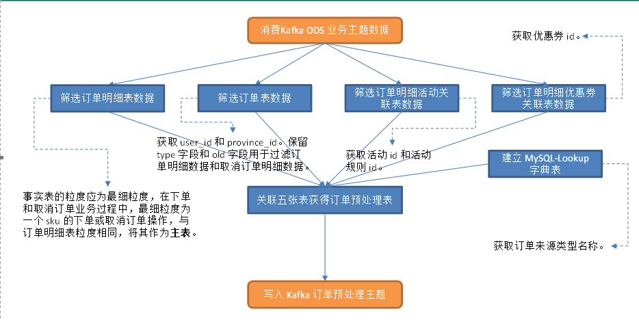

#### 3.7 交易域下单事务事实表

##### 3.7.1 任务

从 Kafka 读取订单预处理表数据，筛选订单明细数据，写入 Kafka 对应主题。

##### 3.7.2 思路

**实现步骤**

（1）从 Kafka dwd\_trade\_order\_pre\_process 主题读取订单预处理数据；

（2）筛选订单明细数据：新增数据，即订单表操作类型为 insert 的数据即为订单明细数据；

（3）写入 Kafka 订单明细主题。

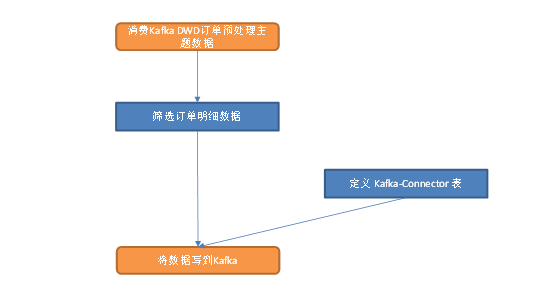

  

#### 3.8 交易域取消订单事务事实表

##### 3.8.1 任务

从 Kafka 读取订单预处理表数据，筛选取消订单明细数据，写入 Kafka 对应主题。

##### 3.8.2 思路

**实现步骤**

（1）从 Kafka dwd\_trade\_order\_pre\_process 主题读取订单预处理数据；

（2）筛选取消订单明细数据：保留修改了 order\_status 字段且修改后该字段值为"1003" 的数据;

（3）写入 Kafka 取消订单主题。

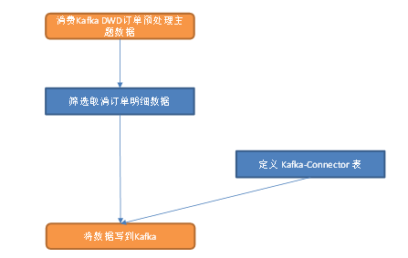

#### 3.9 交易域支付成功事务事实表

##### 3.9.1 任务

从 Kafka topic\_db主题筛选支付成功数据、从dwd\_trade\_order\_detail主题中读取订单事实数据、MySQL-LookUp字典表，关联三张表形成支付成功宽表，写入 Kafka 支付成功主题。

##### 3.9.2 思路

**1****）设置** **ttl**

支付成功事务事实表需要将业务数据库中的支付信息表 payment\_info 数据与订单明细表关联。订单明细数据是在下单时生成的，经过一系列的处理进入订单明细主题，通常支付操作在下单后15min 内完成即可，因此，支付明细数据可能比订单明细数据滞后15min。考虑到可能的乱序问题，ttl 设置为15min + 5s。

**2****）获取订单明细数据**

用户必然要先下单才有可能支付成功，因此支付成功明细数据集必然是订单明细数据集的子集。

**3****）筛选支付表数据**

​获取支付类型、回调时间（支付成功时间）、支付成功时间戳。

​生产环境下，用户支付后，业务数据库的支付表会插入一条数据，此时的回调时间和回调内容为空。通常底层会调用第三方支付接口，接口会返回回调信息，如果支付成功则回调信息不为空，此时会更新支付表，补全回调时间和回调内容字段的值，并将 payment\_status 字段的值修改为支付成功对应的状态码（本项目为1602）。支付成功之后，支付表数据不会发生变化。因此，只要操作类型为 update 且状态码为1602 即为支付成功数据。

由上述分析可知，支付成功对应的业务数据库变化日志应满足两个条件：

（1）payment\_status 字段的值为1602；

（2）操作类型为 update。

本程序为了去除重复数据，在关联后的宽表中补充了处理时间字段，DWS 层将进行详细介绍。支付成功表是由支付成功数据与订单明细做内连接，而后与字典表做 LookUp Join 得来。这个过程中不会出现回撤数据，关联后表的重复数据来源于订单明细表，所以应按照订单明细表的处理时间字段去重，故支付成功明细表的 row\_op\_ts 取自订单明细表。

**4****）构建****MySQL-LookUp** **字典表**

**5****）关联上述三张表形成支付成功宽表，写入** **Kafka** **支付成功主题**

支付成功业务过程的最细粒度为一个 sku 的支付成功记录，order\_detail\_info 表的粒度与最细粒度相同，将其作为主表。

（1）我们只需要 order\_detail 表中与支付成功相关的明细数据，且payment\_info 表的记录在订单明细表中必然存在对应数据，因此订单明细表通过内连接与支付成功数据关联；

（2）与字典表的关联是为了获取 payment\_type 对应的支付类型名称，主表不存在独有数据，通过内连接与字典表关联。下文与字典表的关联同理，不再赘述。

**6）图解**

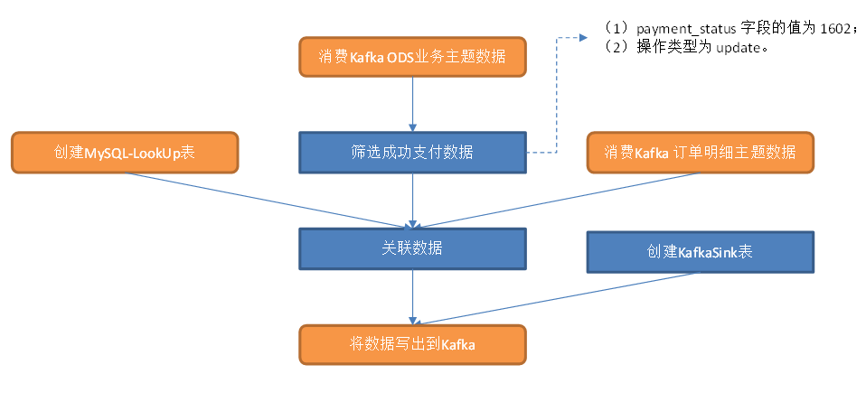

#### 3.10 交易域退单事务事实表

##### 3.10.1 任务

从 Kafka 读取业务数据，筛选退单表数据，筛选满足条件的订单表数据，建立 MySQL-Lookup 字典表，关联三张表获得退单明细宽表。

##### 3.10.2 思路

**1****）设置** **ttl**

​用户执行一次退单操作时，order\_refund\_info 会插入多条数据，同时 order\_info 表的**一**条对应数据会发生修改，所以两张表不存在业务上的时间滞后问题，因此仅考虑可能的乱序即可，ttl 设置为5s。

**2****）筛选退单表数据**

​退单业务过程最细粒度的操作为一个订单中一个 SKU 的退单操作，退单表粒度与最细粒度相同，将其作为**主表**。

**3****）筛选订单表数据并转化为流**

​获取 province\_id。退单操作发生时，订单表的 order\_status 字段值会由1002（已支付）更新为1005（退款中）。订单表中的数据要满足三个条件：

（1）order\_status 为1005（退款中）。

（2）操作类型为 update。

（3）更新的字段为 order\_status。

该字段发生变化时，变更数据中 old 字段下order\_status 的值不为 null（为1002）。

**4****）建立** **MySQL-Lookup** **字典表**

​获取退款类型名称和退款原因类型名称。

**5****）关联这几张表获得退单明细宽表，写入** **Kafka** **退单明细主题**

​退单信息表 order\_refund\_info 的粒度为退单业务过程的最细粒度，将其作为主表。

​（1）对单信息表与订单表的退单数据完全对应，不存在独有数据，通过内连接关联。

​（2）与字典表通过内连接关联。

第二步是否从订单表中筛选退单数据并不影响查询结果，提前对数据进行过滤是为了减少数据量，减少性能消耗。下文同理，不再赘述。

**6）图解**

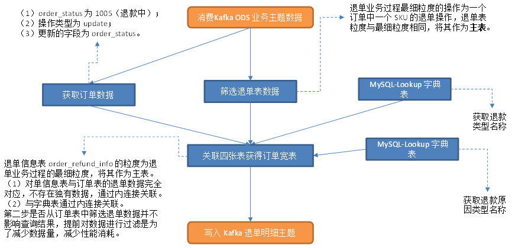

#### 3.11 交易域退款成功事务事实表

##### 3.11.1 任务

（1）从退款表中提取退款成功数据，并将字典表的 dic\_name 维度退化到表中。

（2）从订单表中提取退款成功订单数据。

（3）从退单表中提取退款成功的明细数据。

##### 3.11.2 思路

**1****）设置** **ttl**

​一次退款支付操作成功时，refund\_payment 表会新增记录，订单表 order\_info 和退单表order\_refund\_info 的对应数据会发生修改，几张表之间不存在业务上的时间滞后。与字典表的关联分析同上，不再赘述。因而，仅考虑可能的数据乱序即可。将 ttl 设置为5s。

**1****）建立** **MySQL-Lookup** **字典表**

​获取支付类型名称。

**2****）读取退款表数据，筛选退款成功数据**

​退款表refund\_payment 的粒度为一个订单中一个 SKU 的退款记录，与退款业务过程的最细粒度相同，将其作为**主表**。

​退款操作发生时，业务数据库的退款表会先插入一条数据，此时 refund\_status 状态码应为0701（商家审核中），callback\_time 为 null，而后经历一系列业务过程：商家审核、买家发货、退单完成。退单完成时会将状态码由0701 更新为0705（退单完成），同时将 callback\_time 更新为退款支付成功的回调时间。

​由上述分析可知，退款成功记录应满足三个条件：（1）数据操作类型为 update；（2）refund\_status 为0705；（3）修改的字段包含 refund\_status。

**3****）读取订单表数据，过滤退款成功订单数据**

​用于获取 user\_id 和 province\_id。退款操作完后时，订单表的 order\_status 字段会更新为1006（退款完成），因此退单成功对应的订单数据应满足三个条件：（1）操作类型为 update；

（2）order\_status 为1006；（3）修改了 order\_status 字段。

​order\_status 值更改为1006 之后对应的订单表数据就不会再发生变化，所以只要满足前两个条件，第三个条件必定满足。

**4****）筛选退款成功的退单明细数据**

​用于获取退单件数 refund\_num。退单成功时 order\_refund\_info 表中的 refund\_status 字段会修改为0705（退款成功状态码）。因此筛选条件有三：（1）操作类型为 update；（2）refund\_status 为0705；（3）修改了 refund\_status 字段。筛选方式同上。

**5****）关联四张表并写出到** **Kafka** **退款成功主题**

退款支付表的粒度为退款支付业务过程的最细粒度，即一个 sku 的退款操作，将其作为主表。

（1）退款支付表数据与订单表中的退款变更数据完全对应，不存在独有数据，内连接关联。

（2）退款支付数据与退单表退款变更数据完全对应，不存在独有数据，内连接关联。

（3）与字典表通过内连接关联。

**6）图解**

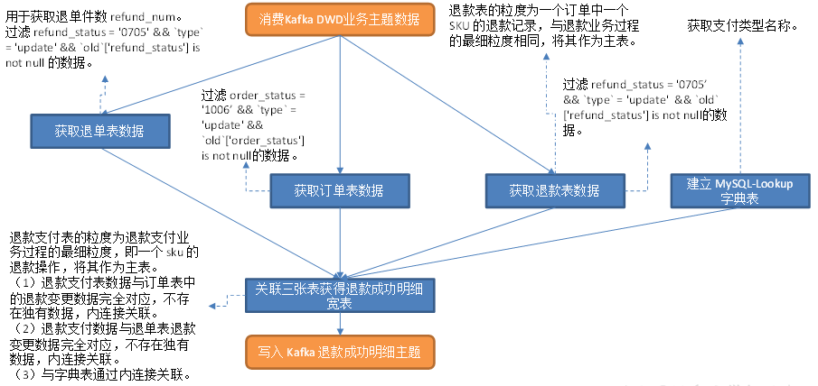

#### 3.12 工具域优惠券领取事务事实表

3.12.1 任务

读取优惠券领用数据，写入 Kafka 优惠券领用主题。

3.12.2 思路

用户领取优惠券后，业务数据库的优惠券领用表会新增一条数据，因此操作类型为 insert 的数据即为优惠券领取数据。

图解

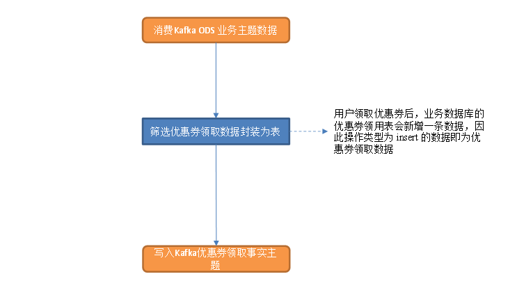

#### 3.13 工具域优惠券使用(下单)事务事实表

##### 3.13.1 任务

读取优惠券领用表数据，筛选优惠券下单数据，写入Kafka 优惠券下单主题。

##### 3.13.2 思路

用户使用优惠券下单时，优惠券领用表的 using\_time 字段会更新为下单时间，同时 coupon\_status 字段会由 1401 更改为1402，因此优惠券下单数据应满足三个条件：①操作类型为 update；②当前 coupon\_status 字段的值为1402；③修改了coupon\_status 字段。

**2****）执行步骤**

（1）通过三个条件筛选优惠券使用（下单）数据。

（2）建立 Upsert-Kafka 表，将优惠券使用（下单）数据写入 Kafka 优惠券使用（下单）事实主题。

**3）图解**

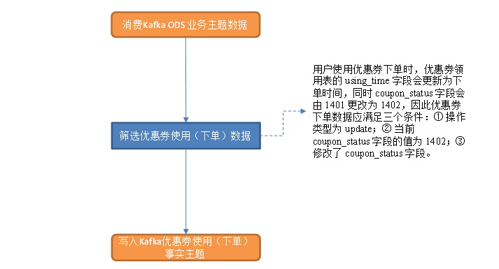

#### 3.14 工具域优惠券使用(支付)事务事实表

##### 3.14.1 任务

读取优惠券领用表数据，筛选优惠券支付数据，写入Kafka 优惠券支付主题。

##### 3.14.2 思路

用户使用优惠券支付时，优惠券领用表的 used\_time 字段会更新为支付时间，因此优惠券支付数据应满足两个条件：（1）操作类型为 update；（2）修改了 used\_time 字段。使用优惠券支付后，优惠券领用表数据就不会再发生变化，所以在操作类型为 update 的前提下，只要 used\_time 不为 null，就可以断定本次操作修改的是 used\_time 字段。

图解

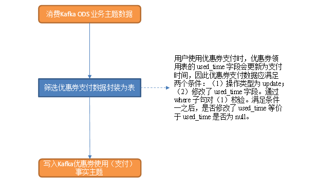

  

#### 3.15 互动域收藏商品事务事实表

##### 3.15.1 任务

读取收藏数据，写入 Kafka 收藏主题

##### 3.15.2 思路

用户收藏商品时业务数据库的收藏表会插入一条数据，因此筛选操作类型为insert 的数据即可。

图解

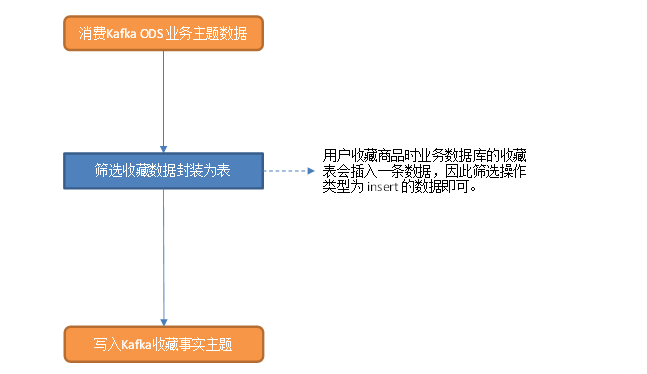

#### 3.16 互动域评价事务事实表

###### 3.16.1 任务

建立 MySQL-Lookup 字典表，读取评论表数据，关联字典表以获取评价（好评、中评、差评、自动），将结果写入 Kafka 评价主题。

##### 3.16.2 四路

**1****）设置** **ttl**

​前文提到，与字典表关联时 ttl 的设置主要是考虑到从外部介质查询维度数据的时间，此处设置为5s。

**2****）筛选评论数据**

用户提交评论时评价表会插入一条数据，筛选操作类型为 insert 的数据即可。

**3****）建立** **Mysql-Lookup** **字典表**

**4****）关联两张表**

**5）写入Kafka 互动域评论事实主题**

**6）图解**

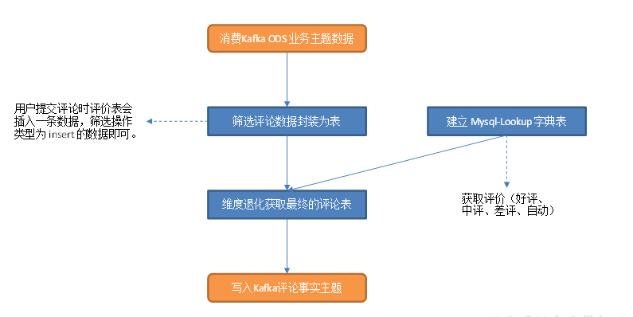

#### 3.17 用户域用户注册事务事实表

##### 3.17.1 任务

读取用户表数据，获取注册时间，将用户注册信息写入 Kafka 用户注册主题。

##### 3.17.2 思路

用户注册时会在用户表中插入一条数据，筛选操作类型为 insert 的数据即可。

图解

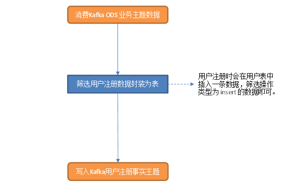

## 4.DWS层

#### 4.1 设计要点

（1）DWS层的设计参考指标体系。

（2）DWS层表名的命名规范为dws\_数据域\_统计粒度\_业务过程\_统计周期（window）。

注：window 表示窗口对应的时间范围。

#### 4.2 流量域来源关键词粒度页面浏览各窗口汇总表

##### 4.2.1任务

从 Kafka 页面浏览明细主题读取数据，过滤搜索行为，使用自定义 UDTF（一进多出）函数对搜索内容分词。统计各窗口各关键词出现频次，写入Doris。

##### 4.2.2 思路

本程序将使用FlinkSQL 实现。分词是个一进多出的过程，需要一个 UDTF 函数来实现，FlinkSQL 没有提供相关的内置函数，所以要自定义 UDTF 函数。

​自定义函数的逻辑在代码中实现，要完成分词功能，需要导入相关依赖，此处将借助IK 分词器完成分词。

​最终要将数据写入Doris，需要补充相关依赖，相关子类和工具类中的方法。本节任务分为两部分：分词处理和数据写出。

**1****）分词处理**

分词处理分为八个步骤，如下。

（1）创建分词工具类

​定义分词方法，借助IK 分词器提供的工具将输入的关键词拆分成多个词，返回一个 List 集合。

（2）创建自定义函数类

​继承 Flink 的 TableFunction 类，调用分词工具类的分词方法，实现分词逻辑。

（3）注册函数

（4）从 Kafka 页面浏览明细主题读取数据并设置水位线

（5）过滤搜索行为

​满足以下三个条件的即为搜索行为数据：

①page 字段下 item 字段不为 null；

② page 字段下last\_page\_id 为 search；

③page 字段下 item\_type 为 keyword。

（6）分词

（7）分组、开窗、聚合计算

按照拆分后的关键词分组。统计每个词的出现频次，补充窗口起始时间、结束时间、关键词来源（source）和当天日期（用于分区）字段。

（8）将动态表转换为流

**2****）将数据写入****Doris**

​（1）建表

​①Doris 建表首先要明确表引擎和数据模型，本项目没有特殊需求，表引擎使用默认的 olap 即可，接下来考虑数据模型。Flink 程序可以通过异步分界线快照算法实现精准一次语义，前提有二。

Ø 一是Source 端是可以重置读取位置的数据源。本项目Source 端使用了 Kafka，满足此要求。

Ø 二是Sink 端需要实现事务，或者支持幂等写入。如果实现事务，程序故障重启时可以回滚清除未被状态后端记录的数据，从而保证精准一次。为了实现事务，我们需要继承抽象类 TwoPhaseCommitSinkFunction，重写抽象方法，实现过程较为繁琐。如果 Sink 端是支持幂等写入的数据库，可以一定程度上简化程序。Doris 提供了幂等写入，可以通过 Aggregate 模型的 replace 方式实现，也可以用 Unique 模型实现，二者的内部实现方式和数据存储方式完全一致。此处选用Aggregate 模型的replace 方式。

​②分区

​分区可以在查询数据时帮助我们避免全表扫描，提升查询效率。本项目将会聚合 OLAP 数据库中的当日数据并将结果通过 SringBoot 服务传递给前端页面，进行可视化展示。显然，按天分区最为合理。

Doris 有两种分区方式：Range Partition 和 List Partition，前者通过划分区间实现分区，后者通过枚举的方式实现分区，按天分区显然是在划分时间范围，应选用 Range Partition。

考虑下一个问题，Range Partition 的分区划分通过 less than 语法完成，用户需要定期创建未来分区，删除历史分区，开发人员需要耗费大量精力维护。如果能把这些工作交给 Doris 来完成可以大大降低维护成本，Doris 的动态分区可以实现这样的需求。动态分区可以实现表级分区的生命周期管理，建表时设定动态分区规则，FE 会启动一个后台线程，根据建表时设定的规则创建或删除分区，降低维护成本。动态分区及表级部分配置项解读如下。

Ø dynamic\_partition.enable：是否开启动态分区特性，可指定true或false,默认为true

Ø dynamic\_partition.time\_unit：动态分区调度的单位，可指定HOUR、DAY、WEEK、MONTH。本项目按天分区，指定为DAY，后缀格式为 yyyyMMdd。

Ø dynamic\_partition.start：动态分区的起始偏移，为负数。根据 time\_unit 属性的不同，以当天（星期/月）为基准，分区范围在此偏移之前的分区将会被删除。如果不填写默认值为Interger.Min\_VALUE 即\-2147483648，即不删除历史分区。通常实时项目不需要保留历史数据，理论上仅保留当日数据即可，但考虑这样一种情况，数仓上线一段时间后，对零点前后生成的数据做运算，可能系统时间已进入第二天，而第一天的分区数据计算仍未完成，此时就有必要保留前一日分区。因此将其设为\-1，仅保留昨日及之后的数据。

Ø dynamic\_partition.end：动态分区的结束偏移，为正数。根据 time\_unit 属性的不同，以当天（星期/月）为基准，提前创建对应范围的分区。本项目按天分区，提前一日创建分区即可，该参数设为1，避免数据写入时分区不存在而报错。

Ø dynamic\_partition.prefix：动态创建的分区名前缀，此处设为 par。

Ø dynamic\_partition.buckets：动态创建的分区所对应分桶数量。分桶数越多，单次查询就可以定位到更加精确的数据集，查询效率更高，但同时数据会更加分散，可能会导致大量小文件的产生，分桶数应在二者之间寻找平衡，生产环境需要结合实际情况调整。最佳分桶数的确定属于项目调优内容，本文不过多介绍，此处设置为10。

Ø dynamic\_partition.replication\_num：动态创建的分区所对应的副本数量，如果不填写，则默认为该表创建时指定的副本数量。此处不设该参数，副本数由 replication\_num 参数指定。

Ø dynamic\_partition.hot\_partition\_num：指定最新的多少个分区为热分区。对于热分区，系统会自动设置其 storage\_medium 参数为SSD，并且设置 storage\_cooldown\_time。上文提到，对零点前后生成数据的运算可能会有昨日分区数据的参与，为了不影响效率，昨日分区同样优先使用 SSD 介质存储，该参数设置为1。

Ø dynamic\_partition.create\_history\_partition：默认为 false。当置为 true 时，Doris 会自动创建所有历史分区，当期望创建的分区个数大于 max\_dynamic\_partition\_num 值时，操作将被禁止。当不指定 start 属性时，该参数不生效。实时数仓不对历史数据做处理，无须创建历史分区，因此该参数保持默认值即可。

Ø replication\_num：指定表副本数，副本数不可超过 IP 互不相同的 BE 节点数量。本项目 BE 分布在三台节点，副本数最大为3。该参数设置为3。

​（2）写出方式

​Doris 官方提供了Flink Doris Connector 可以实现 Flink SQL 及 Flink 流处理与 Doris 的数据交互。本项目的表均为分区表，在向分区表写入数据时要指定分区，SQL 和流处理方式均可通过sink.properties.partition 参数指定数据分区。分区信息包含在 Flink 流的数据中，我们无法将其取出传递给 sink.properties.partition 参数，因此 Flink Doris Connector 不能解决本项目需求。此处选择继承RichSinkFunction，重写抽象方法，在其中自定义数据写出逻辑。在自定义的 RickSinkFunction 子类中，获取每条数据的分区名称，拼接 DML 语句，通过 JDBC 方式连接 Doris 将数据写出。

​（3）TransientSink

​在实体类中某些字段是为了辅助指标计算而设置的，并不会写入到数据库。那么，如何告诉程序哪些字段不需要写入数据库呢？Java 的反射提供了解决思路。类的属性对象 Field 可以调用 getAnnotation(Class annotationClass) 方法获取写在类中属性定义语句上方的注解中的信息，若注解存在则返回值不为 null。

定义一个可以写在属性上的注解，对于不需要写入数据库的属性，在实体类中属性定义语句上方添加该注解。为数据库操作对象传参时判断注解是否存在，是则跳过属性，即可实现对属性的排除。

**3）图解**

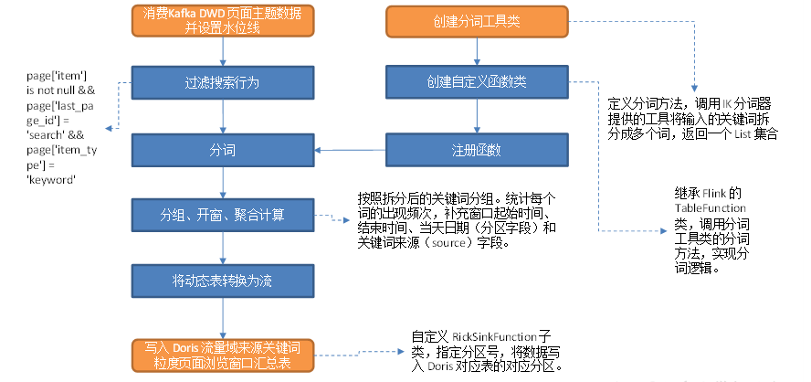

#### 4.3 流量域版本-渠道-地区-访客类别粒度页面浏览各窗口汇总表

##### 4.3.1 任务

DWS 层是为 ADS 层服务的，通过对指标体系的分析，本节汇总表中需要有会话数、页面浏览数、浏览总时长、独立访客数、跳出会话数五个度量字段。本节的任务是统计这五个指标，并将维度和度量数据写入Doris 汇总表。

##### 4.3.2 思路

任务可以分为两部分：统计指标的计算和数据写出，数据写出在10.1 节已有介绍，不再赘述。此处仅对统计指标计算进行分析。

会话数、页面浏览数和浏览总时长三个指标均与页面浏览有关，可以由 DWD 层页面浏览明细表获得。独立访客数可以由 DWD 层的独立访客明细表获得，跳出会话数可以由 DWD 层的用户跳出明细表获得。

三个主题读取的数据会在程序中被封装为三条流。处理后的数据要写入Doris 的同一张表，那么三条流的数据结构必须完全一致，这个问题很好解决，只要定义与表结构对应的实体类，然后将流中数据结构转换为实体类即可。除此之外，还有个问题需要考虑，三条流是否需要合并？Doris 表的字段将按照维度字段去重，如果三条流分别将数据写出到Doris，则对于唯一键相同的数据，不考虑重复写入的情况下会存在三条需要保留的数据（度量数据分别存在于三条数据中），但 Doris 只会保留插入时间最晚的数据，将造成数据丢失。显然，这种方案是不可行的。此处将三条流合并为一条，对于每一排序键只生成一条数据。

**1****）知识储备**

常见的多流合并算子及应用场景如下。

Ø union()：用于两条及多条流之间的合并，对流的数量没有限制，但是要求所有流中的数据结构完全一致。

Ø connect()：用于两条流的合并，其后紧邻的 process 算子中可以使用的 CoProcessFunction 是双流处理最底层的 API，可以通过键控状态和定时器的运用实现join、广播join、段join等各种关联。connect() 只能对两条流做关联，且对两条流的数据结构没有要求。

Ø intervalJoin：段 join，两条流的每一条数据都可以与另一条流某个时间范围内的数据做关联。底层实现原理：以 A.intervalJoin(B) 为例，A 流中的数据进入算子后，会被保存到键控状态中，同时注册一个定时器，定时器触发时清空 A 流状态中的数据。在定时器触发之前，B 流中的每一条数据都可以与状态中保存的 A 流数据关联。同理，B 流中也维护了状态定时器。由此实现了段 join。假定A流中的定时器存在时长为3s，B流中的定时器存在时长为5s，A 流中某条数据抵达时间为 tA，可与 tA – 5s ~ tA + 3s 时间范围内抵达的 B 流数据关联；B 流中某条数据抵达时间为 tB，可与 tB – 3s ~ tB + 5s 时间范围内抵达的 A 流数据关联。

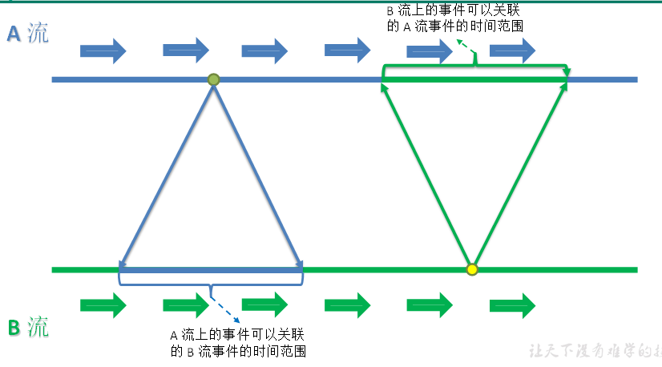

Ø join()：该算子的功能可以被其它算子替代，目前基本不用。

​connect()、intervalJoin()、join() 都是双流合并算子，本节对三条流进行合并，且流中数据结构一致，选择 union() 更为合理。

**2****）执行步骤**

（1）读取页面主题数据，封装为流

（2）统计页面浏览时长、页面浏览数、会话数，转换数据结构

创建实体类，将独立访客数、跳出会话数置为0，将页面浏览数置为1（只要有一条页面浏览日志，则页面浏览数加一），获取日志中的页面浏览时长，赋值给实体类的同名字段，最后判断 last\_page\_id 是否为 null，如果是，说明页面是首页，开启了一个新的会话，将会话数置为1，否则置为0。补充维度字段，窗口起始和结束时间置为空字符串。下游要根据水位线开窗，所以要补充事件时间字段，此处将日志生成时间 ts 作为事件时间字段即可。最后将实体类对象发往下游。

（3）读取用户跳出明细数据

（4）转换用户跳出流数据结构

封装实体类，维度字段和时间戳处理与页面流相同，跳出数置为1，其余度量字段置为0。将数据发往下游。

（5）读取独立访客明细数据

（6）转换独立访客流数据结构

处理过程与跳出流同理。

（7）union 合并三条流

（8）设置水位线；

（9）按照维度字段分组；

（10）开窗

​跳出行为判定的超时时间为10s，假设某条日志属于跳出数据，如果它对应的事件时间为15s，要判定是否跳出需要在水位线达到25s 时才能做到，若窗口大小为 10s，这条数据应进入10~20s 窗口，但是拿到这条数据时水位线已达到25s，所属窗口已被销毁。这样就导致跳出会话数永远为 0，显然是有问题的。要避免这种情况，必须设置窗口延迟关闭，延迟关闭时间大于等于跳出判定的超时时间才能保证跳出数据不会被漏掉。但是这样会严重影响时效性，如果企业要求延迟时间设置为半小时，那么窗口就要延迟半小时关闭。要统计跳出行为相关的指标，就必须接受它对时效性带来的负面影响。

（11）聚合计算

度量字段求和，每个窗口数据聚合完毕之后补充窗口起始时间、结束时间和当天日期字段。

（12）将数据写入Doris。

**3）图解**

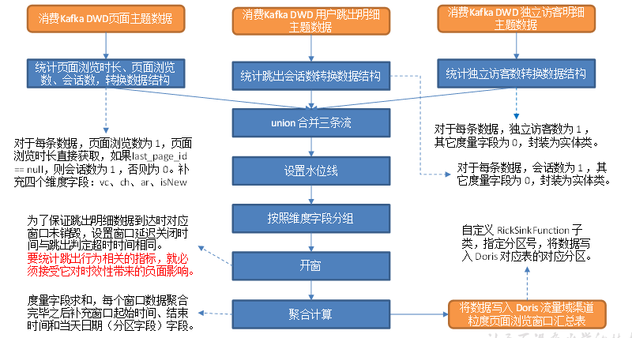

#### 4.4 流量域页面浏览各窗口汇总表

###### 4.4.1 任务

从 Kafka 页面日志主题读取数据，统计当日的首页和商品详情页独立访客数。

##### 4.1.2 思路

**1****）读取** **Kafka** **页面主题数据**

**2****）转换数据结构**

将流中数据由 String 转换为 JSONObject。

**3****）过滤数据**

​仅保留 page\_id 为 home 或 good\_detail 的数据，因为本程序统计的度量仅与这两个页面有关，其它数据无用。

**4****）设置水位线**

**5****）按照** **mid** **分组**

**6****）统计首页和商品详情页独立访客数，转换数据结构**

运用 Flink 状态编程，为每个 mid 维护首页和商品详情页末次访问日期。如果 page\_id 为home，当状态中存储的日期为 null 或不是当日时，将 homeUvCt（首页独立访客数）置为1，并将状态中的日期更新为当日。否则置为0，不做操作。商品详情页独立访客的统计同理。当 homeUvCt 和detailUvCt 至少有一个不为0 时，将统计结果和相关维度信息封装到定义的实体类中，发送到下游，否则舍弃数据。

**7****）开窗**

**8****）聚合**

**9）将数据写出到Doris**

**10）图解**

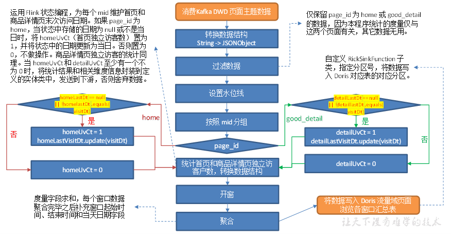

#### 4.5 用户域用户登陆各窗口汇总表

##### 4.5.1 任务

从Kafka 页面日志主题读取数据，统计七日回流用户和当日独立用户数预处理。

##### 4.5.2 思路

之前的活跃用户，一段时间未活跃（流失），今日又活跃了，就称为回流用户。此处要求统计回流用户总数。规定当日登陆，且自上次登陆之后至少7 日未登录的用户为回流用户。

**1****）读取** **Kafka** **页面主题数据**

**2****）转换数据结构**

​流中数据由 String 转换为JSONObject。

**3****）过滤数据**

​统计的指标与用户有关，uid 不为 null 的数据才是有用的。此外，登陆分为两种情况：（1）用户打开应用后自动登录；（2）用户打开应用后没有登陆，浏览部分页面后跳转到登录页面，中途登陆。对于情况（1），登录操作发生在会话首页，所以保留首页即可；对于情况（2），登陆操作发生在login 页面，login 页面之后必然会跳转到其它页面，保留 login 之后的页面即可记录情况（2）的登陆操作。

综上，我们应保留 uid 不为 null 且 last\_page\_id 为 null 或 last\_page\_id 为login 的浏览记录。

**4****）设置水位线**

**5****）按照****uid** **分组**

​不同用户的登陆记录互不相干，各自处理。

**6****）统计回流用户数和独立用户数**

​运用 Flink 状态编程，记录用户末次登陆日期。

（1）若状态中的末次登陆日期不为 null，进一步判断。

①如果末次登陆日期不等于当天日期则独立用户数 uuCt 记为1，并将状态中的末次登陆日期更新为当日，进一步判断。

a）如果当天日期与末次登陆日期之差大于等于8 天则回流用户数 backCt 置为1。

b）否则 backCt 置为0。

②若末次登陆日期为当天，则 uuCt 和 backCt 均为0，此时本条数据不会影响统计结果，舍弃，不再发往下游。

（2）如果状态中的末次登陆日期为null，将 uuCt 置为1，backCt 置为0，并将状态中的末次登陆日期更新为当日。

**7****）开窗，聚合**

度量字段求和，补充窗口起始和结束时间，时间戳字段置为当前系统时间，用于 ClickHouse 数据去重。

**8）写入Doris**

**9）图解**

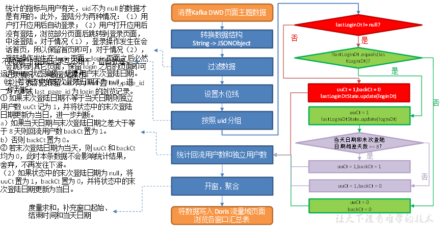

#### 4.6 用户域用户注册各窗口汇总表

##### 4.6.1 任务

从 DWD 层用户注册表中读取数据，统计各窗口注册用户数，写入Doris。

##### 4.6.2 思路

**1****）读取****Kafka** **用户注册主题数据**

**2****）转换数据结构**

​String 转换为 JSONObject。

**3****）设置水位线**

**4****）开窗、聚合**

**5）写入Doris**

**6）图解**

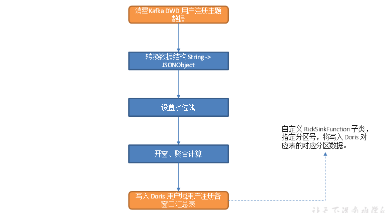

#### 4.7 交易域加购各窗口汇总表

##### 4.7.1 任务

从 Kafka 读取用户加购明细数据，统计各窗口加购独立用户数，写入Doris。

##### 4.7.2 思路

**1****）从** **Kafka** **加购明细主题读取数据****2****）转换数据结构**

**​**将流中数据由 String 转换为 JSONObject。

**3****）设置水位线**

**4****）按照用户** **id** **分组**

**5****）过滤独立用户加购记录**

**​**运用 Flink 状态编程，将用户末次加购日期维护到状态中。

​如果末次登陆日期为 null 或者不等于当天日期，则保留数据并更新状态，否则丢弃，不做操作。

**6****）开窗、聚合**

**​**统计窗口中数据条数即为加购独立用户数，补充窗口起始时间、关闭时间，将时间戳字段置为当前系统时间，发送到下游。

**7）将数据写入Doris。**

**8）图解**

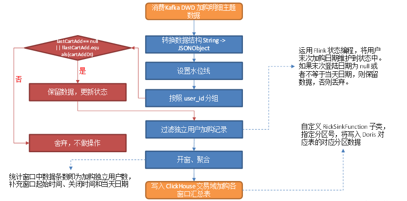

#### 4.8 交易域支付各窗口汇总表

##### 4.8.1 任务

从 Kafka 读取交易域支付成功主题数据，统计支付成功独立用户数和首次支付成功用户数。

##### 4.8.2 思路

##### **1）从 Kafka 支付成功明细主题读取数据**

**2****）转换数据结构**

​String 转换为 JSONObject。

**3****）设置水位线，按照** **user\_id** **分组**

**4****）统计独立支付人数和新增支付人数**

​运用 Flink 状态编程，在状态中维护用户末次支付日期。

​若末次支付日期为 null，则将首次支付用户数和支付独立用户数均置为 1；否则首次支付用户数置为 0，判断末次支付日期是否为当日，如果不是当日则支付独立用户数置为 1，否则置为 0。最后将状态中的支付日期更新为当日。

**5****）开窗、聚合**

度量字段求和，补充窗口起始时间、结束时间和当天日期字段。

**6）写出到Doris**

**7）图解**

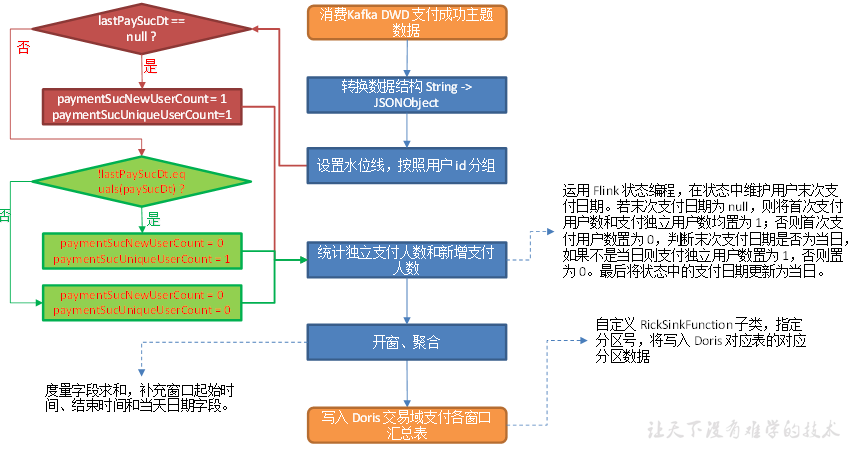

#### 4.9 交易域下单各窗口汇总表

##### 4.9.1 任务

从Kafka 订单明细主题读取数据，统计当日下单独立用户数和新增下单用户数，封装为实体类，写入Doris。

##### 4.9.2 思路

**1****）从** **Kafka****订单明细主题读取数据**

**2****）转换数据结构**

​Kafka 订单明细主题的数据是通过 Kafka-Connector 从订单预处理主题读取后进行过滤获取的，Kafka-Connector 会过滤掉主题中的 null 数据，因此订单明细主题不存在为 null 的数据，直接转换数据结构即可。

**3****）设置水位线**

**4****）按照用户** **id** **分组**

**5****）计算度量字段的值**

​运用 Flink 状态编程，在状态中维护用户末次下单日期。

​若末次下单日期为 null，则将首次下单用户数和下单独立用户数均置为1；否则首次下单用户数置为0，判断末次下单日期是否为当日，如果不是当日则下单独立用户数置为1，否则置为 0。最后将状态中的下单日期更新为当日。

**6****）开窗、聚合**

​度量字段求和，补充窗口起始时间、结束时间和当天日期字段。

**7）写出到Doris。**

**8）图解**

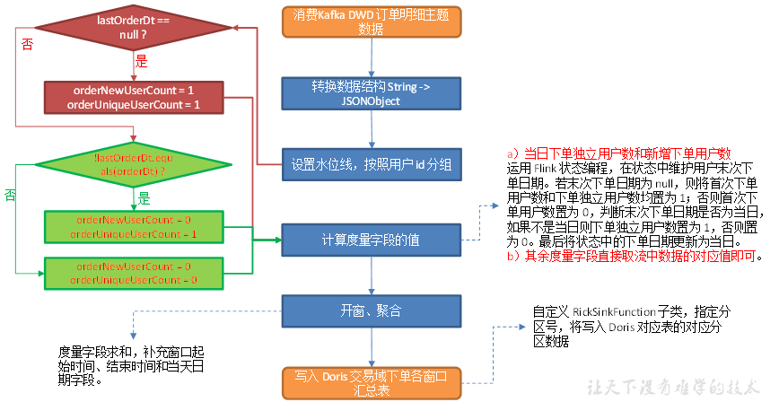

#### 4.10 交易域SKU粒度下单各窗口汇总表

##### 4.10.1 任务

从 Kafka 订单明细主题读取数据，按照唯一键对数据去重，分组开窗聚合，统计各维度各窗口的订单数、原始金额、活动减免金额、优惠券减免金额和订单金额，补全维度信息，将数据写入Doris交易域SKU粒度下单各窗口汇总表。

##### 4.10.2 思路

与上文提到的 DWS 层宽表相比，本程序新增了维度关联操作。

维度表保存在 Hbase，首先要在 PhoenixUtil 工具类中补充查询方法。

**1****）****PhoenixUtil** **查询方法思路**

本程序要通过已知的主键、表名从 HBase 中获取相关维度字段的值。根据已知信息，我们可以拼接查询语句，通过参数传递给查询方法，在方法内部执行注册驱动、获取连接对象、预编译（获取数据库操作对象）、执行、解析结果集、关闭资源六个步骤即可取出数据。

查询结果必然要通过返回值的方式将数据传递给调用者。那么，返回值应该是什么类型？查询结果可能有多条，所以返回值应该是一个集合。确定了这一点，接下来要考虑集合元素用什么类型？查询结果可能有多个字段，此处提出两种方案：元组或实体类。下文将对两种方案的实现方式进行分析。

（1）元组

如果用元组封装每一行的查询结果，可以有两种策略。a）把元组的元素个数传递给方法，然后通过 switch … case … 针对不同的元素个数调用对应的元组 API 对查询结果进行封装；b）把元组的 Class 对象传给方法，通过反射的方式将查询结果赋值给元组对象。a 的问题是需要编写大量的重复代码，对于每一个分支都要写一遍相同的处理逻辑；b 的问题是丢失了元组元素的类型信息。b 方案实现示例如下

```java
public class TupleTest {
public static void main(String[] args) throws InstantiationException, IllegalAccessException {
Class<Tuple3> tuple3Class = Tuple3.class;
Tuple3 tuple3 = tuple3Class.newInstance();
Field[] declaredFields = tuple3Class.getDeclaredFields();
for (int i = 1; i < declaredFields.length; i++) {
Field declaredField = declaredFields[i];
declaredField.setAccessible(true);
declaredField.set(tuple3, (char)('a' + i));
}
System.out.println(tuple3);
}
}
```

结果如下

(b,c,d)

​由于没有元组元素的类型信息，所以只能调用Field 对象的 set 方法赋值，导致元组元素类型均为 Object，如此一来可能会为下游数据处理带来不便。

此外，Flink 提供的元组最大元素个数为25，当查询结果字段过多时会出问题。

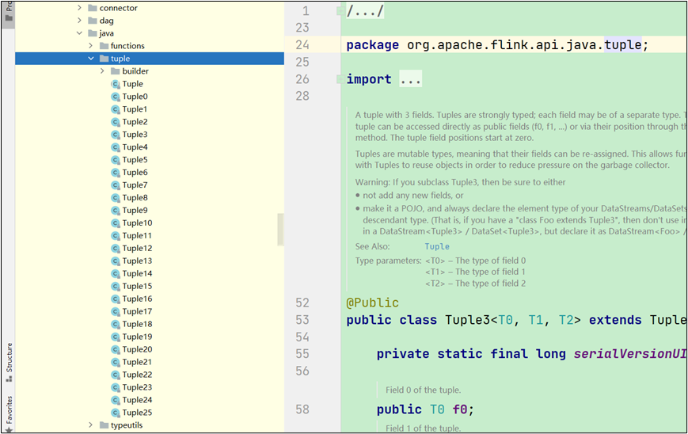

​（2）实体类

​将实体类的 Class 对象通过参数传递到方法内，通过反射将查询结果赋值给实体类对象。

​基于以上分析，此处选择自定义实体类作为集合元素，查询结果的每一行对应一个实体类对象，将所有对象封装到 List 集合中，返回给方法调用者。

**2****）****Phoenix** **维度查询图解**

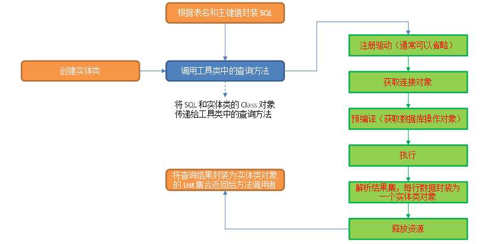

**3****）旁路缓存优化**

外部数据源的查询常常是流式计算的性能瓶颈。以本程序为例，每次查询都要连接 Hbase，数据传输需要做序列化、反序列化，还有网络传输，严重影响时效性。可以通过旁路缓存对查询进行优化。

旁路缓存模式是一种非常常见的按需分配缓存模式。所有请求优先访问缓存，若缓存命中，直接获得数据返回给请求者。如果未命中则查询数据库，获取结果后，将其返回并写入缓存以备后续请求使用。

（1）旁路缓存策略应注意两点

a）缓存要设过期时间，不然冷数据会常驻缓存，浪费资源。

b）要考虑维度数据是否会发生变化，如果发生变化要主动清除缓存。

（2）缓存的选型

一般两种：堆缓存或者独立缓存服务（memcache，redis）

堆缓存，性能更好，效率更高，因为数据访问路径更短。但是难于管理，其它进程无法维护缓存中的数据。

独立缓存服务（redis,memcache），会有创建连接、网络IO等消耗，较堆缓存略差，但性能尚可。独立缓存服务便于维护和扩展，对于数据会发生变化且数据量很大的场景更加适用，此处选择独立缓存服务，将 redis 作为缓存介质。

（3）实现步骤

从缓存中获取数据。

①如果查询结果不为 null，则返回结果。

②如果缓存中获取的结果为 null，则从 Phoenix 表中查询数据。

a）如果结果非空则将数据写入缓存后返回结果。

b）否则提示用户：没有对应的维度数据

​注意：缓存中的数据要设置超时时间，本程序设置为1 天。此外，如果原表数据发生变化，要删除对应缓存。为了实现此功能，需要对维度分流程序做如下修改：

​i）在MyBroadcastFunction的 processElement 方法内将操作类型字段添加到 JSON 对象中。

​ii）在 DimUtil 工具类中添加 deleteCached 方法，用于删除变更数据的缓存信息。

​iii）在MyPhoenixSink 的 invoke 方法中补充对于操作类型的判断，如果操作类型为 update 则清除缓存。

**4****）旁路缓存图解**

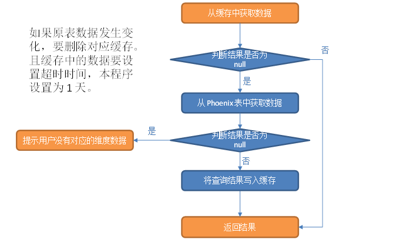

**5****）异步** **IO**

在Flink 流处理过程中，经常需要和外部系统进行交互，如通过维度表补全事实表中的维度字段。

默认情况下，在Flink 算子中，单个并行子任务只能以同步方式与外部系统交互：将请求发送到外部存储，IO阻塞，等待请求返回，然后继续发送下一个请求。这种方式将大量时间耗费在了等待结果上。

为了提高处理效率，可以有两种思路。

（1）增加算子的并行度，但需要耗费更多的资源。

（2）异步 IO。

Flink 在1.2中引入了Async I/O，将IO操作异步化。在异步模式下，单个并行子任务可以连续发送多个请求，按照返回的先后顺序对请求进行处理，发送请求后不需要阻塞式等待，省去了大量的等待时间，大幅提高了流处理效率。

Async I/O 是阿里巴巴贡献给社区的特性，呼声很高，可用于解决与外部系统交互时网络延迟成为系统瓶颈的问题。

异步查询实际上是把维表的查询操作托管给单独的线程池完成，这样不会因为某一个查询造成阻塞，因此单个并行子任务可以连续发送多个请求，从而提高并发效率。对于涉及网络IO的操作，可以显著减少因为请求等待带来的性能损耗。

**6****）异步** **IO** **图解**

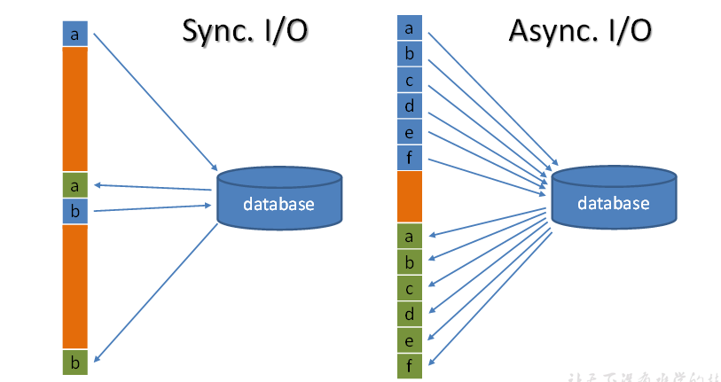

**7****）模板方法设计模式**

​（1）定义

​在父类中定义完成某一个功能的核心算法骨架，具体的实现可以延迟到子类中完成。模板方法类一定是抽象类，里面有一套具体的实现流程（可以是抽象方法也可以是普通方法）。这些方法可能由上层模板继承而来。

（2）优点

​在不改变父类核心算法骨架的前提下，每一个子类都可以有不同的实现。我们只需要关注具体方法的实现逻辑而不必在实现流程上分心。

​本程序中定义了模板类DimAsyncFunction，在其中定义了维度关联的具体流程

​a）根据流中对象获取维度主键。

​b）根据维度主键获取维度对象。

​c）用上一步的查询结果补全流中对象的维度信息。

**8****）去重思路分析**

我们在 DWD 层提到，订单明细表数据生成过程中会形成回撤流。left join 生成的数据集中，相同唯一键的数据可能会有多条。上文已有讲解，不再赘述。回撤数据在 Kafka 中以 null 值的形式存在，只需要简单判断即可过滤。我们需要考虑的是如何对其余数据去重。

对回撤流数据生成过程进行分析，可以发现，字段内容完整数据的生成一定晚于不完整数据的生成，要确保统计结果的正确性，我们应保留字段内容最全的数据，基于以上论述，内容最全的数据生成时间最晚。要想通过时间筛选这部分数据，首先要获取数据生成时间。上文已经对FlinkSQL中几个获取当前时间戳的函数进行了讲解，此处不再赘述。获取时间之后要考虑如何比较时间，保留时间最大的数据，由此引出时间比较工具类。

（1）时间比较工具类

​动态表中获取的数据生成时间精确到毫秒，前文提供的日期格式化工具类无法实现此类日期字符串向时间戳的转化，也就不能通过直接转化为时间戳的方式比较两条数据的生成时间。因此，单独封装工具类用于比较 TIME\_STAMP(3) 类型的时间。比较逻辑是将时间拆分成两部分：小数点之前和小数点之后的。小数点之前的日期格式为 yyyy-MM-dd HH:mm:ss，这部分可以直接转化为时间戳比较，如果这部分时间相同，再比较小数点后面的部分，将小数点后面的部分转换为整型比较，从而实现 TIME\_STAMP(3) 类型时间的比较。

（2）去重思路

​获取了数据生成时间，接下来要考虑的问题就是如何获取生成时间最晚的数据。此处提供两种思路。

​①按照唯一键分组，开窗，在窗口闭合前比较窗口中所有数据的时间，将生成时间最晚的数据发送到下游，其它数据舍弃。

​②按照唯一键分组，对于每一个唯一键，维护状态和定时器，当状态中数据为 null 时注册定时器，把数据维护到状态中。此后每来一条数据都比较它与状态中数据的生成时间，状态中只保留生成最晚的数据。如果两条数据生成时间相同（系统时间精度不足），则保留后进入算子的数据。因为我们的 Flink 程序并行度和 Kafka 分区数相同，可以保证数据有序，后来的数据就是最新的数据。

​两种方案都可行，此处选择方案二。

​本节数据来源于Kafka dwd\_trade\_order\_detail 主题，后者的数据来源于 Kafka dwd\_trade\_order\_pre\_process 主题，dwd\_trade\_order\_pre\_process 数据生成过程中使用了 left join，因此包含 null 数据和重复数据。订单明细表读取数据使用的 Kafka Connector 会过滤掉 null 数据，程序内只做了过滤没有去重，因此该表不存在 null 数据，但对于相同唯一键 order\_detail\_id 存在重复数据。综上，订单明细表存在唯一键 order\_detail\_id 相同的数据，但不存在 null 数据，因此仅须去重。

**9****）执行步骤**

​（1）从 Kafka 订单明细主题读取数据

​（2）转换数据结构

​（3）按照唯一键去重

​（4）转换数据结构

​JSONObject 转换为实体类TradeSkuOrderBean。

（5）设置水位线

（6）分组、开窗、聚合

按照维度信息分组，度量字段求和，并在窗口闭合后补充窗口起始时间、结束时间和当天日期字段。

（7）维度关联，补充维度字段

①关联 sku\_info 表

​获取sku\_name，tm\_id，category3\_id，spu\_id。

②关联 spu\_info 表

​获取 spu\_name。

​③关联 base\_trademark 表

​获取 tm\_name。

​④关联 base\_category3 表

​获取 name（三级品类名称），获取 category2\_id。

​⑤关联 base\_categroy2 表

​获取 name（二级品类名称），category1\_id。

​⑥关联 base\_category1 表

​获取 name（一级品类名称）。

（8）写出到Doris。

**10）图解**

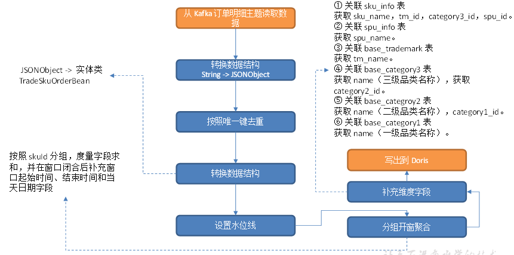

#### 4.11 交易域省份粒度下单各窗口汇总表

###### 4.11.1 任务

从 Kafka 读取业务数据，筛选订单表数据，统计各省份各窗口订单数和订单金额，将数据写入Doris交易域省份粒度下单各窗口汇总表。

##### 4.11.2 思路

**1****）从** **Kafka topic\_db** **主题读取业务数据**

**2****）筛选订单表数据**

**3****）转换数据结构**

​JSONObject 转换为实体类TradeProvinceOrderWindow。

**4****）设置水位线**

**5****）按照省份** **ID** **分组**

provinceId 可以唯一标识数据。

**6****）开窗**

**7****）聚合计算**

度量字段求和，并在窗口闭合后补充窗口起始时间、结束时间和当天日期字段。

**8****）关联省份信息**

补全省份名称字段。

**9）写出到Doris。**

**10）图解**

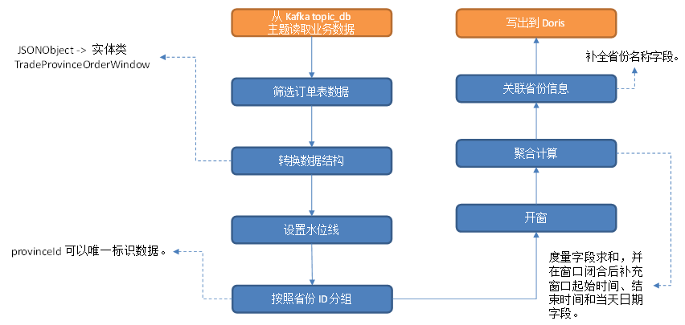

#### 4.12 交易域品牌-品类-用户粒度退单各窗口汇总表

###### 4.12.1 任务

从 Kafka 读取退单明细数据，关联与分组相关的维度信息后分组，统计各分组各窗口的订单数和订单金额，补充与分组无关的维度信息，将数据写入Doris交易域品牌-品类-用户粒度退单各窗口汇总表。

##### 4.12.2 思路

**1****）从** **Kafka** **退单明细主题读取数据**

**2****）转换数据结构**

​JSONString 转换为 JSONObject。

JSONObject 转换为实体类TradeTrademarkCategoryUserRefundBean。

**3****）补充与分组相关的维度信息**

​关联 sku\_info 表

​获取 tm\_id，category3\_id。

**4****）设置水位线**

**5****）分组、开窗、聚合**

按照维度信息分组，度量字段求和，并在窗口闭合后补充窗口起始时间、结束时间和当天日期字段。

**6****）补充与分组无关的维度信息**

（1）关联 base\_trademark 表

​获取 tm\_name。

​（2）关联 base\_category3 表

​获取 name（三级品类名称），获取 category2\_id。

​（3）关联 base\_categroy2 表

​获取 name（二级品类名称），category1\_id。

（4）关联 base\_category1 表

​获取 name（一级品类名称）。

**7）写出到Doris。**

**8）图解**

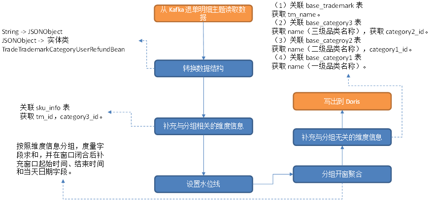

## 5.数据可视化接口

  

## 6.常见问题汇总

**1）水位线始终为负无穷（实际上是个极小值）**

本项目要求 Kafka 并行度为4，如果没有修改 Kafka 的配置文件，则默认并行度为1。而程序并行度为4，一个分区至多只能被一个消费者消费，这样一来，只有一个并行度可以消费到数据。没有数据的并行度水位线始终为极小值，上游多个并行度的数据进入下游的一个并行度时，下游的水位线取决于上游多个并行度的最小值，程序中存在 shuffle 时，就会出现下游某个并行度的水位线无法升高，始终为极小值的情况，从而导致窗口无法闭合。

**2****）没有聚合结果**

（1）DWS 层的数据来源于 DWD 层。如果为了测试方便，将 Kafka Connector 的启动模式修改为earliest-offset，则会将 topic\_db 的所有数据读取到程序中。在模拟数据配置文件中指定的业务日期不变的前提下，生成数据的水位线高低只与执行 jar 包的系统时间有关（数据生成时间的 HH:mm:ss 部分与系统时间相同）。若首次执行 jar 包在当日22:00，之后执行都在22:00 之前，则第一批数据会将水位线推至22:00 对应的值，导致之前的窗口全部销毁，此时前面的数据进入程序，无法进入对应窗口，会被舍弃。而同批数据的生成时间极其相近，抵达较晚的数据无法使前面数据的窗口闭合，又没有其它批次的数据推高水位线，所以这批数据也没有结果输出。因而，看不到任何结果。

（2）如果没有消费分区历史数据，生成一批数据之后没有看到结果，可能是由于同批次数据生成时间极其相近，全部进入了同一个窗口。此时再生成一批数据，推高水位线使当前批次数据所属窗口闭合，即可看到结果。

**3****）关于** **Kafka** **分区的删除和重新消费**

​Kafka 主题分区数只能增大，不能减小。分区数增大后，不会发生数据迁移，新的分区为空。

​Kafka 主题的分区数发生变化时，重启程序才会消费到新的分区。因为只有在启动时才会为消费者分配分区，运行过程中分区分配不会发生变化。

4）DWS 层程序执行无报错，但数据始终无法进入 Doris

首先可以考虑在主程序中打印算子链的中间结果，定位问题。如果主程序没有问题，可以在自定义的 RichSinkFunction 子类中打印日志，判断 SQL 是否成功执行。如果 SQL 成功执行，但是仍没有数据，很可能是写出的数据某个字段所占的存储空间超过了 Doris 表字段可以分配的最大容量。通常 sku\_name 等字段所占的存储空间较大，可以将传递给 MyDorisSink 类中invoke 方法的实体类打印出来，查看相关字段内容，粗略估算大小，和 Doris 对应字段分配的容量做对比。若实体类字段的字节数大于Doris 分配的字节数，增加分配给该字段的存储空间通常就可以解决问题。