# 一、推荐系统介绍

## 1.概念

根据人口统计、用户画像、相似度求解、模型计算等将合适的物品推荐给用户

## 2.分类

时效性：离线、实时

数据源：基于人口统计学（主要围绕用户相似度）、基于内容的推荐（物品相似度）、基于用户行为的协同过滤（相似度+模型计算）

是否个性推荐：是否基于个人的特性来推荐与之复合的物品

根据推荐原则：基于相似度、基于知识、基于模型

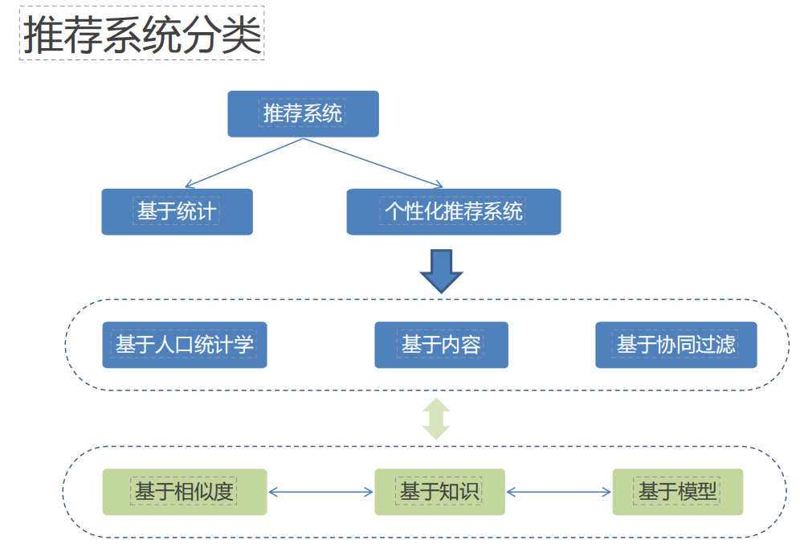

注意：推荐方法往往是混合的，如加权、分区、切换、分层等形式

## 3.推荐系统的重要概念

实验方法：离线实验、用户调查、在线实验

推荐系统性能评估：

推荐准确率评估：

评分预测：均方根误差、平均绝对误差。历史评分与预测评分作差计算。

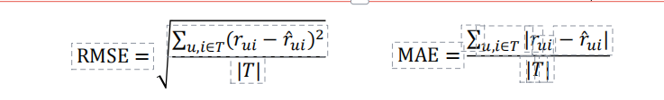

Top-N预测：根据相似度、模型等计算出推荐值，根据推荐值高低推荐一组推荐对象。

准确率、精确率、召回率：班级选女生的例子

准确率：被正确分类的样本数/总样本数

精确率：应该被选中的一类样本数/总的选出的样本数

召回率：样本中被选中（正类）的样本数/样本中所有应被选中的（正类）样本数

# 二、数学基础

### 线代：

矩阵、矩阵的转置、矩阵运算、矩阵的逆、矩阵乘法

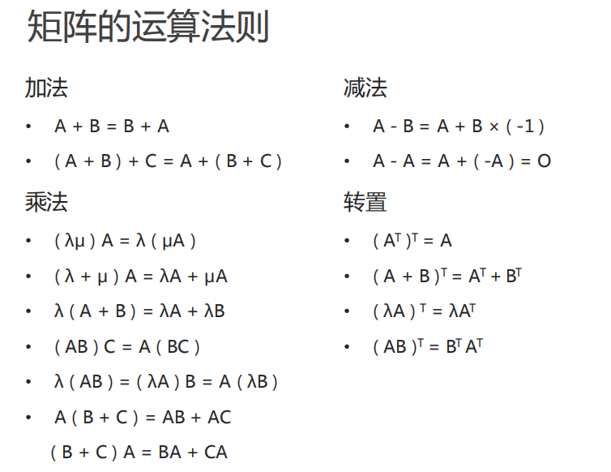

### 微积分

导数、偏导数、方向导数、梯度、凹凸函数

### 概率论

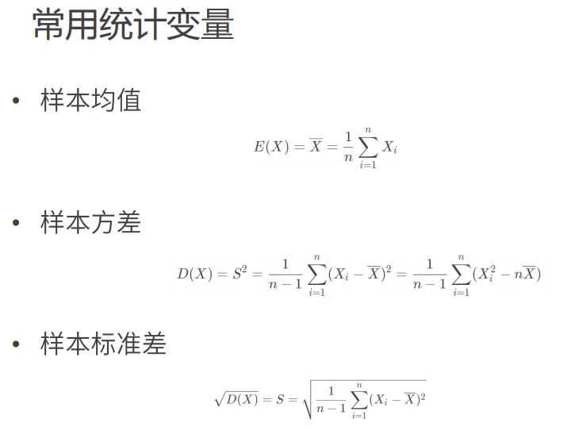

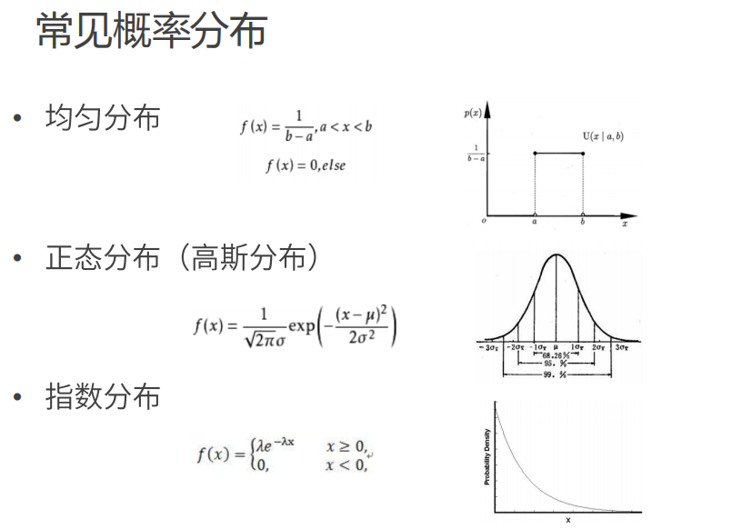

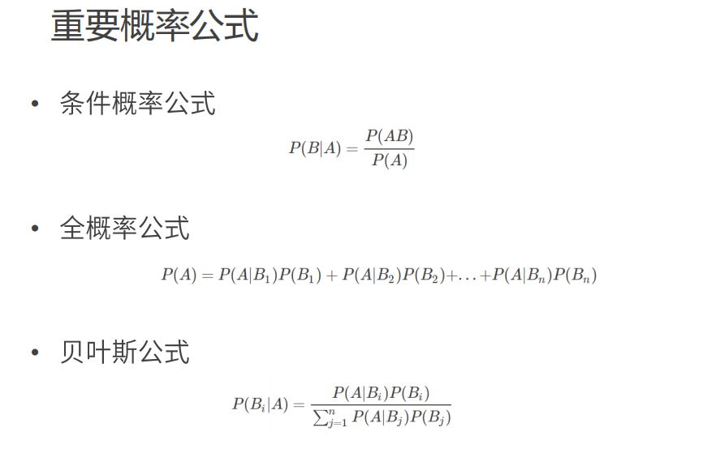

# 三、涉及到的算法：

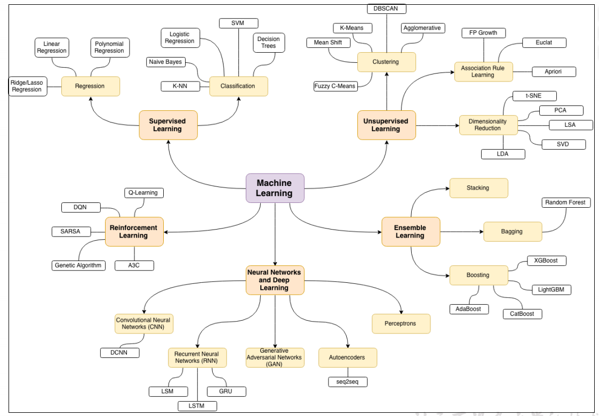

## 监督学习

### 三要素

模型（规律）、策略（选择最优模型的准则、损失、均方误差之类达到什么水平？）、算法（最优模型选取的最优方法、als、tf-idf）

### 实现步骤

首先需要学习已有的输入输出数据，根据数据学习规律，总结模型

其次采用相关评价标准来确定模型

最后利用模型来预测输入数据的对应输出结果

### 模型评估策略

#### 评估：

训练集与测试集

损失函数：预测值与真实值的差异。0-1损失函数、平方损失（放大）、绝对损失、对数损失（平缓）

经验风险：所有训练集的平均损失。训练集较多时，经验风险最小，模型最好。

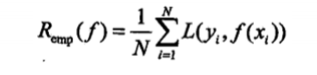

训练误差：训练集平均损失，用于评价模型是否容易习得，且易于泛化结果

测试误差：测试集平均损失，用于评价模型的预测能力准确性

#### 选择：

过拟合与欠拟合

正则化：防止过拟合（模型复杂度太高），随着复杂度提高加大惩罚项，及正则化

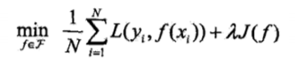

奥卡姆剃刀原理：若简单模型够用，则不必要增加其复杂度

交叉验证

简单交叉验证：划分训练集、测试集，训练集负责训练模型，测试集用于选择评估模型

s折交验证：将数据集分为s份，s-1份用于训练、1份用于测试评估。以此类推可训练验证s次

留一交叉验证

准确率、精确率、召回率：班级选女生的例子

准确率：被正确分类的样本数/总样本数

精确率：应该被选中的一类样本数/总的选出的样本数

召回率：样本中被选中（正类）的样本数/样本中所有应被选中的（正类）样本数

### 分类和回归

分类：通过模型预测的值是不连续的值。如k邻近、决策树、感知机、逻辑斯蒂回归、支撑向量机、朴素贝叶斯、神经网络。

回归：通过模型预测的值是连续的

回归问题求解：最小二乘法

模型求解方法：梯度下降法、牛顿法和拟牛顿法

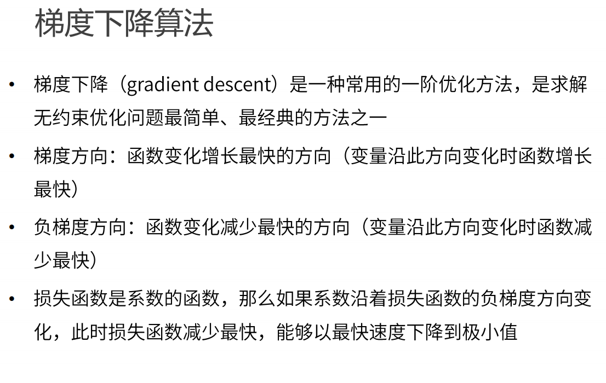

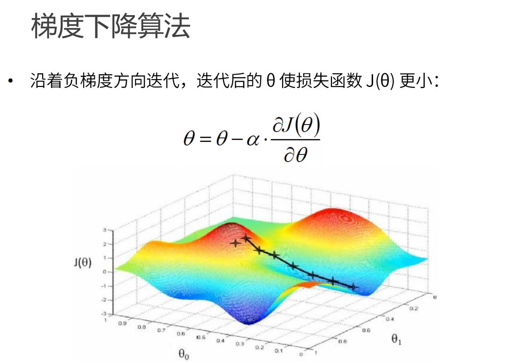

# 四、机器学习模型

### （1）线性回归

根据历史数据计算出一个线性相关关系，用于预测、分类、特征选择

最小二乘法（一元）

求解所有样本到一元函数欧式距离最小值时对应的参数。从而得到相关的一元线性模型

梯度下降法（多元）

根据历史数据计算出一个损失函数达到最小值的一个多元线性相关关系

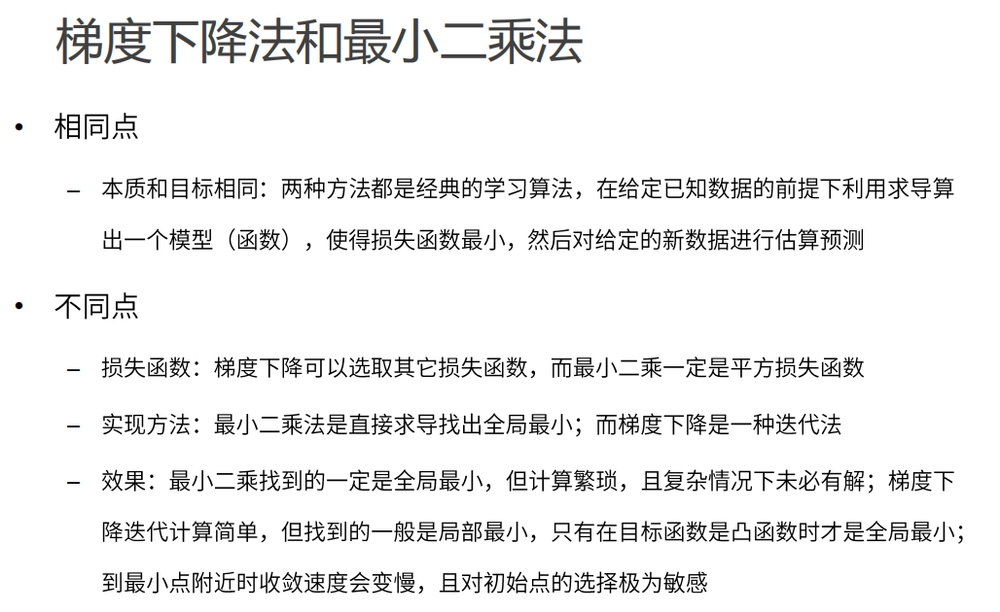

### （2）k邻近（分类）

通过测量样本间的距离（欧式距离、余弦相似度）来预测、分类。如：图像分类、文本分类、房价预测、股票价格预测、相似产品推荐、异常检测

### （3）逻辑回归

通过预测样本边界来分类。如：信用评分、欺诈检测、客户流失预测、疾病诊断、患者预后评估、药物反应预测、客户分类、用户行为分析、广告点击率预测、文本分类、情感分析、垃圾邮件过滤、图像分类、目标检测

### （4）决策树

通过对历史数据的归类总结，根据不同特征来划分预测数据的树模型。根据信息增益准则（值、比例）来划分特征（特征越明显越靠近根节点），得到熵尽可能小的分类（叶子结点）。

## 无监督学习

### （1）聚类

k均值：

先选取K个质心点，根据样本到质心距离分类，在分类后的k类数据中，分别计算新的质心（样本到质心的平均距离值），之后再按照新的k个质心点来计算数据到质心距离，根据距离最小来分类... 如此往复得到质心不再变化或者迭代达到上限时停止。

基于密度的聚类：随机选取样本点作为圆心，在一定半径范围内的样本点个数若达到所设阈值，则该点事核心点，若达不到，则继续迭代计算，若圆内无样本点，则该带你是噪点。

最大期望聚类

### （2）降维

潜语义分析（LSA）

主成分分析（PCA）

奇异值分解（SVD）

# 二、推荐系统详解

## 1.常用推荐算法（根据数据源：用户信息、物品信息、用户行为数据）

### （1）基于人口统计学的推荐与用户画像（用户信息）

通过用户画像得到用户标签，根据标签喜好相似度推荐

### （2）基于内容的推荐（CB，物品信息）

根据物品内容标签，计算相似度，结合用户的过往记录喜好，推荐内容。需提取物品特征值计算相似度。然后根据用户个人信息来匹配感兴趣度。相似度计算：欧式距离、余弦相似度

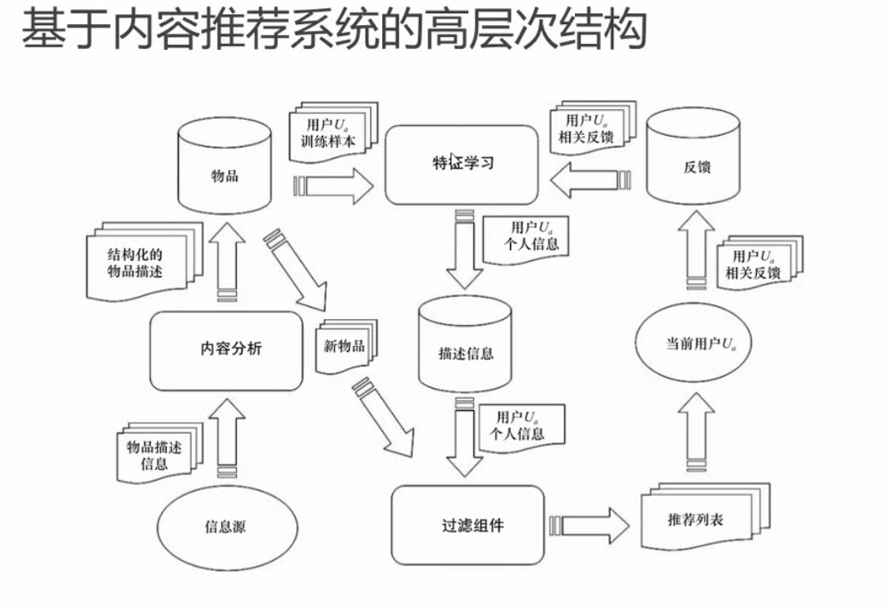

#### ①特征分类

数值型：归一化、离散化

类别型：注意不能有数值大小的预先定义，可以转为向量

时间型：

统计型：

#### 归一化

将特征统一‘单位’的过程。如一个模型需房价、房屋面积两个特征，但是特征应该是平等，房价明显是个很大的数值，可将房价和面积统一使用当前值除以（最大值-最小值）这样就能得到一个统一的值来描述。

#### 离散化

将连续的值范围映射到一个确定的向量，如年龄10岁以下（1,0，0），10-60岁（0,1,0），60岁以上（0，0，1）。

等步长：如年龄每10岁切割一个向量。按数值差异切割

等频：年龄对应人数比例，按照比例来切割一个向量。按占比切割

当连续值无法确定时，采用等步长，或者是等频切分需要按实际来，等频可能会有之前模型之后不适用的情况但是更精准。

#### ②算法

##### 基于UGC的推荐（基于物品，用户生成标签的场景为例）

以文档关键词计算为例：若关键词在文档中出现频率TF越高越有代表性，但是“的”“了”之类的词需要去掉。若用户常用到这些关键词，则会相关的文档推荐给该用户。

TF-IDF：TF指一个词在一文中所有词的占比。IDF是为了惩罚所有文章的共性，即该词在所有文档集中出现的文档数，这个数值越大，说明该词越不能作为文档的关键词，所以借助公式IDF=log（N+1/N\*+1）将在所有文档集中出现的多的词语做惩罚，计算得到的值就越小，若都出现则为0。最后将TF\*IDF就可以得到相应词的关键程度，值越大越能代表文章。

有点：解决冷启动问题，可以使用调查问卷等形式获取信息。

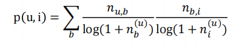

### （3）基于协同过滤的推荐（用户行为数据）

#### （1）基于CF的推荐算法（基于用户/物品的协同过滤，用户的行为及用户与物品的关联）

优点：物品内容不完全可以借助用户的的反馈给出评价；对与物品质量可以有合理评估，CB一般不关心物品质量，仅依赖内容；CF不受内容限制,但是需要历史数据，可通过用户给出的反馈来推荐内容。

#### （2）基于近邻的行为推荐

user-CF：根据用户对不同物品的反馈，找出相近的反馈的人，推荐彼此反馈好的物品。当物品变化迅速，更新迭代快，则基于此算法会比较好。如新闻

item-CF：根据物品的评分，来推荐，topN？当物品相对稳定，不常更替可以使用此法，如汽车

#### （3）基于模型的协同过滤

①说明：

根据用户标签+物品标签+用户行为反馈匹配隐藏式关系推荐

从用户行为提取特征，给用户和物品打标签，提取特征-》匹配

有显性特征时直接匹配推荐，没有时根据喜好去通过矩阵分解进行降维分析挖掘隐藏特征（隐语义模型）（如：啤酒+尿不湿）

②基于近邻的推荐：对已有的偏好数据，通过近邻计算得出推荐

③基于模型的推荐：使用偏好数据来训练模型，找到规律并做出预测推荐

④隐语义模型

基于概率

隐式迪利克雷分布

矩阵因子分解

⑤LFM降维方法-矩阵因子分解

将一个矩阵R（用户对电影的评分矩阵）拆解为两个低维矩阵相乘P\*Q，若相乘后的矩阵R^与原有R很相近，则认为这个因子分解是可行的。

求解方法：als 交替最小二乘法、梯度下降法

​  

# 三、开始做项目

## 1.项目系统设计

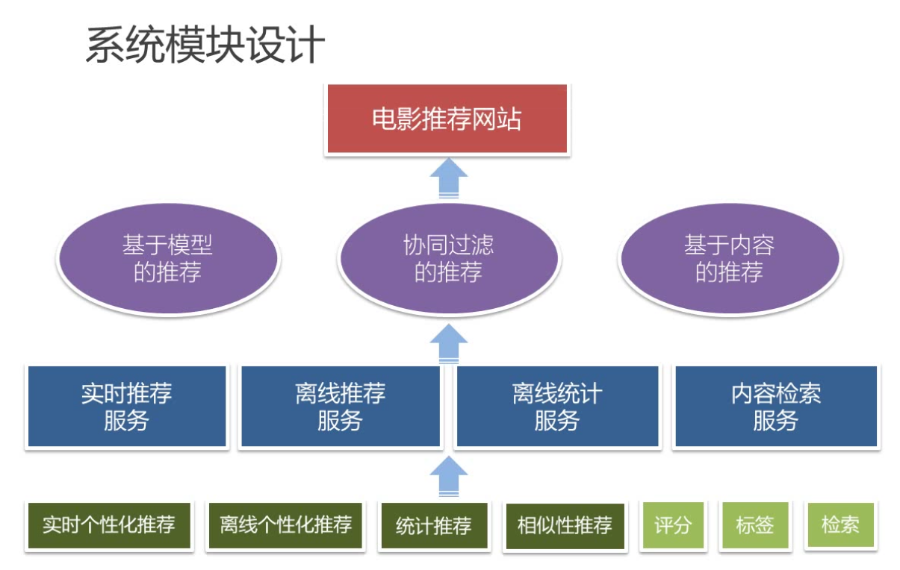

  

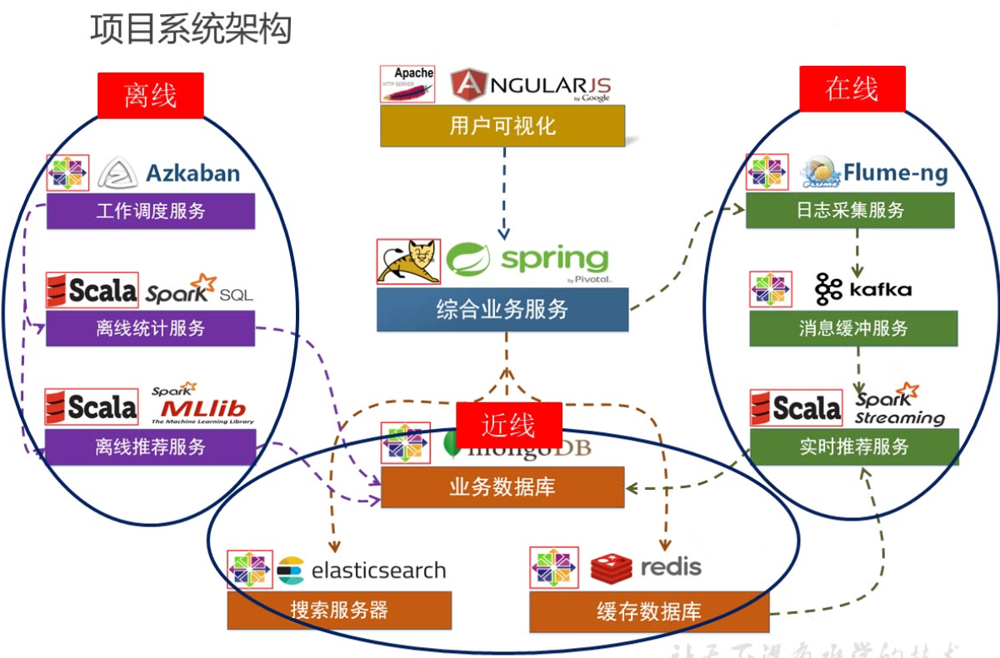

项目流程

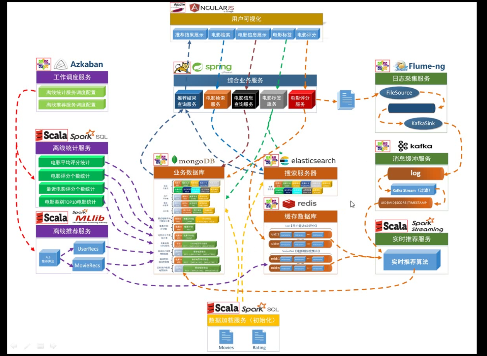

  

工作流图

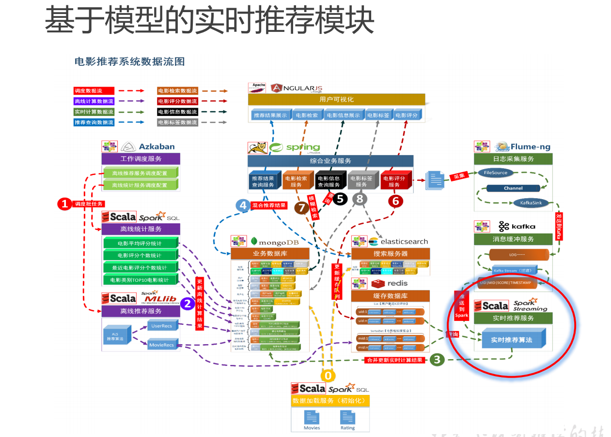

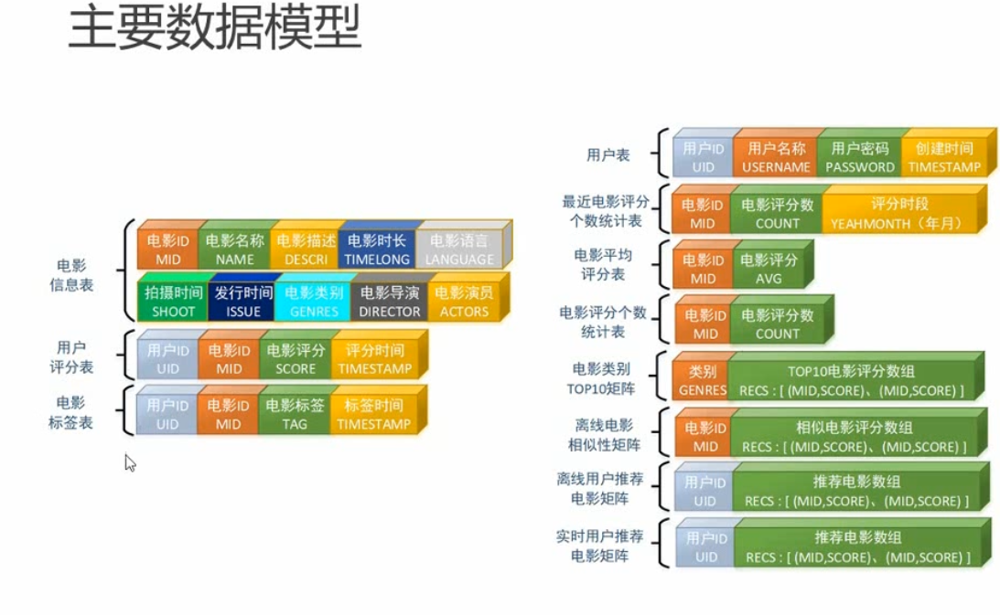

## 2.项目架构

组件：mangoDB + kafka + ES + Redis + spark（sql、mlib）

算法：

als-离线推荐，将用户评分矩阵通过调用als库，降维为两个矩阵相乘。能将一些潜在的规律计算出来。

TF-IDF-实时推荐：

基于内容的推荐：

## 3.项目总结

### 数据源：

MongoDB存储用户、电影、用户评分信息；flume采集日志服务器日志写入kafka。

### 数据处理：

#### （1）统计推荐模块

每日读取MongoDB数据，基于数仓统计历史热门电影（最多被评分）、近期热门电影（按月最多被评分）、电影平均评分计算、各类别topN计算。

该模块由azkaban每日调度计算后写入MongoDB。SpringBoot读取MongoDB计算结果在推荐页面推荐、或者与其他模块加权后在用户看过电影的下方推荐。

**重点：**spark读写MongoDB、sparkSql计算。

#### （2）离线推荐模块

**根据评分行为的潜在推荐关系计算(用户推荐电影)：**

根据历史用户评分数据，生成一个用户\*电影的笛卡尔积（用户评分矩阵），利用als算法，将用户评分 矩阵降解为用户特征矩阵U(m x k) x 电影特征矩阵V(n x k)，两个矩阵每行分别代表用户、电影的k个特征组合的向量。同时als模型会计算出每个用户的相应推荐电影。用户-》电影集合的map结构。将数据保存到 MongoDB 的 UserRecs 表中

**相似电影计算：**

根据als降维拆解出来的V(n x k)，计算每个电影（行）与其他电影（其他行）的余弦相似度，根据相似度选取topN或者满足相似度的电影存入MongoDB，一个电影对应一堆相似电影的类似map结构。将数据保存到 MongoDB 的 movieRecs 表中

**als模型评估与调参：**

计算均方根误差（RMSE），考察预测评分与实际评分之间的误差。根据误差来调整参数，从而得到一个更小误差的更优模型。（调整隐语义模型的 rank,iterations,lambda 三个参数）

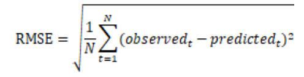

*计算方法：调用adjustALSParams*(trainingRDD, testingRDD)即可迭代计算出每次模型的rmse值，根据rmse值排序得出最优的三个参数。

#### （4）实时推荐模块

实时推荐需要满足时效性，若继续使用als模型，每来一条评分数据的更新都会使用模型去重新计算推荐，计算量太大，时效太低。因此实时推荐模块采用tf-idf模型思想。根据用户对电影P的评分行为，计算出与该电影P相似的n个电影Q的集合S1作为候选；同时根据用户最近几次的评分电影R与候选电影Q计算相似度与用户对R评分的成绩相加求平均值，加上电影R与Q的相似度大于0.6且R评分大于三的log加权，减去电影R与Q的相似度小于0.6且R评分小于三的log加权，得出Q推荐度。

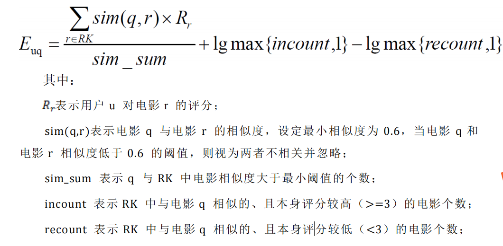

从MongoDB中读取用户电影评分数据、从Redis读取离线推荐计算的电影相似度矩阵、从kafka读取用户评分行为数据。根据如上模型计算推荐电影列表，将列表写入MongoDB，供SpringBoot读取展示。

#### （5）基于内容的推荐

利用tf-idf算法，将每个电影的标签作为一组特征，计算每个标签在单个电影的出现率、以及在所有电影中的出现率的倒数的log值，将出现率与log值相乘做惩罚，得出标签特征向量，然后计算两个电影的相似度，得到相似矩阵供实时推荐系统使用。

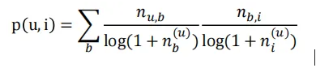

## 4.项目联调

前端是给的代码，启动即可。

后端只要负责往MongoDB中写入推荐电影列表。