# 数据治理考评平台

# 一、项目介绍

[尚硅谷大数据技术之数据治理考评平台完整V1.2.0.docx](https://www.yuque.com/attachments/yuque/0/2024/docx/35670500/1713113992137-e1fd8512-01d4-48b4-9347-204ab28e7675.docx)

[数据治理总结.mmap](https://www.yuque.com/attachments/yuque/0/2024/mmap/35670500/1713113992150-70bcdb92-126b-450c-bbeb-4379ea5a19cd.mmap)

## 为什么做该开源项目：了解底层，所以自学

  

  

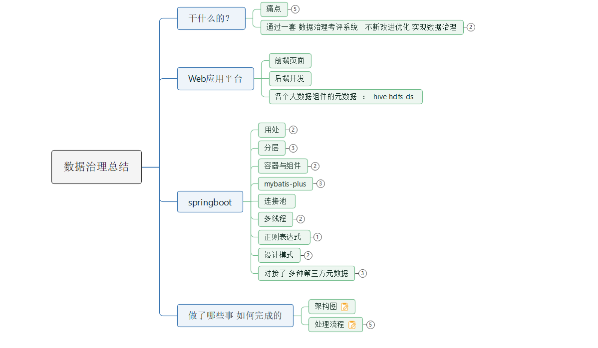

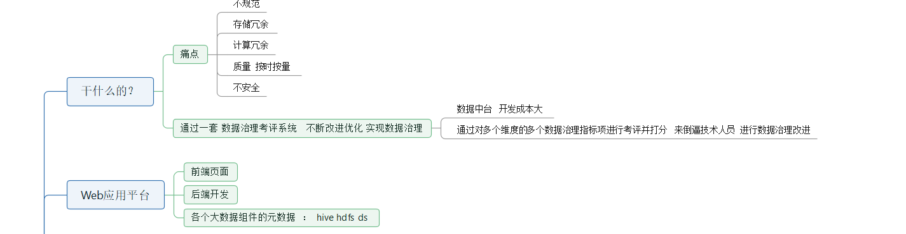

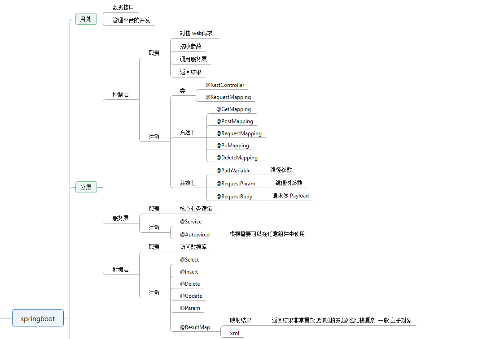

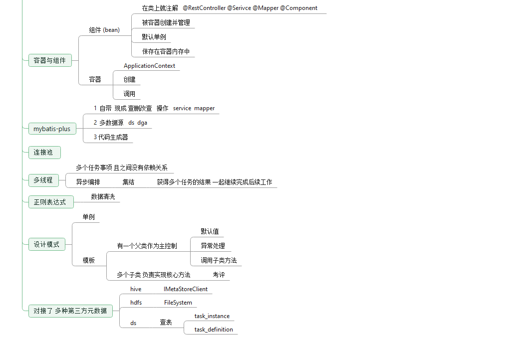

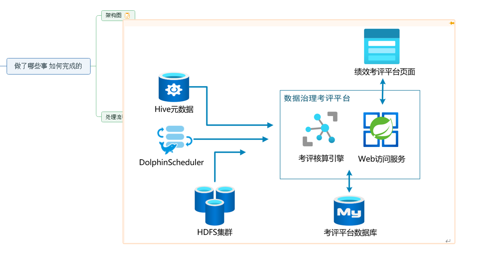

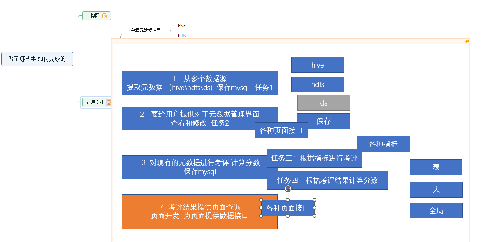

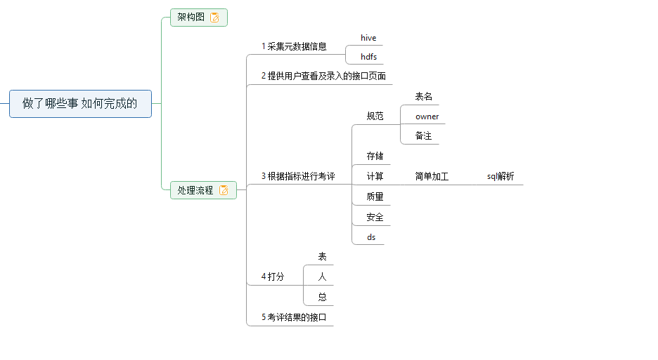

除了考评，还有数据血缘图的处理。

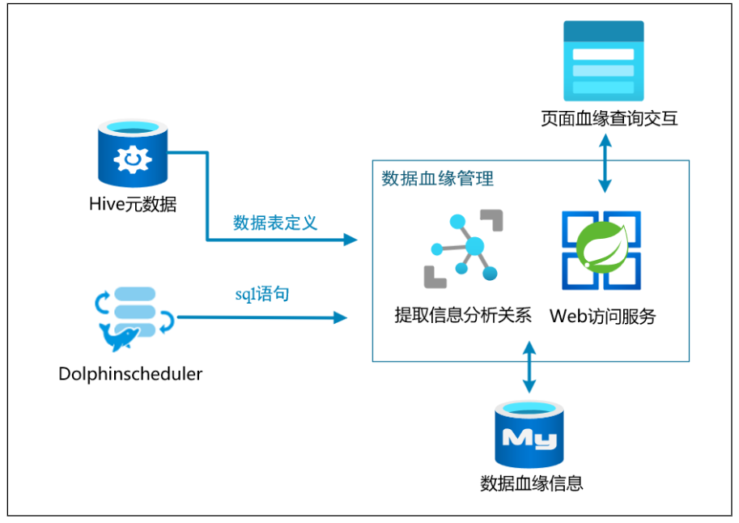

## 怎么做：

### 1.步骤：

**todo 1.**先创建hive客户端、根据库名schema获取所有表表名，遍历表名，

通过hiveClient.getTable（表名）获取表对象，提取表中元数据（责任人、字段列表、输入输出类型、分区信息、表备注、字段备注，hdfs路径、创建日期等）封装到tableMetaInfo类

**todo 2.**根据从表元数据中获取到的表存储hdfs路径、通过Hadoop api接口 FileSystem.get获取文件系统对象，fileSystem.listStatus（展示路径下的所有对象）借助递归遍历路径下的所有文件计算表数据大小，

以及表的所有副本数据量大小、访问时间等属性。

t**odo 3**.mapper读取额外信息表提取额外的表属性信息：生命周期、数仓分层、安全等级，这些信息有则不动，null会赋值为（常量）默认值，如标记为未配置。后续需要开发人员自己在UI界面填写。这个bean对象也会封装一份到tableMetaInfo对象中用 @TableFiled（exist = false）来排除不写入库

**todo 4.关于元数据信息与UI界面交互的处理：**controller层的处理：

功能一：根据库名、表名、数仓层级来查询表格，并且要做分页展示处理 limit pagestart , pageSize。

功能二：手动输入库名和考评日期更新所有元数据信息。

用到三个注解 @GetMapping（“读参数”） @PostMapping（“写请求参数”）

@RequestMapping（"公用路径请求参数"）

传参方式有

@RequestParam（？号后kv对形式的一个或多个参数，多个用&链接）、

@PathVariable（一级或者多级‘目录’）、

@RequestBody（JSON对象或者数组）

**todo 5.**读取DolphinSchedule中的数仓SQL调用的任务定义表和任务实例表,MyBitsPlus支持子查询，获取考评日运行的实例对应的任务定义中的SQL参数，并截取出来封装到任务定义表的Bean对象中。

@TableField(exist = false) 标注sql字段不写入库中

**todo 6. 开始考评：**

**开闭原则 思想：**不改老代码，只新增代码来解决问题。当需求发生变化时，应该通过增加新的代码来扩展现有功能，而不是直接修改现有代码。如我们的Assessor抽象类不会被更改，通过子类重写抽象方法去实现新增的逻辑。（我们的实现方式：抽象和多态）

**开闭原则实现方式：**

1.  抽象和多态：使用抽象类、接口和多态等技术来隔离变化和不变的部分，使得系统更加灵活和可扩展。例如，在一个图形界面程序中，可以定义一个抽象的“控件”类或接口，然后具体的按钮、文本框、滚动条等控件都继承或实现这个抽象类或接口，从而实现了控件的扩展。
2.  模板方法：使用模板方法模式来定义算法骨架，将变化的部分交由子类实现，从而实现开闭原则。例如，在一个排序程序中，可以定义一个排序算法的抽象类或接口，其中包含一个“排序”的模板方法，然后具体的排序算法都继承或实现这个抽象类或接口，并重写模板方法中的排序算法部分，从而实现了排序算法的扩展。
3.  策略模式：使用策略模式将变化的部分封装为独立的策略对象，使得系统更加灵活和可配置。例如，在一个商店促销程序中，可以定义一个促销策略的抽象类或接口，然后具体的促销策略都继承或实现这个抽象类或接口，从而实现了促销策略的扩展。
4.  观察者模式：使用观察者模式实现事件驱动的编程，将变化的部分作为事件发布，从而实现开闭原则。例如，在一个订单处理程序中，可以定义一个“订单”类或接口，然后具体的订单处理逻辑都以事件的形式发布，其他相关的对象可以订阅这些事件并进行相应的处理，从而实现了订单处理逻辑的扩展。

使用SpringBoot提供的applicationcontext获取容器组件（封装成一个工具类SpringBeanProvider），通过读取考评指标表获取metricCode，metricCode是每个考评器的@Component注解的标签，在考评明细的service层完成如下调用工具类，Assessor assessor = SpringBeanProvider.getBean(metricCode, Assessor.class); 通过@Component注解的标签识别到不同的子类，将父类的引用指向子类对象组件，父类Assessor中有考评方法，方法中先完成对考评明细表的部分公用默认值的处理、然后再调用一个抽象方法。子类继承Assessor方法后重写抽象方法checkproblem，完成子类特殊的考评明细数据填写。

**todo 7.各个考评实现：**考评各方面指标，将考评结果存入考评明细表

**规范：**数仓分层命名：读取表元数据信息，使用正则表达式 模式匹配 判断表名是否合规。

是否填写技术/业务负责人：获取元数据信息表中的对应负责人项是否为空。

是否有表/字段备注：获取元数据信息表中的对应表/表字段JSON数组中字段JSON的comment备注项是否为空。字段数组，需要判断有备注的字段数量占所有字段的比例来考核分数。

**计算：**是否超过一定时间没有产出、没有被访问、ds运行实例表中是否有对应的出错任务，运行时间是否超过最近n天的平均运行时间

**难点：**判断sql是否为简单sql。需要借助hive解析驱动解析sql为AST语法树,SqlParser.parseSQL(sql,dispatcher);借助遍历语法树的过程，收集group by、join、union等复杂情况过滤得出简单sql打分。

**质量：**数据量监控、读取考评日hdfs对应分区文件下数据量大小，与前n天平均大小做对比。

**安全权限：**表的安全等级是否设置、文件的访问权限是否为建议值。难点：借助Hadoop FileSystem 递归读取对应表格数据路径下的每个文件、目录的权限设置，分别与文件、目录的建议值比对。

**存储：**是否设置生命周期、日分区类型根据给的建议值参数判断当前生命周期是否合理

**todo 8.读取考评明细表**，在service层对考评明细表做不同粒度的聚合（表级别、负责人级别、汇总级别），就是mapper层写个sql，然后service层调用这个sql的执行方法

**todo 9.考评自动调度：**每日调度元数据查询更新落库、然后对每个指标考评落库。

实现：在application启动类中添加@EnableScheduling注解，AssessScheduleTask调度类添加@Component注解，通过properties文件传入考评日期参数，将考评日期需要清理的表格数据和考评打分的表数据封装两个方法clear（）和assessMain（），调度类按照cron表达式定时调用元数据初始化和考评打分函数。

**todo 10.controller层对接UI界面**

查询汇总表展示总分（仪表盘）和五维分数（五边形图）；读取负责人维度考评表 对考评人的总分排序top5展示；读取考评明细表，根据考评类型展示各考评项遇到的问题及相关说明。

**todo 11.数据血缘计算分析**

创建血缘关系表，一个节点的上下游血缘信息，通过读取hive元数据信息（表名），读取ds任务定义（sql），先清空考评当日血缘表数据，创建两个map，key是当前节点表名，value分别是source表和sink表。sink表其实就是当前节点表名，所以直接填入sinkMap中，然后通过读取当日运行实例关联任务定义提取sql，创建dispatch解析sql中的表（**astNode.getType()== HiveParser.TOK\_TABREF**），把表名提取出来，放入sourceSet集合中去重，之后要把set中的本节点表名去掉，因为dim的时候来源表也会有自己。

分析完后根据map和set封装血缘表的对象，将对象利用mybits-plus写入库，供controller层调用。

**todo 12.数据血缘图UI展示**

读取学缘表，封装为前端需要的JSON格式，根据表名即席查询进行展示。

**todo 13.数据倾斜判断**

借助java http工具：httpClient 、**Okhttp**、RestTemplete（Spring自带的）

**思路：**

1.首先通过ds获取到当日数仓节点运行实例，查找对应表格的yarnID（application\_xxxxxxx）。由于yarn上去提取日志非常麻烦，所以借助spark的历史服务来解析日志，spark会把查询日志的操作发布为Web接口，通过OkHttp创建客户端，和Request去get，将返回值的body解析日志信息（JSON），需要的参数有yarnid、stageid。

路径如下：逐层解析为JSON提取对应值判断。

"http://" \+ histServerUrl + "/api/v1/applications/" \+ yarnId+"/"+attemptId+"/stages/"+stageId

### 2.表格：

#### dga：

governance\_assess\_detail

governance\_assess\_global

governance\_assess\_table

governance\_assess\_tec\_owner

governance\_metric

governance\_type

table\_meta\_info

table\_meta\_info\_extra

​  

#### ds：

t\_ds\_task\_definition

t\_ds\_task\_instance

#### gmall：数仓所有表格

### 3.网页接口：

| **接口名称** | **接口路径** | **请求方式** |
| --- | --- | --- |
| **表信息查询列表** | /tableMetaInfo/table-list | GET |
| **单表信息详情** | /tableMetaInfo/table/{tableMetaInfoId} | GET |
| **单表附加信息保存** | /tableMetaInfo/tableExtra | POST |
| **手动更新全表元数据** | /tableMetaInfo/init-tables/{database}<br>​ | POST |

  

| **接口名称** | **接口路径** | **请求方式** |
| --- | --- | --- |
| **全局分数** | /governance/globalScore | GET |
| **问题列表** | /governance/problemList/{governType}/{pageNo}/{pageSize} | GET |
| **五维问题个数** | /governance/problemNum | GET |
| **用户评分排行榜** | /governance/rankList | GET |
| **手动执行评估** | /governance/assess/{date} | POST |

  

接口名称接口路径参数说明请求

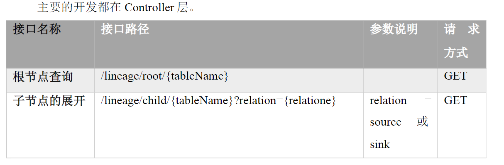  
方d/{tableName}?relation={relatio

### 4.类信息：

#### ds模块：

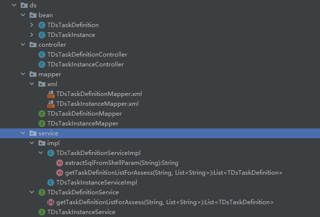

#### governance模块：

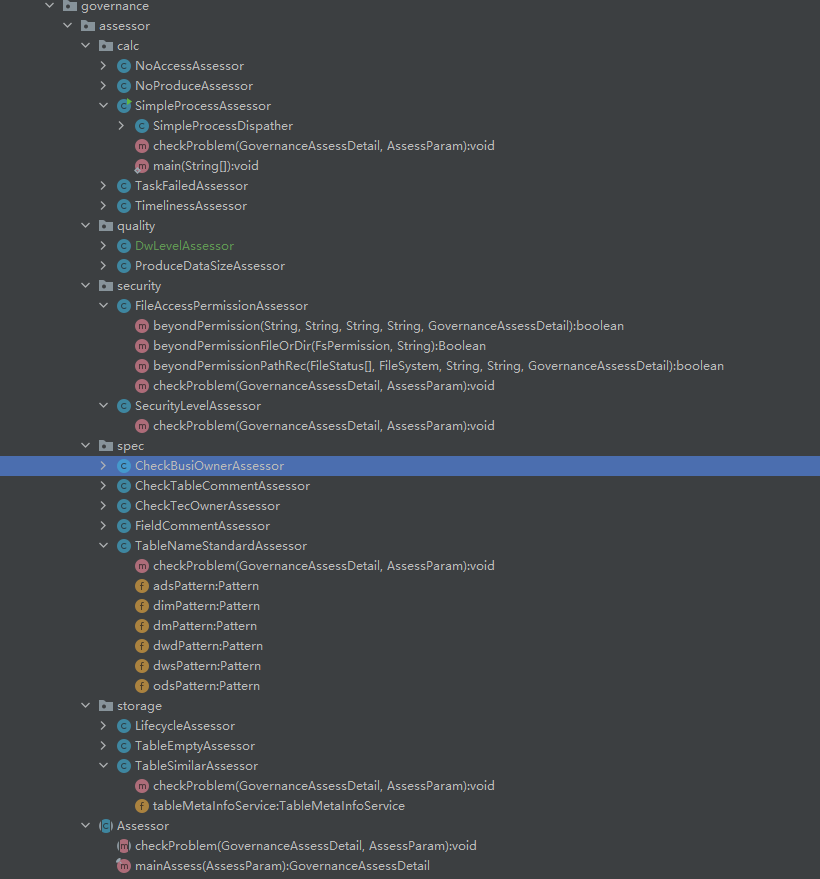


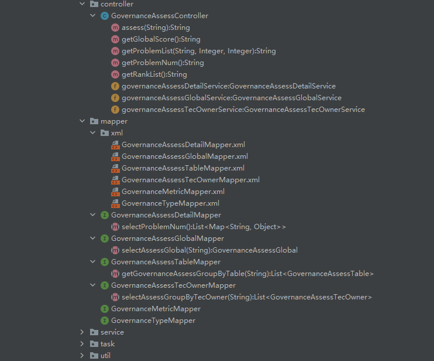

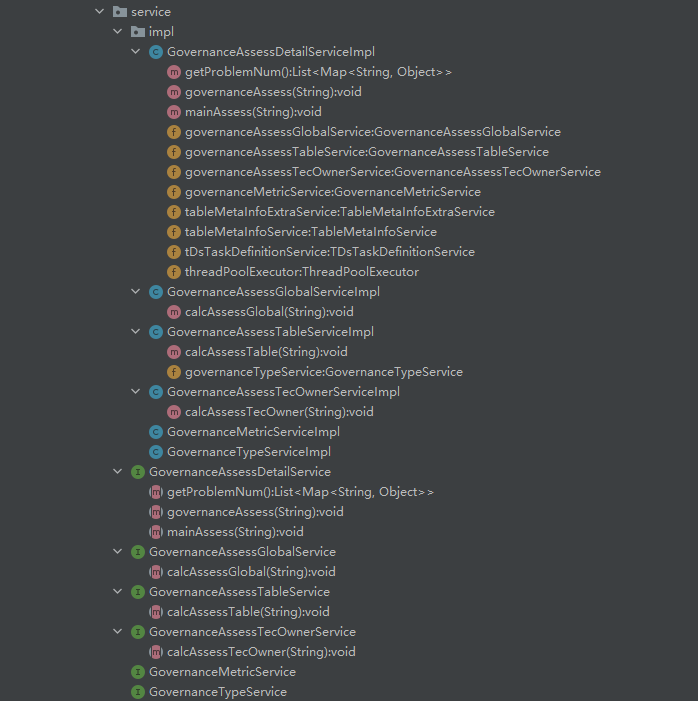

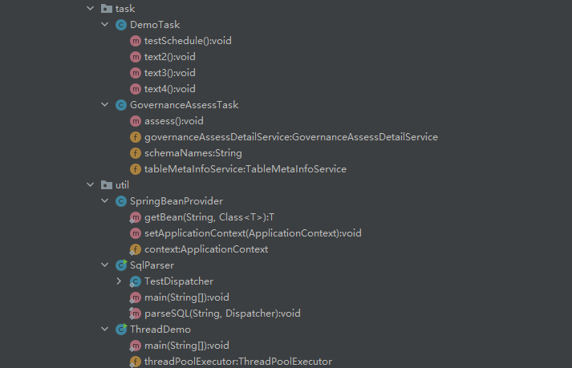

#### Meta模块：

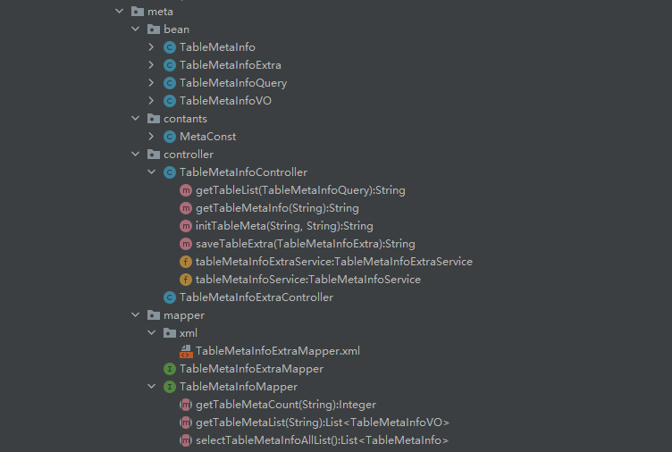

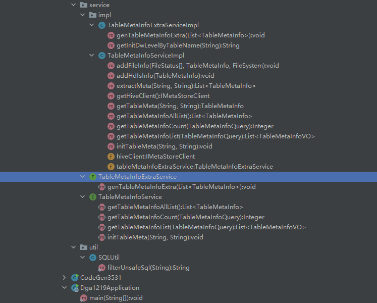

#### resource：

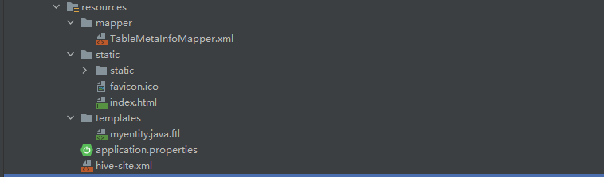

#### application.properties

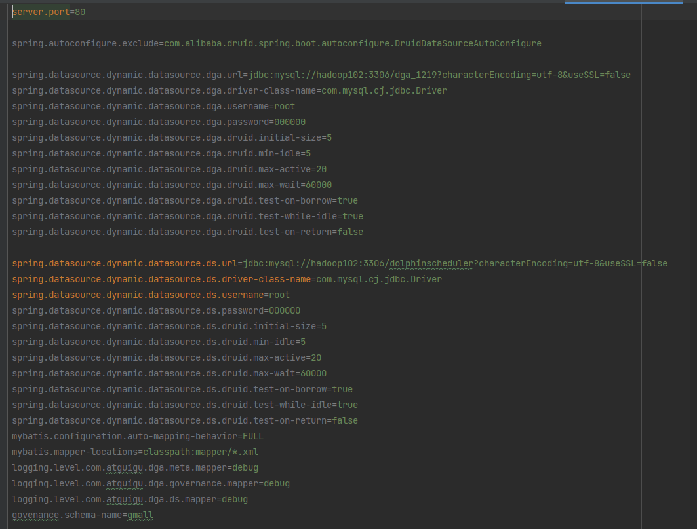

  

## 5.项目优化：

**异步处理考评：**一共17个考评器，相互并不影响，如果不使用异步，则是串行的，cpu和内存利用率都不大行，所以考虑使用多线程异步并行处理考评。

**如何使用：**

线程池传参：（类似于druid线程池）线程池数量、线程池最大数、线程池不活跃踢出时间、时间单位、满了之后等待资源的队列

```java
//创建线程池 
ThreadPoolExecutor threadPoolExecutor=new ThreadPoolExecutor(100,100,600, TimeUnit.SECONDS,new LinkedBlockingDeque<>());
```

异步处理，传入一个方法和线程池。这个方法就是可以并行互不依赖的一些处理逻辑。异步处理结束后，使用completableFutureList.add()将并行考评预期放入list中，最后调用异步集结，将异步处理数据收集到main线程，变成同步。

```java
CompletableFuture<GovernanceAssessDetail> completableFuture 
	= CompletableFuture.supplyAsync(() -> {
    //业务逻辑：把考评互不依赖的考评任务放到线程池异步执行
    GovernanceAssessDetail governanceAssessDetail = assessor.mainAssess(assessParam);
    return governanceAssessDetail;
}, threadPoolExecutor
                                                                                           );
completableFutureList.add(completableFuture);

//异步集结
governanceAssessDetailList = completableFutureList
	.stream().map(future -> future.join()).collect(Collectors.toList());
```

  

## 1.为什么需要数据治理

数据价值在于流通、利用和分析。

数据质量低、数据孤岛、数据安全风险、规范性问题、数据难以支持创新、难以实现数据驱动、用户体验受损等原因会干扰数据的快速准确流通、利用和分析。

## 2.数据治理的概念

数据治理是系统的方法、旨在管理企业中数据的质量、一致性、安全性和完整性。

## 3.数据治理如何落地

数据中台

数据中台功能：数据集成、数据存储、数据清洗与转换、数据质量管理、元数据及血缘管理、数据安全、数据可视化、数据监控与运维、数据治理与流程的制定和实施。

## 4.本项目介绍

将数据治理轻量化为一场考试，将各个环节的打分情况列出来，然后根据评分逐步改善。

## 5.数据考评的指标

规范：是否有技术负责人、是否有业务、表名命名是否规范、表是否有备注、表字段是否有备注

存储：是否设定生命周期且生命周期设置是否合理、是否分区表、是否空表、是否相似表

计算：是否长期无产出、长期无访问、计算中有报错、简单加工（没有聚合关联等操作）

质量：表产出时效性监控、表产出数据量监控

安全：数据安全等级、敏感数据加密与否、文件范文权限是否设置

# 二、数据治理考评平台的技术方案

  

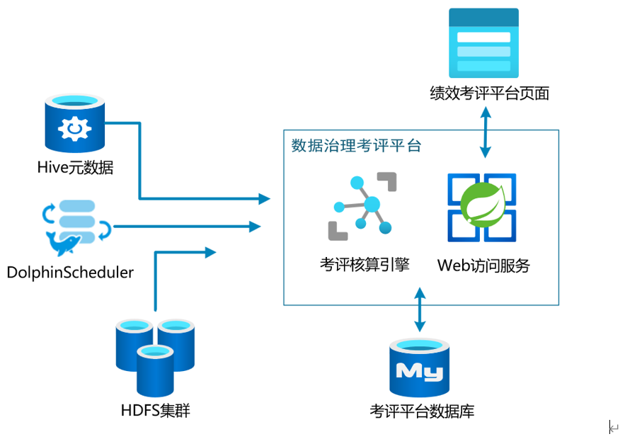

  

**涉及技能：**

利用springboot搭建外部服务

利用MyBits 及 MyBitsPlus对数据库增删查改：

从hive中提取需要的元数据：存储方面指标、规范方面指标

从hdfs中提取相关数据

从海豚调度器的任务信息中提取相关信息

# 三、springboot 及 MyBits入门

## 1、web服务

### 1.1 什么是web服务

web服务（http服务），接受者从app或者网页端发起http请求，web服务通过程序进行相关请求的存储、计算、查询等处理、并将结果返回给接受者。

url: https://www.baidu.com:443/index.html?name=xxxx

https:// 协议

www.baidu.com 域名

：443 端口

/index.html 路径 一般用作唯一性查询的关键字

用@pathVariable 用于读操作

？后面是 k=v 这是参数 可用 & 连接多个参数 ，一般用于多个条件组合查询筛选

用@RequestParam 用于读操作

请求方法的请求方式

get 读

post 写（新增）

put 写 （幂等性写，类似update）

delete （删）

响应状态码：

1xx 访问中未完成

2xx 200已完成 常见

3xx 跳转

4xx 客户端错误

400

403 禁止访问 权限问题

405

404 not found

5xx 服务器错误 后台程序报错，需看控制台

6xx 自定义

​  

为什么调用服务端要用接口？

1.同一个接口可以由多个实例实现、可以通过 @Qulifier（“customer1”）来选择合适的实现类（早期通过xml配置）

2.程序员可以不用关心具体的实现类是什么。分布式环境，程序员不用担心实现类在哪，如何部署，减轻了开发压力。

​  

### 1.2 传统的web服务应用框架

web应用框架有不同语言编写的，java web最6，其中spring家族又占领了java领域的web框架，在springboot之前流行的是“SSM”框架（springMVC处理web请求+Spring业务组件化+MyBits增删查改数据库）。

### 2、 springboot对比SSM

springboot整合了SSM的核心能力，本质上还是实现功能的还是SSM的包，只是在SSM之上封装了一层，这样用户就不必直接对spring、springMVC进行xml文件配置。

**springboot的优势：**

不再需要千篇一律繁琐的xml文件

内嵌Tomcat，不需要外部的Tomcat

更方便和第三方工具整合、而且只要一个配置文件即可（mysql、es、kafka、dubbo、rs等）

### 3、创建springboot模块

```html
<dependencies>
    <dependency>
        <groupId>org.springframework.boot</groupId>
        <artifactId>spring-boot-starter-web</artifactId>
    </dependency>
    <dependency>
        <groupId>org.projectlombok</groupId>
        <artifactId>lombok</artifactId>
        <optional>true</optional>
    </dependency>
</dependencies>
```

创建Maven项目 添加springboot模块，添加lombok、springweb依赖

### 4、springboot应用开发

#### 4.1 应开发分层

为什么分层：类似与数仓建模，复用底层，减少重复

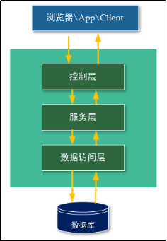

分层及各层职责

| **分****层** | **名****称** | **职****责** | **涉及的标****签** |
| --- | --- | --- | --- |
| **controller** | 控制层 | 1接收请求和参数<br>2调用服务层<br>3 返回响应和结果 | @RestController<br>@RequestMapping<br>@RequestParam<br>@RequestBody |
| **service** | 服务层（业务层） | 1接收控制层调用<br>2 处理业务<br>​3 返回结果 | @Service<br>@Autowired |
| **mapper** | 数据层 | 1接收服务层调用<br>2数据库的操作 （SQL）<br>3 返回结果<br>​ | @Select<br>@Insert<br>@Delete<br>@Update<br>@Param |

#### 4.2 控制层 controller

| **注****解** | **位****置** | **​** |
| --- | --- | --- |
| **@RestController** | 类 | 标识入口类 |
| **@RequestMapping** | 方法 | 标识入口方法、类 |
| **@GetMapping** | 方法 | 标识入口方法GET请求专用 |
| **@PostMapping** | 方法 | 标识入口方法POST请求专用 |
| **@RequestParam** | 参数 | 接收路径上的键值对参数<br>http://xxxxx/xx?name=xxx&age=xxx |
| **@PathVariable** | 参数 | 接收路径上的值<br>http://xxxxx/customer/123 |
| **@RequestBody** | 参数 | 接收请求体(payload) 中的参数 |

#### 4.3 服务层 service

| **注****解** | **位****置** | **说****明** |
| --- | --- | --- |
| **@Service** | 类 | 声明该类为Service层Spring容器组件 |
| **@****Component** | 类 | 声明该类为Spring容器组件，功能上于@Service没有区别 |
| **@Autowired** | 类 | ​自动将Spring容器中的组件，装配到引用上。 |

Service层由两个类组成，一个接口和一个实现类组成。

**容器：**service层类就是一个容器（餐馆）

**组件：**controller层类就是一个容器（服务员），所有组件的new由容器的启动统一创建。每个组件在容器中都是唯一的（单例模式），一般情况下不要在单例组件上设置成员变量，因为成员变量是多线程共享的，线程不安全

#### 4.4 数据访问层 mapper

| **注****解** | **位****置** | **说****明** |
| --- | --- | --- |
| **@Mapper** | 类 | 标识Mapper接口 |
| **@Select** | 方法 | 查询语句 |
| **@Update** | 方法 | 修改语句 |
| **@Delete** | 方法 | 删除语句 |
| **@Insert** | 方法 | 插入语句 |
| **@Param** | 参数 | 标识SQL参数 |

关于注解中的参数

| **注****解** | **说****明** |
| --- | --- |
| **#{}** | 会识别参数的类型会自动补全单引<br>本身字符串值中的特殊符号会被替换、转义 |
| **${}** | 参数原值（一般程序中动态组合sql） |

### 5.MyBits使用

```html
<dependency>
    <groupId>org.mybatis.spring.boot</groupId>
    <artifactId>mybatis-spring-boot-starter</artifactId>
    <version>3.0.0</version>
</dependency>

<dependency>
    <groupId>org.springframework.boot</groupId>
    <artifactId>spring-boot-starter-jdbc</artifactId>
</dependency>

<dependency>
    <groupId>com.mysql</groupId>
    <artifactId>mysql-connector-j</artifactId>
    <scope>runtime</scope>
</dependency>
```

#### 好处：

1.帮助程序员链接数据库，简化jdbc链接过程（注册驱动、创建statement、statement执行sql语句、返回结果）

2.封装参数 通过select、insert等注解来帮忙识别要写的语句获取对应的方法

3.封装结果

4.使程序员更专注于业务（写sql）

#### #{ } 和 ${ }的区别

#{ } 是用于传参

${ } 可用于传参，也可用于传入语句（动态拼接SQL时候用，如大屏查询语句书写时用到？）

### 6.Mybits-Plus

```html
<!--mybatis-plus-->
<dependency>
  <groupId>com.baomidou</groupId>
  <artifactId>mybatis-plus-boot-starter</artifactId>
  <version>3.4.1</version>
</dependency>
<dependency>
  <groupId>com.baomidou</groupId>
  <artifactId>mybatis-plus-generator</artifactId>
  <version>3.5.3.1</version>
</dependency>
<dependency>
  <groupId>org.springframework.boot</groupId>
  <artifactId>spring-boot-starter-freemarker</artifactId>
</dependency>
```

借助MyBits-plus 完全去SQL化，封装好了大量的CURD操作，甚至把CRUD操作封装到了Service层，可以直接在controller调用现成的CRUD服务层，极度舒适省心

**局限**：只支持简单的CRUD 操作。不支持多表操作（join ,union,子查询）

### 7.动态数据源，配置里边添加多个数据源

避免用户操作数据库需要反复的建立连接

```html
<dependency>
    <groupId>com.alibaba</groupId>
    <artifactId>druid-spring-boot-starter</artifactId>
    <version>1.2.15</version>
</dependency>
```

​  

​  

spring.datasource.**dynamic.datasource.demo**.url\=jdbc:mysql://bigdata01:3306/demo?characterEncoding=utf-8&useSSL=false  
spring.datasource.dynamic.datasource.demo.driver-class-name\=com.mysql.cj.jdbc.Driver  
spring.datasource.dynamic.datasource.demo.username\=root  
spring.datasource.dynamic.datasource.demo.password\=000000  
  
spring.datasource.**dynamic.datasource.demo2**.url\=jdbc:mysql://bigdata01:3306/demo2?characterEncoding=utf-8&useSSL=false  
spring.datasource.dynamic.datasource.demo2.driver-class-name\=com.mysql.cj.jdbc.Driver  
spring.datasource.dynamic.datasource.demo2.username\=root  
spring.datasource.dynamic.datasource.demo2.password\=000000

​  

### 8.druid连接池

spring.datasource.dynamic.datasource.demo.url\=jdbc:mysql://bigdata01:3306/demo?characterEncoding=utf-8&useSSL=false  
spring.datasource.dynamic.datasource.demo.driver-class-name\=com.mysql.cj.jdbc.Driver  
spring.datasource.dynamic.datasource.demo.username\=root  
spring.datasource.dynamic.datasource.demo.password\=000000  
**spring.datasource.dynamic.datasource.demo.****druid****.****initial-size****\=****5  
****spring.datasource.dynamic.datasource.demo.****druid****.****min-idle****\=****5  
****spring.datasource.dynamic.datasource.demo.****druid****.****max-active****\=****20  
****spring.datasource.dynamic.datasource.demo.****druid****.****max-wait****\=****60000  
****spring.datasource.dynamic.datasource.demo.****druid****.****test-on-borrow****\=****true  
****spring.datasource.dynamic.datasource.demo.****druid****.****test-while-idle****\=****true  
****spring.datasource.dynamic.datasource.demo.****druid****.****test-on-return****\=****false**  
  
spring.datasource.dynamic.datasource.demo2.url\=jdbc:mysql://bigdata01:3306/demo2?characterEncoding=utf-8&useSSL=false  
spring.datasource.dynamic.datasource.demo2.driver-class-name\=com.mysql.cj.jdbc.Driver  
spring.datasource.dynamic.datasource.demo2.username\=root  
spring.datasource.dynamic.datasource.demo2.password\=000000  
**spring.datasource.dynamic.datasource.demo2.****druid****.****initial-size****\=****5  
****spring.datasource.dynamic.datasource.demo2.****druid****.****min-idle****\=****5  
****spring.datasource.dynamic.datasource.demo2.****druid****.****max-active****\=****20  
****spring.datasource.dynamic.datasource.demo2.****druid****.****max-wait****\=****60000  
****spring.datasource.dynamic.datasource.demo2.****druid****.****test-on-borrow****\=****true  
****spring.datasource.dynamic.datasource.demo2.****druid****.****test-while-idle****\=****true  
****spring.datasource.dynamic.datasource.demo2.****druid****.****test-on-return****\=****false**

| **参数** | **​** |
| --- | --- |
| **initial-size** | 初始连接数 |
| **min-idle** | 最少保持空闲连接数 |
| **max-active** | 最大可活动的连接数 |
| **max-wait** | 最长等待时长 |
| **test-on-borrow** | 借走时测试 |
| **test-while-idle** | 空闲时测试 |
| **test-on-return** | 归还时测试 |

### 9.总结

Springboot 作为一个web应用快速开发框架，整合了SpringMVC、Spring、Mybatis等框架。其中：

SpringMVC负责接收返回web请求。

Spring负责把业务处理类的组件化，管理生命周期。

Mybatis负责连接数据。

Mybatis-plus是Mybatis的第三方扩展依赖，可以方便的对数据表进行查删改查操作。

DynamicDatasource是用来对接多个jdbc数据源的工具。

可以使用 logging.level.{mapper的全类名}=debug就能查看指定mapper下的sql信息，也可以设置到某个类

##   

## \-----------------------------------------------------------------------