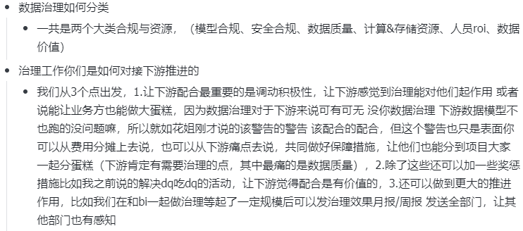
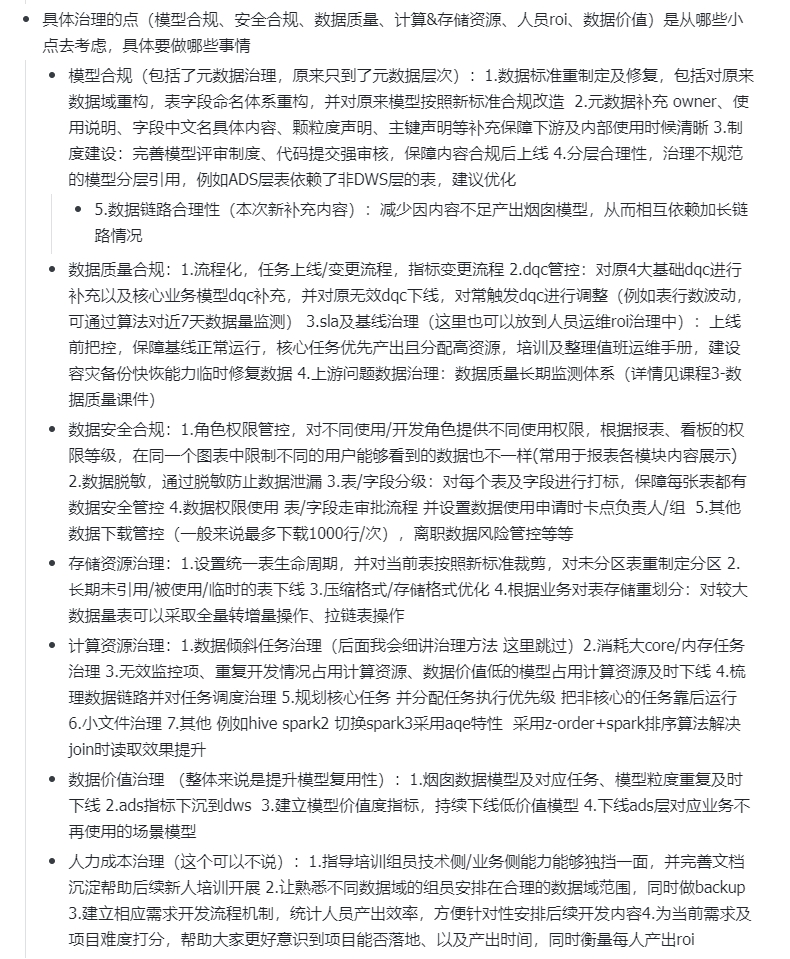
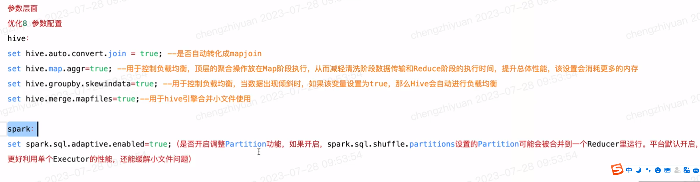
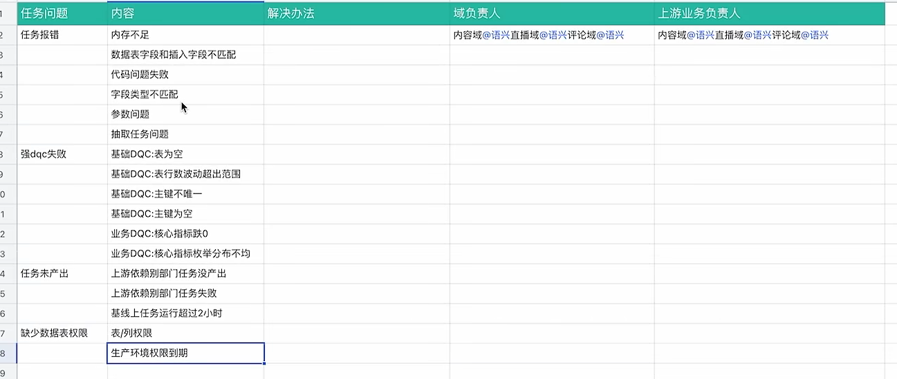
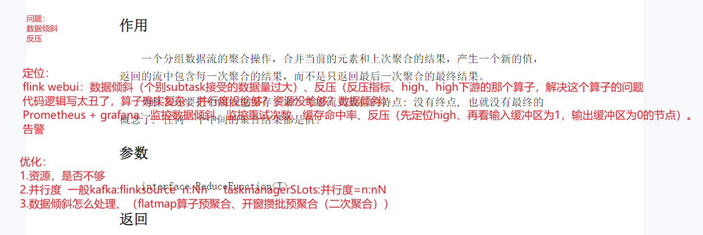
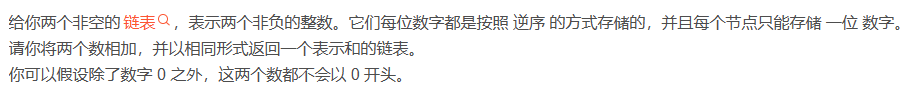
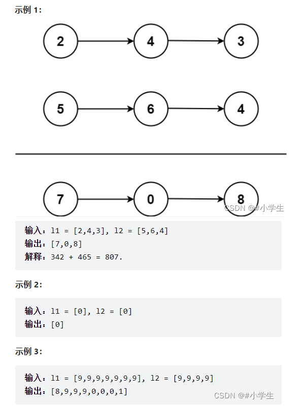

个人介绍：

老师您好！我叫xxx，来自于xx。目前工作了**将近五年的时间**，主要经历了**电商和银行**两个行业。早些时候的电商项目，主要是参与到一个**lambda架构的数仓项目**，这段经历主要是学习和接触了大量的Apache开源组件及数仓的建模思想，从一个只会SQL和一点javase的小白慢慢成长为一个拥有离线和实时双重数仓建模能力的合格数仓开发工程师。最近的**银行工作**主要分为两方面，**第一**是负责FLink on k8s流处理框架的搭建、开发、运维、监控等；**第二**是负责对原有数仓项目架构做数据模型规范、数据质量、基线保障、计算资源和存储资源等方面的数据治理工作。

下面我主要给您介绍一下我在银行工作时的两个项目：

①首先FLink on k8s的实时项目，该项目主要是因为行内领导觉得使用阿里云的FLink比较贵，综合考虑我们团队的能力后，决定自己搭建一套开源的实时架构，该项目主要对接上游行内自营产品业务数据库，是对自营产品促贷活动、促存活动、以及信贷业务流量驾驶舱提供实时数据支持。其中k8s集群为FLink作业提供计算资源，docker+Harbor为行内提供内网公用镜像私有仓库，rancher为管理k8s集群提供可视化界面，FLink提供实时数据计算处理能力，streampark提供FLink作业开发编译打包管理一键操作的便携性。

实时数据的处理过程借鉴维度建模分层理论：首先flinkcdc读取MySQL业务数据，在FLink中把数据量小的维表维度退化到事实表中的得到一个明细层数据存入datahub消息中间件；之后会再次读取DataHub中明细数据与主维表关联开10s窗口得到轻度汇总的宽表数据写入Doris中，最后由大屏直接配置Doris数据源展示数据。

这次项目考虑到我们维表数据量不大，直接将MySQL作为我们维表存储库，后续随着数据量的增大，需要将维表统一存储到Hbase中方便高效读写，如果还需要考虑数据读取的延迟，还可以在FLink和Hbase之间增加Redis作为热点数据缓存。另外目前项目的告警方式主要是使用streampark提供的作业异常告警，后续考虑使用Prometheus+grafana来监控告警FLink作业的更多异常指标，比如可以实现Redis的缓存命中率计算、FLink数据倾斜、FLink反压等指标，也可Prometheus+grafana来监控k8s集群的异常情况指标。

②第二个项目是信贷业务的离线数仓项目，本项目是基于阿里云dataworks平台以日批量的形式运行。主要围绕授信、放贷、还款三个业务过程，为合作方提供对账、分润的报表数据，为下游催收提供用户逾期还款提醒等数据，为下游风控和用户画像提供用户标签数据，同时也为行内提供驾驶舱大屏数据支持。项目是趋于成熟，覆盖了大部分业务场景，因此为了提升数据质量、数据复用性等考虑，我的职责主要是针对已有维度模型展开数据治理工作以及部分开发任务。

数据治理是对模型合规、数据质量合规、数据安全合规、存储资源治理、计算资源治理、任务基线治理等方面的一个优化整合。

**模型合规**我们主要针对元数据进行管理，比如数据域划分、表字段命名、统一填充表负责人、业务负责人、使用说明、颗粒度声明、主键声明等信息来保障下游自助分析的方便性。同时也会对不合理分层模型重构或建议优化。

**数据质量合规：**规范任务上下线及变更流程，模型评审流程。配置DQC管控，增加基础dqc和业务dqc，并且对无效dqc下线，对常触发dqc做调整。配置数据基线破线预警告警等。对上游数据质量把控，主要是数据重复和脏数据过滤。基线治理、保障下游数据及时性。

**安全合规：**数据脱敏、角色权限控制，数据的秘密等级设置等。

**存储资源管理：**主要针对表的生命周期管理，清理无用表，冷热数据采取压缩或者冷热存储处理等。

**计算资源管理**主要是优化重复计算，下线无价值模型和dqc，对高消耗任务单独分析处理、严格要求SQL代码行列裁剪，优化数据倾斜任务、规划任务运行顺序，保证核心任务先运行，非核心任务可错开高峰期等。

本项目通过治理的展开，为项目减少了高峰时期30%CU资源占用，腾挪出了近40%的磁盘空间，并且大大提高了数据的规范性、易用性、安全性，一致性，及时性等。

最后总结一下：

我觉得我的优点主要在于：

对数仓从0-1搭建、建模、数据治理、数据质量监控、集群运维、集群监控等的多方面能力。

我虽然是土木类专业转行过来大数据的，与科班同学有着不小的差距，但是凭借这四年半在互联网行业的工作经验，以及平时自己的自学能力，我觉得只要我对互联网的兴趣不减、持续当前好学的状态，我肯定也能成为一个优秀的大数据工作者。

​  

​  

为什么离职：

首先是在技术方面最近感觉成长比较缓慢，想换个平台学习下，虽然自己也有在自学，但是感觉还是在更大的平台可能成长更多，毕竟站得高看得远嘛，金融行业咱们平安这样的大树就是比较好的选择。

其次我希望能够投入像流批一体、数据中台这样拥有前沿技术的公司，这个刚好今早有和老师聊过这些方面的东西。

最后呢，我对大模型在我们数仓的应用上有一些被震惊到的地方，比如用大模型去帮助运营同学生成一些用户用于对风控模型准确率作测试。这样的东西我小平台是给不了我的。

综上几点的话，我也在这个小平台工作了将近五年了，不能一直做井底之蛙嘛。

​  

未来的规划：

第一，我个人在离线、实时数仓建模、数据治理、数据质量监控等方面都有一些自己的理解，算是一点技术上的优势。但是呢，我还是认为“业务为王”是有道理的，能进入我们平安这样的大平台，我会优先积极拥抱业务，才能调动手中的技能创造价值。

第二，未来数仓的发展我觉得大概率会被公司的数据中台给替换。所以当下自己有时间的情况下会提升一下数据中台方面的认知。比如one id、one data、one service这些思想。

第三，我觉得虽然是大数据工作，但是我不能局限于大数据技术，还是要了解比如后端、前端以及ai的一些技术或是，争取能够成长为一个以大数据为核心，其他技术也懂的一个工作者。因为复合型的人会在ai时代创造更大的价值。

就以上三点吧。

​  

个人优势：

首先技术：我在离线实时数仓、数据治理、数据质量监控、集群监控方面都有自己一些独有的理解。能为leader说的流批一体或者数据中台相关的改造提供一些自己的价值。

其次性格：我属于乐光、积极、坦诚的人，还是比较容易和同事相处的，这样我就能快速打入组织内部，快速成长。

最后自驱能力：从土木转行到程序员这个卷王中心，我凭借的也是自己的学习能力、毅力坚持到现在的，每当我融入公司正常工作中，我一般都会抽时间总结项目、或者学习新的技术。

​  

个人缺点：

可能是因为刚好处在对行业有一定认知的阶段，我有有点工作狂，有问题不及时解决了会睡不着。

另外呢，有点强迫症，做数据治理工作的时候，SQL逻辑有一些小的优化点，影响虽然不大，但是我都得想办法委婉的告知一下开发的同学。

  

什么时候离职

说了不怕老师您笑话，我之前的平台就5个人做大数据，咱们平安就是170多人，我很想加入这样的大团队。所以的话，你们确定能给offer，我会立即提离职的。

​  

​  

目前总包26-27 月薪是19k

期望，我看中的是咱们平台，而且咱们有自己的定级规则，我尊重公司给我的定级。

​  

​  

​  

# 面试总结

## 离线项目遇到的问题：

##### 数仓表格结构更改，如何处理数据（增加字段、减少字段）

##### 数据有问题怎么办？如何刷数？（操作的是分区粒度）

##### 离线批量在测试环境，需手动跑批，容易跑错日期，或者时间倒跑、跳跑（可能会对数据准确性有影响，如我们的借据表放款日期是以借据进来的第一天算，如果跳跑，放款日期不准）。

解决：我们使用的是Dataworks、在流程上增加触发节点、通过Dataworks的api写Java程序，借助flinkcdc读取上游跑批（切日）的时间（上游的日期只能递增），发现时间切日了就跟随一起自动跑批。

##### 数据倾斜问题解决：

如一次测试环境中，上游文件数据重复了一条，两条信息进入dim层，9999分区有两条重复数据，之后在dws层计算时，每其还款时使用一次dim的对应的借据数据，就会出现数据量翻倍的情况，导致跑了多期，或者测试重跑数据后数据也会几何增长，最后发现，测试环境跑不动了很慢，定位到dag图，发现是一个reduce很慢，应该数据倾斜了，通过groupby key查看数据量，果然有一个key有上千亿条数据。

解决：要去重这部分数据，同事直接row\_nunber去重，但是本质处理的底层还是会数据倾斜。

我的方法：借助Hadoop的combine提前在map阶段预聚合的操作，每个maptask中数据先聚合，减少了数据量，reduce阶段拉去的数据量就会大大减少。所以，我先将数据中加入一列随机值（100份），然后对key + 随机值列做row\_nunber 去重，之后再按key再去重一次。达到一个解决数据倾斜的效果。最后同事的方法要跑30多分钟，我的只要3分钟。

##### 数仓为什么分层？

提高复用性减少资源开销：建模的核心，复用性高、且不能太耦合，要保障数据口径统一。

清晰数据结构：清晰每层是做什么的，方便下游或数仓团队新人更快上手了解信息。

方便追踪数据血缘定位问题：方便查找上下游，定位问题及后期维护。

复杂问题简单化：每一个问题单一处理为一个节点，解决问题时能快速分析影响范围。

##### 维度建模 vs 三范式

1）维度建模一般有星型、星座、雪花三种模型，常用星型模型来处理单业务过程（单一事实表为中心，附加多维度信息），星座模型处理多业务关联的业务场景（多业务过程关联为中心，附加多维度信息），雪花模型较为复杂（可能分多环，事实表，主维表、其他维表）。

优点：关联较少，以业务为核心事实为辅助便于理解，设计与实现比较简单。

缺点：冗余性高

建模思路：至上而下，逐层拆解。

2）三范式：（第一范式：每个属性不可再分，第二范式：非主键字段都完全依赖于主键，第三范式：飞逐渐字段不能依赖于其他非主键字段）

瀑布模型：不易于后期扩展，低冗余高精度，多用于后端数据存储。

##### 数仓小文件产生的原因主要有以下几点：

1.  动态分区插入数据，产生大量的小文件，从而导致map数量剧增。
2.  数据源本身就包含大量的小文件。
3.  在HDFS中，每个小文件对象约占150byte，如果小文件过多会占用大量内存。

解决数仓小文件过多问题的方法包括：

1.  使用Sequencefile作为表存储格式，不要用textfile，在一定程度上可以减少小文件。
2.  减少reduce的数量（可以使用参数进行控制）。
3.  少用动态分区，用时记得按distribute by分区。
4.  对于已有的小文件，可以使用hadoop archive命令把小文件进行归档。
5.  重建表，建表时减少reduce数量。
6.  通过参数进行调节，设置map/reduce端的相关参数。

##### 模型建设五要素

**数据域、业务过程、维度、粒度、度量值**

##### 数据治理：

如何推动下游合作一起做数据治理：调动积极性（六性分析）、部门间奖惩、各部分合作后的成果展示。

1.  准确性：数据必须准确，以确保基于数据的决策是可靠的。不准确的数据可能导致错误的结论和决策。
2.  完整性：数据必须完整，不能缺少任何关键信息。不完整的数据可能导致分析结果偏颇或无法得出正确的结论。
3.  及时性：数据必须及时，以便决策者能够根据最新的信息做出决策。过时的数据可能导致决策基于不准确的信息。
4.  一致性：数据必须一致，以确保不同来源和不同时间点的数据可以相互比较和整合。不一致的数据可能导致混淆和误解。
5.  唯一性：数据必须具有唯一性，以避免重复记录和数据冗余。重复的数据可能导致错误的分析结果和不必要的复杂性。
6.  安全性：数据必须得到保护，以确保其机密性和隐私性。未经授权的人员不应能够访问敏感数据，以避免数据泄露和滥用。

##### 数据治理怎么分类？



##### 数据治理详细做些啥



##### 数据治理话术

**模型合规：**数据标准制定重构（数据域划分、分层规范、模型强评审）

**数据质量合规：**

1.流程化：任务上线、下线、指标变更等操作需要有一个流程（如评估影响、沟通上下游、代码审核、测试、再投产操作）

2.DQC管控：对原基础dqc（数据量波动率、是否有数据、主键唯一性、空值）配置，并且新增业务dqc（如对应模型关心的字段是否为空、字段是否符合要求等）；下线无效dqc、优化常触发dqc（保障质量、保障及时性等）。

3.SLA及基线治理：上线前把控基线情况、设定合理基线预警和破线告警。通过安排值班且完善值班手册总结问题共性一起解决；保障高优先级任务先执行产出；建设容灾备份快恢复能力和及时修复能力（如避免大屏没数，可在跑批出问题后暂时使用t-2日分区数据展示）；

4.上游问题数据治理：上游数据质量保障（沟通数据口径，准确性、一致性、及时性、完整性、规范性等）

**数据安全合规：**角色权限（能看哪些表、哪些大屏）、数据脱敏防止泄漏、表的安全等级打标等。

**存储资源治理：**表生命周期管理、分区管理、明确增全量；长期未使用的表下线；压缩；冷热数据存储。

**计算资源治理：**数据倾斜治理（如预判热点数据，提前二次聚合处理热点数据倾斜，设置单表数据倾斜负载均衡set hive.groupby.skewindata = true，两次reduce，一次预聚合，一次汇总集合）；找出消耗资源较大的任务治理优化（如是否资源设置不合理给大了）；无效监控、重复开发模型优化或下线；规划核心任务执行优先级；小文件治理（设置参数，hdfs har归档等）；join性能优化（大小表mapjoin、大小表区分值设置，大表join大表SMB JOIN，桶数量得是倍数关系，先过滤后join，写清楚列信息避免\*。）

**数据价值治理：**认真拆解业务指标，把数据域、业务过程、粒度相同的指标拆解出来放到同一个dws大宽表。

##### 数据治理思路（在公司怎么玩）

**上下游配合：**调动下游积极性配合治理（简单培训治理的意义、及给下游带来易用性、适当奖惩机制）；上游数据合规性（DQC拦截上游脏数据或不规范数据，反馈给上游，让其配合治理）

**步骤总览：**搭建治理看板（方便对比治理前后的效果，团队产出可视化，治理进度）-》先从简单数据标准重制定开始-》无用、临时表下线-》应用指标公共下沉复用-》解决ods层穿透问题-》烟囱数据表重构及下线-》元数据非合规数据表修改-》

**看板360**：ssg数据治理项目

**标准重制定、模型规范、安全规范、元数据规范**：数据域（按业务过程来分，如消金的贷前中后）、主题域划分（风控、营销推荐等）、规范元数据（表使用、粒度等说明清晰、字段说明等）

**无用、临时表处理、链路过长、ods层穿透**：根据数据血缘图分析、血缘图制作，可先将一个表的上下游信息收集后存入数据库，SpringBoot读取信息前端同学配合展示，但是最好还是使用datahub、atlas、ambari读取hive元数据信息展示血缘图、同时也可加工出表数据的读取热度、安全等级设置等。

**指标下沉、烟囱表重构与下线**：dws\_数据域\_统计粒度\_业务过程\_统计周期（1d/nd/td），将新需求中指标拆解为：数据域、统计粒度、业务过程、统计周期，根据这 思维信息去定位是否已有相同指标，若有则复用，没有才创建新的。

**基线治理：**核心业务优先执行、非核心业务错峰，基线预警及破线告警。

**数据质量治理：**

**上线前：**

**数据比对：如ods层和后端业务数据库数据比对。**

**数据探查：max/min值或长度、空值比例、主键数、主键去重数**

**存在问题：**

1.数据产出延迟

2.消耗资源过多（资源打满）

3.降本增效（预算吃紧）

4.重复开发/无用模型或DQC

**计算资源方面问题：**围绕小文件和数据倾斜、外加一些sql代码习惯（where 提前）

几十个高消耗任务：行列裁剪、数据倾斜（spark3 aqe、z\_order排序类似索引加快查询效率）

map端：行列裁剪、distributed by rand()治理小文件和数据倾斜

reduce端：主要是数据倾斜（map join、二次聚合等）

避免笛卡尔积、where提前

distinct换group by

map join解决大小表关联（小表放入内存，只有map阶段），convert.join=true则自动

单表大key：

分而治之：

知道大key、如iPhone的热搜比较多，则单独过滤这些数据二次聚合，其他产品正常计算

不知道大key：二次聚合（加随机列聚合、去随机列再聚合）、group.skwindata参数开启二次聚合

大表join：smb join、表分桶有序，能减少左右表遍历时的数据量，从而达到优化



**上百万的小文件：怎么看小文件、怎么处理？**小文件治理设置参数合并（spark3 aqe、hive端参数设置(map.aggr/merge.mapfiles/)、hdfs端har归档）

**任务调度不合理：**查看cpu内存使用情况、削峰填平、核心表优先，非核心错峰

**无效DQC：**下线、合并dqc

**重复开发/无用模型：**重构或下线

**任务缺少调优参数：**

**存储方面的问题：**小文件、表生命周期管理、压缩（parquet列式存储+snappy快速解压缩、冷热存储处理）

DQC配置：

基线/SLA治理：

数据问题上报平台（或在线文档维护）：bug出现时间及相关信息描述、解决进度、解决方法

数据长期监控跟踪体系：夜间维护手册记录及总结



##### 数据治理效果

（1）治理了模型（ods穿透、烟囱表、指标下沉、数据域划分）、质量（规范评审流程、规范上线及变更流程）、元数据（新增、规范表说明、字段说明等）、安全（安全等级设置，用户权限设置）、计算（小文件、数据倾斜、严格行列裁剪、高消耗任务治理）、资源（合理分区、合理生命周期、压缩、冷热存储）、基线（预警+告警）等方面。

（2）下线多少无用表、临时表、采用压缩方案或者冷热处理，减少多少磁盘占用

（3）完成多少烟囱表整合、多少指标公共下沉。

（4）ods穿透率由多少下降至多少

（5）数仓同学红黑排行榜，维持在80分以上（各方面按权重打分汇总）

（6）数据产出时间提前多少小时

总结：数据规范性、一致性、易用性、安全性、及时性等大大提高。

## 实时项目遇到的问题：

##### 1.搭建过程中遇到的问题

###### 1）docker磁盘空间不足：

停止docker、修改docker的容器默认存储位置到一个更大的磁盘目录（/etc/docker/daemon.json），然后利用rsync命令将原有的数据迁移到新的更大的目录下，重启即可。

###### 2）对已有镜像修改更新，重新推送私库：

1.docker images 找到要修改的镜像 名字（随机码）

2.docker run -it --name 容器名字（自己取一个） 镜像名字（随机码） /bin/bash -- --运行镜像并命名且进入容器内部（一个小的虚拟机）

exit 退出容器

3.docker cp 要放入容器内的文件或者jar包 容器名字：容器内路径 （把路径调过来在 宿主机运行，可实现由内向外复制） 如FLink镜像中lib添加连接器依赖

4.docker start 容器名字 运行刚才退出的容器

6.docker exec -it 容器名字 /bin/bash 进入容器后查看指定路径下是否修改成功

exit

docker ps 查看该容器的 容器id

7.docker commit 容器id 指定容器的tag

8.docker push 镜像tag

###### 3）docker: http: server gave HTTP response to HTTPS client

修改daemon.json文件 { "insecure-registries":["192.168.220.125:5000"] }

###### 4）k8s集群如何识别到私有仓库

我们是rke2安装的k8s集群，在/etc/rancher/rke2/目录下创建一个registres.yaml文件，添加docker的私有仓库即可，但是有个坑，需要k8s的每个节点都要配置这个yaml。否则FLink作业调度到相应的节点时还会报拉去不到镜像，或者 server gave HTTP response to HTTPS client

###### 5）UAT尝试：迁移手动安装k8s的etcd，暂定方案如下

在所有master节点执行：

cd /var/lib/rancher/rke2/server/db/etcd

vim config

先停了k8s集群

更改data-dir到 /app路径下

rsync -avz /var/lib/rancher/rke2/server/db/etcd /app/clmp/db/etcd

重新启动k8s集群

###### 6）运维的后知后觉：

当时安装是一台机子一台机子安装的，比较累。后面有看过一下如果用ansible这样的工具能帮我批量操作，将节省很多投产时间。

###### 7）k8s问题定位：

没有rancher之前，我们直接通过

kubectl logs -f -n 200 podname -n ns

kubectl describe node kmaster1 #查看node节点日志

kubectl describe pod pod名称 #查看pod应用的信息

用了rancher之后：

直接在可视化界面，通过查看对应的pod、node、sv、ns等等信息可以查看。例如我们的FLink日志，在streampark上边只会显示jobmanager的日志信息，可通过rancher查看taskmanager的日志信息。

###### 8）pod日志的本地挂载：防止pod停止后，日志即被删除。

##### 2.开发过程中遇到的问题

###### 1.kafka协议连接datahub（DataHub里边的数据是有多个列的划分的，而kafka只有k v或者只有k的形式，也就是说datahub数据像是一张表而kafka像是一个JSON）

###### 2.streampark如何与FLink、k8s协作的。

**FLink有一个本地的FLink，用于streampark提交作业以及读取配置，真正运行起来后，是streampark把FLink job 的jar包与FLink镜像build成另外一个镜像，根据streampark服务器上的kubectl命令识别k8s集群，将镜像提交到这个k8s集群上运行，k8s的角色类似于yarn（k8s容易扩展，作业方便迁移、自动扩缩容等）。**

###### 3.flinkcdc读取数据，全量阶段是通过jdbc读取的，数据基本都是多线程读取，乱序程度极大，若是对这些全量数据开窗聚合，一般都没有数据。因为watermark很快就更新到了最大值。

如果要历史数据，则需要先把历史数据按照窗口粒度聚合后导入结果表中，覆盖实时聚合的窗口，之后实时数据的窗口就会准确了。

###### 4.FLinkcdc指定binlog日志文件和点位消费数据 或 指定timestamp消费数据。2.3版本后才有。且2.3、2.4版本MySQLcdc的类与debizum的一个类有冲突，需要解决冲突，github上要改源码，我们直接利用Maven重新打包FLinkcdc及其依赖，更改该包为flinkcdc之前的名字上传FLink的lib即可。

###### 5.kafka指定offset或timestamp消费数据。

###### 6.FLink窗口大导致数据可见性差，如开窗一小时。


###### 7.FLink的ck频率太高，manager内存占满了，

可以调节内存的比例，默认占FLink内存的0.4，可以提高到0.5，或者整体内存提升

也可以增大FLink ck的频率，如3分钟改为10分钟。

###### 8.join两端的表所有数据都存于状态，状态会无限变大，可设置ttl来解决。ttl根据业务经验来设置。

###### 9.FLink写入Doris或者其他组件时，可以尝试攒批写入，这样可以减少交互次数，提高性能，Doris有参数可配置。

###### 10.数据去重

使用row\_number（） over （partition by xx order by xx asc/desc）

升序使用时需注意，如果你的流数据去关联维表（如主表a left join 维表b），a表中有数据，但是b表中没有能与之关联上的数据时，此时输出的第一条数据时没关联上的，导致了数据丢失；而且有可能数据关联上的维度数据是过期的数据。所以大多时候使用的是desc。


###### 11.流join有哪些方式：connect、union、广播流。

使用场景：

1.  **Connect**：主要用于处理复杂控制流场景，如使用一个控制流来动态调整另一个数据流的处理逻辑。
2.  **Join**：适用于需要结合多个数据源进行关联分析的场景，例如实时订单分析、用户行为分析等。通过Join操作可以方便地整合不同数据源的信息，从而进行深入的数据分析。
3.  **Union**：适用于需要将多个数据流合并为一个单一输出流的场景，例如将来自不同源的用户行为数据合并为统一格式进行进一步分析。通过Union操作可以消除重复数据并简化数据处理流程。
4.  **广播流**：适用于需要将某些公共信息实时推送给所有接收者的场景，例如实时监控系统中的公共警报信息、实时交易系统中的市场动态等。通过广播流可以确保所有相关接收者都能及时获取这些重要信息并进行相应处理。

###### 12.上游数据倾斜

| 上游数据倾斜或某个分区为空 | 数据倾斜或空分区会导致某一个或者几个Source并行度处于闲置状态，您会观察到这些Source的sourceIdleTime指标较大。 |
| --- | --- |

###### 13.Source是性能瓶颈点

| Source是性能瓶颈点 | 如果仅是Source的吞吐量不足，那么您的作业中不应该检测到反压，sourceIdleTime会维持在较低的值（Source一直在工作），currentFetchEventTimeLag和currentEmitEventTimeLag接近，但是两个指标均较高。 |
| --- | --- |

###### 14.反压

| 作业中某些算子存在反压 | 判断反压最直接的方式是使用Flink UI提供的反压检查功能，而不是通过指标判断。反压的存在会导致Source端数据发送至下游算子的速率下降，您可能会观察到sourceIdleTime周期性上升，currentFetchEventTime和currentEmitEventTimeLag不断增长。极限情况下（某些算子卡死）sourceIdleTime会持续上升。 |
| --- | --- |

可以Prometheus监控算子的输入缓冲区和输出缓冲区情况。

###### 15.如果您发现作业的延迟较高，则可以使用以下指标帮您分析Flink当前的处理能力，以及数据在外部系统中的滞留情况。

| 场景 | 详情 |
| --- | --- |
| sourceIdleTime | 该指标反映Source是否有闲置，如果该指标较大，说明您的数据在外部系统中的产生速率较低。 |
| currentFetchEventTimeLag、currentEmitEventTimeLag | 均反映了Flink当前处理的延迟，您可以通过两个指标的差值（即数据在 Source中停留的时间）分析Source当前的处理能力。<br>- 如果两个延迟非常接近，说明Source从外部系统中拉取数据的能力（网络 I/O、并发数）不足。<br>- 如果两个延迟差值较大，说明Source的数据处理能力（数据解析、并发、反压）不足。 |

###### 16.FLink缓存命中率：

程序open方法中增加了两个Counter对象。

Counter hitCounter=null;  
Counter totalCounter=null;

数据流到达时通过判断缓存是否命中（是否get到数据）来调用inc（）和dec（）方法对counter对象计数，这两个方法是不安全的，得加两锁

lock = new ReentrantLock(); try {

hitLock.lock();

hitCounter.inc();

}finally {

hitLock.unlock();

}

###### 17.Prometheus + grafana监控FLink那些指标

-   吞吐量/延迟：展示任务数据滞留延迟、数据滞留量、输入输出 QPS 等数据信息。
-   窗口延迟：展示任务中有窗口函数时，窗口丢弃数据量、丢弃数据TPS、Watermark延迟的监控信息。
-   Failover：展示任务启动耗时及 Failover 次数。
-   CheckPoint：展示上一次 CheckPoint 大小、上一次 CheckPoint 持续时间、Compeleted CheckPoint 个数等信息。
-   CPU/内存：展示 TaskManager CPU 负载、TaskManager Heap 内存用量、TaskManager Direct 内存用量以及 TM GC 信息。
-   反压：展示 InPoolUsage 与 OutPoolUsage 信息。
-   RocksDB：展示当前延迟写速率、写入是否停止、MemTable 的总大小、block cache 的总大小等信息。
-   启停时间监控：展示最新任务的启停时间信息。

###### 18.旁路缓存的一点感想

实时数仓将维表数据写入hbase（因为读取维表会通过主键去关联，所以Redis和HBASE会比较适用，而Redis常驻内存且持久化rdb数据会丢失、aof每次写都持久化有压力），另外将Redis用于缓存HBASE热点数据。

使用时注意点：热点数据是否真的存在？不存在，不用Redis；存在但是不多，可以增大HBASE的读缓存也可以实现；存在且热点数据多，那用Redis缓存时不错的选择，因为HBASE的读缓存设置过大的话，gc的时候HBASE是不可用的状态，会对flink作业有影响（超时错误？）

​  



19.  流批模式的的切换问题（水印可能不更新）

```plain
StreamExecutionEnvironment env = StreamExecutionEnvironment.getExecutionEnvironment().setParallelism(1);
// env.setRuntimeMode(RuntimeExecutionMode.STREAMING);         
// 批模式使用了Streaming模式，可能会导致（无数据来，最后一个窗口水印不更新），无输出
env.setRuntimeMode(RuntimeExecutionMode.AUTOMATIC);            
// 所以正常使用的时候这个还是有必要加一下的。避免读文件等批量数据时，使用了处理时间，窗口不更新水印触发计算
```

STREAMING 模式下, 数据是来一条输出一次结果.

BATCH 模式下, 数据处理完之后, 一次性输出结果.

  

## \-----------------------------------------------------------------------

# 面试

### 1.电梯要求：18-26\*12 24

java经验：查看javase，查看简单几个算法题

flink经验：看一下flink陈教授文档

架构经验：吹牛云原生和开源

数仓建模：差不多就那样

**题：**

1.自我介绍

2.说一下你的实时项目

3.你对kafka了解多少

4.Flink说一个指标计算的逻辑处理

5.Flinkcdc读取数据变慢怎么办

6.你熟悉哪些数据库

7.MySQL的引擎有哪些

8.Java使用的多吧，说说你对Java的理解，什么是AOP

9.问点简单的，Java的方法重载和重写说一下

10.Flink窗口抖动怎么处理

​  

### 2.深圳华讯兴业外包一面（2023-12-08 早10:00）18-25\*12 24

1.介绍自己

2.他们是flink实时项目

3.工作中遇到过的一些flink相关的问题。说了flinkcdc版本问题2.3开始可以指定位置时间消费；FLinkcdc2.3升级后和debizum的类有冲突，利用Maven插件将flinkcdc带依赖导入FLink镜像的lib目录下；说了flink窗口提前触发提高可见性；flinkcdc读取数据全量阶段是多线程非有序（时间）的watermark乱序程度极大，若是要开窗聚合，容易出现没有数据的情况；

4.flink的多流join：connect、union、广播流说了一下

5.flink的监控：刚好前几天整理了笔记，说了flinkwebUI可以看，streampark可以看，Prometheus+granfana可以看，具体场景就比如数据倾斜、缓存命中率忘记说了

6.kafka数据积压了：先看flink算子是否有反压，怎么定位，怎么解决。然后看kafka的性能要不要提高资源，提高吞吐（消费者数=分区 ++），如果是大促这种场景，kafka性能已经调至最优且没有机器可加入扩容，此时只能先保证核心业务跑起来，不重要的可以先关闭。

### 2.深圳华讯 兴业外包二面（2023-12-12 14:30） 已给offer

四个人面，三个人问

主要围绕FLink问，考察是否真的使用过FLink

FlinkSQL自己做的一些东西，窗口啊什么的和他们说了

FLinkapi讲了一个日志分流（侧输出流），然后被问了其中一个输出流数据量大怎么处理（压根不用处理，本来数据量就大，然后我说你想问的是数据倾斜的场景吧，这个场景一般是keyby之后的情况了，flatmap算子处理或者窗口中处理就行）

FLink的反压：我一通输出。

### 3.平安普惠一面 （2023-12-11 9：30）

1.自我介绍+项目介绍

2.数据质量监控如何做？

3.具体监控什么业务场景？

4.对监控到的上游数据质量问题如何处理？

5.flink集群监控如何做？

6.flink与外部组件有哪些交互介绍下？

7.kafka的了解？分区与消费者的关系？一定是要分区与消费者1:1吗？

8.不关心的业务数据字段频繁更改进入kafka，该如何处理？

9.kafka数据一致性如何保证？

10.开源框架使用了哪些组件？

11.看老师找不到问了，补充了一下数据倾斜和缓存命中率的监控情况。

12.hive内外部表的区分？

13.hadoop的了解？

14.hdfs的了解？

15.yarn调度队列的了解？

个人总结：今早回答问题有点卡顿，自我介绍和项目介绍临时想改善话术引起的(真是关心则乱)，问题基本都答上来了。老师找不到问题问，很可能是我简历项目实现流程没有清晰去写(感觉他在反复找想问的)。

​  

另一个面试的老哥（挂了的）

hdfs有哪些角色，nameNode能无限扩容吗，小文件怎么处理，有哪些影响，namenode挂了怎么办? standyby与secondery namenode能共存? hivesql 执行流程,rbo,cbo,doris与hdfs区别，分区与分桶表，内部表与外部表区别，分桶的大小怎么确定，mapioin怎么ioin的，hive优化，数据倾斜怎么外理的，linux中sed，aws使用过吗inux查看端口号，服务器硬盘坏了怎么发现，数仓分层介绍，集群监控了解吗，人员分工怎么安排的，职业规划yarn调度策略，调度资源具体怎么分配的，文档建设，有同学不按照命名规范执行，怎么监控，flink会吗，doris表模型有哪些，使用场景，hadoop集群组件有哪些? hbase文件格式，hive文件格式，hbase热点问题怎么解决?

### 3.平安普惠二面 （2023-12-11 9：30）30 - 35 \* 16 30

与总监面试的自我介绍话术

如何保证集群的稳定性

未来的规划（说着说着被打断了，看到了我的公司是东软下边的子公司）

问了团队规模，自己带领多少人

离职的原因

你有什么想问我？咱们的团队怎样、风控大模型有什么落地的吗？数据中台咱们有项目吗？

### 3.平安普惠三面 HR

很简单问问离职原因、未来规划、目前薪资、准备要多少、等这他把资料整理给到上边定级。

### 3.平安普惠背调

一年公积金、一年工资流水、一年个税、三个电话

### 4.指南车数据科技一面（2023-12-11 14:30） 15 - 28 \* 12 25

要求：

java+SQL，数据库调优，flink，常见设计模式+面向对象思想、常见算法应用，linux运维（docker + k8s）

题：

想问Java，一直被我打住了。

FLink、反压，为什么反压，怎么定位，怎么解决？

FLink反压的信任机制？

docker + k8s 问了一些，streampark如何跟k8s通讯？

数据治理、数据质量监控、集群监控怎么做的？

集群监控问的比较多？

这套系统是你来选型的吗？

离职原因、未来发展。其他的想不起来了，聊了一个多小时最后挂了。

最后当晚就挂了，感觉像是在套我方案。不过我也瞎扯。

### 5.拼多多一面 （2023-12-17 20:00） 30-60 \* 16 两个月是不固定的9成能拿到，预报的40w+

**岗位要求：**

ETL经验，维度建模经验。

重点考察Hdfs、Mapreduce、Hive、Hbase；

元数据管理、数据开发测试工具与方法、数据质量、主数据管理；

熟悉各种NoSQL产品，熟悉分布式架构者优先；有图数据库开发经验者优先；

**面试题：**

主基调：老师偏向于想听我的实际经历、flink的使用，遇到的难点及怎么处理。

1.自我介绍

2.实时项目聊了一下，里边的flink精确一致性，端到端的一致性，两阶段提交

3.至少一次和精确一次语义checkpoint时有啥不同？

4.写入MySQL和doris如何保证一致性。

5.多流join怎么join，工作中是怎么用的，讲一个场景。

6.flink的重分区算子有什么区别，在什么时候使用？

7.数据的延迟怎么处理？

8.算法题：





### 6.digi plus 菲律宾工作

**一面：**

1.  自我介绍+项目介绍
2.  数仓如何从0-1建设的，用一个场景来说一下，从数据域划分-bi大屏报表都说了。
3.  实时场景下或者离线场景下，一个人可以发展很多下属人员，下属人员充值则会从中获得一定比例的返佣，可以获得多级下线人员的返佣，问如何计算每个人的当前返佣金额？
4.  拉链表好像也问了。基本围绕项目和场景题问，八股文基本没问

二面：

1.  自我介绍 + 项目介绍
2.  如何规划一个数仓的建设、和一面的从0-1差不多。
3.  数仓从0-1，在实时场景里怎么规划？中间聊到了数据源、kafka、实时分层复用这些？
4.  为什么离职？
5.  能接受出国的这样工作吗？
6.  发表了一下对我的看法：他觉得小伙子很不错（可能是觉得我的腰子不错，哈哈哈哈）
7.  反问，那边的环境是否稳定：菲律宾的陆家嘴、不乱跑乱搞没有任何问题。租房3000-8000不等，技术人员基本都是果仁。

  

​  

## \-----------------------------------------------------------------------

# 写简历心得

## 注意点：

**尽量用高大山词汇（专业词汇）**

1.不要又臭又长，简明扼要，不求多么精致一定要“小清新”，抓重点，让人看到你虽然不帅但是很整洁清晰 --》》》》》 即 “目录”

2.抛砖引玉很重要：关键字突出，关键能力突出，思路清晰，早早构思引导面试官去问问题。

3.自我介绍，拿到邀约后，和hr以及公司官网了解公司情况，自我介绍尽量去往公司技术栈或者业务方向去贴近。

4.项目描述要思路清晰，但是不要太长，抓住几个点：什么业务、为什么要做、做了之后的效果。

5.写好简历之后再去复习项目：包括项目数据量、业务路线、自己负责的工作量、工作中带给公司的价值（量化）、工作中使用到的技术亮点、遇到的问题、怎么优化、怎么提高效率。

6.不知道怎么复习，那么就拿着简历一条一条的读，从中找到你当初在这里做了什么，有哪些是自己没做的，有没有可以优化的方向或更好的解决方案等。

## 明细点：

1.定位自己的方向、什么岗位，切记牛头不对马嘴

2.技术栈（8-10行），最好自己归类（达到抛转引玉的效果），比如从数据采集、数仓建模、数据接口提供、大屏展示、数据质量监控、数据治理、监控指标等。

3.工作经验，什么公司，什么岗位，主要负责什么，简单写清楚，非自己面试方向的东西就可以略过，实在少的话再写上。

4.项目经验：

分块写

项目描述：（简单介绍业务、凝练需求、引出该项目实际意义，不要大而空）

项目架构：列出重要技术名称即可

负责技术：讲解利用什么技能做了什么，少大白话，多用面试官能理解的技术名词（需要平时多了解这方面的东西）。

5.自我介绍：正常三五条就行，面试官一般不会看

​