# 概述

Yarn是一个资源调度平台，负责为运算程序提供服务器运算资源，相当于一个分布式的操作系统平台，而MapReduce等运算程序则相当于运行于操作系统之上的应用程序。

# Yarn基础架构

## 组成

YARN主要由ResourceManager、NodeManager、ApplicationMaster和Container等组件构成。

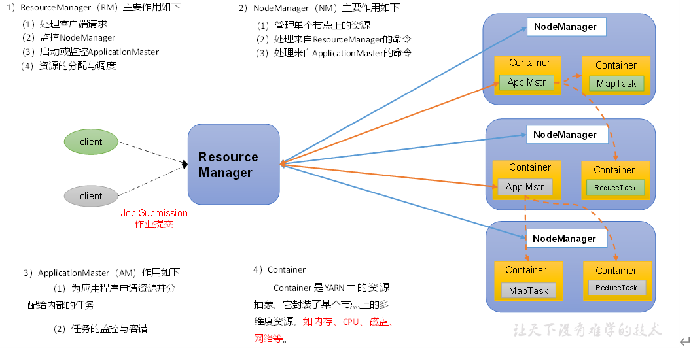

## 工作机制

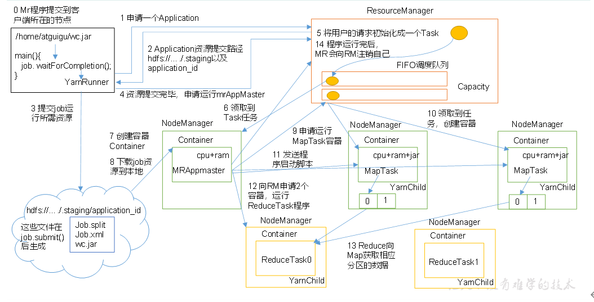

（1）MR程序提交到客户端所在的节点。

​（2）YarnRunner向ResourceManager申请一个Application。

​（3）RM将该应用程序的资源路径返回给YarnRunner。

​（4）该程序将运行所需资源提交到HDFS上。

​（5）程序资源提交完毕后，申请运行mrAppMaster。

​（6）RM将用户的请求初始化成一个Task。

​（7）其中一个NodeManager领取到Task任务。

​（8）该NodeManager创建容器Container，并产生MRAppmaster。

​（9）Container从HDFS上拷贝资源到本地。

​（10）MRAppmaster向RM 申请运行MapTask资源。

​（11）RM将运行MapTask任务分配给另外两个NodeManager，另两个NodeManager分别领取任务并创建容器。

​（12）MR向两个接收到任务的NodeManager发送程序启动脚本，这两个NodeManager分别启动MapTask，MapTask对数据分区排序。

（13）MrAppMaster等待所有MapTask运行完毕后，向RM申请容器，运行ReduceTask。

​（14）ReduceTask向MapTask获取相应分区的数据。

（15）程序运行完毕后，MR会向RM申请注销自己。

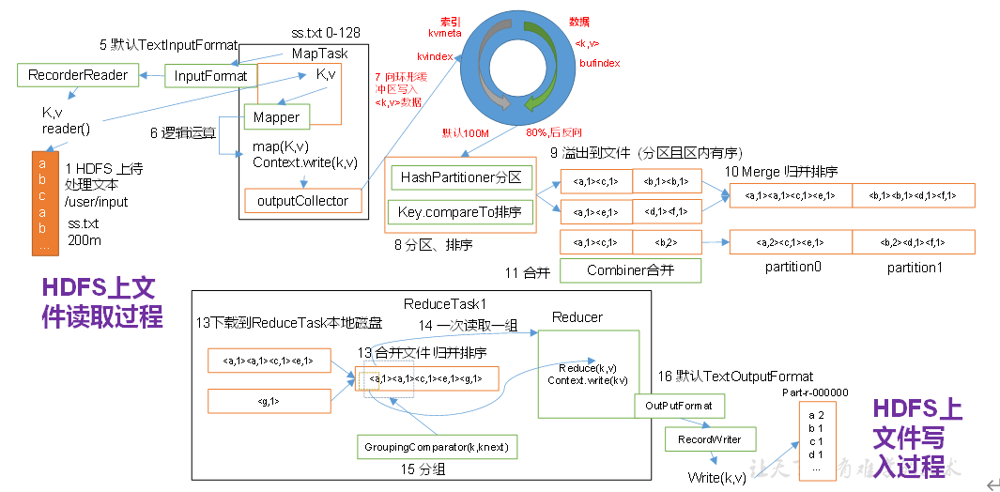

作业提交全过程详解

（1）作业提交

第1步：Client调用job.waitForCompletion方法，向整个集群提交MapReduce作业。

第2步：Client向RM申请一个作业id。

第3步：RM给Client返回该job资源的提交路径和作业id。

第4步：Client提交jar包、切片信息和配置文件到指定的资源提交路径。

第5步：Client提交完资源后，向RM申请运行MrAppMaster。

（2）作业初始化

第6步：当RM收到Client的请求后，将该job添加到容量调度器中。

第7步：某一个空闲的NM领取到该Job。

第8步：该NM创建Container，并产生MRAppmaster。

第9步：下载Client提交的资源到本地。

（3）任务分配

第10步：MrAppMaster向RM申请运行多个MapTask任务资源。

第11步：RM将运行MapTask任务分配给另外两个NodeManager，另两个NodeManager分别领取任务并创建容器。

（4）任务运行

第12步：MR向两个接收到任务的NodeManager发送程序启动脚本，这两个NodeManager分别启动MapTask，MapTask对数据分区排序。

第13步：MrAppMaster等待所有MapTask运行完毕后，向RM申请容器，运行ReduceTask。

第14步：ReduceTask向MapTask获取相应分区的数据。

第15步：程序运行完毕后，MR会向RM申请注销自己。

（5）进度和状态更新

YARN中的任务将其进度和状态(包括counter)返回给应用管理器, 客户端每秒(通过mapreduce.client.progressmonitor.pollinterval设置)向应用管理器请求进度更新, 展示给用户。

（6）作业完成

除了向应用管理器请求作业进度外, 客户端每5秒都会通过调用waitForCompletion()来检查作业是否完成。时间间隔可以通过mapreduce.client.completion.pollinterval来设置。作业完成之后, 应用管理器和Container会清理工作状态。作业的信息会被作业历史服务器存储以备之后用户核查。

# yarn调度器

## 先进先出调度器（FIFO）

根据提交作业的先后顺序，先来先服务。

优点：简单易懂；

缺点：不支持多队列，生产环境很少使用；

## 容量调度器（Capacity Scheduler）

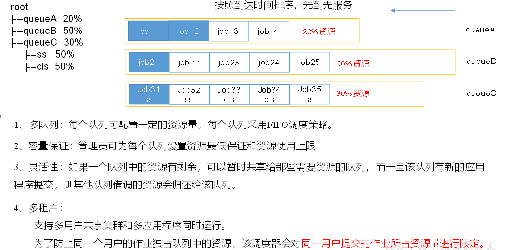

## 公平调度器（Fair Scheduler）

### 公平调度器

Fair Schedulere是Facebook开发的多用户调度器。

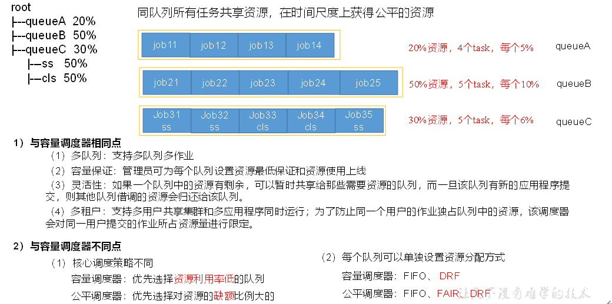

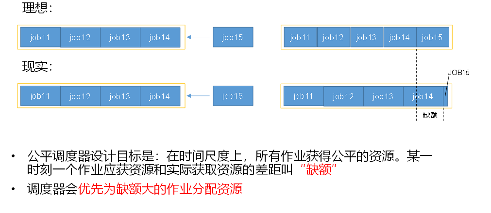

### 不同策略资源分配方式

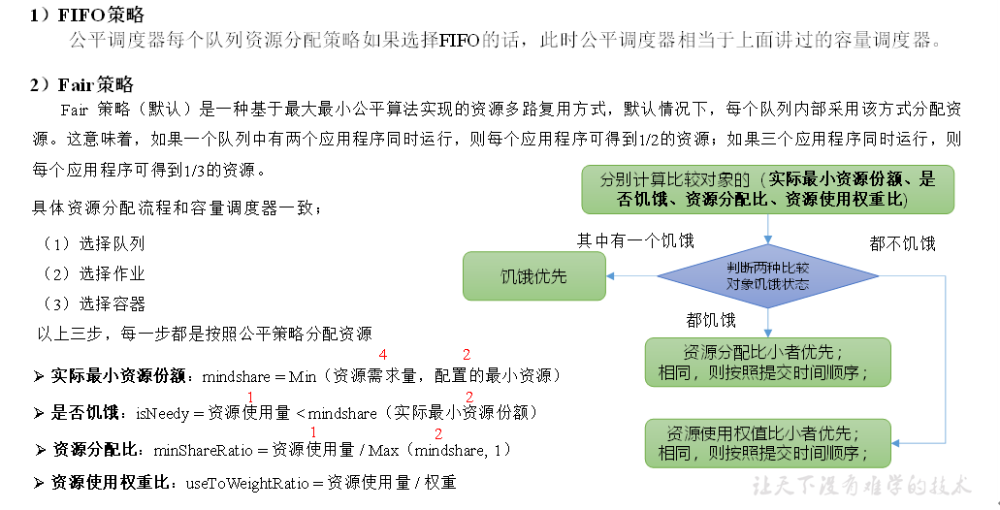

  

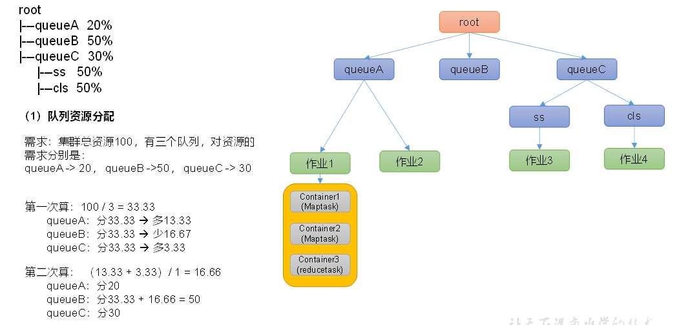

  

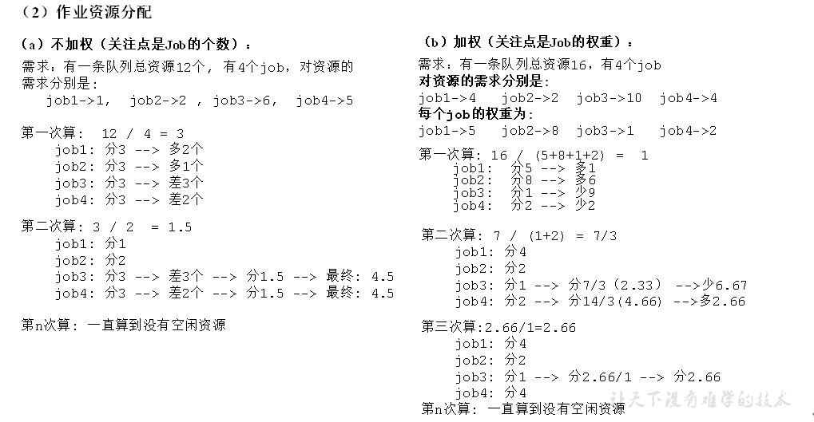

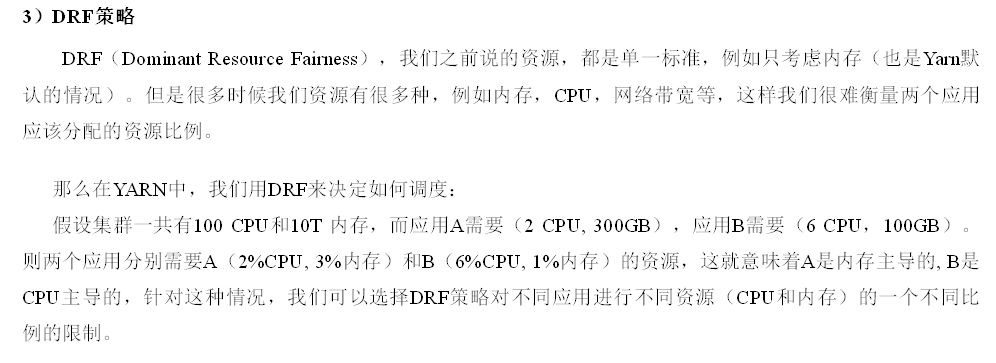

# yarn使用

## shell命令

```xml
yarn application -list
yarn application -list -appStates FINISHED
yarn application -kill application_1612577921195_0001
yarn logs -applicationId application_1612577921195_0001
yarn logs -applicationId application_1612577921195_0001 -containerId container_1612577921195_0001_01_000001
yarn applicationattempt -list application_1612577921195_0001
yarn applicationattempt -status appattempt_1612577921195_0001_000001
yarn container -list appattempt_1612577921195_0001_000001
yarn container -status container_1612577921195_0001_01_000001
yarn node -list -all
yarn rmadmin -refreshQueues
yarn queue -status default
```

## 生产核心参数

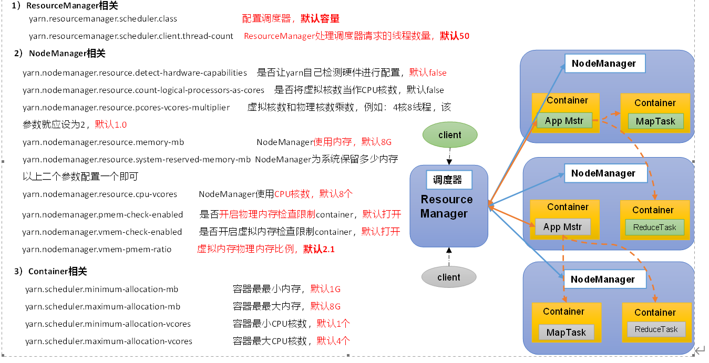

修改yarn-site.xml配置参数如下：

```xml
<!-- 选择调度器，默认容量 -->
<property>
<description>The class to use as the resource scheduler.</description>
<name>yarn.resourcemanager.scheduler.class</name>
<value>org.apache.hadoop.yarn.server.resourcemanager.scheduler.capacity.CapacityScheduler</value>
</property>

<!-- ResourceManager处理调度器请求的线程数量,默认50；如果提交的任务数大于50，可以增加该值，但是不能超过3台* 4线程 = 12线程（去除其他应用程序实际不能超过8） -->
<property>
<description>Number of threads to handle scheduler interface.</description>
<name>yarn.resourcemanager.scheduler.client.thread-count</name>
<value>8</value>
</property>

<!-- 是否让yarn自动检测硬件进行配置，默认是false，如果该节点有很多其他应用程序，建议手动配置。如果该节点没有其他应用程序，可以采用自动-->
<property>
<description>Enable auto-detection of node capabilities such as
memory and CPU.
</description>
<name>yarn.nodemanager.resource.detect-hardware-capabilities</name>
<value>false</value>
</property>

<!-- 是否将虚拟核数当作CPU核数，默认是false，采用物理CPU核数-->
<property>
<description>Flag to determine if logical processors(such as
hyperthreads) should be counted as cores. Only applicable on Linux
when yarn.nodemanager.resource.cpu-vcores is set to -1 and
yarn.nodemanager.resource.detect-hardware-capabilities is true.
</description>
<name>yarn.nodemanager.resource.count-logical-processors-as-cores</name>
<value>false</value>
</property>

<!-- 虚拟核数和物理核数乘数，默认是1.0 -->
<property>
<description>Multiplier to determine how to convert phyiscal cores to
vcores. This value is used if yarn.nodemanager.resource.cpu-vcores
is set to -1(which implies auto-calculate vcores) and
yarn.nodemanager.resource.detect-hardware-capabilities is set to true. The    number of vcores will be calculated as   number of CPUs * multiplier.
</description>
<name>yarn.nodemanager.resource.pcores-vcores-multiplier</name>
<value>1.0</value>
</property>

<!-- NodeManager使用内存数，默认8G，修改为4G内存 -->
<property>
<description>Amount of physical memory, in MB, that can be allocated 
for containers. If set to -1 and
yarn.nodemanager.resource.detect-hardware-capabilities is true, it is
automatically calculated(in case of Windows and Linux).
In other cases, the default is 8192MB.
</description>
<name>yarn.nodemanager.resource.memory-mb</name>
<value>4096</value>
</property>

<!-- nodemanager的CPU核数，不按照硬件环境自动设定时默认是8个，修改为4个-->
<property>
<description>Number of vcores that can be allocated
for containers. This is used by the RM scheduler when allocating
resources for containers. This is not used to limit the number of
CPUs used by YARN containers. If it is set to -1 and
yarn.nodemanager.resource.detect-hardware-capabilities is true, it is
automatically determined from the hardware in case of Windows and Linux.
In other cases, number of vcores is 8 by default.</description>
<name>yarn.nodemanager.resource.cpu-vcores</name>
<value>4</value>
</property>

<!-- 容器最小内存，默认1G -->
<property>
<description>The minimum allocation for every container request at the RMin MBs. Memory requests lower than this will be set to the value of thisproperty. Additionally, a node manager that is configured to have less memorythan this value will be shut down by the resource manager.
</description>
<name>yarn.scheduler.minimum-allocation-mb</name>
<value>1024</value>
</property>

<!-- 容器最大内存，默认8G，修改为2G -->
<property>
<description>The maximum allocation for every container request at the RMin MBs. Memory requests higher than this will throw an    InvalidResourceRequestException.
</description>
<name>yarn.scheduler.maximum-allocation-mb</name>
<value>2048</value>
</property>

<!-- 容器最小CPU核数，默认1个-->
<property>
<description>The minimum allocation for every container request at the RMin terms of virtual CPU cores. Requests lower than this will be set to thevalue of this property. Additionally, a node manager that is configured tohave fewer virtual cores than this value will be shut down by the resource   manager.
</description>
<name>yarn.scheduler.minimum-allocation-vcores</name>
<value>1</value>
</property>

<!-- 容器最大CPU核数，默认4个，修改为2个-->
<property>
<description>The maximum allocation for every container request at the RMin terms of virtual CPU cores. Requests higher than this will throw an
InvalidResourceRequestException.</description>
<name>yarn.scheduler.maximum-allocation-vcores</name>
<value>2</value>
</property>

<!-- 虚拟内存检查，默认打开，修改为关闭 -->
<property>
<description>Whether virtual memory limits will be enforced for
containers.</description>
<name>yarn.nodemanager.vmem-check-enabled</name>
<value>false</value>
</property>

<!-- 虚拟内存和物理内存设置比例,默认2.1 -->
<property>
<description>Ratio between virtual memory to physical memory whensetting memory limits for containers. Container allocations are  expressed in terms of physical memory, and virtual memory usage   is allowed to exceed this allocation by this ratio.
</description>
<name>yarn.nodemanager.vmem-pmem-ratio</name>
<value>2.1</value>
</property>
```

## 界面

8088端口查看yarn运行任务情况

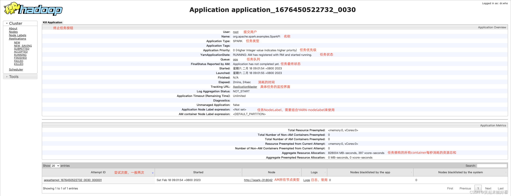

关闭虚拟内存检测

（1）可以在yarn-site.xml中设置虚拟内存检测为false

```bash
<!--是否启动一个线程检查每个任务正使用的虚拟内存量，如果任务超出分配值，则直接将其杀掉，默认是true -->
<property>
<name>yarn.nodemanager.vmem-check-enabled</name>
<value>false</value>
</property>
```

（2）分发配置并重启Yarn集群

## capacity scheduler配置案例

### 需求

需求1：default队列占总内存的40%，最大资源容量占总资源60%，hive队列占总内存的60%，最大资源容量占总资源80%。

需求2：配置队列优先级

### 配置多队列的容量调度器

1）在capacity-scheduler.xml中配置如下：

​（1）修改如下配置

```xml
<!-- 指定多队列，增加hive队列 -->
<property>
<name>yarn.scheduler.capacity.root.queues</name>
<value>default,hive</value>
<description>
The queues at the this level (root is the root queue).
</description>
</property>

<!-- 降低default队列资源额定容量为40%，默认100% -->
<property>
<name>yarn.scheduler.capacity.root.default.capacity</name>
<value>40</value>
</property>

<!-- 降低default队列资源最大容量为60%，默认100% -->
<property>
<name>yarn.scheduler.capacity.root.default.maximum-capacity</name>
<value>60</value>
</property>
（2）为新加队列添加必要属性：
<!-- 指定hive队列的资源额定容量 -->
<property>
<name>yarn.scheduler.capacity.root.hive.capacity</name>
<value>60</value>
</property>

<!-- 用户最多可以使用队列多少资源，1表示 -->
<property>
<name>yarn.scheduler.capacity.root.hive.user-limit-factor</name>
<value>1</value>
</property>

<!-- 指定hive队列的资源最大容量 -->
<property>
<name>yarn.scheduler.capacity.root.hive.maximum-capacity</name>
<value>80</value>
</property>

<!-- 启动hive队列 -->
<property>
<name>yarn.scheduler.capacity.root.hive.state</name>
<value>RUNNING</value>
</property>

<!-- 哪些用户有权向队列提交作业 -->
<property>
<name>yarn.scheduler.capacity.root.hive.acl_submit_applications</name>
<value>*</value>
</property>

<!-- 哪些用户有权操作队列，管理员权限（查看/杀死） -->
<property>
<name>yarn.scheduler.capacity.root.hive.acl_administer_queue</name>
<value>*</value>
</property>

<!-- 哪些用户有权配置提交任务优先级 -->
<property>
<name>yarn.scheduler.capacity.root.hive.acl_application_max_priority</name>
<value>*</value>
</property>

<!-- 任务的超时时间设置：yarn application -appId appId-updateLifetimeTimeout
参考资料：https://blog.cloudera.com/enforcing-application-lifetime-slas-yarn/ -->

<!-- 如果application指定了超时时间，则提交到该队列的application能够指定的最大超时时间不能超过该值。
-->
<property>
<name>yarn.scheduler.capacity.root.hive.maximum-application-lifetime</name>
<value>-1</value>
</property>

<!-- 如果application没指定超时时间，则用default-application-lifetime作为默认值 -->
<property>
<name>yarn.scheduler.capacity.root.hive.default-application-lifetime</name>
<value>-1</value>
</property>
```

2）分发配置文件

3）重启Yarn或者执行yarn rmadmin -refreshQueues刷新队列，就可以看到两条队列：

yarn rmadmin -refreshQueues

4) 作业提交如何指定队列

```xml
hadoop jar share/hadoop/mapreduce/hadoop-mapreduce-examples-3.1.3.jar wordcount -D mapreduce.job.queuename=hive /input /output
注: -D表示运行时改变参数值
```

  

```xml
conf.set("mapreduce.job.queuename","hive");
```

### 配置任务优先级

容量调度器，支持任务优先级的配置，在资源紧张时，优先级高的任务将优先获取资源。默认情况，Yarn将所有任务的优先级限制为0，若想使用任务的优先级功能，须开放该限制。

1）修改yarn-site.xml文件，增加以下参数

```xml
<property>
<name>yarn.cluster.max-application-priority</name>
<value>5</value>
</property>
```

2）分发配置，并重启Yarn

xsync yarn-site.xml

sbin/stop-yarn.sh

sbin/start-yarn.sh

3）模拟资源紧张环境，可连续提交以下任务，直到新提交的任务申请不到资源为止。

hadoop jar /opt/module/hadoop-3.1.3/share/hadoop/mapreduce/hadoop-mapreduce-examples-3.1.3.jar pi 5 2000000

4）再次重新提交优先级高的任务

hadoop jar /opt/module/hadoop-3.1.3/share/hadoop/mapreduce/hadoop-mapreduce-examples-3.1.3.jar pi \-D mapreduce.job.priority=5 5 2000000

5）也可以通过以下命令修改正在执行的任务的优先级。

yarn application -appID <ApplicationID> -updatePriority 优先级

yarn application -appID application\_1611133087930\_0009 -updatePriority 5

​  

## fair scheduler配置案例

### 需求

创建两个队列，分别是test和atguigu（以用户所属组命名）。期望实现以下效果：若用户提交任务时指定队列，则任务提交到指定队列运行；若未指定队列，test用户提交的任务到root.group.test队列运行，atguigu提交的任务到root.group.atguigu队列运行（注：group为用户所属组）。

公平调度器的配置涉及到两个文件，一个是yarn-site.xml，另一个是公平调度器队列分配文件fair-scheduler.xml（文件名可自定义）。

（1）配置文件参考资料：

https://hadoop.apache.org/docs/r3.1.3/hadoop-yarn/hadoop-yarn-site/FairScheduler.html

（2）任务队列放置规则参考资料：

https://blog.cloudera.com/untangling-apache-hadoop-yarn-part-4-fair-scheduler-queue-basics/

### 配置多队列的公平调度器

1）修改yarn-site.xml文件，加入以下参数

```xml
<property>
<name>yarn.resourcemanager.scheduler.class</name>
<value>org.apache.hadoop.yarn.server.resourcemanager.scheduler.fair.FairScheduler</value>
<description>配置使用公平调度器</description>
</property>

<property>
<name>yarn.scheduler.fair.allocation.file</name>
<value>/opt/module/hadoop-3.1.3/etc/hadoop/fair-scheduler.xml</value>
<description>指明公平调度器队列分配配置文件</description>
</property>

<property>
<name>yarn.scheduler.fair.preemption</name>
<value>false</value>
<description>禁止队列间资源抢占</description>
</property>
```

2）配置fair-scheduler.xml

```xml
<?xml version="1.0"?>
<allocations>
<!-- 单个队列中Application Master占用资源的最大比例,取值0-1 ，企业一般配置0.1 -->
<queueMaxAMShareDefault>0.5</queueMaxAMShareDefault>
<!-- 单个队列最大资源的默认值 test atguigu default -->
<queueMaxResourcesDefault>4096mb,4vcores</queueMaxResourcesDefault>

<!-- 增加一个队列test -->
<queue name="test">
<!-- 队列最小资源 -->
<minResources>2048mb,2vcores</minResources>
<!-- 队列最大资源 -->
<maxResources>4096mb,4vcores</maxResources>
<!-- 队列中最多同时运行的应用数，默认50，根据线程数配置-->
<maxRunningApps>4</maxRunningApps>
<!-- 队列中Application Master占用资源的最大比例 -->
<maxAMShare>0.5</maxAMShare>
<!-- 该队列资源权重,默认值为1.0 -->
<weight>1.0</weight>
<!-- 队列内部的资源分配策略 -->
<schedulingPolicy>fair</schedulingPolicy>
</queue>
<!-- 增加一个队列atguigu -->
<queue name="atguigu" type="parent">
<!-- 队列最小资源 -->
<minResources>2048mb,2vcores</minResources>
<!-- 队列最大资源 -->
<maxResources>4096mb,4vcores</maxResources>
<!-- 队列中最多同时运行的应用数，默认50，根据线程数配置 -->
<maxRunningApps>4</maxRunningApps>
<!-- 队列中Application Master占用资源的最大比例 -->
<maxAMShare>0.5</maxAMShare>
<!-- 该队列资源权重,默认值为1.0 -->
<weight>1.0</weight>
<!-- 队列内部的资源分配策略 -->
<schedulingPolicy>fair</schedulingPolicy>
</queue>

<!-- 任务队列分配策略,可配置多层规则,从第一个规则开始匹配,直到匹配成功 -->
<queuePlacementPolicy>
 <!-- 提交任务时指定队列,如未指定提交队列,则继续匹配下一个规则;false表示：如果指定队列不存在,不允许自动创建-->
<rule name="specified" create="false"/>
<!-- 提交到root.group.username队列,若root.group不存在,不允许自动创建；若root.group.user不存在,允许自动创建 -->
<rule name="nestedUserQueue" create="true">
<rule name="primaryGroup" create="false"/>
</rule>
<!-- 最后一个规则必须为reject或者default。Reject表示拒绝创建提交失败，default表示把任务提交到default队列 -->
<rule name="reject" />
</queuePlacementPolicy>
</allocations>
```

3）分发配置并重启Yarn

### 提交任务

1）提交任务时指定队列，按照配置规则，任务会到指定的root.test队列

hadoop jar /opt/module/hadoop-3.1.3/share/hadoop/mapreduce/hadoop-mapreduce-examples-3.1.3.jar pi \-Dmapreduce.job.queuename=root.test 1 1

2）提交任务时不指定队列，按照配置规则，任务会到root.atguigu.atguigu队列

hadoop jar /opt/module/hadoop-3.1.3/share/hadoop/mapreduce/hadoop-mapreduce-examples-3.1.3.jar pi 1 1

​  

# yarn的tool接口(解决自己写的mr无法动态传参)

写法一：hadoop jar wc.jar com.atguigu.mapreduce.wordcount2.WordCountDriver /input /output1

写法二（报错）：hadoop jar wc.jar com.atguigu.mapreduce.wordcount2.WordCountDriver -Dmapreduce.job.queuename=root.test /input /output1

​  

让driver类实现tool

WordCount implements Tool 重写run方法绑定map和reduce以及相关配置提交作业。

wordcount driver类main方法判断是否使用tool

```xml
// 1. 创建配置文件
Configuration conf = new Configuration();

// 2. 判断是否有tool接口
switch (args[0]){
case "wordcount":
tool = new WordCount();
break;
default:
throw new RuntimeException(" No such tool: "+ args[0] );
}
// 3. 用Tool执行程序
// Arrays.copyOfRange 将老数组的元素放到新数组里面
int run = ToolRunner.run(conf, tool, Arrays.copyOfRange(args, 1, args.length));

System.exit(run);
```

# yarn高可用

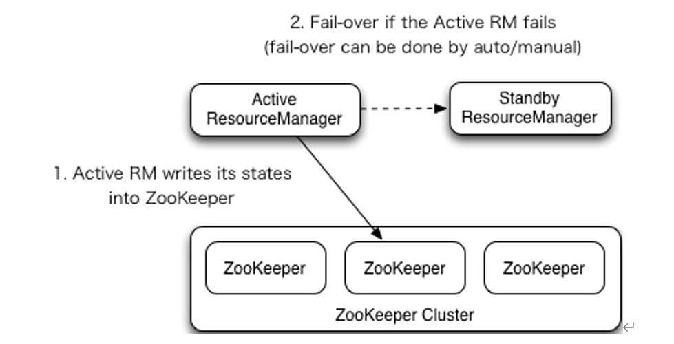

# Yarn参数调优

```xml
<!-- 选择调度器，默认容量 -->
<property>
<description>The class to use as the resource scheduler.</description>
<name>yarn.resourcemanager.scheduler.class</name>
<value>org.apache.hadoop.yarn.server.resourcemanager.scheduler.capacity.CapacityScheduler</value>
</property>

<!-- ResourceManager处理调度器请求的线程数量,默认50；如果提交的任务数大于50，可以增加该值，但是不能超过3台* 4线程 = 12线程（去除其他应用程序实际不能超过8） -->
<property>
<description>Number of threads to handle scheduler interface.</description>
<name>yarn.resourcemanager.scheduler.client.thread-count</name>
<value>8</value>
</property>

<!-- 是否让yarn自动检测硬件进行配置，默认是false，如果该节点有很多其他应用程序，建议手动配置。如果该节点没有其他应用程序，可以采用自动-->
<property>
<description>Enable auto-detection of node capabilities such as
memory and CPU.
</description>
<name>yarn.nodemanager.resource.detect-hardware-capabilities</name>
<value>false</value>
</property>

<!-- 是否将虚拟核数当作CPU核数，默认是false，采用物理CPU核数-->
<property>
<description>Flag to determine if logical processors(such as
hyperthreads) should be counted as cores. Only applicable on Linux
when yarn.nodemanager.resource.cpu-vcores is set to -1 and
yarn.nodemanager.resource.detect-hardware-capabilities is true.
</description>
<name>yarn.nodemanager.resource.count-logical-processors-as-cores</name>
<value>false</value>
</property>

<!-- 虚拟核数和物理核数乘数，默认是1.0 -->
<property>
<description>Multiplier to determine how to convert phyiscal cores to
vcores. This value is used if yarn.nodemanager.resource.cpu-vcores
is set to -1(which implies auto-calculate vcores) and
yarn.nodemanager.resource.detect-hardware-capabilities is set to true. The    number of vcores will be calculated as   number of CPUs * multiplier.
</description>
<name>yarn.nodemanager.resource.pcores-vcores-multiplier</name>
<value>1.0</value>
</property>

<!-- NodeManager使用内存数，默认8G，修改为4G内存 -->
<property>
<description>Amount of physical memory, in MB, that can be allocated 
for containers. If set to -1 and
yarn.nodemanager.resource.detect-hardware-capabilities is true, it is
automatically calculated(in case of Windows and Linux).
In other cases, the default is 8192MB.
</description>
<name>yarn.nodemanager.resource.memory-mb</name>
<value>4096</value>
</property>

<!-- nodemanager的CPU核数，不按照硬件环境自动设定时默认是8个，修改为4个-->
<property>
<description>Number of vcores that can be allocated
for containers. This is used by the RM scheduler when allocating
resources for containers. This is not used to limit the number of
CPUs used by YARN containers. If it is set to -1 and
yarn.nodemanager.resource.detect-hardware-capabilities is true, it is
automatically determined from the hardware in case of Windows and Linux.
In other cases, number of vcores is 8 by default.</description>
<name>yarn.nodemanager.resource.cpu-vcores</name>
<value>4</value>
</property>

<!-- 容器最小内存，默认1G -->
<property>
<description>The minimum allocation for every container request at the RMin MBs. Memory requests lower than this will be set to the value of thisproperty. Additionally, a node manager that is configured to have less memorythan this value will be shut down by the resource manager.
</description>
<name>yarn.scheduler.minimum-allocation-mb</name>
<value>1024</value>
</property>

<!-- 容器最大内存，默认8G，修改为2G -->
<property>
<description>The maximum allocation for every container request at the RMin MBs. Memory requests higher than this will throw an    InvalidResourceRequestException.
</description>
<name>yarn.scheduler.maximum-allocation-mb</name>
<value>2048</value>
</property>

<!-- 容器最小CPU核数，默认1个-->
<property>
<description>The minimum allocation for every container request at the RMin terms of virtual CPU cores. Requests lower than this will be set to thevalue of this property. Additionally, a node manager that is configured tohave fewer virtual cores than this value will be shut down by the resource   manager.
</description>
<name>yarn.scheduler.minimum-allocation-vcores</name>
<value>1</value>
</property>

<!-- 容器最大CPU核数，默认4个，修改为2个 -->
<property>
<description>The maximum allocation for every container request at the RMin terms of virtual CPU cores. Requests higher than this will throw an
InvalidResourceRequestException.</description>
<name>yarn.scheduler.maximum-allocation-vcores</name>
<value>2</value>
</property>

<!-- 虚拟内存检查，默认打开，修改为关闭 -->
<property>
<description>Whether virtual memory limits will be enforced for
containers.</description>
<name>yarn.nodemanager.vmem-check-enabled</name>
<value>false</value>
</property>

<!-- 虚拟内存和物理内存设置比例,默认2.1 -->
<property>
<description>Ratio between virtual memory to physical memory whensetting memory limits for containers. Container allocations are  expressed in terms of physical memory, and virtual memory usage   is allowed to exceed this allocation by this ratio.
</description>
<name>yarn.nodemanager.vmem-pmem-ratio</name>
<value>2.1</value>
</property>
```