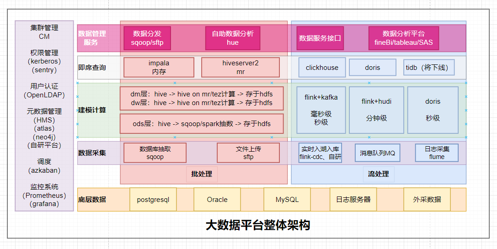

围绕公司架构来学习（先实时部分->后离线部分->拓展后端部分->拓展ai部分）

##### 当前用的比较多的Doris（已做）

基础差不多了。对于sql优化、运维问题排查、监控配置都有涉及。接下来解决遇到问题就好了。

##### mysql与pgsql对比

mysql 锁、事务、索引。

##### flink写Doris

需要使用flinkcdc读取mysql、pgsql，使用Doris connector写入Doris。

##### kafka复习（重新总结个笔记）

围绕生产kafka老有节点挂了的问题去复习寻找答案

##### hudi（感兴趣再去看，估计不会看了）

学了基础，没有实战，抽空看下生产已有作业

##### clickhouse学习起来

与Doris做对比

##### azkaban/dophinschduler

实时作业的管理，离线作业的调度（可对比海豚）

##### sqoop使用了解、对比datax

##### hadoop（重新学一遍，整理笔记）

##### hive（重新学一遍，整理笔记）

##### impala学习起来（sql限制，查杀，监控等）

##### flink（重新学一遍，整理笔记）

##### spark（重新学一遍，整理笔记）

##### 查看数仓离线模型，梳理整个线路（至少一到两个模型）

##### 查看flink-kafa-clickhouse实时秒级任务，梳理整个线路（至少一个模型）

##### 查看flink-hudi实时秒级任务，梳理整个线路（至少一个模型）

##### 查看flink-Doris准实时任务，梳理整个线路（至少一个模型）

达到了解公司业务+架构的目的

##### JAVA后端就业课学习了解

##### 机器学习、深度学习、大模型