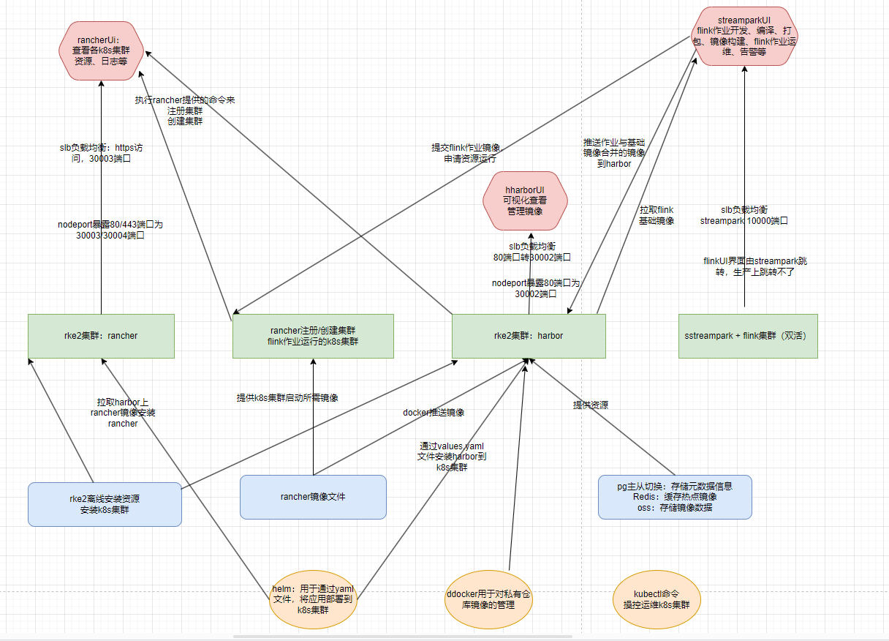
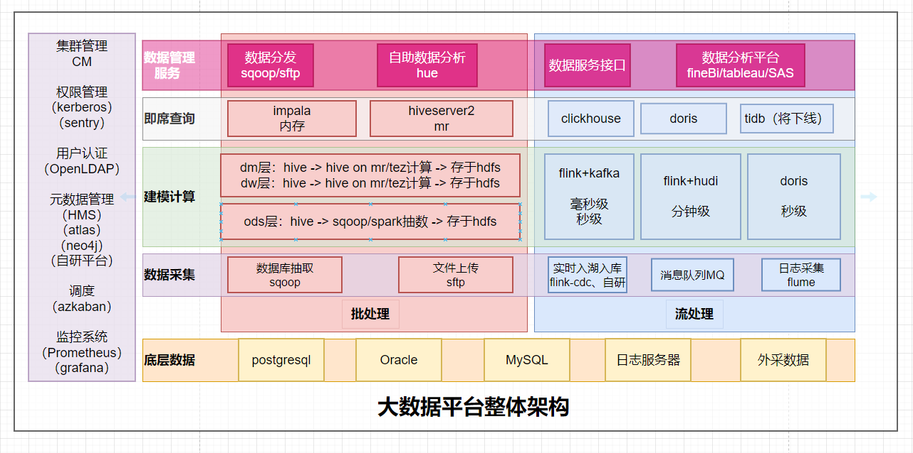

[公司1-实时系统架构图（flink on k8s）.pdf](https://www.yuque.com/attachments/yuque/0/2024/pdf/35670500/1712857906046-9e4b0b5d-8e62-449e-8b0c-3e626dc81a60.pdf)[公司2-大数据平台架构（CDP）.pdf](https://www.yuque.com/attachments/yuque/0/2024/pdf/35670500/1712857906139-327c36d3-93a3-44ba-b024-ca2252e19ec1.pdf)

draw.io不支持上传，需要的练习我。

  

