# pg库被打爆（找时间排查根因）

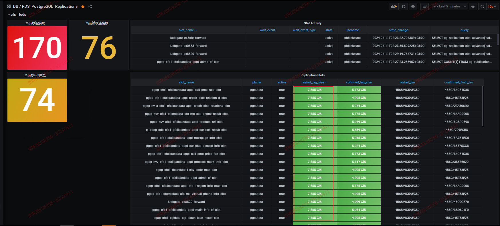

大部分作业如此报错：

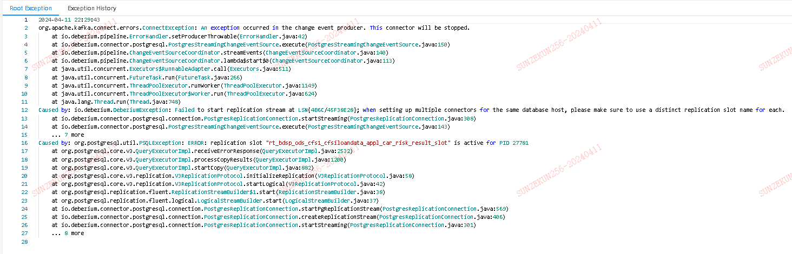

  

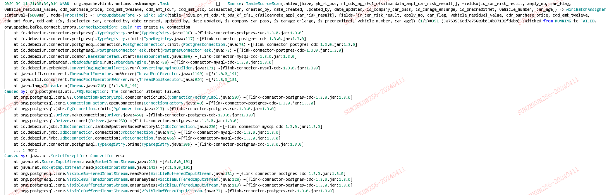

  

# doris 内外表关联，出现be oom

首次跑逻辑

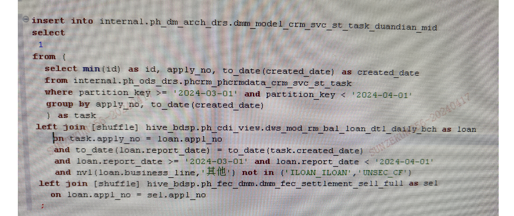

对应监控信息：

有三个be节点内存超限直接挂了。（跑了半个多小时）

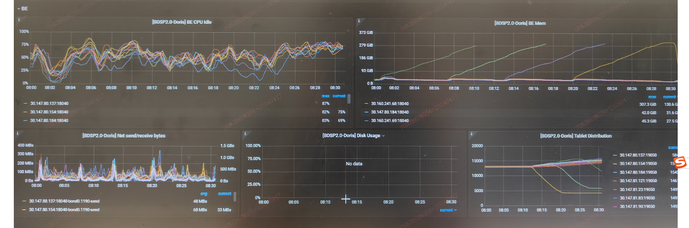

fe报错

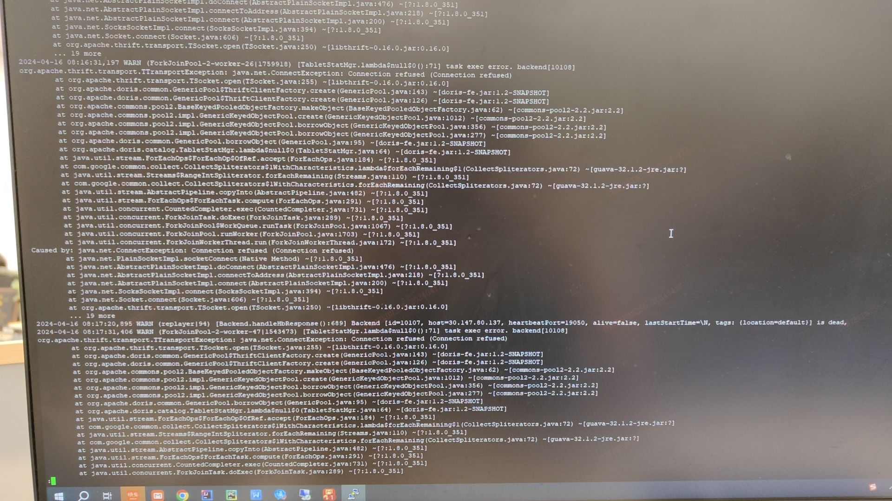

be报错

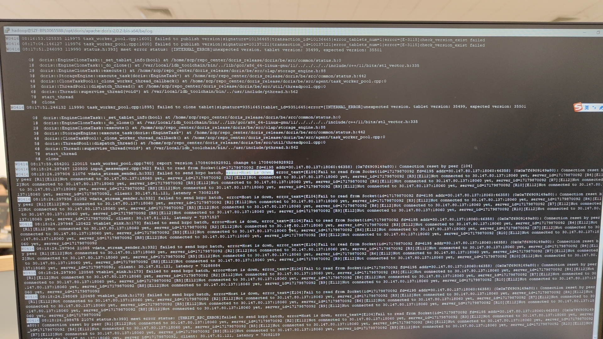

分析原因

更改sql

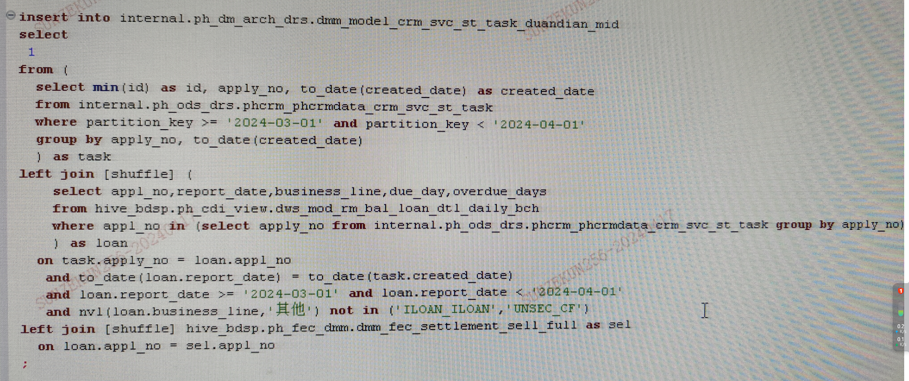

资源情况，sql一分多钟跑完，内存降了四分之一，cpu差不多。

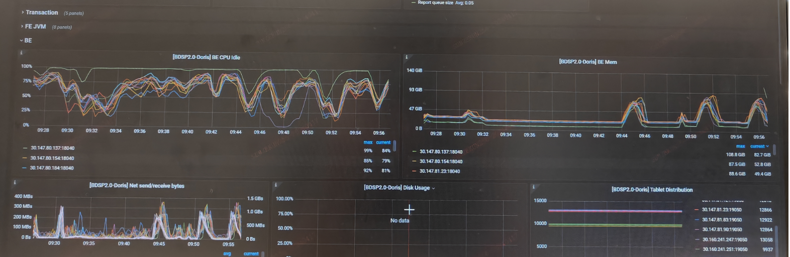

  

# flink作业没法从checkpoint重启

flink状态兼容性总结：

[https://help.aliyun.com/zh/flink/user-guide/flink-state-data-compatibility/?spm=a2c4g.11186623.0.0.57bb1bfdYhEBnD](https://help.aliyun.com/zh/flink/user-guide/flink-state-data-compatibility/?spm=a2c4g.11186623.0.0.57bb1bfdYhEBnD)

​  

| **场景** | **描述** | **相关文档** |
| --- | --- | --- |
| 变更Query | 别名的变化不影响状态的兼容性。 | [Alias](https://help.aliyun.com/zh/flink/user-guide/alias#concept-2171610) |
|  | 为您介绍Group Aggregate变更的可兼容性和不可兼容性详情。 | [Group Aggregate](https://help.aliyun.com/zh/flink/user-guide/aggregate-function-that-is-used-with-group-by#concept-2171611) |
|  | 为您介绍Over Aggregate变更的可兼容性和不可兼容性详情。 | [Over Aggregate](https://help.aliyun.com/zh/flink/user-guide/aggregate-function-that-is-used-with-over#concept-2171611) |
|  | 为您介绍Group Window Aggregate变更的可兼容性和不可兼容性详情。 | [Group Window Aggregate](https://help.aliyun.com/zh/flink/user-guide/window-aggregate-function-that-is-used-with-group-by#concept-2171611) |
|  | 为您介绍Window TVF变更的可兼容性和不可兼容性详情。 | [Window TVF](https://help.aliyun.com/zh/flink/user-guide/window-tvf#concept-2171611) |
|  | 为您介绍Deduplication变更的可兼容性和不可兼容性详情。 | [Deduplication](https://help.aliyun.com/zh/flink/user-guide/deduplication#concept-2171611) |
|  | 为您介绍Top-N变更的可兼容性和不可兼容性详情。 | [Top-N](https://help.aliyun.com/zh/flink/user-guide/topn-function#concept-2171611) |
|  | 为您介绍Window Top-N变更的可兼容性和不可兼容性详情。 | [Window Top-N](https://help.aliyun.com/zh/flink/user-guide/window-based-topn-function#concept-2171611) |
|  | 为您介绍Regular Join、Interval Join、Temporal Join和Lookup Join变更的可兼容性和不可兼容性详情。 | [Join](https://help.aliyun.com/zh/flink/user-guide/join#concept-2171618) |
|  | 为您介绍Pattern Recognition变更的可兼容性和不可兼容性详情。 | [Pattern Recognition](https://help.aliyun.com/zh/flink/user-guide/pattern-recognition#concept-2177902) |
|  | 为您介绍Where变更的可兼容性和不可兼容性详情。 | [Where](https://help.aliyun.com/zh/flink/user-guide/where#concept-2177362) |
|  | 为您介绍Union All变更的可兼容性和不可兼容性详情。 | [Union All](https://help.aliyun.com/zh/flink/user-guide/union-all#concept-2177363) |
|  | 为您介绍Temporal Sort变更的可兼容性和不可兼容性详情。 | [Temporal Sort](https://help.aliyun.com/zh/flink/user-guide/temporal-sorting#concept-2177365) |
|  | 为您介绍Limit变更的可兼容性和不可兼容性详情。 | [Limit](https://help.aliyun.com/zh/flink/user-guide/limit#concept-2177366) |
| 变更Source | 为您介绍Source变更所造成的可兼容性和不可兼容性影响。 | [变更Source](https://help.aliyun.com/zh/flink/user-guide/modify-the-source-connector#concept-2171597) |
| 变更Sink | 为您介绍Sink变更所造成的可兼容性和不可兼容性影响。 | [变更Sink](https://help.aliyun.com/zh/flink/user-guide/modify-a-sink-connector#concept-2171598) |
| 其他限制 | 介绍变更SQL除Query、Source和Sink之外的其他限制。 | [其他限制](https://help.aliyun.com/zh/flink/user-guide/other-limits#concept-2171600) |

# 一个优化

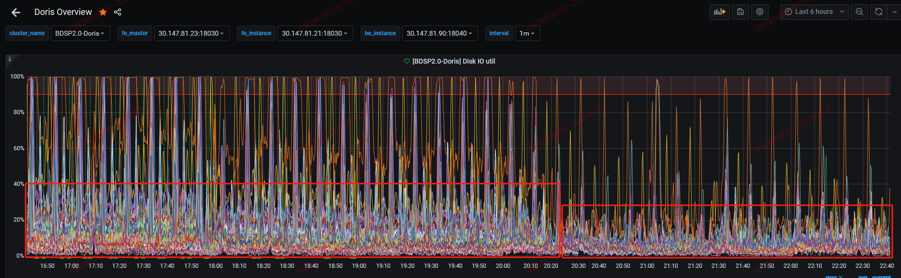

  

# cpu对比

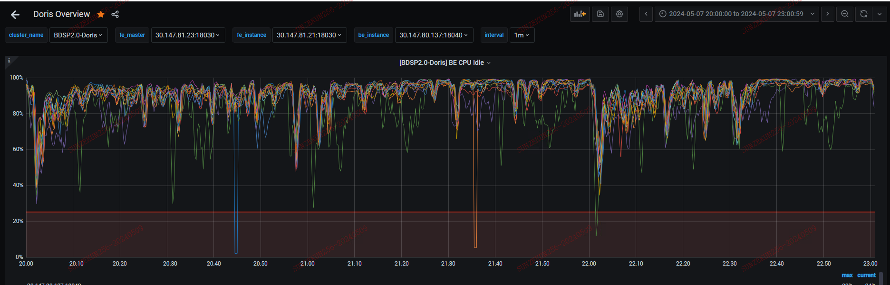

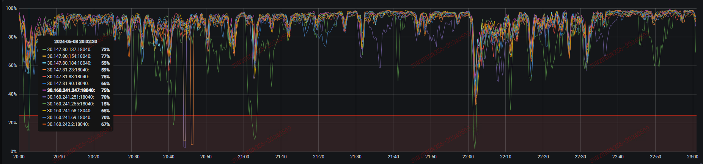

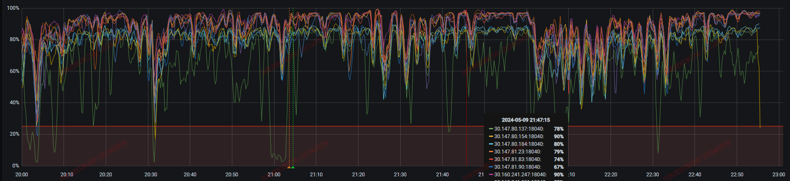

  

  

  

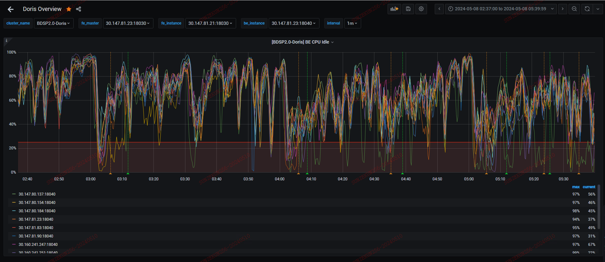

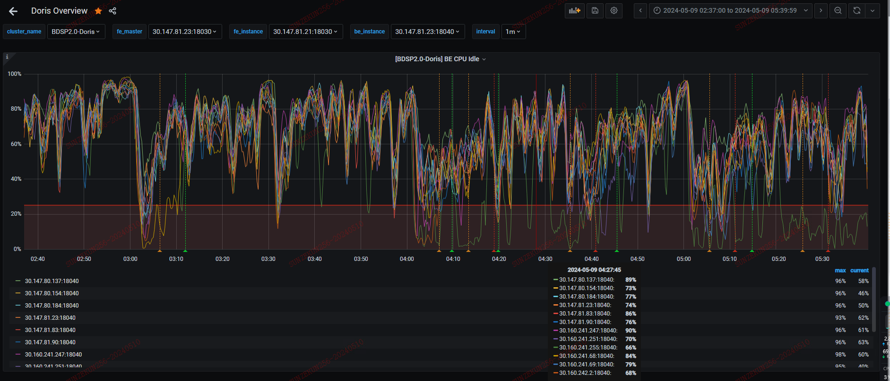

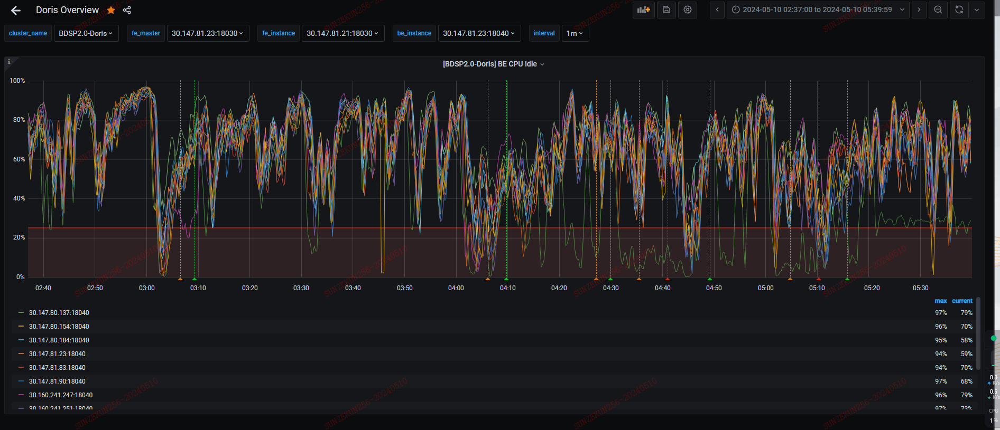

  

  

  

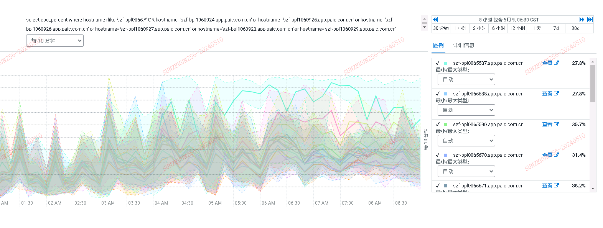

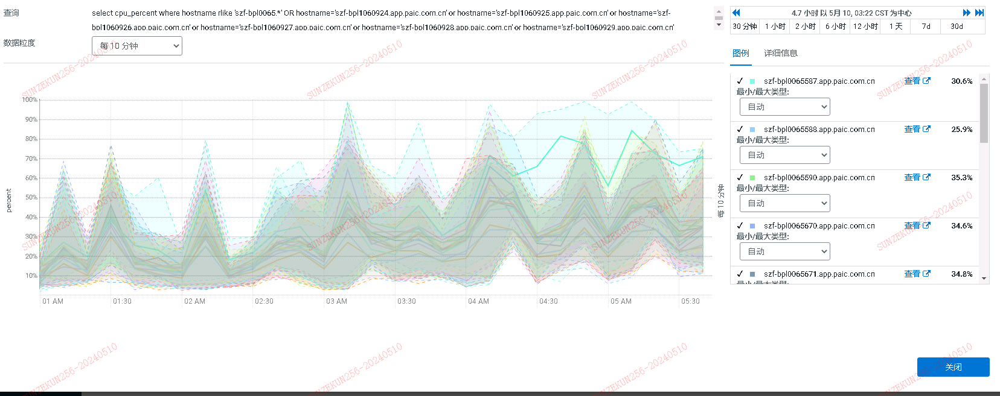

  

# doris be节点间磁盘不均衡/be单节点磁盘不均衡

```sql
MySQL >showproc"/diagnose/cluster_balance";
+-----------------------+--------+-------------------------------------------------------------------------------------------------------------+---------------------------------------------------------------------+------------+
| Item |Status| Content | Detail Cmd | Suggestion |
+-----------------------+--------+-------------------------------------------------------------------------------------------------------------+---------------------------------------------------------------------+------------+
| Tablet Health | ERROR | healthy tablet num 691< total tablet num 1014|showproc"/cluster_health/tablet_health";|<null>|
| BeLoad Balance| ERROR | backend loadnotbalancefor tag {"location" : "default"}, low load backends [], high load backends [10009]|showproc"/cluster_balance/cluster_load_stat/location_default/HDD"|<null>|
|DiskBalance| OK |<null>|<null>|<null>|
| Colocate Group Stable | OK |<null>|<null>|<null>|
| History Tablet Sched | OK |<null>|<null>|<null>|
+-----------------------+--------+-------------------------------------------------------------------------------------------------------------+---------------------------------------------------------------------+------------+

```

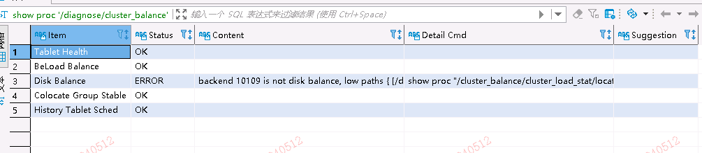

信息解读：

使用 show proc '/diagnose/cluster\_balance' 可以看到5个信息：

tablet：所有的tablet的副本情况，异常情况下content会有提示，健康的和不健康的数目

Beload Balance：Be节点间的均衡是否正常

disk Balance：单个be节点间的磁盘是否均衡，这里就显示其中一个be的不均衡

history tablet shced：历史的tablet调度

问题解决：

[https://doris.apache.org/zh-CN/docs/sql-manual/sql-statements/Database-Administration-Statements/ADMIN-REBALANCE-DISK](https://doris.apache.org/zh-CN/docs/sql-manual/sql-statements/Database-Administration-Statements/ADMIN-REBALANCE-DISK)

先查看be之间是否均衡-》不均衡则执行以下语句

```sql
ADMIN REBALANCE DISK [ON ("BackendHost1:BackendHeartBeatPort1","BackendHost2:BackendHeartBeatPort2", ...)];

1. 该语句表示让系统尝试优先均衡指定BE的磁盘数据，不受限于集群是否均衡。
2. 默认的 timeout 是 24小时。超时意味着系统将不再优先均衡指定的BE磁盘数据。需要重新使用该命令设置。
3. 指定BE的磁盘数据均衡后，该BE的优先级将会失效。
```

1.  尝试优先均衡集群内的所有BE

```plain
ADMIN REBALANCE DISK;
```

2.  尝试优先均衡指定BE

```plain
ADMIN REBALANCE DISK ON ("192.168.1.1:9050", "192.168.1.2:9050");
```

​  

# doris compaction优化

① doris connector攒批

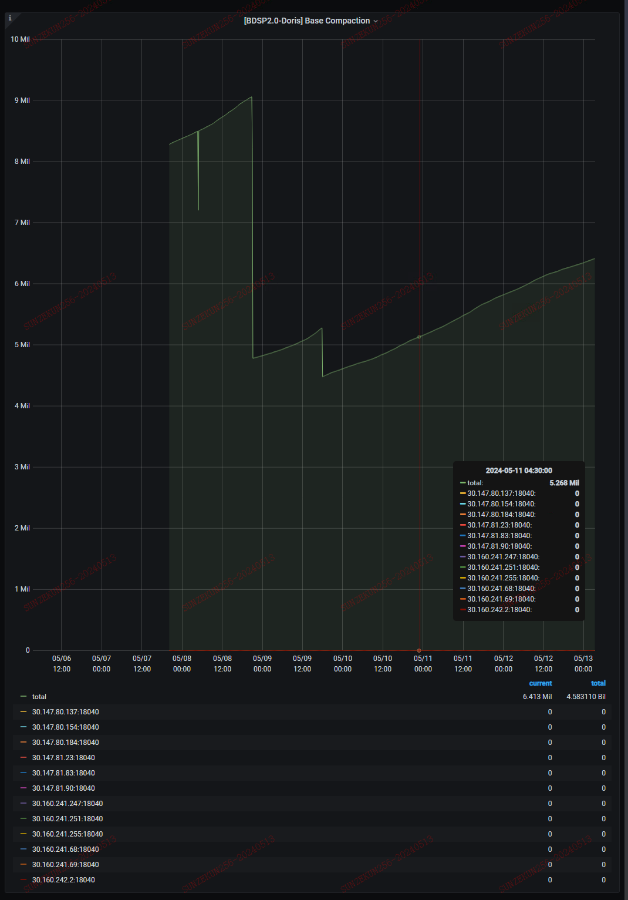

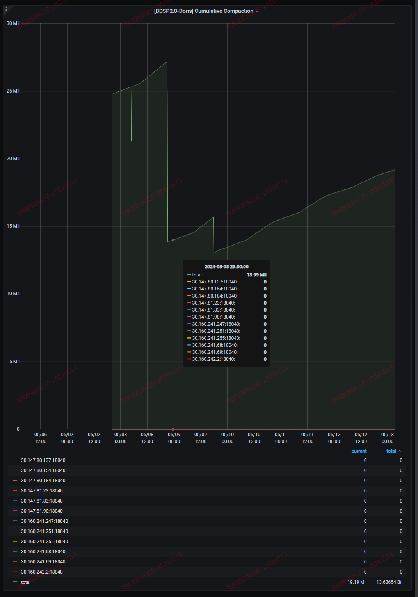

# doris的fe jvm内存泄漏

  

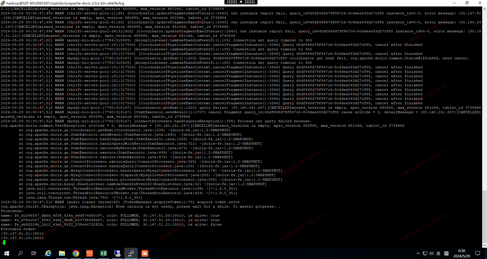

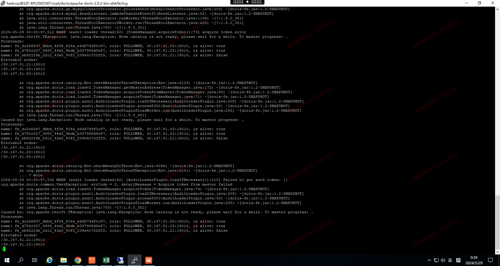

  

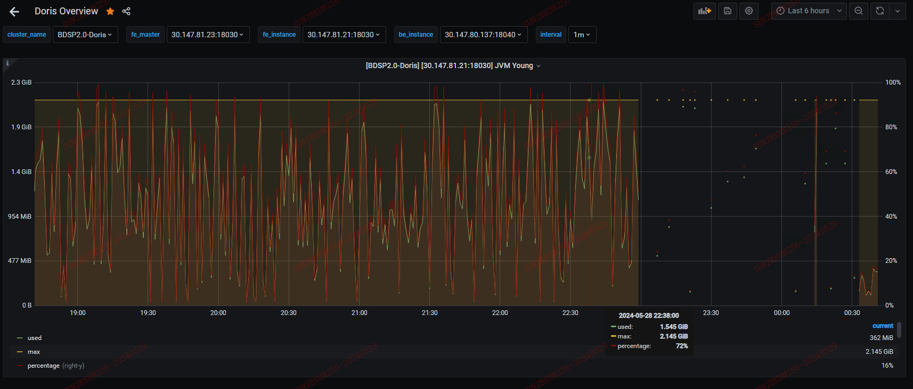

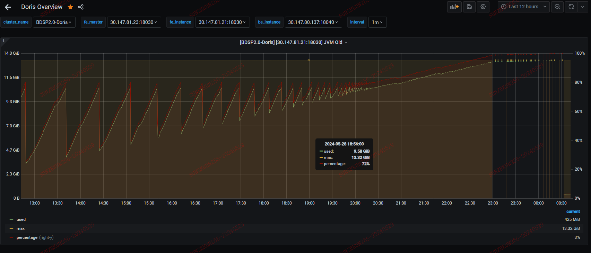

  

分析：

**1\. 查看整个JVM内存状态**

${JAVA\_HOME}/bin/jmap -heap 进程号

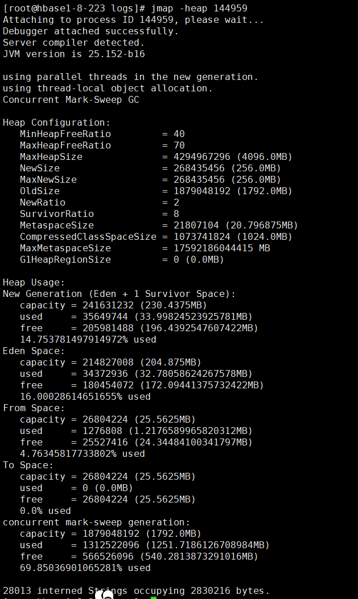

**2\. 查看JVM堆中对象详细占用情况**  
jmap -histo [pid]

​  

**3、获取JVM的dump文件的两种方式**

1\. JVM启动时增加两个参数:

```makefile
#出现 OOME 时生成堆 dump: 
-XX:+HeapDumpOnOutOfMemoryError
#生成堆文件地址：
-XX:HeapDumpPath=/opt/jvmlogs/
```

  

​2\. 发现程序异常前通过执行指令，直接生成当前JVM的dmp文件，1234是指JVM的进程号

```perl
jmap -dump:format=b,file=/var/logs/heap.hprof 1234
```

获得heap.hprof以后，就可以分析你的java线程里面对象占用堆内存的情况了。

​  

第一种方式是一种事后方式，需要等待当前JVM出现问题后才能生成dmp文件，实时性不高。

第二种方式在执行时，JVM是暂停服务的，所以对**线上的运行会产生影响**。所以建议第一种方式。

​  

**4\. 导出整个JVM 中内存信息，可以利用其它工具打开dump文件分析，例如jdk自带的visualvm工具**

jmap -dump:file=文件名.dump [pid]

jmap -dump:format=b,file=文件名 [pid]

format=b指定为二进制格式文文

​  

**5\. 使用分析工具分析**

eclipse memory analyzer（MAT）

visualVM

YourKit Java Profiler

​