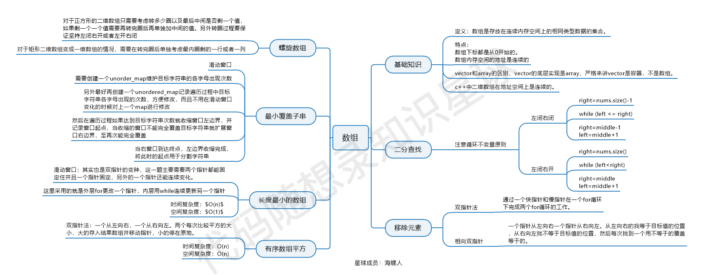

# 代码仓库

[https://gitee.com/blueskyaboveclouds/codeWithYaoYao-1.0.git](https://gitee.com/blueskyaboveclouds/codeWithYaoYao-1.0.git)

# 数组题

数组理论基础:数组是存放在连续内存空间上的相同类型数据的集合。

数组下标都是从0开始的。

数组内存空间的地址是连续的

数组的元素是不能删的，只能覆盖。

二维数组内存，java仅行连续，列之间不连续

正是因为数组的在内存空间的地址是连续的，所以我们在删除或者增添元素的时候，就难免要移动其他元素的地址。

增删改查操作：

增：可能涉及数组移动排序、扩容

删：数组移动

改：找到对应下标，直接修改值

查：找下标或是遍历

​  

数组解题思路

1\. 双指针法：快慢指针、左右指针、滑动窗口

2\. 二分查找法：遵循循环不变量原则,定义好循环处理区间,如：二分查找、旋转数组、搜索插入位置

3\. 滑动窗口：滑动窗口、最小覆盖子串、无重复字符的最长子串、寻找重复数、替换空格、删除排序数组中的重复项、移动零、合并两个有序数组等

4\. 模拟：遵循循环不变量规则，订好区间，模拟行为，找到规律

5\. 排序：快速排序、归并排序、堆排序、插入排序、选择排序、冒泡排序、希尔排序、计数排序、桶排序、基数排序

# 链表题

单链表：除了每个节点的值还包括一个指向下一个节点的指针（可理解为一个对象记录了下一个对象的位置），尾节点指向null

循环链表：首尾相连的单链表

双链表：包括值、指向前和后的两个指针

增删改查操作

增：新建一个节点，修改要插入位置前后节点的指针

删：找到节点，修改前后指针

改：找到节点，修改值

查：根据头结点遍历