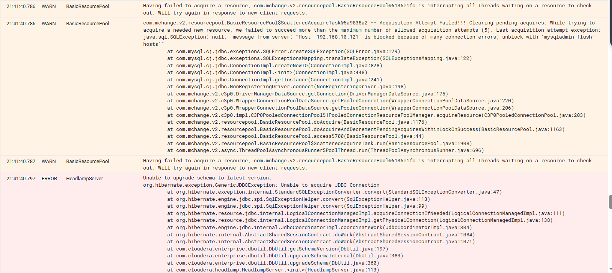
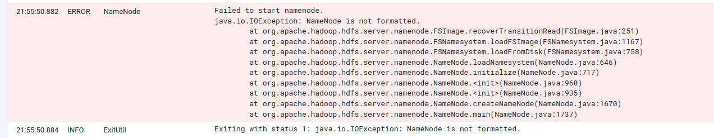
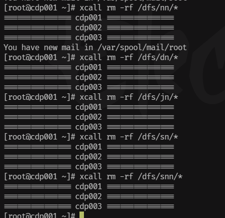
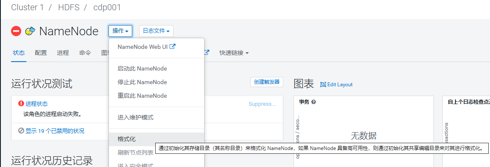
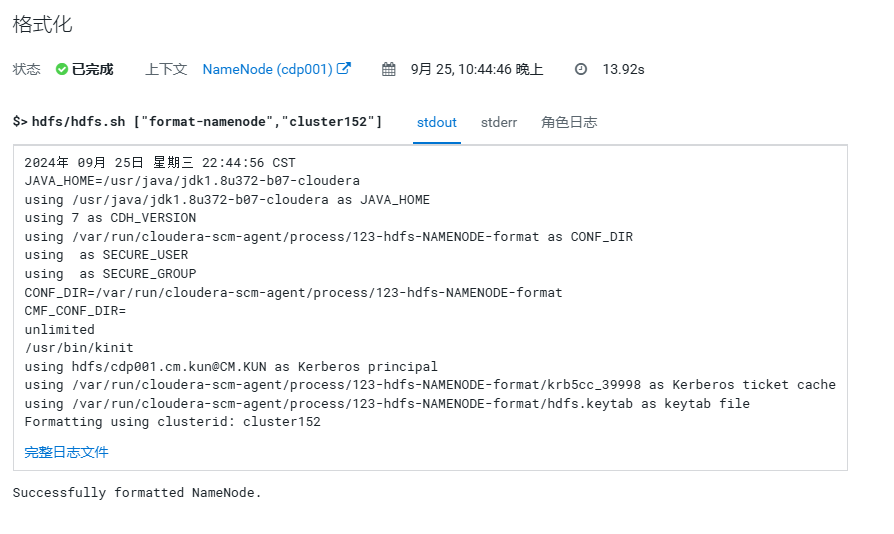
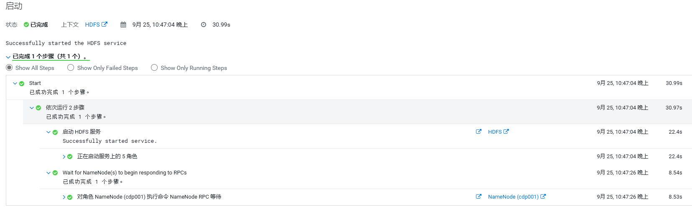
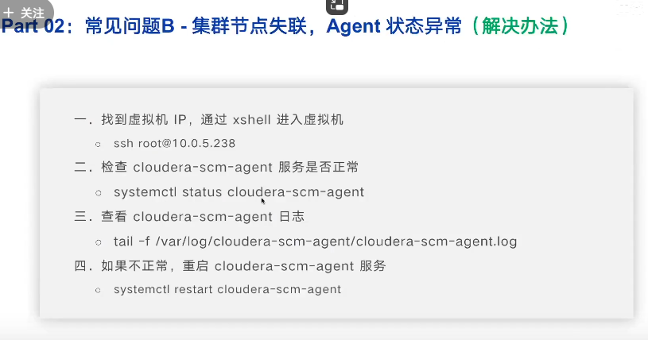
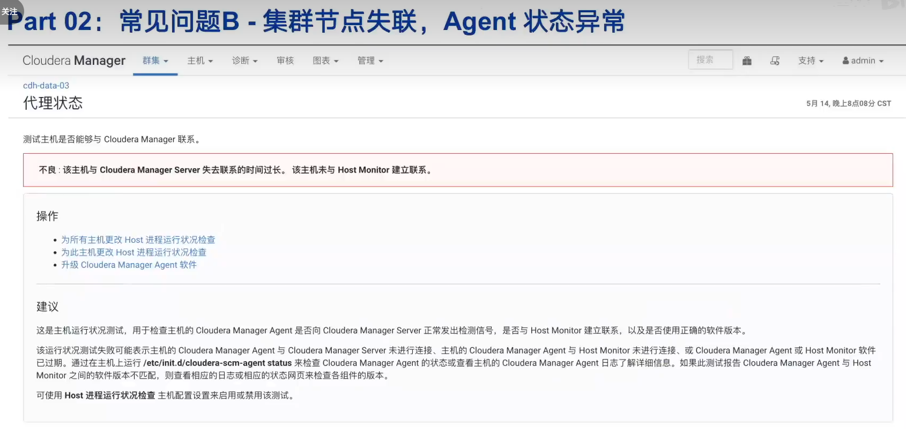
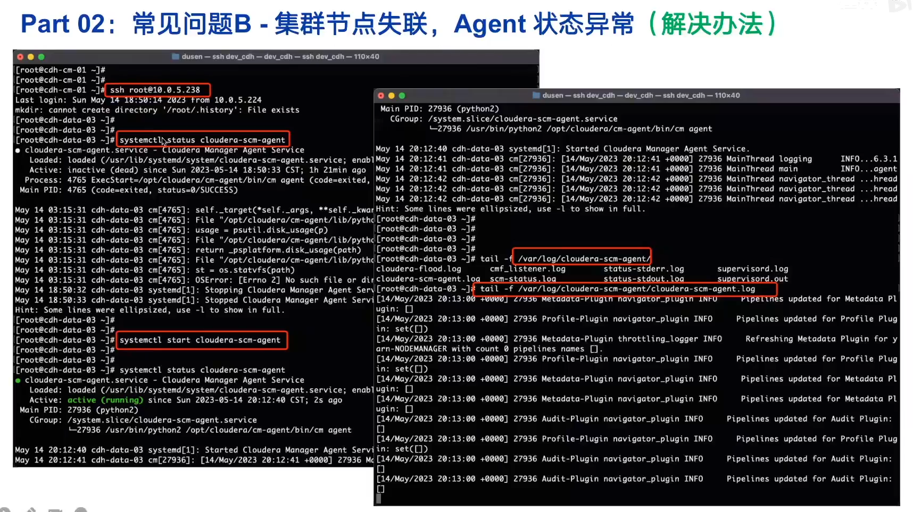
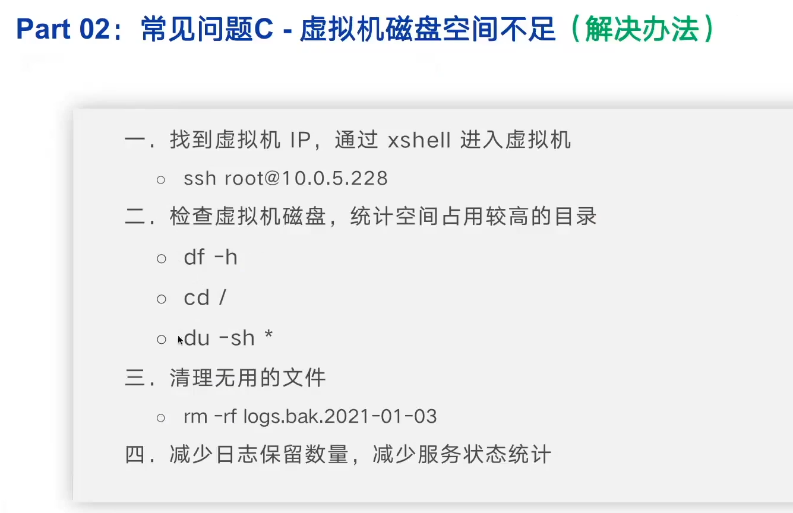

# 问题1:连接mysql的问题

要么改一下jdbc连接,我没找到cloudera的jdbc连接串在哪改

要么改一下服务端配置绕过公钥检索:default\_authentication\_plugin=mysql\_native\_password

报错如下:

> BasicResourcePool com.mchange.v2.resourcepool.BasicResourcePool$ScatteredAcquireTask@5982108b -- Acquisition Attempt Failed!!! Clearing pending acquires. While trying to acquire a needed new resource, we failed to succeed more than the maximum number of allowed acquisition attempts (5). Last acquisition attempt exception: java.sql.SQLNonTransientConnectionException: Public Key Retrieval is not allowed at com.mysql.cj.jdbc.exceptions.SQLError.createSQLException(SQLError.java:110)
> 
> ​  
> 
> BasicResourcePool Having failed to acquire a resource, com.mchange.v2.resourcepool.BasicResourcePool@6136e1fc is interrupting all Threads waiting on a resource to check out. Will try again in response to new client requests. 21:24:06.948 ERROR HeadlampServer Unable to upgrade schema to latest version. org.hibernate.exception.GenericJDBCException: Unable to acquire JDBC Connection



我是mysql8.0.26配置参数

vim /etc/my.cnf

```sql
default_authentication_plugin=mysql_native_password
```

连接mysql,设置一下密码验证方式

```sql
ALTER USER 'root'@'%' IDENTIFIED WITH mysql_native_password BY 'szk123';
ALTER USER 'scm'@'%' IDENTIFIED WITH mysql_native_password BY 'szk123';
ALTER USER 'rman'@'%' IDENTIFIED WITH mysql_native_password BY 'szk123';
ALTER USER 'hive'@'%' IDENTIFIED WITH mysql_native_password BY 'szk123';
ALTER USER 'hue'@'%' IDENTIFIED WITH mysql_native_password BY 'szk123';
ALTER USER 'oozie'@'%' IDENTIFIED WITH mysql_native_password BY 'szk123';
ALTER USER 'ranger'@'%' IDENTIFIED WITH mysql_native_password BY 'szk123';
ALTER USER 'queryprocessor'@'%' IDENTIFIED WITH mysql_native_password BY 'szk123';
ALTER USER 'yqm'@'%' IDENTIFIED WITH mysql_native_password BY 'szk123';
ALTER USER 'sr'@'%' IDENTIFIED WITH mysql_native_password BY 'szk123';
ALTER USER 'sm'@'%' IDENTIFIED WITH mysql_native_password BY 'szk123';
FLUSH PRIVILEGES;
```

# 问题2



停止所有hdfs角色实例,删除对应的目录







启动成功



  

# 问题3



  



  



  

