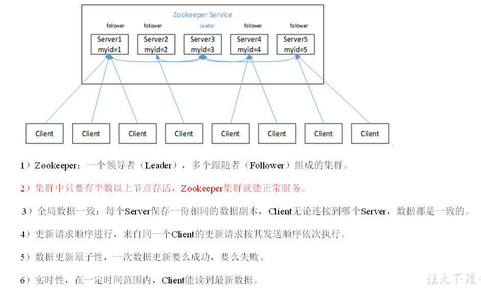
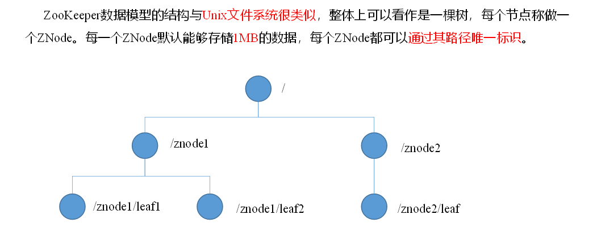
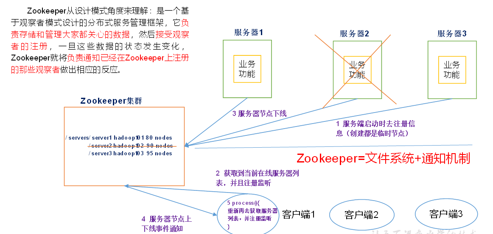
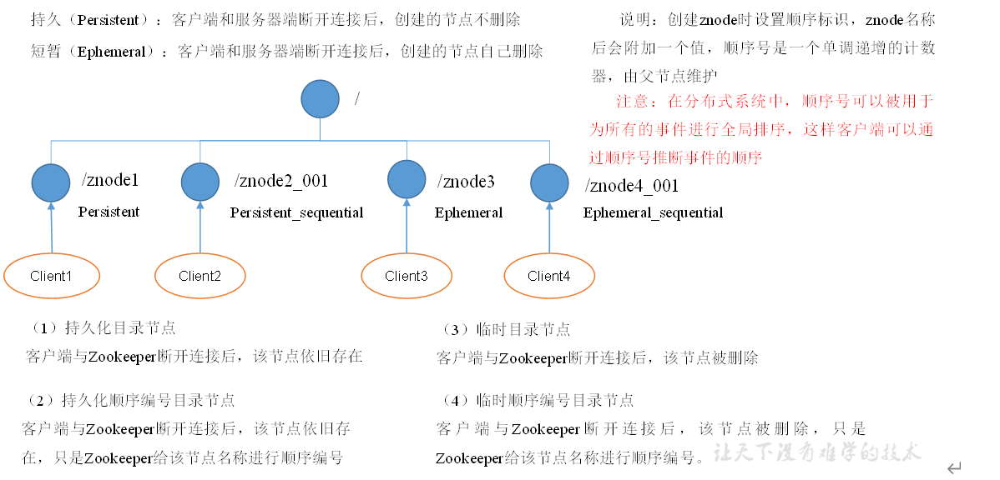
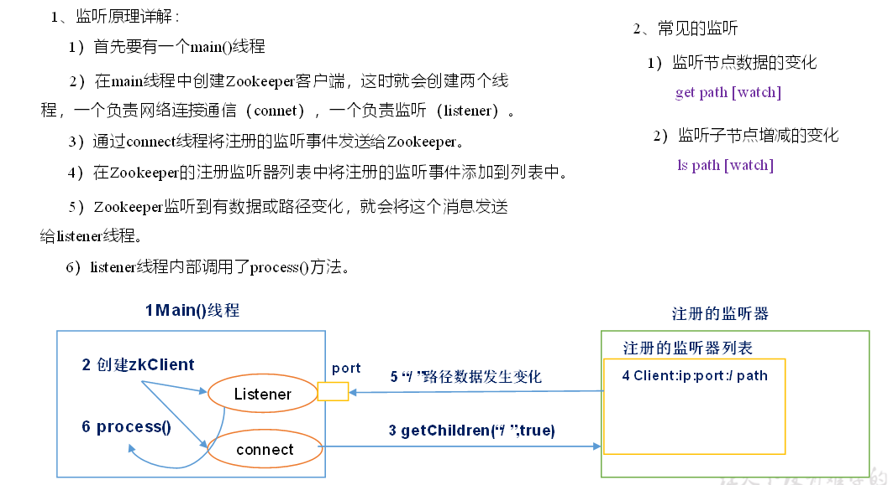
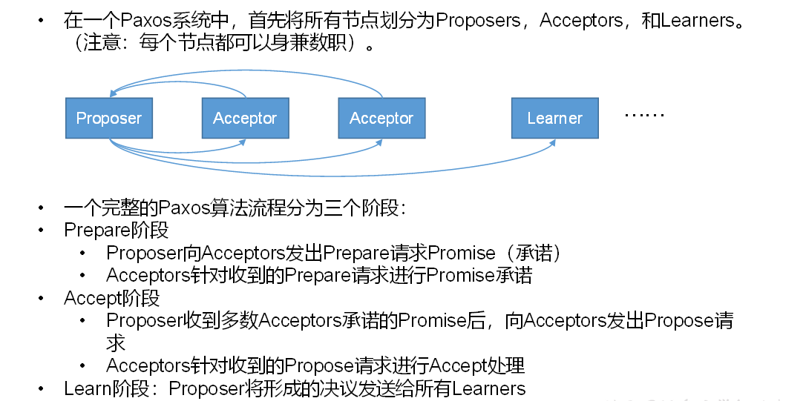
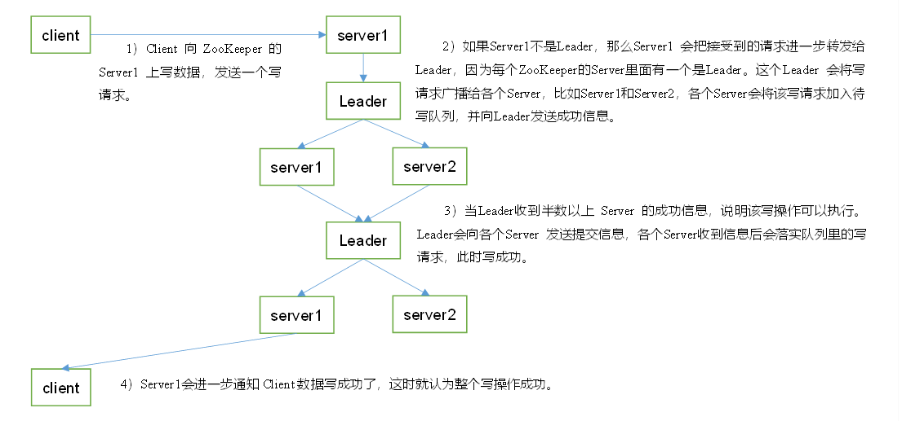

# 概述

## 概念

于观察者模式设计的分布式服务管理框架，它负责存储和管理大家都关心的数据，然后接受观察者的注册，一旦这些数据的状态发生了变化，Zookeeper就负责通知已经在Zookeeper上注册的那些观察者做出相应的反应.

Zookeeper = 文件系统 + 通知机制

提供的服务包括：统一命名服务、统一配置管理、统一集群管理、服务器节点动态上下线、软负载均衡等。

## 组成

## 工作机制

# 内部原理

## 节点类型

## Stat结构体

（1）czxid-创建节点的事务zxid

每次修改ZooKeeper状态都会收到一个zxid形式的时间戳，也就是ZooKeeper事务ID。

事务ID是ZooKeeper中所有修改总的次序。每个修改都有唯一的zxid，如果zxid1小于zxid2，那么zxid1在zxid2之前发生。

（2）ctime - znode被创建的毫秒数(从1970年开始)

（3）mzxid - znode最后更新的事务zxid

（4）mtime - znode最后修改的毫秒数(从1970年开始)

（5）pZxid-znode最后更新的子节点zxid

（6）cversion - znode子节点变化号，znode子节点修改次数

（7）dataversion - znode数据变化号

（8）aclVersion - znode访问控制列表的变化号

（9）ephemeralOwner- 如果是临时节点，这个是znode拥有者的session id。如果不是临时节点则是0。

（10）dataLength- znode的数据长度

（11）numChildren - znode子节点数量

## 监听器原理

## Paxos算法

Paxos算法流程中的每条消息描述如下：

（1）Prepare: Proposer生成全局唯一且递增的Proposal ID (可使用时间戳加Server ID)，向所有Acceptors发送Prepare请求，这里无需携带提案内容，只携带Proposal ID即可。

（2）Promise: Acceptors收到Prepare请求后，做出“两个承诺，一个应答”。

两个承诺：

Ø 不再接受Proposal ID小于等于（注意：这里是<= ）当前请求的Prepare请求。

Ø 不再接受Proposal ID小于（注意：这里是< ）当前请求的Propose请求。

一个应答：

Ø 不违背以前做出的承诺下，回复已经Accept过的提案中Proposal ID最大的那个提案的Value和Proposal ID，没有则返回空值。

（3）Propose: Proposer 收到多数Acceptors的Promise应答后，从应答中选择Proposal ID最大的提案的Value，作为本次要发起的提案。如果所有应答的提案Value均为空值，则可以自己随意决定提案Value。然后携带当前Proposal ID，向所有Acceptors发送Propose请求。

（4）Accept: Acceptor收到Propose请求后，在不违背自己之前做出的承诺下，接受并持久化当前Proposal ID和提案Value。

（5）Learn: Proposer收到多数Acceptors的Accept后，决议形成，将形成的决议发送给所有Learners。

## 选举机制（半数机制）

（1）服务器1启动，发起一次选举。服务器1投自己一票。此时服务器1票数一票，不够半数以上（3票），选举无法完成，服务器1状态保持为LOOKING；

（2）服务器2启动，再发起一次选举。服务器1和2分别投自己一票并交换选票信息：此时服务器1发现服务器2的ID比自己目前投票推举的（服务器1）大，更改选票为推举服务器2。此时服务器1票数0票，服务器2票数2票，没有半数以上结果，选举无法完成，服务器1，2状态保持LOOKING

（3）服务器3启动，发起一次选举。此时服务器1和2都会更改选票为服务器3。此次投票结果：服务器1为0票，服务器2为0票，服务器3为3票。此时服务器3的票数已经超过半数，服务器3当选Leader。服务器1，2更改状态为FOLLOWING，服务器3更改状态为LEADING；

（4）服务器4启动，发起一次选举。此时服务器1，2，3已经不是LOOKING状态，不会更改选票信息。交换选票信息结果：服务器3为3票，服务器4为1票。此时服务器4服从多数，更改选票信息为服务器3，并更改状态为FOLLOWING；

（5）服务器5启动，同4一样当小弟。

## 写数据流程

