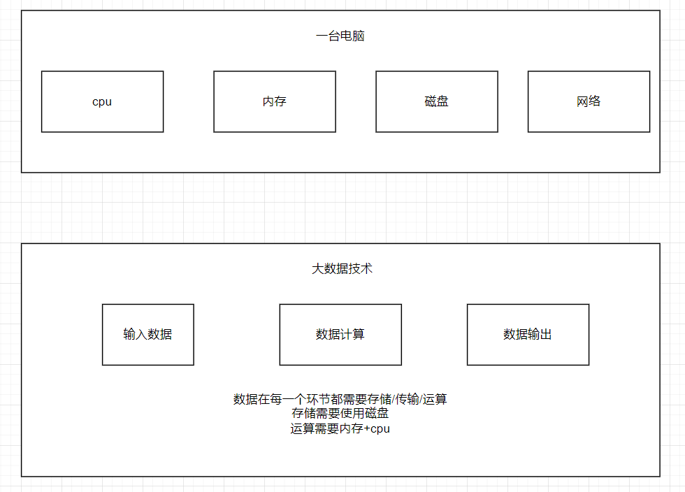
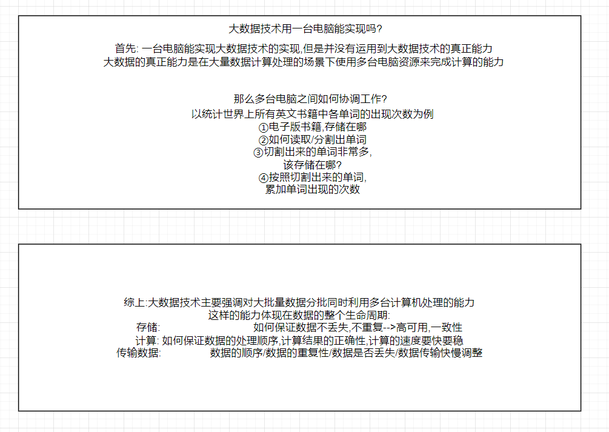
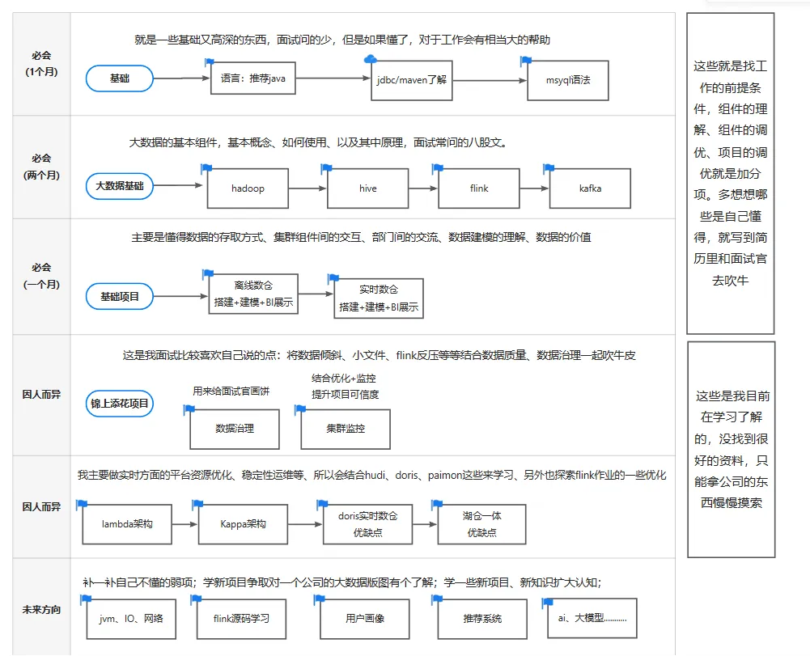

# 大数据生命周期

先了解整体:

公司运转过程中产生的数据存储于不同数据库，形成数据孤岛（没法关联查看分析），因此将各数据孤岛的数据以批/流不同的方式（导数工具）导入数仓来打破孤岛，数仓以一个统一的方式（sql）查询关联不同数据源得到一个数据角度的公司运转全貌。关联计算的过程按一定周期重复计算输出供指定的业务方使用（从数据层面发现规律和问题，从而找到降本增效的方法）。

​  

简而言之，大数据的生命周期为一个良性的闭环：

公司运转产生数据-》数仓汇聚数据-》分析统计数据-》挖掘数据规律与问题-》形成解决方案优化公司运作

​  

# 大数据架构初步分类

由于需求不同，企业不同，使用大数据的架构就不一样，一般可按时效性分为离线+实时。

**离线：**一般为每日对上游数据抽取->清洗计算 一次，企业所看到的数据时效是T-1日数据。

企业不同业务的数据量不一，重要程度不一，大部分公司使用hive+调度构建离线数仓，在每日凌晨0点后对前一天数据进行计算，正常能在8:00前将数据计算出来供各bu使用。若是数据量大、且比较重要或是领导关注度高的数据，到点无法计算出来，此时往往可采用impala或其他olap数据库进行加速计算。

  

代表架构：hadoop + hive + impala + azkaban/dophinscheduler + 安全（FreeIPA + kerberos）+ 监控（组件监控+任务监控）

  

**实时：**数据一般由产生到计算出结果只需秒级，资源耗费以内存为主。

秒级实时：此场景一般为比较重要紧急的业务数据使用，“有数据即刻计算”。如实时推荐系统、实时风控等

分钟级+小时级：当数据要求时效性并不需要很高但是又希望能实时看到数据，“实时攒批窗口计算”。如一些实时看板驾驶舱，

​  

代表架构：flink + kafka + olap数据库（ck、starrocks、doris等）

hudi/paimon/iceberg+flink/spark

纯olap数据库（ck、starrocks、doris等）

# 个人认为大数据核心岗位如下（了解不深）：

数仓开发：

汇总数据，统计业务特定维度的数据，将数据导出给下游数据分析师/业务方赋能公司业务。

数据的接入-》清洗计算-》导出

​  

数据分析师：

从数仓统计出来的各种维度数据中，挖掘数据的价值/展示公司的运营情况大屏等。

接受数仓数据-》进一步清洗聚合-》报表生成与分析

​  

平台开发：

数据中台的种种，可以是自研一整大数据生命周期所需的方便好用的工具，也可以是整合二次开发开源组件得到一个套方便好用的工具。包括但不限于：导数工具开发、存储开发、计算引擎开发、计算平台开发、调度工具开发、自助取数平台开发、报表可视化平台开发、数据血缘展示开发、权限控制平台开发。。。

  

产品经理：

发现公司运作环节中的一些问题，将问题以工具或其他形式解决，可以是一个工具的idea发起人，从工具的界面设计、功能设计等方面开始，配合开发最终完成一个工具的现世。

  

业务岗位：

根据数仓和数据分析提供的数据，挖掘价值，决策业务方向，调整战略目标等。

​  

架构师/领导：

有以上岗位综合能力：会思考问题、发现问题、解决问题，能整合管理组件、能管理人、能协调部门间工作；公司内有熟悉的人脉、熟悉公司的业务运转。

# 大数据成长路线（个人想法）

前三年：

以数仓开发、数据分析入门，熟悉岗位职责（某一块业务的整个数据生命周期），顺带了解梳理出公司整体业务，最好能形成一定的产品思维，汇聚一部分人脉。

前五年：

摸清大数据生命周期所涉及组件，能整合出公司大数据架构，以及各部门职责。

五年之后：

有岗位基本上也差不多能上位了，没岗位就创造岗位（抱大腿或者跳槽）

  

# 涨薪攻略

在同一家公司想要工资大幅提升基本不可能，如果能涨那肯定是好公司无疑了。在30岁前，卷卷卷、学学学，能跳槽涨薪就跳，尽可能提高自己的工资（为了和下家谈判），30岁后以现有技术寻找一个好的公司，有一个好的工资待遇，开始躺平，追寻管理上的能力突破，等待晋升机会或者上司带你一起跳槽的机会。

​  

# 面试套路

## 技术面

**自我介绍：**简单介绍，几年工作经验，分别做些什么项目，自己优势领域。

**项目介绍套话：**项目流程介绍、项目难点痛点分析、个人解决方案突出贡献介绍、项目成果介绍（量化）

**问答环节：**前面突出说过自己优势和项目，大概率已经将面试官带入自己的擅长区域，有问有答就好

**有什么想问的：**技术面一般都是同事或者自己上级，问一问技术架构，业务架构，需要一个什么样能力的人等等。

## 大领导面

**自我介绍：**如上，几句话总结

**项目介绍：**突出整体架构把控，难点如何解决的（团队协作、部门合作等能力），解决优化的问题及成事效果。

**问答环节：**为什么离职，个人发展规划，个人对大数据发展的看法（离线实时的演变；资产门户、血缘分析等中台建设的意义）

**反问环节：**

1.  公司在数据战略上的中长期规划是什么？有好的概括能力可以试图简短几句话概括下领导的回答复述出来。
2.  在您看来，一个优秀的数据仓库工程师应该具备哪些关键能力？如果说的和你之前自我介绍的差不多，那么你应该稍微强调一下某些能力你做了些什么事，做的还可以，点下题。若领导的想法和你的优点不一致，那么你可以补充相关的事迹稍作挽救。
3.  贵公司如何看待新技术（如实时数仓、湖仓一体）在业务中的应用前景？此问题提出，要给领导一些选项，比如实时的paimon好像有点火、比如基于大模型sql生成等等，这样既给了领导你热爱研究技术的影响，也体现了你的技术敏感度

​