# 概念

批量系统配置、批量程序部署、批量运行命令能力。ansible不需要在远程主机上安装client/agents，因为它们是基于ssh来和远程主机通讯的。

**名词：**

Ansible：Ansible核心程序。  
HostInventory：记录由Ansible管理的主机信息，包括端口、密码、ip等。  
Playbooks：“剧本”YAML格式文件，多个任务定义在一个文件中，定义主机需要调用哪些模块来完成的功能。  
CoreModules：**核心模块**，主要操作是通过调用核心模块来完成管理任务。  
CustomModules：自定义模块，完成核心模块无法完成的功能，支持多种语言。  
ConnectionPlugins：连接插件，Ansible和Host通信使用

# 架构

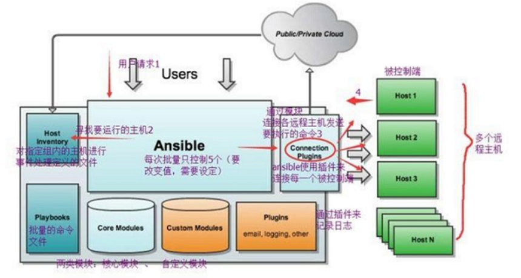

**任务执行流程：**

1.  加载自己的配置文件，默认/etc/ansible/ansible.cfg；
2.  查找对应的主机配置文件，找到要执行的主机或者组；
3.  加载自己对应的模块文件，如 command；
4.  通过ansible将模块或命令生成对应的临时py文件(python脚本)， 并将该文件传输至远程服务器；
5.  对应执行用户的家目录的.ansible/tmp/XXX/XXX.PY文件；
6.  给文件 +x 执行权限；
7.  执行并返回结果；
8.  删除临时py文件，sleep 0退出；

**安装目录如下(yum安装)：**  
配置文件目录：/etc/ansible/  
执行文件目录：/usr/bin/  
Lib库依赖目录：/usr/lib/pythonX.X/site-packages/ansible/  
Help文档目录：/usr/share/doc/ansible-X.X.X/  
Man文档目录：/usr/share/man/man1/

ansible 的配置文件为/etc/ansible/ansible.cfg：

```sql
	inventory = /etc/ansible/hosts		#这个参数表示资源清单inventory文件的位置
	library = /usr/share/ansible		#指向存放Ansible模块的目录，支持多个目录方式，只要用冒号（：）隔开就可以
	forks = 5		#并发连接数，默认为5
	sudo_user = root		#设置默认执行命令的用户
	remote_port = 22		#指定连接被管节点的管理端口，默认为22端口，建议修改，能够更加安全
	host_key_checking = False		#设置是否检查SSH主机的密钥，值为True/False。关闭后第一次连接不会提示配置实例
	timeout = 60		#设置SSH连接的超时时间，单位为秒
	log_path = /var/log/ansible.log		#指定一个存储ansible日志的文件（默认不记录日志）
```

# 安装

1.  **yum源替换**

yum install -y wget

cd /etc/yum.repos.d/

wget http://mirrors.aliyun.com/repo/Centos-7.repo

mv CentOs-Base.repo CentOs-Base.repo.bak

mv Centos-7.repo CentOs-Base.repo

yum clean all

yum makecache

yum update

2.  **初始化虚拟机环境**

systemctl status firewalld

systemctl start firewalld

systemctl stop firewalld

systemctl disabled firewalld

​  

vim /etc/sysconfig/selinux

SELINUX=disabled

3.  **开始安装**

yum install -y epel-release

yum install ansible -y

​  

//查看ansible的版本

ansible --version

​  

yum install -y tree

tree /etc/ansible/

​  

vim /etc/ansible/hosts 添加操作的ip组

[all]

192.168.10.101

192.168.10.102

192.168.10.103

192.168.10.104

192.168.10.105

​  

ansible机器到其他机器的免密要做一下

ssh-keygen -t rsa

​  

ssh-copy-id root@192.168.10.101

ssh-copy-id root@192.168.10.102

ssh-copy-id root@192.168.10.103

ssh-copy-id root@192.168.10.104

ssh-copy-id root@192.168.10.105

​  

ssh-agent bash

ssh-add

​  

​  

# 常用命令

/usr/bin/ansible Ansibe AD-Hoc 临时命令执行工具，常用于临时命令的执行/usr/bin/ansible-doc Ansible 模块功能查看工具  
/usr/bin/ansible-galaxy 下载/上传优秀代码或Roles模块 的官网平台，基于网络的/usr/bin/ansible-playbook Ansible 定制自动化的任务集编排工具/usr/bin/ansible-pull Ansible远程执行命令的工具，拉取配置而非推送配置（使用较少，海量机器时使用，对运维的架构能力要求较高）/usr/bin/ansible-vault Ansible 文件加密工具/usr/bin/ansible-console Ansible基于Linux Consoble界面可与用户交互的命令执行工具

其中，我们比较常用的是/usr/bin/ansible和/usr/bin/ansible-playbook。

​  

### ansible

ansible <host-pattern> [-f forks][-m module\_name][-a args]

```sql
-a MODULE_ARGS #模块的参数，如果执行默认COMMAND的模块，即是命令参数，如： “date”，“pwd”等等
-k，--ask-pass #ask for SSH password。登录密码，提示输入SSH密码而不是假设基于密钥的验证
--ask-su-pass #ask for su password。su切换密码
-K，--ask-sudo-pass #ask for sudo password。提示密码使用sudo，sudo表示提权操作
--ask-vault-pass #ask for vault password。假设我们设定了加密的密码，则用该选项进行访问
-B SECONDS #后台运行超时时间
-C #模拟运行环境并进行预运行，可以进行查错测试
-c CONNECTION #连接类型使用
-f FORKS #并行任务数，默认为5
-i INVENTORY #指定主机清单的路径，默认为/etc/ansible/hosts
--list-hosts #查看有哪些主机组
-m MODULE_NAME #执行模块的名字，默认使用 command 模块，所以如果是只执行单一命令可以不用 -m参数
-o #压缩输出，尝试将所有结果在一行输出，一般针对收集工具使用
-S #用 su 命令
-R SU_USER #指定 su 的用户，默认为 root 用户
-s #用 sudo 命令
-U SUDO_USER #指定 sudo 到哪个用户，默认为 root 用户
-T TIMEOUT #指定 ssh 默认超时时间，默认为10s，也可在配置文件中修改
-u REMOTE_USER #远程用户，默认为 root 用户
-v #查看详细信息，同时支持-vvv，-vvvv可查看更详细信息
```

#### ping

ansible web -m ping

#### command模块

这个模块可以直接在远程主机上执行命令，并将结果返回本主机。

ansible web -m command -a 'ss -ntl'

该模块不会通过shell进行处理，比如$HOME和操作如"<"，">"，"|"，";"，"&" 工作（需要使用（shell）模块实现这些功能）。注意，该命令不支持| 管道命令。

**几个常用命令：**

chdir # 在执行命令之前，先切换到该目录

ansible web -m command -a 'chdir=/data/ ls' #先切换到/data/ 目录，再执行“ls”命令  
executable # 切换shell来执行命令，需要使用命令的绝对路径  
free\_form # 要执行的Linux指令，一般使用Ansible的-a参数代替。  
creates # 一个文件名，当这个文件存在，则该命令不执行,可以  
用来做判断

ansible web -m command -a 'creates=/data/aaa.jpg ls' #如果/data/aaa.jpg存在，则不执行“ls”命令  
removes # 一个文件名，这个文件不存在，则该命令不执行

ansible web -m command -a 'removes=/data/aaa.jpg cat /data/a' #如果/data/aaa.jpg存在，则执行“cat /data/a”命令

#### shell模块

shell模块可以在远程主机上调用shell解释器运行命令，支持shell的各种功能，例如管道等

ansible web -m shell -a 'cat /etc/passwd |grep "keer"'

#### copy模块

用于将文件复制到远程主机，同时支持给定内容生成文件和修改权限等。

其相关选项如下：

src #被复制到远程主机的本地文件。可以是绝对路径，也可以是相对路径。如果路径是一个目录，则会递归复制，用法类似于"rsync"  
content #用于替换"src"，可以直接指定文件的值dest #必选项，将源文件复制到的远程主机的**绝对路径**  
backup #当文件内容发生改变后，在覆盖之前把源文件备份，备份文件包含时间信息directory\_mode #递归设定目录的权限，默认为系统默认权限force #当目标主机包含该文件，但内容不同时，设为"yes"，表示强制覆盖；设为"no"，表示目标主机的目标位置不存在该文件才复制。默认为"yes"others #所有的 file 模块中的选项可以在这里使用

​  

**复制文件**

ansible web -m copy -a 'src=~/hello dest=/data/hello'

**给定内容生成文件，并制定权限**

ansible web -m copy -a 'content="I am keer\\n" dest=/data/name mode=666'

ansible web -m shell -a 'ls -l /data/'

**生成内容到目标端并在改变目标端时备份**

ansible web -m copy -a 'content="I am keerya\\n" backup=yes dest=/data/name mode=666'

#### file模块

设置文件的属性，比如创建文件、创建链接文件、删除文件等。

下面是一些常见的命令：

force #需要在两种情况下强制创建软链接，一种是源文件不存在，但之后会建立的情况下；另一种是目标软链接已存在，需要先取消之前的软链，然后创建新的软链，有两个选项：yes|nogroup #定义文件/目录的属组。后面可以加上mode：定义文件/目录的权限  
owner #定义文件/目录的属主。后面必须跟上path：定义文件/目录的路径  
recurse #递归设置文件的属性，只对目录有效，后面跟上src：被链接的源文件路径，只应用于state=link的情况  
dest #被链接到的路径，只应用于state=link的情况

  
state #状态，有以下选项：

directory：如果目录不存在，就创建目录  
file：即使文件不存在，也不会被创建  
link：创建软链接  
hard：创建硬链接  
touch：如果文件不存在，则会创建一个新的文件，如果文件或目录已存在，则更新其最后修改时间  
absent：删除目录、文件或者取消链接文件

​  

**创建目录**

ansible web -m file -a 'path=/data/app state=directory'

ansible web -m shell -a 'ls -l /data'

**创建链接文件**

ansible web -m file -a 'path=/data/bbb.jpg src=aaa.jpg state=link'

ansible web -m shell -a 'ls -l /data'

**删除文件**

ansible web -m file -a 'path=/data/a state=absent'

#### fetch模块

用于从远程某主机获取（复制）文件到本地。

dest：用来存放文件的目录  
src：在远程拉取的文件，并且必须是一个**file**，不能是**目录**

ansible web -m fetch -a 'src=/data/hello dest=/data'

#### cron模块

用于管理cron计划任务的。

可以指定以下选项：

day= #日应该运行的工作( 1-31, \*, \*/2, )hour= # 小时 ( 0-23, \*, \*/2, )minute= #分钟( 0-59, \*, \*/2, )month= # 月( 1-12, \*, /2, )weekday= # 周 ( 0-6 for Sunday-Saturday,, )job= #指明运行的命令是什么name= #定时任务描述reboot # 任务在重启时运行，不建议使用，建议使用special\_timespecial\_time #特殊的时间范围，参数：reboot（重启时），annually（每年），monthly（每月），weekly（每周），daily（每天），hourly（每小时）state #指定状态，present表示添加定时任务，也是默认设置，absent表示删除定时任务user # 以哪个用户的身份执行

​  

**制定计划**

ansible web -m cron -a 'name="ntp update every 5 min" minute=\*/5 job="/sbin/ntpdate 172.17.0.1 &> /dev/null"'

ansible web -m shell -a 'crontab -l'

删除计划

ansible web -m shell -a 'crontab -l'

ansible web -m cron -a 'name="df everyday" hour=15 job="df -lh >> /tmp/disk\_total &> /dev/null" state=absent'

​  

#### yum模块

该模块主要用于软件的安装

name= #所安装的包的名称  
state= #present\--->安装， latest\--->安装最新的, absent\---> 卸载软件。  
update\_cache #强制更新yum的缓存  
conf\_file #指定远程yum安装时所依赖的配置文件（安装本地已有的包）。  
disable\_pgp\_check #是否禁止GPG checking，只用于presentor latest。  
disablerepo #临时禁止使用yum库。 只用于安装或更新时。  
enablerepo #临时使用的yum库。只用于安装或更新时。

​  

ansible web -m yum -a 'name=htop state=present'

​  

#### service模块

用于服务程序的管理。

其主要选项如下：

arguments #命令行提供额外的参数enabled #设置开机启动。name= #服务名称runlevel #开机启动的级别，一般不用指定。sleep #在重启服务的过程中，是否等待。如在服务关闭以后等待2秒再启动。(定义在剧本中。)state #有四种状态，分别为：started\--->启动服务， stopped\--->停止服务， restarted\--->重启服务， reloaded\--->重载配置

**设置启动并开机自启**

ansible web -m service -a 'name=nginx state=started enabled=true'

ansible web -m shell -a 'ss -ntl'

**关闭服务**

ansible web -m service -a 'name=nginx state=stopped'

ansible web -m shell -a 'ss -ntl | grep 80'

#### user模块

主要是用来管理用户账号。

其主要选项如下：

comment # 用户的描述信息createhome # 是否创建家目录force # 在使用state=absent时, 行为与userdel –force一致.group # 指定基本组groups # 指定附加组，如果指定为(groups=)表示删除所有组home # 指定用户家目录move\_home # 如果设置为home=时, 试图将用户主目录移动到指定的目录name # 指定用户名non\_unique # 该选项允许改变非唯一的用户ID值password # 指定用户密码remove # 在使用state=absent时, 行为是与userdel –remove一致shell # 指定默认shellstate # 设置帐号状态，不指定为创建，指定值为absent表示删除system # 当创建一个用户，设置这个用户是系统用户。这个设置不能更改现有用户uid # 指定用户的uid

​  

**添加一个用户并指定其 uid**

ansible web -m user -a 'name=keer uid=11111'

ansible web -m shell -a 'cat /etc/passwd |grep keer'

**删除用户**

ansible web -m user -a 'name=keer state=absent'

ansible web -m shell -a 'cat /etc/passwd |grep keer'

​  

#### group模块

该模块主要用于添加或删除组。  
常用的选项如下：

gid= #设置组的GID号name= #指定组的名称state= #指定组的状态，默认为创建，设置值为absent为删除  
system= #设置值为yes，表示创建为系统组

**创建组**

ansible web -m group -a 'name=sanguo gid=12222'

ansible web -m shell -a 'cat /etc/group | grep 12222'

**删除组**

ansible web -m group -a 'name=sanguo state=absent'

ansible web -m shell -a 'cat /etc/group | grep 12222'

​  

#### scrip模块

用于将本机的脚本在被管理端的机器上运行

ansible web -m script -a '/tmp/df.sh'

ansible web -m shell -a 'cat /tmp/disk\_total.log'

​  

#### setup模块

用于收集信息，是通过调用facts组件来实现的

facts组件是Ansible用于采集被管机器设备信息的一个功能，我们可以使用setup模块查机器的所有facts信息，可以使用filter来查看指定信息。整个facts信息被包装在一个JSON格式的数据结构中，ansible\_facts是最上层的值。  
facts就是变量，内建变量 。每个主机的各种信息，cpu颗数、内存大小等。会存在facts中的某个变量中。调用后返回很多对应主机的信息，在后面的操作中可以根据不同的信息来做不同的操作。如redhat系列用yum安装，而debian系列用apt来安装软件。

**查看信息**

ansible web -m setup -a 'filter="\*mem\*"' #查看内存

**保存信息**

ansible web -m shell -a 'free -m'

### ansible-playbook

playbook 是 ansible 用于配置，部署，和管理被控节点的剧本

playbook 就像 Ansible 控制器给被控节点列出的的一系列 to-do-list ，而被控节点必须要完成。

playbook 与 Ansible 就像是shell命令与shell脚本的关系。

#### 格式简介

playbook由YMAL语言编写。

以下为playbook常用到的YMAL格式：  
1、文件的第一行应该以 "---" (三个连字符)开始，表明YMAL文件的开始。  
2、在同一行中，#之后的内容表示注释，类似于shell，python和ruby。  
3、YMAL中的列表元素以”-”开头然后紧跟着一个空格，后面为元素内容。  
4、同一个列表中的元素应该保持相同的缩进。否则会被当做错误处理。  
5、play中hosts，variables，roles，tasks等对象的表示方法都是键值中间以":"分隔表示，":"后面还要增加一个空格。

下面是一个举例：mysql.yml

```yaml
---
#安装与运行mysql服务
- hosts: node1
  remote_user: root
  tasks:
  
    - name: install mysql-server package
      yum: name=mysql-server state=present
    - name: starting mysqld service
      service: name=mysql state=started
```

host部分：使用 hosts 指示使用哪个主机或主机组来运行下面的 tasks ，每个 playbook 都必须指定 hosts ，hosts也**可以使用通配符格式**。主机或主机组在 inventory 清单中指定，可以使用系统默认的/etc/ansible/hosts，也可以自己编辑，在运行的时候加上\-i选项，指定清单的位置即可。在运行清单文件的时候，–list-hosts选项会显示那些主机将会参与执行 task 的过程中。  
remote\_user：指定远端主机中的哪个用户来登录远端系统，在远端系统执行 task 的用户，可以任意指定，也可以使用 sudo，但是用户必须要有执行相应 task 的权限。  
tasks：指定远端主机将要执行的一系列动作。tasks 的核心为 ansible 的模块，前面已经提到模块的用法。tasks 包含 name 和要执行的模块，name 是可选的，只是为了便于用户阅读，不过还是建议加上去，模块是必须的，同时也要给予模块相应的参数。

​  

使用ansible-playbook运行playbook文件，得到如下输出信息，输出内容为JSON格式。并且由不同颜色组成，便于识别。一般而言  
| 绿色代表执行成功，系统保持原样  
| 黄色代表系统代表系统状态发生改变  
| 红色代表执行失败，显示错误输出  
执行有三个步骤：1、收集facts 2、执行tasks 3、报告结果  
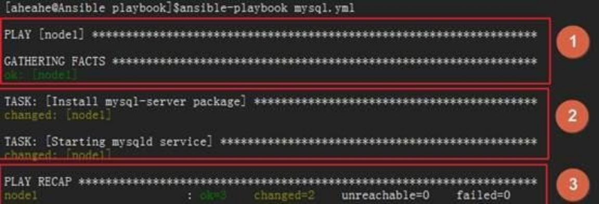

#### 核心元素

Playbook的核心元素：

Hosts：主机组；  
Tasks：任务列表；  
Variables：变量，设置方式有四种；  
Templates：包含了模板语法的文本文件；  
Handlers：由特定条件触发的任务；

#### 基本组件

Playbooks配置文件的基础组件：

Hosts：运行指定任务的目标主机  
remoute\_user：在远程主机上执行任务的用户；  
sudo\_user：  
tasks：任务列表

格式：  
tasks：  
– name: TASK\_NAME  
module: arguments  
notify: HANDLER\_NAME  
handlers:  
– name: HANDLER\_NAME  
module: arguments

模块，模块参数：

格式：  
(1) action: module arguments  
(2) module: arguments  
注意：shell和command模块后面直接跟命令，而非key=value类的参数列表；

handlers：任务，在特定条件下触发；接收到其它任务的通知时被触发；

(1) 某任务的状态在运行后为changed时，可通过“notify”通知给相应的handlers；  
(2) 任务可以通过“tags“打标签，而后可在ansible-playbook命令上使用-t指定进行调用；

举例

**① 定义playbook**

```yaml
[root@server ~]# cd /etc/ansible
[root@server ansible]# vim nginx.yml
---
- hosts: web
  remote_user: root
  tasks:

    - name: install nginx
      yum: name=nginx state=present
    - name: copy nginx.conf
      copy: src=/tmp/nginx.conf dest=/etc/nginx/nginx.conf backup=yes
      notify: reload　　　　#当nginx.conf发生改变时，通知给相应的handlers
      tags: reloadnginx　　　#打标签
    - name: start nginx service
      service: name=nginx state=started
      tags: startnginx　　　#打标签

  handlers:　　#注意，前面没有-，是两个空格
    - name: reload
      service: name=nginx state=restarted　　#为了在进程中能看出来
```

**② 测试运行结果**  
写完了以后，我们就可以运行了：

```csharp
[root@server ansible]# ansible-playbook nginx.yml
```

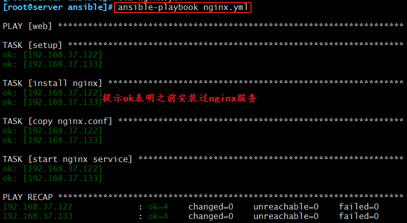  
现在我们可以看看两台机器的端口是否开启：

```ruby
[root@server ansible]# ansible web -m shell -a 'ss -nutlp |grep nginx'
192.168.37.122 | SUCCESS | rc=0 >>
tcp    LISTEN     0      128       *:80                    *:*                   users:(("nginx",pid=8304,fd=6),("nginx",pid=8303,fd=6))

192.168.37.133 | SUCCESS | rc=0 >>
tcp    LISTEN     0      128       *:80                    *:*                   users:(("nginx",pid=9671,fd=6),("nginx",pid=9670,fd=6))
```

**③ 测试标签**  
我们在里面已经打上了一个标签，所以可以直接引用标签。但是我们需要先把服务关闭，再来运行剧本并引用标签：

```csharp
[root@server ansible]# ansible web -m shell -a 'systemctl stop nginx'
[root@server ansible]# ansible-playbook nginx.yml -t startnginx
```

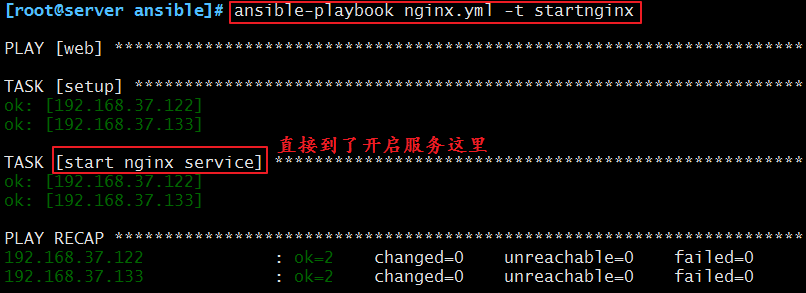  
**④ 测试notify**  
我们还做了一个notify，来测试一下：  
首先，它的触发条件是配置文件被改变，所以我们去把配置文件中的端口改一下：

```perl
[root@server ansible]# vim /tmp/nginx.conf
	listen       8080;
```

然后我们重新加载一下这个剧本：  
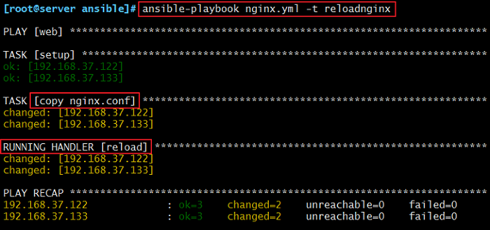  
发现我们执行的就是reload段以及我们定义的notify部分。  
我们来看一看我们的端口号：

```ruby
[root@server ansible]# ansible web -m shell -a 'ss -ntlp | grep nginx'
192.168.37.122 | SUCCESS | rc=0 >>
LISTEN     0      128          *:8080                     *:*                   users:(("nginx",pid=2097,fd=6),("nginx",pid=2096,fd=6))

192.168.37.133 | SUCCESS | rc=0 >>
LISTEN     0      128          *:8080                     *:*                   users:(("nginx",pid=3061,fd=6),("nginx",pid=3060,fd=6))
```

可以看出，我们的nginx端口已经变成了8080。

#### variables 部分

上文中，我们说到了variables是变量，有四种定义方法，现在我们就来说说这四种定义方法：

① facts ：可直接调用

上一篇中，我们有说到setup这个模块，这个模块就是通过调用facts组件来实现的。我们这里的variables也可以直接调用facts组件。  
具体的facters我们可以使用setup模块来获取，然后直接放入我们的剧本中调用即可。

② 用户自定义变量

我们也可以直接使用用户自定义变量，想要自定义变量有以下两种方式：

通过命令行传入

ansible-playbook命令的命令行中的\-e VARS, --extra-vars=VARS，这样就可以直接把自定义的变量传入。

在playbook中定义变量

我们也可以直接在playbook中定义我们的变量：

```yaml
vars:
　　- var1: value1
　　- - var2: value2
```

举例

**① 定义剧本**  
我们就使用全局替换把我们刚刚编辑的文件修改一下：

```csharp
[root@server ansible]# vim nginx.yml
```

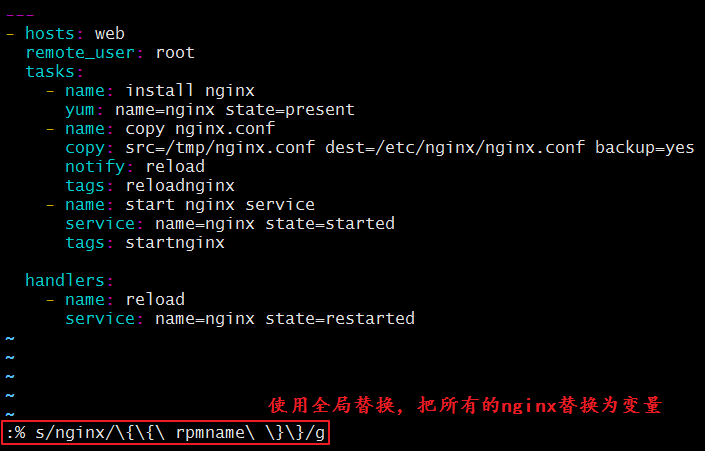  
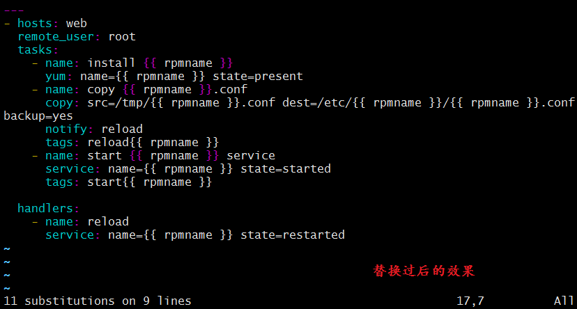  
这样一来，我们的剧本就定义完成了。  
**② 拷贝配置文件**  
我们想要在被监管的机器上安装什么服务的话，就直接在我们的server端上把该服务的配置文件拷贝到我们的/tmp/目录下。这样我们的剧本才能正常运行。  
我们就以keepalived服务为例：

```csharp
[root@server ansible]# cp /etc/keepalived/keepalived.conf /tmp/keepalived.conf
```

**③ 运行剧本，变量由命令行传入**

```csharp
[root@server ansible]# ansible-playbook nginx.yml -e rpmname=keepalived
```

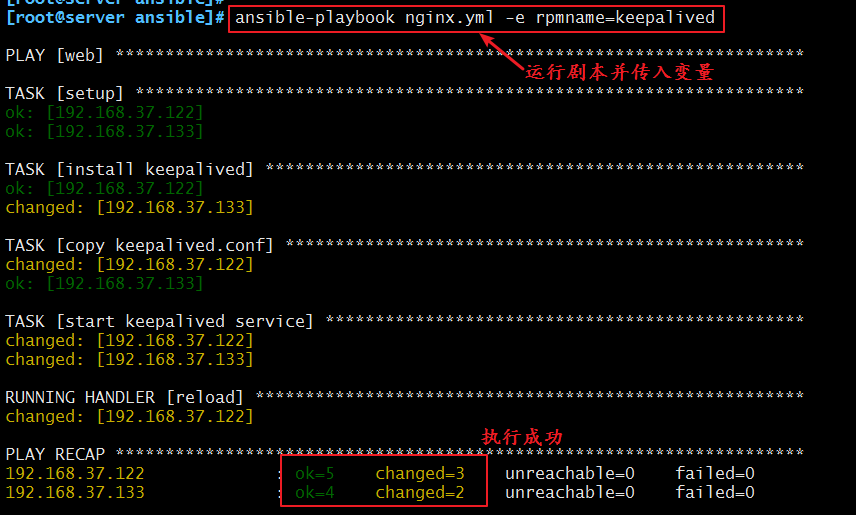  
**④ 修改剧本，直接定义变量**  
同样的，我们可以直接在剧本中把变量定义好，这样就不需要在通过命令行传入了。以后想要安装不同的服务，直接在剧本里把变量修改一下即可。

```csharp
[root@server ansible]# vim nginx.yml
```

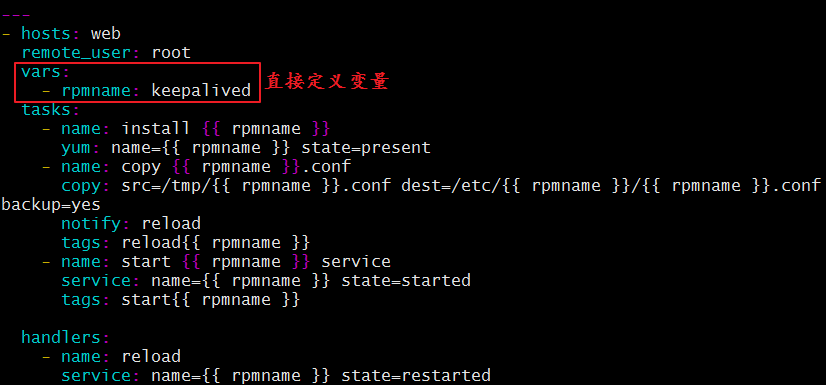  
**⑤ 运行定义过变量的剧本**  
我们刚刚已经把变量定义在剧本里面了。现在我们来运行一下试试看：

```csharp
[root@server ansible]# ansible-playbook nginx.yml
```

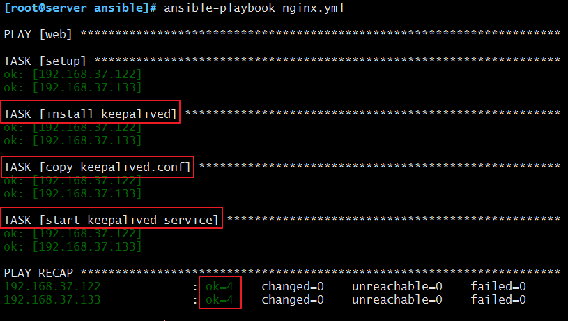  
发现这样也是可以的~

**③ 通过roles传递变量**

具体的，我们下文中说到 roles 的时候再详细说明。这里是[传送带](https://www.cnblogs.com/keerya/p/8004566.html#jump)  
  

**④ Host Inventory**

我们也可以直接在主机清单中定义。  
定义的方法如下：

向不同的主机传递不同的变量：

```plain
IP/HOSTNAME varaiable=value var2=value2
```

向组中的主机传递相同的变量：

```plain
[groupname:vars]
　　variable=value
```

​  

#### 模板 templates

模板是一个文本文件，嵌套有脚本（使用模板编程语言编写）。  
Jinja2：Jinja2是python的一种模板语言，以Django的模板语言为原本。  
模板支持：

字符串：使用单引号或双引号；  
数字：整数，浮点数；  
列表：[item1, item2, ...]  
元组：(item1, item2, ...)  
字典：{key1:value1, key2:value2, ...}  
布尔型：true/false  
算术运算：  
+, -, \*, /, //, %, \*\*  
比较操作：  
\==, !=, >, >=, <, <=  
逻辑运算：  
and, or, not

通常来说，模板都是通过引用变量来运用的。

举例

**① 定义模板**  
我们直接把之前定义的/tmp/nginx.conf改个名，然后编辑一下，就可以定义成我们的模板文件了：

```perl
[root@server ansible]# cd /tmp
[root@server tmp]# mv nginx.conf nginx.conf.j2
[root@server tmp]# vim nginx.conf.j2
	worker_processes  {{ ansible_processor_vcpus }};
	listen       {{ nginxport }};
```

**② 修改剧本**  
我们现在需要去修改剧本来定义变量：

```csharp
[root@server ansible]# vim nginx.yml
```

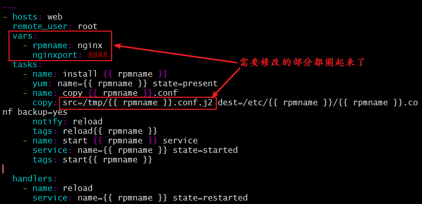  
需要修改的部分如图所示。  
**③ 运行剧本**  
上面的准备工作完成后，我们就可以去运行剧本了：

```markdown
[root@server ansible]# ansible-playbook nginx.yml -t reloadnginx

PLAY [web] *********************************************************************

TASK [setup] *******************************************************************
ok: [192.168.37.122]
ok: [192.168.37.133]

TASK [copy nginx.conf] *********************************************************
ok: [192.168.37.122]
ok: [192.168.37.133]

PLAY RECAP *********************************************************************
192.168.37.122             : ok=2    changed=0    unreachable=0    failed=0   
192.168.37.133             : ok=2    changed=0    unreachable=0    failed=0
```

6）条件测试

when语句：在task中使用，jinja2的语法格式。  
举例如下：

```plain
tasks:
- name: install conf file to centos7
  template: src=files/nginx.conf.c7.j2
  when: ansible_distribution_major_version == "7"
- name: install conf file to centos6
  template: src=files/nginx.conf.c6.j2
  when: ansible_distribution_major_version == "6"
```

循环：迭代，需要重复执行的任务；  
对迭代项的引用，固定变量名为"item"，而后，要在task中使用with\_items给定要迭代的元素列表；  
举例如下：

```yaml
tasks:
- name: unstall web packages
  yum: name={{ item }} state=absent
  with_items:
  - httpd
  - php
  - php-mysql
```

#### 条件测试

when语句：在task中使用，jinja2的语法格式。  
举例如下：

```plain
tasks:
- name: install conf file to centos7
  template: src=files/nginx.conf.c7.j2
  when: ansible_distribution_major_version == "7"
- name: install conf file to centos6
  template: src=files/nginx.conf.c6.j2
  when: ansible_distribution_major_version == "6"
```

循环：迭代，需要重复执行的任务；  
对迭代项的引用，固定变量名为"item"，而后，要在task中使用with\_items给定要迭代的元素列表；  
举例如下：

```yaml
tasks:
- name: unstall web packages
  yum: name={{ item }} state=absent
  with_items:
  - httpd
  - php
  - php-mysql
```

#### 字典

ansible playbook 还支持字典功能。举例如下：

```yaml
- name: install some packages
  yum: name={{ item }} state=present
  with_items:
    - nginx
    - memcached
    - php-fpm
- name: add some groups
  group: name={{ item }} state=present
  with_items:
    - group11
    - group12
    - group13
- name: add some users
  user: name={{ item.name }} group={{ item.group }} state=present
  with_items:
    - { name: 'user11', group: 'group11' }
    - { name: 'user12', group: 'group12' }
    - { name: 'user13', group: 'group13' }
```

#### 角色订制：roles

① 简介

对于以上所有的方式有个弊端就是无法实现复用假设在同时部署Web、db、ha 时或不同服务器组合不同的应用就需要写多个yml文件。很难实现灵活的调用。  
roles 用于层次性、结构化地组织playbook。roles 能够根据层次型结构自动装载变量文件、tasks以及handlers等。要使用roles只需要在playbook中使用include指令即可。简单来讲，roles就是通过分别将变量(vars)、文件(file)、任务(tasks)、模块(modules)及处理器(handlers)放置于单独的目录中，并可以便捷地include它们的一种机制。角色一般用于基于主机构建服务的场景中，但也可以是用于构建守护进程等场景中。

② 角色集合

角色集合：roles/  
mysql/  
httpd/  
nginx/  
files/：存储由copy或script等模块调用的文件；  
tasks/：此目录中至少应该有一个名为main.yml的文件，用于定义各task；其它的文件需要由main.yml进行“包含”调用；  
handlers/：此目录中至少应该有一个名为main.yml的文件，用于定义各handler；其它的文件需要由main.yml进行“包含”调用；  
vars/：此目录中至少应该有一个名为main.yml的文件，用于定义各variable；其它的文件需要由main.yml进行“包含”调用；  
templates/：存储由template模块调用的模板文本；  
meta/：此目录中至少应该有一个名为main.yml的文件，定义当前角色的特殊设定及其依赖关系；其它的文件需要由main.yml进行“包含”调用；  
default/：此目录中至少应该有一个名为main.yml的文件，用于设定默认变量；

③ 角色定制实例

1\. **在roles目录下生成对应的目录结构**

```csharp
[root@server ansible]# cd roles/
[root@server roles]# ls
[root@server roles]# mkdir -pv ./{nginx,mysql,httpd}/{files,templates,vars,tasks,handlers,meta,default}
[root@server roles]# tree
.
├── httpd
│   ├── default
│   ├── files
│   ├── handlers
│   ├── meta
│   ├── tasks
│   ├── templates
│   └── vars
├── mysql
│   ├── default
│   ├── files
│   ├── handlers
│   ├── meta
│   ├── tasks
│   ├── templates
│   └── vars
└── nginx
    ├── default
    ├── files
    ├── handlers
    ├── meta
    ├── tasks
    ├── templates
    └── vars

24 directories, 0 files
```

**2\. 定义配置文件**  
我们需要修改的配置文件为/tasks/main.yml，下面，我们就来修改一下：

```yaml
[root@server roles]# vim nginx/tasks/main.yml
- name: cp
  copy: src=nginx-1.10.2-1.el7.ngx.x86_64.rpm dest=/tmp/nginx-1.10.2-1.el7.ngx.x86_64.rpm
- name: install
  yum: name=/tmp/nginx-1.10.2-1.el7.ngx.x86_64.rpm state=latest
- name: conf
  template: src=nginx.conf.j2 dest=/etc/nginx/nginx.conf
  tags: nginxconf
  notify: new conf to reload
- name: start service
  service: name=nginx state=started enabled=true
```

**3\. 放置我们所需要的文件到指定目录**  
因为我们定义的角色已经有了新的组成方式，所以我们需要把文件都放到指定的位置，这样，才能让配置文件找到这些并进行加载。  
rpm包放在files目录下，模板放在templates目录下：

```csharp
[root@server nginx]# cp /tmp/nginx-1.10.2-1.el7.ngx.x86_64.rpm ./files/
[root@server nginx]# cp /tmp/nginx.conf.j2 ./templates/
[root@server nginx]# tree
.
├── default
├── files
│   └── nginx-1.10.2-1.el7.ngx.x86_64.rpm
├── handlers
├── meta
├── tasks
│   └── main.yml
├── templates
│   └── nginx.conf.j2
└── vars

7 directories, 3 files
```

**4\. 修改变量文件**  
我们在模板中定义的变量，也要去配置文件中加上：

```yaml
[root@server nginx]# vim vars/main.yml
nginxprot: 9999
```

**5\. 定义handlers文件**  
我们在配置文件中定义了notify，所以我么也需要定义handlers，我们来修改配置文件：

```csharp
[root@server nginx]# vim handlers/main.yml
- name: new conf to reload
  service: name=nginx state=restarted
```

**6\. 定义剧本文件**  
接下来，我们就来定义剧本文件，由于大部分设置我们都单独配置在了roles里面，所以，接下来剧本就只需要写一点点内容即可：

```yaml
[root@server ansible]# vim roles.yml 
- hosts: web
  remote_user: root
  roles:
    - nginx
```

**7\. 启动服务**  
剧本定义完成以后，我们就可以来启动服务了：

```markdown
[root@server ansible]# ansible-playbook roles.yml

PLAY [web] *********************************************************************

TASK [setup] *******************************************************************
ok: [192.168.37.122]
ok: [192.168.37.133]

TASK [nginx : cp] **************************************************************
ok: [192.168.37.122]
ok: [192.168.37.133]

TASK [nginx : install] *********************************************************
changed: [192.168.37.122]
changed: [192.168.37.133]

TASK [nginx : conf] ************************************************************
changed: [192.168.37.122]
changed: [192.168.37.133]

TASK [nginx : start service] ***************************************************
changed: [192.168.37.122]
changed: [192.168.37.133]

RUNNING HANDLER [nginx : new conf to reload] ***********************************
changed: [192.168.37.122]
changed: [192.168.37.133]

PLAY RECAP *********************************************************************
192.168.37.122             : ok=6    changed=4    unreachable=0    failed=0   
192.168.37.133             : ok=6    changed=4    unreachable=0    failed=0
```

启动过后照例查看端口号：

```ruby
[root@server ansible]# ansible web -m shell -a "ss -ntulp |grep 9999"
192.168.37.122 | SUCCESS | rc=0 >>
tcp    LISTEN     0      128       *:9999                  *:*                   users:(("nginx",pid=7831,fd=6),("nginx",pid=7830,fd=6),("nginx",pid=7829,fd=6))

192.168.37.133 | SUCCESS | rc=0 >>
tcp    LISTEN     0      128       *:9999                  *:*                   users:(("nginx",pid=9654,fd=6),("nginx",pid=9653,fd=6),("nginx",pid=9652,fd=6))
```

可以看出我们的剧本已经执行成功。