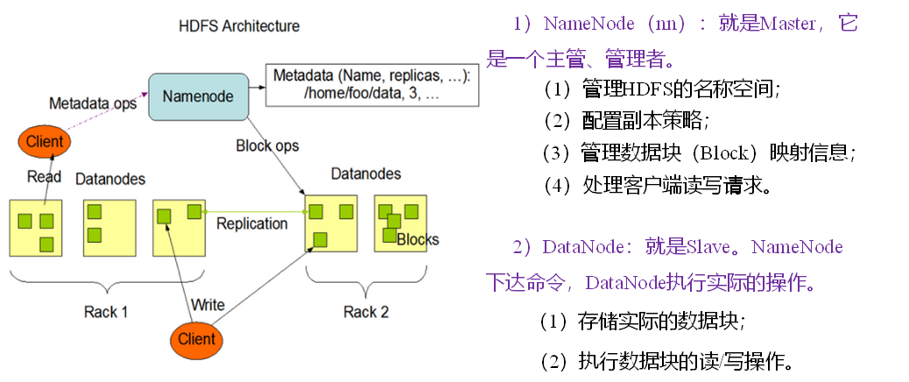
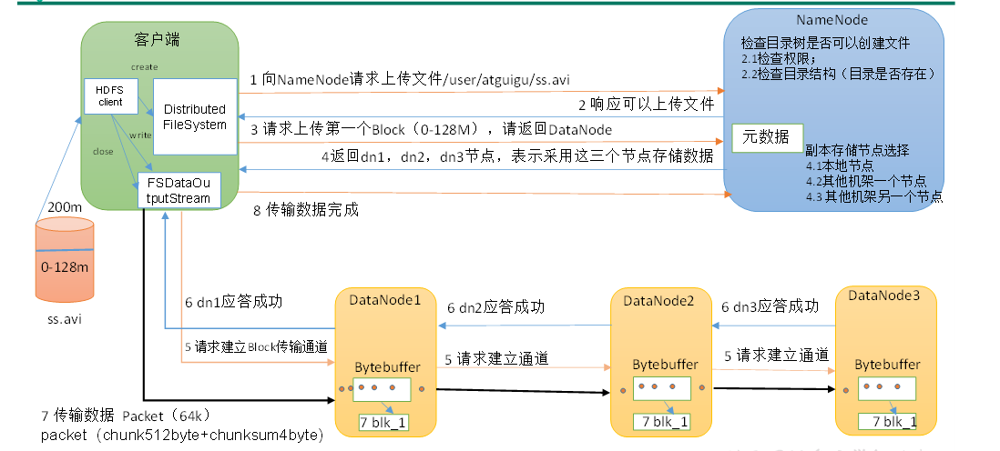
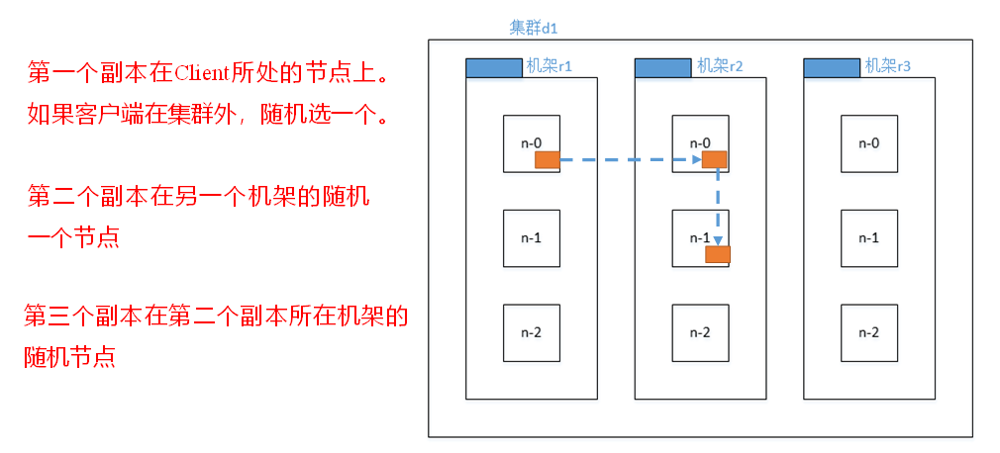
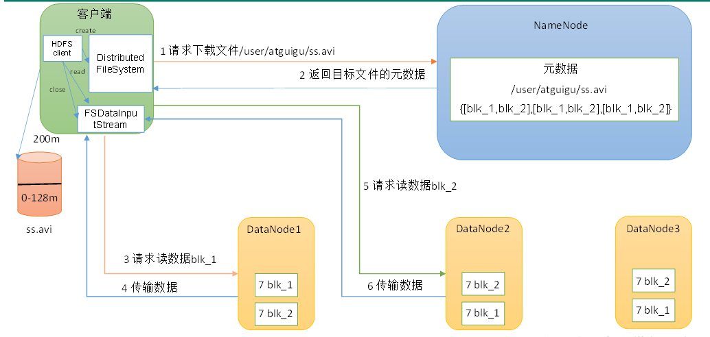
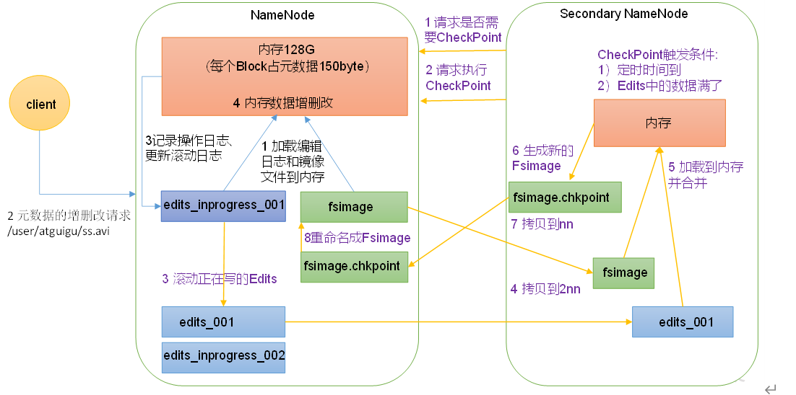
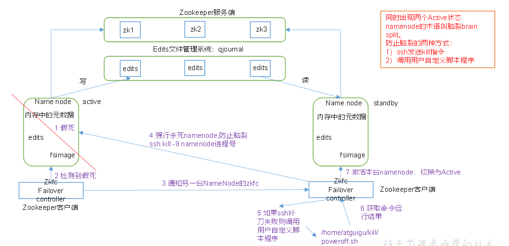
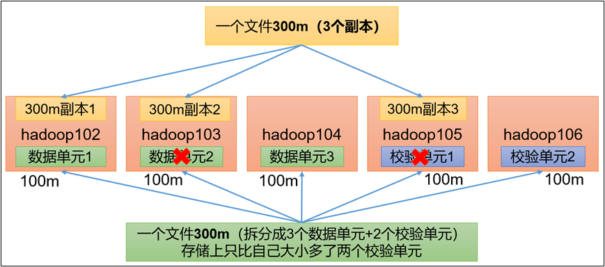
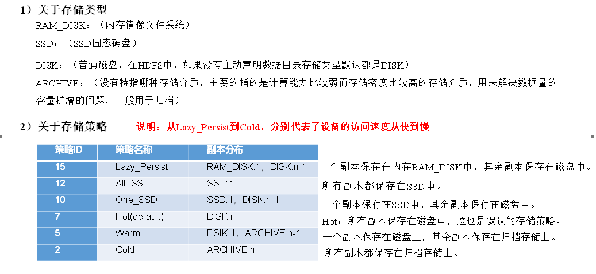

# 概述

## 定位

分布式文件存储系统（多副本高容错、分布式处理大批量数据、磁盘要求不高），适合于单次写入多次读取的场景；不适合低延迟要求场景（多次IO），不允许并发写入同一个文件（适合于数仓定时跑批这种场景），仅支持追加写，不支持文件随机修改，数据更新场景需将整个文件读出更改后重新写入性能很差（hive不支持更新的原因）

## 架构



**元数据：**存储数据的描述信息，如数据name、replicas、路径、数据块映射信息等。元数据存于内存，

**主数据：**真正存储的数据块里的数据。

**数据块：**根据磁盘寻址时间与传输时间来确定块大小，传输时间=寻址时间\*100（HDD寻址时间大概10ms，100MB/s读写速度，10\*100/1000 \* 100 = 100MB 取整得到块大小128M），另一种算法是根据磁盘的读写速度取整，如500M/s 则块大小设置512M

**replication：**副本

## 写流程





（1）客户端通过Distributed FileSystem模块向NameNode请求上传文件，NameNode检查目标文件是否已存在，父目录是否存在。

（2）NameNode返回是否可以上传。

（3）客户端请求第一个Block上传到哪几个DataNode服务器上。

（4）NameNode返回3个DataNode节点，分别为dn1、dn2、dn3。

（5）客户端通过FSDataOutputStream模块请求dn1上传数据，dn1收到请求会继续调用dn2，然后dn2调用dn3，将这个通信管道建立完成。

（6）dn1、dn2、dn3逐级应答客户端。

（7）客户端开始往dn1上传第一个Block（先从磁盘读取数据放到一个本地内存缓存），以Packet为单位，dn1收到一个Packet就会传给dn2，dn2传给dn3；dn1每传一个packet会放入一个应答队列等待应答。dn1，dn2，dn3选择遵循就近原则（图2）

（8）当一个Block传输完成之后，客户端再次请求NameNode上传第二个Block的服务器。（重复执行3-7步）。

## 读流程



（1）客户端通过DistributedFileSystem向NameNode请求下载文件，NameNode通过查询元数据，找到文件块所在的DataNode地址。

（2）挑选一台DataNode（就近原则，然后随机）服务器，请求读取数据。

（3）DataNode开始传输数据给客户端（从磁盘里面读取数据输入流，以Packet为单位来做校验）。

（4）客户端以Packet为单位接收，先在本地缓存，然后写入目标文件。

  

# nn与2nn关系

背景：内存数据如何做到一致性持久化？元数据都存储nn节点的内存，断电后更改过的元数据信息是否会丢？

思想：元数据更新会直接更新内存数据，并且会周期刷写内存数据到磁盘，机器重启后可读取磁盘中数据来恢复上一次信息。但是元数据更新后，数据同步到磁盘的过程不管全量覆盖还是增量更新都会耗费资源且很慢，全交由nn节点则负载很高，因此引入顺序追加 + 合并 + 2nn节点。nn的元数据更新顺序写磁盘edits文件，2nn读取edits文件合并为fsimage文件，之后把fsimage给到nn节点，重启时根据edits+fsimage来恢复数据

思考：与mysql事务持久化的redolog、undolog思想一致。



**1****）第一阶段：****NameNode****启动**

（1）第一次启动NameNode格式化后，创建Fsimage和Edits文件。如果不是第一次启动，直接加载编辑日志和镜像文件到内存。

（2）客户端对元数据进行增删改的请求。

（3）NameNode记录操作日志，更新滚动日志。

（4）NameNode在内存中对元数据进行增删改。

**2****）第二阶段：****Secondary NameNode****工作**

（1）Secondary NameNode询问NameNode是否需要CheckPoint。直接带回NameNode是否检查结果。

（2）Secondary NameNode请求执行CheckPoint。

（3）NameNode滚动正在写的Edits日志。

（4）将滚动前的编辑日志和镜像文件拷贝到Secondary NameNode。

（5）Secondary NameNode加载编辑日志和镜像文件到内存，并合并。

（6）生成新的镜像文件fsimage.chkpoint。

（7）拷贝fsimage.chkpoint到NameNode。

（8）NameNode将fsimage.chkpoint重新命名成fsimage。

​  

# shell操作

```bash
bin/hadoop fs

[-appendToFile <localsrc> ... <dst>]
[-cat [-ignoreCrc] <src> ...]
[-chgrp [-R] GROUP PATH...]
[-chmod [-R] <MODE[,MODE]... | OCTALMODE> PATH...]
[-chown [-R] [OWNER][:[GROUP]] PATH...]
[-copyFromLocal [-f] [-p] <localsrc> ... <dst>]
[-copyToLocal [-p] [-ignoreCrc] [-crc] <src> ... <localdst>]
[-count [-q] <path> ...]
[-cp [-f] [-p] <src> ... <dst>]
[-df [-h] [<path> ...]]
[-du [-s] [-h] <path> ...]
[-get [-p] [-ignoreCrc] [-crc] <src> ... <localdst>]
[-getmerge [-nl] <src> <localdst>]
[-help [cmd ...]]
[-ls [-d] [-h] [-R] [<path> ...]]
[-mkdir [-p] <path> ...]
[-moveFromLocal <localsrc> ... <dst>]
[-moveToLocal <src> <localdst>]
[-mv <src> ... <dst>]
[-put [-f] [-p] <localsrc> ... <dst>]			-- 写脚本时使用 -f强制覆盖，不然存在文件会报错
[-rm [-f] [-r|-R] [-skipTrash] <src> ...]
[-rmdir [--ignore-fail-on-non-empty] <dir> ...]
<acl_spec> <path>]]
[-setrep [-R] [-w] <rep> <path> ...]
[-stat [format] <path> ...]
[-tail [-f] <file>]
[-test -[defsz] <path>]
[-text [-ignoreCrc] <src> ...]

sbin/start-dfs.sh
sbin/start-yarn.sh

```

# api操作

```bash
FileSystem fs = FileSystem.get(new URI("hdfs://hadoop102:8020"), configuration, "atguigu");
```

  

# 高可用

## 背景：

虽然有nn+2nn的架构，nn挂了之后再次启动能从2nn读取fsimage和edits文件合并得到最新元数据，但是nn挂了或升级组件时hdfs并不可用了，所以nn需要一个备岗。

HDFS HA功能通过配置Active/Standby两个NameNodes实现在集群中对NameNode的热备来解决上述问题。如果出现故障，如机器崩溃或机器需要升级维护，这时可通过此种方式将NameNode很快的切换到另外一台机器。

## 双nn故障需突破难点

1\. 元数据管理方式需要改变

内存中各自保存一份元数据；

Edits日志只有Active状态的NameNode节点可以做写操作；

两个NameNode都可以读取Edits；

共享的Edits放在一个共享存储中管理（qjournal和NFS两个主流实现）；

2. 需要一个状态管理功能模块

实现了一个zkfailover，常驻在每一个namenode所在的节点，每一个zkfailover负责监控自己所在NameNode节点，利用zk进行状态标识，当需要进行状态切换时，由zkfailover来负责切换，切换时需要防止brain split现象的发生。

3. 必须保证两个NameNode之间能够ssh无密码登录

4\. 隔离（Fence），即同一时刻仅仅有一个NameNode对外提供服务

## HDFS-HA自动故障转移工作机制

自动故障转移为HDFS部署增加了两个新组件：ZooKeeper和ZKFailoverController（ZKFC）进程。ZooKeeper是维护少量协调数据，通知客户端这些数据的改变和监视客户端故障的高可用服务。HA的自动故障转移依赖于ZooKeeper的以下功能：

**1****）故障检测：**集群中的每个NameNode在ZooKeeper中维护了一个持久会话，如果机器崩溃，ZooKeeper中的会话将终止，ZooKeeper通知另一个NameNode需要触发故障转移。

**2****）现役****NameNode****选择：**ZooKeeper提供了一个简单的机制用于唯一的选择一个节点为active状态。如果目前现役NameNode崩溃，另一个节点可能从ZooKeeper获得特殊的排外锁以表明它应该成为现役NameNode。

ZKFC是自动故障转移中的另一个新组件，是ZooKeeper的客户端，也监视和管理NameNode的状态。每个运行NameNode的主机也运行了一个ZKFC进程，ZKFC负责：

**1****）健康监测：**ZKFC使用一个健康检查命令定期地ping与之在相同主机的NameNode，只要该NameNode及时地回复健康状态，ZKFC认为该节点是健康的。如果该节点崩溃，冻结或进入不健康状态，健康监测器标识该节点为非健康的。

**2****）****ZooKeeper****会话管理：**当本地NameNode是健康的，ZKFC保持一个在ZooKeeper中打开的会话。如果本地NameNode处于active状态，ZKFC也保持一个特殊的znode锁，该锁使用了ZooKeeper对短暂节点的支持，如果会话终止，锁节点将自动删除。

**3）基于ZooKeeper的选择：**如果本地NameNode是健康的，且ZKFC发现没有其它的节点当前持有znode锁，它将为自己获取该锁。如果成功，则它已经赢得了选择，并负责运行故障转移进程以使它的本地NameNode为Active。故障转移进程与前面描述的手动故障转移相似，首先如果必要保护之前的现役NameNode，然后本地NameNode转换为Active状态。



​  

# 调优

## nn内存与存储的文件块数量计算

**块数量**

1Gb内存 \* 1024 \* 1024 \* 1024 /150Byte ≈ 700w块

无小文件情况下：700W\*128M= 9亿M = 860 PB的数据

小文件情况就不好说了

**nn内存**

1）Hadoop2.x系列，配置NameNode默认2000m

2）Hadoop3.x系列，配置NameNode内存是动态分配的

NameNode内存最小值1G，每增加100万个文件block，增加1G内存。

## dn与nn心跳并发配置

修改hdfs-site.xml

```bash
NameNode有一个工作线程池，用来处理不同DataNode的并发心跳以及客户端并发的元数据操作。
对于大集群或者有大量客户端的集群来说，通常需要增大该参数。默认值是10。
<property>
<name>dfs.namenode.handler.count</name>
<value>21</value>
</property>
```

dfs.namenode.handler.count=

## 开启回收站

### 开启需修改core-site.xml

```bash
<property>
 <name>fs.trash.interval</name>
 <value>1</value>
</property>
```

回收站目录在HDFS集群中的路径：/user/username/.Trash/….

通过网页上直接删除的文件也不会走回收站

### 通过程序删除的文件不会经过回收站，需要调用moveToTrash()才进入回收站

```bash
Trash trash = New Trash(conf);
trash.moveToTrash(path);
```

### 只有在命令行利用hadoop fs -rm命令删除的文件才会走回收站。

```bash
hadoop fs -rm -r /user/atguigu/input
2021-07-14 16:13:42,643 INFO fs.TrashPolicyDefault: Moved: 'hdfs://hadoop102:9820/user/atguigu/input' to trash at: hdfs://hadoop102:9820/user/atguigu/.Trash/Current/user/atguigu/input
```

### 恢复回收站数据

```bash
hadoop fs -mv /user/atguigu/.Trash/Current/user/username/input    /user/atguigu/input
```

## 测试读写性能

利用map、reduce，计算每个maptask的平均读写速度，reduce task计算所有map的平均读写性能，读写min（核数、内存GB数）-1个文件

```bash
hadoop jar /opt/module/hadoop-3.1.3/share/hadoop/mapreduce/hadoop-mapreduce-client-jobclient-3.1.3-tests.jar TestDFSIO -write -nrFiles 10 -fileSize 128MB

hadoop jar /opt/module/hadoop-3.1.3/share/hadoop/mapreduce/hadoop-mapreduce-client-jobclient-3.1.3-tests.jar TestDFSIO -read -nrFiles 10 -fileSize 128MB
```

性能接近网络则正常，否则可能磁盘较弱需考虑升级磁盘

Ø Number of files：生成mapTask数量，一般是集群中（CPU核数\-1），我们测试虚拟机就按照实际的物理内存\-1分配即可

Ø Total MBytes processed：单个map处理的文件大小

Ø Throughput mb/sec:单个mapTak的吞吐量

计算方式：处理的总文件大小/每一个mapTask写数据的时间累加

集群整体吞吐量：生成mapTask数量\*单个mapTak的吞吐量

Ø Average IO rate mb/sec::平均mapTak的吞吐量

计算方式：每个mapTask处理文件大小/每一个mapTask写数据的时间

​全部相加除以task数量

Ø IO rate std deviation:方差、反映各个mapTask处理的差值，越小越均衡

## nn可配置多个目录存储，数据一样避免误删

（1）在hdfs-site.xml文件中添加如下内容

```bash
<property>
<name>dfs.namenode.name.dir</name>
<value>file://${hadoop.tmp.dir}/dfs/name1,file://${hadoop.tmp.dir}/dfs/name2</value>
</property>
```

（2）停止集群，删除三台节点的data和logs中所有数据。

```bash
rm -rf data/ logs/
```

（3）格式化集群并启动。

```bash
bin/hdfs namenode -format
sbin/start-dfs.sh
```

## dn多目录配置（多磁盘配置），数据不一样，提升并发读取性能

在hdfs-site.xml文件中添加如下内容

```bash
<property>
<name>dfs.datanode.data.dir</name>
<value>file://${hadoop.tmp.dir}/dfs/data1,file://${hadoop.tmp.dir}/dfs/data2</value>
</property>
```

## HDFS—存储优化

纠删码

HDFS默认情况下，一个文件有3个副本，这样提高了数据的可靠性，但也带来了2倍的冗余开销。Hadoop3.x引入了纠删码，采用计算的方式，可以节省约50％左右的存储空间。



纠删码操作

```bash
hdfs ec
Usage: bin/hdfs ec [COMMAND]
[-listPolicies]
[-addPolicies -policyFile <file>]
[-getPolicy -path <path>]
[-removePolicy -policy <policy>]
[-setPolicy -path <path> [-policy <policy>] [-replicate]]
[-unsetPolicy -path <path>]
[-listCodecs]
[-enablePolicy -policy <policy>]
[-disablePolicy -policy <policy>]
[-help <command-name>].
```

例子：

hdfs ec -enablePolicy -policy RS-3-2-1024k

hdfs dfs -mkdir /input

hdfs ec -setPolicy -path /input -policyRS-3-2-1024k

​  

## 异构存储（冷热数据分离）



（1）查看当前有哪些存储策略可以用

hdfs storagepolicies -listPolicies

（2）为指定路径（数据存储目录）设置指定的存储策略

hdfs storagepolicies -setStoragePolicy \-path xxx -policy xxx

（3）获取指定路径（数据存储目录或文件）的存储策略

hdfs storagepolicies -getStoragePolicy \-path xxx

（4）取消存储策略；执行改命令之后该目录或者文件，以其上级的目录为准，如果是根目录，那么就是HOT

hdfs storagepolicies -unsetStoragePolicy \-path xxx

（5）查看文件块的分布

bin/hdfs fsck xxx -files -blocks -locations

（6）查看集群节点

hadoop dfsadmin -report

  

## 磁盘均衡

（1）生成均衡计划

hdfs diskbalancer -plan hadoop103

（2）执行均衡计划

hdfs diskbalancer -execute hadoop103.plan.json

（3）查看当前均衡任务的执行情况

hdfs diskbalancer -query hadoop103

（4）取消均衡任务

hdfs diskbalancer -cancel hadoop103.plan.json

## HDFS—集群扩容及缩容

**1****）在****NameNode****节点的****/opt/module/hadoop-3.1.3/etc/hadoop****目录下分别创****建****whitelist** **和****blacklist****文件**

**（****1****）创建白名单**

vim whitelist

**（2）创建黑名单**

vim blacklist

**2****）在****hdfs-site.xml****配置文件中增加****dfs.hosts****配置参数**

```bash
<!-- 白名单-->
<property>
<name>dfs.hosts</name>
<value>/opt/module/hadoop-3.1.3/etc/hadoop/whitelist</value>
</property>

<!-- 黑名单-->
<property>
<name>dfs.hosts.exclude</name>
<value>/opt/module/hadoop-3.1.3/etc/hadoop/blacklist</value>
</property>
```

**3****）分发配置文件****whitelist****，****hdfs-site.xml**

xsync hdfs-site.xml whitelist

**4****）第一次添加白名单必须重启集群，不是第一次，只需要刷新****NameNode****节点即可**

​myhadoop.sh stop

​myhadoop.sh start

**5）在web浏览器上查看DN，http://hadoop102:9870/dfshealth.html#tab-datanode**

**6****）在****hadoop104****上执行上传数据数据失败**

hadoop fs -put NOTICE.txt /

**7****）二次修改白名单，增加****hadoop104**

vim whitelist

**8****）刷新****NameNode**

hdfs dfsadmin -refreshNodes

**9）在web浏览器上查看DN，http://hadoop102:9870/dfshealth.html#tab-datanode**

## 服役新服务器

**1）服役新节点：安装hadoop，复制相关配置文件**

hdfs --daemon start datanode

yarn --daemon start nodemanager

在白名单中增加新服役的服务器，分发至集群各节点

hdfs dfsadmin -refreshNodes

**2****）开启数据均衡命令：**

[atguigu@hadoop105 hadoop-3.1.3]$ sbin/start-balancer.sh -threshold 10

对于参数10，代表的是集群中各个节点的磁盘空间利用率相差不超过10%，可根据实际情况进行调整。

**3****）停止数据均衡命令：**

[atguigu@hadoop105 hadoop-3.1.3]$ sbin/stop-balancer.sh

注意：由于HDFS需要启动单独的Rebalance Server来执行Rebalance操作，[所以尽量不要在NameNode上执行start-balancer.sh](http://xn--NameNodestart-balancer-sy68a2bx05ag98dux2afg9ay6af924fm2hzl3e.sh)，而是找一台比较空闲的机器。

​  

## 黑名单下线节点

黑名单配置步骤如下：

**1****）编辑****/opt/module/hadoop-3.1.3/etc/hadoop****目录下的****blacklist****文件**

[atguigu@hadoop102 hadoop] vim blacklist

添加如下主机名称（要退役的节点）

hadoop105

**注意：如果白名单中没有配置，需要在****hdfs-site.xml****配置文件中增加****dfs.hosts****配置参数**

<!-- 黑名单\-->

<property>

​<name>dfs.hosts.exclude</name>

​<value>/opt/module/hadoop-3.1.3/etc/hadoop/blacklist</value>

</property>

**2****）分发配置文件****blacklist****，****hdfs-site.xml**

[atguigu@hadoop104 hadoop]$ xsync hdfs-site.xml blacklist

**3****）第一次添加黑名单必须重启集群，不是第一次，只需要刷新****NameNode****节点即可**

[atguigu@hadoop102 hadoop-3.1.3]$ hdfs dfsadmin -refreshNodes

Refresh nodes successful

**4****）检查****Web****浏览器，退役节点的状态为****decommission in progress****（退役中），说明数据节点正在复制块到其他节点**

**5****）等待退役节点状态为****decommissioned****（所有块已经复制完成），停止该节点及节点资源管理器。注意：如果副本数是****3****，服役的节点小于等于****3****，是不能退役成功的，需要修改副本数后才能退役**

[atguigu@hadoop105 hadoop-3.1.3]$ hdfs --daemon stop datanode

stopping datanode

[atguigu@hadoop105 hadoop-3.1.3]$ yarn --daemon stop nodemanager

stopping nodemanager

**6****）如果数据不均衡，可以用命令实现集群的再平衡**

[atguigu@hadoop102 hadoop-3.1.3]$ sbin/start-balancer.sh -threshold 10

## nn故障无法启动

**1****）需求：**

NameNode进程挂了并且存储的数据也丢失了，如何恢复NameNode

**2****）故障模拟**

（1）kill -9 NameNode进程

[atguigu@hadoop102 current]$ kill -9 19886

（2）删除NameNode存储的数据（/opt/module/hadoop-3.1.3/data/tmp/dfs/name）

rm -rf /opt/module/hadoop-3.1.3/data/dfs/name/\*

**3****）问题解决**

（1）拷贝SecondaryNameNode中数据到原NameNode存储数据目录

scp -r username@hadoop104:/opt/module/hadoop-3.1.3/data/dfs/namesecondary/\* ./name/

（2）重新启动NameNode

[atguigu@hadoop102 hadoop-3.1.3]$ hdfs --daemon start namenode

（3）向集群上传一个文件

  

## 集群安全模式&磁盘修复

注：磁盘损坏或者误删块信息，导致元数据与块信息对应不上，生产环境先hdfs dfsadmin -safemode leave 离开安全模式，让集群正常运作，之后评估数据的重要性，数据是否可找回（正常找回不了），记录丢失的数据文件，重新计算这部分数据写入（hive重新跑批等操作），或者直接删除元数据（web操作）。

**1****）安全模式：**文件系统只接受读数据请求，而不接受删除、修改等变更请求

**2****）进入安全模式场景**

Ø NameNode在加载镜像文件和编辑日志期间处于安全模式；

Ø NameNode再接收DataNode注册时，处于安全模式

**3****）退出安全模式条件**

dfs.namenode.safemode.min.datanodes:最小可用datanode数量，默认0

dfs.namenode.safemode.threshold-pct:副本数达到最小要求的block占系统总block数的百分比，默认0.999f。（只允许丢一个块）

dfs.namenode.safemode.extension:稳定时间，默认值30000毫秒，即30秒

**4****）基本语法**

集群处于安全模式，不能执行重要操作（写操作）。集群启动完成后，自动退出安全模式。

（1）bin/hdfs dfsadmin -safemode get （功能描述：查看安全模式状态）

（2）bin/hdfs dfsadmin -safemode enter （功能描述：进入安全模式状态）

（3）bin/hdfs dfsadmin -safemode leave（功能描述：离开安全模式状态）

（4）bin/hdfs dfsadmin -safemode wait（功能描述：等待安全模式状态）

**5****）案例****1****：启动集群进入安全模式**

**​****（****1****）重新启动集群**

[atguigu@hadoop102 subdir0]$ myhadoop.sh stop

[atguigu@hadoop102 subdir0]$ myhadoop.sh start

**​****（****2****）集群启动后，立即来到集群上删除数据，提示集群处于安全模式**

**6****）案例****2****：磁盘修复**

**​****需求：数据块损坏，进入安全模式，如何处理**

**​****（****1****）分别进入****hadoop102****、****hadoop103****、****hadoop104****的****/opt/module/hadoop-3.1.3/data/dfs/data/current/****BP-1015489500-192.168.10.102-1611909480872****/current/finalized/subdir0/subdir0****目录，统一删除某****2****个块信息**

[atguigu@hadoop102 subdir0]$ pwd

/opt/module/hadoop-3.1.3/data/dfs/data/current/BP-1015489500-192.168.10.102-1611909480872/current/finalized/subdir0/subdir0

​  

[atguigu@hadoop102 subdir0]$ rm -rf blk\_1073741847 blk\_1073741847\_1023.meta

[atguigu@hadoop102 subdir0]$ rm -rf blk\_1073741865 blk\_1073741865\_1042.meta

**说明：****hadoop103/hadoop104****重复执行以上命令**

**​****（****2****）重新启动集群**

[atguigu@hadoop102 subdir0]$ myhadoop.sh stop

[atguigu@hadoop102 subdir0]$ myhadoop.sh start

**​****（****3****）观察****http://hadoop102:9870/dfshealth.html#tab-overview**

**​****说明：安全模式已经打开，块的数量没有达到要求。**

**​****（****4****）离开安全模式**

[atguigu@hadoop102 subdir0]$ hdfs dfsadmin -safemode get

Safe mode is ON

[atguigu@hadoop102 subdir0]$ hdfs dfsadmin -safemode leave

Safe mode is OFF

**​****（****5****）观察****http://hadoop102:9870/dfshealth.html#tab-overview**

**​****（****6****）将元数据删除**

**（****7****）观察**[**http://hadoop102:9870/dfshealth.html#tab-overview**](http://hadoop102:9870/dfshealth.html#tab-overview)**，集群已经正常**

**7****）案例****3****：**

需求：模拟等待安全模式

**（****1****）查看当前模式**

[atguigu@hadoop102 hadoop-3.1.3]$ hdfs dfsadmin -safemode get

Safe mode is OFF

**（****2****）先进入安全模式**

[atguigu@hadoop102 hadoop-3.1.3]$ bin/hdfs dfsadmin -safemode enter

**（****3****）创建并执行下面的脚本**

在/opt/module/hadoop-3.1.3路径上，编辑一个脚本safemode.sh

[atguigu@hadoop102 hadoop-3.1.3]$ vim safemode.sh

​  

#!/bin/bash

hdfs dfsadmin -safemode wait

hdfs dfs -put /opt/module/hadoop-3.1.3/README.txt /

​  

[atguigu@hadoop102 hadoop-3.1.3]$ chmod 777 safemode.sh

​  

[atguigu@hadoop102 hadoop-3.1.3]$ ./safemode.sh

**（****4****）再打开一个窗口，执行**

[atguigu@hadoop102 hadoop-3.1.3]$ bin/hdfs dfsadmin -safemode leave

**（****5****）再观察上一个窗口**

Safe mode is OFF

**（6）HDFS集群上已经有上传的数据了**

## 慢磁盘监控

正常在HDFS上创建一个目录，只需要不到1s的时间。如果你发现创建目录超过1分钟及以上，而且这个现象并不是每次都有。只是偶尔慢了一下，就很有可能存在慢磁盘。一般出现慢磁盘现象，会影响到DataNode与NameNode之间的心跳。正常情况心跳时间间隔是3s。超过3s说明有异常。

一般grafana监控就可看出磁盘io情况，读写速率等监控。

## 小文件处理

小文件危害

①占用nn内存，一个块150Byte

②mr计算，一个小文件会占用一个maptask，分配1GB计算

③检索数据慢（如：查hive等）

**解决方案一：归档 或者自己写一个小文件处理的mr程序**

如：

把/input目录里面的所有文件归档成一个叫input.har的归档文件，并把归档后文件存储到/output路径下。

hadoop archive -archiveName input.har -p /input /output

**解决方案二：**采用CombineTextInputFormat

将小文件合并起来切片处理

**解决方案三：**

详见hive小文件处理

spark小文件处理

解决方案四：开启JVM重用

有小文件场景开启JVM重用；如果没有小文件，不要开启JVM重用，因为会一直占用使用到的Task卡槽，直到任务完成才释放。

JVM重用可以使得JVM实例在同一个job中重新使用N次，N的值可以在Hadoop的mapred-site.xml文件中进行配置。通常在10-20之间。

<property>

​<name>mapreduce.job.jvm.numtasks</name>

​<value>10</value>

​<description>How many tasks to run per jvm,if set to -1 ,there is no limit</description>

</property>

​  

## HDFS—集群迁移

Apache 2 Apache

**采用****distcp****命令实现两个****Hadoop****集群之间的递归数据复制**

hadoop distcp hdfs://hadoop102:8020/user/atguigu/hello.txthdfs://hadoop105:8020/user/atguigu/hello.txt

Apache 2 Apache

  

## HDFS参数调优

（1）修改：hadoop-env.sh

```xml
export HDFS_NAMENODE_OPTS="-Dhadoop.security.logger=INFO,RFAS -Xmx1024m"

export HDFS_DATANODE_OPTS="-Dhadoop.security.logger=ERROR,RFAS -Xmx1024m"
（2）修改hdfs-site.xml
<!-- NameNode有一个工作线程池，默认值是10 -->
<property>
<name>dfs.namenode.handler.count</name>
<value>21</value>
</property>
（3）修改core-site.xml
<!-- 配置垃圾回收时间为60分钟 -->
<property>
 <name>fs.trash.interval</name>
 <value>60</value>
</property>
（4）分发配置
[atguigu@hadoop102 hadoop]$ xsync hadoop-env.sh hdfs-site.xml core-site.xml
```