# doris数据的增删改查原理

## 数据存储目录（fe存储元数据、be存储数据）

**名称解释**

-   **FE：** Frontend，即 Doris 的前端节点。主要负责接收和返回客户端请求、元数据以及集群管理、查询计划生成等工作。
-   **BE：** Backend，即 Doris 的后端节点。主要负责数据存储与管理、查询计划执行等工作。
-   **Tablet：** Tablet 是一张表实际的物理存储单元，一张表按照分区和分桶后在 BE 构成分布式存储层中以 Tablet 为单位进行存储，每个 Tablet 包括元信息及若干个连续的 RowSet。
-   **Rowset：** Rowset 是 Tablet 中一次数据变更的数据集合，数据变更包括了数据导入、删除、更新等。Rowset 按版本信息进行记录。每次变更会生成一个版本。
-   **Version：** 由 Start、End 两个属性构成，维护数据变更的记录信息。通常用来表示 Rowset 的版本范围，在一次新导入后生成一个 Start，End 相等的 Rowset，在 Compaction 后生成一个带范围的 Rowset 版本。
-   **Segment：** 表示 Rowset 中的数据分段。多个 Segment 构成一个 Rowset。
-   **Compaction：** 连续版本的 Rowset 合并的过程称为 Compaction，合并过程中会对数据进行压缩操作。

fe存储的元数据（在安装目录下的doris-meta/）

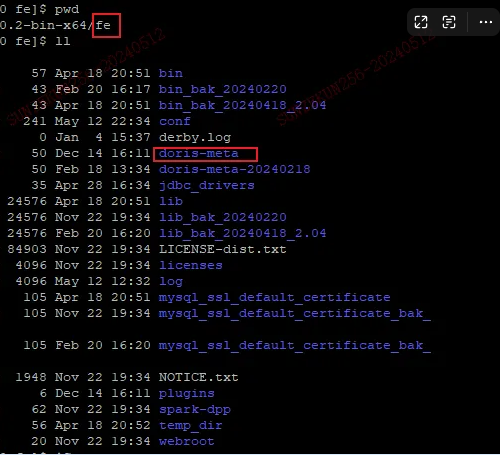

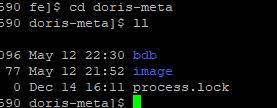

bdb下文件示例：

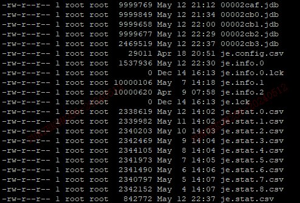

image下的文件：

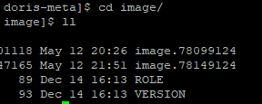

be的数据存储目录：

参考：

[https://mp.weixin.qq.com/s?\_\_biz=Mzg5MDEyODc1OA==&mid=2247484201&idx=1&sn=f3ffed25b688636b9d2181b08afee47c&chksm=cfe01330f8979a2600304595daaa1233ad163faab7f3e44559c5d0c09012ed3ff617a3fc8b48&scene=21#wechat\_redirect](https://mp.weixin.qq.com/s?__biz=Mzg5MDEyODc1OA==&mid=2247484201&idx=1&sn=f3ffed25b688636b9d2181b08afee47c&chksm=cfe01330f8979a2600304595daaa1233ad163faab7f3e44559c5d0c09012ed3ff617a3fc8b48&scene=21#wechat_redirect)

​  

[https://xie.infoq.cn/article/4cc8416c0054bf6f2cdb8b16c](https://xie.infoq.cn/article/4cc8416c0054bf6f2cdb8b16c)

生产情况：

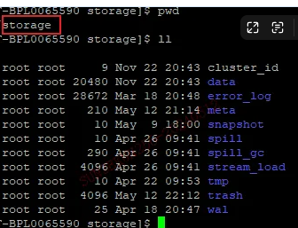

data 存储主数据目录：


/data1/doris/be/storage 这是doris be.conf的配置目录

data是存储数据的

95数字：这个数字从0开始，猜测是单表的tablet的一个标记

1627011：这个整个doris中tablet的唯一id

966113208：这个是schemahash，tablet的一个映射？

最底层的数据文件：索引+数据

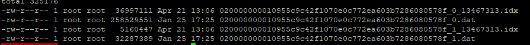

  

## 增

  

# 干活角度理解Doris：

我们的Doris集群：3fe+12be，大概单台80核400G

## source（数据接入-ods层）

### 数据类型映射及同步方式

数据类型看情况。比如我们时间、字符串等就用String；整型bigint；浮点型decimal（38,10）；key尽可能用简单类型。下边主要说下同步方式：我们是存量批同步+增量实时同步（先启动）。

mysql -》Doris：flinkcdc + flink-connector-doris 实时入；

pg -》Doris：flinkcdc + flink-connector-doris 实时入；

oracle -》Doris： OGG + flink-connector-doris 实时入；

hive -》 Doris : 用的是读hive catalog，然后insert into，1亿数据不到1分钟。

kafka -》Doris：Routine Load 有一个链路，但是不建议用，不方便监控；后续会考虑flink读写。

TiDB -》Doris：用的是读TIDB catalog，然后insert into，1亿数据不到1分钟。

```sql
-- 将 core-site.xml，hdfs-site.xml 和 hive-site.xml 放到 FE 和 BE 的 conf 目录下。
-- 优先读取 conf 目录下的 Hadoop 配置文件，再读取环境变量 HADOOP_CONF_DIR 的相关配置文件。

CREATECATALOGhive_bdspPROPERTIES (
"yarn.resourcemanager.principal" = "hive/hive@HADOOP.COM",
"type" = "hms",
"metadata_refresh_interval_sec" = "60",
"ipc.client.fallback-to-simple-auth-allowed" = "true",
"hive.metastore.uris" = "thrift://192.168.10.102:9083",
"hadoop.security.authentication" = "kerberos",
"hadoop.kerberos.principal" = "hive/hive@HADOOP.COM",
"hadoop.kerberos.keytab" = "/root/hive.keytab",
"dfs.client.failover.proxy.provider.bdsp-cluster" = "org.apache.hadoop.hdfs.server.namenode.ha.ConfiguredFailoverProxyProvider"
);
```

### ods层模型使用

unique 模型（主键唯一）

**注意点：**

①key的设置，保证数据唯一，且考虑后续使用该表时性能，故key可设置为常用过滤字段或者join字段。

②分区分桶设置（分区基本采用create\_time来做分区）

事实表：主要看日增量数据来预估分区分桶。我们的测试单桶数据量1g、512m、256m、128m性能递增，但考虑并发度及元数据的影响，单桶使用256m-512m。根据桶大小反推分区粒度。

维表：看存量数据，单桶使用256m-512m，可不设分区。

③参数调优

enable\_unique\_key\_merge\_on\_write = true -- 写要求不高，查时要求性能开启此参数

"compression"="lz4" -- 压缩有lz4和zstd。lz4解压缩快（6-7成），zstd（3-4成）

### 数据监控及告警（Prometheus + grafana）

当前公司主要是实时数据接入，主要涉及数据延迟和数据量问题。

主要监控**数据量及波动率、数据延迟、是否有数据、主键唯一性、空值率**。

**数据量及波动率：**上下游数据量对比，离线要相等，实时要大差不差；且从业务角度来看数据的波动是否符合预期（如：过去7天数据量平均100w，今天1000w或者1w，可告警）。开发平台每日定时任务查询上下游数据量，做对比，将异常数据作为指标写入哪？谁来读？如何告警？

**是否有数据：**

**空值率：**关键业务字段的空值检索，超过多少比例告警啥的。将异常数据作为指标写入哪？谁来读？如何告警？

**数据延迟（实时同步）：**查表中update\_time字段和当前时间做对比，不超xx分钟。将异常数据作为指标写入哪？谁来读？如何告警？

**主键唯一性：**Doris使用unique，不存在，可不做，存在了也是Doris的锅，我们不背。

### transform（数据处理-模型层）

#### 使用

依然使用unique模型，主要是使用数仓分层思想，根据结果层（指标需求）拆分复用sql、避免一个sql打满资源（好多非数仓同学使用Doris，直接用ods出结果，n个表join，资源波峰高了两三倍）

注意点：

①多表join问题（dim、dwd层）-> 维度建模理论

不建议太多表，建议按业务过程，拆解多个事实表；整合维度表（缩减维度表个数）

②内外表join问题

同①不建议太多表join，且外表Doris的优化没有那么细致，比如与外表join默认都走了broadcast join，满足条件的并不会走shuffle join或是runtime filter。故内外表join时需写上hint： [shuffle]

例如：select xxx from internal.a join [shuffle] hive.b on a.x = b.x；

外表数据一般为维表数据量小，但是有需要读取大外表的情况，可以把内表关联键当做外表子查询，先做数据过滤，减小doris内存使用量。可见《生产问题》中有案例。

#### SQL优化问题

①基础的分区裁剪、列裁剪尽量过滤数据量

②内表有join优化：

大小表join默认走broadcast join

大表join 会走 shuffle join

runtime filter 会根据小表数据裁剪大表数据。

Colocation Join 需要设置参数且相同组内表分桶列类型、分桶列个数、表副本数一致。（有点类似hive的 smb join？）

③SQL运行情况查询：

set enable\_profile=true; -- 查完要记得置为false

开启参数后，在8030端口的qurey profile里查看运行情况

explain 查看执行计划，根据执行计划+数据量，调整join形式、顺序，或是增加过滤条件

④ hiive外表统计信息：

通过配置catalog参数，doris自动拉取catalog中的库表统计信息，帮助根据cbo优化查询计划（谓词下推，优化join等）

```sql
ALTER CATALOG external_catalog SET PROPERTIES ('enable.auto.analyze'='true'); // 打开自动收集
ALTER CATALOG external_catalog SET PROPERTIES ('enable.auto.analyze'='false'); // 关闭自动收集
```

可配置变量，主要是为了别太消耗内存

| **会话变量** | **说明** | **默认值** |
| --- | --- | --- |
| auto_analyze_start_time | 自动统计信息收集开始时间 | 00:00:00 |
| auto_analyze_end_time | 自动统计信息收集结束时间 | 23:59:59 |
| enable_auto_analyze | 开启自动收集功能 | true |
| huge_table_default_sample_rows | 对大表的采样行数 | 4194304 |
| huge_table_lower_bound_size_in_bytes | 大小超过该值的的表，在自动收集时将会自动通过采样收集统计信息 | 0 |
| huge_table_auto_analyze_interval_in_millis | 控制对大表的自动ANALYZE的最小时间间隔，在该时间间隔内大小超过huge_table_lower_bound_size_in_bytes * 5的表仅ANALYZE一次 | 0 |
| table_stats_health_threshold | 取值在0-100之间，当自上次统计信息收集操作之后，数据更新量达到 (100 - table_stats_health_threshold)% ，认为该表的统计信息已过时 | 60 |
| analyze_timeout | 控制ANALYZE超时时间，单位为秒 | 43200 |
| auto_analyze_table_width_threshold | 控制自动统计信息收集处理的最大表宽度，列数大于该值的表不会参与自动统计信息收集 | 100 |

手动统计catalog.db.table可以，但是对create external table这种 table不行，提示不支持（虽然官网有）。

⑤hive表联邦查询能力对比内表测试：

在查询doris内表执行计划，与查询hive外表执行计划对比

内表情况：两表均分区，百万级数据量，两表join后聚合处理。list表989w条数据、task163w条

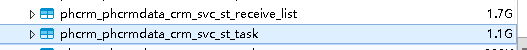

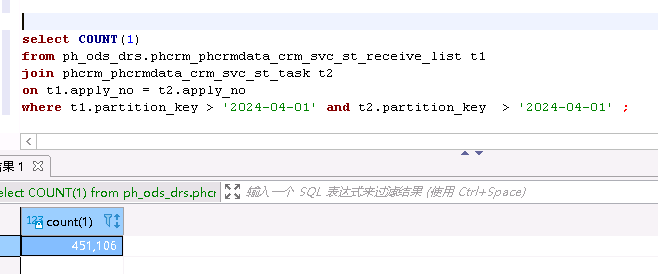

​  

内表join explain 查看（graph）：

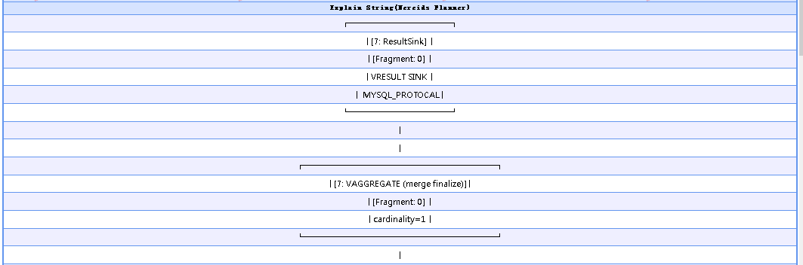

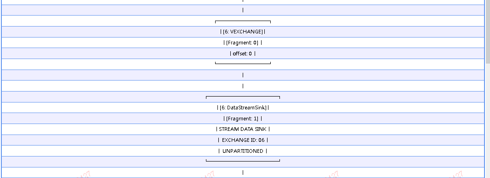

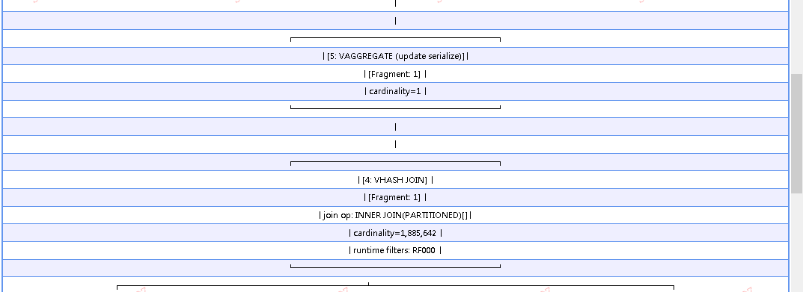

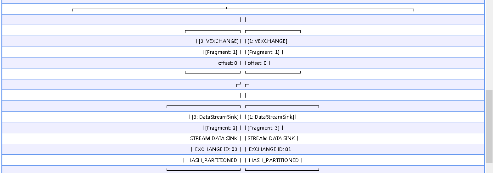

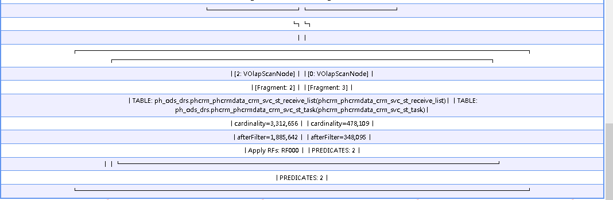

内表join explain 查看（非graph）：

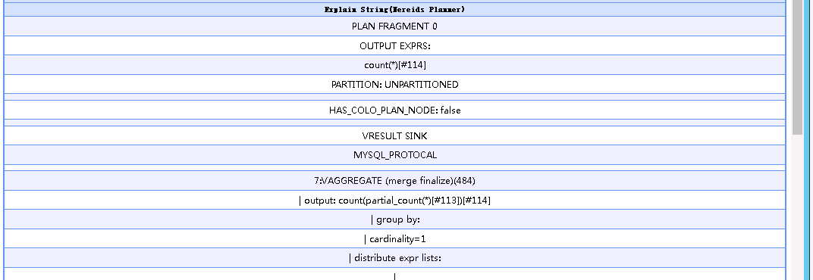

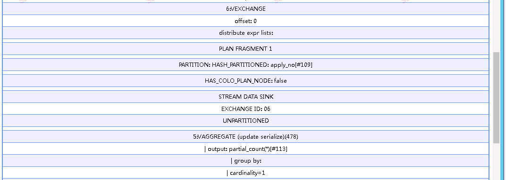

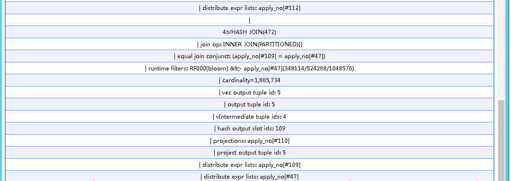

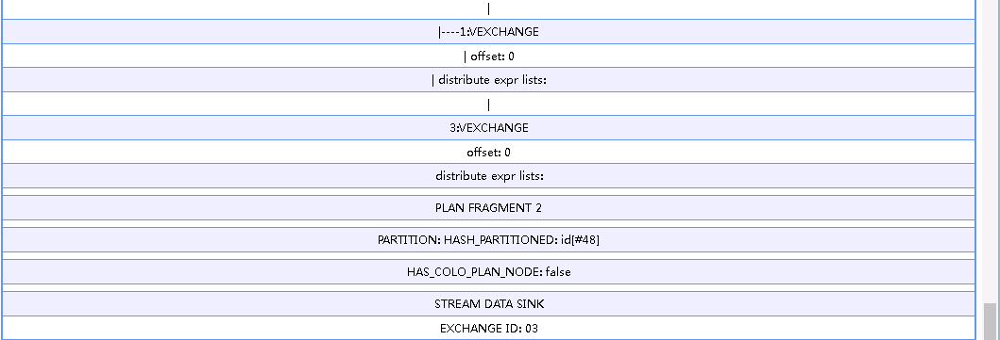

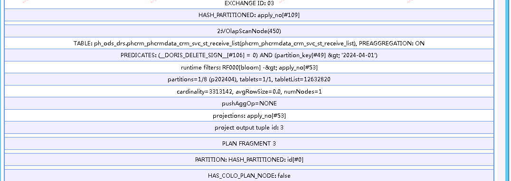

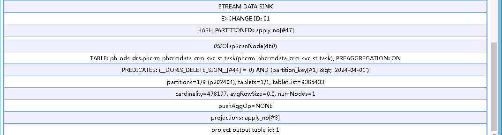

外表join explain 查看（graph）：

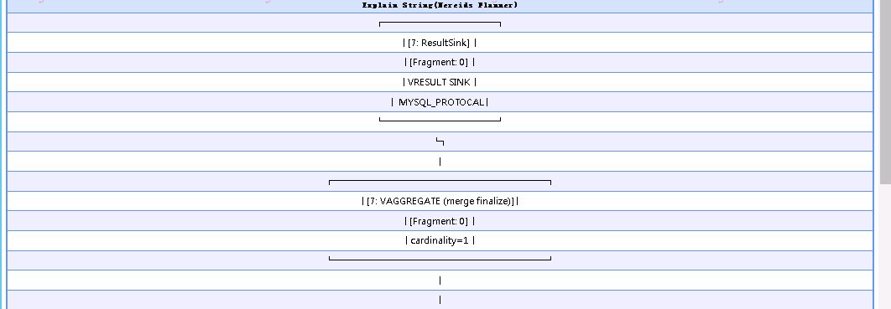

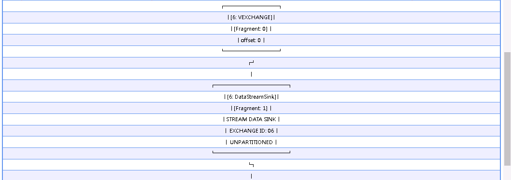

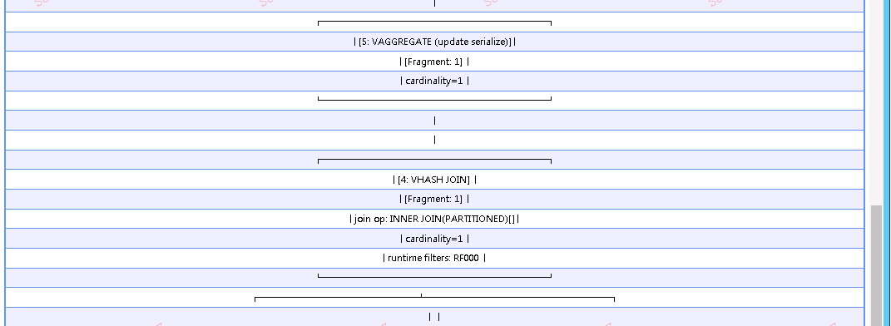

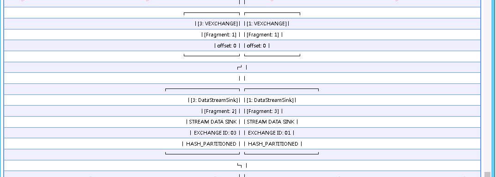

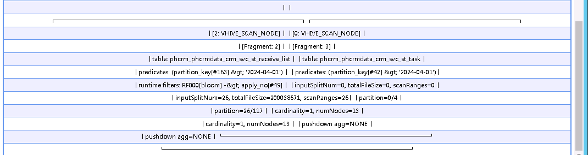

外表join explain 查看（非graph）：


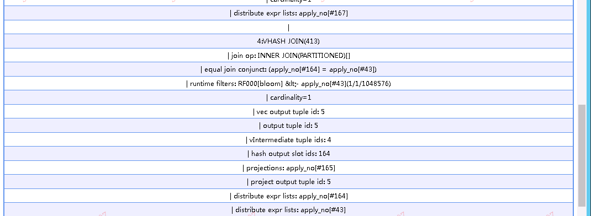


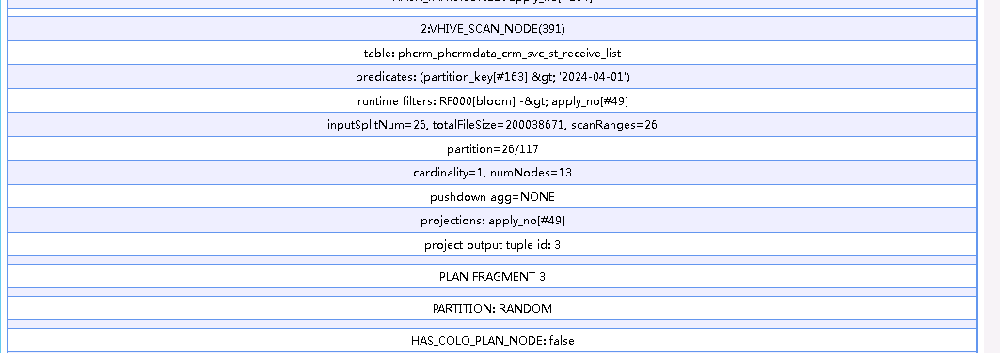

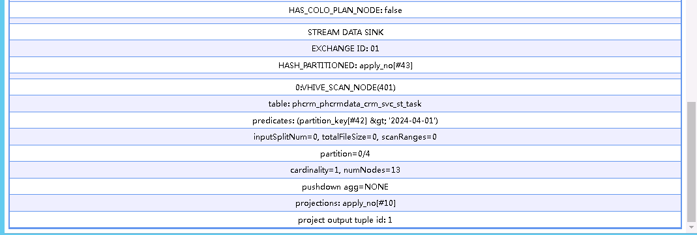

**总结：**

1.  查询hive外表时，扫描hive表是将hive表数据的分片（inputsplitnum）放入所有be节点
2.  查询内表时，单节点扫描数据，数据量少只用扫描一个副本数据。
3.  外表与外表join，外表与内表join，默认是broadcast join，内表与外表join时满足shuffle 会shuffle。加hint之后，都会走shuffle join。所有join方式，都有runtime filter。
4.  不加hints的情况下：外表与外表join 6s，外表与内表 6s，内表与外表 300ms，内表与内表300ms。
5.  加hints的情况下：外表与外表join 6s，外表与内表 300ms，内表与外表 300ms，内表与内表300ms。
6.  内存使用情况，主要是外表数据分布到了过多的be上（从执行计划或者profile可以看出，外表分布到了13个be，内表1个be），因此在join的时候内存消耗跟join方式相关（broadcast join N\*T开销 右表数据发送到左表的每个节点；shuffle join是T + T开销 把相同key右表数据发送到计算节点计算；buket shuffle join 右表数据根据key分区后的数据发送到左表相关分区的节点；colocate join 数据已经按照key分区 且分区数据在同一be节点上，直接本地join计算就行）
7.  四种 Shuffle 方式对比

| **Shuffle 方式** | **网络开销** | **物理算子** | **适用场景** |
| --- | --- | --- | --- |
| BroadCast | N * T(R) | Hash Join / Nest Loop Join | 通用 |
| Shuffle | T(S) + T(R) | Hash Join | 通用 |
| Bucket Shuffle | T(R) | Hash Join | Join 条件中存在左表的分布式列，且左表执行时为单分区 |
| Colocate | 0 | Hash Join | Join 条件中存在左表的分布式列，且左右表同属于一个 Colocate Group |

N：参与 Join 计算的 Instance 个数

T(关系) : 关系的 Tuple 数目

上面这 4 种方式灵活度是从高到低的，它对这个数据分布的要求是越来越严格，但 Join 计算的性能也是越来越好的。join顺序从下到上生效。

​  

**SQL join顺序特别重要：最大表 join 最小表 join 次小表 .......**

**是为了runtime filter过滤效果更好，且join的时候（没有优化顺序）都是移动右表数据，所以右表越小越好。**

**内外表join的时候，也要遵循左大右小的原则，且外表尽可能在右，若是外表较大则开启shuffle join，默认不走 shuffle。**

### 垃圾SQL判断与拦截

**关键点在于，防止一个sql，或者一个部分的作业将整个集群拖累或打挂。**

**限制这类作业**

**定位作业**

#### （1）从单查询的角度考虑

SET exec\_mem\_limit=2\*1024\*1024\*1024;

\-- 生产20GB内存限制，单查询内存使用超过则被kill，注意，该参数在2.0版本有坑，需要be关闭参数

SET query\_timeout =300; -- 查询超时限制5分钟，单查询超过此值被kill

set insert\_timeout = 300; -- 插入数据超时5分钟，将被kill

```sql
CREATE SQL_BLOCK_RULE test_rule 
PROPERTIES(
  "sql"="\\s*select\\s*\\*\\s*from\\s*.*", -- 限制select * 的使用，生产必须列裁剪
  "global"="false",	-- 是否对所有用户生效
  "enable"="true"		-- 是否开启
);
```
```sql
-- 注意，该规则对外表不生效
CREATE SQL_BLOCK_RULE test_rule2 
PROPERTIES
(
   "partition_num" = "30",						-- 单表分区扫描数量，生产不开此参数
   "cardinality" = "10000000000",			-- 单表where过滤后数据量行数，生产2y
   "global" = "false",								-- 是否对所有用户生效
   "enable" = "true"
);
```

  

#### （2）从资源分组隔离角度考虑

原理：将doris的be节点组划分为多个小的集群，一个小集群包含多个be称为group，建表时限制表存储于哪个group，根据user对group的权限判断使用哪些be来查询表，查询的表也要存储于该group才行。

优点：能根据不同user（部门）来划分资源，防止资源的互相抢占，保证了公平。

缺点：绝对的物理隔离很可能会有资源倾斜的现象（云上可调，物理机难调）。并且若是user过多，be节点少，此时也难免资源抢占。

生产建议：我们是12个be，可以分4个组。随着用户增多，一个组还是会面临资源抢占，只是风险相对较小。在设置了（1）查杀规则的前提下，不可能一个作业打崩整个集群。故不使用该资源划分策略。

上生产操作参考：

[https://doris.apache.org/zh-CN/docs/admin-manual/multi-tenant](https://doris.apache.org/zh-CN/docs/admin-manual/multi-tenant)

### 监控告警

做了单条sql资源限制之后，监控告警只配置集群节点总资源使用量告警就行，如cpu、io、mem等。有Doris的监控模版可套用，在模版基础上做监控。

指标参考如下：

[https://doris.apache.org/zh-CN/docs/admin-manual/maint-monitor/monitor-metrics/metrics](https://doris.apache.org/zh-CN/docs/admin-manual/maint-monitor/monitor-metrics/metrics)

## sink（输出-宽表/结果层）

fineBi输出报表等等。

# 常用doris操作

```sql
show frontends; 
show backends;
-- 过去2w个执行的作业情况，倒序查看状态。 
SHOW AUTO ANALYZE ; 
-- 查看任务的子任务 
SHOW ANALYZE TASK STATUS 5340071; 
SHOW ANALYZE 5337564; 
-- 开启以下可在fe 18030 端口查看Profile 信息，需要分析SQL性能时开启
SET [global] enable_profile=true;

-- 查看fe配置 
SHOW FRONTEND CONFIG; 
ADMIN SET FRONTEND CONFIG ("insert_load_default_timeout_second" = "1800");
-- 历史查询命中统计 
SHOW QUERY STATS for ph_ods_drs; 
-- ods库元数据信息 
SHOW PROC '/dbs/301915'; 
-- ludb事务量 
show proc "/transactions/304230/running"; 
-- ods事务量 
show proc "/transactions/301915/running"; 
-- 集群均衡状态 show proc '/diagnose/cluster_balance'; 
-- 集群处理挂起的tablet，正常是个位数或者0，可能是insert 操作有事务挂起，超时insert会被kill 
show proc '/cluster_balance/'; 
-- 查看被挂起的tablet
show proc '/cluster_balance/pending_tablets'; 
-- 查看tablet状态是否正常，由pending的来查。 
show proc '/diagnose/cluster_balance';
-- 回收站删除的库表分区 
SHOW CATALOG RECYCLE BIN;
-- 查看变量值 
show variables like '%limit%'; 
show variables like '%timeout%'; 
SET global insert_timeout = 1800; 
SET global query_timeout = 300; 
SET global exec_mem_limit = 102410241024*50; -- 50GB，默认2G，生产根据sql使用内存大小调整，20G差不多
```

# 开发规范：

1.【强制】doris集群规模较小，资源有限，小时级的任务可以使用doris，daily级别的任务使用hive/impala，实时秒级走flink

2.【强制】doris ods层默认根据CREATED\_DATE按月分区，分区字段名为’partition\_key’,字段类型datetime，数据格式’yyyy-mm-dd’，使用到ods层分区表时，必须添加’partition\_key’过滤条件，避免全表扫描。

3.【强制】Doris模型层开发任务，需建表时，今后统一提供建表语句（命名格式：库名\_表名\_ddl.sql）+计算逻辑代码（命名格式：库名\_表名\_dml.sql），并且需先在开发/测试环境先跑一下再由生产建表。

4.【强制】经过测试分桶1g、512M、256M的查询性能呈现倍数递减，结合并发能力与查询性能考虑，单桶控制在256M-512M比较合理。

分区分桶规则：

一、5G以下不做分区策略，仅做分桶策略

200M以内： 1buckets

200M ~ 1G：6个buckets （BE节点个数的二分之一）

1G~ 5G：13个buckets （BE节点个数）

二、5G ~ 1000G 分区策略

按月分区，doris中分区字段名称partition\_key，根据表创建时间生成

按月分区桶个数规则

表的磁盘空间大小（字节） / 表的总行数 \* 日增 \* 30 / 1024/1024

200M以内： 1buckets

200M ~ 1G：6个buckets（BE节点个数的二分之一）

1G ~ 5G：13个buckets（BE节点个数）

三、1000G 以上分区策略

按天分区，doris中分区字段名称partition\_key，根据表创建时间生成

表的磁盘空间大小（字节） / 表的总行数 \* 日增 / 1024/1024

100M以内： 1buckets

200M ~ 1G：6个buckets

1G ~ 5G：13个buckets

5.【强制】为防止字段长度不够以及兼容impala语法，doris 数据类型执行统一规范，数值类型decimal（38,10），字符、日期等类型使用string，整型使用bigint，partition\_key date为类型、drs\_kf\_timestamp datetime为类型，主键中字符使用1.5倍原始长度的varchar类型。

6.【建议】建表语句，在保持满足数据唯一或其他逻辑下，key可尽量选用常作为过滤条件的非varchar、string类型字段，并且可将key中占用字节较小的类型往前放，注意分桶数据倾斜。

7.【强制】表类型统一使用Unique模型 ，特殊场景需要aggregate的replace模型，请详细说明需求发邮件给数据平台组评审

8.【强制】为了提升数据查询效率请添加参数："enable\_unique\_key\_merge\_on\_write" = "true"

字符集规范

【建议】库名统一使用小写方式，中间用下划线分割，长度64字符内

【建议】表名称大小写敏感，统一使用小写方式，中间用下划线分割，长度64字符内

建表规范

【强制】确保每个tablet大小为1~3G之间。举例：假设表内单分区数据量在100G，按天分区，bucket数量在100个

【强制】5GB以上的数据必须设置分区分桶策略

避免数据倾斜

a. 一个是对分桶字段进行加盐处理，业务上查询的时候也是同样的加盐策略，这样能利用到分桶数据裁剪能力

b. 另外一个是数据随机分桶，这种缺点是没办法利用数据分桶裁剪能力，数据分布会很均匀

【建议】1000w~2亿以内数据为了方便可以不设置分区，直接使用分桶策略

【强制】如果分桶字段存在30%以上的数据倾斜，则禁止使用hash分桶策略，改用random分桶策略

【强制】表的副本数必须为3

【强制】除了unique key和aggregate key要构建key的情况，否则不要基数（例如user\_type）小于50的字段建立任何索引，doris内置了字典类型优化。unique key是aggregate key的一个特例，当aggregate key的key保持唯一其实就是unique key模型

【建议】亿级别以上数据，如果有模糊匹配，使用倒排索引

【强制】单表物化视图不能超过5个

【建议】建议使用json数据类型替代字符串类型存放json数据的使用方式 数据变更规范

【强制】应用程序不可以直接使用delete或者update进行变更数据

【强制】DBA执行delete或者update语句时必须带分区条件

【强制】禁止线上使用insert into table values 这种方式写入数据

【建议】特殊大的ETL操作，可以在session中设置超时时间，通过Hint方式设置session会话变量，不要全局设置系统变量 数据查询规范

【强制】in中条件超过2000后，必须修改为子查询

【强制】禁止使用rest api进行大量sql查询，rest api仅用于集群维护

【建议】一次insert into select数据超过1亿条后，建议拆分为多个insert into select语句执行，分成多个批次来执行

【强制】query查询条件返回结果在5w以上，使用outffile方式导出，不然大量FE上数据传输将占用FE资源，影响集群稳定性 如果是交互式查询，建议使用分页方式(offset limit)

# 上线标准：

1.  【强制】扫描数据量不允许超过200 GB
2.  【强制】单条SQL扫描数据量总和不允许超过xx亿
3.  【强制】SQL查询时效不允许超过5分钟
4.  【强制】内存使用量不允许超过xx GB
5.  【强制】case when嵌套不允许超过
6.  【强制】单条SQL插入数据量不允许超过1.5亿

# 索引使用

## Doris BloomFilter索引

[https://doris.apache.org/zh-CN/docs/data-table/index/bloomfilter](https://doris.apache.org/zh-CN/docs/data-table/index/bloomfilter)

### Doris BloomFilter使用场景

满足以下几个条件时可以考虑对某列建立Bloom Filter 索引：

1.  首先BloomFilter适用于非前缀过滤。
2.  查询会根据该列高频过滤，而且查询条件大多是 in 和 = 过滤。
3.  BloomFilter适用于高基数列。比如UserID。因为如果创建在低基数的列上，比如 “性别” 列，则每个Block几乎都会包含所有取值，导致BloomFilter索引失去意义。

### Doris BloomFilter使用注意事项

1.  不支持对Tinyint、Float、Double 类型的列建Bloom Filter索引。
2.  Bloom Filter索引只对 in 和 = 过滤查询有加速效果。
3.  如果要查看某个查询是否命中了Bloom Filter索引，可以通过查询的Profile信息查看。

## Doris倒排索引

[https://doris.apache.org/zh-CN/docs/data-table/index/inverted-index](https://doris.apache.org/zh-CN/docs/data-table/index/inverted-index)

### 功能介绍

Doris倒排索引的功能简要介绍如下：

-   增加了字符串类型的全文检索

-   支持字符串全文检索，包括同时匹配多个关键字MATCH\_ALL、匹配任意一个关键字MATCH\_ANY
-   支持短语查询 MATCH\_PHRASE
-   支持短语+前缀 MATCH\_PHRASE\_PREFIX
-   支持正则查询 MATCH\_REGEXP
-   支持字符串数组类型的全文检索
-   支持英文、中文以及Unicode多语言分词

-   加速普通等值、范围查询，覆盖bitmap索引的功能，可代替bitmap索引

-   支持字符串、数值、日期时间类型的 =, !=, >, >=, <, <= 快速过滤
-   支持字符串、数字、日期时间数组类型的 =, !=, >, >=, <, <=

-   支持完善的逻辑组合

-   新增索引对OR NOT逻辑的下推
-   支持多个条件的任意AND OR NOT组合

-   灵活、快速的索引管理

-   支持在创建表上定义倒排索引
-   支持在已有的表上增加倒排索引，而且支持增量构建倒排索引，无需重写表中的已有数据
-   支持删除已有表上的倒排索引，无需重写表中的已有数据

### 语法

-   建表时定义倒排索引，语法说明如下

-   USING INVERTED 是必须的，用于指定索引类型是倒排索引
-   PROPERTIES 是可选的，用于指定倒排索引的额外属性，目前有三个属性

-   parser指定分词器

-   默认不指定代表不分词
-   english是英文分词，适合被索引列是英文的情况，用空格和标点符号分词，性能高
-   chinese是中文分词，适合被索引列主要是中文的情况，性能比english分词低
-   unicode是多语言混合类型分词，适用于中英文混合、多语言混合的情况。它能够对邮箱前缀和后缀、IP地址以及字符数字混合进行分词，并且可以对中文按字符分词。

-   parser\_mode用于指定分词的模式，目前parser = chinese时支持如下几种模式：

-   fine\_grained：细粒度模式，倾向于分出比较短的词，比如 '武汉市长江大桥' 会分成 '武汉', '武汉市', '市长', '长江', '长江大桥', '大桥' 6个词
-   coarse\_grained：粗粒度模式，倾向于分出比较长的词，，比如 '武汉市长江大桥' 会分成 '武汉市' '长江大桥' 2个词
-   默认coarse\_grained

-   support\_phrase用于指定索引是否支持MATCH\_PHRASE短语查询加速

-   true为支持，但是索引需要更多的存储空间
-   false为不支持，更省存储空间，可以用MATCH\_ALL查询多个关键字
-   默认false

-   char\_filter：功能主要在分词前对字符串提前处理

-   char\_filter\_type：指定使用不同功能的char\_filter（目前仅支持char\_replace）

-   char\_replace 将pattern中每个char替换为一个replacement中的char

-   char\_filter\_pattern：需要被替换掉的字符数组
-   char\_filter\_replacement：替换后的字符数组，可以不用配置，默认为一个空格字符

-   ignore\_above：控制字符串是否建索引。

-   长度超过 ignore\_above 设置的字符串不会被索引。对于字符串数组，ignore\_above 将分别应用于每个数组元素，长度超过 ignore\_above 的字符串元素将不被索引。
-   默认为 256 字节

-   lower\_case: 是否将分词进行小写转换，从而在匹配的时候实现忽略大小写

-   true: 转换小写
-   false：不转换小写

-   COMMENT 是可选的，用于指定注释

### 使用条件

倒排索引在不同数据模型中有不同的使用限制：

-   Aggregate 模型：只能为 Key 列建立倒排索引。
-   Unique 模型：需要开启 merge on write 特性，开启后，可以为任意列建立倒排索引。
-   Duplicate 模型：可以为任意列建立倒排索引。

### 适用场景

非key文本类型点查。性能提升8倍，非首次查询有缓存，性能更好

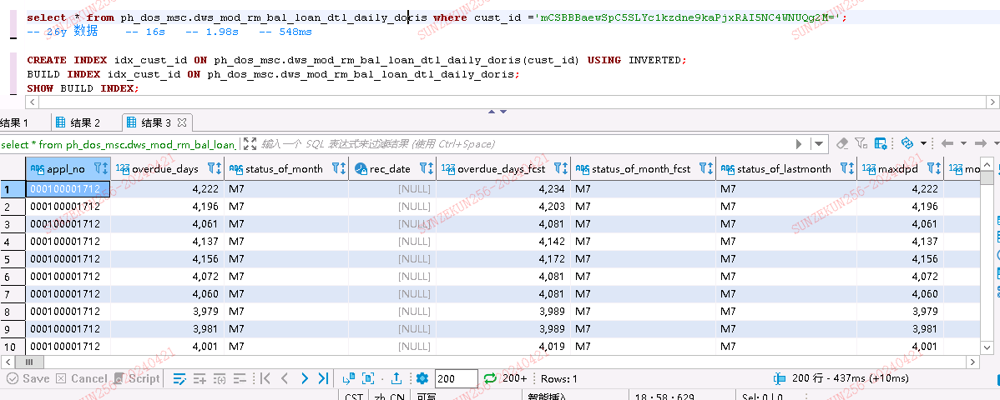

## NGram BloomFilter 索引

[https://doris.apache.org/zh-CN/docs/data-table/index/ngram-bloomfilter-index](https://doris.apache.org/zh-CN/docs/data-table/index/ngram-bloomfilter-index)

### Doris NGram BloomFilter使用注意事项

1.  NGram BloomFilter只支持字符串列
2.  NGram BloomFilter索引和BloomFilter索引为互斥关系，即同一个列只能设置两者中的一个
3.  NGram大小和BloomFilter的字节数，可以根据实际情况调优，如果NGram比较小，可以适当增加BloomFilter大小
4.  如果要查看某个查询是否命中了NGram Bloom Filter索引，可以通过查询的Profile信息查看

### 适用场景

提升like的查询性能

## 索引性能对比（亿级数据10倍提升）

[https://www.infoq.cn/article/mow1CJlqo2IH6zkDoZes](https://www.infoq.cn/article/mow1CJlqo2IH6zkDoZes)

## 索引总结

-   **大规模数据非主键列点查场景：** 在这种场景下，往往存在大量分散的数值列在值，且查询的值命中量很低。为了加速查询，除了在建表时利用 Doris 内置的智能索引（**前缀+zeroMap**）能力之外，还可以通过给对应的列增加**倒排索引**来加速查询。倒排索引对字符类型、数值类型、日期等标量类型支持比较完整。
-   **短文本列的文本检索场景：** 如果短文本分布比较**离散**（即文本之间相似度低），则适合使用 **Ngram Bloom Filter 索引**，能够有效地处理短文本的模糊匹配查询（LIKE）。同时，在短文本场景下 Apache Doris 的向量化处理能力可以得到更加充分和高效的应用和发挥。如果短文本分布比较**集中**（如大量文本相似，少量文本不同），则适合使用**倒排分词索引**，这样可以保证词典比较小，适合快速检索获取行号列表。
-   **长文本列的文本搜索场景：** 针对长文本列，**倒排分词索引**是更好的方案。相比于暴力字符串匹配，倒排索引提供了更高效的查询性能，避免了大量的 CPU 资源消耗。