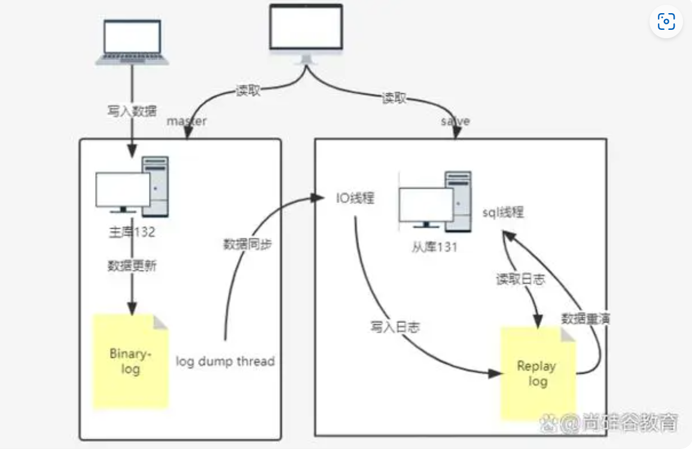

# 关系型数据库与非关系型数据对比：

## 关系型数据库（列存、事务）

### Oracle数据库

**优点**：

1.  **高可靠性和稳定性**：经过严格测试和优化，确保数据的高可用性和完整性。
2.  **强大的性能**：支持大规模数据处理和复杂查询，满足企业级应用需求。
3.  **安全性**：提供丰富的安全特性和加密功能，保护数据安全。

**缺点**：

1.  **高成本**：许可和支持费用较高，可能不适合预算有限的项目。
2.  **学习曲线**：功能复杂，初学者需要一定时间学习和适应。
3.  **资源消耗**：对硬件资源要求较高，可能需要更多投资。

**适用场景**：适用于大型企业级应用，如金融、电子商务和政府等领域，需要处理大量交易和敏感数据。

**限制**：

1.  **闭源**：无法查看源代码或进行自定义修改，灵活性受限。
2.  **部署和维护**：可能需要专业的DBA团队进行部署和维护。

### PostgreSQL

**优点**：

1.  **开源免费**：无需支付许可费用，降低总体成本。
2.  **高性能和扩展性**：支持ACID事务，确保数据一致性和可靠性；支持水平和垂直扩展，适应不同规模的应用需求。
3.  **丰富的数据类型和功能**：支持地理空间数据类型、全文搜索等，满足多种应用场景。

**缺点**：

1.  **复杂性**：配置和管理可能相对复杂，需要一定的学习成本。
2.  **商业支持有限**：虽然有一些公司提供商业支持，但相比Oracle等商业数据库可能较少。

**适用场景**：适用于金融、电商平台、物联网、地理信息系统和社交网络等场景，需要处理复杂数据和查询。

**限制**：

1.  **学习曲线**：对于初学者来说，可能需要一定时间来熟悉和掌握。
2.  **性能优化**：在高并发和大数据量场景下，可能需要进行更复杂的性能优化。

### MySQL

**体积小、速度快、总体拥有成本低，可处理上千万条记录的大型数据库，尤其是开放源码**

**这一特点，使得很多互联网公司、中小型网站选择了MySQL作为网站数据库**

**优点**：

1.  **开源免费**：降低总体成本，适合预算有限的项目。
2.  **高性能**：采用高效的索引技术，支持快速数据处理和查询。
3.  **易用性**：功能相对简单，易于学习和使用。

**缺点**：

1.  **安全性问题**：由于是开源软件，可能存在潜在的安全漏洞。
2.  **不适合大型企业级应用**：在处理大规模数据和复杂查询时，性能可能受限。
3.  **存储过程和触发器限制**：对存储过程和触发器的支持有限，可能影响某些应用程序的开发。

**适用场景**：适用于中小型网站、博客平台、在线调查系统和社交媒体平台等场景，需要处理一般规模和复杂度的数据。

**限制**：

1.  **高并发处理**：在高并发场景下，可能需要额外的优化措施来提高性能。
2.  **数据安全性**：需要额外关注数据安全问题，采取必要的安全措施。

综上所述，Oracle、PostgreSQL和MySQL各有优缺点，适用于不同的场景和需求。在选择时，应根据项目的规模、预算、性能要求和数据安全性等因素进行综合考虑。

## 非关系型数据库

有哪些：键值型数据库（Redis）、文档型数据库（**MongoDB**）、搜索引擎（**Elasticsearch**）和 列存储（Doris、clickhouse、Hbase）等，除此以外还包括图形数据库（neo4j）

优点：并发能力、横向拓展能力，大规模结构化与非结构化数据处理能力方面都会更优秀

缺点：但是在复杂的事务处理方面，需要对单行数据的并发处理时，数据的一致性可能没法保证一致，且效率不高，延迟较大，此时使用关系型数据库。

​  

# MySQL

## 增删改查、视图、存储过程（略）

## 架构原理

MySQL 是一个开源的关系型数据库管理系统（RDBMS），广泛应用于各种规模的网站和应用程序中。其架构原理设计使得 MySQL 在处理大量数据时既高效又稳定。下面将详细介绍 MySQL 的架构原理：

### 总体架构

MySQL 的总体架构可以分为几个主要部分：

-   **连接层**：负责处理客户端的连接和认证。
-   **SQL 层**：处理 SQL 查询、优化查询、生成执行计划等。
-   **存储引擎层**：负责数据的存储和检索，提供了多种存储引擎供用户选择。

### 连接层

连接层是 MySQL 的最外层，负责处理客户端的连接请求和身份验证。当客户端尝试连接到 MySQL 服务器时，连接层会检查客户端的凭证（如用户名和密码），并确定其是否有权访问数据库。一旦连接建立，客户端就可以发送 SQL 查询到服务器了。

### SQL 层

SQL 层是 MySQL 的核心部分，负责处理所有的 SQL 查询。

-   **查询解析器**：将 SQL 查询语句解析成语法树。
-   **预处理器**：检查语法树中的表和列是否存在，并解析其中的别名等。
-   **优化器**：基于统计信息和执行计划生成器，为 SQL 查询选择最优的执行计划。
-   **执行器**：按照优化器生成的执行计划执行查询，并返回结果。

### 存储引擎层

存储引擎层负责数据的实际存储和检索。MySQL 支持多种存储引擎，每种引擎都有其特定的特点和适用场景。

-   **InnoDB**：MySQL 的默认存储引擎，**支持事务**、**行级锁定**和**外键约束**。
-   **MyISAM**：早期的默认存储引擎，不支持事务和行级锁定，但读写性能在某些场景下可能更优。
-   **Memory**：将所有数据存储在 RAM 中，适用于临时表或高速缓存。

存储引擎的选择会影响数据库的性能、可靠性和功能。例如，InnoDB 适用于需要事务支持和高度可靠性的应用，而 MyISAM 可能更适合只读或大量读操作的场景。

### 缓存和缓冲

为了提高性能，MySQL 在各个层次都使用了缓存和缓冲机制。例如，查询缓存可以缓存整个查询结果，以便在相同的查询再次执行时快速返回结果；InnoDB 存储引擎有自己的缓冲池，用于缓存数据和索引。

### 复制和集群

MySQL 还支持复制和集群功能，以实现数据的备份、恢复和高可用性。通过复制，可以将数据从一个 MySQL 服务器复制到另一个服务器，以实现数据备份和负载均衡。而集群功能则可以通过多个 MySQL 服务器协同工作，提供更高的性能和可靠性。

### 总结

MySQL 的架构原理是一个复杂但高效的系统，通过连接层、SQL 层和存储引擎层的协同工作，以及缓存、复制和集群等功能的支持，使得 MySQL 能够处理大量的数据查询和存储需求，同时保持高效和稳定。

## 事务

MySQL 中的事务（Transaction）是数据库操作的基本单位，它是一个不可分割的工作单位，包含了一组对数据库的读写操作。事务的主要目的是保证数据的完整性（Integrity）和一致性（Consistency），同时它还支持数据的并发处理。事务通过一系列的控制机制来确保数据库从一个一致性状态转变到另一个一致性状态。

### 事务的特性（ACID）

1.  **原子性（Atomicity）**：事务被视为一个原子操作单元，其对数据的修改要么全都执行，要么全都不执行。
2.  **一致性（Consistency）**：事务必须使数据库从一个一致性状态变换到另一个一致性状态。
3.  **隔离性（Isolation）**：事务的执行不受其他事务的干扰，事务执行的中间结果对其他事务是不可见的。
4.  **持久性（Durability）**：一旦事务提交，则其结果就是永久性的，即使系统崩溃也不会丢失。

### MySQL 中的事务控制语句

在 MySQL 中，你可以使用以下语句来控制事务：

1.  **START TRANSACTION** 或 **BEGIN**：开始一个新的事务。
2.  **COMMIT**：提交当前事务，使所做的更改永久保存。
3.  **ROLLBACK**：回滚当前事务，取消事务中所做的所有更改。
4.  **SET TRANSACTION**：用来设置事务的隔离级别。
5.  **SAVEPOINT**：在事务中设置一个保存点，以便以后可以回滚到该点。
6.  **ROLLBACK TO [SAVEPOINT]**：回滚到指定的保存点。
7.  **RELEASE SAVEPOINT**：删除一个先前定义的保存点。

### 隔离级别

MySQL 支持四种事务隔离级别，它们决定了事务如何与其他事务隔离：

1.  **READ UNCOMMITTED**：允许读取未提交的数据。这可能导致脏读、不可重复读和幻读。
2.  **READ COMMITTED**：只允许读取已提交的数据。这可以防止脏读，但可能导致不可重复读和幻读。
3.  **REPEATABLE READ**：这是 MySQL 的默认隔离级别。它确保在同一事务中多次读取同一数据会返回相同的结果，但可能导致幻读。
4.  **SERIALIZABLE**：这是最高级别的隔离，它通过强制事务串行执行来防止脏读、不可重复读和幻读。但这也降低了并发性能。

## 锁

在MySQL中，锁（Locking）是用于管理对共享资源的并发访问的一种机制，以确保数据的一致性和完整性。当多个事务尝试同时访问或修改同一资源时，锁可以防止它们之间的冲突和不一致。MySQL提供了多种类型的锁，每种锁都有其特定的用途和场景。

### 锁的类型

1.  **共享锁（Shared Locks，S锁）**：允许一个事务去读一行，阻止其他事务对该行加排他锁。
2.  **排他锁（Exclusive Locks，X锁）**：允许一个事务去写一行，阻止其他事务对该行加任何锁。

### 锁的粒度

根据锁的粒度，MySQL中的锁可以分为以下几类：

1.  **表级锁（Table-level Locks）**：对整个表加锁，开销小，加锁快；不会出现死锁；锁定粒度大，发生锁冲突的概率最高，并发度最低。MyISAM存储引擎主要使用表级锁。
2.  **行级锁（Row-level Locks）**：仅对需要访问的行记录加锁，加锁粒度最小，并发度高，但加锁开销也最大，可能发生死锁。InnoDB存储引擎主要使用行级锁。

### InnoDB的行级锁

InnoDB存储引擎支持多种行级锁：

-   **记录锁（Record Locks）**：单个行记录上的锁。
-   **间隙锁（Gap Locks）**：锁定一个范围，但不包括记录本身。
-   **Next-key Locks**：记录锁和间隙锁的结合，锁定一个范围，并且锁定记录本身。

### 意向锁（Intention Locks）

InnoDB支持一种称为意向锁的锁，它表示一个事务想要在行上设置共享锁或排他锁。意向锁是InnoDB自动加的，不需用户干预。

-   **意向共享锁（IS锁）**：事务想要在行上设置共享锁前，必须先取得该表的IS锁。
-   **意向排他锁（IX锁）**：事务想要在行上设置排他锁前，必须先取得该表的IX锁。

### 死锁（Deadlocks）

当两个或多个事务相互等待对方释放资源时，会发生死锁。InnoDB存储引擎具有死锁检测机制，当检测到死锁时，它会主动回滚其中一个事务，从而解决死锁。

### 锁的获取与释放

-   **锁的获取**：当事务需要访问某个资源时，它会尝试获取相应的锁。如果锁已经被其他事务持有，那么当前事务可能需要等待，直到锁被释放。
-   **锁的释放**：当事务完成其操作并提交或回滚时，它会释放其持有的所有锁。

### 优化锁的使用

为了优化锁的使用和减少锁冲突，可以考虑以下策略：

-   **尽量减少锁的持有时间**：通过减少事务的大小和持续时间来减少锁的持有时间。
-   **避免热点数据**：尽量将数据分散到多个表中，以减少对同一资源的并发访问。
-   **使用合适的索引**：索引可以加快查询速度，减少锁的持有时间。
-   **调整隔离级别**：根据应用的需求和并发性能的要求，选择合适的隔离级别。

### 总结

MySQL中的锁是用于管理并发访问的重要机制。了解不同类型的锁、它们的用途和如何优化锁的使用，对于确保数据库的性能和一致性至关重要。在设计数据库和应用时，应充分考虑并发访问的需求，并选择合适的锁策略。

## 索引

MySQL中的索引是用于提高查询性能的关键数据库对象。它们允许数据库系统更快地定位到表中的特定数据，从而加速查询操作。以下是关于MySQL索引的一些重要概念和要点：

### 索引类型

MySQL支持多种类型的索引，每种索引都有其特定的用途和适用场景：

1.  **B-树索引（BTREE索引）**：这是MySQL中最常用的索引类型。它使用B-树数据结构来存储索引值，能够高效地支持范围查询和排序操作。
2.  **哈希索引**：基于哈希表实现，适用于等值查询，但不支持范围查询和排序操作。
3.  **空间索引（R-tree索引）**：用于地理空间数据类型的字段，支持空间数据的查询和计算。
4.  **全文索引**：用于在文本字段上进行全文搜索。倒排索引的原理也可与之对比。
5.  **单列索引与复合索引**：单列索引是基于单个列创建的索引，而复合索引则是基于多个列创建的索引。

### 索引的优势与劣势

**优势**：

1.  **提高查询性能**：通过减少全表扫描，加速数据检索。
2.  **保证数据唯一性**：通过创建唯一索引，确保表中每一行数据的唯一性。
3.  **加速连接操作**：在外键上创建索引可以加速两个表之间的连接操作。
4.  **优化排序和分组**：索引可以提供有序的数据访问，从而加速排序和分组操作。

**劣势**：

1.  **占用物理空间**：索引本身需要占用存储空间。
2.  **创建和维护成本**：创建索引和更新索引都需要时间，特别是在数据量大或数据变动频繁的情况下。
3.  **可能降低写入性能**：因为每次插入、更新或删除记录时，相关的索引也需要更新。

### 索引设计原则

1.  **选择性高的列（高基数）**：选择性是指不重复值与总记录数的比值，选择性越高，索引的效率越高。
2.  **避免过度索引**：不是每个列都需要索引，过多的索引会增加写操作的开销并占用更多的存储空间。
3.  **考虑查询模式**：根据实际的查询需求来设计和优化索引。
4.  **维护索引**：随着数据的插入、更新和删除，索引也需要进行维护以保持其有效性和性能。

### 索引的使用和优化

1.  **使用****EXPLAIN****命令**：通过EXPLAIN命令可以查看MySQL如何使用索引来执行查询，从而帮助优化索引和查询。
2.  **定期分析和优化表**：使用ANALYZE TABLE命令可以更新表的键分布统计信息，帮助优化器更好地选择索引。
3.  **避免在索引列上进行计算或函数操作**：这会导致索引失效，从而增加查询成本。
4.  **考虑使用覆盖索引**：如果查询只需要访问索引中的信息，而不需要回表访问实际的数据行，那么这种索引被称为覆盖索引，它可以进一步提高查询性能。

## explain使用

-   id: 查询的标识符。
-   select\_type: 查询的类型（例如 SIMPLE, SUBQUERY, DERIVED 等）。
-   table: 查询涉及的表。
-   partitions: 匹配的分区。
-   type: 访问类型。这是最重要的列之一，它告诉你 MySQL 如何连接表。在这个例子中，类型是 ref，表示使用了非唯一索引或唯一索引的前缀来查找记录。其他可能的值包括 system, const, eq\_ref, ref, range, index 和 ALL。
-   possible\_keys: 可能使用的索引。
-   key: 实际使用的索引。在这个例子中，我们使用了 username 索引。
-   key\_len: 使用的索引的长度。这可以帮助你理解索引是如何被使用的，特别是当索引包含多个列时。
-   ref: 显示了哪些列或常量被用作索引查找的条件。在这个例子中，它是 const，意味着我们查找的是一个具体的常量值。
-   rows: 估计需要检查的行数。
-   filtered: 返回结果的行数占需要检查的行数的百分比。
-   Extra: 额外的信息，如使用了文件排序、临时表等。

# MySQL-binlog日志-实时数据同步原理

## 原理

### 基于binlog日志：

主库会生成一个I/O操作线程进去写的的操作，而从库则生成两个线程，其一是I/O读取线程，其二是一个SQL线程。

总结如下三点：

1、主库将数据的操作记录到一个二进制日志中（即：binary log），也就是配置文件中指定的log-bin指定的文件就是日志文件。

2、从库将主库的日志文件拷贝到他的中继日志即配置文件中指定的relay log日志文件中，I/O线程去请求主库的bin-log日志，并将日志写入到relay log中继日志中，此时主库会生成一个log dump线程，用来给从库I/O线程传输bin-log日志件。

3、从库会更新relay log文件中的操作，将数据的改变在从库中进行数据重演即重新执行一次，即SQL线程执行操作，将日志文件中的记录变为数据操作行为再次执行，以达到主从数据最终一致性的目的。

​  



### 基于事务+binlog日志

```sql
gtid_mode = ON    #开启gtid
enforce_gtid_consistency=1   #强制gtid
```

GTID工作原理

1、master更新数据时，会在事务前产生GTID，一同记录到binlog日志中。

2、slave端的i/o 线程将变更的binlog，写入到本地的relay log中。

3、sql线程从relay log中获取GTID，然后对比slave端的binlog是否有记录。

4、如果有记录，说明该GTID的事务已经执行，slave会忽略。

5、如果没有记录，slave就会从relay log中执行该GTID的事务，并记录到binlog

## binlog日志

MySQL的binlog日志有三种格式，分别是Statement格式、Row格式和Mixed格式。

**Statement格式**

Statement格式是最简单的binlog格式，记录的是执行的SQL语句，可以通过解析SQL语句来恢复数据。这种格式的优点是简单、易于理解和分析，缺点是可能会出现数据不一致的情况，因为同一个SQL语句在不同的环境下可能会产生不同的结果。

若使用current\_time这样的函数来过滤会出现啥问题？

**Row格式（较稳定）**

Row格式是记录每一行数据的变化，包括插入、删除和更新操作。这种格式的优点是数据恢复准确、不会出现数据不一致的情况，缺点是日志量大，对于大量的数据变化会产生大量的日志。

**Mixed格式**

Mixed格式是Statement格式和Row格式的混合体，MySQL会自动选择使用哪种格式来记录日志。对于简单的SQL语句，使用Statement格式，对于复杂的SQL语句，使用Row格式。这种格式的优点是兼顾了简单和复杂情况下的优点，缺点是可能会出现数据不一致的情况。

## cdc工具实时同步MySQL数据

通过读取MySQL的binlog日志，解析日志，将日志的insert update delete等操作在目标端重放。