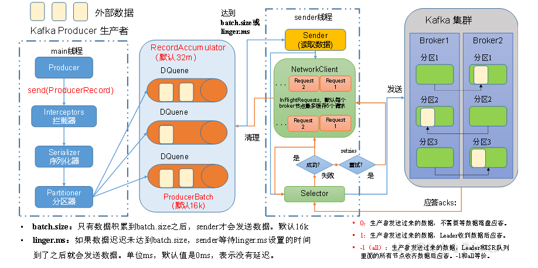
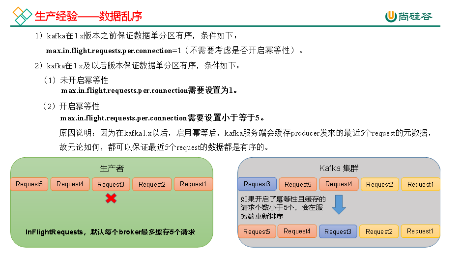
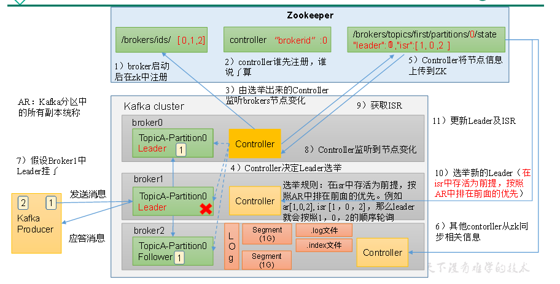
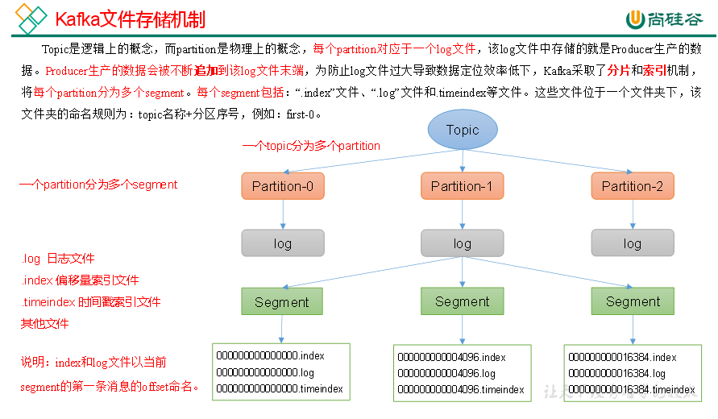
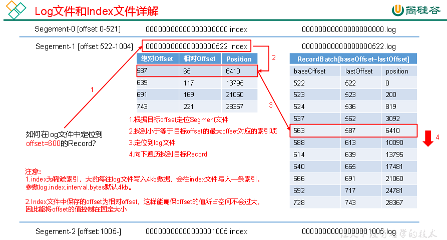
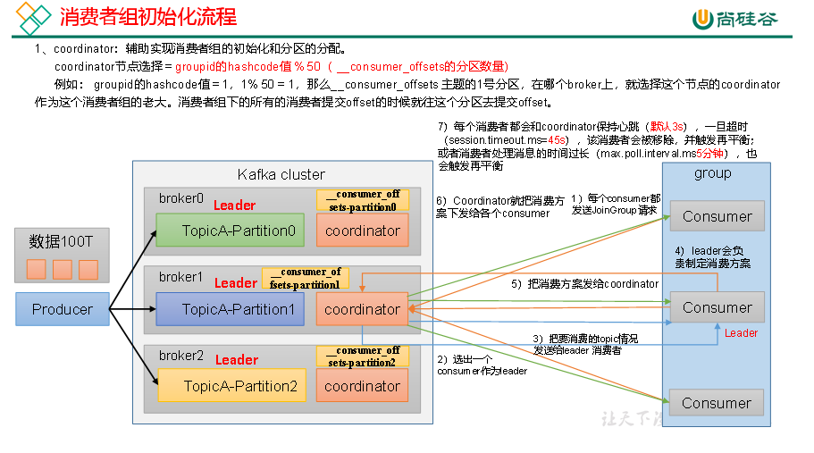
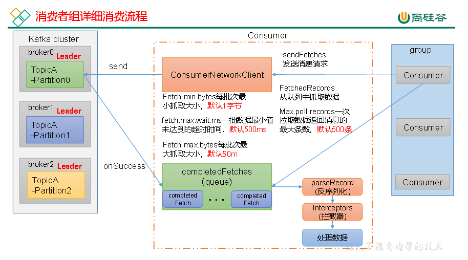
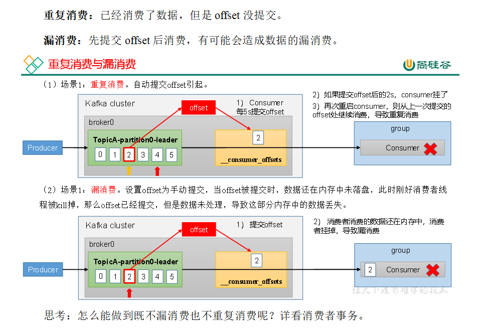
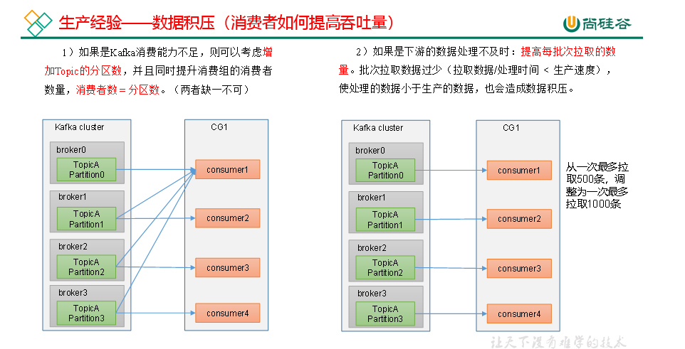

# 是什么？

缓存、消息队列、中间站、削峰填谷，高吞吐，低延迟，高伸缩，高可靠性，高并发，且社区活跃度高等特性

# 基本概念

## 生产者（producer）：数据的生产端

**生产者发送数据分区规则：** 指明分区；key的hash值模上分区；粘性分区（随机选择一个分区写入一个batch的数据，之后随机选择其他分区）。

**调整速率：**batch.size默认16k调大调小、recordaccumulator默认32M调大调小。

**数据一致性：**acks=-1 且 broker副本数大于等于2。

**数据顺序保证：**

生产环境一般是单表一个topic，并且都是多分区多副本。

**① 使用upsertKafka:（当前生产正在使用的）**

使用upsertKafka，需制定primary key ，当key相同时，发往同一个partition，kafka内会以回撤的形式修正数据，实现幂等。

**② 使用kafka链接器（该方式需要测试）**

flinksql（primary key并非写kafka的分区key） 往kafka（可指定“key.fields”，让相同key数据写入同一分区）写。同时，设置max.in.flight.erquests.per.connection=1或者开启幂等设置max.in.flight.erquests.per.connection<=5从而达到数据有序。

  

| **参数名** | **参数作用** | **类型** | **默认值** | **推荐值** |
| --- | --- | --- | --- | --- |
| bootstrap.servers | 集群地址，格式为： brokerIP1:端口号,brokerIP2:端口号 | 必须 | ​ | ​ |
| key.serializer | 对生产数据Key进行序列化的类完整名称 | 必须 | ​ | Kafka提供的字符串序列化类：StringSerializer |
| value.serializer | 对生产数据Value进行序列化的类完整名称 | 必须 | ​ | Kafka提供的字符串序列化类：StringSerializer |
| interceptor.classes | 拦截器类名，多个用逗号隔开 | 可选 | ​ | ​ |
| batch.size | 数据批次字节大小。此大小会和数据最大估计值进行比较，取大值。 估值=61+21+（keySize+1+valueSize+1+1） | 可选 | 16K | ​ |
| retries | 重试次数 | 可选 | 整型最大值 | 0或整型最大值 |
| request.timeout.ms | 请求超时时间 | 可选 | 30s | ​ |
| linger.ms | 数据批次在缓冲区中停留时间 | 可选 | ​ | ​ |
| acks | 请求应答类型：all(-1), 0, 1 | 可选 | all(-1) | 根据数据场景进行设置 |
| retry.backoff.ms | 两次重试之间的时间间隔 | 可选 | 100ms | ​ |
| buffer.memory | 数据收集器缓冲区内存大小 | 可选 | 32M | 64M |
| max.in.flight.requests.per.connection | 每个节点连接的最大同时处理请求的数量 | 可选 | 5 | 小于等于5 |
| enable.idempotence | 幂等性， | 可选 | true | 根据数据场景进行设置 |
| partitioner.ignore.keys | 是否放弃使用数据key选择分区 | 可选 | false | ​ |
| partitioner.class | 分区器类名 | 可选 | null | ​ |

  

## kafka主体节点（broker）：数据存储，一个节点一个broker

topic：存储数据的逻辑主体，生产和消费的对象

partition：topic的分区，一个topic有多个分区

replica：每个分区数据会有多个副本

leader：副本间有主从之分；broker之间有主从之分

follower：

contoller：先在zookeeper注册的broker为controller，监听brokers的变化。

segment：默认1G大小，存储数据的逻辑主体

.log：存储数据的实际主体，名字用的第一条数据的索引

.index：稀疏索引，4kb数据穿插一个索引

## 消费者（consumer）：消费数据

消费者：读取kafka的一个客户端

消费者组：拥有相同组标识的消费者

消费者分区：range（topic分区数/consumer数，来分配消费分区数量，topic多时会倾斜）、roundrobin（轮询，多topic一起轮询）、Sticky（尽量不动，再按照range或者roundrobin来分配）

  

  

  

