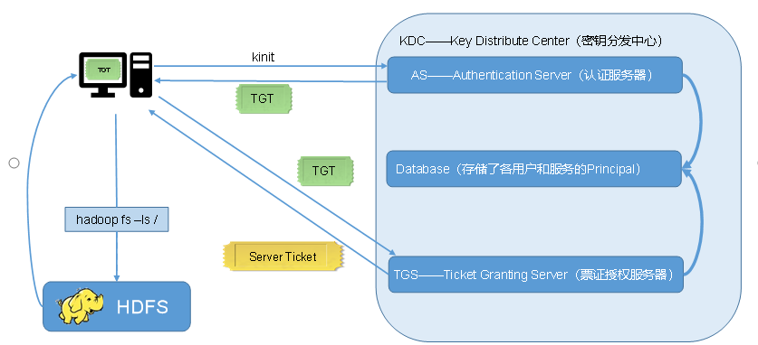
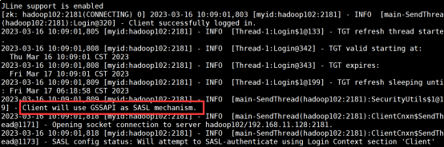

# 概念

**kerberos:** 用于用户身份验证，管控资源的访问权限。

**KDC（Key Distribute Center）：**密钥分发中心，负责管理发放票据，记录授权。

**Realm：**Kerberos所管理的一个领域或范围，称之为一个Realm。

**principal：**Kerberos所管理的一个服务。格式：ServiceName/HostName@REALM，如：yarn/pa101@HADOOP.COM、yarn/pa102@HADOOP.COM，可理解为@HADOOP.COM域的两台机器上的yarn服务。

**keytab：**Kerberos中的用户认证，可通过密码或者密钥文件证明身份，keytab指密钥文件。

**认证原理：**用户要访问对应的资源（资源在一个realm下），则需要认证相应的realm，认证通过会获取到一个秘钥，用户可持秘钥认证后访问资源。



常用命令及配置文件

```sql
安装：
yum install -y krb5-server krb5-workstation krb5-libs  -- 安装kdc
yum install -y krb5-workstation krb5-libs			-- 安装client
conf：
/var/kerberos/krb5kdc/kdc.conf		-- 设置kdc端口 realm（@xxxx）
/etc/krb5.conf						-- 域名、kdc的配置与连接信息
认证：
kadmin.local    -- 可登录kdc，做主体/策略相关的增删改查、keytab文件生成，密码修改等。
  addprinc -randkey test/test
  xst -k /etc/security/keytab/test.keytab test/test
kinit USERNAME         -- 输入密码后可认证成功获得票据访问对应域下资源。
kadmin.local -q "xst -norandkey -k  /root/test.keytab test@EXAMPLE.COM"   		-- kdc执行，用于生成keytab文件，代替用户密码的方式验证。-norandkey 参数必须带，生产要是敢不带你就gg了。
kinit -kt /root/test.keytab test  -- 免密的方式认证获取票据
klist     -- 列出认证的principal
kdestroy	-- 销毁认证
```

日志文件参考krb5配置中的log路径：

/etc/krb5.conf

# 二、使用

注：大数据集群，正常需要对hdfs、yarn、mr、hive、hbase、kafka这些公共资源及访问公共资源的组件flume、Maxwell、sqoop等做kerberos认证。

以zookeeper的kerberos集成为例：

操作前配置用户在集群内的免密

①先创建principal

```sql
kadmin -padmin/admin -wadmin -q"addprinc -randkey zookeeper/hadoop102"
```

②生成principal的keytab文件

```sql
kadmin -padmin/admin -wadmin -q"xst -k /etc/security/keytab/zookeeper.keytab zookeeper/hadoop102"
chown zookeeper:hadoop /etc/security/keytab/zookeeper.keytab
```

​  

③修改zoo.cfg开启认证

```sql
vim zoo.cfg
#添加如下内容

#kerberos认证配置
authProvider.1=org.apache.zookeeper.server.auth.SASLAuthenticationProvider
jaasLoginRenew=3600000
sessionRequireClientSASLAuth=true
```

④jaas.conf文件指定principal和keytab文件 -- 该文件时java程序需配置的，用于指定客户端和服务端的kerberos交互，如kafka认证时也需要开启

```sql
vim /opt/module/zookeeper/conf/jaas.conf

Server {
   com.sun.security.auth.module.Krb5LoginModule required
   useKeyTab=true
   keyTab="/etc/security/keytab/zookeeper.keytab"
   storeKey=true
   useTicketCache=false
   principal="zookeeper/hadoop102@EXAMPLE.COM";
};
Client {
   com.sun.security.auth.module.Krb5LoginModule required
   useKeyTab=true
   keyTab="/etc/security/keytab/zookeeper.keytab"
   storeKey=true
   useTicketCache=false
   principal="zookeeper/hadoop102@EXAMPLE.COM";
```

⑤java.env文件，定义了jvm认证使用kerberos

```sql
vim /opt/module/zookeeper/conf/java.env

export SERVER_JVMFLAGS="-Djava.security.auth.login.config=/opt/module/zookeeper/conf/jaas.conf -Djava.security.krb5.conf=/etc/krb5.conf"
export CLIENT_JVMFLAGS="${CLIENT_JVMFLAGS} -Djava.security.auth.login.config=/opt/module/zookeeper/conf/jaas.conf -Djava.security.krb5.conf=/etc/krb5.conf -Dzookeeper.server.principal=zookeeper/hadoop102@EXAMPLE.COM"
```

⑥以zookeeper用户启动zookeeper服务验证

```sql
sudo -i -u zookeeper /opt/module/zookeeper/bin/zkServer.sh start

bin/zkCli.sh -server hadoop102:2181
```



  

详细参考：

[尚硅谷大数据技术之Kerberos.docx](https://www.yuque.com/attachments/yuque/0/2024/docx/35670500/1719146046215-877f2ed7-da8d-427e-a8f5-fcda68c2348c.docx)