### 概述

MapReduce是一个分布式运算程序的编程框架

## 优点：

**MapReduce易于编程：**它简单的实现一些接口，就可以完成一个分布式程序

**良好的扩展性：**通过简单的增加机器来扩展它的计算能力

**高容错性：**其中一台机器挂了，它可以把上面的计算任务转移到另外一个节点上运行，不至于这个任务运行失败

**适合PB级以上海量数据的离线处理：**可以实现上千台服务器集群并发工作，提供数据处理能力。

## 缺点

**不擅长实时计算：毫秒级或秒级无法做到**

**不擅长流式计算：mapreduce是以批量的形式处理数据**

**不擅长DAG（有向无环图）计算：**每个MapReduce作业的输出结果都会写入到磁盘，会造成大量的磁盘IO，导致性能非常的低下。

# 核心编程思想

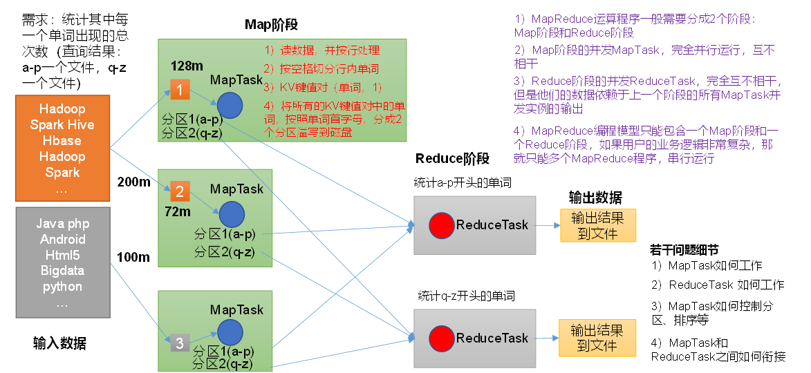

（1）分布式的运算程序往往需要分成至少2个阶段。

（2）第一个阶段的MapTask并发实例，完全并行运行，互不相干。

（3）第二个阶段的ReduceTask并发实例互不相干，但是他们的数据依赖于上一个阶段的所有MapTask并发实例的输出。

（4）MapReduce编程模型只能包含一个Map阶段和一个Reduce阶段，如果用户的业务逻辑非常复杂，那就只能多个MapReduce程序，串行运行。

总结：分析WordCount数据流走向深入理解MapReduce核心思想。

# 核心进程

（1）**MrAppMaster**：负责整个程序的过程调度及状态协调。

（2）**MapTask**：负责Map阶段的整个数据处理流程。

（3）**ReduceTask**：负责Reduce阶段的整个数据处理流程。

（4）Driver：相当于客户端，用于封装map、reduce计算过程并以job形式提交

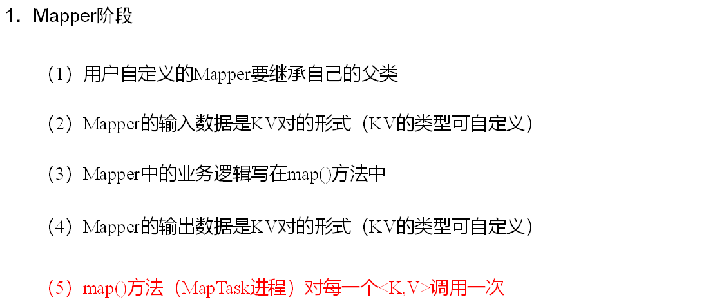

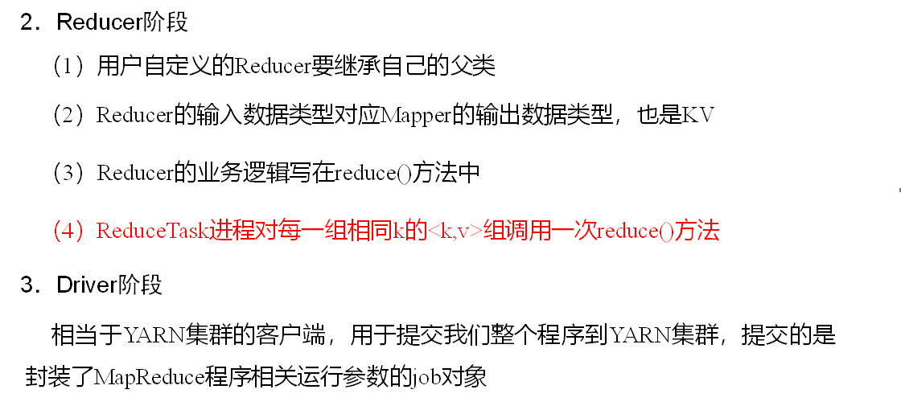

# 数据类型

| **Java****类型** | **Hadoop Writable****类型** |
| --- | --- |
| Boolean | BooleanWritable |
| Byte | ByteWritable |
| Int | IntWritable |
| Float | FloatWritable |
| Long | LongWritable |
| Double | DoubleWritable |
| String | Text |
| Map | MapWritable |
| Array | ArrayWritable |
| Null | NullWritable |

# 序列化

1）Java的序列化是一个重量级序列化框架（Serializable），一个对象被序列化后，会附带很多额外的信息（各种校验信息，Header，继承体系等），不便于在网络中高效传输。所以，Hadoop自己开发了一套序列化机制（Writable）。

Hadoop序列化特点：

**（****1****）紧凑****：**高效使用存储空间。

**（****2****）快速：**读写数据的额外开销小。

**（3）互操作：**支持多语言的交互

2）具体实现bean对象序列化步骤如下7步。

（1）必须实现Writable接口

```bash
public class FlowBean implements Writable {
......
}
```

（2）反序列化时，需要反射调用空参构造函数，所以必须有空参构造

```bash
public FlowBean() {
super();
}
```

（3）重写序列化方法

```bash
@Override
public void write(DataOutput out) throws IOException {
out.writeLong(upFlow);
out.writeLong(downFlow);
out.writeLong(sumFlow);
}
```

（4）重写反序列化方法

```bash
@Override
public void readFields(DataInput in) throws IOException {
upFlow = in.readLong();
downFlow = in.readLong();
sumFlow = in.readLong();
}
```

（5）注意反序列化的顺序和序列化的顺序完全一致

（6）要想把结果显示在文件中，需要重写toString()，可用"\\t"分开，方便后续用。

（7）如果需要将自定义的bean放在key中传输，则还需要实现Comparable接口，因为MapReduce框中的Shuffle过程要求对key必须能排序。​

```bash
@Override
public int compareTo(FlowBean o) {
// 倒序排列，从大到小
return this.sumFlow > o.getSumFlow() ? -1 : 1;
}
```

# 框架原理

## InputFormat数据输入

### 切片与MapTask并行度决定机制

**MapTask的并行度：**决定Map阶段的任务处理并发度，进而影响到整个Job的处理速度。

**数据块：**Block是HDFS物理上把数据分成一块一块。数据块是HDFS存储数据单位。

**数据切片：**数据切片只是在逻辑上对输入进行分片，并不会在磁盘上将其切分成片进行存储。数据切片是MapReduce程序计算输入数据的单位，一个切片会对应启动一个MapTask。

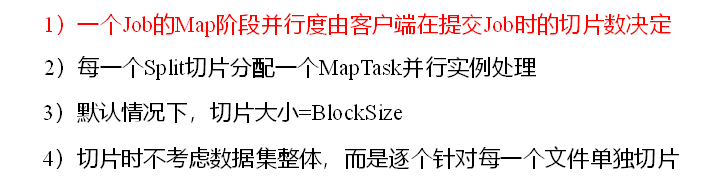

### FileInputFormat切片大小由minSize maxSize和blocksize共同确认

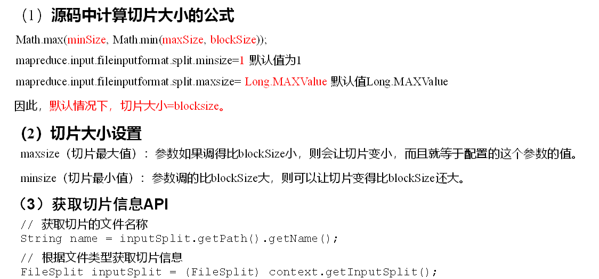

### FileInputFormat输入实现类

FileInputFormat常见的接口实现类包括：TextInputFormat、KeyValueTextInputFormat、NLineInputFormat、CombineTextInputFormat和自定义InputFormat等

#### TextInputFormat

TextInputFormat是默认的FileInputFormat实现类。按行读取每条记录。键是存储该行在整个文件中的起始字节偏移量， LongWritable类型。值是这行的内容，不包括任何行终止符（换行符和回车符），Text类型。

#### CombineTextInputFormat

CombineTextInputFormat用于小文件过多的场景，它可以将多个小文件从逻辑上规划到一个切片中，这样，多个小文件就可以交给一个MapTask处理。

切片

## MapReduce工作流程

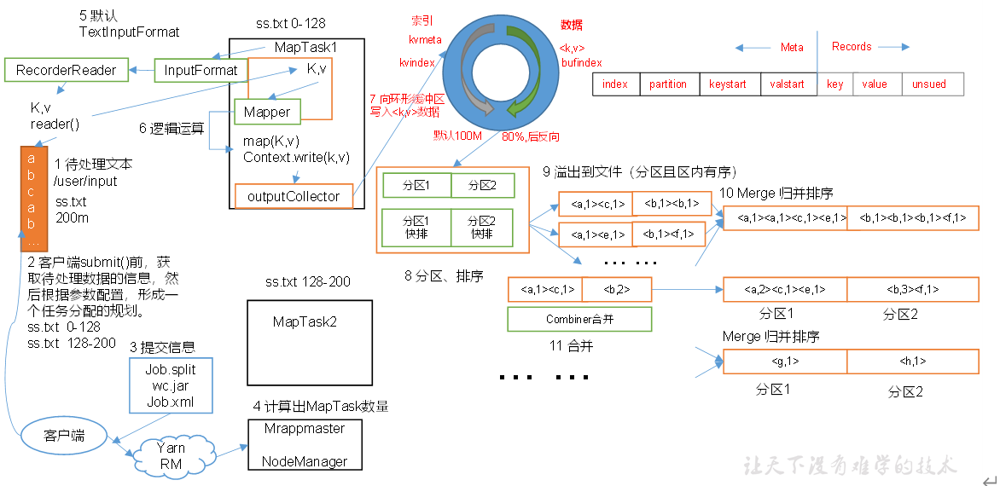

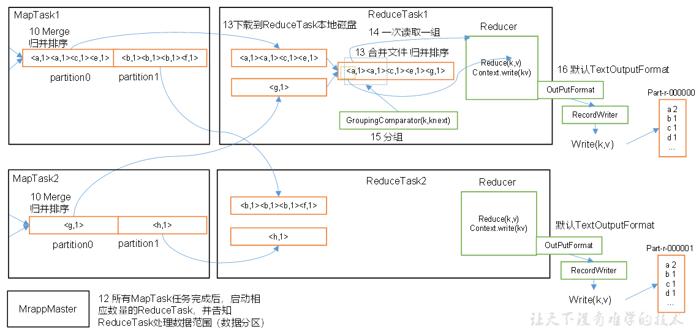

上面的流程是整个MapReduce最全工作流程，但是Shuffle过程只是从第7步开始到第16步结束，具体Shuffle过程详解，如下：

（1）MapTask收集我们的map()方法输出的kv对，放到内存缓冲区中

（2）从内存缓冲区不断溢出本地磁盘文件，可能会溢出多个文件

（3）多个溢出文件会被合并成大的溢出文件

（4）在溢出过程及合并的过程中，都要调用Partitioner进行分区和针对key进行排序

（5）ReduceTask根据自己的分区号，去各个MapTask机器上取相应的结果分区数据

（6）ReduceTask会抓取到同一个分区的来自不同MapTask的结果文件，ReduceTask会将这些文件再进行合并（归并排序）

（7）合并成大文件后，Shuffle的过程也就结束了，后面进入ReduceTask的逻辑运算过程（从文件中取出一个一个的键值对Group，调用用户自定义的reduce()方法）

**注意：**

（1）Shuffle中的缓冲区大小会影响到MapReduce程序的执行效率，原则上说，缓冲区越大，磁盘io的次数越少，执行速度就越快。

（2）缓冲区的大小可以通过参数调整，参数：mapreduce.task.io.sort.mb默认100M。

## Shuffle机制

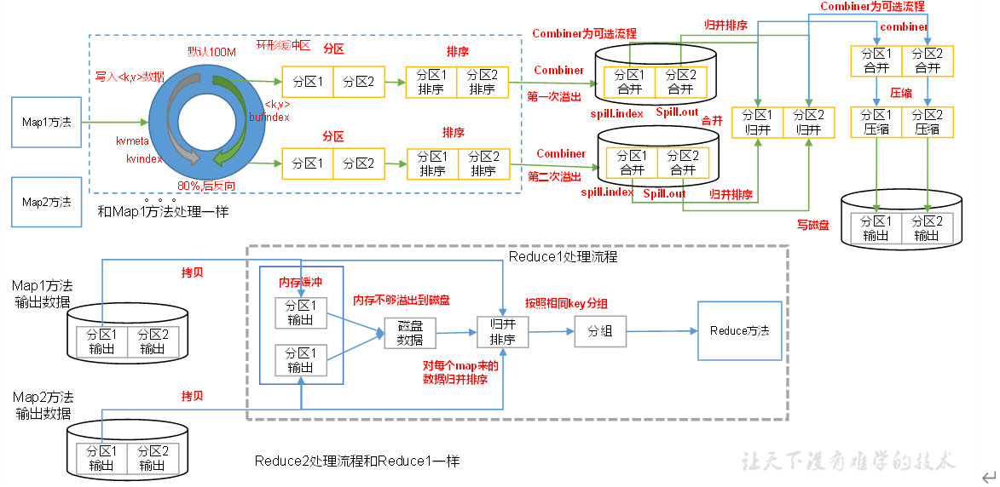

### partition分区

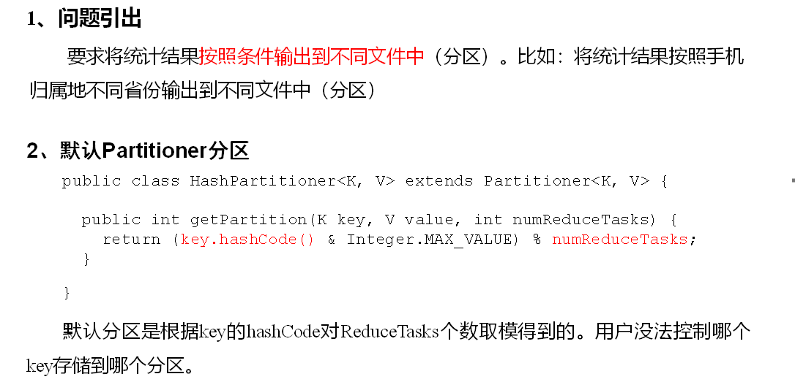

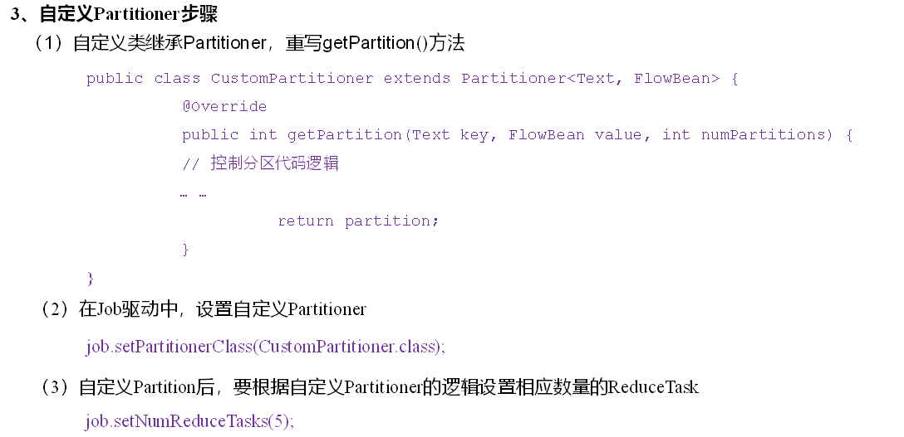

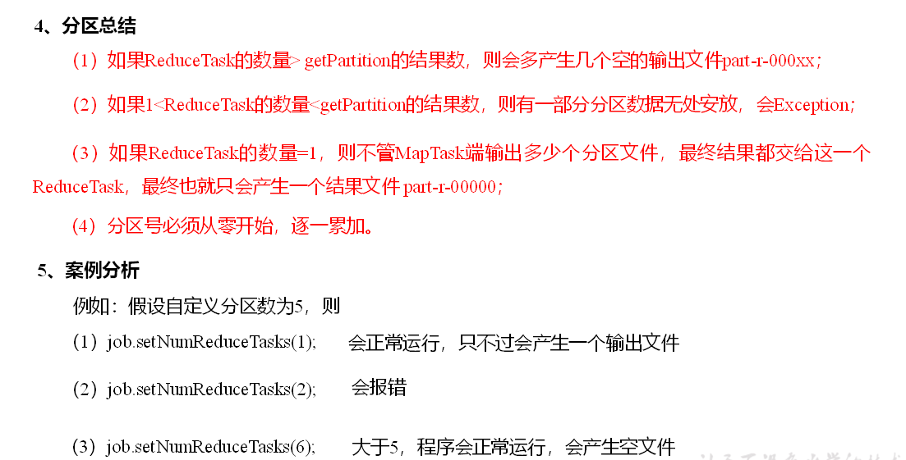

### WritableComparable排序

**MapReduce中的排序**

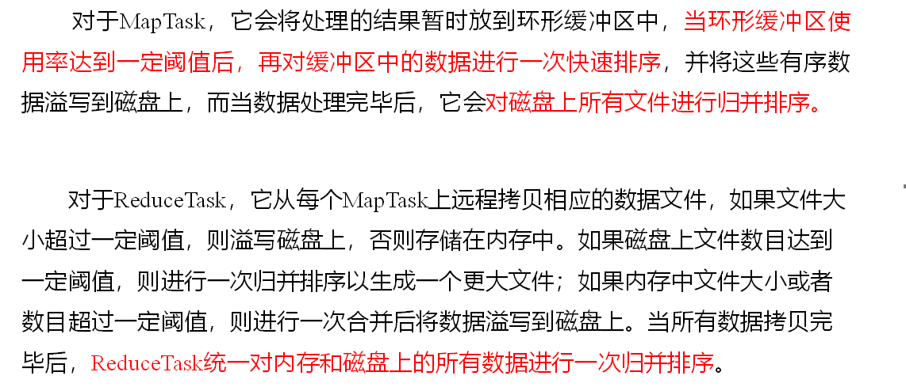

**排序分类**

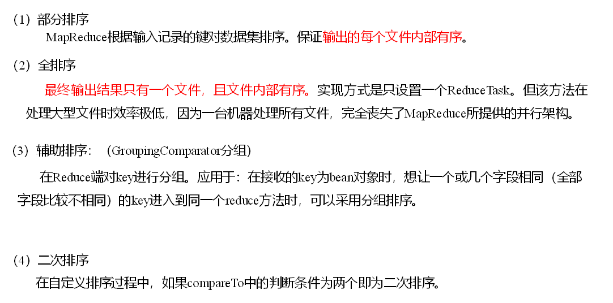

注：部分排序是指自定义了分区，全排序是指最终只有一个reduce输出结果

**自定义排序****WritableComparable****原理分析**

bean对象做为key传输，需要实现WritableComparable接口重写compareTo方法，就可以实现排序。

### combine预聚合

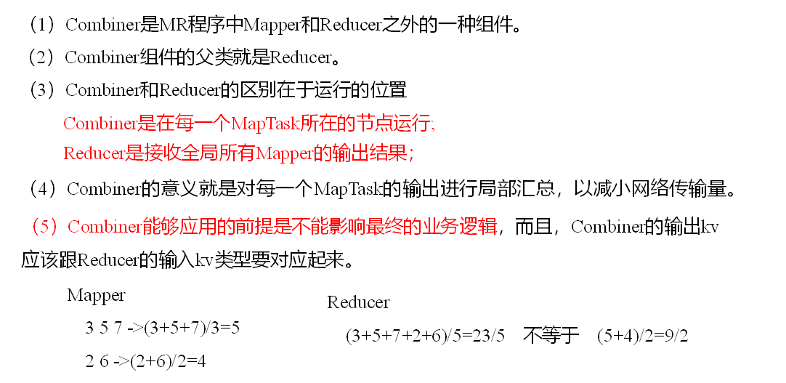

## OutputFormat数据输出

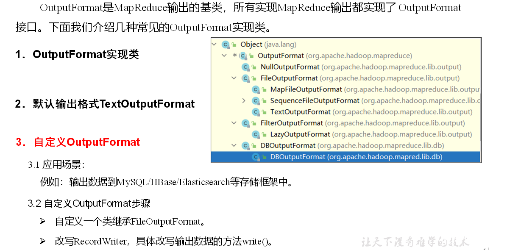

## maptask工作机制

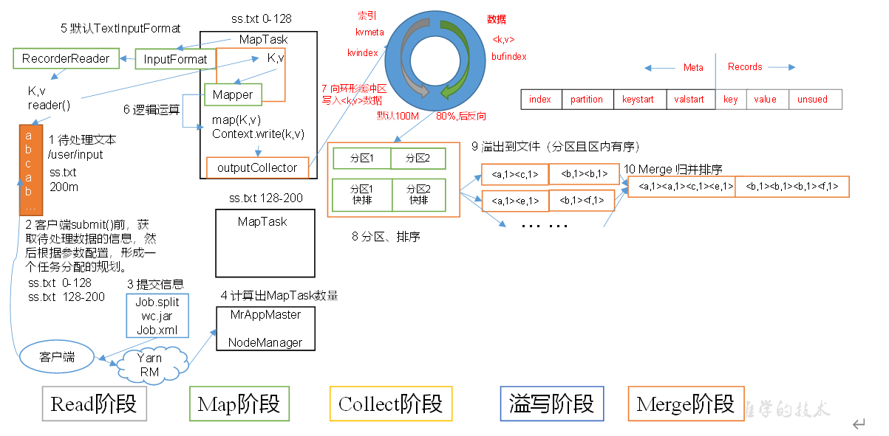

（1）Read阶段：MapTask通过InputFormat获得的RecordReader，从输入InputSplit中解析出一个个key/value。

​（2）Map阶段：该节点主要是将解析出的key/value交给用户编写map()函数处理，并产生一系列新的key/value。

​（3）Collect收集阶段：在用户编写map()函数中，当数据处理完成后，一般会调用OutputCollector.collect()输出结果。在该函数内部，它会将生成的key/value分区（调用Partitioner），并写入一个环形内存缓冲区中。

​（4）Spill阶段：即“溢写”，当环形缓冲区满后，MapReduce会将数据写到本地磁盘上，生成一个临时文件。需要注意的是，将数据写入本地磁盘之前，先要对数据进行一次本地排序，并在必要时对数据进行合并、压缩等操作。

​溢写阶段详情：

​步骤1：利用快速排序算法对缓存区内的数据进行排序，排序方式是，先按照分区编号Partition进行排序，然后按照key进行排序。这样，经过排序后，数据以分区为单位聚集在一起，且同一分区内所有数据按照key有序。

​步骤2：按照分区编号由小到大依次将每个分区中的数据写入任务工作目录下的临时文件output/spillN.out（N表示当前溢写次数）中。如果用户设置了Combiner，则写入文件之前，对每个分区中的数据进行一次聚集操作。

​步骤3：将分区数据的元信息写到内存索引数据结构SpillRecord中，其中每个分区的元信息包括在临时文件中的偏移量、压缩前数据大小和压缩后数据大小。如果当前内存索引大小超过1MB，则将内存索引写到文件output/spillN.out.index中。

​（5）Merge阶段：当所有数据处理完成后，MapTask对所有临时文件进行一次合并，以确保最终只会生成一个数据文件。

​当所有数据处理完后，MapTask会将所有临时文件合并成一个大文件，并保存到文件output/file.out中，同时生成相应的索引文件output/file.out.index。

​在进行文件合并过程中，MapTask以分区为单位进行合并。对于某个分区，它将采用多轮递归合并的方式。每轮合并mapreduce.task.io.sort.factor（默认10）个文件，并将产生的文件重新加入待合并列表中，对文件排序后，重复以上过程，直到最终得到一个大文件。

让每个MapTask最终只生成一个数据文件，可避免同时打开大量文件和同时读取大量小文件产生的随机读取带来的开销。

## reducetask工作机制

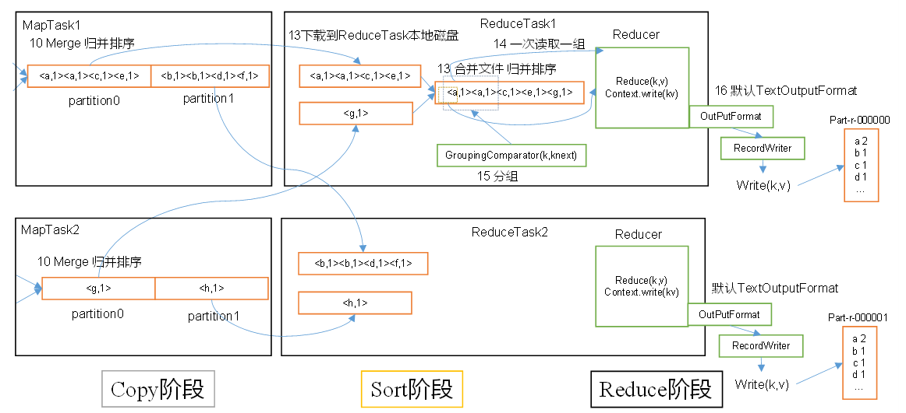

（1）Copy阶段：ReduceTask从各个MapTask上远程拷贝一片数据，并针对某一片数据，如果其大小超过一定阈值，则写到磁盘上，否则直接放到内存中。

​（2）Sort阶段：在远程拷贝数据的同时，ReduceTask启动了两个后台线程对内存和磁盘上的文件进行合并，以防止内存使用过多或磁盘上文件过多。按照MapReduce语义，用户编写reduce()函数输入数据是按key进行聚集的一组数据。为了将key相同的数据聚在一起，Hadoop采用了基于排序的策略。由于各个MapTask已经实现对自己的处理结果进行了局部排序，因此，ReduceTask只需对所有数据进行一次归并排序即可。

（3）Reduce阶段：reduce()函数将计算结果写到HDFS上。

### ReduceTask并行度决定机制

MapTask并行度由切片个数决定，切片个数由输入文件和切片规则决定。

ReduceTask的并行度同样影响整个Job的执行并发度和执行效率，但与MapTask的并发数由切片数决定不同，ReduceTask数量的决定是可以直接手动设置：

```bash
// 默认值是1，手动设置为4
job.setNumReduceTasks(4);
```

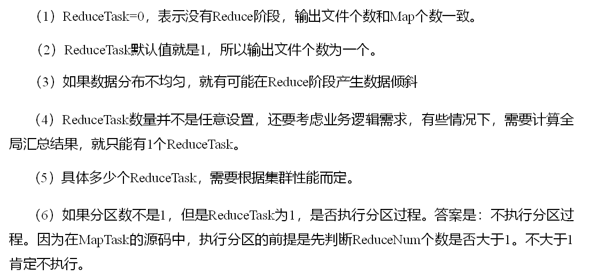

## join应用

### Reduce Join

Map端的主要工作：为来自不同表或文件的key/value对，打标签以区别不同来源的记录。然后用连接字段作为key，其余部分和新加的标志作为value，最后进行输出。

Reduce端的主要工作：在Reduce端以连接字段作为key的分组已经完成，我们只需要在每一个分组当中将那些来源于不同文件的记录（在Map阶段已经打标志）分开，最后进行合并就ok了。

缺点：这种方式中，合并的操作是在Reduce阶段完成，Reduce端的处理压力太大，Map节点的运算负载则很低，资源利用率不高，且在Reduce阶段极易产生数据倾斜。

解决方案：Map端实现数据合并。

### Map Join

**1****）使用场景**

Map Join适用于一张表十分小、一张表很大的场景。

**2****）优点**

思考：在Reduce端处理过多的表，非常容易产生数据倾斜。怎么办？

在Map端缓存多张表，提前处理业务逻辑，这样增加Map端业务，减少Reduce端数据的压力，尽可能的减少数据倾斜。

**3****）具体办法：采用****DistributedCache**

​（1）在Mapper的setup阶段，将文件读取到缓存集合中。

​（2）在Driver驱动类中加载缓存。

```bash
//缓存普通文件到Task运行节点。
job.addCacheFile(new URI("file:///e:/cache/pd.txt"));
//如果是集群运行,需要设置HDFS路径
job.addCacheFile(new URI("hdfs://hadoop102:8020/cache/pd.txt"));
```

## MapReduce开发总结

**1****）输入数据接口：****InputFormat**

（1）默认使用的实现类是：TextInputFormat

（2）TextInputFormat的功能逻辑是：一次读一行文本，然后将该行的起始偏移量作为key，行内容作为value返回。

（3）CombineTextInputFormat可以把多个小文件合并成一个切片处理，提高处理效率。

**2****）逻辑处理接口：****Mapper**

用户根据业务需求实现其中三个方法：map() setup() cleanup ()

**3****）****Partitioner****分区**

（1）有默认实现 HashPartitioner，逻辑是根据key的哈希值和numReduces来返回一个分区号；key.hashCode()&Integer.MAXVALUE % numReduces

（2）如果业务上有特别的需求，可以自定义分区。

**4****）****Comparable****排序**

（1）当我们用自定义的对象作为key来输出时，就必须要实现WritableComparable接口，重写其中的compareTo()方法。

（2）部分排序：对最终输出的每一个文件进行内部排序。

（3）全排序：对所有数据进行排序，通常只有一个Reduce。

（4）二次排序：排序的条件有两个。

**5****）****Combiner****合并**

Combiner合并可以提高程序执行效率，减少IO传输。但是使用时必须不能影响原有的业务处理结果。

**6****）逻辑处理接口：****Reducer**

用户根据业务需求实现其中三个方法：reduce() setup() cleanup ()

**7****）输出数据接口：****OutputFormat**

（1）默认实现类是TextOutputFormat，功能逻辑是：将每一个KV对，向目标文本文件输出一行。

（2）用户还可以自定义OutputFormat。

# Hadoop数据压缩

## 概述

**1****）压缩的好处和坏处**

压缩的优点：以减少磁盘IO、减少磁盘存储空间。

压缩的缺点：增加CPU开销。

**2****）压缩原则**

（1）运算密集型的Job，少用压缩

（2）IO密集型的Job，多用压缩

## MR支持的压缩编码

压缩方式选择时重点考虑：压缩/解压缩速度、压缩率（压缩后存储大小）、压缩后是否可以支持切片。

1）压缩算法对比介绍

| 压缩格式 | Hadoop自带？ | 算法 | 文件扩展名 | 是否可切片 | 换成压缩格式后，原来的程序是否需要修改 |
| --- | --- | --- | --- | --- | --- |
| DEFLATE | 是，直接使用 | DEFLATE | .deflate | 否 | 和文本处理一样，不需要修改 |
| Gzip | 是，直接使用 | DEFLATE | .gz | 否 | 和文本处理一样，不需要修改 |
| bzip2 | 是，直接使用 | bzip2 | .bz2 | 是 | 和文本处理一样，不需要修改 |
| LZO | 否，需要安装 | LZO | .lzo | 是 | 需要建索引，还需要指定输入格式 |
| Snappy | 是，直接使用 | Snappy | .snappy | 否 | 和文本处理一样，不需要修改 |

2）压缩性能的比较

| 压缩算法 | 原始文件大小 | 压缩文件大小 | 压缩速度 | 解压速度 |
| --- | --- | --- | --- | --- |
| gzip | 8.3GB | 1.8GB | 17.5MB/s | 58MB/s |
| bzip2 | 8.3GB | 1.1GB | 2.4MB/s | 9.5MB/s |
| LZO | 8.3GB | 2.9GB | 49.3MB/s | 74.6MB/s |

  

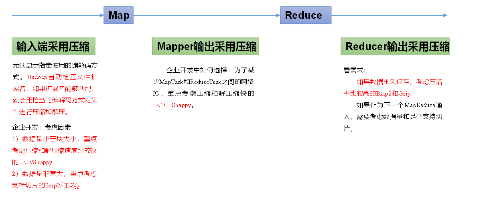

要在Hadoop中启用压缩，可以配置如下参数

| 参数 | 默认值 | 阶段 | 建议 |
| --- | --- | --- | --- |
| io.compression.codecs<br>（在core-site.xml中配置） | 无，这个需要在命令行输入hadoop checknative查看 | 输入压缩 | Hadoop使用文件扩展名判断是否支持某种编解码器 |
| mapreduce.map.output.compress（在mapred-site.xml中配置） | false | mapper输出 | 这个参数设为true启用压缩 |
| mapreduce.map.output.compress.codec（在mapred-site.xml中配置） | org.apache.hadoop.io.compress.DefaultCodec | mapper输出 | 企业多使用LZO或Snappy编解码器在此阶段压缩数据 |
| mapreduce.output.fileoutputformat.compress（在mapred-site.xml中配置） | false | reducer输出 | 这个参数设为true启用压缩 |
| mapreduce.output.fileoutputformat.compress.codec（在mapred-site.xml中配置） | org.apache.hadoop.io.compress.DefaultCodec | reducer输出 | 使用标准工具或者编解码器，如gzip和bzip2 |

# mr编写过程中常见异常

1）导包容易出错。尤其Text和CombineTextInputFormat。

2）Mapper中第一个输入的参数必须是LongWritable或者NullWritable，不可以是IntWritable. 报的错误是类型转换异常。

3）java.lang.Exception: java.io.IOException: Illegal partition for 13926435656 (4)，说明Partition和ReduceTask个数没对上，调整ReduceTask个数。

4）如果分区数不是1，但是reducetask为1，是否执行分区过程。答案是：不执行分区过程。因为在MapTask的源码中，执行分区的前提是先判断ReduceNum个数是否大于1。不大于1肯定不执行。

5）在Windows环境编译的jar包导入到Linux环境中运行，

hadoop jar wc.jar com.atguigu.mapreduce.wordcount.WordCountDriver /user/atguigu/ /user/atguigu/output

报如下错误：

Exception in thread "main" java.lang.UnsupportedClassVersionError: com/atguigu/mapreduce/wordcount/WordCountDriver : Unsupported major.minor version 52.0

原因是Windows环境用的jdk1.7，Linux环境用的jdk1.8。

解决方案：统一jdk版本。

6）缓存pd.txt小文件案例中，报找不到pd.txt文件

原因：大部分为路径书写错误。还有就是要检查pd.txt.txt的问题。还有个别电脑写相对路径找不到pd.txt，可以修改为绝对路径。

7）报类型转换异常。

通常都是在驱动函数中设置Map输出和最终输出时编写错误。

Map输出的key如果没有排序，也会报类型转换异常。

8）集群中运行wc.jar时出现了无法获得输入文件。

原因：WordCount案例的输入文件不能放用HDFS集群的根目录。

9）出现了如下相关异常

Exception in thread "main" java.lang.UnsatisfiedLinkError: org.apache.hadoop.io.nativeio.NativeIO$Windows.access0(Ljava/lang/String;I)Z

​at org.apache.hadoop.io.nativeio.NativeIO$Windows.access0(Native Method)

​at org.apache.hadoop.io.nativeio.NativeIO$Windows.access(NativeIO.java:609)

​at org.apache.hadoop.fs.FileUtil.canRead(FileUtil.java:977)

java.io.IOException: Could not locate executable null\\bin\\winutils.exe in the Hadoop binaries.

​at org.apache.hadoop.util.Shell.getQualifiedBinPath(Shell.java:356)

​at org.apache.hadoop.util.Shell.getWinUtilsPath(Shell.java:371)

​at org.apache.hadoop.util.Shell.<clinit>(Shell.java:364)

解决方案：拷贝hadoop.dll文件到Windows目录C:\\Windows\\System32。个别同学电脑还需要修改Hadoop源码。

方案二：创建如下包名，并将NativeIO.java拷贝到该包名下

​  

10）自定义Outputformat时，注意在RecordWirter中的close方法必须关闭流资源。否则输出的文件内容中数据为空。

```bash
@Override
public void close(TaskAttemptContext context) throws IOException, InterruptedException {
if (atguigufos != null) {
atguigufos.close();
}
if (otherfos != null) {
otherfos.close();
}
}
```

# MapReduce计算性能测试

hadoop jar /opt/module/hadoop-3.1.3/share/hadoop/mapreduce/hadoop-mapreduce-examples-3.1.3.jar randomwriter random-data

hadoop jar /opt/module/hadoop-3.1.3/share/hadoop/mapreduce/hadoop-mapreduce-examples-3.1.3.jar sort random-data sorted-data

hadoop jar /opt/module/hadoop-3.1.3/share/hadoop/mapreduce/hadoop-mapreduce-client-jobclient-3.1.3-tests.jar testmapredsort -sortInput random-data -sortOutput sorted-data

# 优化

## MapReduce跑的慢的原因

MapReduce程序效率的瓶颈在于两点：

**1****）计算机性能**

CPU、内存、磁盘、网络

**2****）****I/O****操作优化**

（1）数据倾斜

（2）Map运行时间太长，导致Reduce等待过久

（3）小文件过多

## MapReduce数据倾斜问题

**1****）数据倾斜现象**

数据频率倾斜——某一个区域的数据量要远远大于其他区域。

数据大小倾斜——部分记录的大小远远大于平均值。

**2****）减少数据倾斜的方法**

**​****（****1****）首先检查是否空值过多造成的数据倾斜**

**​**生产环境，可以直接过滤掉空值；如果想保留空值，就自定义分区，将空值加随机数打散。最后再二次聚合。

**（****2****）能在****map****阶段提前处理，最好先在****Map****阶段处理。如：****Combiner****、****MapJoin**

**（3）设置多个reduce个数**

## MapReduce常用调优参数

**map阶段**

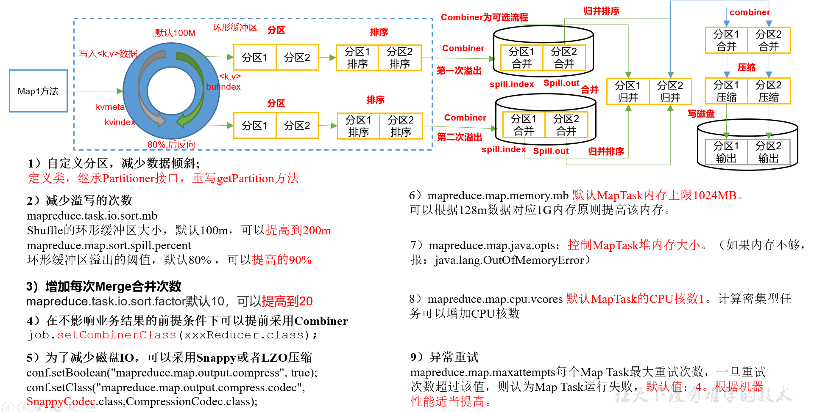

**​**  

**reduce阶段**

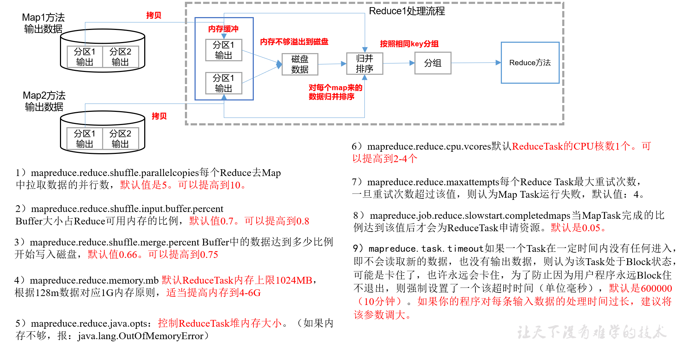

​  

```xml
<!-- 环形缓冲区大小，默认100m -->
<property>
  <name>mapreduce.task.io.sort.mb</name>
  <value>100</value>
</property>

<!-- 环形缓冲区溢写阈值，默认0.8 -->
<property>
  <name>mapreduce.map.sort.spill.percent</name>
  <value>0.80</value>
</property>

<!-- merge合并次数，默认10个 -->
<property>
  <name>mapreduce.task.io.sort.factor</name>
  <value>10</value>
</property>

<!-- maptask内存，默认1g；maptask堆内存大小默认和该值大小一致mapreduce.map.java.opts -->
<property>
  <name>mapreduce.map.memory.mb</name>
  <value>-1</value>
  <description>The amount of memory to request from the scheduler for each    map task. If this is not specified or is non-positive, it is inferred from mapreduce.map.java.opts and mapreduce.job.heap.memory-mb.ratio. If java-opts are also not specified, we set it to 1024.
  </description>
</property>

<!-- matask的CPU核数，默认1个 -->
<property>
  <name>mapreduce.map.cpu.vcores</name>
  <value>1</value>
</property>

<!-- matask异常重试次数，默认4次 -->
<property>
  <name>mapreduce.map.maxattempts</name>
  <value>4</value>
</property>

<!-- 每个Reduce去Map中拉取数据的并行数。默认值是5 -->
<property>
  <name>mapreduce.reduce.shuffle.parallelcopies</name>
  <value>5</value>
</property>

<!-- Buffer大小占Reduce可用内存的比例，默认值0.7 -->
<property>
  <name>mapreduce.reduce.shuffle.input.buffer.percent</name>
  <value>0.70</value>
</property>

<!-- Buffer中的数据达到多少比例开始写入磁盘，默认值0.66。 -->
<property>
  <name>mapreduce.reduce.shuffle.merge.percent</name>
  <value>0.66</value>
</property>

<!-- reducetask内存，默认1g；reducetask堆内存大小默认和该值大小一致mapreduce.reduce.java.opts -->
<property>
  <name>mapreduce.reduce.memory.mb</name>
  <value>-1</value>
  <description>The amount of memory to request from the scheduler for each    reduce task. If this is not specified or is non-positive, it is inferred
    from mapreduce.reduce.java.opts and mapreduce.job.heap.memory-mb.ratio.
    If java-opts are also not specified, we set it to 1024.
  </description>
</property>

<!-- reducetask的CPU核数，默认1个 -->
<property>
  <name>mapreduce.reduce.cpu.vcores</name>
  <value>2</value>
</property>

<!-- reducetask失败重试次数，默认4次 -->
<property>
  <name>mapreduce.reduce.maxattempts</name>
  <value>4</value>
</property>

<!-- 当MapTask完成的比例达到该值后才会为ReduceTask申请资源。默认是0.05 -->
<property>
  <name>mapreduce.job.reduce.slowstart.completedmaps</name>
  <value>0.05</value>
</property>

<!-- 如果程序在规定的默认10分钟内没有读到数据，将强制超时退出 -->
<property>
  <name>mapreduce.task.timeout</name>
  <value>600000</value>
</property>
```