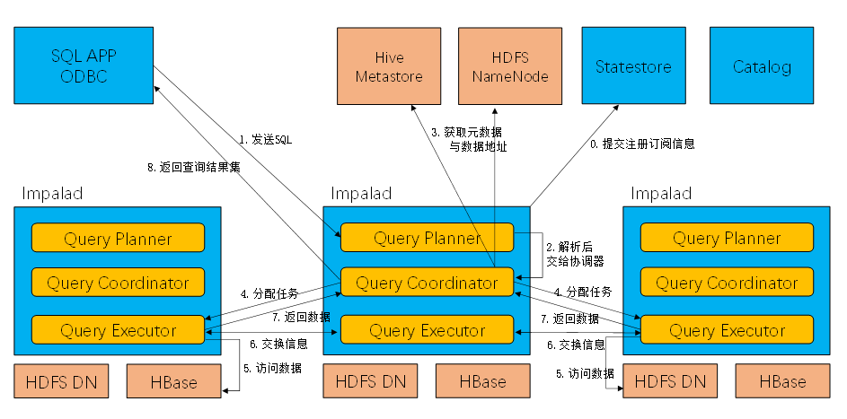

官网文档：[impala-4.3.pdf](https://www.yuque.com/attachments/yuque/0/2024/pdf/35670500/1715157807035-7842037c-331c-4b5f-9961-535dc87d8f6e.pdf)

# 概念

## 描述

impala是即席查询的代表，提供对HDFS、Hbase数据的高性能、低延迟的交互式SQL查询功能，CDH平台首选的PB级大数据实时查询分析引擎。

## 定位

impala适用于即席查询和加速查询场景：

即席查询：如自助查询平台取数等场景下

加速查询：若hive跑批太慢，影响到重要报表/业务，此时可通过使用impala加速hive查询。

## 优缺点

**优点：**

①快：

因为impala运算是尽量在数据存储节点运行，减少了网络传输量；且不走mr程序直接查询hdfs文件或hbase数据，减少了mr的落盘次数，提升了io速度。

②生态优良：

支持textfile、sequencefile、rcfile、parquet文件格式；

能直接与hive元数据共享，对hive数据进行分析，加速hive计算，提升即席查询性能；

支持Snappy、GZIP、Deflate、BZIP压缩；

支持读取hdfs、hbase、s3数据、和hive公用元数据且语法相近。

**缺点：**

①吃内存，严重依赖hive。

②分区超过1w，性能严重下降。只能读取文本文件。

③每当新的记录/文件被添加到HDFS中的数据目录时，该表需要被刷新，这可能会增加数据管理的复杂性。

④Impala主要设计用于查询和分析任务，对于大规模写入操作的支持相对较弱

⑤没法自动创建分区，需要预创建好再导入数据。

## impala架构

### 组成

catalog：

把impala表的metadata信息分发到各个impalad

-   包含有关表(Table)、分区(Partition)和列(Column)的信息。
-   负责将表的元数据加载到内存中，以便查询计划的生成和执行。

statestore：

收集分布在集群中各个impalad进程的资源信息、各节点健康状态、同步节点信息

负责query的协调调度

impalad（impala daemon）：Impala的核心组件，负责接收客户端的SQL查询请求，执行查询计划，并返回结果

query planner：负责生成查询计划树

query coordinator：负责分发执行计划到其他节点，并汇总结果

query excutor：负责执行具体的查询任务。

服务：

启动三个ThriftServer：

beeswax\_server（连接客户端）

hs2\_server（借用Hive元数据）

be\_server（Impalad内部使用）和一个ImpalaServer服务。

其他：hdfs作为数据存储、与hive metastore元数据共享

### 运行原理

①在客户提交查询之前，impala daemon会向statestore提交注册信息。

②当客户端提交查询时，其中一个impala daemon会接受到并由query planner对sql解析生成解析树，planner会将解析树分解为query fragment，之后会将执行计划转交给协调器。

③query coordinator将查询hive metastore、hdfs namenode以获取需查询数据在datanode上的分布情况，根据分布情况，将query fragment分发到相应的impalad的query excutor做本地数据计算。

④各个impalad节点之间通过网络交换数据，最终数据会返回给query coordinator，之后query coordinator汇总数据并由query coordinator返回到客户端。

# 安装

## 相关地址

1.Impala的官网

[http://impala.apache.org/](http://impala.apache.org/)

2.Impala文档查看

[http://impala.apache.org/impala-docs.html](http://impala.apache.org/impala-docs.html)

3.下载地址

[http://impala.apache.org/downloads.html](http://impala.apache.org/downloads.html)

## 安装方式

### 手动安装

略

### cdh、cdp安装（推荐）

注意：impalad安装与datanode节点一致；catalog与statestore建议分开安装

### 使用

**(1)Impala的外部shell：**

| 选项 | 描述 |
| --- | --- |
| -h, --help | 显示帮助信息 |
| -v or --version | 显示版本信息 |
| -i hostname, --impalad=hostname | 指定连接运行 impalad 守护进程的主机。默认端口是 21000。 |
| -q query, --query=query | 从命令行中传递一个shell 命令。执行完这一语句后 shell 会立即退出。 |
| -f query_file, --query_file= query_file | 传递一个文件中的 SQL 查询。文件内容必须以分号分隔 |
| -o filename or --output_file filename | 保存所有查询结果到指定的文件。通常用于保存在命令行使用 -q 选项执行单个查询时的查询结果。 |
| -c | 查询执行失败时继续执行 |
| -d default_db or --database=default_db | 指定启动后使用的数据库，与建立连接后使用use语句选择数据库作用相同，如果没有指定，那么使用default数据库 |
| -r or --refresh_after_connect | 建立连接后刷新 Impala 元数据 |
| -p, --show_profiles | 对 shell 中执行的每一个查询，显示其查询执行计划 |
| -B（--delimited） | 去格式化输出 |
| --output_delimiter=character | 指定分隔符 |
| --print_header | 打印列名 |

**(2)Impala的内部shell**

| 选项 | 描述 |
| --- | --- |
| help | 显示帮助信息 |
| explain <sql> | 显示执行计划 |
| profile | (查询完成后执行）查询最近一次查询的底层信息 |
| shell <shell> | 不退出impala-shell执行shell命令 |
| version | 显示版本信息（同于impala-shell -v） |
| connect | 连接impalad主机，默认端口21000（同于impala-shell -i） |
| refresh <tablename> | 增量刷新元数据库 |
| invalidate metadata | 全量刷新元数据库（慎用）（同于impala-shell -r） |
| history | 历史命令 |

**（3）impala数据类型**

| Hive数据类型 | Impala数据类型 | 长度 |
| --- | --- | --- |
| TINYINT | TINYINT | 1byte有符号整数 |
| SMALINT | SMALINT | 2byte有符号整数 |
| INT | INT | 4byte有符号整数 |
| BIGINT | BIGINT | 8byte有符号整数 |
| BOOLEAN | BOOLEAN | 布尔类型，true或者false |
| FLOAT | FLOAT | 单精度浮点数 |
| DOUBLE | DOUBLE | 双精度浮点数 |
| STRING | STRING | 字符系列。可以指定字符集。可以使用单引号或者双引号。 |
| TIMESTAMP | TIMESTAMP | 时间类型 |
| BINARY | 不支持 | 字节数组 |

注意：Impala虽然支持array，map，struct复杂数据类型，但是支持并不完全，一般处理方法，将复杂类型转化为基本类型，通过hive创建表。

# 查询

1. 基本的语法跟hive的查询语句大体一样

2. Impala不支持CLUSTER BY, DISTRIBUTE BY, SORT BY

3. Impala中不支持分桶表

4. Impala不支持COLLECT\_SET(col)和explode（col）函数

5. Impala支持开窗函数

[hadoop103:21000] > select name,orderdate,cost,sum(cost) over(partition by month(orderdate)) from business;

6.impala不支持自动分区，需要预创建

  

# 优化

## 常见一些优化（裁剪过滤、数据倾斜、小文件、join方式）

1、尽量将StateStore和Catalog单独部署到同一个节点，保证他们正常通行。  
2、通过对Impala Daemon内存限制（默认256M）及StateStore工作线程数，来提高Impala的执行效率。  
3、SQL优化，使用之前调用**执行计划**  
4、选择合适的文件格式进行存储，提高查询效率。  
5、避免产生很多小文件（如果有其他程序产生的小文件，可以使用中间表，将小文件数据存放到中间表。然后通过insert…select…方式中间表的数据插入到最终表中）  
6、使用合适的分区技术，根据分区粒度测算  
7、使用compute stats进行表信息搜集，当一个内容表或分区明显变化，重新计算统计相关数据表或分区。因为行和不同值的数量差异可能导致impala选择不同的连接顺序时，表中使用的查询。  
[hadoop104:21000] > compute stats student;  
Query: compute stats student  
+-----------------------------------------+  
| summary |  
+-----------------------------------------+  
| Updated 1 partition(s) and 2 column(s). |  
+-----------------------------------------+  
8、网络io的优化：  
   避免把整个数据发送到客户端  尽可能的做条件过滤  使用limit字句输出文件时，避免使用美化输出  
尽量少用全量元数据的刷新  
9、使用**profile**输出底层信息计划，再做相应环境优化

10、通用的单表group by数据倾斜、多表join数据倾斜处理（预聚合，二次聚合）；小文件处理；shuffle和broadcast join显示指定。

## 如何定位哪些sql需要优化

1、事前explain，事后profile、summary

2、优化的侧重点主要有一下几个方面：

（1）结合执行计划，进行Join 时防止大表被广播。

（2）根据实际情况调整关联方式： broadcast 、(Shuffle)partitioned join

broadcast 适合大表关联小表，将小表广播复制到各个节点，再和左表进行JOIN

(Shuffle)partitioned join 适合大表和大表关联. 注意 partitioned join 和右表的 partition 没有直接关系, impala 会将右表打散成N份, 发送到左表所在的节点, 然后作join

（3）要写入大量数据时，尽量使用Kudu的API直接写入，采用impala写入时，impala会进行预分区/排序来降低Kudu的负载，并防止大批量的insert超时，but，正是由于这种机制存在，会降低写入数据时 end-to-end 的性能（impala预处理，在执行很长时间后才能查到数据，不让impala预处理，目标表很快就能查到数据），从CDH5.13/Impala2.10起，可以使用/\* +NOCLUSTERED\*/、/NOSHUFFLE /让impala不预排序、分区数据。

例如 insert into table\_a / +NOCLUSTERED/,/\*NOSHUFFLE \*/ select \* from table\_b

（4）定期对表收集统计信息, 或者在大量DML操作后主动收集统计信息. 执行 COMPUTE STATS table，需要注意的是此语句在进行大表操作时会耗费相当长的时间

（5）使用not in，not exists 默认将右表广播，而且没法指定partitioned join ，使用left anti join

（6）使用 straight\_join 进行自定义表的关联顺序，不按照impala优化器的优化顺序执行

（7）根据 summary 的结果，确定出需要优化的位值，减少关联数据量和表字段

## sql如何管控（）

规范-》宣导-》评审-》sql优化案例

1.  定时调度作业

1.  **事前评审：**对explain解析，查看分区扫描情况，谓词尽可能下推。先试跑一次sql，查看profile、summary，严控sql分区扫描、join方式严格指明、数据倾斜处理。
2.  事中：一般没问题，有问题也是集群问题导致的sql问题，或者大量刷数导致问题（延迟、oom、卡住等）
3.  事后：定期检查profile、summary，是否有异样（跑完就行，应该没人去看吧）

2.  即席查询

1.  事前：别人怎么查询你不知道，sql是否优化过你不知道，只能任他跑。
2.  **事中查杀：**特别重要，万一他的sql特别大，你受不了，需要查杀。

① 手动kill

impala-shell：CANCEL <query\_id>;

cm的web端可以有取消按钮？

hue可手动停止正在查询的sql。

impala的web端取消

JDBC/ODBC可调用cancel api来完成取消

② 参数限制

query\_timeout\_s: 设置查询超时时间，单位为秒。

query\_mem\_limit: 限制查询可以使用的最大内存。

③高阶查杀：做平台

sql执行走平台入口，实时监控sql cpu 内存等使用情况，超过阈值直接kill。

3.  事后：总结profile、summary，对基本的过滤、join方式、数据倾斜做成规范，同时宣导提高大家能力，增加事后处罚机制。