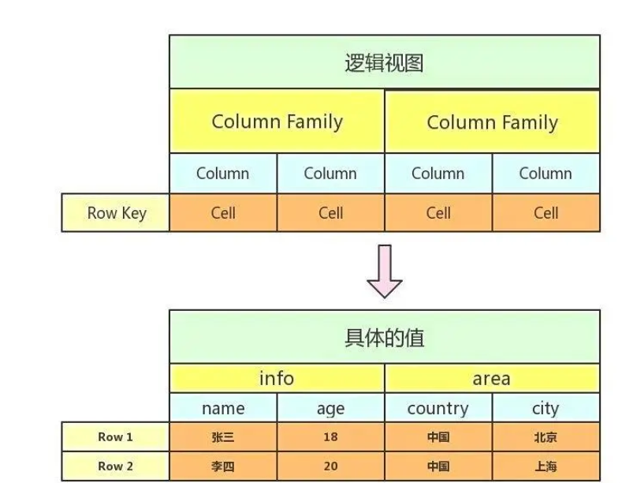

# 1、hbase的HA实现,zookeeper在其中的作用

HBase中可以启动多个HMaster，通过Zookeeper的Master Election机制保证总有一个Master运行配置HBase高可用，只需要启动两个HMaster，让Zookeeper自己去选择一个Master Acitve即可zk的在这里起到的作用就是用来管理master节点,以及帮助hbase做master选举

# 2、hbase的存储结构,这样的存储结构有什么优缺点

  

**Hbase的优点及应用场景:**

1.  半结构化或非结构化数据: 对于数据结构字段不够确定或杂乱无章非常难按一个概念去进行抽取的数据适合用HBase，因为HBase支持动态添加列。
2.  记录很稀疏: RDBMS的行有多少列是固定的。为null的列浪费了存储空间。HBase为nul的Column不会被存储，这样既节省了空间又提高了读性能。
3.  多版本号数据: 依据Row key和Column key定位到的Value能够有随意数量的版本号值，因此对3.于须要存储变动历史记录的数据，用HBase是很方便的。比方某个用户的Address变更，用户的Address变更记录也许也是具有研究意义的。
4.  仅要求最终一致性: 对于数据存储事务的要求不像金融行业和财务系统这么高，只要保证最终4.致性就行。(比如HBase+elasticsearch时，可能出现数据不一致)
5.  高可用和海量数据以及很大的瞬间写入量: WAL解决高可用，支持PB级数据，put性能高 适用5.于插入比查询操作更频繁的情况。比如，对于历史记录表和日志文件。(HBase的写操作更加高效)
6.  业务场景简单: 不需要太多的关系型数据库特性，列入交叉列，交又表，事务，连接等。

**Hbase的缺点:**

1.单一RowKey固有的局限性决定了它不可能有效地支持多条件查询

2.不适合于大范围扫描查询

3.不直接支持 SQL的语句查询

​  

# 3、hbase 如何设计rowkey

**RowKey长度原则**

Rowkey是一个二进制码流，Rowkey的长度被很多开发者建议说设计在10~100个字节，不过建议是越短越好，不要超过16个字节。

原因如下

数据的持久化文件HFile中是按照KeyValue存储的，如果Rowkey过长比如100个字节，1000万列数据光Rowkey就要占用100\*1000万=10亿个字节，将近1G数据，这会极大影响HFile的存储效率;

MemStore将缓存部分数据到内存，如果Rowkey字段过长内存的有效利用率会降低，系统将无法缓存更多的数据，这会降低检索效率。因此Rowkey的字节长度越短越好

目前操作系统是都是64位系统，内存8字节对齐。控制在16个字节，8字节的整数倍利用操作系统的最佳特性。

**RowKey散列原则**

如果Rowkey是按时间戳的方式递增，不要将时间放在二进制码的前面，建议将Rowkey的高位作为散列字段，由程序循环生成，低位放时间字段，这样将提高数据均衡分布在每个Regionserver实现负载均衡的几率。如果没有散列字段，首字段直接是时间信息将产生所有新数据都在一个RegionServer上堆积的热点现象，这样在做数据检索的时候负载将会集中在个别RegionServer，降低查询效率。

**RowKey唯一原则**必须在设计上保证其唯一性。

​  

# 4、hbase如何导入数据?

1.通过HBase API进行批量写入数据

2.使用Sqoop工具批量导数到HBase集群:

3.使用MapReduce批量导入;

4.HBase BulkLoad的方式。

# 5、HBase 宕机如何处理?

宕机分为 HMaster 宕机和 HRegisoner 宕机.如果是 HRegisoner 宕机，HMaster 会将其所管理的 region 重新分布到其他活动的RegionServer 上，由于数据和日志都持久在 HDFS 中，该操作不会导致数据丢失,所以数据的一致性和安全性是有保障的。

如果是 HMaster 宕机，HMaster 没有单点问题， HBase 中可以启动多个HMaster，通过 Zookeeper 的 Master Election 机制保证总有一个 Master运行。即ZooKeeper 会保证总会有一个 HMaster 在对外提供服务。

​  

# 6、HBase优化方法

优化手段主要有以下四个方面

**6.1.减少调整**

减少调整这个如何理解呢?HBase中有几个内容会动态调整，如region(分区)HFile，所以通过一些方法来减少这些会带来I/0开销的调整Region

如果没有预建分区的话，那么随着region中条数的增加，region会进行分，这将增加I/0开销，所以解决方法就是根据你的RowKey设计来进行预建分区，减少region的动态分裂。

HFile

HFile是数据底层存储文件，在每个memstore进行刷新时会生成一个HFile，当HFile增加到一定程度时，会将属于一个region的HFile进行合并，这个步会带来开销但不可避免，但是合并后HFile大小如果大于设定的值，那么HFile会重新分裂。为了减少这样的无谓的I/O开销，建议估计项目数据量大小，给HFile设定一个合适的值

​  

**6.2.减少启停**

数据库事务机制就是为了更好地实现批量写入，较少数据库的开启关闭带来的开销，那么HBase中也存在频繁开启关闭带来的问题。1.关闭Compaction，在闲时进行手动Compaction因为HBase中存在Minor Compaction和Major Compaction，也就是对HFile进行合并，所谓合并就是I/0读写，大量的HFile进行肯定会带来I/0开销，甚至是I/O风暴，所以为了避免这种不受控制的意外发生，建议关闭自动Compaction，在闲时进行compaction

2.批量数据写入时采用BulkLoad

如果通过HBase-Shell或者JavaAPI的put来实现大量数据的写入，那么性能差是肯定并目还可能带来一些意想不到的问题，所以当需要写入大量离线数据时建议使用BulkLoad

**6.3.减少数据量**

虽然我们是在进行大数据开发，但是如果可以通过某些方式在保证数据准确性同时减少数据量，何乐而不为呢?

1.开启过滤，提高查询速度

开启BloomFilter，Bloomfilter是列族级别的过滤，在生成一个StoreFile同时会生成一个MetaBlock，用于查询时过滤数据

2.使用压缩:一般推荐使用Snappy和LZO压缩

​  

**6.4.合理设计**

在一张HBase表格中RowKey和ColumnFamily的设计是非常重要，好的设计能够提高性能和保证数据的准确性

1.RowKey设计:应该具备以下几个属性

散列性:散列性能够保证相同相似的rowkey聚合，相异的rowkey分散，有利于查询简短性:rowkey作为key的一部分存储在HFile中，如果为了可读性将rowKey设计得过长，那么将会增加存储压力

唯一性:rowKey必须具备明显的区别性

·业务性:举些例子

假如我的查询条件比较多，而且不是针对列的条件，那么rowKey的设计就应该支持多条件查询

如果我的查询要求是最近插入的数据优先，那么rowKey则可以采用叫上Long.Max-时间戳的方式，这样rowKey就是递减排列

2.列族的设计

列族的设计需要看应用场景

多列族设计的优劣

**优势:**

HBase中数据时按列进行存储的，那么查询某一列族的某一列时就不需要全盘扫描，只需要扫描某一列族，减少了读I/O;

其实多列族设计对减少的作用不是很明显，适用于读多写少的场景。

**劣势:**

降低了写的//0性能。原因如下:数据写到store以后是先缓存在memstore中，同一个region中存在多个列族则存在多个store，每个store都一个memstore，当其实memstore进行flush时，属于同一个region的store中的memstore都会进行flush，增加I/O开销。

​  

# 7、HBase 中可以设置 过多的列族吗?

在 Hbase 的表中，每个列族对应 Region 中的一个Store，Region的大小达到阈值时会分裂因此如果表中有多个列族，则可能出现以下现象:

1.  一个Region中有多个Store，如果每个CF的数据量分布不均匀时，比如CF1为100万，CF2为1万，则Region分裂时导致CF2在每个Region中的数据量太少，查询CF2时会横跨多个Region导致效率降低。
2.  如果每个CF的数据分布均匀，比如CF1有50万，CF2有50万，CF3有50万，则Region分裂时导致每个CF在Region的数据量偏少，查询某个CF时会导致横跨多个Region的概率增大。
3.  多个CF代表有多个Store，也就是说有多个MemStore(2MB)，也就导致内存的消耗量增大，使用效率下降。
4.  Region 中的 缓存刷新 和 压缩 是基本操作，即一个CF出现缓存刷新或压缩操作其它CF也会同时做一样的操作，当列族太多时就会导致I0频繁的问题。