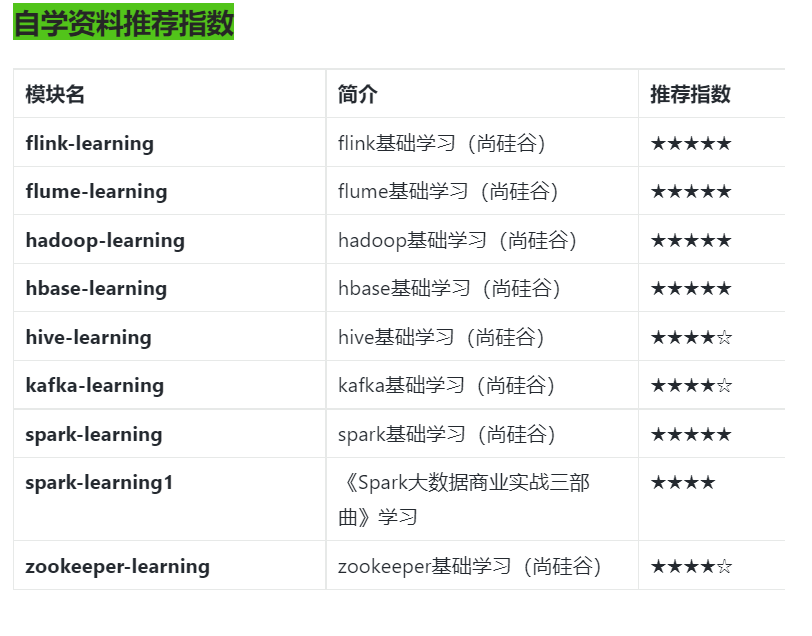

# 第一阶段 JavaSE零基础小白自学路线

1.  建立编程思想(基本语法、数组、排序和查找、面向对象编程);
2.  提升编程能力(枚举和自定义注解、Exception(异常类)、常用API、集合、泛型、线程、10流网络编程、反射、Mysql、JDBC和连接池、正则表达式);
3.  项目综合技能实践结合应用场景联系更有效哦!

场景1:大数据组件源码阅读能力

Hive源码阅读

main --(程序的开始)->

run --(任务的开始，读取用户传参与相关配置，初始化日志)->

executeDriver --(确保传入的语句是一条完整的SQL或命令)->

processLine --(上保险，确保任务可以中断)->

processCmd --(识别命令的类型，交给相对于的处理方法)->

processLocalCmd --(选择SQL命令的处理器，默认是Driver)->

Driver(到这里算提交完成)

​  

场景2:大数据组件源码二次开发基于流式计算应用场景功能二次开发:

SS：

一个完善的Spark Streaming二次封装开源框架，包含:实时流任务调度、kafka偏移量管理web后台管理，web api启动、停止spark streaming，宕机告警、自动重启等等功能支持，用户只需要关心业务代码，无需关注繁琐的技术细节，大大提高实时流开发效率。Spark Streaming Framework简称SSF(一个完善的Spark Streaming二次封装开源框架，包含:实时流任务调度、kafka偏移量管理，web后台管理，webapi启动、停止sparkstreaming，宕机告警、自动重启等等功能支持，用户只需要关心业务代码，无需关注繁琐的技术细节，大大提高实时流开发效率和难度。)

​  

Flink:

KafkaSink

1、按流内容分发到对应topic，隔天自动切换在fink自带的kafka sink实现里，只支持写到固定topic，而我们的kafka2kafka日志处理逻辑要求消息要按照ds字段值写入到对应topic，topic名前缀相同，后面跟ds字段值，需要进行改造具体实现思路如下:

由如下源码可知KeyedSerializationSchema对象才能赋值schema，从而可以通过schema.getTargetTopic获得每条对应的topic，而常用的SimpleStringSchema并未继承KeyedSerializationSchema，无法得到对应的topic，只能使用固定topic

​  

HdfsSink

1、按流内容分发到对应目录

fink自带的hdfs sink只支持写入到固定目录，而我们的kafka2hdfs处理逻辑要求消息要按照header\_filepath字段值写入到对应的目录，类似如下形式:/logs/ball/json/Chat/ds=2018-11-12//ogs/ball/json/Chat/status-1/ds=2018-11-12//logs/ball/json/status-2-CheckWg/ds=2018-10-31/具体实现思路如下:

(1)由源码可知BucketingSink类的setBucketer(Bucketer<T> bucketer)方法确定要写入的文件目录

(2)继承合适的父类进行二次开发实现了Bucketer接口的类有以下两种

-   DateTimeBucketer写入到固定目录的桶内，桶是按给定日期格式生成的BasePathBucketer写入到固定日录
-   我们所要写入的目录不需要分桶，因此继承BasePathBucketer类，重写部分方法

​  

场景3:大数据组件在整个大数据平台架构中数据流转过程的API编写

1、JAVAAPI 操作 HBASE(实时数仓必用)

2、hbase的版本不对的话 是会有很多的问题的 因为 hbasae低的版本的jar有些sqoop用到的类没有导致报错 这个及需要换jar包了

java 代码 操作sqoop api 转数据 到 hdfs 或者到hbase

场景4: 大数据组件在整个大数据平台架构中数据流转过程的API编写

作为数仓工程师要掌握自定义函数 UDF\\UDAF\\UDTF 自定义函数

​  

场景5: spark flink支持语言包括java、scala底层也是java封装的

​  

# 第二阶段 基础环境

1、LINUX 系统环境

Linux shell编程、awk、sed、cut、ssh、scp、expect、yum、nestat、top、iostat等高级命令使用。安装linux系统环境

2、Hadoop集群环境 安装hadoop集群环境

​  

​  

# 第三阶段 基础技术栈

1、存储技术 Hadoop (hdfs、Yarn、MapReduce 三板斧)

Mysql、Hbase、Redis、消息中间件kafka、ES

2、采集技术(sqoop、flume、datax、canal);

3、计算技术 (hive、spark、flink);

4、调度(小海豚、Azkaban、Oozie),

5.报表应用 Superset

​  

​  

# 第四阶段 数据仓库 【重要】

1、离线&实时数仓构建

2、数据治理(元数据、数据质量、数据资产)

自学资料推荐指数

  

# 第五阶段 企业真实工作流全链路【非常重要)

业务理解能力

需求拆解能力

模型设计能力

架构设计能力

全链路优化能力

数据治理能力

时间管理能力

复盘能力

结构化思维