、利用关系数据库的5个约束条件创建如下三个表。

​①学生表**T\_STU**

| 中文名 | 列名 | 类型长度 | 约束 | 备注 |
| --- | --- | --- | --- | --- |
| 学 号 | S_ID | Char(8) | 主键 |  |
| 姓 名 | S_NAME | Varchar2(8) | 非空 |  |
| 性 别 | S_XB | Char(1) | 非空、检查 | 取值：'M'或'W' |
| 身份证 | S_SFZ | Char(18) | 非空、唯一 |  |

```plsql
CREATE TABLE T_STU (
    S_ID CHAR(8) PRIMARY KEY,
    S_NAME VARCHAR2(8) NOT NULL,
    S_XB CHAR(1) NOT NULL CHECK (S_XB IN ('M', 'W')),
    S_SFZ CHAR(18) NOT NULL UNIQUE
);
COMMENT ON COLUMN T_STU.S_XB IS '取值：''M''或''W''';
```

  

​②课程表**T\_COURSE**

| 中文名 | 列名 | 类型长度 | 约束 | 备注 |
| --- | --- | --- | --- | --- |
| 课程号 | C_ID | Char(4) | 主键 |  |
| 课程名 | C_NAME | Varchar2(20) | 非空 |  |
| 学 时 | C_XS | Number(3) | 非空 |  |
| 学 分 | C_XF | Number(1) | 非空 |  |

```plsql
create table T_COURSE(
  C_ID Char(4) PRIMARY KEY,
  C_NAME Varchar2(20) NOT NULL,
  C_XS Number(3) NOT NULL,
  C_XF Number(1) NOT NULL
);
```

​③成绩表**T\_GRADE**

| 中文名 | 列名 | 类型长度 | 约束 | 备注 |  |
| --- | --- | --- | --- | --- | --- |
| 学 号 | S_ID | Char(8) | 非空、外键 | ​<br>组合主键 |  |
| 课程号 | C_ID | Char(4) | 非空、外键 |  |  |
| 平时成绩 | G_PS | Varchar2(6) |  |  |  |
| 考试成绩 | G_KS | Varchar2(6) |  |  |  |

```plsql
create table T_GRADE(
  S_ID Char(8) NOT NULL,
  C_ID Char(4) NOT NULL,
  G_PS Varchar2(6),
  G_KS Varchar2(6),
  -- 定义组合主键
  CONSTRAINT pk_T_GRADE PRIMARY KEY (S_ID, C_ID),
  -- 定义外键约束
  CONSTRAINT fk_S_ID FOREIGN KEY (S_ID) REFERENCES T_STU (S_ID),
  CONSTRAINT fk_C_ID FOREIGN KEY (C_ID) REFERENCES T_COURSE (C_ID)
);
COMMENT ON COLUMN T_GRADE.S_ID   IS '组合主键';
COMMENT ON COLUMN T_GRADE.C_ID   IS '组合主键';
```

**2****、利用题一创建的三个表，完成下列内容，写出****SQL****语句，并将语句及执行结果截图。**

①在学生表**T\_STU**中，增加列出生日期S\_CSRQ,类型为固定长8位。

```plsql
-- ① 在学生表T_STU中增加列出生日期S_CSRQ，类型为日期（DATE）而非固定长8位字符串，通常日期用DATE类型更为合适
--ALTER TABLE T_STU ADD (
--    S_CSRQ DATE
--);

-- 若确实需要固定格式的字符串，请替换为如下语句：
ALTER TABLE T_STU ADD (
     S_CSRQ CHAR(8)
);
```

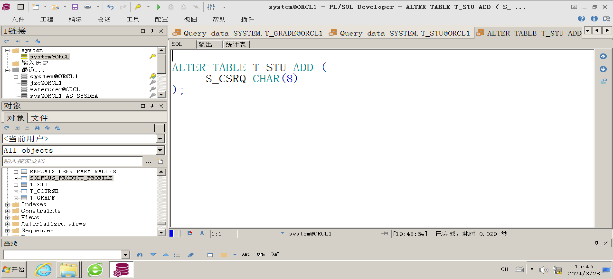

②在课程表**T\_COURSE**中，把列学分的长度改为2位。

```plsql
ALTER TABLE T_COURSE MODIFY (
    C_XF NUMBER(2) -- 修改为两位整数
);
-- 如果学分需保留小数，则应该这样修改：
-- ALTER TABLE T_COURSE MODIFY (
--     C_XF NUMBER(2, 1) -- 修改为两位，其中一位为小数
-- );

```

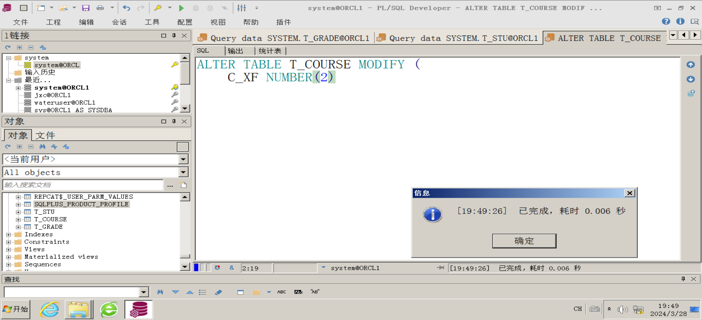

③在成绩表**T\_GRADE**中修改列数据类型，分别把**平时成绩和考试成绩**列名改为number(6,2)。

```plsql
ALTER TABLE T_GRADE MODIFY (
    G_PS NUMBER(6, 2),
    G_KS NUMBER(6, 2)
);
```


④在学生表**T\_STU**中，以姓名为主键创建唯一索引。

```plsql
-- 假设S_NAME列没有重复值
CREATE UNIQUE INDEX idx_unique_name ON T_STU (S_NAME);
```

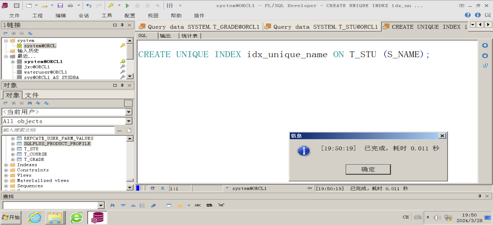

⑤在成绩表**T\_GRADE**中分别为学号和课程号创建一般索引(两个索引)。

```plsql
CREATE INDEX idx_grade_s_id ON T_GRADE (S_ID);
CREATE INDEX idx_grade_c_id ON T_GRADE (C_ID);
```

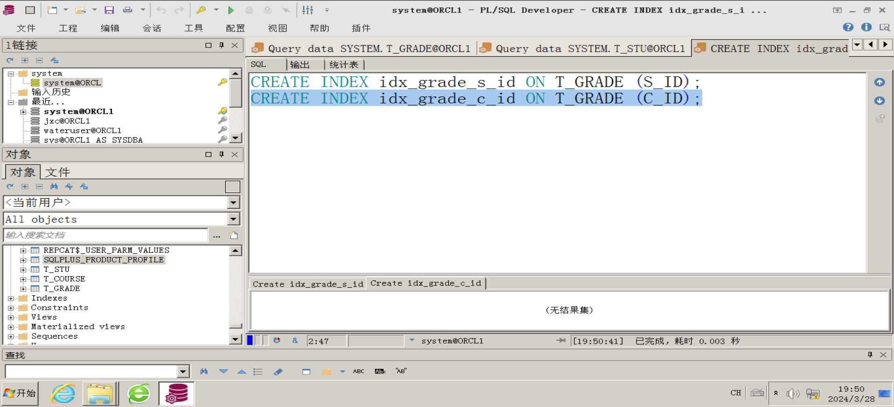

**3****、把自己的信息与《****Oracle****数据库》成绩****(****随意****)****分别插入到下列表中。写出****SQL****语句，并将语句及执行结果截图。**

①学生表插入1行记录（输入自己的信息）；

```plsql
-- ① 插入学生表记录
INSERT INTO T_STU (S_ID, S_NAME, S_XB, S_SFZ)
VALUES ('2021230', '李宇宁', 'M', '120000789111111111');

-- 请将'实际的出生日期'替换为您的真实出生日期，例如 '1990-01-01'
```

  

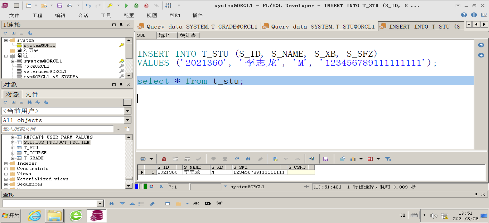

②课程表插入1行记录（输入Oracle数据库课程）；

```plsql
-- ② 插入课程表记录
INSERT INTO T_COURSE (C_ID, C_NAME, C_XS, C_XF)
VALUES ('11', 'Oracle数据库', 48, 3); -- 假设学时为48小时，学分为3分
```

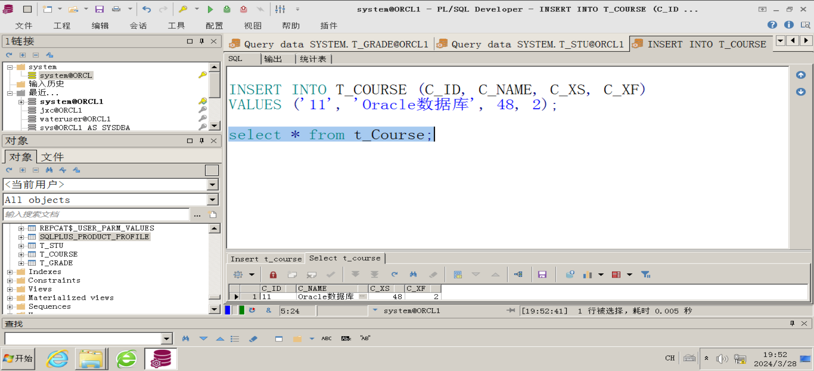

③成绩表插入1行记录（输入自己的Oracle数据库成绩，成绩<100）。

```plsql
-- ③ 插入成绩表记录
INSERT INTO T_GRADE (S_ID, C_ID, G_PS, G_KS)
VALUES ('2021360', '11', 85.0, 90.0); -- 假设平时成绩为85.5分，考试成绩为90分
```

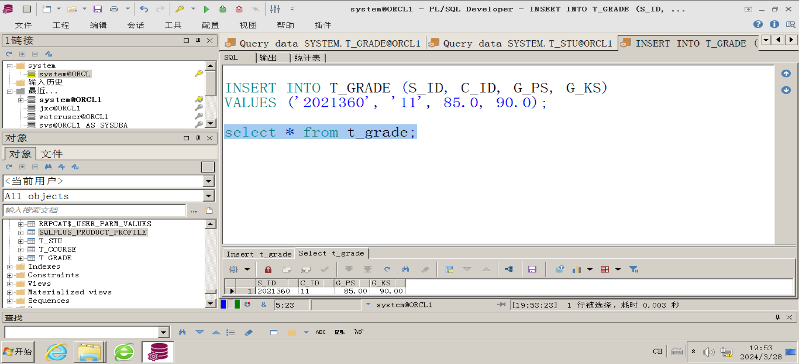

**4****、完成下列各题，并把结果写入表中。写出****SQL****语句，并将语句及执行结果截图。**

1.在课程表T\_COURSE中插入一条记录,其各列值分别是：

课程号\='0001',课程名\='Java程序设计'，学分\=2，学时\=45

```plsql
INSERT INTO T_COURSE (C_ID, C_NAME, C_XF, C_XS)
VALUES ('0001', 'Java程序设计', 2, 45);
```

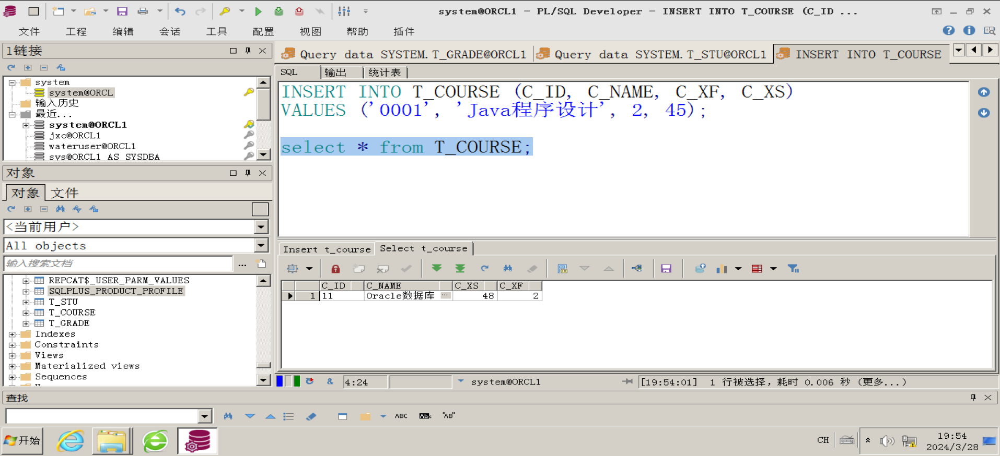

2.在课程表中创建以课程名为关键字的唯一索引，索引名：**i\_cou**\_**name**

```plsql
CREATE UNIQUE INDEX i_cou_name ON T_COURSE (C_NAME);
```

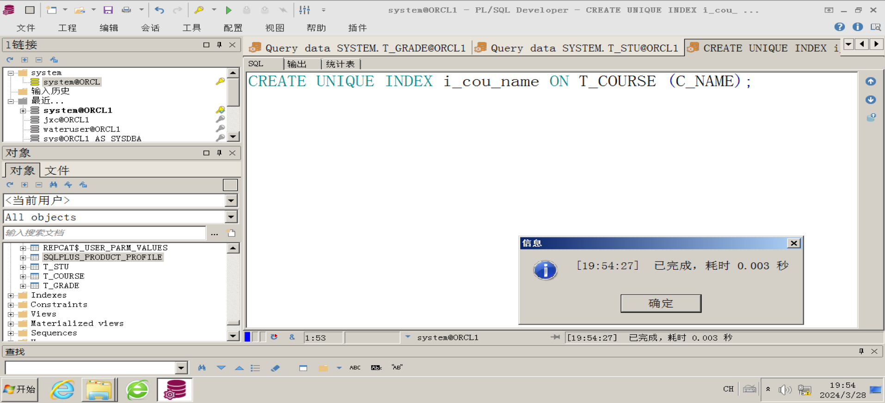

3.在成绩表中创建以课程号+考试成绩为关键字的一般索引，索引名：**I\_GRADE**

```plsql
CREATE INDEX I_GRADE ON T_GRADE (C_ID, G_KS);
```

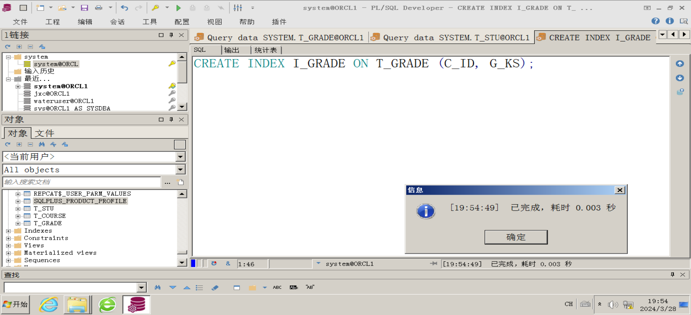

4.创建视图V\_CJB，视图的字段分别是：学生姓名、课程名、考试成。

```plsql
CREATE VIEW V_CJB AS
SELECT T_STU.S_NAME AS "学生姓名", T_COURSE.C_NAME AS "课程名", T_GRADE.G_KS AS "考试成绩"
FROM T_STU JOIN T_GRADE ON T_STU.S_ID = T_GRADE.S_ID
JOIN T_COURSE ON T_GRADE.C_ID = T_COURSE.C_ID;
```

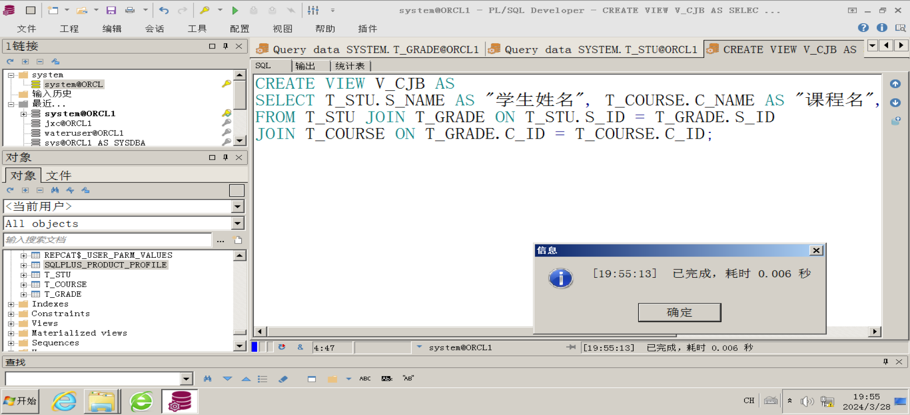

5.创建序列sqe\_xh,步长1，最大值99999999，初始值14010000

```plsql
CREATE SEQUENCE sqe_xh
INCREMENT BY 1
MAXVALUE 99999999
START WITH 14010000;
```

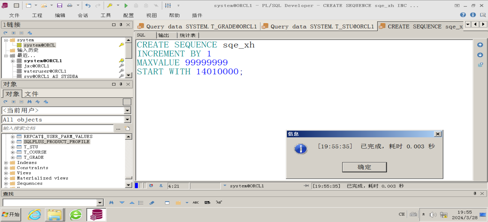

6、在学生表插入数据5行数据，要求学号S\_ID值取自序列sqe\_xh。

```plsql
--学号在定义的时候是char（8），最长只有八位，无法插入
INSERT INTO T_STU (S_ID, S_NAME, S_XB)
VALUES (sqe_xh.NEXTVAL, '学生1', 'M');

INSERT INTO T_STU (S_ID, S_NAME, S_XB)
VALUES (sqe_xh.NEXTVAL, '学生2', 'W');

INSERT INTO T_STU (S_ID, S_NAME, S_XB)
VALUES (sqe_xh.NEXTVAL, '学生3', 'M');

INSERT INTO T_STU (S_ID, S_NAME, S_XB)
VALUES (sqe_xh.NEXTVAL, '学生4', 'W');

INSERT INTO T_STU (S_ID, S_NAME, S_XB)
VALUES (sqe_xh.NEXTVAL, '学生5', 'M');
```

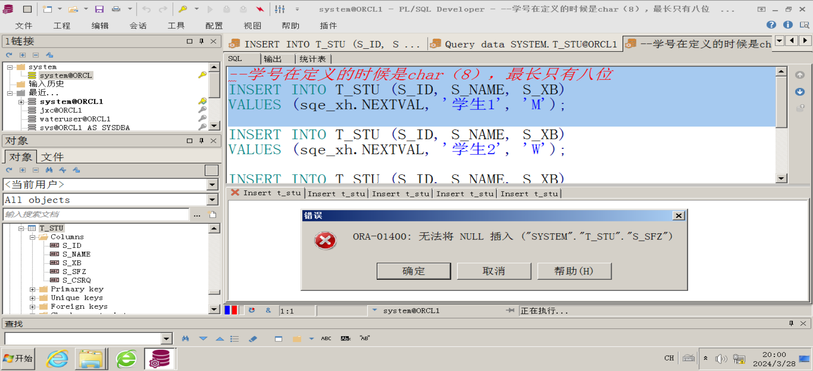

**五、实验心得**

  

1.  **插入记录**：在数据库管理中，向表中插入新记录是最基本的操作之一。例如，在课程表（T\_COURSE）中添加新的课程信息，通过`INSERT INTO`语句实现，确保对应列的值与表结构匹配，这样可以有效地维护数据库的完整性。

-   心得体会：在插入数据时，务必遵循数据完整性规则，包括但不限于主键唯一性、外键参照完整性等。同时，应当保证所插入数据的准确性与有效性。

2.  **创建唯一索引**：创建唯一索引是为了确保特定字段的数据在整个表中是唯一的，避免重复，提高查询效率，同时也能够强化业务逻辑，如课程名不重复。在本例中，以课程名为关键字创建了唯一索引`i_cou_name`。

-   心得体会：合理使用索引有助于提升数据库性能，特别是在频繁进行查找和排序操作时。然而，索引也会占用存储空间，且在更新数据时可能影响写入速度，因此需要权衡利弊。

3.  **创建一般索引**：一般索引并不强制唯一性，但同样可以加速数据检索过程。本例中，在成绩表上创建了一个基于课程号和考试成绩的复合索引`I_GRADE`，这在涉及这两列的联合查询或排序时特别有用。

-   心得体会：复合索引能针对多列进行优化查询，但它的效果很大程度上取决于实际查询模式，应根据应用的实际需求来选择合适的索引策略。

4.  **创建视图**：视图是虚拟表，它基于一个或多个表的查询结果集。在本例中创建的视图`V_CJB`整合了学生、课程和成绩表的信息，简化了复杂的查询操作，提供了用户友好的数据视图。

-   心得体会：视图不仅提高了查询的便利性，还能够在一定程度上隐藏底层复杂性和保护数据安全。此外，视图也能用于封装复杂的业务逻辑。

5.  **创建序列**：序列在Oracle等数据库中用于生成一系列唯一整数值，非常适合于作为自动增长的标识符，如学号。在本例中创建的序列`sqe_xh`按照指定的步长递增，并设置了上限，用于生成学生的学号。

-   心得体会：序列机制简化了自增主键或其他唯一标识符的管理，尤其在并发环境下，可以有效防止主键冲突的问题。在插入数据时引用序列的`NEXTVAL`可确保每次获取的都是唯一的下一个值。

6.  **利用序列插入数据**：在插入学生表数据时，直接引用序列的`NEXTVAL`来获取学号，这样可以自动化地生成连续的学号，无需手动管理，增强了系统的可扩展性和一致性。

-   心得体会：正确运用序列不仅能简化编程工作，还能减少因人为操作带来的错误，增强数据库表间关系的连贯性和一致性。在处理大量数据插入时，尤其是涉及到唯一标识符生成的场景，序列功能尤为实用