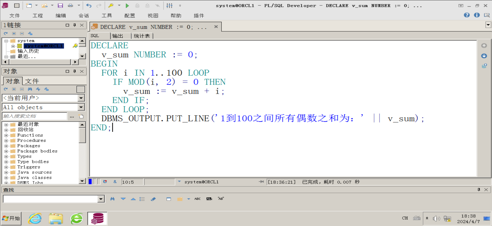
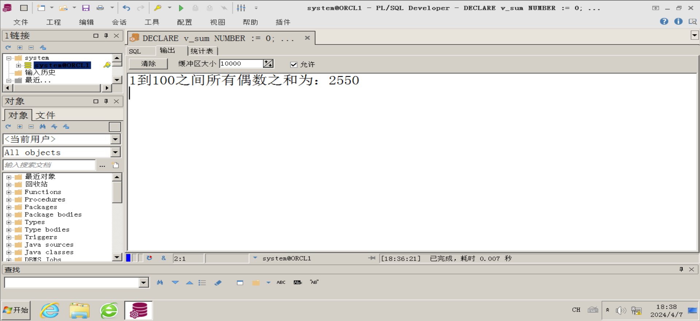
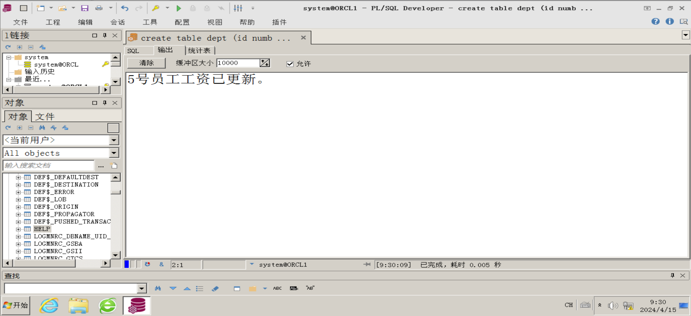
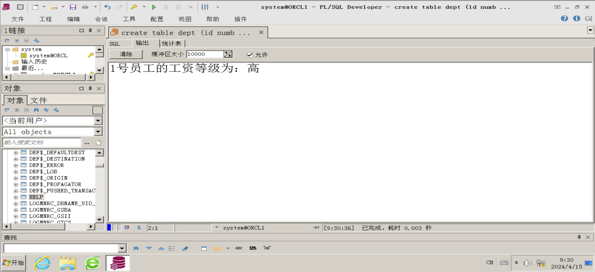
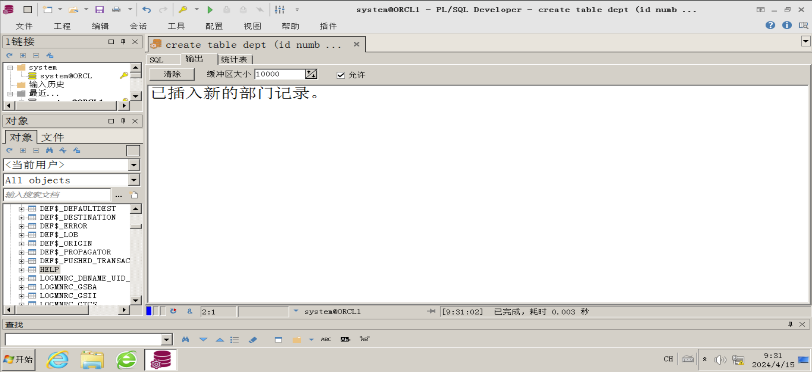

#   
一．实验目的及要求

  

1.  熟练掌握PL/SQL程序设计的基本知识。
2.  熟练掌握PL/SQL中控制结构的使用。具体包括选择结构语句（IF语句和CASE语句），循环结构（四种循环结构）。
3.  熟练使用PL/SQL中系统函数。
4.  掌握PL/SQL中异常处理语句的使用
5.  掌握PL/SQL中SELECT语句和DML语句的综合运用。

#   
二、实验仪器设备

  
在虚拟机环境下，服务器成功安装Oracle 11g数据库服务器（企业版），客户机成功安装Oracle 11g客户端软件，网络服务配置正确，数据库和客户端正常工作。

#   
三、PL/SQL基本语法及示例

  
1、条件语句IF的语法及使用  
IF <条件表达式> THEN  
<执行语句> …… <执行语句n>  
[ELSIF <条件表达式> THEN  
<执行语句> …… <执行语句n>  
……  
ELSE  
<执行语句>]  
END IF;

  

例1：声明一个整型变量Num，使用IF语句判断Num变量是正数、负数或0。

```plsql
SET ServerOutput ON;--启用服务器输出
DECLARE
  Num INTEGER := -11;
BEGIN
  IF Num < 0 THEN
    dbms_output.put_line('负数');
  ELSIF Num >0 THEN
    dbms_output.put_line('正数');
  ELSE
    dbms_output.put_line('0');
  END IF;
END;
```

  
  

  

2、分支语句CASE 语法：

```plsql
CASE <变量>
WHEN <表达式1> THEN 值1
WHEN <表达式2> THEN 值2
……
WHEN <表达式n> THEN 值n
ELSE 值n + 1
END;
```

  
  

  

例2、使用CASE语句根据给定的整数输出对应的星期值：

```plsql
SET ServerOutput ON;
DECLARE
varDAY INTEGER := 3;
Result VARCHAR2(20);
BEGIN
  Result := CASE varDAY
  WHEN 1 THEN '星期一'
  WHEN 2 THEN '星期二'
  WHEN 3 THEN '星期三'
  WHEN 4 THEN '星期四'
  WHEN 5 THEN '星期五'
  WHEN 6 THEN '星期六'
  WHEN 7 THEN '星期七'
  ELSE '数据越界'
  END;
  dbms_output.put_line(Result);
END;
```

  
  

  

  

3、练习循环结构语句的使用方法。

  
（1）循环语句LOOP…EXIT…END  
LOOP  
<程序块1>  
IF <条件表达式> THEN  
EXIT  
END IF  
<程序块2>  
END LOOP;  
例1、计算1到3的累加和。

```plsql
SET ServerOutput ON;
DECLARE
v_Num INTEGER := 1;
v_Sum INTEGER := 0;
BEGIN
LOOP
v_Sum := v_Sum + v_Num;
dbms_output.put_line(v_Num);
IF v_Num = 3 THEN
EXIT;
END IF;
dbms_output.put_line(' + ');
v_Num := v_Num + 1;
END LOOP;
dbms_output.put_line(' = ');
dbms_output.put_line(v_Sum);
END;
```

  
  

  

（2）循环语句LOOP…EXIT WHEN…END  
LOOP  
<程序块1>  
EXIT WHEN <条件表达式>  
<程序块2>  
END LOOP;  
例2、计算1到3的累加和。

```plsql
SET ServerOutput ON;
DECLARE
v_Num INTEGER := 1;
v_Sum INTEGER := 0;
BEGIN
LOOP
v_Sum := v_Sum + v_Num;
dbms_output.put_line(v_Num);
EXIT WHEN v_Num = 3;
dbms_output.put_line(' + ');
v_Num := v_Num + 1;
END LOOP;
dbms_output.put_line(' = ');
dbms_output.put_line(v_Sum);
END;
```

  
  
（3）循环语句WHILE…LOOP…END LOOP  
WHILE <条件表达式>  
LOOP  
<程序块>  
END LOOP;  
（4）循环语句FOR…IN…LOOP…END LOOP  
FOR <循环变量> IN <初始值> .．<终止值>  
LOOP  
<程序块>  
END LOOP;  
例3、计算1到3的累加和。

```plsql
SET ServerOutput ON;
DECLARE
v_Num INTEGER;
v_Sum INTEGER := 0;
BEGIN
FOR v_Num IN 1..3
LOOP
v_Sum := v_Sum + v_Num;
dbms_output.put_line(v_Num);
IF v_Num < 3 THEN
dbms_output.put_line(' + ');
END IF;
END LOOP;
dbms_output.put_line(' = ');
dbms_output.put_line(v_Sum);
END;
```

  
  

  

4、练习异常处理语句的使用方法。  
EXCEPTION  
WHEN <异常情况名> THEN  
<异常处理代码>  
WHEN <异常情况名> THEN  
<异常处理代码>  
……  
WHEN OTHERS THEN  
<异常处理代码>  
例1、

```plsql
SET SERVEROUTPUT ON;
DECLARE
x NUMBER;
BEGIN
x:= 'a123';--向NUMBER类型的变量X中赋值字符串，导致异常
EXCEPTION
WHEN VALUE_ERROR THEN
DBMS_OUTPUT.PUT_LINE('数据类型错误');
END;
```

  
  
例2、

```plsql
SET SERVEROUTPUT ON;
DECLARE
v_result NUMBER(10):=0;
BEGIN
v_result:= 100/0;
DBMS_OUTPUT.PUT_LINE('结果是：'||v_result);
EXCEPTION
WHEN ZERO_DIVIDE THEN
DBMS_OUTPUT.PUT_LINE('除数是零！默认用1替代除数，结果是：'||100/1);
END;
```

  
  

  

# 四、实验内容

  
1、 编写PL/SQL程序，使用LOOP…EXIT…END语句计算1—100之间所有偶数之和。

```sql
DECLARE
  v_sum NUMBER := 0;
BEGIN
  FOR i IN 1..100 LOOP
    IF MOD(i, 2) = 0 THEN
      v_sum := v_sum + i;
    END IF;
  END LOOP;
  DBMS_OUTPUT.PUT_LINE('1到100之间所有偶数之和为：' || v_sum);
END;
```





  
2、 创建表部门表（dept）和表员工表（emp）, 并为两张表输入若干数据。具体结构及SQL语句如下：  
表dept结构：  
字段名称    字段类型         约束          备注  
id         number           主键           --  
name       varchar2(40)

  

  

字段名称    字段类型     约束               备注  
id        number          主键                --员工ID  
name      varchar2(20)                        --姓名  
sex       varchar2(2)                         --性别  
zw       varchar2(20)                         --职务  
sal       number                              --工资  
idcard    varchar2(20)                        --卡号  
dep\_id    number          外键                --部门id

  

create table dept  
(id number primary key,  
name varchar2(20));

INSERT INTO dept VALUES ('1','人事部');  
INSERT INTO dept VALUES ('2','办公室');  
INSERT INTO dept VALUES ('3','财务部');  
INSERT INTO dept VALUES ('4','技术部');  
INSERT INTO dept VALUES ('5','服务部');  
commit;  
create table emp  
(id number primary key,  
name varchar2(20),  
sex varchar2(2),  
zw varchar2(20),  
sal number,  
idcard varchar2(12),  
dep\_id number,  
foreign key(dep\_id)  references dept(id));

  

INSERT INTO emp VALUES ('1','张三','男','部门经理',6000, '1101123aadx1','1');  
INSERT INTO emp VALUES ('2','李四','男','职员',3000, '1101123dddx2','1');  
INSERT INTO emp VALUES ('3','王五','女','职员',3500, '1101123aadx3','1');  
INSERT INTO emp VALUES ('4','赵六','男','部门经理',6500, '1101123dddx4','2');  
INSERT INTO emp VALUES ('5','高七','男','职员',2500, '1101123aadx5','2');  
INSERT INTO emp VALUES ('6','马八','男','职员',3100, '1101123dddx6','2');  
INSERT INTO emp VALUES ('7','钱九','女','部门经理',5000, '1101123aadx7','3');  
INSERT INTO emp VALUES ('8','孙十','男','职员',2800, '1101123dddx8','3');  
commit;

  

3、 编写PL/SQL程序，查询5号员工工资，如果工资小于3000，则加200员工资，并提示信息“5号员工工资已更新。”，如果工资大于3000，则提示信息“5号员工工资为XXX，已达到规定标准。”

```sql
DECLARE
  v_sal NUMBER;
BEGIN
  SELECT sal INTO v_sal FROM emp WHERE id = 5;
  IF v_sal < 3000 THEN
    UPDATE emp SET sal = sal + 200 WHERE id = 5;
    DBMS_OUTPUT.PUT_LINE('5号员工工资已更新。');
  ELSE
    DBMS_OUTPUT.PUT_LINE('5号员工工资为' || v_sal || '，已达到规定标准。');
  END IF;
  COMMIT;
END;
```



  
4、 编写PL/SQL程序，查询1号员工的工资，使用CASE语句输出其工资等级。工资小于等于3000，等级为“低”；工资大于3000，小于5000，等级为”中”；工资大于等于5000，等级为高；

```sql
DECLARE
  v_sal NUMBER;
  v_grade VARCHAR2(10);
BEGIN
  SELECT sal INTO v_sal FROM emp WHERE id = 1;
  CASE
    WHEN v_sal <= 3000 THEN v_grade := '低';
    WHEN v_sal >= 5000 THEN v_grade := '高';
    ELSE v_grade := '中';
  END CASE;
  DBMS_OUTPUT.PUT_LINE('1号员工的工资等级为：' || v_grade);
END;
```



  
5、 编写PL/SQL程序，查询的dept表中是否有部门号为“6”的记录，如果没有，插入新记录部门号为6，部门名称为“后勤部”。如果有，显示查询结果。

```sql
DECLARE
  v_count NUMBER;
BEGIN
  SELECT COUNT(*) INTO v_count FROM dept WHERE id = 6;
  IF v_count = 0 THEN
    INSERT INTO dept (id, name) VALUES (6, '后勤部');
    DBMS_OUTPUT.PUT_LINE('已插入新的部门记录。');
  ELSE
    DBMS_OUTPUT.PUT_LINE('部门号为6的记录已存在。');
  END IF;
  COMMIT;
END;
```

  
  

# 五、实验结果

实验结果如上截图

# 六、实验心得

在本次PL/SQL实验中，我深入探索了Oracle数据库的编程能力，特别是在处理数据和控制程序流程方面。通过一系列的编程任务，我不仅巩固了理论知识，还提升了解决实际问题的能力。

首先，在处理条件判断时，我通过编写IF语句和CASE语句来解决实际问题，例如判断一个数是正数、负数还是零。这种逻辑处理在数据库编程中非常常见，它帮助我更好地理解了如何根据不同情况执行相应的操作。通过这个练习，我学会了如何编写更加清晰和高效的代码。

在循环结构的练习中，我通过计算1到3的累加和来熟悉不同的循环语句。这个过程让我意识到，选择合适的循环结构对于提高程序效率至关重要。通过实践，我能够根据不同的需求选择LOOP、EXIT WHEN、WHILE或FOR循环，并理解它们在实际应用中的适用场景。

异常处理的练习让我认识到了程序健壮性的重要性。在尝试进行除零操作和类型不匹配的赋值时，我学会了如何通过EXCEPTION块来捕获和处理这些异常情况。这不仅提高了程序的稳定性，也让我学会了如何在面对错误时提供有用的反馈信息。

此外，通过创建部门表（dept）和员工表（emp），我学会了如何定义表结构、插入数据以及设置主键和外键约束。这些操作加深了我对数据库设计和数据完整性的理解。特别是在编写PL/SQL程序来查询和更新员工工资时，我学会了如何结合SQL查询和DML操作来实现复杂的业务逻辑。

最后，通过查询dept表中是否有特定部门号的记录并进行相应的插入或更新操作，我学会了如何进行条件判断和数据的动态管理。这个练习不仅提高了我的SQL编写能力，也让我更加熟悉了如何在数据库中进行有效的数据维护。

总结来说，本次实验不仅让我掌握了PL/SQL的基本语法和控制结构，更重要的是，它让我学会了如何将这些知识应用到解决具体的数据库编程问题中。我相信这些经验将对我未来的学习和职业生涯大有裨益。