## 一．实验目的及要求

1． 熟悉Oracle的基本知识。

2． 熟悉Oracle的命令操作环境SQL\*PLUS，pl/sql及常用命令。

3． 熟悉并掌握oracle常用的SQL语句。

**二、实验主要内容**

1、Oracle SQL\*PLUS,PLSQL环境及常用命令。

2、Oracle的SQL语句。

**三、实验仪器设备**

在虚拟机环境下，服务器成功安装Oracle 11g数据库服务器（企业版），客户机成功安装Oracle 11g客户端软件，网络服务配置正确，数据库和客户端正常工作。

**四、实验内容**

续上节：

1、DML操作

1) 按学生表（t\_stu）相同结构创建其备份表t\_stu\_bf.

```plsql
CREATE TABLE t_stu_bf AS SELECT * FROM t_stu WHERE 1=2;
```

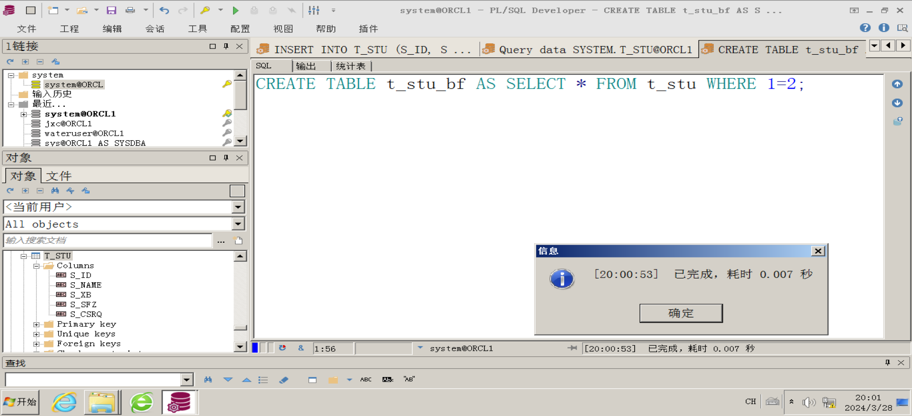

2) 插入一条数据到t\_stu ，要求学号为‘901’，性别男（M),其他任意。

```plsql
INSERT INTO t_stu (S_ID, S_NAME, S_XB, S_SFZ, S_CSRQ) 
VALUES ('901', 'lisi', 'M', 'SFZ901', '200101'); -- 随意填充其他信息
```

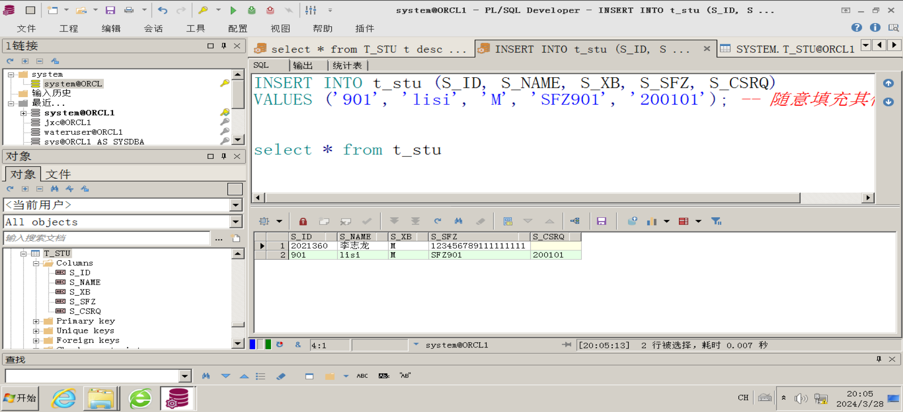

3) 删除t\_stu\_bf 中所有数据；

```plsql
DELETE FROM t_stu_bf;
```

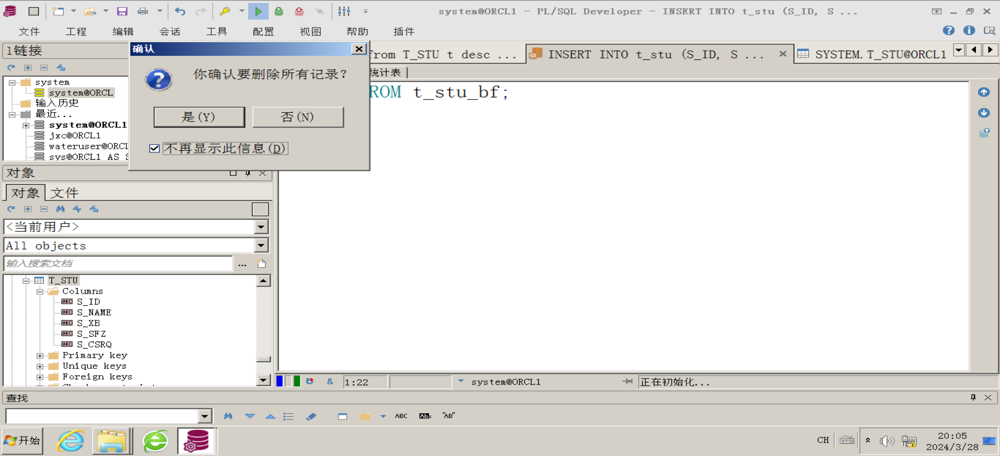

4) 将t\_stu中的数据重新备份到t\_stu\_bf；

```plsql
INSERT INTO t_stu_bf SELECT * FROM t_stu;
```

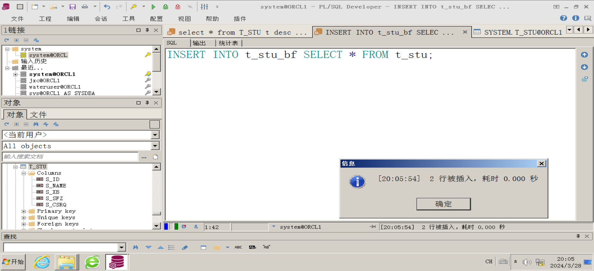

5) 修改t\_stu 表，将学号901 的性别改成女（W）；

```plsql
UPDATE t_stu SET S_XB = 'W' WHERE S_ID = '901';
```

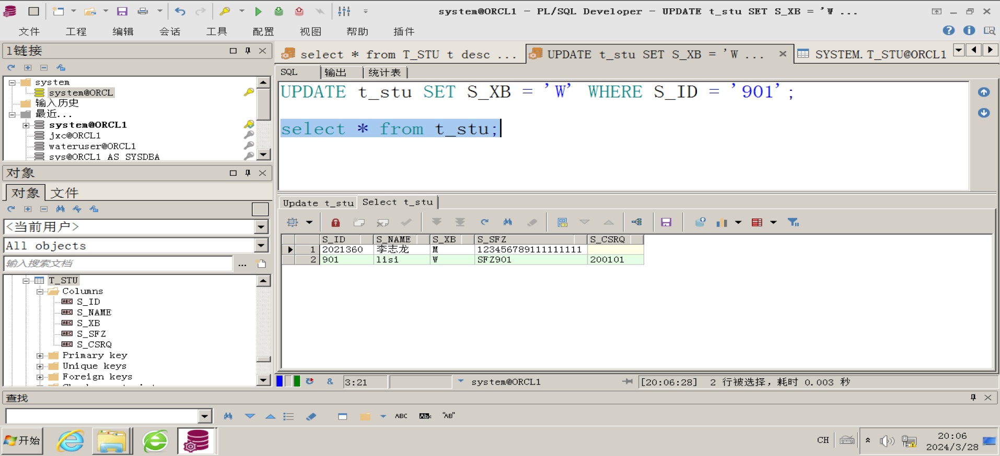

6) 用truncate 删除表t\_stu\_bf 。

```plsql
TRUNCATE TABLE t_stu_bf;
```

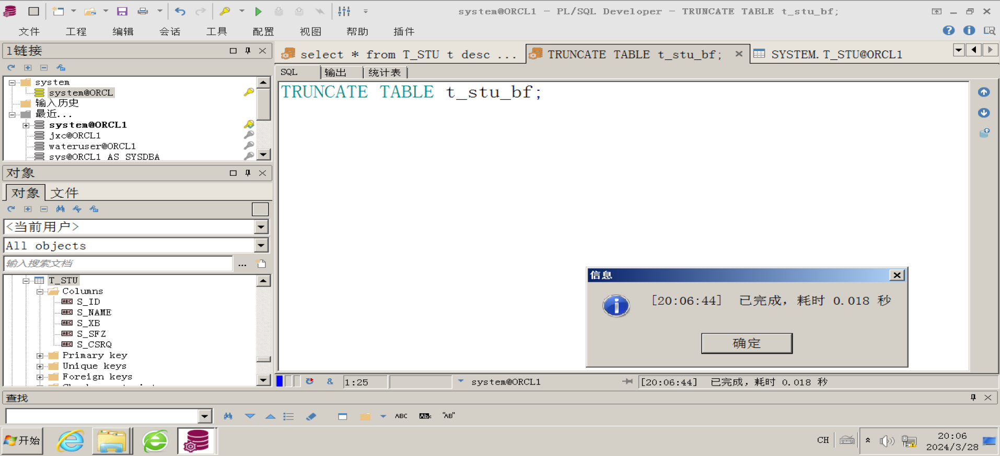

7) 再次将t\_stu中的数据重新备份到t\_stu\_bf；

```plsql
INSERT INTO t_stu_bf SELECT * FROM t_stu;
```

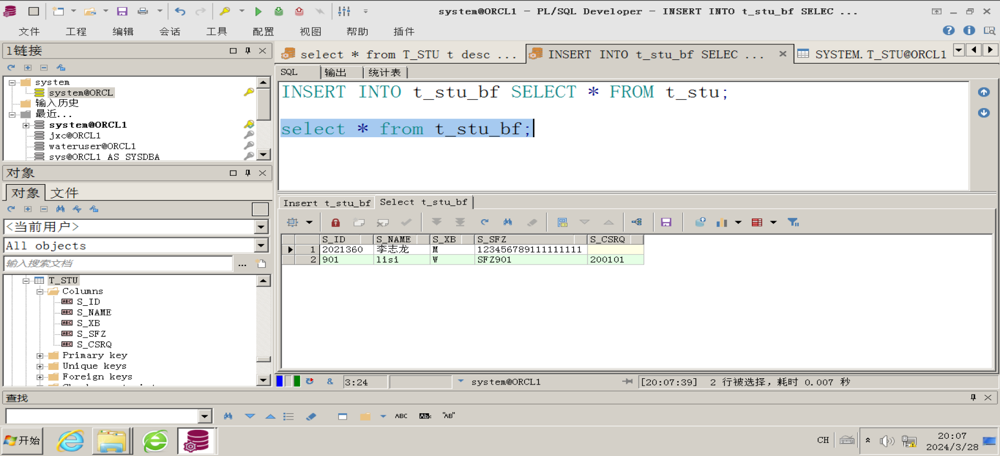

​  

2、简单查询，用现有用户里的表为数据源。

首先建立实验环境：

l 创建JCX用户，并导入数据。

create user jxc identified by jxc default tablespace users;

grant connect,resource to jxc;

grant create view,create synonym,create public synonym,create sequence to jxc;

导入数据：

l 在PLSQL Developer 下导入JXC.DMP 数据

​  

注：导入数据后，可以在sql plus 下，

查询当前用户下所有表：

Select \* from tab;

列出当前表结构

Desc 表名 例如，查看t\_spkcmx 的结构 desc t\_spkcmx

​  

1) 查询供货单位目录表T\_GHDWML中所有的列和行；

```plsql
SELECT * FROM TT_GHDWML;
```

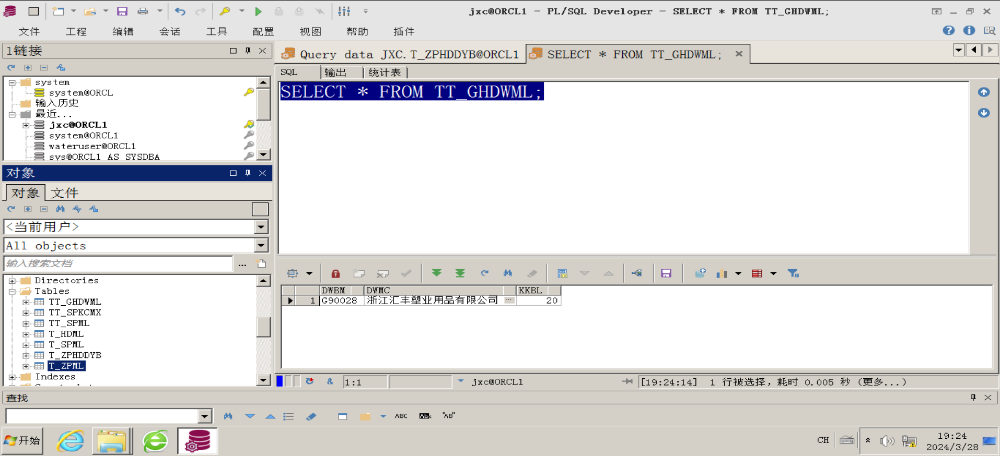

2) 查询供货单位目录表T\_GHDWML中单位编码和单位名称所有的行

```plsql
select DWBM 单位编码, DWMC 单位名称 from TT_GHDWML 
```

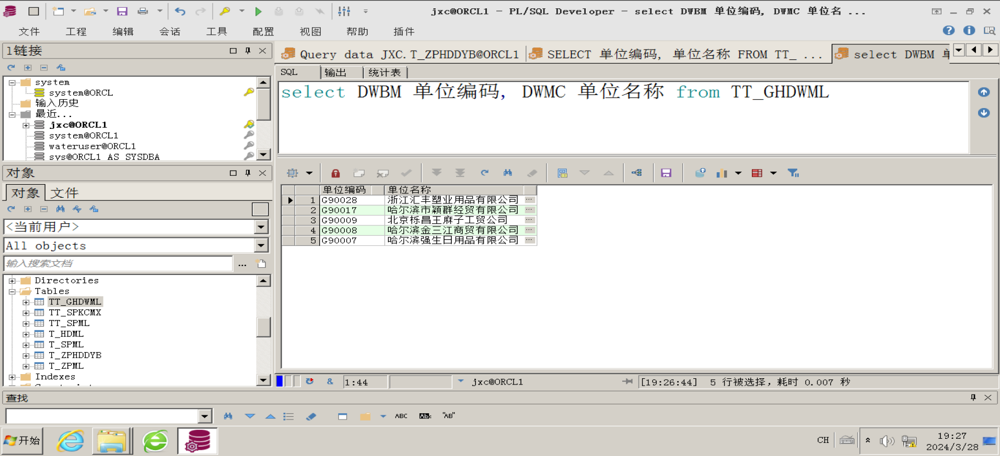

3) 查询供货单位目录中，单位名称带有“哈尔滨”的所有记录，如没有，插入一行单位名称带有“哈尔滨”的记录。

```plsql
select * from TT_GHDWML 
where dwmc like '%哈尔滨%';
```

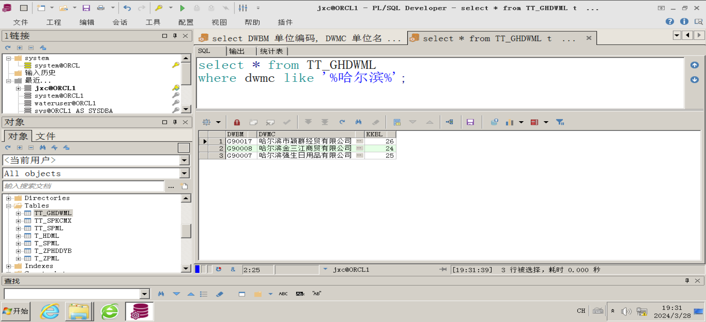

4) 查询职工目录中t\_zgml，职工编码（zgbm）是"10007"和"10033"的姓名、性别、联系电话及家庭地址.

```plsql
--没有找到职工目录表，所以没有截图
SELECT 姓名, 性别, 联系电话, 家庭地址 FROM t_zgml WHERE zgbm IN ('10007', '10033');
```

5) 查询商品目录T\_SPML中，销售价格在\>=60到<=80的商品编码、商品名称、商品规格、产地及销售价格。

```plsql
--没有商品规格，有供货单位
SELECT spbm 商品编码, spmc 商品名称,ghdw 供货单位,spcd 产地,xsjg 销售价格 FROM T_SPML WHERE xsjg BETWEEN 60 AND 80;
```

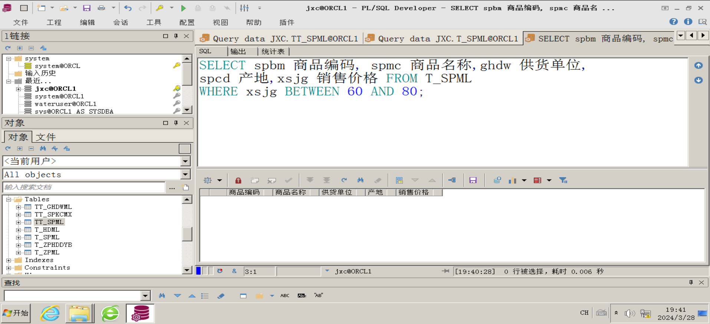

6) 查询商品库存明细t\_spkcmx中，供货单位(ghdw)是"G30016"、销售数量是空值的商品编码、入库日期、进货价格、库存数量。

```plsql
SELECT spbm 商品编码, rkrq入库日期,jhjg 进货价格,kcsl 库存数量 FROM t_spkcmx WHERE ghdw = 'G30016' AND xssl IS NULL;

```

7) 查询商品库存明细t\_spkcmx 中，入库日期(rkrq)是2005年09月商品编码、

```plsql
SELECT spbm 商品编码 FROM t_spkcmx WHERE TO_CHAR(rkrq, 'yyyy-mm') = '2005-09';
```

8) 查询商品库存明细t\_spkcmx入库日期(rkrq)、进货价格(jhjg)、库存数量(zcsl)、销售数量(xssl)，并按销售数量由大到小排序。

```plsql
SELECT rkrq, jhjg, zcsl, xssl FROM t_spkcmx ORDER BY xssl DESC;
```

9) 查询当前系统日期时间，上个月今天日期，两个月以后今天日期，从2011年12月6日到今天，过了多少个月。日期用格式yyyymmdd-hh24miss 表示。

```plsql
SELECT SYSDATE AS 当前日期时间,
       ADD_MONTHS(SYSDATE, -1) AS 上个月今天,
       ADD_MONTHS(SYSDATE, 2) AS 两个月以后今天,
       MONTHS_BETWEEN(SYSDATE, DATE '2011-12-06') AS 过去月份数
FROM DUAL;
```

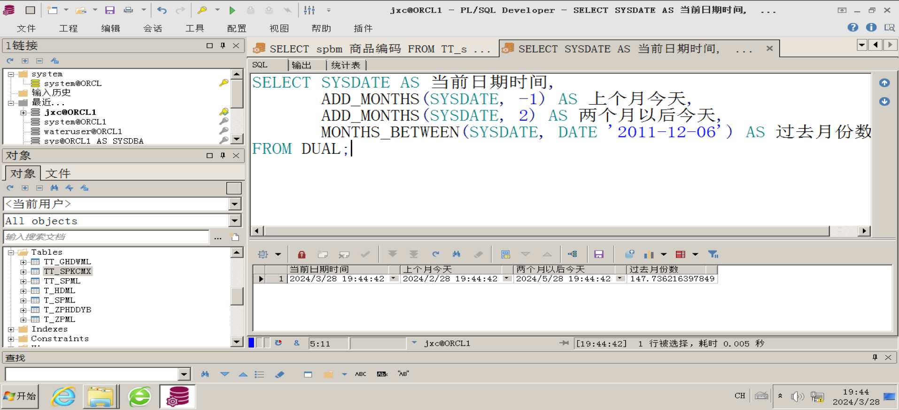

10) 完成教材4.6上机实训(4),(5),(6) 全部内容。

**（4：分组查询练习）**

*1、参考4.43，参考4.44*

*4.43：*使用GROUP BY从句对t\_spkcmx表按照供货单位代码进行分组，并统计各组的行数count（\*）、平均销售价格AVG（hsjg）、最高销售价格MAX（hsjg）、最低销售价格MIN（hsjg）、库存总数SUM（yysl）

```sql
SELECT GHDW 供货单位,COUNT(*) 记录数,ROUND(avg(hsjg),4) 销售价格，
MIN(hsjg) 最低售价,MAX(hsjg) 最高售价，SUM（yysl） 库存总数
FROM TT_SPKCMX group BY GHDW ORDER BY GHDW;
```

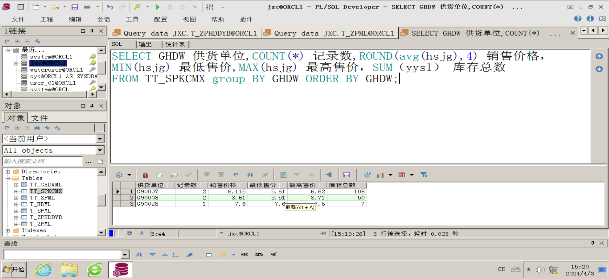

*4.44：**在商品销售明细t\_spxsmx表中，查找合计销量大于50的供货单位以及销售数量*

```sql
select ghdw ,SUM(xssl) from t_spxsmx GROUP BY ghdw
HAVING SUM(xssl) >50;
```

*​*  

**（5：多表连接查询）**

*1、等值连接练习，参考4.46:**​*

```sql
select * from tt_spkcmx t1,tt_spml t2 where t1.spbm=t2.spbm;
```

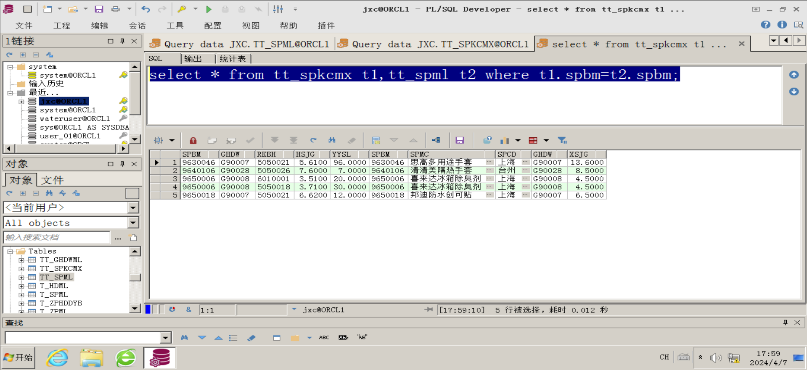

*2、自连接练习，参考4.47*

```sql
select * from tt_spkcmx  natural join tt_spml;
```

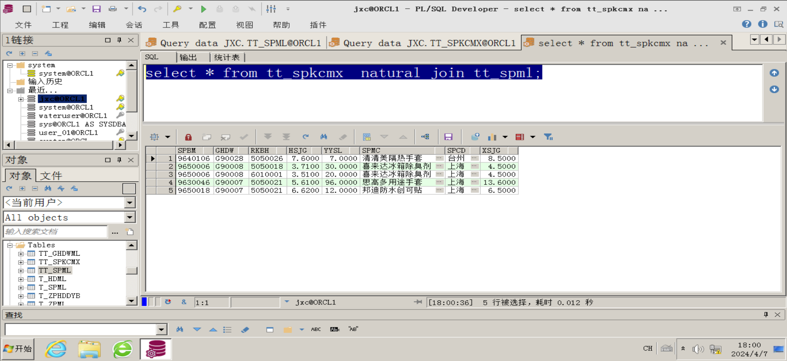

*2、外连接练习，参考4.48*

```sql
select * from tt_spkcmx x left join tt_spml y on x.ghdw=y.ghdw;
```

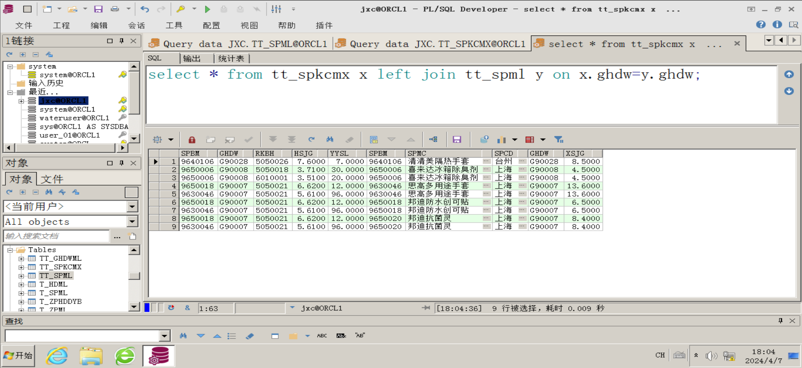

*3、相关连接练习，参考4.49*

```sql
select * from tt_spkcmx x left join tt_spkcmx y on x.ghdw=y.ghdw;
```

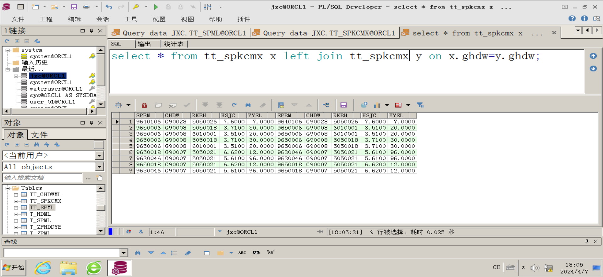

**（6：子查询练习）**

1、单行子查询练习*，参考4.53、4.54*

```sql
select * from tt_spml
         where ghdw = (select ghdw from tt_spml where spbm='9640106');
```

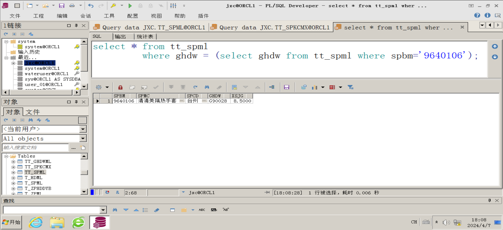

*2、多行子查询练习，参考4.55*

```sql
select * from T_SPML t
         where ghdw in (select ghdw from t_spml where ghdw='G90028');
```

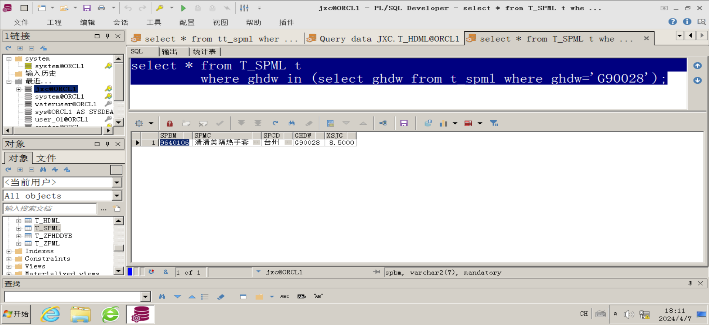

*3、相关子查询练习，参考4.56*

```sql
select '存在NPBM未存入数据' ts from dual
where exists (select * from t_zpml where npbm is null)
```

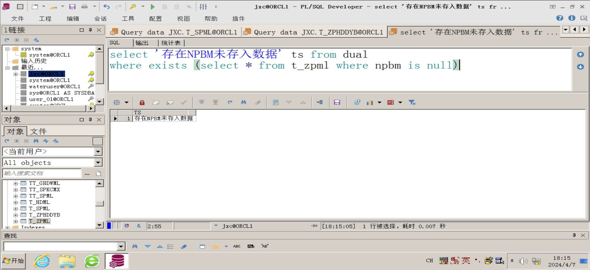

**五、实验心得**

​  

  

1.  **备份操作****：首先，通过**`**CREATE TABLE ... AS SELECT ...**`**的方式创建了一个结构与**`**t_stu**`**相同的备份表**`**t_stu_bf**`**，但不包含任何数据。随后进行了数据插入、备份、修改和清空再备份等一系列数据维护操作，体现了SQL在数据管理方面的灵活性和高效性。**
2.  **插入数据****：插入了一条新的学生记录到**`**t_stu**`**表中，注意使用了TO\_DATE函数来确保日期格式正确转换为数据库可识别的日期类型。**
3.  **删除和更新数据****：通过**`**DELETE**`**和**`**UPDATE**`**语句实现了对数据的删除和修改，其中更新操作根据特定条件（如学号）定位到了需要改变性别的学生记录。**
4.  **备份策略****：两次将**`**t_stu**`**的数据完整备份到**`**t_stu_bf**`**表中，第一次使用**`**INSERT INTO ... SELECT ...**`**语句，第二次使用**`**TRUNCATE**`**后再次插入，展示了两种不同的数据复制方法，前者保留了事务性和完整性，后者则更快但更彻底地清空原有数据。**
5.  **查询操作****：**

-   **对于简单的全表查询，使用**`**SELECT * FROM ...**`**获取了指定表的所有行和列。**
-   **按需选择特定列的查询则仅返回指定的列。**
-   `**EXISTS**`**关键字用于避免插入重复记录，这里是尝试插入只有当“哈尔滨”不存在于单位名称列表时才插入的新记录。**
-   `**IN**`**关键字用于查询符合多个条件的记录，例如职工编码为"10007"或"10033"的职工信息。**
-   `**BETWEEN**`**关键字用来查询价格区间内的商品记录。**
-   `**IS NULL**`**检查了销售数量为空的商品记录。**
-   **使用**`**EXTRACT**`**函数从日期字段中提取年份和月份，以精确匹配某个时间段的数据。**
-   **最后，通过**`**ORDER BY**`**对查询结果按照销售数量进行了降序排列。**

6.  **系统日期函数****：展示了Oracle SQL中常用的日期时间函数，如SYSDATE、ADD\_MONTHS和MONTHS\_BETWEEN，它们在业务逻辑中常被用于获取系统当前日期时间、计算过去和未来日期以及两个日期间相隔的月份数。**

  

**心得：**

  

-   **在编写SQL语句时，需要注意数据库表的实际结构和字段约束，如唯一性约束、非空约束等。**
-   **对于日期字段的操作，了解数据库系统的日期时间函数及其使用方法非常重要，这有助于处理复杂的日期相关查询和计算。**
-   **数据备份和恢复过程应当谨慎执行，特别是在生产环境中，应结合具体业务需求和性能影响，合理选择备份策略。**
-   **在插入数据时要考虑完整性约束，防止违反约束导致插入失败。**
-   **SQL查询设计灵活多样，可以根据实际业务需求构建复杂查询条件，有效获取所需数据。**

​