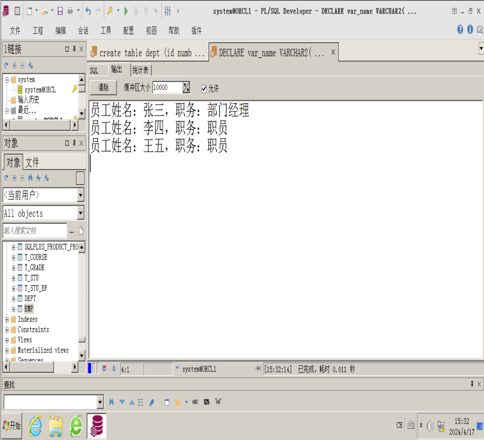

# 一．实验目的及要求

（1） 了解游标的概念和工作原理。

（2） 了解存储过程的分类和使用方法。

（3） 了解触发器的概念。

（4） 学习编写和执行自定义过程。

（5） 学习创建和使用触发器。

# 三、实验仪器设备

在虚拟机环境下，服务器成功安装Oracle 11g数据库服务器（企业版），客户机成功安装Oracle 11g客户端软件，网络服务配置正确，数据库和客户端正常工作。

# 四、游标、存储过程和触发器基本语法及示例

## 1、游标的使用

### （一）使用显式游标

（1）说明游标。

DECLARE CURSOR <游标名\>

[ (<参数列表\>) ]

IS

<SELECT语句\>;

（2）打开游标。

OPEN <游标名\> [ (<参数列表\>) ];

（3）读取数据。

FETCH <游标名\> INTO <变量列表\>;

（4）关闭游标。

CLOSE <游标名\>;

例1、使用游标读取1号部门的名称。

DECLARE \--开始声明部分

​varName VARCHAR2(50); \--声明变量,用来保存游标中的部门名称

​\--定义游标, varId为参数, 指定部门编号

​CURSOR MyCur(varId NUMBER) IS

​SELECT Dep\_Name FROM Dept

​WHERE Dep\_id = varId;

BEGIN \--开始程序体

​OPEN MyCur(1); --打开游标,参数为1,表示读取部门编号为1的记录

​FETCH MyCur INTO varName; \--读取当前游标位置的数据

​CLOSE MyCur; \--关闭游标

​dbms\_output.put\_line('部门名称:' || varName); --显示读取的数据

END; \--结束程序体

### （二）带子查询的游标for循环的语法如下：

FOR <记录名\> IN (SELECT 子查询) LOOP

​语句1；

​语句2；

​…

​语句n；

END LOOP;

例2、带子查询的游标for循环例子：

/\* 打开显示模式 \*/

SET ServerOutput ON;

BEGIN \--开始程序体

​FOR var\_DeptRecord IN (SELECT Dep\_id, Dep\_Name FROM Dept) LOOP

​/\* 显示保存在记录变量var\_DeptRecord中的数据 \*/

​dbms\_output.put\_line('部门编号:' || var\_DeptRecord.Dep\_Id ||', 部门名称:' || var\_DeptRecord.Dep\_Name);

​END LOOP;

END; \--结束程序体

/

## 2、过程的定义及使用

CREATE PROCEDURE语句来创建过程的语法格式：

CREATE [ OR REPLACE ] PROCEDURE<过程名\>

[ <参数列表\>] IS | AS

[ <局部变量声明\> ]

BEGIN

​<过程体\>

END [ <过程名\> ];

例3、创建过程GetDepAvgsal ，此过程的功能是根据输入的部门号获取指定部门的平均工资。

CREATE OR REPLACE PROCEDURE GetDepAvgsal

( v\_DepId IN NUMBER, v\_Avgsal OUT NUMBER)

AS

BEGIN

​SELECT AVG(sal) INTO v\_Avgsal FROM Emp WHERE Dep\_Id = v\_DepId;

END;

/

执行过程GetDepAvgsal ，获取1号部门的平均工资。

\--执行在使用输出参数时，必须首先定义参数的类型。

SET ServerOutput ON;

DECLARE

​AvgWage NUMBER := 0;

BEGIN

​GetDepAvgsal(1, Avgsal);

​dbms\_output.put\_line(Avgsal);

END;

/

## 3、触发器的创建及使用。

CREATE TRIGGER语句来创建触发器：

CREATE [ OR REPLACE ] TRIGGER <触发器名\>

{BEFORE | AFTER }

{INSERT | DELETE | UPDATE [OF column \[, column …]\]}  
[OR {INSERT | DELETE | UPDATE \[OF column \[, column …]\]}...\]

ON <表名\>|<视图名\>

[ FOR EACH ROW ]

[ WHEN <条件表达式\> ]

<PL/SQL程序体\>|call procedure\_name

​  

例4、创建一个语句级DML触发器。

（1）首先创建表Test和表LogTable（记录对表Test的更新操作）

CREATE TABLE Test

( id INTEGER,

​name VARCHAR2(50));

CREATE TABLE LogTable

( log\_dateDATE,

​action VARCHAR2(50));

（2）创建语句触发器LogUpdateTrigger

CREATE OR REPLACE TRIGGER LogUpdateTrigger

AFTER INSERT OR UPDATE OR DELETE

ON Test

DECLARE log\_action VARCHAR2(50);

BEGIN

IF INSERTING THEN log\_action := 'Insert';

ELSIF UPDATING THEN log\_action := 'Update';

ELSIF DELETING THEN log\_action := 'Delete';

ELSE DBMS\_OUTPUT.PUT\_LINE(' ..');

END IF;

INSERT INTO LogTable (log\_date, action) VALUES (SYSDATE, log\_action);

END;

/

（3）在表Test上执行插入、修改、删除操作：

INSERT INTO Test VALUES(1, 'Insert');

UPDATE Test SET name='Update';

DELETE FROM Test WHERE id=1;

COMMIT;

（4）查看表LogTable的内容：

SELECT \* FROM LogTable;

​  

例5、创建一个行级触发器MyTrigger，它的作用是当Dept中id列的值发生变化时，自动更新表Emp中的Dep\_id列的值，从而保证数据完整性。

CREATE OR REPLACE TRIGGER MyTrigger

AFTER UPDATE ON Dept

FOR EACH ROW

BEGIN

​UPDATE Emp SET Dep\_id = :new.Dep\_id WHERE Dep\_id = :old.Dep\_id;

END;

/

验证触发器的功能：

UPDATE Dept SET Dep\_id=200 WHERE Dep\_id=1;

Commit;

SELECT Emp\_name, Dep\_id FROM Emp;

# 五、实验内容

（1） 创建游标mycur，从表emp中读取1号部门的员工姓名，职务。并输出“员工姓名：XXX，职务：XXX。”

```sql
DECLARE
  var_name VARCHAR2(20);
  var_zw VARCHAR2(20);
  CURSOR mycur IS SELECT name, zw FROM emp WHERE dep_id = 1;
BEGIN
  OPEN mycur;
  LOOP
    FETCH mycur INTO var_name, var_zw;
    EXIT WHEN mycur%NOTFOUND;
    DBMS_OUTPUT.PUT_LINE('员工姓名：' || var_name || '，职务：' || var_zw);
  END LOOP;
  CLOSE mycur;
END;
/
```



（2） 创建存储过程GetGrade，查询指定员工的工资，使用CASE语句输出其工资等级。工资小于等于3000，等级为“低”；工资大于3000，小于5000，等级为”中”；工资大于等于5000，等级为高。并执行该存储过程。

```sql
CREATE OR REPLACE PROCEDURE GetGrade(p_id IN NUMBER, p_grade OUT VARCHAR2)
IS
BEGIN
  -- 声明变量来存储员工的工资
  DECLARE
    v_sal NUMBER;
  BEGIN
    -- 从员工表(emp)中获取指定员工的工资
    SELECT sal INTO v_sal FROM emp WHERE id = p_id;
    
    -- 使用CASE语句确定工资等级
    p_grade := CASE
                  WHEN v_sal <= 3000 THEN '低'
                  WHEN v_sal > 3000 AND v_sal < 5000 THEN '中'
                  ELSE '高'
                END;
    
    -- 输出工资等级
    DBMS_OUTPUT.PUT_LINE('员工ID为' || p_id || '的工资等级为：' || p_grade);
  END;
END GetGrade;
/
```
```sql
CREATE OR REPLACE PROCEDURE GetGrade(p_id IN NUMBER, p_grade OUT VARCHAR2)
IS
  v_sal NUMBER;
BEGIN
  SELECT sal INTO v_sal FROM emp WHERE id = p_id;
  
  IF v_sal <= 3000 THEN
    p_grade := '低';
  ELSIF v_sal >= 3000 AND v_sal < 5000 THEN
    p_grade := '中';
  ELSE
    p_grade := '高';
  END IF;
  
END;
/

DECLARE
  v_grade VARCHAR2(10);
BEGIN
  GetGrade(1, v_grade);
  dbms_output.put_line(v_grade);-- 假设查询员工ID为1的工资等级
  -- 由于存储过程已经直接输出了结果，这里不再需要打印v_grade
END;
/

DECLARE
  v_grade VARCHAR2(10);
BEGIN
  GetGrade(1, v_grade); -- 假设查询员工ID为1的工资等级
  -- 由于存储过程已经直接输出了结果，这里不再需要打印v_grade
END;
/
```

（3） 创建存储过程UpdateWage，查询指定员工的工资，如果工资小于3000，则加200工资，并提示信息“XX号员工工资已更新。”，如果工资大于3000，则提示信息“XX号员工工资为XXX，已达到规定标准。”

```sql
CREATE OR REPLACE PROCEDURE UpdateWage(p_id IN NUMBER)
IS
BEGIN
  UPDATE emp SET sal = sal + 200 WHERE id = p_id AND sal < 3000;
  IF sal < 3000 THEN
    DBMS_OUTPUT.PUT_LINE('员工ID为' || p_id || '的工资已更新。');
  ELSE
    SELECT sal INTO v_sal FROM emp WHERE id = p_id;
    DBMS_OUTPUT.PUT_LINE('员工ID为' || p_id || '的工资为' || v_sal || '，已达到规定标准。');
  END IF;
END;
/
```
```sql
CREATE OR REPLACE PROCEDURE UpdateWage(p_id IN NUMBER)
IS
  v_sal EMP.sal%TYPE;
  v_message VARCHAR2(100);
BEGIN
  -- 查询指定员工的工资
  SELECT sal INTO v_sal FROM emp WHERE id = p_id;
  
  -- 检查工资是否小于3000，并相应地更新工资和输出信息
  IF v_sal < 3000 THEN
    UPDATE emp SET sal = sal + 200 WHERE id = p_id;
    v_message := '员工ID为' || p_id || '的工资已更新。';
    DBMS_OUTPUT.PUT_LINE(v_message);
  ELSE
    v_message := '员工ID为' || p_id || '的工资为' || v_sal || '，已达到规定标准。';
    DBMS_OUTPUT.PUT_LINE(v_message);
  END IF;
  
  -- 提交事务以保存更改
  COMMIT;
EXCEPTION
  WHEN OTHERS THEN
    -- 如果发生异常，则回滚事务
    ROLLBACK;
    DBMS_OUTPUT.PUT_LINE('发生错误：' || SQLERRM);
END UpdateWage;
/

BEGIN
  UpdateWage(1); -- 假设我们要更新员工ID为1的工资
END;
/
```

（4） 创建触发器MyTrigger，它的作用是当表dept中的记录被删除后，自动删除表emp中的对应的员工记录，从而保证数据的完整性。

```sql
CREATE OR REPLACE TRIGGER MyTrigger
AFTER DELETE ON dept
FOR EACH ROW
--这个子句用于指定触发器应该对每一行受影响的数据执行一次。
--也就是说，如果触发器定义为FOR EACH ROW，那么无论触发条件被触发多少次，
--触发器的代码块都会对每一行数据独立执行。这与FOR EACH STATEMENT相对，
--后者只执行一次，即使多行数据受到影响。
BEGIN
  DELETE FROM emp WHERE dep_id = :OLD.id;
END;
/

DELETE FROM dept WHERE id = <某个部门ID>;
COMMIT;
```

​  

# 五、实验结果

​  

​  

​  

​  

​  

# 六、实验心得

​  

​