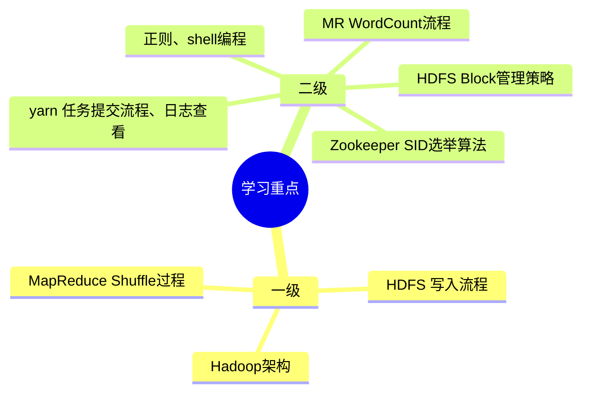
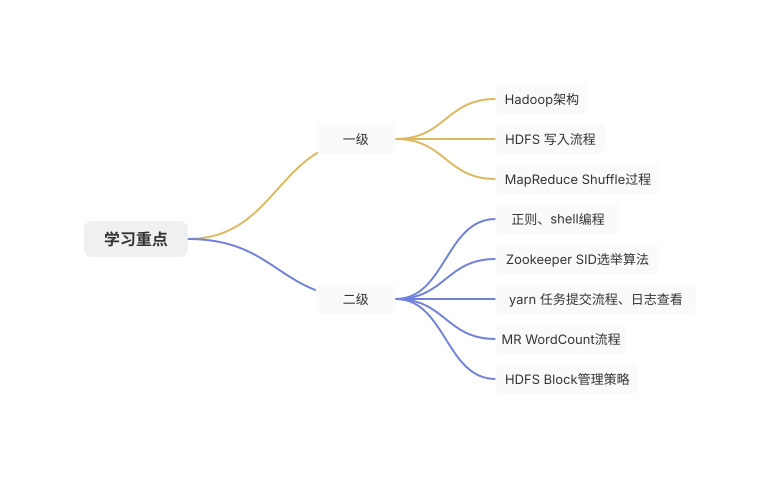
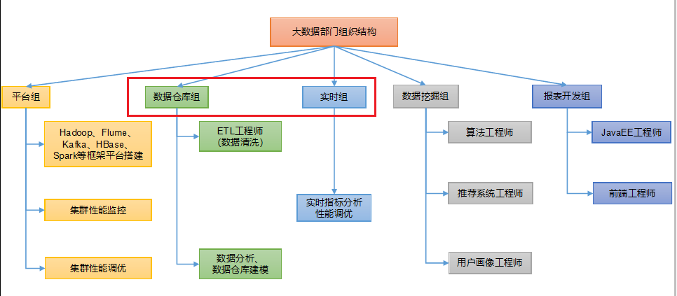
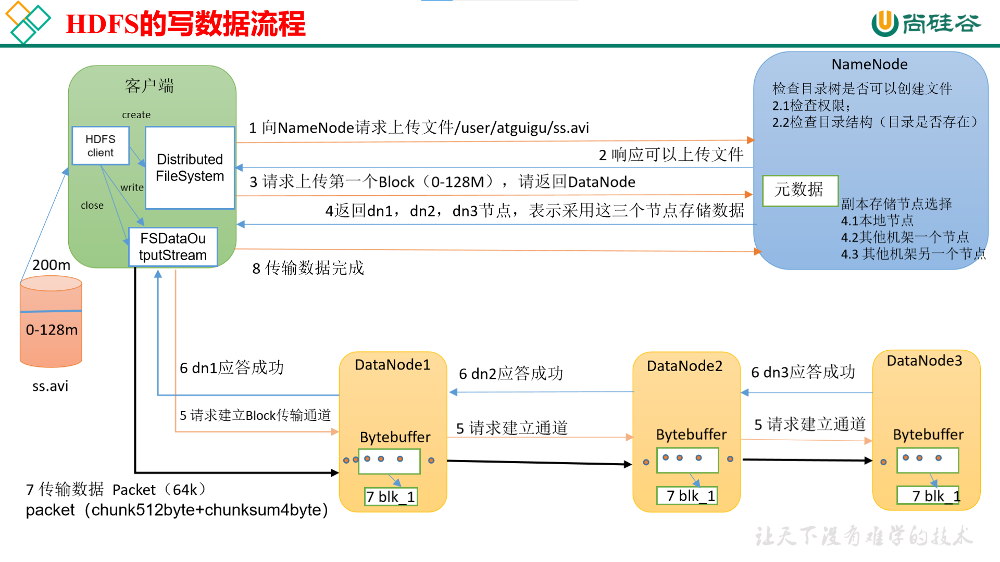
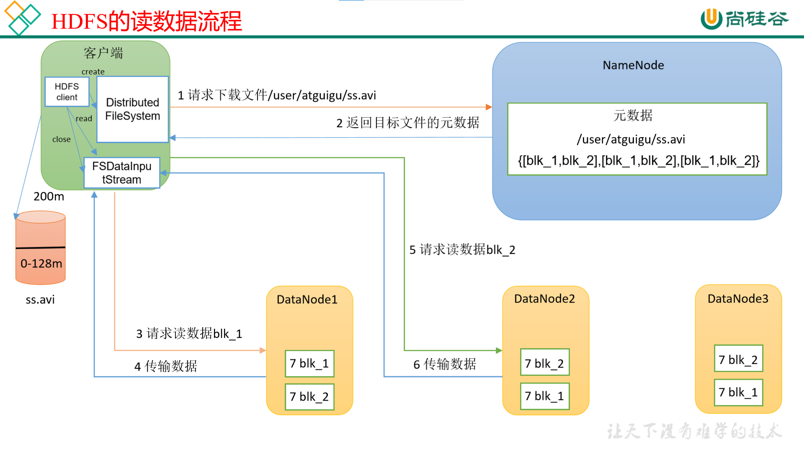
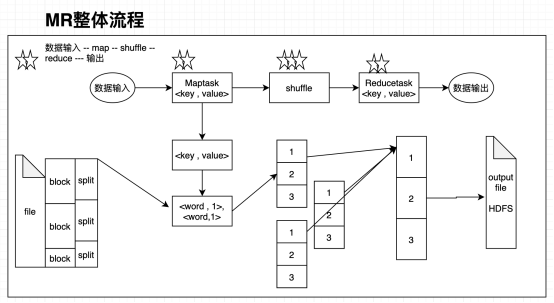
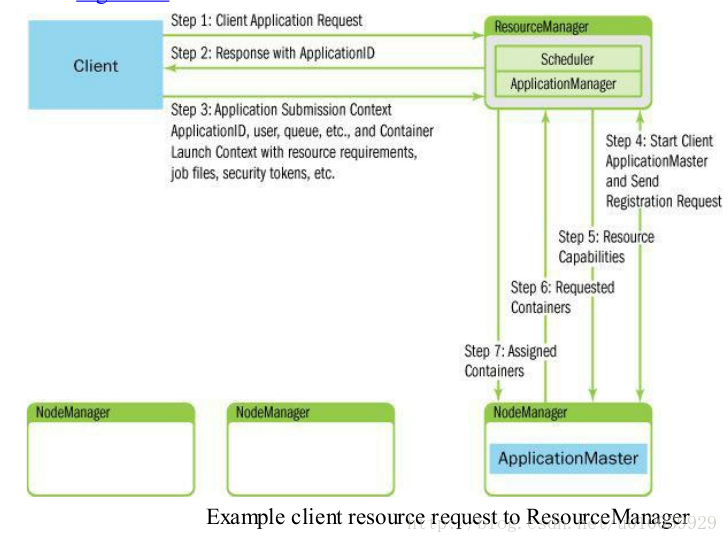

## 大数据概述

解决海量数据的采集、存储、分析计算

4V特点：大数据量、高速(实时计算)、类型多样性(结构化、半结构化、非结构化)、价值密度低(ETL)

## Hadoop简介

Hadoop是分布式系统基础框架，解决海量数据的存储和分析计算

优势

-   高可靠性：底层维护多个数据副本
-   高扩展性：在集群间分配任务数据，可以扩展数以千计的节点
-   高效性：并行工作，加快任务处理速度
-   高容错性：能自动将失败的任务重新分配

组成

-   HDFS 数据存储
-   MapReduce 分布式计算引擎
-   Yarn 集群资源的管理和分配（从Hadoop 2.0引入）
-   Common 辅助工具

## HDFS

### 组成架构

HDFS是分布式文件系统，包含：

1.  NameNode：存储文件的元数据；管理命名空间；配置副本策略；管理数据块位置映射信息；处理客户端读写请求
2.  DataNode：存储文件实际数据；根据namenode指令执行数据块的创建、删除、复制
3.  Secondary NameNode：定期合并FsImage文件和Edits文件。辅助namenode恢复。实际用得不多，生产直接用HA模式
4.  Client：提供一些命令来操作HDFS

优点

-   高容错性
-   适合处理海量数据
-   在廉价的硬件上即可构建高可用集群

缺点

-   不适合低时间延迟的数据访问
-   无法存储大量小文件

​  

datanode作用

DataNode以数据块的形式存储HDFS文件

DataNode响应HDFS客户端读写请求

DataNode周期向NameNode汇报心跳信息

DataNode周期性向NameNode汇报数据块信息

### Block块

块机制：Block默认大小为128MB，可通过dfs.blocksize配置。块太小，会增加寻址时间，且增加namenode的存储负担；块太大，磁盘传输数据的时间会明显大于寻址时间，导致存储很慢

副本机制：保障数据安全，体现HDFS高容错性。存放策略：

1、第一个副本块存本机

2、第二个副本块存跟本机不同机架内的服务器节点

3、第三个副本块存不同机架的另一个服务器节点上

### HDFS指令

hdfs dfs -help

\-ls

\-mkdir

\-touchz

\-cp

\-put 将本地文件传输到hdfs

\-get 下载文件到本地

\-du 统计文件夹的大小信息

\-setrep 设置HDFS中文件的副本数量

### 读写数据流程

写数据的容错机制

1.  **DataNode故障处理**：如果某个DataNode在写数据过程中失败，NameNode会选择新的DataNode，并通知客户端重新写入未完成的数据块。
2.  **心跳和块报告**：DataNodes定期向NameNode发送心跳信号和块报告，以确保NameNode能够及时检测到DataNodes的状态和数据块的完整性。

### 元数据

元数据存储

1、存放在namenode内存中

2、存放在磁盘的**FsImage和EditLog文件**

-   **FsImage**：持久化存储文件系统的快照，保存在磁盘上。
-   **EditLog**：记录对文件系统的所有变更操作

元数据合并

Secondary NameNode定期将EditLog中的变更合并到FsImage中，生成新的FsImage，并传回NameNode。

simage和edits的合并触发机制有两个，一个是1小时时合并一次，一个是每完成100百万次的元数据操作合并一次。

### 补充知识

脑裂：同时有两个NameNode处于Active状态。

HDFS HA：由两个NameNode组成，一个处于active状态，另一个处于standby状态。Active NameNode对外提供服务，而Standby NameNode则不对外提供服务，仅同步Active NameNode的状态，以便能够在它失败时快速进行切换。

ZKFC机制和JournalNode：

每个NameNode节点上都运行一个ZKFC进程，它监控本地的NameNode健康状态，如果检测到故障，ZKFC会通知ZooKeeper。ZooKeeper会进行领导选举，选择Standby NameNode成为新的Active NameNode。

Active NameNode会将所有变更写入JournalNodes，而Standby NameNode从JournalNodes中读取变更，以保持数据同步。

HDFS联邦机制：单个NameNode存在扩展性问题，大数据量下限制了集群规模。HDFS联邦机制通过引入多个独立的NameNode来管理不同的命名空间NameSpace，这些NameSpace彼此隔离，但又共享DataNode节点数据。提升了系统的整体性能和可扩展性。

## MapRduce

### 概述

MapReduce将计算过程分为Map和Reduce两个阶段。Map阶段负责将数据划分为键值对，Reduce阶段负责对具有相同键的值进行计算。

Mapreduce核心功能是将用户编写的业务逻辑代码和自带默认组件整合成一个完整的分布式运算程序，并发运行在一个hadoop集群上。

优缺点

优点：易于编程、良好的扩展性、高容错性

缺点：不擅长实时计算、不擅长流式计算、不擅长有向图计算

现状：中间结果写到磁盘，影响计算效率和速度，逐步被其他计算框架如spark替代。

### MapReduce进程

一个完整的MapReduce程序在分布式运行时有三类实例进程：

1.  MRAppMaster：负责整个程序过程调度及状态协调
2.  MapTask：负责map阶段整个数据处理流程
3.  ReduceTask：负责reduce阶段整个数据处理流程

### 工作机制

计算流程是：输入分片 ---> map阶段 ---> combiner阶段(可选) ---> shuffle阶段 ---> reduce阶段 ---> 数据输出

**切片机制**

​  

**MapTask工作机制**

  

S**huffle工作机制**

Map方法之后，Reduce方法之前的数据处理过程称之为Shuffle。

具体Shuffle过程详解，如下：

（1）MapTask收集我们的map()方法输出的kv对，放到环形缓冲区中

（2）从环形缓冲区不断溢出本地磁盘文件，可能会溢出多个文件

（3）多个溢出文件会被合并成大的溢出文件

（4）在溢出过程及合并的过程中，都要调用Partitioner进行分区和针对key进行快速排序

（5）ReduceTask根据自己的分区号，去各个MapTask机器上取相应的结果分区数据

（6）ReduceTask会抓取到同一个分区的来自不同MapTask的结果文件，ReduceTask会将这些文件再进行合并（归并排序）

（7）合并成大文件后，Shuffle的过程也就结束了，后面进入ReduceTask的逻辑运算过程（从文件中取出一个一个的键值对Group，调用用户自定义的reduce()方法）

**ReduceTask工作机制**

  

## Yarn

Yarn是Hadoop的资源管理器，为各类计算框架提供资源管理(主要是硬件资源如：CPU，内存，磁盘，网络IO)和任务调度。支持多种计算引擎同时在Yarn中运行，如MapReduce、Spark、Tez等。

### 组成架构

1、ResourceManager

RM是整个集群的中心，负责集群的资源分配和调度。RM包含调度器（Scheduler）和应用程序管理器（ApplicationsManager）。

Scheduler负责为应用程序分配资源。有FIFO（先进先出调度器）、CapacityScheduler（容量调度器）、FairScheduler（公平调度器）

ApplicationsManager管理整个系统中所有应用程序，接收程序提交、与调度器协商资源后启动ApplicationMaster、监控ApplicationMaster运行状态并在失败时重新启动它等。

2、NodeManager

管理YARN集群中的每个节点，提供针对集群中单个节点的服务，包括监督容器的生命周期、监视资源和跟踪节点健康。

3、ApplicationMaster

AM是单个应用程序的中心。负责应用的监控，跟踪应用执行状态，重启失败任务等。

4、Container

Container是YARN中的资源抽象，是资源管理和任务执行的基本单位，它封装了某个节点上的多维度资源，如内存、CPU、磁盘、网络等。

### 调度器

1、先进先出调度器（FIFO）

根据提交作业的先后顺序，先来先服务。不支持多队列，与造成任务拥堵，生产环境很少使用

2、容量调度器（Capacity Scheduler）

支持多队列，多租户，空闲资源共享

3、公平调度器（Fair Scheduler）

在多队列，多用户的基础上，支持抢占机制

所有应用程序都能公平获得资源时使用

### Yarn任务提交流程

1.  **请求提交**：

-   Client向ResourceManager（RM）发送启动新应用程序的请求。

2.  **获取ApplicationID**：

-   RM响应Client的请求，并分配一个唯一的ApplicationID。

3.  **提交Application Submission Context（ASC）**：

-   Client使用分配的ApplicationID，连同用户信息、队列信息、资源请求（内存、CPU）、作业文件、安全令牌等构建ASC，并提交给RM。

4.  **调度并启动ApplicationMaster（AM）**：

-   RM根据ASC中的信息，调度一个container（container 0）来启动AM。当找到合适的NodeManager（NM）时，RM会请求NM启动AM。

5.  **AM启动与资源信息获取**：

-   AM在NM上启动后，RM会告知AM集群的资源限制（最小和最大资源）。
-   AM根据这些信息决定如何分配资源给应用程序中的任务。

6.  **AM请求更多container**：

-   AM根据应用程序需求，向RM请求一定数量的container来运行任务。这些请求可以指定具体的资源需求（如额外的内存）。

7.  **RM分配container**：

-   RM根据集群的当前状态、队列的容量和调度策略，尽可能满足AM的资源请求，并通知相应的NM启动新的container。

### 查看任务日志

yarn logs -applicationId application\_1640176853989\_0001

查看yarn实时运行信息：yarn top，每秒刷新一次

web页面也能查看Application-logs

## HA高可用

### 什么是HA

为了整个系统的可靠性，通常在系统中部署两台或多台主节点，形成主备关系，但在某一时间只有一个主节点能对外提供服务。当这个节点挂了之后，备用的主节点能立刻接替对外提供服务，用户感受不到明显的系统故障。