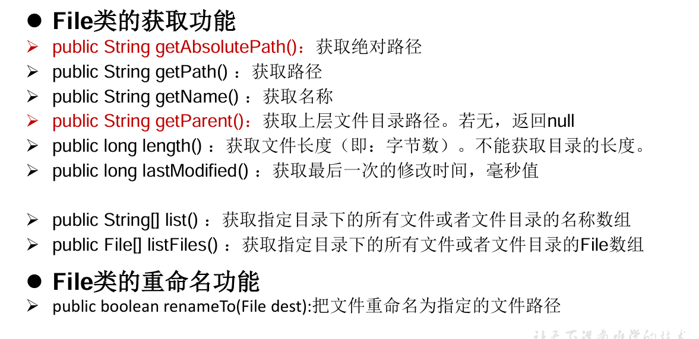
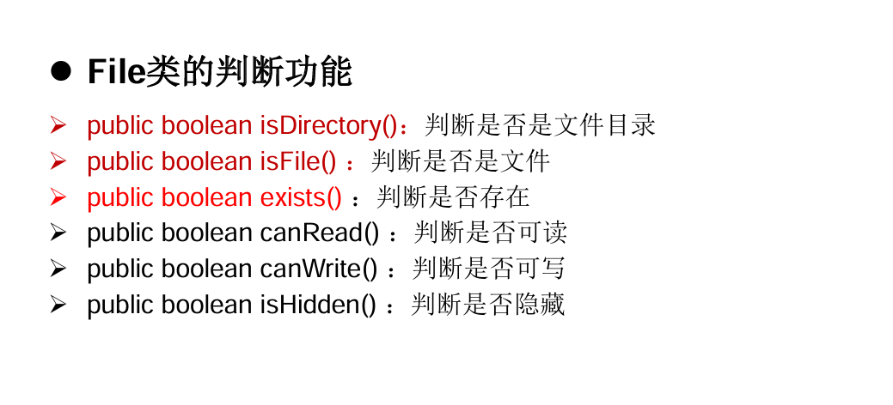
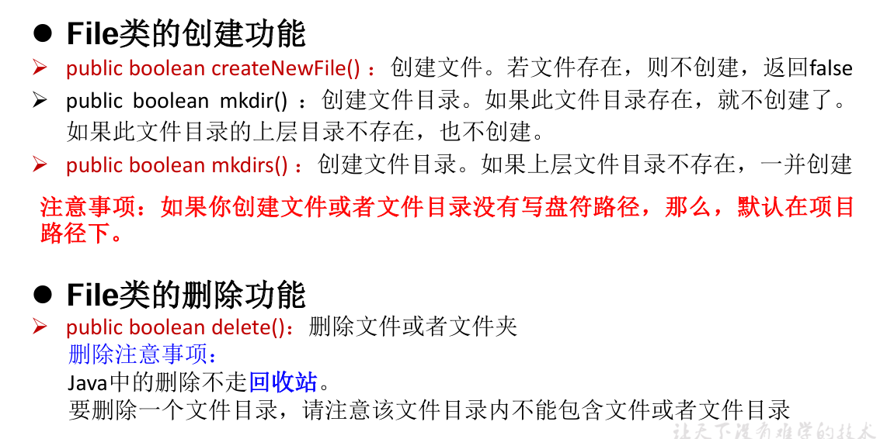
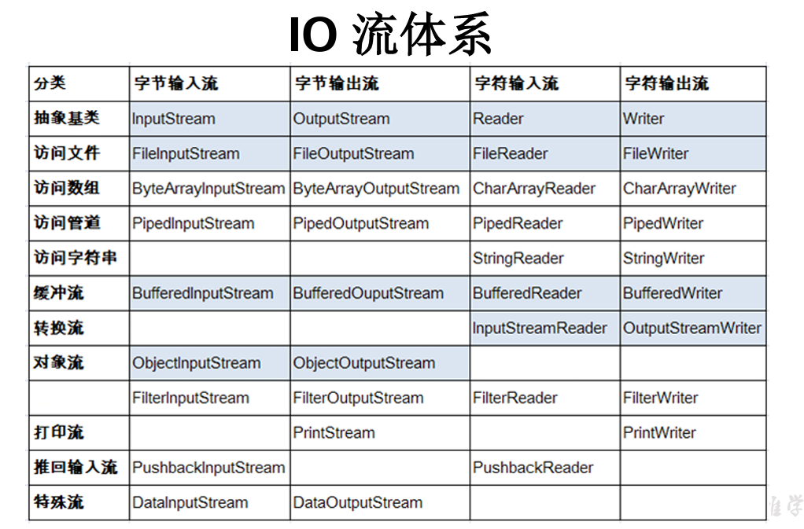
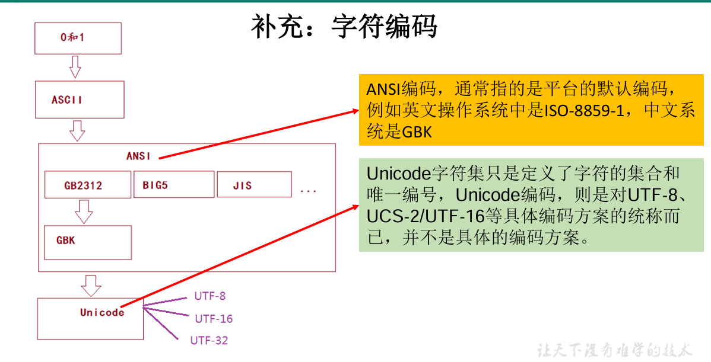
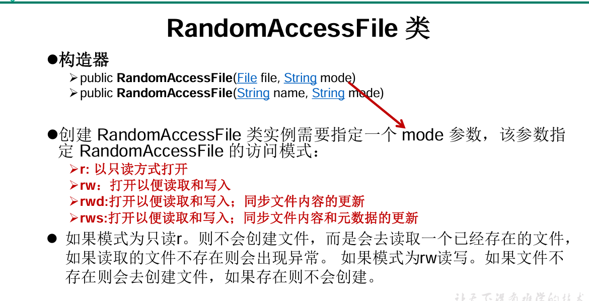
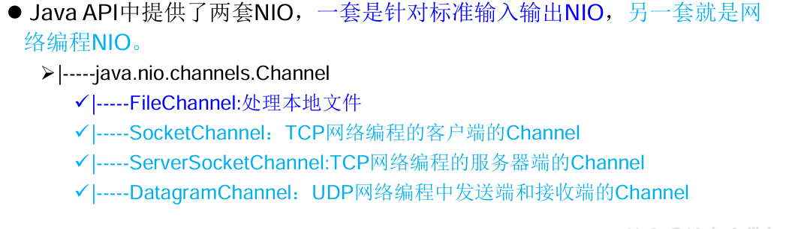

## File类的使用

### 1.1 概述

-   java.io.File类：文件和文件目录路径的抽象表示形式
-   File 能新建、删除、重命名文件和目录，但File 不能访问文件内容本身。 如果需要访问文件内容，则需要使用io流
-   File对象可以作为参数传递给io流的构造器

### 1.2 常用方法







## I0流原理及流的分类

io 用于处理设备间的数据传输。如读/写文件，网络通讯等。以“流(stream)”的方式进行

### 2.1 流的分类

-   按操作数据单位不同分为：字节流(8 bit)，字符流(16 bit)
-   按数据流的流向不同分为：输入流，输出流
-   按流的角色的不同分为：节点流，处理流--->套接在已有的流上



## 节点流

### 3.1 字符流 --处理文本

读 FileReader

写 FileWriter

复制 FileReader+FileWriter

```plain
@Test
//使用FileReader和FileWriter实现文本文件的复制
public void test2() {
    FileReader fir1 = null;
    FileWriter fir2 = null;
    try {
        //1.创建File类对象，指明读入和写出的文件
        File scrFile = new File("testFile.txt");
        File destFile = new File("testFile2.txt");
        //2.创建输入和输出流的对象
        fir1 = new FileReader(scrFile);
        fir2 = new FileWriter(destFile);
        //3.数据的读入和写出
        char[] cbuf = new char[1024];
        int len;
        while ((len = fir1.read(cbuf)) != -1) {
            fir2.write(cbuf, 0, len);
        }
    } catch (IOException e) {
        e.printStackTrace();
    } finally {
        //4.关闭流资源
        if (fir1 != null){
            try {
                fir1.close();
            } catch (IOException e) {
                e.printStackTrace();
            }
        }
        if (fir2 != null){
            try {
                fir2.close();
            } catch (IOException e) {
                e.printStackTrace();
            }
        }
    }
}
```

### 3.2 字节流--处理非文本

读 FileInputStream

写 FileOutputStream

复制 FileInputStream+FileOutputStream

区别在于：byte[] cbuf = new byte[1024];

## 缓冲流

属于处理流的一种，为了提高文件的读取效率。在开发中常用

-   字节流：BufferedInputStream 和 BufferedOutputStream
-   字符流：BufferedReader 和 BufferedWriter

先造节点流，再造处理流

只需要关闭外层处理流，内层的会自动关闭

## 转换流

属于处理流的一种 ，实现字节流和字符流之间的转换

Java API提供了两个转换流：

1.  InputStreamReader：将一个字节的输入流InputStream转换为字符的输入流Reader，解码
2.  OutputStreamWriter：将一个字符的输出流Writer转换为字符的输出流OutputStream ，编码



## 标准输入、输出流

System.in：标准的输入流，默认输入设备是键盘

System.out：标准的输出流，默认输出设备是显示器

重定向：通过System类的setIn( )、 setOut( )方法对默认设备进行改变。

​  

## 打印流

实现将基本数据类型的数据格式转化为字符串输出

打印流：PrintStream和PrintWriter

## 数据流

读写基本数据类型和String的数据

DataInputStream 和 DataOutputStream

注意：读取不同类型数据的顺序，要和写入数据时的数据保持一致

## 对象流

ObjectInputStream和OjbectOutputSteam

用于存储和读取基本数据类型数据或对象的处理流。它的强大之处在于可以把Java中的对象写入到数据源中，也能把对象从数据源中还原回来。

序列化：用ObjectOutputStream类保存基本类型数据或对象的机制

反序列化：用ObjectInputStream类读取基本类型数据或对象的机制

​  

为了让某个自定义类是可序列化的，有以下要求：

1.  该类必须实现如下两个接口之一。 否则会抛出NotSerializableException异常 ：Serializable 、Externalizable
2.  该类必须有一个表示序列化版本标识符的静态变量： private static final long serialVersionUID = 422222 L

## 随机存取文件流

RandomAccessFile 类，实现了DataInput、DataOutput这两个接口，也就意味着这个类既可以读也可以写。

当作为输出流实现时，若写出到的文件不存在，则创建；若存在，则会从原有文件的开头位置，对原有文件进行覆盖

RandomAccessFile对象包含一个记录指针，用以标示当前读写处的位置。对象可以自由移动记录指针：

getFilePointer()：获取文件记录指针的当前位置

seek(long pos)：将文件记录指针定位到 pos 位置



  

## NI0.2中Path、Paths.Files类的使用

NIO支持面向缓冲区的(IO是面向流的)、基于通道的IO操作。NIO将以更加高效的方式进行文件的读写操作 。



Path、Paths和Files核心API