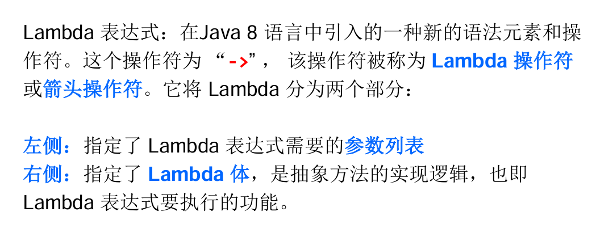
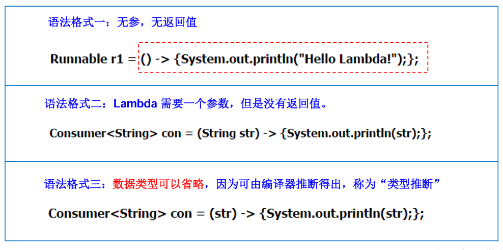
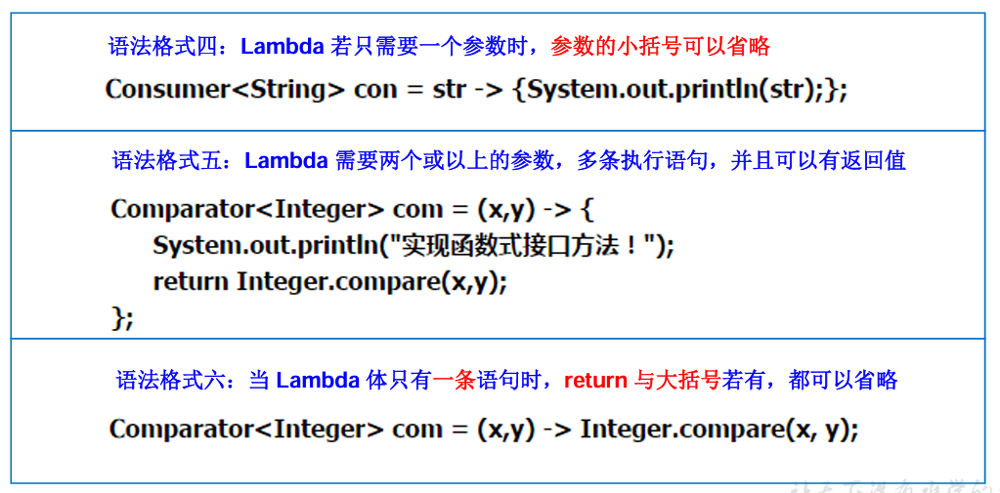
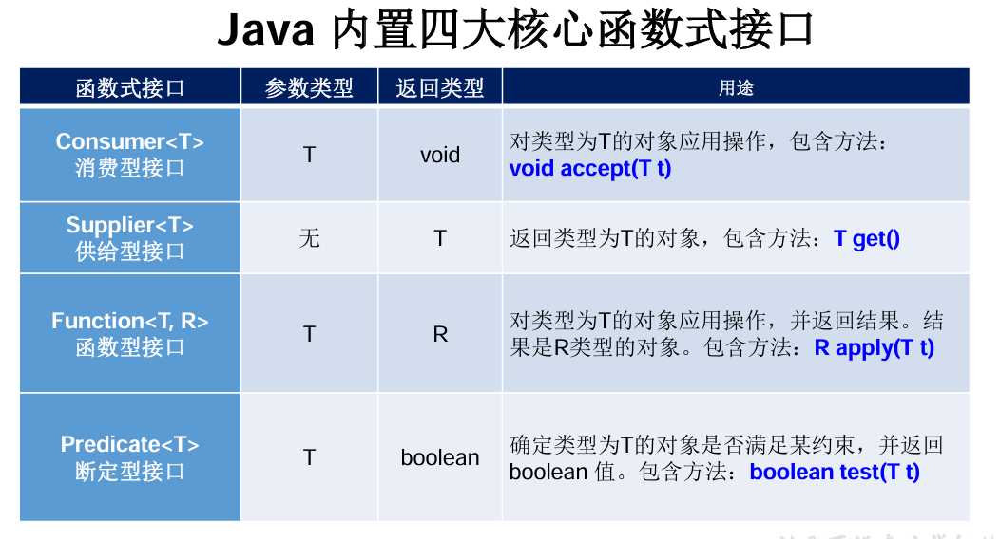

## 一、Lambda表达式

## 二、函数式接口

只包含一个抽象方法的接口，称为函数式接口 (FunctionalInterface)

在一个接口上使用@FunctionalInterface注解，这样做可以检查它是否是一个函数式接口。

在Java8中，Lambda表达式就是一个函数式接口的实例

在java.util.function包下定义了Java 8 的丰富的函数式接口

## 三、方法引用与构造器引用

## 四、Stream APl

## 五、Optional类