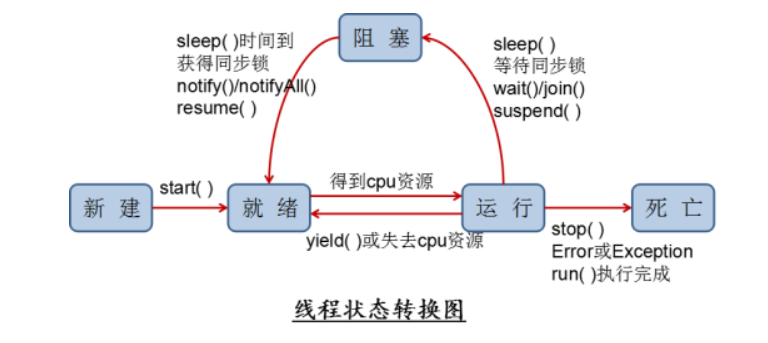

## 一、基本概念：程序、进程、线程

并行：多个CPU同时执行多个任务。比如：多个人同时做不同的事。

并发：一个CPU(采用时间片)同时执行多个任务。比如：秒杀、多个人做同一件事。

**多线程程序的优点：**

1.  提高应用程序的响应。对图形化界面更有意义，可增强用户体验。
2.  提高计算机系统CPU的利用率
3.  改善程序结构。将既长又复杂的进程分为多个线程，独立运行，利于理解和修改

**何时需要多线程？**

1.  程序需要同时执行两个或多个任务。
2.  程序需要实现一些需要等待的任务时，如用户输入、文件读写操作、网络操作、搜索等。
3.  需要一些后台运行的程序时。

## 二、线程的创建和使用

JDK1.5之前创建新执行线程有两种方法：

1.  继承Thread类的方式
2.  实现Runnable接口的方式

**继承Thread类的方式**

1) 定义子类继承Thread类。

2) 子类中重写Thread类中的run方法。 --将此线程要实现的操作写在方法体中

3) 创建Thread子类对象，即创建了线程对象。

4) 调用线程对象start方法：启动线程，调用run方法。

**实现Runnable接口的方式**

1) 定义子类，实现Runnable接口。

2) 子类中重写Runnable接口中的run方法。

3) 通过Thread类含参构造器创建线程对象。

4) 将Runnable接口的子类对象作为实际参数传递给Thread类的构造器中。

5) 调用Thread类的start方法：开启线程，调用Runnable子类接口的run方法。

**​**  

**Thread类的有关方法**

start(): 启动线程，并执行对象的run()方法

run(): 线程在被调度时执行的操作（通常需要重写）

getName(): 返回线程的名称

setName():设置该线程名称

currentThread(): 返回当前线程。

yield()：线程让步

join() ：在线程a中调用线程b的 join() 方法，线程a将被阻塞，直到线程b执行完成

sleep(long millis)：(指定时间:毫秒)

-   令当前活动线程在指定时间段内放弃对CPU控制,使其他线程有机会被执行,时间到后重排队。
-   抛出InterruptedException异常 -- try catch

**Java的调度方法**

-   同优先级线程组成先进先出队列（先到先服务），使用时间片策略
-   对高优先级，使用优先调度的抢占式策略

**线程的优先级**

MAX\_PRIORITY：10

MIN \_PRIORITY：1

NORM\_PRIORITY：5 （默认）

涉及的方法

-   getPriority() ：返回线程优先值
-   getPriority(int newPriority) ：改变线程的优先级

说明

-   线程创建时继承父线程的优先级
-   低优先级只是获得调度的概率低，并非一定是在高优先级线程之后才被调用

## 三、线程安全

多个线程并发访问共同资源会发生线程安全问题

**同步机制原理**

同步锁机制的两种方式：

1、同步代码块

synchronized(锁对象){

     需要同步操作的代码

}

2、同步方法

public synchronized void method(){

    可能会产生线程安全问题的代码

}

锁对象的选择

-   静态同步方法默认：当前类的.Class对象
-   非静态方法默认：this
-   string字符串---同步代码块通常用这种方式

## 四、线程间通信

等待唤醒机制可以解决经典的“生产者与消费者”的问题

wait(time)：当前线程不再活动，不再参与调度

notify()：随机唤醒一个正在等待的线程

notifyall()：唤醒所有等待中的线程--多个生产者和消费者的情况使用

  

## 五、线程生命周期

线程的生命周期有五种状态：新建（New）、就绪（Runnable）、运行（Running）、阻塞（Blocked）、死亡（Dead）。

## 六、释放锁和死锁

**sleep()和wait()方法的区别**

（1）sleep()不释放锁，wait()释放锁

（2）sleep()指定休眠的时间，wait()可以指定时间也可以无限等待直到notify()或notifyAll()

（3）sleep()在Thread类中声明的静态方法，可以直接通过类名调用；wait()方法在Object类名调用，需要由锁对象调用

**死锁**

不同的线程分别锁住对方需要的同步监视器对象不释放，都在等待对方先放弃时就形成了线程的死锁。一旦出现死锁，整个程序既不会发生异常，也不会给出任何提示，只是所有线程处于阻塞状态，无法继续。