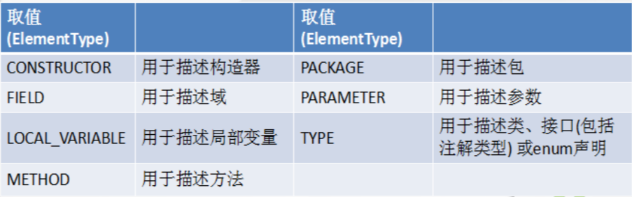

## 一、枚举类的使用

当需要定义一组常量时，强烈建议使用枚举类

### 1.1 如何自定义枚举类（jdk1.5之前）

```plain
class Season{
    private final String seasonName;//季节的名称
    private final String seasonDesc;//季节的描述
    //私有化类的构造器，保证不能在类的外部创建其对象
    private Season(String seasonName,String seasonDesc){ 
        this.seasonName = seasonName;
        this.seasonDesc = seasonDesc;
    }
    //在类的内部创建枚举类的实例。声明为：public static final
    public static final Season SPRING = new Season("春天", "春暖花开");
    public static final Season SUMMER = new Season("夏天", "夏日炎炎");
    public static final Season AUTUMN = new Season("秋天", "秋高气爽");
    public static final Season WINTER = new Season("冬天", "白雪皑皑");
}
```

### 1.2 如何使用关键字enum定义枚举类（jdk1.5之后新增）

```plain
enum Season1{
    //需要先提供当前枚举类的对象
    SPRING ("春天", "春暖花开"),
    SUMMER ("夏天", "夏日炎炎"),
    AUTUMN ("秋天", "秋高气爽"),
    WINTER ("冬天", "白雪皑皑");

    private final String seasonName;//季节的名称
    private final String seasonDesc;//季节的描述
    //私有化类的构造器，保证不能在类的外部创建其对象
    private Season1(String seasonName,String seasonDesc){
        this.seasonName = seasonName;
        this.seasonDesc = seasonDesc;
    }    
}
```

### 1.3 Enum类的主要方法

-   values()方法：返回枚举类型的对象数组。该方法可以很方便地遍历所有的枚举值。
-   valueOf(String str)：找指定名的枚举类对象。要求字符串必须是枚举类对象的“名字”。如不是，会有运行时异常：IllegalArgumentException。
-   toString()：返回当前枚举类对象常量的名称

### 1.4 实现接口的枚举类

若每个枚举值在调用实现的接口方法呈现相同的行为方式，则只要统一实现该方法即可。

若需要每个枚举值在调用实现的接口方法呈现出不同的行为方式, 则可以让每个枚举值分别实现该方法

```plain
SPRING("春天", "春暖花开") {
    @Override
    public void show() {
        System.out.println("重写1");
    }
},
SUMMER("夏天", "夏日炎炎") {
    @Override
    public void show() {
        System.out.println("重写2");
    };
```

## 二、注解的使用

### 2.1 注解(Annotation)概述

Annotation 其实就是代码里的特殊标记, 这些标记可以在编译, 类加载, 运行时被读取, 并执行相应的处理。

Annotation 可以像修饰符一样被使用, 可用于修饰包,类, 构造器, 方法, 成员变量, 参数, 局部变量的声明, 这些信息被保存在 Annotation 的 “name=value” 对中。

在JavaSE中，注解的使用目的比较简单，例如标记过时的功能，忽略警告等。

框架 = 注解 + 反射 + 设计模式

## 2.2 常见的Annotation示例

JDK内置的三个基本注解

-   @Override: 限定重写父类方法, 该注解只能用于方法
-   @Deprecated: 用于表示所修饰的元素(类, 方法等)已过时。通常是因为所修饰的结构危险或存在更好的选择
-   @SuppressWarnings: 抑制编译器警告

### 2.3 自定义Annotation

自定义注解必须配上注解的信息处理流程才有意义（使用反射）

### 2.4 JDK中的元注解

元注解是指修饰其他注解的注解。JDK5.0提供了4个标准的meta-annotation类型，分别是：

-   Retention

用于指定该 Annotation 的生命周期,。

RetentionPolicy.SOURCE:在源文件中有效（即源文件保留）

RetentionPolicy.CLASS:在class文件中有效（即class保留）---- 这是默认值

RetentionPolicy.RUNTIME:在运行时有效（即运行时保留）---只有RUNTIME的注解程序，才可以通过反射获取该注释

-   Target

用于指定被修饰的 Annotation 能用于修饰哪些程序元素。



-   Documented

修饰的 Annotation 类将被javadoc 工具提取成文档。（默认情况下，javadoc是不包括注解的）

定义为Documented的注解必须设置Retention值为RUNTIME

-   Inherited

被它修饰的 Annotation 将具有继承性。

如果某个类使用了被@Inherited 修饰的 Annotation, 则其子类将自动具有该注解

##### 2.5 利用反射获取注解信息（在反射部分涉及）

### 2.6 JDK 8中注解的新特性

Java 8对注解处理提供了两点改进：可重复的注解及可用于类型的注解

类型注解：

关于元注解@Target的参数类型ElementType枚举值多了两个：TYPE\_PARAMETER,TYPE\_USE。

TYPE\_PARAMETER表示该注解能写在类型变量的声明语句中（如：泛型声明）

TYPE\_USE表示该注解能写在使用类型的任何语句中。