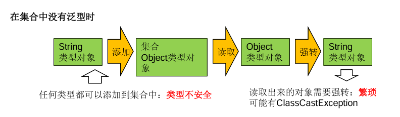
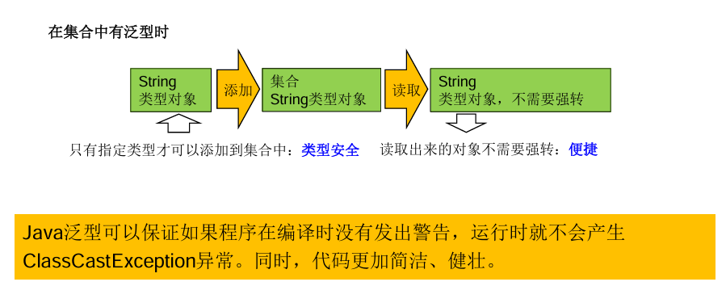
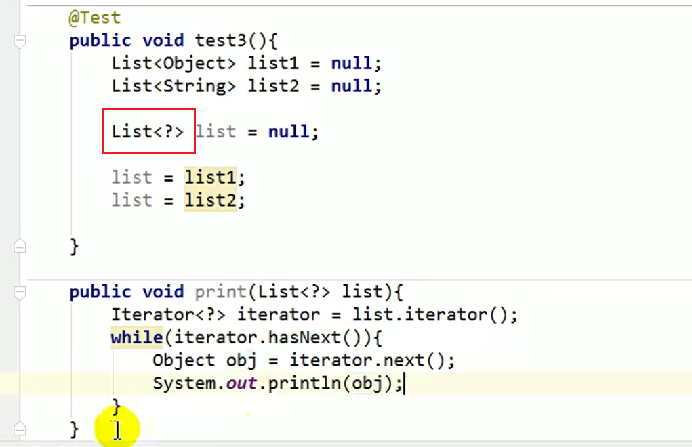

## 一、为什么要有泛型

泛型(Generic)类似标签，用于标识类中元素的类型或者方法的参数类型



## 二、在集合中使用泛型

```plain
public class GenericTtest {
    @Test
    public void test1() {
        ArrayList<Integer> list = new ArrayList<Integer>();
        list.add(78);
        list.add(88);
        list.add(77);
        list.add(66);
        Iterator<Integer> iterator = list.iterator();
        while (iterator.hasNext()) {
            System.out.println(iterator.next());
        }
    }

    @Test
    public void test2() {
        Map<Integer, String> m = new HashMap<Integer, String>();
        m.put(1, "小白");
        m.put(2, "小黑");
        m.put(3, "小绿");
        Set<Map.Entry<Integer, String>> entries = m.entrySet();
        Iterator<Map.Entry<Integer, String>> iterator = entries.iterator();
        while (iterator.hasNext()) {
            Map.Entry<Integer, String> e = iterator.next();
            Integer key = e.getKey();
            String value = e.getValue();
            System.out.println(key + "----->" + value);
        }
    }
}
```

## 三、自定义泛型结构

泛型类、泛型接口

泛型方法

操作数据库会使用到

## 四、泛型在继承上的体现

虽然类A是类B的父类， 但是G<A>和G<B>两者不具备子父类关系，A<G>和B<G>是子父类

## 五、通配符的使用

可用通配符? 解决上述问题



写入：对于List<?>来说不能向内部添加数据

读取：允许，读取的数据类型为Object

​  

有限制条件的通配符

<? extends Number> (无穷小, Number\]

只允许泛型为Number及Number子类的引用调用

<? super Number> \[Number , 无穷大)

只允许泛型为Number及Number父类的引用调用