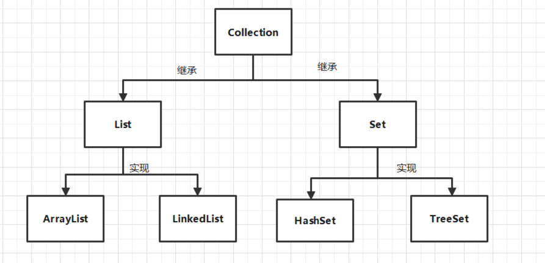
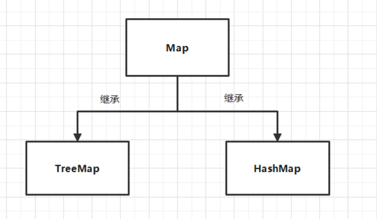
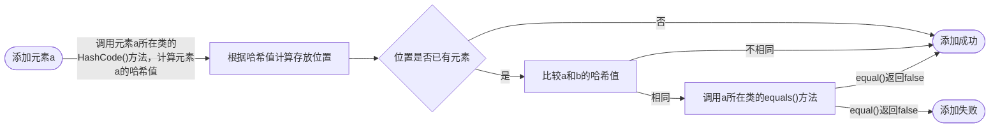
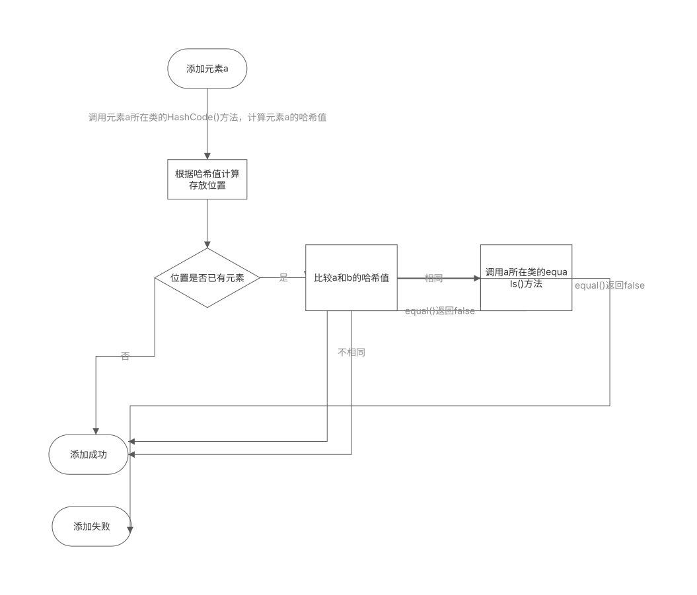

## 一、整体框架图





## 二、 Collection 接口常见方法

Collection 接口是 List、Set 接口的父接口。

Collection接口：单列数据，定义了存取一组对象的方法的集合

1、添加

add(Object obj)

addAll(Collection coll)

2、获取有效元素的个数 int size()

3、清空集合 void clear()

4、是否是空集合 boolean isEmpty()

5、是否包含某个元素

boolean contains(Object obj)：是通过元素的equals方法来判断是否是同一个对象

boolean containsAll(Collection c)：也是调用元素的equals方法来比较的。拿两个集合的元素挨个比较。

6、删除

boolean remove(Object obj) ：通过元素的equals方法判断是否是要删除的那个元素。只会删除找到的第一个元素

boolean removeAll(Collection coll)：取当前集合的差集

7、取两个集合的交集

boolean retainAll(Collection c)：把交集的结果存在当前集合中，不影响c

8、集合是否相等

boolean equals(Object obj)

9、将集合转成对象数组

Object[] toArray()

10、获取集合对象的哈希值

hashCode()

11、遍历

iterator()：返回迭代器对象，用于Collection集合遍历或移除元素

```plain
Collection c1 = new ArrayList();
Iterator iterator = c1.iterator();
while(iterator.hasNext()){
    System.out.println(iterator.next());
}
```
```plain
Collection c1 = new ArrayList();
Iterator iterator = c1.iterator();
while(iterator.hasNext()){
    Object next = iterator.next(); //先调next方法，再调remove
    if(next.equals("AA")){
        iterator.remove();
    }
}
```

12、foreach遍历集合

```plain
Collection c1 = new ArrayList();
for(Object o : c1){
    System.out.println(o);
}
```

## 三、 Collection子接口一：List

List：元素有序、可重复的集合（又叫动态数组）

List接口的常用实现类：ArrayList、LinkedList、Vector异同

同：

都实现了List接口，都是有序、可重复的数据

异：

ArrayList：作为List接口主要实现类；线程不安全，执行效率高；底层使用Object[ ]数组存储

~~Vector：是List接口的古老实现类，少用；线程安全，执行效率低；底层使用Object[ ]存储~~

LinkedList：底层使用双向链表存储；线程不安全；对于频繁插入、删除操作效率更高

### 3.1 List接口方法

增 add(Object ele)

插 add(int index,Object ele)

查 get(int index)

删 remove(int index)

改 set(int index,Object ele)

长度 size( )

截取 subList(int fromindex,int toindex)

### 3.2 LinkedList新增方法

void addFirst(Object obj)

void addLast(Object obj)

Object getFirst()

Object getLast()

Object removeFirst()

Object removeLast()

## 四、 Collection子接口二：Set

Set：元素无序、不可重复的集合（高中讲的“集合”）

Set接口是Collection的子接口，set接口没有提供额外的方法

### 4.1Set实现类之一： HashSet

**HashSet 是 Set 接口的典型实现，大多数时候使用 Set 集合时都使用这个实现类。**底层是数组+链表。

无序性：存储数据并非按照索引的顺序添加，而是根据数据的哈希值添加

不可重复性： Set 集合不允许包含相同的元素

**向HashSet中添加元素的过程**





对于存放在Set容器中的对象，对应的类一定要重写equals()和hashCode()方法。IDEA可以自动生成

### 4.2 Set实现类之二：LinkedHashSet

-   LinkedHashSet 是 HashSet 的子类
-   LinkedHashSet 根据元素的 hashCode 值来决定元素的存储位置，但它同时使用双向链表维护元素的次序，这使得元素看起来是以插入顺序保存的
-   LinkedHashSet插入性能略低于 HashSet，但频繁遍历操作效率高

### 4.3 Set实现类之三：TreeSet

TreeSet 是 SortedSet 接口的实现类，TreeSet可以按照对象的指定属性进行排序

向TreeSet中添加的数据，要求是同一个类的对象

TreeSet底层使用红黑树结构存储数据

-   自然排序：实现Comparable接口
-   定制排序：Comparator接口

## 五、 Map接口

### 5.1 Map概述

Map接口：双列数据，保存具有映射关系“key-value对”的集合（高中讲的“函数”）

key无序，不能重复；(key所在的类需要重写equals()和hashCode())

value无序，可以重复(value所在的类需要重写equals())

Map 中的 key 和 value 都可以是任何引用类型的数据

### 5.2 Map常用方法

```plain
/*
 添加、删除、修改操作：
         Object put(Object key,Object value)：将指定key-value添加到(或修改)当前map对象中
         void putAll(Map m):将m中的所有key-value对存放到当前map中
         Object remove(Object key)：移除指定key的key-value对，并返回value
         void clear()：清空当前map中的所有数据
 元素查询的操作：
         Object get(Object key)：获取指定key对应的value
         boolean containsKey(Object key)：是否包含指定的key
         boolean containsValue(Object value)：是否包含指定的value
         int size()：返回map中key-value对的个数
         boolean isEmpty()：判断当前map是否为空
         boolean equals(Object obj)：判断当前map和参数对象obj是否相等
 元视图操作的方法：
         Set keySet()：遍历所有key构成的Set集合
         Collection values()：遍历所有value构成的Collection集合
         Set entrySet()：遍历所有key-value对构成的Set集合
```

### 5.3 Map实现类之一：HashMap

作为Map的主要实现类，可以存储null的key和value

底层：

jdk7 数组+链表

jdk8 数组+链表+红黑树 （提升查找效率）

**HashMap的底层实现原理**

jdk7：调用key.hashCode()判断存放位置，若key1.equals(key2)返回true，则替换已有的value

jdk8：当数组的某个索引位置上的元素，以链表形式存在的数据个数>8且当前数字的长度＞64，此时索引上的数据改为红黑树存储

### 5.4 Map实现类之二：LinkedHashMap

HashMap的子类，添加了指针；保证可以按照添加元素的顺序来遍历Map

对于频繁的遍历操作，执行效率更高

### 5.5 Map实现类之三：TreeMap

可以按照添加的Key-Value进行排序，实现了排序遍历。（ 按照Key排序）

TreeMap底层使用红黑树结构存储数据

-   自然排序

TreeMap 的所有的 Key 必须实现 Comparable 接口，而且所有 的 Key 应该是同一个类的对象，否则将会抛出 ClasssCastException

-   定制排序

创建 TreeMap 时，传入一个 Comparator 对象，该对象负责对 TreeMap 中的所有 key 进行排序。此时不需要 Map 的 Key 实现 Comparable 接口

### 5.6 Map实现类之四：Properties

Properties 类是 Hashtable 的子类，该对象用于处理配置文件

Properties 里的 key 和 value 都是字符串类型

```plain
public class PropertiesTest {
    public static void main(String[] args) throws IOException {
        Properties pro = new Properties();
        FileInputStream fis = new FileInputStream("jdbctest.properties");
        pro.load(fis); //加载流对应的文件
        String name = pro.getProperty("name");
        String age = pro.getProperty("age");
        System.out.println("name = " +name +" age = "+age);
    }
}
```

## 六、 Collections工具类

操作数组的工具类：Arrays

操作Collection(Set、List )和 Map集合的工具类 ：Collections

Collections 中提供了一系列静态的方法对集合元素进行排序、查询和修改等操作， 还提供了对集合对象设置不可变、对集合对象实现同步控制等方法

### 6.1 常用方法

1.  排序操作：（均为static方法）

-   reverse(List)：反转 List 中元素的顺序
-   shuffle(List)：对 List 集合元素进行随机排序
-   sort(List)：根据元素的自然顺序对指定 List 集合元素按升序排序
-   sort(List，Comparator)：根据指定的 Comparator 产生的顺序对 List 集合元素进行排序 swap(List，int i， int j)：将指定 list 集合中的 i 处元素和 j 处元素进行交换

2.  查找、替换

-   Object max(Collection)、min(Collection)：根据元素的自然顺序，返回给定集合中的最大、最小元素
-   Object max(Collection，Comparator)：根据 Comparator 指定的顺序，返回给定集合中的最大元素
-   int frequency(Collection，Object)：返回指定集合中指定元素的出现次数
-   void copy(List dest,List src)：将src中的内容复制到dest中--->dest.size()>src.size()
-   boolean replaceAll(List list，Object oldVal，Object newVal)：使用新值替换 List 对象的所有旧值

3.  同步控制

-   Collections 类中提供了多个 synchronizedXxx() 方法，该方法可使将指定集 合包装成线程同步的集合，从而可以解决多线程并发访问集合时的线程安全 问题