## 1、常用命令

cd - 快速返回上一次所在目录

1、more + 文件名 用于查看文件内容，可翻页查看

通过空格翻页

通过q退出查看

2、 cp [路径1] [路径2] 复制文件

cp -r [路径1] [路径2] 复制文件夹

mv [路径1] [路径2] 移动文件、文件夹(ps：若不存在则重命名)

rm -rf [参数，支持通配符] 删除文件、文件夹

3、查找指令

find / -name "\*.txt" 查找根目录下所有以.txt结尾的文件

find /usr -size +100M 查找/usr目录下所有大于100M的文件

which+命令，查看所使用的一系列命令的程序文件存放在哪里

locate 快速定位文件路径

4、grep -n 关键字 文件路径 从文件中通过关键字过滤文件行。

wc 文件路径 统计文件的行数、单词数、字节数等

5、管道符 | ：将管道符左边命令的结果，作为右边命令的输入

重定向符：>和>>

\>，将左侧命令的结果，覆盖写入到符号右侧指定的文件中

\>>，将左侧命令的结果，追加写入到符号右侧指定的文件中

6、底线命令模式

:wq 保存并退出

:set nu 显示行号

:/关键字 搜索

:%s/old/new/g 替换全文中的old为new

7、vim快捷键

| 语法 | 功能描述 |
| --- | --- |
| yy | 复制光标当前一行 |
| y数字y | 复制一段（从第几行到第几行） |
| p | 箭头移动到目的行粘贴 |
| u | 撤销上一步 |
| dd | 删除光标当前行 |
| d数字d | 删除光标（含）后多少行 |
| x | 剪切一个字母，相当于del |
| X | 剪切一个字母，相当于Backspace |
| yw | 复制一个词 |
| dw | 删除一个词 |
| shift+6（^） | 移动到行头 |
| shift+4 （$） | 移动到行尾 |
| 1+shift+g | 移动到页头，数字 |
| shift+g | 移动到页尾 |
| 数字+shift+g | 移动到目标行 |

8、su 用户名 切换用户

从普通用户切换到其它用户，需要输入密码

从root用户切换到其它用户，无需密码，可以直接切换

9、sudo 其他命令 为普通的命令授权，临时以root身份执行

前提：需要以root用户执行visudo命令，增加配置方可让普通用户有sudo命令的执行权限，步骤如下：

-   切换root用户，执行visudo命令
-   在文件最后一行添加：用户名 ALL=(ALL) NOPASSWD:ALL
-   :wq 保存退出

10、用户、用户组相关管理命令

groupadd添加组、groupdel删除组（需要root权限）

useradd添加用户、userdel删除用户（需要root权限）

id 用户名：查看用户信息

usermod -aG 用户组 用户名：将指定用户加入指定用户组

getent passwd查看系统全部用户信息

\--共有7份信息，用户名:密码(x):用户ID:组ID:描述信息(无用):HOME目录:执行终端(默认bash)

getent group查看系统全部组信息

\-- 包含3份信息，组名称:组认证(显示为x):组ID

11、权限控制

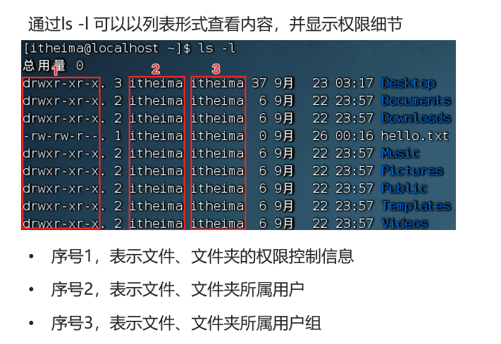

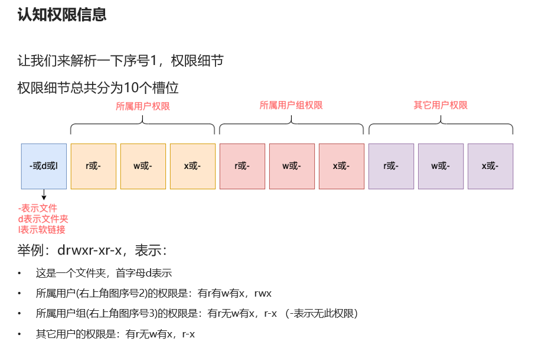

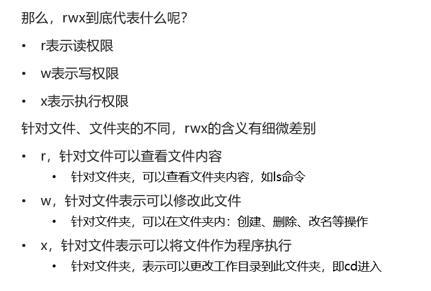

chmod u=rwx,g=rx,o=x hello.txt ，将文件权限修改为：rwxr-x--x

其中：u表示user所属用户权限，g表示group组权限，o表示other其它用户权限

chmod g+w hello,txt ：给组增加可写权限

chmod 777 文件/文件夹 ：权限修改为所有用户用户组都可读可写可执行

（r记为4，w记为2，x记为1）

chown [-R] username:groupname 文件 修改文件的用户和组

chgrp [最终用户组] [文件或目录] （功能描述：改变文件或者目录的所属组）

12、快捷键

ctrl + a 光标跳到命令开头

ctrl + e 光标跳到命令结尾

ctrl + d 强制退出

ctrl + c 强制停止

13、yum -y install/remove/search：用于自动化安装、卸载、搜索Linux软件

14、systemctl

systemctl list-units --type service --all 列出所有服务（空格翻页，q退出）

firewall-cmd --get-zones 查看防火墙所有可用区域

systemctl start| stop|status| enable|disable +服务名

（NetworkManager-主网络服务、network-副网络服务、firewalld-防火墙、sshd-ssh服务）

（start 启动、stop关闭、status查看状态、enable开启开机自启、disable关闭开机自启动）

15、date "+%Y-%m-%d %H:%M:%S" 查看当前时间

ps ：如何修改Linux时区为东八区？

1️⃣rm -rf /etc/localtime

2️⃣sudo ln -s /usr/share/zoneinfo/Asia/Shanghai /etc/localtime

16、IP地址、主机名

ifconfig，查看本机的ip地址

（如无法使用ifconfig命令，可以安装：yum -y install net-tools）

hostname：查看主机名

hostnamectl set-hostname 主机名：修改主机名（需root）

域名解析

在Windows系统的C:\\Windows\\System32\\drivers\\etc\\hosts文件中配置域名和ip地址的映射关系，则在终端即可通过主机名连接。

虚拟机配置固定IP：略

17、网络传输

ping+ip或主机名，检查指定的网络服务器是否是可联通状态

wget -b 下载链接，下载网络文件，会将日志写入到当前工作目录的wget-log文件。可通过tail命令可以监控后台下载进度：tail -f wget-log

（下载apache-hadoop 3.3.0版本：wget http://archive.apache.org/dist/hadoop/common/hadoop-3.3.0/hadoop-3.3.0.tar.gz）

curl -o url 发送http网络请求，可用于：下载文件、获取信息等

18、查看端口占用

nmap IP地址，查看指定IP的对外暴露端口（需要提前安装nmap：yum -y install nmap）

netstat -anp | grep 端口号，查看本机指定端口号的占用情况（需要提前安装netstat：yum -y install net-tools）

19、进程

ps -aux 查看系统中所有进程

pstree -p 查看进程树

ps -ef 列出全部进程的全部信息

ps -ef | grep 30001，过滤30001进程号的信息（名称，进程号，用户ID）

jobs 查看后台任务

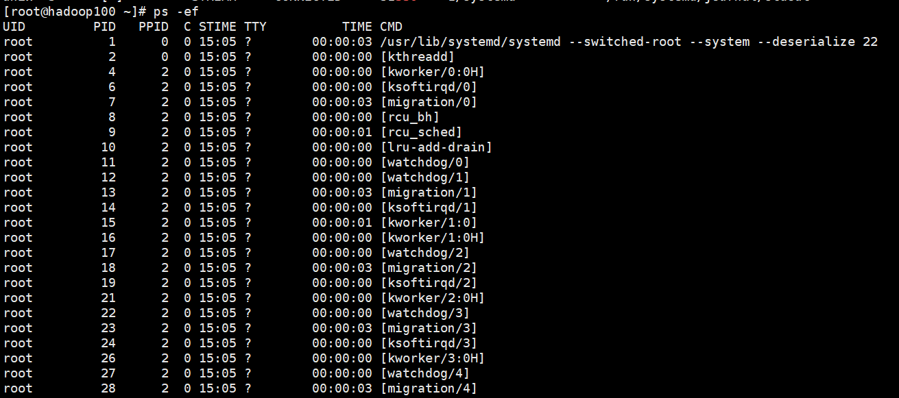

  
kill -9 进程id ：强制关闭进程

20、主机状态

top 持续监听进程运行状态，查看cpu、内存使用情况（每隔五秒刷新一次）

top -p 进程id ：只显示该进程的信息

top -i ：不显示任何闲置或无用的进程

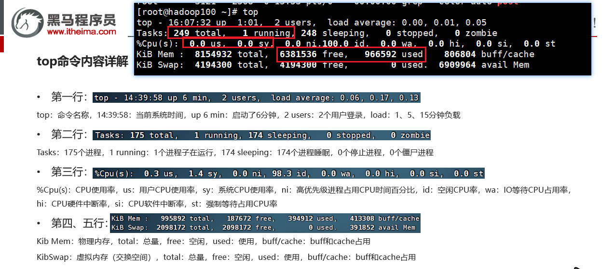

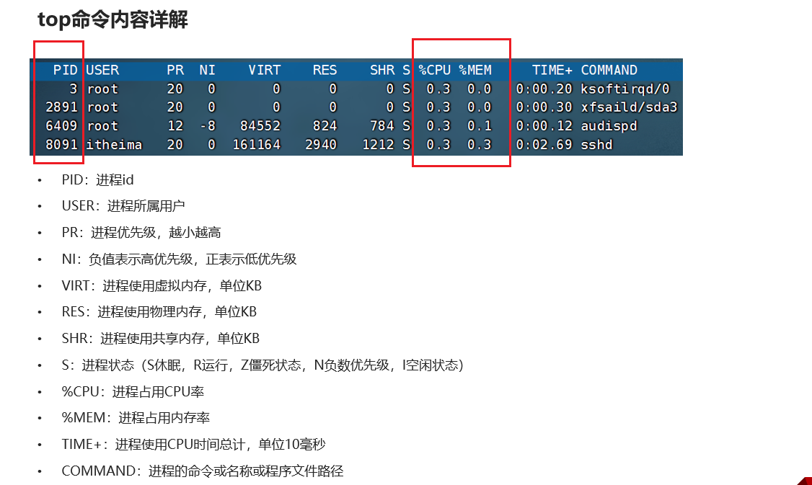

  

sar -n DEV 5 ：网络状态监控（每隔5s刷新一次）

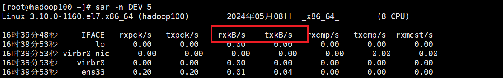

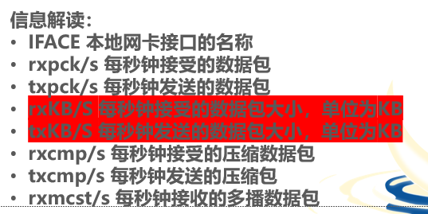

21、文件上传下载（通过 yum -y install lrzsz可以安装此命令）

rz回车，选择文件---上传速度慢，直接用finalshell工具拖拽更快

sz+文件名：进行文件下载

22、压缩和解压

对于linux系统，压缩包通常为.tar、.gz、.zip

1、tar压缩

-   tar -cvf test.tar 1.txt 2.txt 3.txt

将1.txt 2.txt 3.txt 压缩到test.tar文件内

-   tar -zcvf test.tar.gz 1.txt 2.txt 3.txt

将1.txt 2.txt 3.txt 压缩到test.tar.gz文件内，使用gzip模式（可以缩小文件体积）

2、tar解压缩

-   tar -xvf test.tar

解压test.tar，将文件解压至当前目录

-   tar -xvf test.tar \-C /home/itheima

解压test.tar，将文件解压至指定目录（/home/itheima）

-   tar \-zxvf test.gz -C /home/itheima

解压Gzip格式的压缩包，将文件解压至指定目录（/home/itheima）

3、zip压缩

•zip test.zip a.txt b.txt c.txt

将a.txt b.txt c.txt 压缩到test.zip文件内

•zip \-r test.zip test itheima a.txt

将test、itheima两个文件夹和a.txt文件，压缩到test.zip文件内

4、unzip解压缩

•unzip test.zip，将test.zip解压到当前目录

•unzip test.zip \-d /home/itheima，将test.zip解压到指定文件夹内（/home/itheima）

**23、crontab 系统定时任务**

cat /etc/crontab 查看cron配置规则

crontab -e 编辑定时任务

crontab -l 查看定时任务

crontab -r 删除定时任务

ps：cron表达式的写法和含义 \* \* \* \* \*

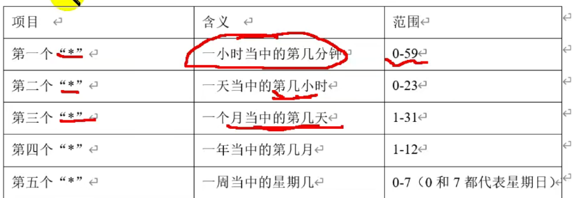

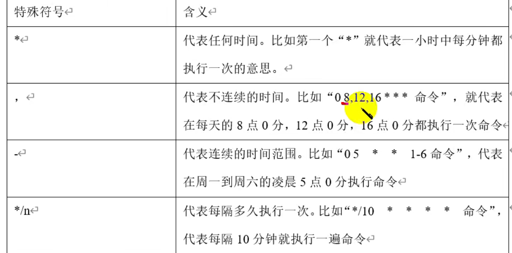

24、软件包管理

-   rpm安装--需要手动解决包之间依赖关系，否则安装报错

rpm -qa（功能描述：**查询所安装的所有rpm软件包，可用grep过滤**）

rpm -ivh + 地址 安装软件

rpm -e 软件包名 卸载软件

-   yum安装--可以自动解决包之间依赖关系

yum install 软件名 安装

yum list installed | grep centos 查询已安装的软件信息

yum remove 软件名 卸载

  

25、date "+%Y-%m-%d %H:%M:%S" 显示当前时间

26、ACL访问控制和umask

setfacl 对当个用户授权

umask 创建文件时的默认权限

27、cat /etc/redhat-release 查看linux操作系统版本

**28、硬盘管理**

du -h 显示指定的目录或文件所占用的磁盘空间

df -h 查看磁盘使用情况

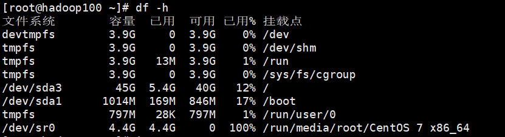

iostat -x 5 磁盘信息监控（每隔5s刷新一次）

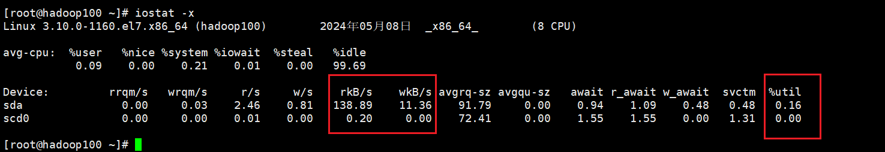

rKB/s： 每秒发送到设备的读取请求数

wKB/s： 每秒发送到设备的写入请求数

%util： 磁盘利用率

​  

​  

## 2、Shell编程

shell主要用来写脚本程序。默认使用bin/bash解析器

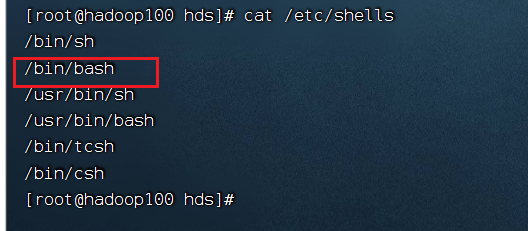

### 2.1 格式

脚本以#!/bin/bash开头（指定解析器）

脚本运行方式：

1.  sh，bash；
2.  绝对路径，相对路径（需要执行权限）；
3.  . 或者source

### 2.2 环境变量

分类：全局变量、局部变量

env 查看全部环境变量

echo $变量名 查看指定的环境变量值

export -p 列出当前用户下生效的环境变量

PATH环境变量中定义了用于进行命令和程序查找的目录

$PATH:/home/chirst/Scripts 追加配置PATH环境变量(重启失效)

环境变量持久化

将PATH环境变量配置在 /etc/profile目录下 source /etc/profile 立即生效

export 引入环境变量

### 2.3 通配符

通配符用于模糊匹配，提高检索效率

| * | 匹配任意长度的任意字符，可以是0个，也可以是任意个 |
| --- | --- |
| ? | 匹配任意单个字符，必须是1个 |
| [ abc] | 匹配指定字符范围内的任意单个字符 |
| [^] | 匹配指定字符范围外的任意单个字符 |
| [a-z] | 表示a-z，A-Y |
| \ '' "" | 转义字符 |

例子：

ls -d /etc/[mnrp]\*.conf 显示/etc目录下，所有.conf结尾，且以m,n,r,p开头的文件或目录

ls -d /etc/[^mnrp]\*.conf 显示/etc目录下，所有.conf结尾，且不以m,n,r,p开头

ls -d /etc/???.\* 显示/etc目录下，文件名长度是3位的文件

### 2.4 Shell 变量

Shell 支持以下三种定义变量的方式：

-   variable=value
-   variable='value'（不会解析变量）
-   variable="value"(推荐使用，可以解析字符串中的附带的变量和命令)

使用变量：**$变量名**

**variable=$(command)** 将命令的结果赋值给变量

readonly 变量名 定义为只读变量，值不可修改

unset 变量名 删除变量

**​**  

**shell中的特殊变量**

$n 位置参数

$0 当前脚本文件名称

$$ 当前shell进程ID

$\* 列出传递给脚本的所有参数

$@ 统计传递给脚本的参数个数

$? 统计上个命令的退出状态（0表示执行成功，1表示不成功）

### 2.5 位置参数

运行 Shell 脚本文件时我们可以给它传递一些参数，这些参数在脚本文件内部可以使用$n的形式来接收，例如，$1 表示第一个参数，$2 表示第二个参数。这种参数叫位置参数，或者命令行参数

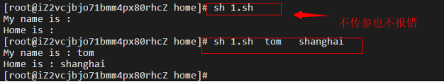

### 2.6 字符串和数组

**字符串**

echo ${#s} 打印字符串长度

echo $s1$s2$s3 字符串拼接

截取

${s:5} 从第5位开始(注意起始位是0)，截取右侧全部

${s:5:6} 从第5位开始，往右截取6位

${s:0-5:6} 从左往右第5位开始，往右截取6位

${s#\*fuck} 从左往右，截取最左边的fuck后面的内容

${s##\*fuck} 从左往右，截取最右边的fuck后面的内容

${s%fuck\*} 从右往左，截取最右边的fuck左边的内容

${s%%fuck\*} 从右往左，截取最左边的fuck左边的内容

**数组**

定义数组：array=(e1 e2 e3 ... en) 小括号，空格

${array[index]} 获取指定位置元素

${array[\*]} 获取数组所有元素

${#arr[\*]} 获取数组长度

### 2.7 运算符

1.  数组运算符

**variable=****$[ 运算表达式 ] 将运算结果赋值给变量****，只支持整数运算。注意$[]要连在一起，数字符号之间要有空格。**

2.  关系运算符

-   数字之间

\-lt 小于（less than） \-le 小于等于（less equal）

\-eq 等于（equal） \-gt 大于（greater than）

\-ge 大于等于（greater equal） -ne 不等于（Not equal）

**[ 1 -lt 4 ] 判断1是否小于4**

-   字符串之间比较

\-z 是否为空字符串 字符串长度为0，就成立

\-n 是否为非空字符串 只要字符串非空，就是成立

string1 = string2 是否相等

string1 != string2 不等

3.  逻辑运算符多命令执行（常用）

&& 表示前一条命令执行成功时，才执行后一条命令

|| 表示上一条命令执行失败后，才执行下一条命令;

### 2.8 Shell流程控制

**if-then 语句提供用于数学表达式的（( )）和用于高级字符串处理功能的[\[ ]\]**

```sql
#!/bin/bash
a=$1
b=$2
if(($a < $b));
then
echo "$a < $b"
elif(($a > $b));
then
echo "$a > $b"
else
echo "$a = $b"
fi
```
```sql
#!/bin/bash
#输入数字，显示星期几
a=$1
case $1 in
1)
echo "星期一"
;;
2)
echo "星期二"
;;
3)
echo "星期三"
;;
4)
echo "星期四"
;;
5)
echo "星期五"
;;
6)
echo "星期六"
;;
7)
echo "星期天"
;;
*)
echo "输入错误"
;;
esac

```

### 2.9 Shell函数

```sql
#!/bin/bash
function getsum(){
    sum=0
    for i  in $@  # $@表示函数的所有参数
    do
       echo $i
  ((sum+=i))
    done
    echo "求和结果为：$sum"
    return $sum
}
#调用函数
getsum $@
```

### 2.10文本处理三剑客**​**

1、grep

grep **bash$** /etc/passwd 在文件中查找以bash结尾的行

grep **^root** /etc/passwd 在文件中查找以root开头的行

2、sed流式编辑器

echo "i am a boy" | sed 's/boy/girl/' 单行文本替换

sed 's/dog/and fat cat/' 文件名 文件内容批量替换

sed **\-e** **'**s/brown/green/; s/dog/cat/' 文件名 同时完成多个替换

注：值并未修改，原文件内容不变。可以重定向来保存结果

若sed命令很多，也可以写成脚本，然后通过sed -f 执行脚本来实现批量替换 (不需要单引号)

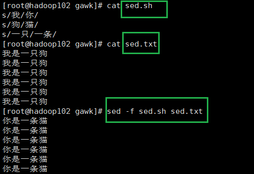

3、gawk

**语法：gawk ‘{options }’program file**

gawk的特殊变量

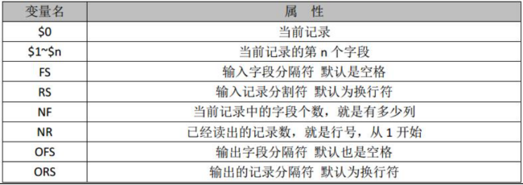

常见用法

-   文本分割

gawk '{print $0}' dbtable\_data.txt 输出整行文本

gawk '{print $1}' dbtable\_data.txt 输出该文本第一个字段（默认空格、tab为分隔符）

gawk **\-F,** '{print $1,$2}' dbtable\_data.txt 输出该文本第一个、第二个字段（指定分隔符为，）

-   正则匹配

**正则匹配~ 表示模式开始，两个斜杠// 中是正则匹配模式**

**正则匹配，模式取反。！~ 表示模式开始。// 中是模式。**

gawk -F, '$1 ~ /biao/ {print $0}' dbtable\_data.txt 输出第一个字段包含biao的整行

gawk '$1 ~ /^chen.\*/ {print $0}' dbtable\_data.txt 输出第一个以chen开头的整行

gawk '$1 ~! /chen/ {print $0}' dbtable\_data.txt 输出第一个字段不包含chen的行

-   多个命令

{ }中的命令用逗号隔开

gawk -F, '{$2="nmsl";print $0}' dbtable\_data.txt 对整行数据分割，批量修改