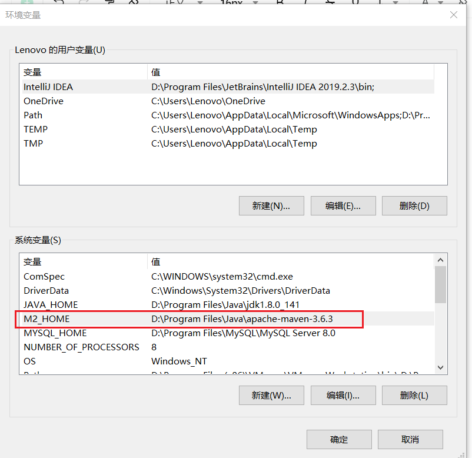
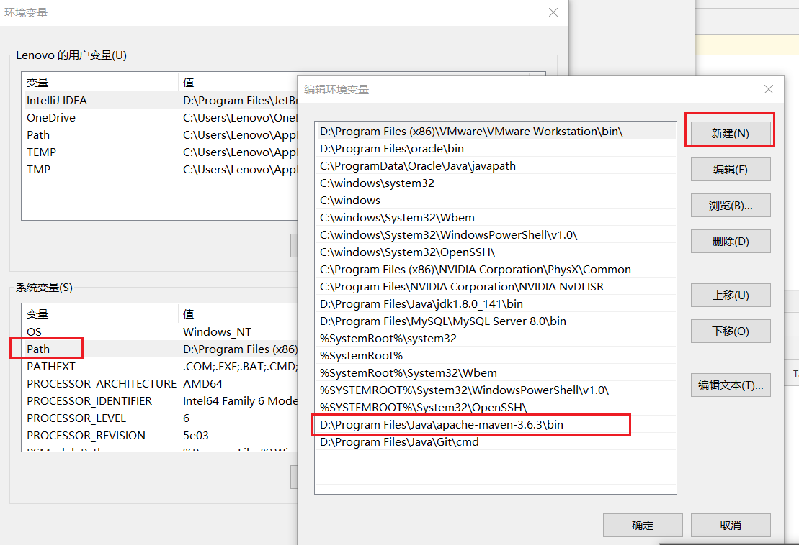
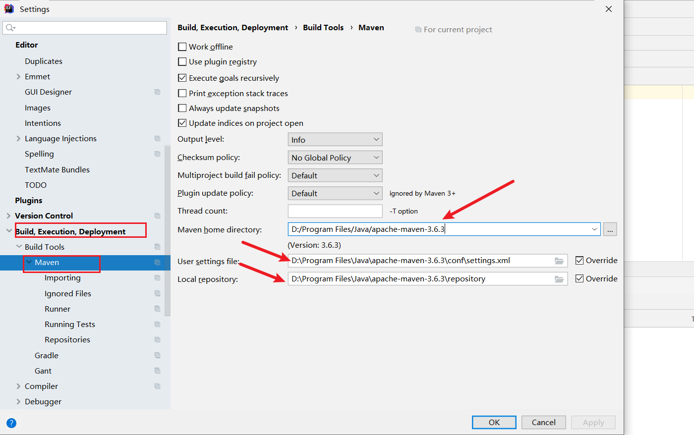
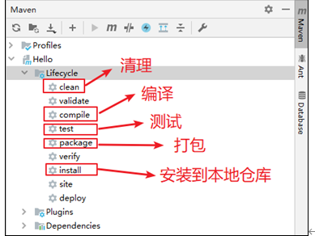
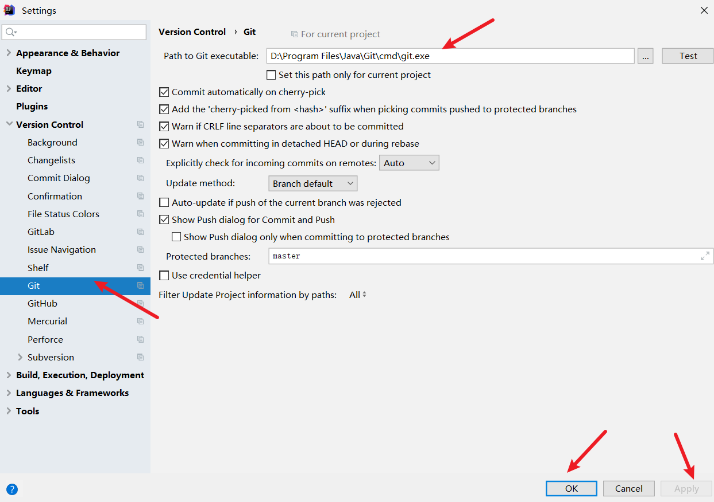
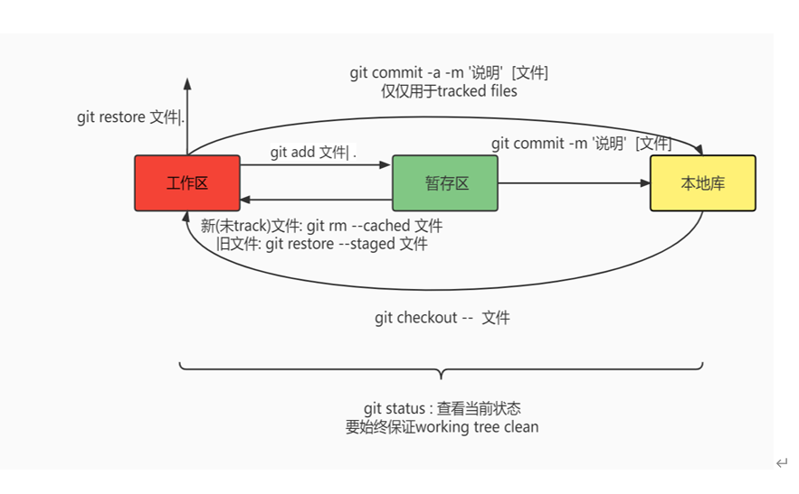
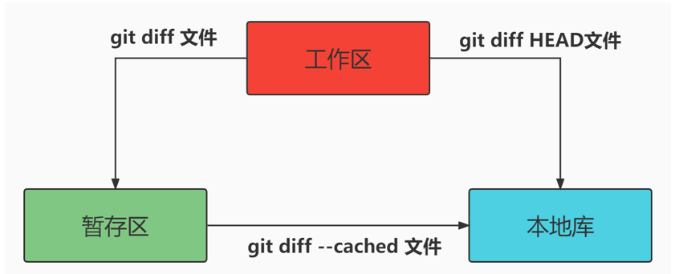
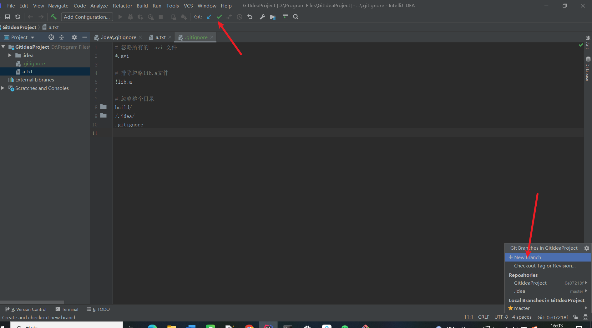
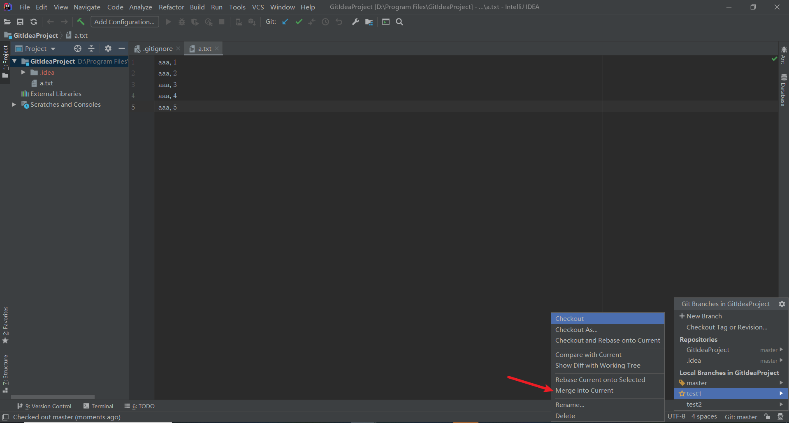
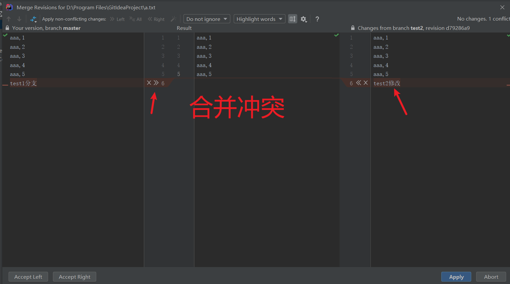

## 1、学习目标

Java是一种高级编程语言，Maven是Java项目构建管理工具，Git是分布式版本控制系统。

**对于Maven，需要我们：**

1.理解maven的基本概念和原理，包括依赖管理、构建生命周期、插件等；

2.使用maven管理项目，包括创建项目、添加依赖、配置构建任务、打包发布等；

3使用maven进行测试、代码分析、打包部署

**对于Git，需要我们：**

1.使用git进行基本的代码管理操作，包括提交、分支、合并、回滚等；

2.使用git进行团队协作，包括创建和管理团队仓库、协同开发、代码合并等；

3.使用git进行版本控制和代码管理，包括更新、提交、回滚、比较等操作；

4.使用git进行代码追踪和分析，包括查看历史版本、比较代码差异、检查代码质量等。

## 2、Maven

### 2.1 Maven作用

1.  依赖管理：自动解决依赖关系，避免手动处理依赖库的复杂问题
2.  项目构建：自动构建项目，包括编译、打包、测试等过程。
3.  版本管理：自动化的对版本进行管理，避免版本混淆或者版本错乱。
4.  插件扩展：有大量的插件可以使用，比如代码插桩（测试使用）、代码覆盖率、性能监测等

### 2.2 Maven Java项目结构

1、POM文件

包含项目基本信息、项目依赖、项目的构建配置、项目开发者信息、资源配置等

2、依赖管理

在pom.xml文件中，使用dependency来指定目标jar包的坐标

3、仓库

包括本地仓库和远程仓库

远程仓库包括：中央仓库、中央仓库镜像、局域网私有仓库

4、生命周期

Maven 有三套相互独立的生命周期，分别是：

1.  Clean Lifecycle 在进行真正的构建之前进行一些清理工作；
2.  Default Lifecycle 构建的核心部分，编译，测试，打包，安装，部署等；
3.  Site Lifecycle 生成项目报告，站点，发布站点。

### 2.3 Maven的安装部署

1、本地环境安装+环境变量配置

2、集成idea开发工具

### 2.4 Maven基本使用

依赖原则--->解决jar包冲突

继承

聚合

## 3、Git

### 3.1 Git介绍

Git 是一种软件版本控制系统

Gitlab和Github都是基于Git仓库的的web开发流程代码托管平台

Git的作用：

1.  备份代码模块；
2.  协助多人协同开发；
3.  可以根据提交记录还原代码；
4.  追溯问题代码的负责人和开发时间

### 3.2 Git概念

仓库、分支、提交、标签

### 3.3 Git、Gitbub集成idea

### 3.4 Git基本使用

-   Git三区

工作区：编写文件

暂存区：临时存储

本地库：历史版本

​  

-   基本命令

-   版本切换

| 命令 | 作用 |
| --- | --- |
| git log | 以完整格式查看本地库状态(查看提交历史) |
| git log --pretty=oneline | 以单行模式查看本地库状态 |
| git reset --hard HEAD^ | 回退一个版本 |
| git reset --hard HEAD~n | 回退N个版本 |
| git reflog | 查看所有操作的历史记录 |
| git reset --hard [具体版本号，例如：1f9a527等] | 回到（回退和前进都行）指定版本号的版本， |

-   文件比较

### 3.5 Git分支

常用分支命令

| 命令 | 描述 |
| --- | --- |
| git branch [分支名] | 创建分支 |
| git branch -v | 查看分支,可以使用-v参数查看详细信息 |
| git checkout [分支名] | 切换分支 |
| git merge [分支名] | 合并分支； 将merge命令中指定的分支合并到当前分支上 例如：如果想将dev分支合并到master分支，那么必须在master分支上执行merge命令 |
| git branch –d [分支名] | 删除分支 |
| git checkout –b [分支名] | 新建并切换到新分支 |
| git log --oneline --decorate --graph --all | 输出你的提交历史、各个分支的指向以及项目的分支分叉情况 |

### 3.5 远程协作

| 命令 | 作用 |
| --- | --- |
| git remote add 变量名远程仓库url | 为远超仓库的url指定一个变量名，之后可以使用变量名代替url |
| git push -u 变量名"本地分支名" | 将本地的指定分支推送到远程仓库 |
| git remote -v | 查看远程仓库列表 |
| git pull 变量名远程仓库分支名 | 拉取远程仓库指定分支到本地 |
| git clone 变量名 | 下载整个远程仓库到本地 |

冲突解决

idea操作远程仓库