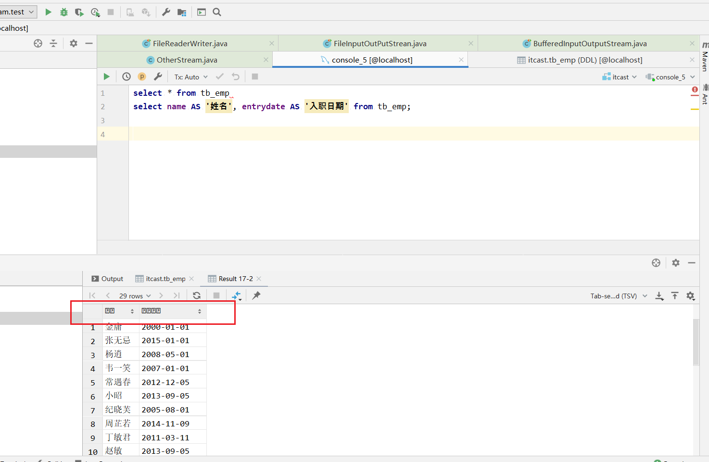
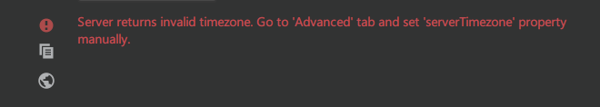
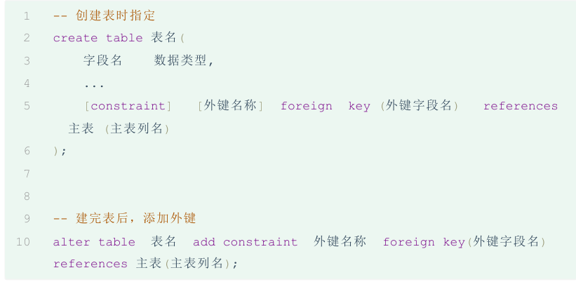

## 1、idea连接mysql遇到的问题

1.1 字段取别名乱码



参考：[http://t.csdnimg.cn/54gMJ](http://t.csdnimg.cn/54gMJ)

1.2 连接MySQL时区报错:Server returns invalid timezone. Go to ‘Advanced‘ tab and set ‘serverTimezon



参考：[https://blog.csdn.net/qq\_41509495/article/details/105568211](https://blog.csdn.net/qq_41509495/article/details/105568211)

[https://blog.csdn.net/liuqiker/article/details/102455077?spm=1001.2101.3001.6650.2&utm\_medium=distribute.pc\_relevant.none-task-blog-2%7Edefault%7EBlogCommendFromBaidu%7ERate-2-102455077-blog-106429131.235%5Ev43%5Epc\_blog\_bottom\_relevance\_base8&depth\_1-utm\_source=distribute.pc\_relevant.none-task-blog-2%7Edefault%7EBlogCommendFromBaidu%7ERate-2-102455077-blog-106429131.235%5Ev43%5Epc\_blog\_bottom\_relevance\_base8&utm\_relevant\_index=5](https://blog.csdn.net/liuqiker/article/details/102455077?spm=1001.2101.3001.6650.2&utm_medium=distribute.pc_relevant.none-task-blog-2%7Edefault%7EBlogCommendFromBaidu%7ERate-2-102455077-blog-106429131.235%5Ev43%5Epc_blog_bottom_relevance_base8&depth_1-utm_source=distribute.pc_relevant.none-task-blog-2%7Edefault%7EBlogCommendFromBaidu%7ERate-2-102455077-blog-106429131.235%5Ev43%5Epc_blog_bottom_relevance_base8&utm_relevant_index=5)

1.3 idea美化sql语句格式的快捷键

ctrl+alt+L；

## 2、单表查询

### 2.1 聚合函数

聚合函数是对一列的值进行计算，然后返回一个结果值。

语法：select 聚合函数(字段列表) from 表名 ;

注意 : 聚合函数会忽略空值，对NULL值不作为统计。

count、max、min、sum、avg

### 2.2 分组查询

分组： 按照某一列或者某几列，把相同的数据进行合并输出。

分组查询通常会使用聚合函数进行计算。

注意事项:

-   分组之后，查询的字段一般为聚合函数和分组字段，查询其他字段无任何意义
-   执行顺序：where > 聚合函数 > having

\-- 查询入职时间在 '2015-01-01' (包含) 以前的员工 , 并对结果根据职位分组 , 获取员工数量大于等于2的职位

```sql
select job, count(*) from tb_emp 
where entrydate <= '2015-01-01' -- 分组前条件 
group by job  -- 按照job字段分组
having count(*) >= 2; -- 分组后条件  
```

  

where与having区别（面试题）

-   执行时机不同：where是分组之前进行过滤，不满足where条件，不参与分组；而having是分组之后对结果进行过滤。
-   判断条件不同：where后面不能跟聚合函数，而having可以。

### 2.3 排序查询

\-- 根据入职时间对公司的员工进行升序排序，入职时间相同，再按照更新时间进行降序排序

```sql
select * from tb_emp 
order by entrydate ASC , update_time DESC  
```

### 2.4 分页查询

语法： limit 起始索引, 查询记录数 ;

limit 0 , 5; -- 从索引0开始，向后取5条记录

limit 5; -- 如果查询的是第1页数据，起始索引可以省略，直接简写为：limit 条数

\-- 查询第3页员工数据, 每页展示5条记录

```sql
 select *  from tb_emp limit 10 , 5; -- 从索引10开始，向后取5条记录 
```

### 2.5 if 和 case when 的用法

if 用于二选一

\-- if(条件表达式, true取值 , false取值)

```sql
select if(gender = 1,'男','女') as 性别,count(*) as '人数' 
from  tb_emp  
group by gender;
```

case when 用于不止两个

```plain
select (case gender
              when 1 then '男'
              when 2 then '女'
              else '人妖'
        end) AS 性别 ,
        count(*) AS 人数
from tb_emp
group by gender;
```

## 3、多表查询

### 3.1 多表设计

表之间的关系有三种：

1.  一对一（用户和身份证信息，拆表提升效率）
2.  一对多（部门和员工，在多的一方添加外键，关联一的主键）
3.  多对多（学生和课程，建立第三张中间表，中间表至少包含两个外键，分别关联两方主键）

​  

添加外键约束：




​  

多表设计分两步：

1.  阅读页面原型及需求文档，分析各个模块涉及到的表结构，及表结构之间的关系。
2.  根据页面原型及需求文档，分析各个表结构中具体的字段及约束。

### 3.2 多表查询

`select * from tb_emp , tb_dept;`

会查出A\*B条结果，需要消除掉无效的笛卡尔积，只保留表关联部分的数据。

​  

多表查询分类


#### 3.2.1 内连接查询

隐式内连接： `select 字段列表 from 表1 , 表2 where 条件 ... ;`

显式内连接： `select 字段列表 from 表1 inner join 表2 on 连接条件 ... ;`

​  

注意：一旦给表取了别名，就不能再使用表名来指定对应的字段了，此时只能够使用别名来指定字段 。

`select emp.name 姓名,dept.name 部门 from tb_emp e inner join tb_dept d on e.dept_id = d.id;`

#### 3.2.2 外连接查询

left join 左外连接，包含交集+左表的所有数据

right join 右外连接，包含交集+右表的所有数据

#### 3.2.3 子查询

SQL语句中嵌套select语句，称为嵌套查询，又称子查询 。

根据子查询结果的不同分为：

1.  标量子查询（子查询结果为单个值[一行一列]）

```sql
select * from tb_emp where 
dept_id = (select id from tb_dept where name = '教研部');  
```

2.  列子查询（子查询结果为一列，但可以是多行）

```sql
select * from tb_emp where 
dept_id in ( select id from tb_dept where name in ('教研部','咨询部'))
```

3.  行子查询（子查询结果为一行，但可以是多列）

```sql
select * from tb_emp where 
(entrydate,job) = (select entrydate,job from tb_emp where name = '韦一笑');
```

4.  表子查询（子查询结果为多行多列[相当于子查询结果是一张表])

```sql
select e.*, d.name from (select * from emp where entrydate > '2006-01
01') e 
left join dept d 
on e.dept_id = d.id 
```

## 4、事务和索引

### 4.1 事务

事务： 事务是一组操作的集合，它是一个不可分割的工作单位。事务会把所有的操作作为一个整体，一起向系统提交或撤销操作请求，即这些操作要么同时成功，要么同时失败。

MYSQL中有两种方式进行事务的操作：

1.  自动提交事务：即执行一条sql语句提交一次事务。（默认MySQL的事务是自动提交）
2.  手动提交事务：先开启，再提交

手动提交事务使用步骤：

第1种情况：开启事务(start transaction) => 执行SQL语句 => 成功 => 提交事务(commit)

第2种情况：开启事务(start transaction) => 执行SQL语句 => 失败 => 回滚事务(roll back)

​  

事务的四大特性

-   原子性（Atomicity） ：原子性是指事务包装的一组sql是一个不可分割的工作单元，事务中的操作要么全部成功，要么全部失败。
-   一致性（Consistency）：一个事务完成之后数据都必须处于一致性状态。 如果事务成功的完成，那么数据库的所有变化将生效。 如果事务执行出现错误，那么数据库的所有变化将会被回滚(撤销)，返回到原始状态。
-   隔离性（Isolation）：多个用户并发的访问数据库时，一个用户的事务不能被其他用户的事务干扰，多个并发的事务之间要相互隔离。 一个事务的成功或者失败对于其他的事务是没有影响。
-   持久性（Durability）：一个事务一旦被提交或回滚，它对数据库的改变将是永久性的，哪怕数据库发生异常，重启之后数据亦然存在。

### 4.2 索引

目的：表的数据量较大时，使用索引可以提高查询效率。索引最常见的是B+Tree结构

优点：

1.  提高数据查询的效率，降低数据库的IO成本。
2.  通过索引列对数据进行排序，降低数据排序的成本，降低CPU消耗。

缺点：

1.  索引会占用存储空间。
2.  索引大大提高了查询效率，同时却也降低了insert、update、delete的效率。

索引语法：

1.  在tb\_emp表name字段创建索引 create index 索引名 on tb\_emp(name);
2.  查看索引 show index from tb\_emp;

（注：主键字段会自动创建主键索引，且性能最高；添加唯一约束时会自动创建唯一索引）

3.  删除索引 drop index idx\_emp\_name on tb\_emp;

## 5、窗口函数

mysql8.0版本引入

​  

## 6、JDBC