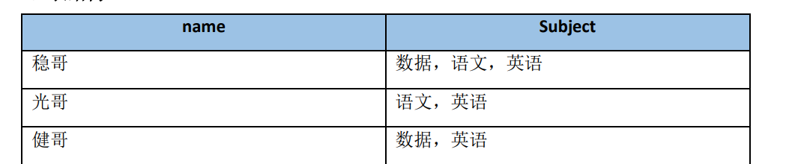

## 一、基础练习

1、查询1984 年获奖者和科目；要求把化学和物理学放在最后，再按科目和获奖者姓名排序

SELECT

winner,

subject

FROM nobel

WHERE yr=1984

ORDER BY subject IN ('physics','chemistry'),subject,winner

2、一些用法

order by score limit 9,10 按照分数排序，取第10-20名（使用limit m,n的形式：m 表示从第 m 行数据之后，不包含第 m 行，之后的 n 行数据；

order by score limit 5,offset 10 --每页5条，从第11条开始取，也就是展示第三页的数据

count(col) 过滤空值 count(\*)不过滤空行

聚合函数也会过滤空行，如avg(score)计算时不会把score为空的行算进去

cast(typeA as typeB) 转换数据类型

对于与MySQL的写法，date\_add(hire\_date,interval 1 month )；date\_sub(hire\_date,interval 2 day )

窗口函数不能用于where、having筛选（因为窗口函数在having之后才运行），但可以用于order by排序

round和concat嵌套得到百分比数据：concat(round(avg\_score,2)\*100,'%') as rate

3、查询一个字段中包含另一个字段

SELECT

name, capital

FROM world

where capital like concat('%',name,'%')

4、插入数据

insert ignore into：若没有则插入，若存在则忽略

replace into：若没有则正常插入，若存在则先删除后插入

5、取模

MOD(10, 3) 用于计算10÷3的余数。它通常用于求模运算

6、炸裂函数



```plain
select
 name,
 subjects
from t1
lateral view
explode(split(Subject,',')) tmp_view AS subjects
;
```

7、`collect_set` 函数和 `named_struct` 构造器的用法

collect\_set(named\_struct('attr\_id',attr\_id, 'attr\_name',attr\_name, 'attr\_value',attr\_value)) as sku\_attrs

| product\_id | color | size | material |

|------------|-------|------|----------|

| 1 | Red | S | Cotton |

| 1 | Blue | M | Silk |

| 2 | Green | L | Wool |

运行上述 SQL 查询后，结果集可能如下所示：

| product\_id | attributes |

|------------|-------------------------------------------|

| 1 | [struct(color:Red,size:S,material:Cotton), struct(color:Blue,size:M,material:Silk)] |

| 2 | [struct(color:Green,size:L,material:Wool)] |

这样，我们可以方便地处理每个产品的多个属性，同时保持数据结构的清晰性和可读性。

7、hive动态分区表插入数据

```plain
CREATE TABLE IF NOT EXISTS dim_commerce.dim_shop_base_info_ss (
  shop_id STRING COMMENT '店铺ID',
  shop_name STRING COMMENT '店铺名称',
  shop_status int COMMENT '营业状态(0在线营业1暂时歇业2停业)' 
) 
COMMENT '店铺信息表'
PARTITIONED BY (dt string comment '数据日期')  --分区
STORED AS orc;

set hive.exec.dynamic.partition.mode=nonstrict; --非严格模式
insert overwrite table dim_commerce.dim_shop_base_info_ss partition(dt) 
select 
  shop_id,
  shop_name,
  shop_status,
  date_sub(current_date(),1) as dt --分区字段放在最后，T日更新T-1日的分区数据
from ods_commerce.ods_shop_base_info
;
```

## 二、sql错题

1、查询和01同学学习的课程完全相同的同学的信息

```plain
-- 方法一
select
       s_id
from score
where s_id != '01'
-- 保证课程相同
and c_id IN (SELECT DISTINCT c_id FROM score WHERE s_id = '01')
group by s_id
-- 保证数量相同相同
having count(distinct c_id) = ( select count(distinct c_id) from score where s_id = '01')
;

-- 方法二 group_concat函数将分组后同一个分组中的值连接起来，返回一个字符串结果。
-- group_concat( [distinct] 要连接的字段 [order by 排序字段 asc/desc ] [separator '分隔符'] )
with t1 as (
            select
                    s_id,
                    group_concat(c_id order by c_id) course_id
            from    score
            group by    s_id
            )
select
        s_id
from    t1
where   s_id != '01'
and     course_id = (select course_id from t1 where s_id = '01')
```

2、查找字符串中逗号出现的次数

```plain
-- 替换掉含逗号的，然后和原来的长度去比较
select
id,
length(string) - length(replace(string,',','')) as cnt
from strings
```

3、查找排除在职(to\_date = '9999-01-01' )员工的最大、最小salary之后，其他的在职员工的平均工资avg\_salary。

```plain
with t1 as (
            select
                emp_no,
                salary,
                row_number() over (order by salary desc) rn
            from
                salaries
            where
                to_date = '9999-01-01'
            )
select 
avg(salary)
from
t1
where rn != 1 
and rn != (select count(*) from salaries where  to_date = '9999-01-01' )
```
```plain
select
    AVG(salary) AS avg_salary
from salaries
where  to_date='9999-01-01'
and salary not in (
                    select max(salary) from salaries where  to_date='9999-01-01'
                    union
                    select min(salary) from salaries where  to_date='9999-01-01'
                    )     
```

## 三、大厂面试题

1、留存率问题

```plain

with t1 as (
-- 将注册日期和登录日期放到一张表里
    select ul.user_id,
           date(register_time)                             as reg_time,
           date(login_time)                                as log_time,
           datediff(date(login_time), date(register_time)) as diff_date --登录日期距离注册日期多少天
             left join uid_login ul on ur.user_id = ul.user_id
)

select reg_time,
       count(distinct user_id),-- 当日新注册的用户数
       -- 1天后登录了的用户数/当日新注册的用户数，计算出次日留存率
       sum(if(diff_date = 1,1,0)) /count(distinct user_id) 1d，
       -- 6天后登录了的用户数/当日新注册的用户数，计算出7日留存率
       count(case when diff_date = 6 then user_id end) /count(distinct user_id) 6d,
       -- 29天后登录了的用户数/当日新注册的用户数，计算出30日留存率
       count(case when diff_date = 29 then user_id end) /count(distinct user_id) 29d 
from t1
group by reg_time; --根据注册日期分组

```

​