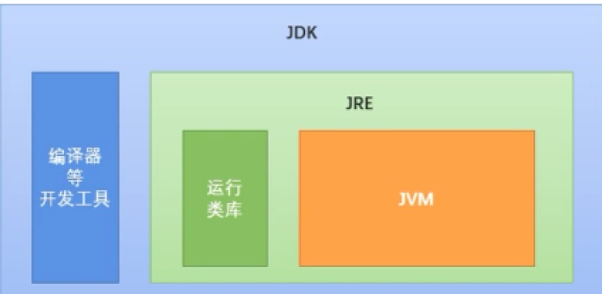
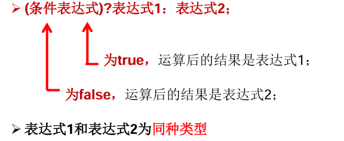
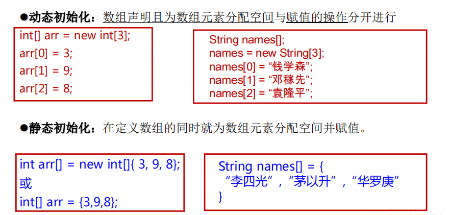
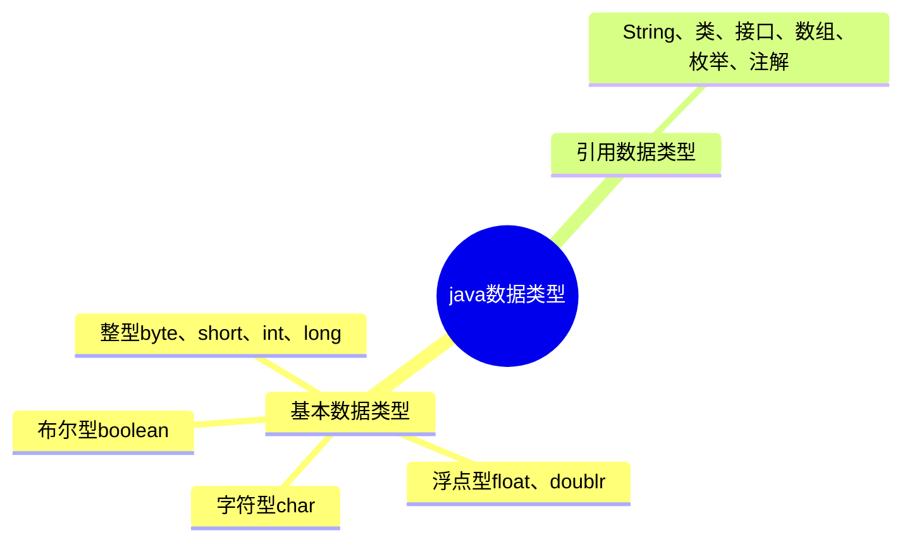
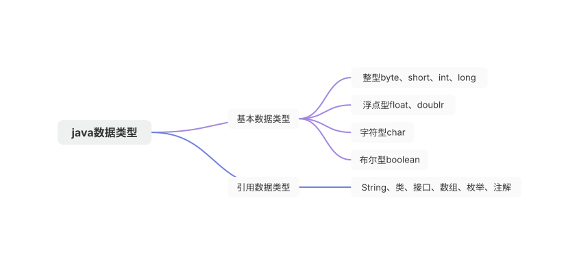
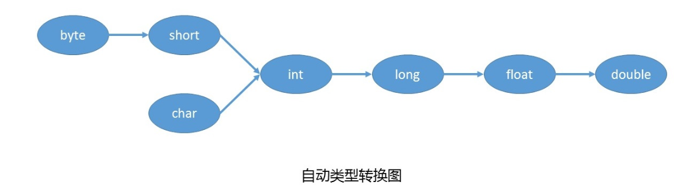

## 第一版

1.  jdk、jre、jvm的概念和关系？

jdk是Java开发工具包

jre是Java运行环境，包含jvm和运行类库

jvm是Java虚拟机

jdk>jre>jvm



2.  什么是java变量和常量？

都是用来存数据的存储单元。

变量包含变量类型、变量名和存储的值。变量的值会在同一类型内变换。

常量通常用final修饰，运行程序过程中常量的值是不变的。

3.  逻辑运算符？三元运算符？

逻辑运算符有以下几种：

&—逻辑与 | —逻辑或 ！—逻辑非 && —短路与 || —短路或 ^ —逻辑异或

“&”和“&&”的区别：

单&时，左边无论真假，右边都进行运算；

双&时，如果左边为真，右边参与运算，如果左边为假，那么右边不参与运算。

“|”和“||”的区别同理，||表示：当左边为真，右边不参与运算。

三元运算符



(a>b)?a:b

4.  java有哪些分支结构、循环结构？关键字break、continue如何使用？

分支结构：if-else、switch-case

循环结构：for 循环 、while 循环、do-while 循环

break 跳出当前循环，可用于for 循环 、while 循环、do-while 循环，以及switch语句；

```sql
for (int i = 0; i < 10; i++) {  
    if (i == 5) {  
        break; // 当 i 等于 5 时，跳出循环  
    }  
    System.out.println(i); // 输出 0 到 4  
}
```

continue 终止当前循环的当前迭代，并开始下一次迭代。不能用于switch语句

```sql
for (int i = 0; i < 10; i++) {  
    if (i == 5) {  
        continue; // 当 i 等于 5 时，跳过当前迭代  
    }  
    System.out.println(i); // 输出 0 到 4 和 6 到 9，但不会输出 5  
}
```

5.  数组的概念？如何动态、静态创建数组？如何从数组中取值

数组是多个相同类型数据按一定顺序排列的集合；



通过索引（index）来访问数组中的元素

6.  说说面向过程和面向对象？描述下面向对象的三大特征？

面向过程，强调的是功能行为，以函数为最小单位，考虑怎么做。

面向对象，将功能封装进对象，强调具备了功能的对象，以对象为最小单位，考虑谁来做。

三大特征：封装、继承、多态

封装性：把代码封装在类的内部，私有化类的属性，但提供公共的方法给外部修改和查看

继承性：子类可以继承父类的属性和方法，还可以扩展新的属性和方法，以及对父类的方法进行重写

多态性：父类引用可以指向子类的对象。如Animal animal = new Dog(); 编译看父类，运行调用子类的方法

7.  介绍下接口和抽象类？有什么区别？

抽象类： 用abstract关键字来修饰的类， 抽象类不能被实例化 。 抽象类的子类必须重写父类全部的的抽象方法，并提供方法体。

接口：可以看作是一份协议，它定义了一组规范，包括方法、属性等。类实现接口则表示承诺遵守这份协议，类需要提供具体的方法实现接口。一个类可以实现多个接口。

区别：

-   抽象类内部可以有代码块、构造器、非抽象方法；接口内部只能定义静态常量、抽象方法；
-   一个类只能继承一个抽象类，一个类可以实现多个接口

8.  什么是异常？异常分几类？每类有哪些常见异常？如何处理异常？

**异常**是在程序执行过程中，由于某些意外情况的发生，如用户输入错误、硬件故障、软件缺陷等，导致程序无法按照正常的流程继续执行下去，从而抛出一个错误信号，这个错误信号就是异常。

-   编译时异常：IOException（输入输出异常）、SQLException（数据库操作异常）等。
-   运行时异常java.lang.RuntimeException ：NullPointerException（空指针异常）、ArrayIndexOutOfBoundsException（数组越界异常）、ClassCastException（类型转换异常）等
-   错误error：比如OutOfMemoryError（内存溢出错误）、StackOverflowError（栈溢出错误）等

异常处理方式：

方式一：try-catch-finally （idea快捷键：*ctrl+alt+t*）

方式二：throws + 异常类型

throws和throw区别：

在方法内部使用 throw 来抛出异常，在方法签名中使用 throws 来声明这些方法可能会抛出的异常类型

​  

9.  java集合框架？描述下单列集合、双列集合的特点？HashMap的put底层实现逻辑

Collection单列集合：List（有序的，允许元素重复，并且可以通过索引访问元素）、Set（无序的，不允许元素重复，并且没有索引。）

Map双列集合：TreeMap、HashMap。提供了一种基于Key-Value的结构来存储数据，这使得它非常适合于存储具有映射关系的数据

10.  说说单例模式？什么是双重检测机制？指令重拍？单例模式的实现方式？
11.  开发工具如何集成Maven和Git？Maven、Git的常用命令？

## 第二版

1.标识符和关键字的区别是什么?有哪些常见的标识符?

在写java代码时，需要给大量的类、方法、变量等取名字，这些名字就是**标识符**。如：int、double、public、private、continue、break、try、catch、throws。。。

但在java中，有一些标识符被赋予了特殊的含义，这些特殊的标识符叫**关键字**。如：final、super、this、static

2.重载和重写区别

重载通常发生在同一个类中，方法名必须相同，参数列表（类型、个数、顺序）不同，方法返回值和访问修饰符可以不同。

重写是子类对父类方法的重新改造，它的参数列表不能进行改变，但它的内部逻辑可以发生改变

3.Java数据类型有哪些?





数据类型转换



5.类和对象的基本概念

类是对象的模板，它定义了对象的属性和方法；而对象则是根据类创建的实例。

类只有通过对象才能使用，开发中先产生类，再造对象

7.==和equals区别

\==比较的是值或者地址值；

Object类的equals()是判断是否是内存中的同一个对象

类重写的equals()判断对象的属性是否相等（当我们重写equals方法时，通常也会重写hashCode方法以保持它们之间的一致性）

9.String StringBuffer 和 StringBuilder 的区别是什么?

String对象是不可变的。

stringBuilder与StringBufer这两种对象都是可变的。

String 中的对象是不可变的，也就可以理解为常量，线程安全。

StringBuffer 对方法加了同步锁，所以是线程安全的。

StringBuilder并没有对方法进行加同步锁，所以是非线程安全的。

对于三者使用的总结:

-   操作少量的数据: 适用 String
-   单线程操作大量数据: 适用 StringBuilder
-   多线程操大量数据: 适用 StringBuffer

10.String类为什么用final关键字修饰?

为了安全，不能被继承

12.什么是Java泛型?

允许程序员在定义类、接口、方法时，使用某种标识区分类中属性的类型或者方法的参数类型。

泛型类、泛型方法、泛型接口

13.反射

14.I/O

15.Java中有哪几种集合

16.Arraylist 与 LinkedList 联系与区别?

1.  线程安全方面: ArrayList 和 Linkedlist 都是线程不安全的;
2.  底层数据结构方面:Arraylist底层使用的是[Object]数组;Linkedlist 底层使用的是 双向链表 数据结构
3.  是根据底层数据结构进行细化:ArrayList 采用数组存储，所以它支持快速的随机元素访问；Linkedlist 采用链表存储，所以它不支持快速的随机元素访问

17.聊聊HashMap和HashTable的区别

18.HashMap 和 Hashset 区别

19.多线程优缺点

优点：提高CPU利用率、提高程序整体性能和并发处理能力

缺点：线程安全问题、死锁、内存泄漏

20.线程的生命周期

新建（New）、就绪（Runnable）、运行（Running）、阻塞（Blocked）、死亡（Dead）。


  

21.run()和start()有什么区别?

run方法是线程执行体，它的方法体代表了线程需要完成的任务，而start方法用来启动线程

调用start方法启动线程时，系统会把该run方法当成线程执行体来处理。

但如果直接调用线程对象的run方法，则run方法立即就会被执行，而且在run方法返回之前其他线程无法并发执行

22.线程死锁

​  

25.JVM和Java的关系

JVM可以加载运行class字节码文件，这类文件不仅仅java可以产生，其他语言如Scala也可以

26.为什么要使用解释器与编译器并存的架构

27.类加载器

​  

​  

​  

​  

​