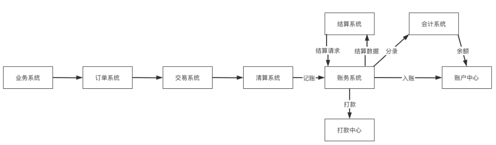
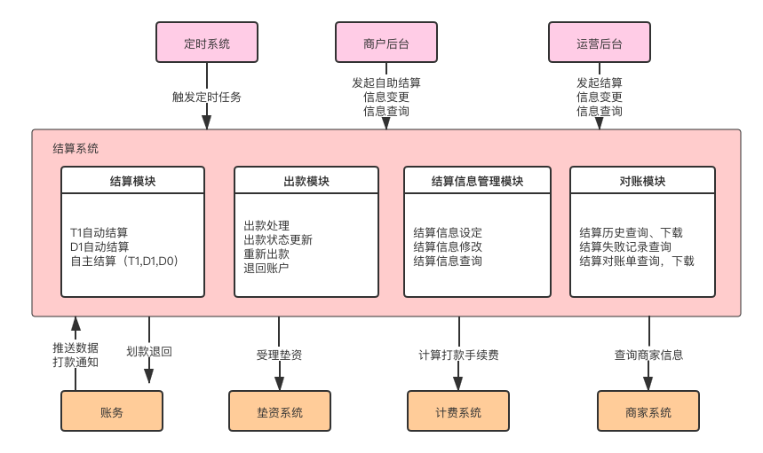
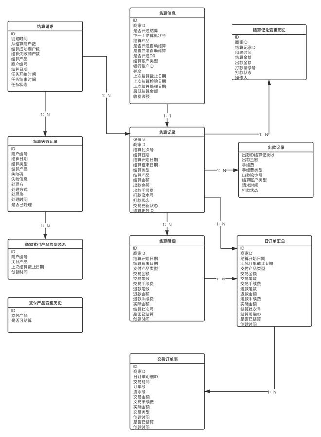

## 清分、清算、什么是结算？

-   “清分（clearing）是清算的数据准备阶段，主要是将当日的全部网络交易数据按照各成员行之间本代他、他代本、贷记、借记、笔数、金额、轧差净额等进行汇总、整理、分类。“
-   清算是根据交易结果和协议规定，对交易的客户备付金、商户手续费、银行成本和其他款项进行计算，明确每个客户的应收应付金额
-   结算是根据结算周期规定，对清算产生的应收应付金额，完成资金的划拨；对账最终完成货款两清
-   对账过程中交易成员对收付的结算款项核对、确认，确保自身权益不受影响

​  

## 结算模式

结算产品其实就是指支撑不同类型结算模式的结算能力：

-   T1结算：工作日结算，当天的服务款，在下一个工作日结算；
-   D1结算：自然日结算，当天的服务款，在下一个自然日结算；
-   D0结算：自然日结算，当天的服务款，在当天结算；
-   S0结算：交易完成后即可结算，按照订单号逐笔进行结算，像借贷的还款，一般逐笔；

  

## 结算的业务架构及系统架构

参考：[https://www.woshipm.com/pd/4391371.html](https://www.woshipm.com/pd/4391371.html)

​  

### 结算的业务架构

​  

业务完成后，到了结算节点，账务系统按照结算周期将已经入账待结算数据打包后推送给结算系统，结算系统对结算数据进行处理加工后生成结算记录和结算明细；然后请求账务系统进行结算打款，账务系统请求账户中心扣款之后调用打款中心进行打款申请。

## ​  

### 结算的系统架构：

​  

对于不同结算产品，需要定时任务的管理去推动结算的进行：

-   商户后台是商家自主发起结算，查询结算信息，变更信息的后台。
-   运营后台是公司内部运营的操作台。

账务系统为结算系统提供结算数据，接受打款申请以及反馈出款通知：

-   垫资系统是针对D0,S0的结算请求申请垫资的受理方。
-   计费系统是计算结算时商家需要支付的费用，比如一笔2元。
-   商家系统是用于查询商家的相关结算需要的信息。

​  

## 结算的核心模型

  

## 清结算包含哪些模块

1， 商户信息模块：包含商户的基本信息，店铺名称，入驻时间，银行账户等

2，商户平台结算费率：不同商户和平台谈的结算费率可能不同，展示结算费率的情况。

3，支付信息模块：平台可以配置到哪些支付方式给到商户（非必选项）

4，账单模块：包含结算区间，交易成功订单总数量，总金额，退款总数量，总金额，优惠总金额，异议处理模块

​  

​  

## 结算系统需要考虑的几个问题？

​  

-   实时交易，交易总量大，交易峰值不可控
-   KA 商户模式，数据库存在热点账户问题，并且资金数据是敏感数据，要求绝对的准确，所以数据库表拆分方案复杂
-   结算模式多样，千人千面结算计费规则

​  

## 热点账户问题

热点账户分出款热点和入款热点，入款热点常用的做法是缓冲入账，将入款交易缓冲，按照一定的处理速度做账务处理，使得账务处理速度低于 tps 的阈值，保证数据库性能稳定；如果在逐笔缓冲处理仍有压力，可以使用汇总缓冲。出款热点如果采用缓冲，可能会导致不良结果，一般不采用，通常对出款热点的处置有三种方法：  
  

-   对数据库驱动层改写。由数据库驱动层检测数据库行锁，在规定时间周期内，合并更新，统一返回处理结果，类似于汇总入账，降低热点的更新频度。
-   数据库水平拆分，账务系统的账户记录分散到不同机器的不同表中。再对有热点的账户逻辑拆分成多个账户，使拆分的多个账户分散到不同机器的不同表中。热点账户变成多个账户，降低账户热度。
-   应用层实现。通过分布式缓存，冻结部分商户资金放在分布式缓存中，由缓存实时扣款。最终再同步到账户余额。

​  

热点账户即系统中，被高频地进行资金池的进出操作，频繁出现加锁解锁操作的账户。比如，B2C系统中的企业虚拟户，用户购买商品时，资金池从用户虚拟户转到企业虚拟机户。用户退款时，资金从企业虚拟户转到用户虚拟户；这时，对企业虚拟户的资金进出操作就会成为整个业务的瓶颈。

#### 基本解决思路：

-   控制并发数：所有进出都先进到线程池中，以线程池的并发数控制实际对热点账户操作的并发数
-   缩小事务控制范围：对热点账户的操作放在尽量小的事务范围，减少时间分片，提供成功率。
-   乐观锁：对热点账户的更新操作使用乐观锁，减少时间分片，提供成功率。

#### 其他解决思路

1.  线程排队 去并发：每台机器启动n个线程，然后使用商家Id mod n的形式将每个商家的账户操作请求排队。
2.  MQ流量削峰：账户操作通过MQ实现削峰去谷。
3.  先记流水，定时批量提交：缓冲记账：这种情况主要针对于入账账户设计，将商家资金进出账户分开设计，对于入账账户，就可以采用这种先记流水，定时批量提交，增加账户余额的形式。这种设计方案不足就是账户余额更新不及时。
4.  账户切分：这种情况主要针对于扣减余额比较频繁的账户，可以将单个账户拆分成多个小子账户，具体每笔扣钱可以通过前置Hash分配到不同的子账户。这点形式的缺点：就是可能子账户余额不足扣钱，但是整体账户余额是充足的。

  

​  

参考：

[美团旅行结算平台实践](https://tech.meituan.com/2018/01/15/high-performance-platform-design.html)