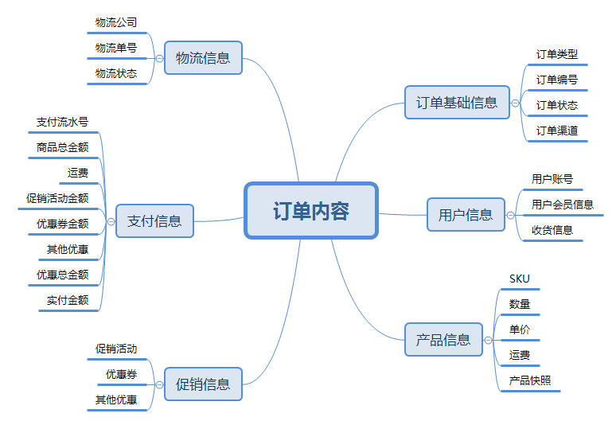
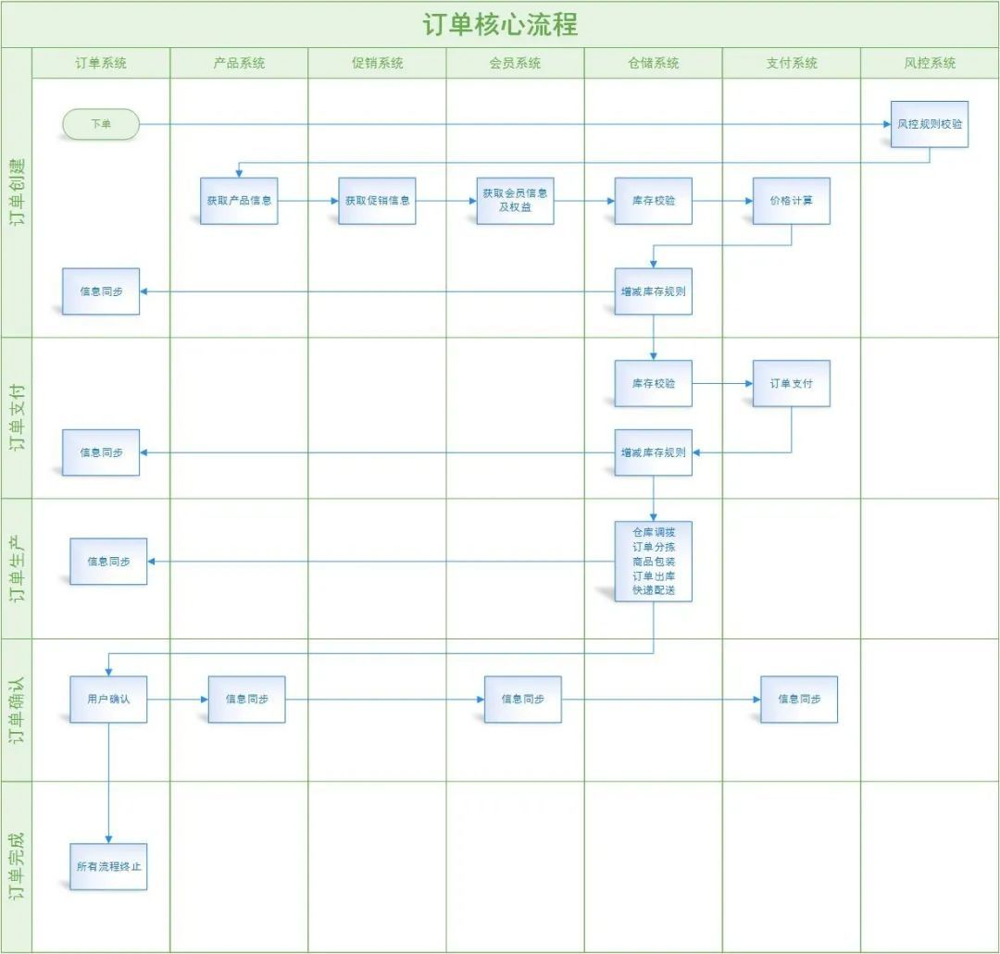
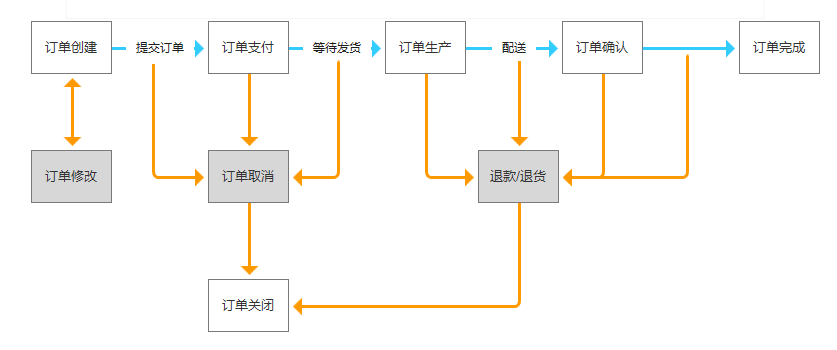

## 订单中一般需要包含的信息

  

  

## 订单的核心流程

  

订单流程中会包含正向流程及逆向流程，正向流程可以比作一次顺利的网购体验过程中，后台系统之间的信息流转。逆向流程则是修改订单、取消订单、退款、退货等各种动作引起的后台系统流程。

​  

### 正向流程

以一个通用B2C商城的订单系统为例，根据其实际业务场景，其订单流程可抽象为5大步骤：**订单创建>订单支付>订单生产>订单确认>订单完成。**

**​**  

而每个步骤的背后，订单是如何在多系统之间交互流转的，可概括如下图：

​  

  

### 逆向流程

  

​  

## 下单扣减库存&支付扣减库存

  

**下单减库存——即用户下单成功时减少库存数量**

-   **优势**：用户体验友好，系统逻辑简洁；
-   **缺点**：会导致恶意下单或下单后却不支付，使得真正有需求的用户无法购买，**会导致少卖**。

**解决办法：**

1.  设置订单有效时间，若订单创建成功N分钟不付款，则订单取消，库存回滚；
2.  限购，用各种条件来限制买家的购买件数，比如一个账号、一个ip，只能买一件；
3.  风控，从技术角度进行判断，屏蔽恶意账号，禁止恶意账号购买。

​  

**付款减库存——即用户支付完成并反馈给平台后再减少库存数量**

-   **优势**：减少无效订单带来的资源损耗；
-   **缺点**：因第三方支付返回结果存在时差，同一时间多个用户同时付款成功，会导致下单数目超过库存，商家库存不足容易引发断货和投诉，成本增加。

**解决办法：**

1.  付款前再次校验库存，如确认订单要付款时再验证一次，并友好提示用户库存不足；
2.  增加提示信息：在商品详情页，订单步骤页面提示不及时付款，不能保证有库存等。

​  

综上所述，两种方式各有优缺点，因此，需结合实际场景进行考虑，如：秒杀、抢购、促销活动等，可使用下单减库存的方式。而对于产品库存量大，并发流量没有那么强的产品使用付款减库存的方式。

  

## 组合支付

  

## 主子订单