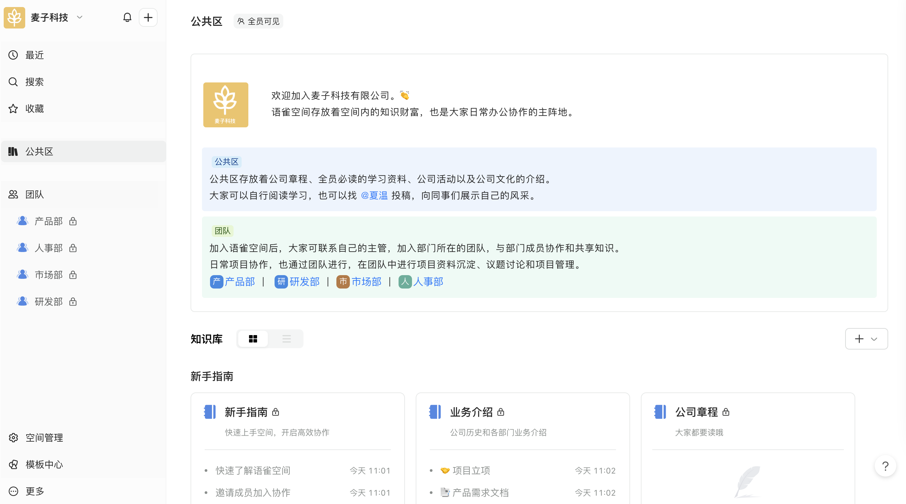
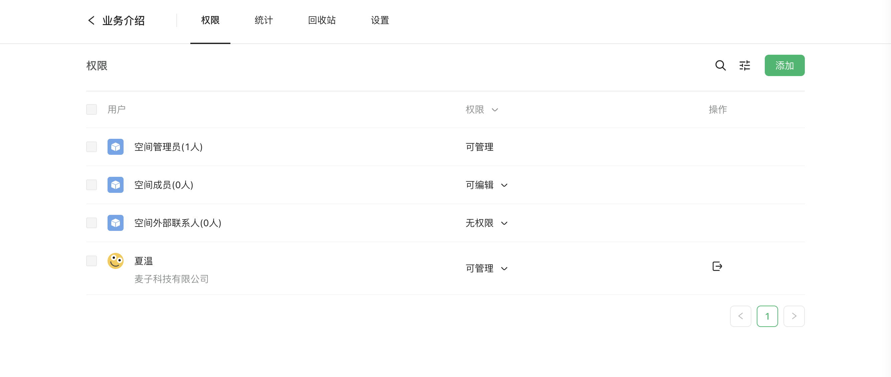

## 公共区介绍

公共区是空间内知识沉淀的阵地。公共区面向空间全体成员开放，可以用于系统地沉淀组织内的知识，让知识成为体系并被广泛传播与消化，让知识为组织创造价值。公共区分为自定义区域和知识库两个模块。

​  

#### 公共区-公告（自定义区域）

空间管理员可自主编辑自定义区域，自定义区域相当于一篇文档，可以使用文档丰富的内容卡片，如图片、视频、文件、分栏、表格等，在自定义区域展示需要公告给全体成员的内容。

#### 公共区-知识库

管理员可以在公共区创建多个知识库，并通过分组进行管理。成员可以在知识库内创建和编辑文档。

​  

​  

## 公共区权限介绍

#### 公共区人员权限

-   空间管理员：默认拥有公共区的管理权限
-   空间成员：默认拥有公共区的查看和编辑权限
-   外部联系人：默认无权限查看公共区模块

  

#### 公共区管理权限介绍

空间管理员拥有公共区的管理权限，无法为公共区设置单独的管理员。

-   空间管理员可以编辑公共区公告，可以创建、修改、删除知识库分组，可以创建、修改和删除知识库。
-   空间成员无法在公共区创建知识库

​  

#### 公共区知识库的权限

公共区知识库默认对全体成员开放，外部联系人不可见。

-   空间管理员默认拥有知识库 `可管理`权限，不可修改
-   空间成员默认拥有知识库`可编辑`权限，可修改为 `可阅读`、`可管理` 或`无权限`
-   外部联系人默认 `无权限`，可修改为 `可阅读`

​  

  

  

## 常见问题

#### 公共区知识库和团队知识库可以互相转移吗？

目前不可以。

#### 公共区可以面向外部联系人开放吗？

公共区模块无法对外部联系人开放，但是公共区内的知识库可以赋予外部联系人组 `可阅读`权限，也可以单独添加具体用户设置为 `可编辑`、`可阅读`或`可管理`权限。