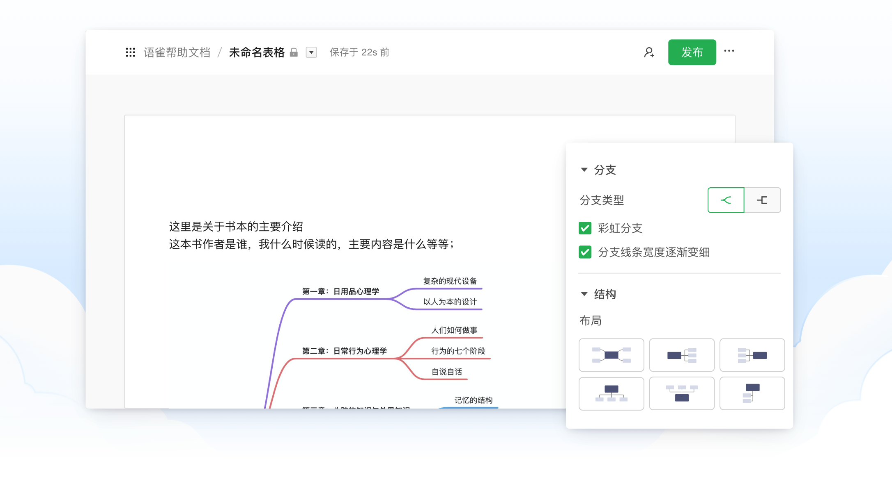
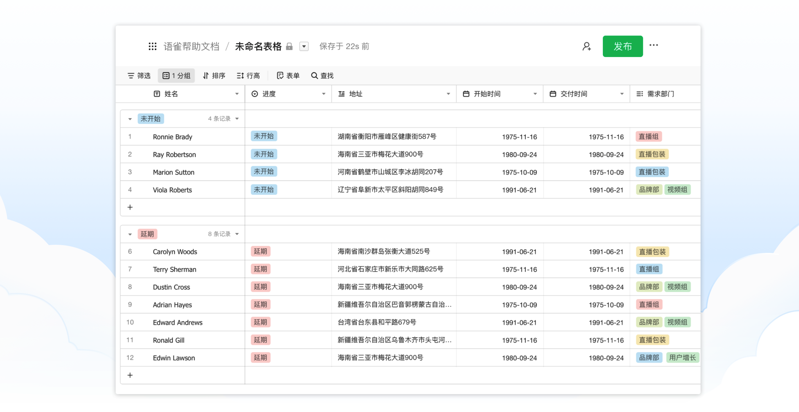
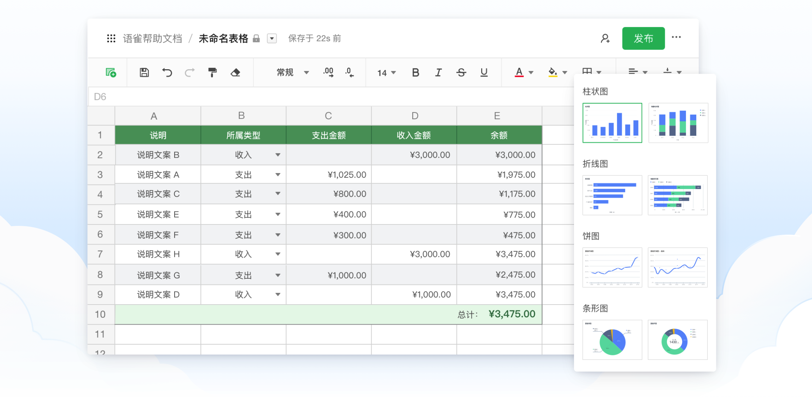
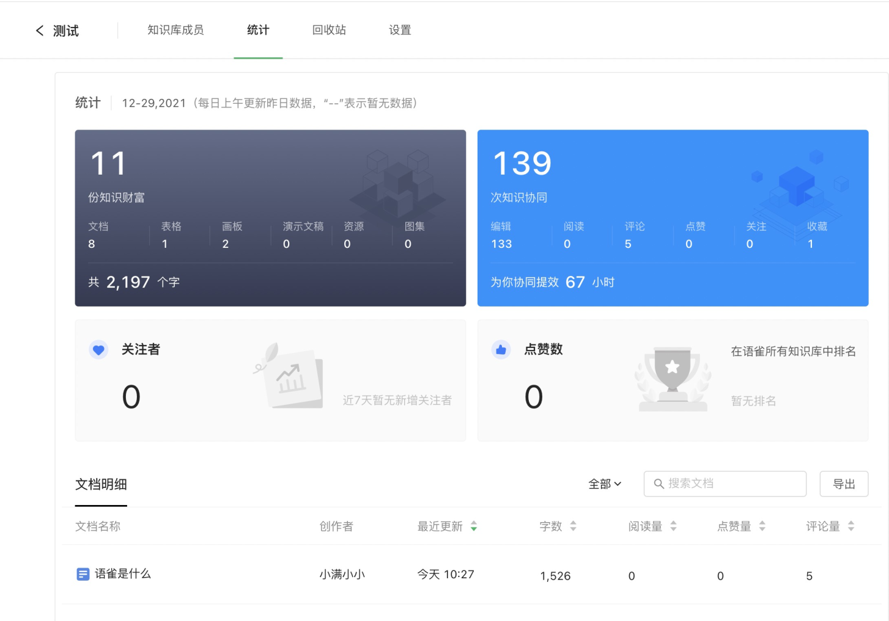
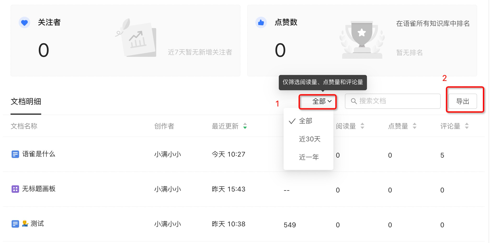

在语雀上「知识库」是知识内容的载体、就好比一本书一样。在知识库中，可以进行 创作与分享。

​  

# 创作：专业好用的编辑器

​  

在语雀「知识库」中，支持使用 **文档、画板、数据表、表格** 四大自研编辑器。

​  

> **文档编辑器**，具备 Markdown、代码块、LaTeX 公式、PlantUML 等专业编辑能力，同时支持本地视频、Office 文件、PDF 文件等内容的上传与在线预览，可满足多种专业岗位需求，让创作更高效。

​  

> **画板编辑器**，可以自由绘制流程图、架构图、脑图、简单图形，让你的思维表达更清晰。

​  

> **数据表编辑器**，是打破传统的新一代表格。通过多视图能力，灵活呈现多样数据。

​  

> **表格编辑器，**支持基础的筛选、函数、条件格式及各类图表。

​  

​  

# 组织：灵活地编排目录

​  

简单、强大的目录编排能力，让你的知识库可以像书本一样清晰易读。

可设置三不同的编排风格：**目录、卡片、专栏**。

  

​  

# 分享：让知识流动

​  

在知识库上，我们额外提供分享能力。可以将知识库分享给他人，让知识流动起来。

  

​  

# 其他功能

​  

除了以上功能，知识库还有会根据不同场景提供一些基础功能，具体如下：

​  

## 统计

​  

如果你想看到一些关于知识库的数据统计，可以点击知识库右侧更多操作，进入统计页面。这里会将常用的数据呈现在你的面前。

​  

​  

同时知识库统计里**支持查看文档明细**，你可以筛选「近30天」或者「近一年」的文档明细内容查看，也支持数据的导出。如下图  
