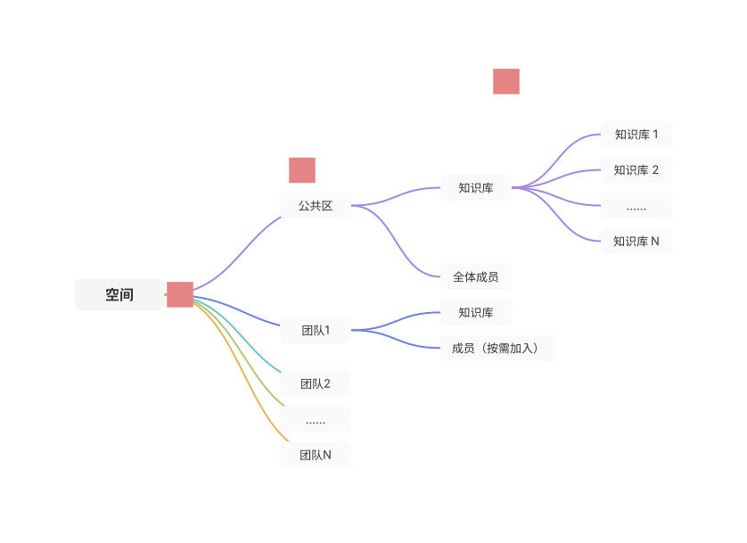
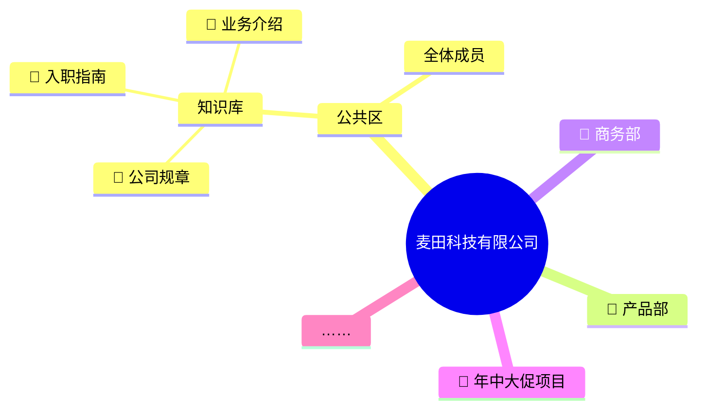
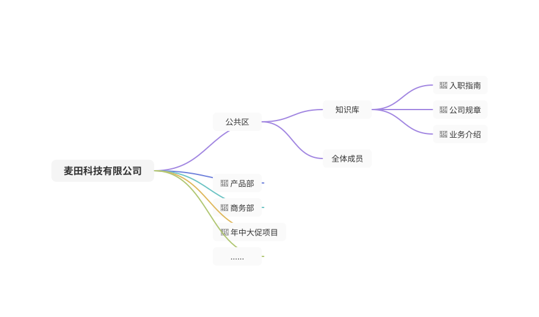
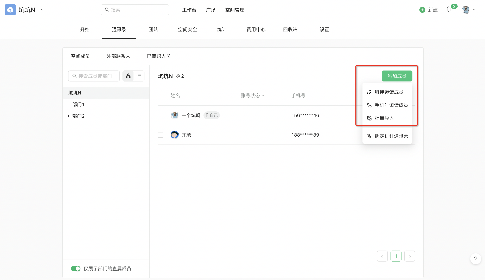
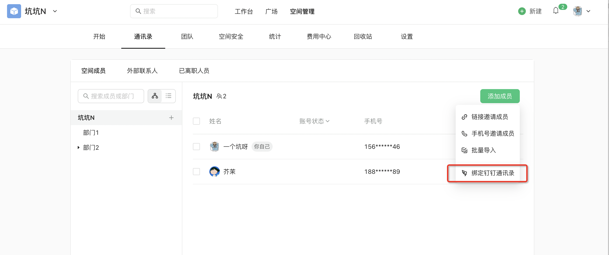
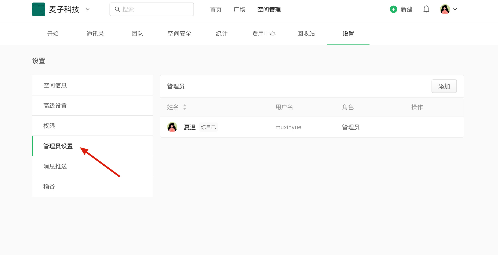
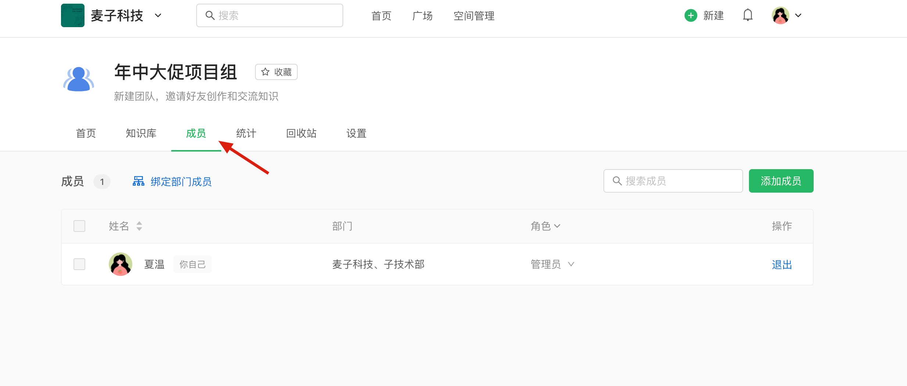
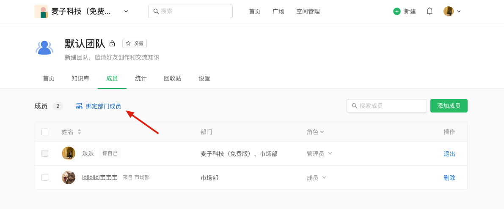

## 1\. 了解基本原理：「空间-团队-知识库」三层结构

  

空间的结构 ：三大核心元素

-   空间：最外层的容器，空间数据完全封闭，一个企业使用一个空间进行协作。
-   公共区：公共区面向全员开放，可以存放需要全员查看的知识库
-   团队：空间下可以有多个团队，团队主要用于一群人聚在一起完成一个项目。
-   知识库：知识库就像一本书，用于结构化地创作和沉淀多篇文档

  

  

  

实际场景用举例 ⬇️

  

​  

## 2\. 邀请成员，设置空间管理员

​  

在 `空间管理-通讯录` 中，可以邀请成员加入，你可以按需选择3种方式：`链接邀请成员``手机号邀请成员`或`批量导入`

​  

也可以`绑定钉钉通讯录`，自动同步钉钉中的成员到语雀中。

钉钉中成员的入职、离职、部门变更等信息也将在后续和语雀保持同步（24 小时内同步）。

与此同时，还可以选择是否同步钉钉的成员昵称。

> 绑定操作手册 👉🏻 [绑定钉钉通讯录 · 语雀](https://www.yuque.com/yuque/rvzzxz/kt5keg)

  

​  

管理员创建空间后，可以在 `空间管理-设置` 中设置多名管理员共同管理空间，所有管理员均享有同样的管理权限。只有管理员可以进入 `空间管理` 模块。

​  

  

  

## 3\. 创建团队，设置权限

  

团队主要用于一群人聚在一起完成一个项目。创建团队后，可以将需要一起协作的成员加入团队中。

建议所有需要协作的成员，都加入团队中。

  

#### 绑定部门

绑定部门（如：产品部）后，部门中的成员访问团队时会自动成为团队成员，无需一个个手动添加。

